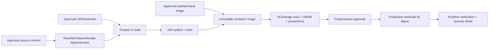
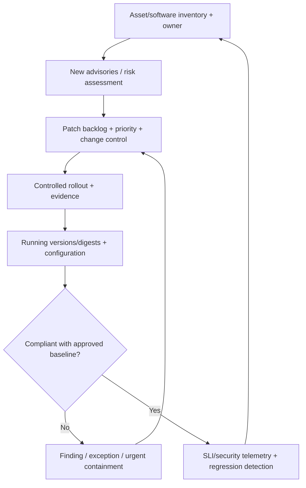
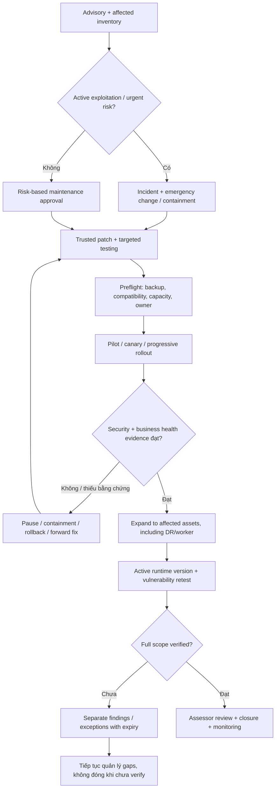

# Triển khai patch: phát hành bản vá an toàn, có kiểm chứng và có khả năng phục hồi

## 1. Triển khai patch là gì?

**Triển khai patch (patch deployment)** là quá trình đưa một bản sửa lỗi, bản cập nhật bảo mật hoặc thay đổi khắc phục điểm yếu từ trạng thái **đã chọn và phê duyệt** vào **những tài sản đang vận hành**, rồi xác minh bản vá thực sự hiện diện, giải quyết rủi ro mục tiêu và không làm suy giảm những yêu cầu an toàn khác ngoài mức được chấp nhận.

Trong chương **Patch management** của module **SECURITY_SECURITY_ASSURANCE**, đây không chỉ là thao tác chạy package manager, nâng version dependency hoặc nhấn nút “Update”. **Security assurance** yêu cầu chuỗi bằng chứng:

**Asset/risk → yêu cầu bản vá → lựa chọn patch → kiểm tra nguồn và tương thích → phê duyệt → triển khai theo đợt → đo/kiểm chứng → xử lý lỗi → lưu evidence → đánh giá lại.**

Ví dụ: nền tảng học tập Java/Spring Boot nhận advisory về một dependency trong dịch vụ `submission-api`. Developer cập nhật dependency và pipeline chạy thành công. Tuy nhiên, nếu cluster production vẫn dùng image digest cũ, hoặc một background worker cũng chứa thư viện dễ bị tấn công chưa cập nhật, thì **yêu cầu triển khai patch chưa hoàn tất**. Ngược lại, một patch lên production có thể khiến nộp bài lỗi đúng giờ thi; phải quản lý cả **rủi ro chưa vá** và **rủi ro do thay đổi**.

### Mục tiêu học tập

Người học có thể:

1. Phân biệt phát hiện lỗ hổng, chọn patch, cài đặt patch, xác minh patch và đóng finding.
2. Lập kế hoạch triển khai dựa trên asset criticality, exploitability, exposure, dependency và mức gián đoạn có thể chấp nhận.
3. Thiết kế quy trình **preflight → staging → pilot/canary → production waves → verify → close**.
4. Sử dụng đúng mục đích rolling, blue-green, canary, in-place patching, immutable rebuild và emergency change.
5. Xử lý patch cho hệ điều hành, JDK, thư viện Java/Spring Boot, container image, Kubernetes, database, cloud-managed service và thiết bị.
6. Định nghĩa health gates, rollback/recovery criteria, quan sát lỗi và security regression tests.
7. Phân biệt **patched**, **mitigated**, **not affected**, **exception**, **not verified** và **failed rollout**.
8. Tổ chức traceability từ CVE/finding tới artifact thực sự chạy, kiểm thử, bằng chứng và risk decision.

> **Nguyên tắc:** “Đã cài patch” chưa đủ. Phải chứng minh **đúng phiên bản/binary/cấu hình được triển khai trên đúng tài sản, lỗ hổng mục tiêu đã được xử lý, chức năng và security invariants vẫn đáp ứng yêu cầu, và những phần chưa phủ được ghi rõ**.

## 2. Patch deployment khác patch management tổng thể như thế nào?

**Patch management** là vòng đời quản lý bản vá: theo dõi advisory, kiểm kê, đánh giá rủi ro, chọn treatment, thực thi, theo dõi và cải tiến. **Patch deployment** là hoạt động thực thi thay đổi vào môi trường thực tế cùng kiểm chứng và xử lý hậu quả.

| Giai đoạn | Câu hỏi | Sản phẩm/bằng chứng |
| --- | --- | --- |
| **Vulnerability discovery** | Có lỗ hổng hoặc lỗi nào, trên tài sản nào? | Advisory/CVE/vendor notice, scanner result, incident signal. |
| **Applicability assessment** | Build/runtime hiện tại có thực sự bị ảnh hưởng? | Asset inventory, dependency graph, affected range, configuration analysis. |
| **Risk prioritization** | Khi nào cần xử lý và có thể chấp nhận gián đoạn gì? | Risk decision, business criticality, exploit evidence, deadline. |
| **Patch selection** | Bản sửa nào đáng tin và tương thích? | Vendor release notes, hashes/signatures, prerequisites, test plan. |
| **Deployment planning** | Triển khai ở đâu, theo thứ tự nào, bằng cơ chế nào? | Change record, waves, owner, rollback plan. |
| **Patch execution** | Bản vá được cài/rebuild/release thế nào? | Run logs, package/image digests, deployment audit. |
| **Verification** | Đúng bản vá đang hoạt động, lỗi cũ còn không? | Effective version, retest, health/security checks, runtime inventory. |
| **Closure and monitoring** | Có thể đóng finding và theo dõi regression thế nào? | Assessor decision, evidence, residual risk, follow-up. |

Patch deployment **không thay thế** secure architecture, access control, backup, incident response, vulnerability management hay configuration management. Nó là hoạt động thay đổi có thể giảm rủi ro nhưng đồng thời tạo ra rủi ro mới nếu triển khai sai.

## 3. Những loại patch thường gặp

| Loại | Ví dụ | Rủi ro cần đánh giá khi triển khai |
| --- | --- | --- |
| **Operating system/kernel** | Kernel và system libraries. | Reboot, driver compatibility, node drain, service downtime. |
| **Runtime/JDK** | Java security update, TLS provider, certificate store. | JVM flags, TLS handshake, GC, bytecode compatibility. |
| **Application framework** | Spring Boot/Spring Security patch release. | Dependency alignment, API behavior, authorization defaults. |
| **Application dependency** | JSON/XML parser, HTTP client, logging library. | Transitive deps, breaking behavior, supply chain integrity. |
| **Container base image** | OS/JRE layers được rebuild. | Digest mới, OS CVEs, startup/user permissions, runtime config. |
| **Database engine** | PostgreSQL minor update, managed database maintenance. | Failover, extensions, replication, schema/data consistency. |
| **Middleware** | Redis, Kafka, ingress controller, API gateway. | Protocol compatibility, cluster quorum, backlog, routing. |
| **Cloud-managed service** | Provider maintenance/engine upgrade. | Maintenance windows, backup/recovery, shared responsibility. |
| **Infrastructure/firmware** | BIOS/BMC, firewall/router, hypervisor. | Downtime, hardware prerequisites, out-of-band recovery. |
| **Configuration mitigation** | Disable vulnerable feature, tighten ACL/WAF rule. | Một mitigation không nhất thiết vá code, có thể gây false positives. |
| **Client/software update** | Mobile app, desktop agent, browser extension. | Update trust chain, staged rollout, rollback feasibility. |

Phân biệt **security patch**, **feature upgrade**, **hotfix**, **emergency workaround** và **major migration**. Có bản vá an ninh nhưng đồng thời thay behavior, schema hoặc dependency graph; vì thế không được mặc định “patch/minor version = không cần kiểm thử”.

## 4. Mục tiêu assurance cho một patch deployment

Một lần rollout muốn được kết luận đạt cần kiểm ít nhất các mục tiêu:

| Mục tiêu | Câu hỏi kiểm chứng |
| --- | --- |
| **Correct target** | Có xác định đủ các instances, regions, tenants, background workers và bản phát hành bị ảnh hưởng? |
| **Authentic patch** | Bản vá đến từ nguồn được duyệt, hash/signature/provenance và vendor metadata đã kiểm? |
| **Correct version** | Tài sản đang chạy thực sự dùng patched package/JDK/image/firmware/config? |
| **Risk reduction** | Vulnerability condition đã được khắc phục hoặc mitigation hoạt động trong phạm vi đã duyệt? |
| **Integrity** | Không làm mất dữ liệu, làm sai quyền hoặc phá business invariants? |
| **Availability** | SLO/RTO/RPO, health, capacity và deadline nghiệp vụ có được bảo vệ? |
| **Reversibility/recoverability** | Nếu lỗi, có đường rollback hoặc recovery khả thi, được diễn tập khi phù hợp? |
| **Traceability** | Có nối được advisory/finding ↔ change ↔ artifact ↔ deployment ↔ test ↔ decision? |
| **Timeliness** | Thay đổi đáp ứng deadline rủi ro hoặc có treatment/exception hợp lệ? |
| **Continuous evidence** | Monitoring phát hiện regressions, outdated nodes và patch drift sau đợt triển khai? |

**Không lấy kết quả scanner “0 Critical” làm bằng chứng cho tất cả các mục tiêu.** Scanner có blind spots; cần kết hợp deployment inventory, behavior tests, runtime attestations, logs và independent review.

## 5. Từ advisory/finding tới danh sách affected assets

Một bản vá thường áp dụng lên **nhiều nơi khác nhau** chứ không chỉ một repository. Ví dụ cùng một JDK hoặc thư viện parser có thể nằm trong API, worker, image DR, job định kỳ và build toolchain.

### Các nguồn inventory cần đối soát

1. **CMDB/asset register:** hệ thống, business owner, environment và data classification.
2. **Software inventory/SBOM:** dependencies direct/transitive, JDK, OS packages, base images.
3. **Container registry:** những image digests đã build, release artifacts và references.
4. **Orchestrator/runtime:** pod/node, image ID, sidecars, Jobs/CronJobs, cluster/region.
5. **Host/package inventory:** OS version, installed package release, restart state.
6. **Cloud control plane:** managed databases, load balancers, managed clusters, network appliances.
7. **Vendor/third-party register:** thành phần managed mà đội nội bộ không tự cập nhật.
8. **Backup/DR environments:** images, VM templates, restore snapshots và cold-standby artifacts.
9. **CI/CD:** plugins, build runners, JDK toolchains và các dependencies chỉ chạy tại build time.

### Asset record minh họa

| Trường | Giá trị ví dụ |
| --- | --- |
| Asset ID | `lms-prod-submission-api-r1` |
| Owner | Submission service owner |
| Environment/region | Production / region R1 |
| Data class | Confidential – bài nộp |
| Software | Spring Boot app, JDK, OS base |
| Before version | Image digest `D_old`, JDK build `J_old` |
| Vulnerability linkage | Advisory `ADV-EXAMPLE`; component `pkg:maven/...` |
| Exposure | API internet-facing, authenticated upload path |
| Target | Fixed release/build đã được chọn và approved |
| Recovery | Previous immutable digest + DB recovery plan |
| Rollout ring | Pilot → low-risk production → peak-sensitive services |
| Verification | Image digest + dependency scan + targeted API test |

**Không tạo một danh sách “đã vá” chỉ dựa vào số lượng deployment YAML.** Cần xác định tài sản thực tế, trạng thái running và đường truy cập. Một số assets tạm thời offline cũng cần kế hoạch update khi tái kết nối.

## 6. Đánh giá rủi ro trước rollout: không chỉ CVSS

**Mức ưu tiên patch** phụ thuộc vulnerability risk và rủi ro áp dụng thay đổi.

| Tín hiệu | Tác dụng | Giới hạn |
| --- | --- | --- |
| **CVE/advisory** | Định danh issue và affected versions. | Không tự chứng minh phiên bản đang dùng bị ảnh hưởng. |
| **CVSS** | Severity dựa trên các đặc tính vulnerability theo phiên bản. | Không thay business/asset risk. |
| **EPSS** | Tín hiệu xác suất khai thác theo mô hình/kỳ quan sát. | Không bảo đảm CVE sẽ bị khai thác hoặc không. |
| **KEV/exploitation intelligence** | Có bằng chứng known exploitation theo nguồn. | Không có trong catalog không đồng nghĩa an toàn. |
| **Exploit prerequisites** | Attack vector, privilege, interaction, reachability. | Cần map tới kiến trúc thực tế. |
| **Data/system criticality** | Impact confidentiality, integrity, availability, privacy. | Nhãn dữ liệu không mô tả hết blast radius. |
| **Exposure** | Internet-facing, tenant reachable, CI privileged, internal only. | Network controls có thể đổi theo thời gian. |
| **Patch complexity** | Reboot, schema changes, dependency compatibility, rollback. | Không là lý do trì hoãn vô hạn. |
| **Service timing** | Kỳ thi, nộp bài hạn chót, maintenance windows. | Peak-time risk có thể khác lịch bình thường. |
| **Compensating controls** | Segmentation, disable feature, temporary access restrictions. | Phải test effectiveness và có expiry. |

### Hai rủi ro phải cân bằng

- **Risk of not patching:** attacker khai thác lỗ hổng, mất dữ liệu, gián đoạn, leo thang đặc quyền.
- **Risk of patching:** service không tương thích, downtime, data corruption, mất kết nối TLS, lỗi load balancer, rollback không khả thi.

Đây **không phải** lý do trì hoãn patch chỉ để bảo vệ uptime KPI. Business/security owner cần ra quyết định theo risk, có emergency paths cho active exploitation và continuity measures khi rollout khó.

## 7. Chọn và xác minh bản vá trước khi dùng

Một file tải được từ internet chưa chắc là vendor patch hợp lệ. Supply chain của **bản vá** cũng phải được bảo vệ.

### Kiểm tra nguồn và metadata

- Vendor/product identifier, release notes, advisory, fixed-version range.
- Nguồn chính thức/được phê duyệt, repository policy, publisher/signing identity.
- Hashes/signatures khi khả dụng, artifact digest, provenance/build metadata theo profile.
- Prerequisites, supported upgrade path, compatibility matrix và EOL/support status.
- Dependencies được kéo theo, config/defaults thay đổi và breaking changes.
- Nếu patch là package/backport của distro: xác minh **vendor security advisory, package release và changelog**, không chỉ upstream version string.
- Kiểm patch artifact qua scanners/validation theo risk và production applicability.
- Lưu source reference để có thể tái dựng quyết định trong audit/incident.

### Không tin “version cao hơn” một cách máy móc

Một distro có thể backport security fix vào package version vẫn trông “cũ” theo upstream; ngược lại, version mới nhưng không thuộc supported vendor build hoặc cài nhầm artifact cũng không bảo đảm fix. Xác minh **effective patched build**, chứ không chỉ so sánh chuỗi version dạng lexicographic.

### Tránh cập nhật qua nguồn không kiểm soát

Không đưa script từ URL lạ vào lệnh shell và chạy production với admin credentials. Package manager/registry, trust roots, update metadata và internal mirrors cần nằm trong **approved source policy**. Ký artifact không chứng minh bản vá không chứa bug; vẫn cần test chức năng và security.

## 8. Change record và điều kiện được phép triển khai

Không nên triển khai chỉ vì scanner tự tạo ticket. Một change record hữu ích ghi:

| Trường | Nội dung cần có |
| --- | --- |
| Change ID | Định danh duy nhất nối vulnerability finding và release. |
| Reason/risk | Advisory/CVE, affected assets, exposure và urgency. |
| Source/target | Version/package/image digest trước và dự kiến sau. |
| Scope | Services, nodes, clusters, regions, user cohorts, DR/backup. |
| Deployment method | In-place, rolling, blue-green, canary, immutable rebuild, vendor-driven. |
| Approval | Service owner, operations, security/risk, emergency authority nếu cần. |
| Window/communications | Giờ bắt đầu/kết thúc, blackout periods, stakeholder/on-call. |
| Preconditions | Backup/restore, capacity, trusted patch, baseline health, compatibility. |
| Execution plan | Waves, commands/workflow references, permissions, checkpoints. |
| Verification | Security tests, functional smoke, SLO/SLI, runtime version check. |
| Stop/rollback | Trigger, decision owner, previous artifact, rollback caveats. |
| Evidence | Run ID, timestamp, logs, scans, digest, deployment state, tester. |
| Exception/residual risk | Thiếu coverage, deferred assets, expiry và risk decision. |

**Approval cho lịch bảo trì không thay security approval** và không chứng minh patch chạy đúng. Với emergency change có thể rút ngắn một số bước phê duyệt theo chính sách nhưng vẫn phải đảm bảo audit, ownership và verification.

## 9. Các chiến lược triển khai patch

| Chiến lược | Mô tả | Ưu điểm | Rủi ro/cần kiểm |
| --- | --- | --- | --- |
| **In-place patch** | Sửa package/config trên instance hiện hữu. | Phù hợp host/thiết bị cần bảo trì trực tiếp. | Configuration drift, restart state, rollback khó, phiên bản lẫn lộn. |
| **Immutable rebuild/redeploy** | Xây image/VM mới từ source, thay workload cũ. | Truy vết tốt qua digest; giảm drift nếu pipeline tin cậy. | Cần migration/state handling, image provenance. |
| **Rolling update** | Thay từng nhóm instances, duy trì capacity. | Giảm outage nếu health/routing đúng. | Mixed versions, DB compatibility, shared dependency outage. |
| **Canary** | Cho traffic nhỏ đến patch trước rồi tăng khi đủ tín hiệu. | Hạn chế blast radius của regression quan sát được. | Low traffic không phát hiện peak-only bugs; cần chính xác cohort/metrics. |
| **Blue-green** | Chuẩn bị môi trường phiên bản mới, chuyển routing giữa hai nhóm. | Có thể chuyển nhanh/rollback routing. | Data/schema/state và cost; database migration có thể không đảo chiều. |
| **Ring deployment** | Pilot → low-risk → critical cohorts theo lịch. | Học từ từng nhóm trước khi mở rộng. | Không thể chỉ đo average; ring cần đại diện risk. |
| **A/B traffic** | Phân traffic giữa biến thể để đánh giá. | Tốt cho quality/behavior metrics theo điều kiện. | Không dùng experiment thiếu đạo đức hoặc lộ PII; patch bảo mật khẩn không nên trì hoãn vì thử nghiệm. |
| **Managed maintenance** | Provider thực hiện upgrade trong window. | Giảm thao tác trực tiếp. | Phụ thuộc provider, failover, contract/notice và verification của customer. |

### Chọn chiến lược theo loại tài sản

- **Stateless Spring Boot API:** thường phù hợp immutable image + rolling/canary.
- **Stateful database:** cần kiểm replication/quorum, schema, backups và recovery; không tùy ý rolling giống stateless pods.
- **Kubernetes worker:** cần kiểm active jobs, queue checkpoints, idempotency và graceful termination.
- **Server OS:** thường phải phối hợp maintenance/reboot hoặc thay node theo nhóm, tránh restart toàn cluster.
- **Firmware/network equipment:** vendor upgrade path, redundant path, out-of-band recovery và human approvals.

Chiến lược là **một quyết định risk/architecture**, không phải tùy chọn menu có thể áp dụng máy móc.

## 10. Thiết kế rollout rings và blast radius

Một rollout wave cần có giới hạn đủ để quan sát lỗi trước khi mở rộng, nhưng không nên coi phần trăm cố định là tiêu chuẩn bắt buộc.

| Ring ví dụ | Target | Tiêu chí để tiếp tục |
| --- | --- | --- |
| **0 – Lab/CI** | Synthetic assets và build artifacts. | Patch origin/integrity, unit/regression/security tests đạt. |
| **1 – Staging** | Môi trường gần giống production, test data. | API integration, migrations, degraded-mode tests. |
| **2 – Pilot** | Một nhóm users/workloads có rollback support. | Runtime patch detection, error/latency/security alerts trong cửa sổ quan sát. |
| **3 – Production wave A** | Một phần traffic hoặc một failure domain có capacity còn lại. | Health gates, user journey SLI, không có data corruption/regression. |
| **4 – Production wave B** | Phần còn lại, theo fault domains. | Business acceptance, SLO, patch coverage tăng có kiểm soát. |
| **5 – DR/long-tail** | Standby, offline endpoints, image templates, workers. | Recovery environment được vá, reconcile inventory/exception. |

### Ví dụ không phải định mức

Có thể dùng các tỷ lệ canary như **1% → 5% → 25% → 100%** trong một số hệ thống đủ traffic, nhưng đó **chỉ là ví dụ**. Một service chỉ có ba replicas, một tenant quan trọng hoặc một thiết bị HA đôi sẽ cần ring khác. Số lượng users, thời gian, lượng requests và metric sensitivity phải đủ để kiểm failure modes của patch.

### Fault-domain awareness

Không patch toàn bộ AZ/replicas đang phục vụ cùng lúc. Đánh giá:

- Capacity của nhóm còn lại khi mất một nhóm.
- Quorum/leader requirements, replication lag, draining connections.
- Node/pod placement thực tế, không chỉ số replicas.
- Shared control plane, database, KMS, DNS, certificate, registry dependencies.
- Cơ chế stop rollout khi một health signal có giá trị quan sát bị hỏng.

## 11. Preflight: kiểm sẵn sàng trước khi chạm production

### 11.1. Điều kiện kỹ thuật

1. **Asset scope** đã đối soát: production, DR, workers, regions, sidecars.
2. **Fix applicability** rõ theo version/build/firmware/advisory; target version nằm trong supported path.
3. **Trusted artifacts** sẵn sàng với source, digest, signature/provenance theo policy.
4. **Baseline health** được lưu: errors, latency, queue, CPU/memory, DB connections, alert noise.
5. **Dependencies compatibility**: API schemas, database protocols, plugins, certs, Java APIs, TLS.
6. **Data safety**: backup/PITR, recovery key, restore access và tính toàn vẹn đã kiểm khi cần.
7. **Capacity headroom**: đủ tài nguyên trong lúc tạm rút node/instance.
8. **Rollback/recovery plan**: previous version/digest, change/reversal steps, khi nào không rollback được.
9. **Monitoring**: probes, synthetic transactions, alerting, deploy markers, log correlation.
10. **Security baseline**: authn/authz, cryptographic controls, audit, network policy được xác định để kiểm regression.
11. **Change permissions**: least privilege, break-glass procedure và audit logs.
12. **Communications**: on-call, business approver, expected impact và hỗ trợ người dùng.

### 11.2. Điểm dễ bị bỏ qua

**Backup job thành công không có nghĩa restore được.** Đặc biệt khi patch database hoặc làm thay đổi dữ liệu, phải đánh giá restore consistency và key/IAM dependencies. Với immutable app rollout chỉ thay code, mức preflight backup có thể khác database migration, nhưng không được bỏ qua hợp đồng dữ liệu.

**Rollback không phải lúc nào là nút “undo”.** Một migration xóa cột dữ liệu, một firmware update thay bootloader, hoặc một patch rotate key có thể khiến phiên bản cũ không chạy được. Cần **forward fix/restore/roll-forward plan** và stop conditions riêng.

## 12. Xác định các kiểm thử trước triển khai

| Loại kiểm thử | Tình huống | Điều phải chứng minh |
| --- | --- | --- |
| **Functional regression** | Login, xem bài, nộp bài, chấm điểm, gửi thông báo. | User journeys chính vẫn chạy theo contract. |
| **Security regression** | Wrong role/tenant, invalid token, CSRF/SSRF/SQLi path liên quan, TLS. | Không tạo bypass mới khi patch. |
| **Targeted vulnerability retest** | Điều kiện/endpoint/library bị advisory mô tả. | Lỗi mục tiêu không còn hoặc mitigation hiệu quả. |
| **Configuration test** | Ciphers, headers, JVM properties, IAM, DB ACL, feature flags. | Baseline được giữ và không phát sinh config drift. |
| **Dependency compatibility** | JDK, Spring APIs, driver, database, other clients. | Không có breaks trong deployment matrix. |
| **Performance/load** | Peak submit, retries, connection pools, heap/GC. | Latency/capacity trong ngưỡng được phê duyệt. |
| **HA/failover** | Mất pod/node/AZ, DB connection breaks khi update. | Không vượt RTO/RPO/fault model đã chọn. |
| **Rollback/recovery** | Patch lỗi, partial deployment, old/new versions cùng tồn tại. | Có thể phục hồi an toàn, data integrity và authorization. |
| **Observability** | Probe và collector vẫn hoạt động sau patch. | Không kết luận PASS khi monitoring mất dữ liệu. |
| **Business acceptance** | Chức năng đặc thù kỳ thi, deadline, batch. | Patch đạt mục tiêu người dùng/operational constraints. |

Một automated test suite toàn bộ xanh **không thay được kiểm chứng production configuration và artifact version**. Kế hoạch test phải liên kết với failure modes của patch, không chỉ checklist cố định.

## 13. Triển khai patch cho Java/Spring Boot

Ứng dụng Java có nhiều lớp cập nhật khác nhau: code/framework, transitive libraries, JDK, OS/container và runtime configuration. Patch chỉ ở một lớp có thể để lại vulnerability ở lớp khác.

### Ví dụ chuỗi build



### Sửa dependency không dừng ở `pom.xml`

- Kiểm **parent/BOM/dependencyManagement, Gradle constraints và transitive graph**.
- Tìm thư viện cùng version trong các services, workers, build plugins và images.
- Xác định bản fixed được vendor hỗ trợ; đừng tự bịa patch version.
- Nâng dependency, chạy unit/integration/security/regression tests.
- Rebuild JAR/container bằng trusted pipeline, cập nhật SBOM, SCA, provenance.
- Deploy **new image digest**, kiểm running image IDs và actual effective component version.
- Retest vulnerability behavior trong environment được phép.
- Không đóng finding production nếu vẫn còn một workload dùng old image.

### Cân nhắc với Spring Security

Một security patch có thể thay default behavior cho request matchers, CSRF, CORS, cookie flags, filter chains, JWT verification hoặc authorization. Ngoài compilation tests, cần **negative authorization matrix**: Student A không được xem điểm Student B; giáo viên Tenant X không được sửa dữ liệu Tenant Y; expired/invalid token bị từ chối. Đạt chỉ tiêu availability bằng cách bỏ security checks là **không đạt assurance**.

## 14. Maven/Gradle: minh họa cập nhật có truy vết

### 14.1. Bản vá dependency Java

Một Gradle build có thể dùng version catalog hoặc BOM để quản lý nhiều versions liên quan:

```kotlin
// build.gradle.kts excerpt — illustrative only
plugins {
    java
    id("org.springframework.boot") version "APPROVED_BOOT_VERSION"
}

dependencies {
    implementation(platform(
        "org.springframework.boot:spring-boot-dependencies:APPROVED_BOOT_VERSION"
    ))
    implementation("org.springframework.boot:spring-boot-starter-web")
    testImplementation("org.springframework.boot:spring-boot-starter-test")
}
```

**Lưu ý:** Đây là cấu trúc minh họa, `APPROVED_BOOT_VERSION` là placeholder; cách dùng plugin/BOM cần phù hợp dự án, có thể không cần khai báo platform riêng khi plugin/quy tắc quản lý version đã áp dụng. Không copy đoạn ví dụ vào production rồi coi là patch. **Version fixed phải được xác minh với advisory và tài liệu chính thức**, đồng thời xem các version constraints/transitive overrides.

### 14.2. Những công cụ hỗ trợ điều tra

Một số câu lệnh đọc trạng thái build trong môi trường được phép:

```bash
# Examples for an authorized local/build environment, not production commands.
./gradlew dependencies --configuration runtimeClasspath
./gradlew dependencyInsight --dependency example-library --configuration runtimeClasspath

# Maven resolved dependency tree, when Maven is the project's build system:
mvn dependency:tree
```

Tác dụng: xác định dependency path và phiên bản **được resolve**. Chúng không thay SCA/image scanning, runtime verification hoặc vendor patch validation. Trước khi chạy cần kiểm build scripts/plugins có thể thực thi mã với quyền CI; dùng trusted environment và không truyền production secrets không cần thiết.

### 14.3. Patch verification record

```yaml
patch_deployment:
  change_id: "CHG-EXAMPLE-2026-007"
  advisory_ref: "ADV-EXAMPLE"
  asset: "submission-api"
  source_revision: "APPROVED_COMMIT"
  before_image_digest: "sha256:OLD_DIGEST_PLACEHOLDER"
  target_image_digest: "sha256:NEW_DIGEST_PLACEHOLDER"
  affected_component: "example-library"
  target_component_version: "REVIEWED_FIXED_VERSION"
  sbom_ref: "SBOM_FOR_NEW_DIGEST"
  scan_ref: "SCA_AND_IMAGE_SCAN_NEW_DIGEST"
  rollout:
    strategy: "canary-then-rolling"
    environment: "production"
    ring: "pilot"
  checks:
    - "target_digest_running"
    - "targeted_vulnerability_retest"
    - "authn_authz_negative_regression"
    - "business_journey_success"
  decision: "PENDING_VERIFICATION"
```

Đây là **mẫu evidence record nội bộ**, không phải schema chuẩn của Spring/Kubernetes/Gradle. Digest và version là placeholders. Một status trong YAML của record chỉ hữu ích nếu kiểm **facts/evidence thật**.

## 15. Patch container: thay image, không chỉ sửa container đang chạy

Trong kiến trúc container, cách quản lý patch có tính truy vết tốt là **build image mới từ source và base image được duyệt, scan, sign/attest theo policy, rồi deploy bằng digest**. Cập nhật thủ công packages bên trong một container đang chạy gây drift và mất tính tái tạo khi restart.

### Quy trình mẫu

1. Xác định image digest đang chạy và phần dễ bị ảnh hưởng: JRE, OS, Java package, native library.
2. Chọn updated base image đã kiểm source, version và vulnerability profile.
3. Rebuild final image từ trusted CI với dependency graph được quản lý.
4. Scan app/OS components của final digest; tạo SBOM và provenance/signed metadata nếu policy yêu cầu.
5. Chạy application tests và container startup/security tests; kiểm user, filesystem, capabilities và certificates.
6. Promote cùng digest qua staging/canary/production; không dùng mutable `latest` như một bằng chứng.
7. Kiểm runtime image IDs/digests tại tất cả clusters/namespaces và Jobs/CronJobs.
8. Cập nhật recovery/DR image templates và artifact retention để không tái triển khai bản cũ.
9. Retest vulnerability và cập nhật finding state có scope.

### Ví dụ Dockerfile khái niệm

```dockerfile
# Replace placeholders with approved, verifiable actual image digests.
FROM registry.example.org/java-runtime@sha256:REPLACE_WITH_64_HEX_DIGEST

WORKDIR /app
COPY app.jar /app/app.jar
USER 10001
ENTRYPOINT ["java", "-jar", "/app/app.jar"]
```

**Không chạy được với placeholder digest.** `USER 10001` chỉ là một control minh họa; phải xác minh file ownership, ports, rootless compatibility, memory/GC behavior, trust store, health probes và runtime policies. Việc base image được pin không có nghĩa không cần update thường xuyên; bản patch cần **digest mới được review**.

## 16. Kubernetes rolling update: cấu hình và giới hạn

Một deployment patch ở Kubernetes có thể dùng rolling update với giới hạn số pods unavailable và số pods được tạo thêm.

```yaml
apiVersion: apps/v1
kind: Deployment
metadata:
  name: submission-api
spec:
  replicas: 4
  strategy:
    type: RollingUpdate
    rollingUpdate:
      maxUnavailable: 1
      maxSurge: 1
  selector:
    matchLabels:
      app: submission-api
  template:
    metadata:
      labels:
        app: submission-api
    spec:
      containers:
        - name: submission-api
          image: registry.example.org/lms/submission-api@sha256:REPLACE_WITH_64_HEX_DIGEST
          ports:
            - containerPort: 8080
          readinessProbe:
            httpGet:
              path: /readyz
              port: 8080
            periodSeconds: 5
            timeoutSeconds: 2
          livenessProbe:
            httpGet:
              path: /livez
              port: 8080
            periodSeconds: 10
            timeoutSeconds: 2
```

**Ví dụ chưa hoàn chỉnh:** manifest thiếu các phần có thể cần như resource requests/limits, startup probe, securityContext, serviceAccount, topology spread, PDB, termination grace và môi trường/secrets; endpoint readiness/liveness phải thực sự tồn tại và phù hợp phiên bản Spring Boot. Digest placeholder không phải định danh hợp lệ. **Bốn replicas không tự đồng nghĩa đa AZ** hoặc đủ capacity sau khi một failure domain mất.

### Những câu hỏi để xác minh rollout

- `maxUnavailable=1` có phù hợp peak load, PDB và số pods thực sự Ready?
- Readiness phản ánh instance có thể nhận requests hợp lệ, không chỉ process up?
- Liveness có tránh restart loop khi database/IdP/KMS tạm mất không?
- Old/new versions có cùng lúc đọc/ghi DB mà không phá compatibility?
- Có kiểm queue workers, in-flight submissions, long-running jobs và graceful shutdown?
- Scheduler có placement/capacity headroom và node images đã vá?
- Admission verifier có từ chối image không đủ provenance/policy?
- Sau rollout, running digest có khớp approved patch artifact tại mọi replica?

### Câu lệnh quan sát minh họa

```bash
# Authorized operator, correct kube-context/namespace required:
kubectl -n lms-prod rollout status deployment/submission-api
kubectl -n lms-prod get pods -l app=submission-api -o wide
kubectl -n lms-prod get deployment submission-api -o yaml
```

Đây là **lệnh quan sát**. Lệnh `rollout status` hoàn tất chỉ chứng minh controller thấy trạng thái rollout theo điều kiện của Kubernetes, **không chứng minh vulnerability đã sửa** hay business SLO/authorization đã đạt. Cần thêm runtime digest, dependency version và negative tests.

## 17. Canary rollout và health gates

Canary cho phép đưa patch tới một tập workload hoặc traffic nhỏ để đo lỗi trước khi mở rộng. Điều kiện tốt phải có **baseline trước thay đổi, cách phân traffic rõ và tiêu chí dừng có thể đo**.

| Tín hiệu canary | Ý nghĩa | Lưu ý |
| --- | --- | --- |
| **Request success/5xx/timeout** | Lỗi dịch vụ có tăng sau patch? | Phân theo version/route/tenant; low traffic làm tín hiệu yếu. |
| **p95/p99 latency** | Regression hiệu năng ở tail. | Kiểm mẫu và thời điểm; không chỉ average. |
| **Business success SLI** | Nộp bài/login/chấm điểm thực sự thành công? | HTTP 200 có thể không đồng nghĩa DB commit đúng. |
| **Crash/OOM/restart** | Patch có gây lỗi runtime? | Dependency outage chung có thể làm cả control và canary lỗi. |
| **DB/queue/cache saturation** | Patch tăng load hoặc retry amplification? | Theo dõi connection pool, queue age, worker backlog. |
| **Security negative tests** | Patch có bỏ nhầm authorization/crypto checks? | Không chỉ health probes hoặc vulnerability scan. |
| **Patch-level evidence** | Canary đã chạy đúng version/digest chưa? | Kiểm runtime, không chỉ Git commit. |
| **Telemetry integrity** | Metrics/alerts có còn hoạt động? | Missing data không được coi là “không lỗi”. |

### Ví dụ gate minh họa (không phải ngưỡng mặc định)

> “Sau khi rollout canary của `grade-service` đạt đủ số lượng request và thời gian quan sát được business owner duyệt, chỉ mở rộng nếu không có security invariant failure, error/latency metrics không vượt giới hạn so với control group, target digest được xác minh, và targeted vulnerability retest đã đạt trên build mới.”

Không dùng mốc “10 phút không thấy lỗi” cho mọi service: các tác vụ batch theo giờ, kỳ thi theo ngày hoặc path ít traffic cần **observation window/test workload** khác. Gate phải quyết định **continue, pause, abort/rollback hoặc extend observation**; missing data thường nên **hold**, không auto-promote.

## 18. Blue-green, feature flags và schema compatibility

**Blue-green** chuẩn bị môi trường B đã được patch song song A đang chạy. Sau khi kiểm, routing chuyển dần/toàn phần sang B. Cách này có thể giảm thời gian chuyển đổi nhưng **không tự đảm bảo rollback dữ liệu**.

### Những trường hợp cần thiết kế riêng

- Green code cần cột DB mới, Blue không biết xử lý dữ liệu/schema mới.
- Token/session format đổi, user đang đăng nhập ở Blue bị logout sau cutover.
- Hai versions cùng consume queue và xử lý message khác ngữ nghĩa.
- Database cache keys/object serialization thay đổi giữa hai phiên bản.
- Green dùng KMS key, certificate hoặc config incompatible với Blue.
- Green đã ghi dữ liệu theo format mới nên routing về Blue không đọc được.

### Expand–migrate–contract

Một hướng phổ biến cho thay đổi schema an toàn:

1. **Expand:** thêm cấu trúc tương thích cả old/new apps, không xóa dữ liệu cũ.
2. **Deploy compatibility:** phiên bản cũ và mới có thể cùng hoạt động.
3. **Migrate/backfill:** chuyển dữ liệu có idempotency, integrity checks và progress metrics.
4. **Contract:** chỉ xóa cột/field cũ sau khi tất cả consumers tương thích và plan được duyệt.

**Không áp dụng công thức này một cách máy móc.** Với migration không thể đảo, cần kế hoạch backup/recovery và forward fix. Một feature flag chỉ ẩn UI **không vá dependency vulnerable** nếu code vẫn chạy hoặc reachable theo đường khác; phải kiểm threat applicability.

## 19. Patch cho Linux/Windows và hệ điều hành máy chủ

Hệ điều hành/host patch có thể yêu cầu **reboot**, restart services, kernel module reload hoặc thay host. Không xác nhận hoàn thành chỉ bằng “package manager reported success”.

### Linux: chu trình có kiểm soát

1. Xác định distro/release, package manager, repository và source trust.
2. Kiểm security advisory, package/backport version và kernel restart requirements.
3. Chọn host ring hoặc xây **patched golden image**; tránh sửa tay các immutable worker nodes.
4. Drain workload/traffic theo HA/quorum/capacity plan nếu host phục vụ dịch vụ.
5. Cài patch theo change workflow, kiểm package manager error logs.
6. Restart/reboot nếu cần theo hướng dẫn của vendor, không bỏ qua vì “cài xong”.
7. Xác minh **running kernel/library/service** đang dùng patched bits, không chỉ package đã tải.
8. Kiểm network connectivity, TLS, application health, disk/cpu, runtime services và vulnerability retest.
9. Update host inventory, images/templates, cluster nodes chưa vá và ticket/evidence.

### Lệnh đọc trạng thái minh họa (Ubuntu/Debian-based)

```bash
# Observational examples only; use under authorized host access.
uname -r
dpkg-query -W 'openssl*' 'linux-image*'
apt list --upgradable
```

Lệnh hiển thị installed package/kernel/version và updates available theo repository state; **không tự chứng minh host đã vá theo vendor advisory**. `uname -r` là phiên bản kernel đang chạy, hữu ích khi package mới đã cài nhưng chưa reboot. Cần đọc vendor changelog và package release. Trên RPM-based distributions phải dùng tooling tương ứng, không áp dụng cú pháp Debian.

### Windows: update service và kiểm restart

Với Windows, một chương trình quản lý bản vá có thể dùng các công cụ được phê duyệt như **Windows Update for Business, Intune, WSUS hoặc endpoint management suites** (tùy tổ chức/hỗ trợ). Cần xác minh:

- OS build và update identifiers/KBs thực tế áp dụng.
- Update rings/maintenance windows, reboot pending state.
- Group Policy/MDM và permissions có làm device bỏ qua patch?
- Application compatibility, services/agent behavior sau restart.
- Offline/remote endpoints, thiết bị ít kết nối, exceptions, reporting freshness.
- Nếu update thất bại, error code/KB applicability và rollback/recovery theo hướng dẫn vendor.

**KB installed** không tự bảo đảm mọi component đã được vá: kiểm applicability, supersedence và actual build/state tương ứng.

## 20. Patch database, middleware và thành phần stateful

Không nên rollout database giống một stateless HTTP service. Patch stateful components cần ưu tiên **data integrity, replication, quorum, failover và recovery**.

### Ma trận tình huống

| Thành phần | Failure mode khi patch | Control/verification |
| --- | --- | --- |
| **PostgreSQL/database** | Connection drop, replication incompatibility, extension mismatch, failover lag. | Replica/primary ordering theo vendor, backup/PITR, reconciliation. |
| **Redis/cache** | Cache loss, persistence incompatibility, cluster failover, lock semantics. | Check app behavior, cache warm-up, distributed lock tests. |
| **Kafka/message broker** | Broker rolling imbalance, protocol version mismatch, rebalance storm. | Quorum/ISR policy, client compatibility, lag and replay tests. |
| **Ingress/load balancer** | Routing outage, TLS cert/cipher differences, session stickiness. | Handshake tests, endpoint SLI, traffic replay/canary. |
| **Identity provider** | Sessions/token validation break, key rotation issues. | Login/MFA/JWT/role negative tests, expiry/rollback. |
| **KMS/secret manager** | App không lấy được khóa, encrypt/decrypt bị gián đoạn. | Key permissions, scoped access, no plaintext fallback, recovery. |
| **Object storage client/service** | Multipart upload changes, consistency assumptions. | Submission receipt/data durability, checksum/retry tests. |

### Bất biến cần giữ

- Không xác nhận “nộp bài thành công” nếu dữ liệu chưa đạt durable commit contract.
- Không phát sinh duplicate jobs hoặc viết lại điểm sai khi worker retry sau patch.
- Không mở rộng quyền đọc/ghi dữ liệu do service account/role bị đổi.
- Không làm mất khả năng decrypt/verify dữ liệu cũ khi key/crypto provider thay đổi.
- Không gây split-brain hoặc mất writes đã acknowledged vượt RPO đã duyệt.

**Một database patch có thể triển khai thành công và vẫn vi phạm RPO/RTO hoặc tính toàn vẹn dữ liệu**. Phải có evidence về trạng thái dữ liệu và hoạt động sau patch.

## 21. Cloud-managed service, firmware và third-party patching

Không phải toàn bộ patch được đội nội bộ trực tiếp cài. Cloud provider hoặc vendor có thể tự bảo trì managed database, hypervisor, serverless runtime hoặc CDN. Tuy nhiên **shared responsibility** vẫn cần evidence.

| Tình huống | Việc provider có thể làm | Việc khách hàng/tổ chức vẫn phải làm |
| --- | --- | --- |
| Managed database engine patch | Phát hành/triển khai engine versions theo offering. | Chọn maintenance window nếu hỗ trợ, test client/replication, backup/restore và actual version. |
| Cloud VM host/hypervisor maintenance | Bảo trì hạ tầng vật lý. | Quản lý guest OS patch, workload resilience và failover. |
| Managed Kubernetes control plane | Nâng service/control plane version. | Node pools, add-ons, workload compatibility, policy và runtime verification theo hợp đồng. |
| Serverless managed runtime | Provider duy trì runtime family hoặc tự áp security changes theo profile. | Xác minh supported runtime, app deps, deployments, compatibility và retirement deadlines. |
| Appliance/firmware | Vendor phát hành firmware/hotfix. | Xác minh đúng model/hardware revision, HA failover, backup config, out-of-band access. |
| SaaS dependency | Vendor vận hành phần mềm của họ. | Contract/SLA, disclosure, customer settings, integration tests, risk decision. |

### Firmware/network equipment preflight

Kiểm model/serial/firmware compatibility; bootloader prerequisites; HA pair và session failover; backup running config; quản trị qua **out-of-band path**; kiểm version **sau reboot**. Nếu firmware upgrade thay data structures hoặc không có downgrade path, cần explicit recovery/replace plan và approval phù hợp.

**Không tự nhận “đã patch” chỉ vì vendor gửi thông báo.** Kiểm applied version, deployment window, customer responsibility và available attestation/report. Nếu không có chứng cứ, ghi **NOT VERIFIED** hoặc third-party coverage gap.

## 22. Availability khi triển khai patch

Patch bảo mật là một thay đổi nhằm giảm rủi ro nhưng có thể làm hệ thống không khả dụng. Availability controls là **điều kiện của patch rollout chất lượng**, không phải lý do trì hoãn vô hạn.

### Các chỉ số theo business journey

| Metric | Mục đích |
| --- | --- |
| **Login success** | IdP/JWT/session có bị ảnh hưởng bởi patch không? |
| **Submission commit success** | Học viên được phép có hoàn tất nộp bài đúng hạn không? |
| **Grade access/update authorization** | Luồng xem/sửa điểm có hoạt động và không vượt quyền? |
| **Latency p95/p99** | Thay đổi JDK/driver/GC có làm tăng tail latency? |
| **Queue age/retry rate** | Worker có bị tắc sau patch, có duplicate job không? |
| **DB replication lag** | Stateful patch có làm tăng nguy cơ mất dữ liệu? |
| **Healthy capacity** | Số pods/nodes còn hoạt động có đủ phục vụ traffic sau khi drain? |
| **Recovery objectives** | RTO/RPO trong failure mode đã định có được giữ? |
| **Security scan coverage** | Scanner/agents/telemetry có tiếp tục hoạt động sau patch? |

### Graceful drain và in-flight work

- Trước khi ngừng pod/node, ngăn nhận công việc mới khi cần và chờ in-flight operations theo policy.
- Với HTTP, kiểm readiness, connection draining, request deadlines và graceful shutdown.
- Với queue workers, kiểm acknowledgment, idempotency key, checkpoints, replay và dead-letter rules.
- Với database, phối hợp leader/follower topology và session/transaction semantics.
- Với session stickiness, WebSocket, long polling và streaming, kiểm khả năng chuyển kết nối.

Một node “drained” không chứng minh mọi requests đã hoàn tất bền vững. Phải kiểm **user-visible outcomes và data consistency**.

## 23. Patch và security invariants: không đánh đổi bảo mật để xanh health

**Security invariants** là những điều hệ thống phải giữ trước, trong và sau patch:

| Invariant | Regression test |
| --- | --- |
| Không chấp nhận unauthenticated access tới protected APIs. | Missing/invalid/expired tokens bị deny. |
| Không đọc/sửa dữ liệu sai tenant/lớp. | Student/Teacher cross-object negative matrix. |
| Không bỏ qua TLS peer validation hoặc yếu cipher suite. | TLS handshake/chain/hostname tests sau JDK/ingress patch. |
| Không dùng plaintext/hard-coded key fallback khi KMS lỗi. | Inject KMS failure, check no secret exposure. |
| Không lộ secrets trong logs/error pages. | Audit/log sampling được redacted. |
| Không trả COMMITTED cho submission chưa bền vững. | Failed DB/object transaction tests. |
| Không tắt audit trail critical để cải thiện throughput. | Verify audit events và missing telemetry handling. |
| Không triển khai image ngoài approved source/digest. | Admission wrong signer/source/digest tests. |
| Không tăng đặc quyền của workload do patch config đổi. | Effective IAM/RBAC permissions diff và negative tests. |

**Ví dụ:** Một Spring Security patch khiến configuration method matchers thay semantics. API health vẫn 200, SLO vẫn đạt, nhưng role Student có thể đọc endpoint của Admin. Như vậy rollout **FAIL về security assurance**, dù uptime và package version đều đúng.

## 24. Ràng buộc patch giữa old/new versions

Trong rolling/canary, các phiên bản old/new có thể cùng tồn tại và chia sẻ dữ liệu/state. Nếu không thiết kế compatibility, một bản vá nhỏ vẫn tạo lỗi lớn.

### Compatibility matrix

| Trục | Câu hỏi | Evidence cần có |
| --- | --- | --- |
| **API wire format** | Client version cũ gọi server mới có thành công? | Contract/integration tests. |
| **DB schema** | Old code có đọc được records do new code tạo? | Mixed-version read/write test. |
| **Event/queue schema** | Workers phiên bản khác nhau có xử lý messages đúng? | Consumer compatibility/replay. |
| **Session/token** | Login trước rollout có còn hợp lệ theo policy? | Session migration/JWT validation tests. |
| **Cache keys/serialization** | Old/new cache entries có tương thích? | Cache namespace/migration tests. |
| **Encryption keys** | Phiên bản mới đổi KMS/key format làm cũ không giải mã được? | Crypto version/decrypt tests. |
| **Health probes** | Endpoint mới/old readiness logic có khớp traffic routing? | Rolling startup/shutdown tests. |
| **Cluster/protocol** | JDK/DB/middleware driver nâng protocol có tương thích nodes khác? | Peer/handshake/quorum tests. |

### Khi nào không nên dùng rolling?

Nếu patch yêu cầu **atomic cutover** do incompatible schema/protocol và không có compatibility shim, cần đổi chiến lược: maintenance window, blue-green có data migration safeguards, hoặc từng bước expand/migrate/contract. Không ép rolling chỉ để tránh thông báo downtime mà bỏ qua data integrity.

## 25. Patch trong môi trường có tải và deadline nhạy cảm

Nền tảng học tập có các khoảng cao điểm: thi trực tuyến, nộp bài trước hạn, cập nhật điểm. Patch window nên dựa trên **BIA/SLO và exploit urgency**, không chỉ lịch đêm.

### Ví dụ quyết định

| Bối cảnh | Hướng xử lý phù hợp |
| --- | --- |
| Low-risk patch, không có dấu hiệu active exploitation, kỳ thi sắp bắt đầu. | Staging/pilot trước; lên lịch theo maintenance/risk policy; vẫn theo dõi exposure. |
| Critical actively exploited issue trên API internet-facing ngay trước kỳ thi. | Incident/emergency change; cân nhắc containment, targeted disable, staged urgent patch và business continuity. |
| DB patch có thể gây failover, chỉ có một primary. | Lập maintenance/DR plan, restore test, thông báo tác động; không tự quảng cáo zero downtime. |
| Patch IdP/KMS làm thay đổi session/key semantics. | Kiểm negative auth/crypto, session TTL/cert/key overlap, rollback feasibility. |
| Một node pool cần reboot trong giờ cao điểm. | Xác minh capacity after drain, fault domains, SLO và on-call; có thể trì hoãn vài giờ nếu risk authority chấp thuận. |

**Không biến yêu cầu business continuity thành fail-open.** Khi auth service/authorization provider lỗi trong rollout, các protected operations không được tự động mở quyền, dù cách đó làm SLI availability đẹp hơn.

## 26. Triển khai patch khẩn cấp cho zero-day hoặc active exploitation

Khi có vulnerability đang bị khai thác hoặc có threat nghiêm trọng với khả năng tác động ngay, **emergency patching** cần rút ngắn thời gian phản ứng nhưng không được loại bỏ kiểm soát tối thiểu bảo vệ tính toàn vẹn của bản vá và hệ thống.

### Quy trình tình huống khẩn

1. **Xác minh tín hiệu:** advisory/source, affected product/version, exploit evidence, exposure và assets trong scope.
2. **Kích hoạt incident/risk authority:** security lead, business owner, ops/on-call và emergency change approver.
3. **Containment tạm thời khi cần:** giới hạn route, tắt feature có vulnerability, network isolation, WAF/ACL rules, workload restrictions; xác minh còn bảo vệ chức năng khác.
4. **Chọn patch trusted:** xác minh vendor source, fixed build, checksum/signature/provenance, dependencies và prerequisites.
5. **Test tối thiểu có mục tiêu:** vulnerable path, critical business journey, negative authz, startup/rollback, availability và data integrity.
6. **Rollout theo fault-domain/risk:** không nhất thiết chờ full cadence nhưng tránh triển khai đồng loạt khi chưa có lý do và controls.
7. **Xác minh ngay:** running patch versions/digests, targeted retest, health/SLI và không có security regression.
8. **Quản lý assets chưa phủ:** devices offline, images DR, vendor-managed components, exceptions có expiry.
9. **Theo dõi và incident response:** cảnh báo exploitation, regression, triage new issues, rotate credentials nếu compromise có thể đã xảy ra.
10. **Post-emergency review:** bổ sung approvals/evidence còn thiếu theo policy, root cause, cải thiện inventory và release process.

### Patch không đồng nghĩa đã chặn attacker

Nếu lỗ hổng đã bị khai thác trước khi vá, kẻ tấn công có thể duy trì **persistence, stolen tokens, web shell, modified data hoặc lateral access**. Cần **incident investigation, credential rotation, forensic preservation, integrity verification và recovery từ trusted state**, không chỉ patch package rồi đóng sự cố.

### Khi vendor chưa có bản vá

Áp dụng mitigation/treatment được phê duyệt, theo dõi exploit intelligence và vendor updates, hạn chế exposure, đặt thời hạn reassessment. **Mitigation không tự biến asset thành PATCHED**; trạng thái phải thể hiện còn vulnerability cùng residual risk.

## 27. Rollback, roll-forward và khôi phục sau patch lỗi

**Rollback** đưa code/config/traffic về trạng thái trước; **roll-forward** phát hành fix tiếp theo hoặc hoàn thành migration theo hướng mới; **restore** phục hồi dữ liệu/hệ thống từ recovery point được phê duyệt. Không thể dùng một từ “rollback” cho mọi trường hợp.

| Patch type | Rollback thường khả thi? | Điểm cần kiểm |
| --- | --- | --- |
| Stateless application image | Có thể chuyển về old digest khi dữ liệu/protocol vẫn tương thích. | Old version có vulnerability; exposure sau rollback tăng. |
| Config/WAF rule | Có thể revert qua versioned policy. | Rollback có làm mở lại attack path? |
| JDK/runtime | Có thể redeploy image với runtime trước. | Session/TLS/certificate behavior, vulnerable JDK quay lại. |
| Database engine update | Có thể khó hoặc không hỗ trợ downgrade. | Vendor path, snapshots, replication, data compatibility. |
| Schema/data migration | Có thể không đảo được nếu đã thay đổi/xóa dữ liệu. | Expand/contract, PITR, forward fix, reconciliation. |
| Firmware/bootloader | Thường có ràng buộc vendor, một số không downgrade được. | Recovery media, out-of-band access, hardware support. |
| Cryptographic key/certificate change | Không thể đơn giản đảo key/format mà không tính dữ liệu. | Key versions, trust stores, old ciphertext compatibility. |

### Stop/rollback criteria phải đo được

- Error rate/SLI vượt ngưỡng đã duyệt trong observation window.
- Critical business action không hoàn thành hoặc receipt/data inconsistency.
- Unauthorized access, token validation bypass, secrets leak hoặc trust policy giảm.
- Crash/OOM, DB replication/saturation, queue backlog, quorum không đạt.
- Monitoring/verification mất, chưa thể chứng minh patch đang dùng đúng.
- Unexpected impact vượt approved scope hoặc mất đủ capacity phục vụ.

Nếu phát hiện **security regression nghiêm trọng**, có thể cần pause/contain ngay mà không chờ đủ số request của canary. Không phải lúc nào rollback về vulnerable version là lựa chọn an toàn nhất; risk owner/IR cần cân nhắc containment/forward fix/offline recovery.

### Quy trình khi rollout fail

1. **Pause rollout**, giữ evidence và thông báo incident/change owner.
2. **Đánh giá ảnh hưởng:** cohort, region, data, sessions, security invariants, user impact.
3. **Chọn phương án**: rollback, failover, roll-forward hoặc tạm ngừng chức năng có kiểm soát.
4. **Thực hiện theo runbook** đã phê duyệt; tránh sửa cấu hình trái policy để cho health xanh.
5. **Kiểm data integrity và availability**, không chỉ số pods Ready.
6. **Đối soát trạng thái patch**: nodes đã quay về vulnerable release cần ghi exposure và treatment.
7. **Mở finding/incident** cho nguyên nhân và policy gap; cập nhật plan/retest.

## 28. Xác minh patch có hiệu lực: bốn lớp evidence

Một lời khẳng định “đã vá” nên dựa trên nhiều lớp bằng chứng, không chỉ một ticket đóng.

| Lớp | Cần xác minh | Ví dụ evidence |
| --- | --- | --- |
| **L1 – Source/artifact** | Patch có trong source/dependency/runtime image được build đúng? | Approved commit, resolved graph, SBOM, image digest, build provenance. |
| **L2 – Deployment** | Artifact/cấu hình đó đã được rollout tới target? | Deployment events, host package state, firmware version, managed service audit. |
| **L3 – Effective runtime** | Process/host/workload đang sử dụng patch, restart/reload đã thực hiện? | Running image IDs, active kernel, process library version, config behavior. |
| **L4 – Security/operational behavior** | Vulnerability condition đã bị loại bỏ, không có regression, SLO/security invariants vẫn đạt? | Targeted retest, negative tests, synthetic business checks, SLI, logs. |

**Ví dụ Linux kernel:** installed patched kernel mới là L2; `uname -r` sau reboot và vendor package evidence hỗ trợ L3. **Ví dụ Spring app:** new image digest ở CI chỉ là L1; production pods dùng digest mới là L2–L3; retest target vulnerability và kiểm authorization là L4.

### Điều kiện đóng finding

Một finding có thể được đóng **CLOSED_VERIFIED** khi:

- Scope/affected asset inventory đủ và có owner.
- Bản patch/mitigation đáp ứng expected security requirement trong target scope.
- Evidence gồm artifact identity, deployment state và retest phù hợp.
- Các hoạt động bắt buộc sau deploy đã thực hiện (restart, cache invalidation, migration, trust bundle refresh).
- Không có assets thuộc scope còn vulnerable mà bị lẫn vào trạng thái “fixed”.
- Các ngoại lệ/coverage gaps được tách riêng với risk decisions và expiry.
- Independent reviewer/assessor chấp nhận evidence theo quy trình.

**Không tìm thấy CVE sau scan** có thể do scanner feed/coverage/rules thay đổi; cần xem targeted vulnerability retest và deployed version trước khi kết luận.

## 29. Phân biệt trạng thái deployment, remediation và assurance

Một trường `status` duy nhất thường không đủ. Nên tách ít nhất:

| Khía cạnh | Trạng thái minh họa | Ý nghĩa |
| --- | --- | --- |
| **Patch applicability** | AFFECTED / NOT_AFFECTED / UNKNOWN | Asset có thuộc affected condition không? |
| **Deployment progress** | PLANNED / PILOT / PARTIAL / DEPLOYED / ROLLED_BACK / FAILED | Bản vá đã tới đâu? |
| **Remediation state** | UNMITIGATED / MITIGATED / PATCHED / PENDING_RETEST | Vulnerability condition đã được xử lý thế nào? |
| **Assurance result** | PASS / FAIL / NOT_VERIFIED / N/A / EXCEPTION | Có đủ evidence requirement đạt trong scope không? |
| **Risk decision** | TREAT / ACCEPT_TEMPORARILY / AVOID / TRANSFER_PARTIAL | Risk owner chọn treatment gì? |

### Ví dụ

- **Image đã build nhưng chưa deploy:** Deployment = PLANNED; remediation production = UNMITIGATED; assurance = NOT_VERIFIED/FAIL tùy evidence.
- **Đã deploy nhưng pod chưa restart:** Deployment = PARTIAL; effective patch runtime chưa đạt; assurance không PASS.
- **Đã chặn đường khai thác bằng isolation nhưng chưa nâng version:** Remediation = MITIGATED, không ghi PATCHED.
- **Patch áp dụng và retest đạt nhưng DR environment còn bản cũ:** PASS chỉ cho region/asset đã kiểm; phần DR có finding/exception riêng.
- **Vendor khẳng định product không bị ảnh hưởng và có bằng chứng:** Applicability = NOT_AFFECTED, assessment N/A nếu scope/requirement phù hợp; không giả là đã cài patch.
- **Không có dữ liệu production vì agent scan lỗi:** NOT_VERIFIED, không tự kết luận patched.

### Quyền quyết định

Người thực thi rollout có thể cập nhật progress, nhưng **người quản trị lỗ hổng/assessor cần xác minh remediation**, và **risk owner có thẩm quyền mới chấp nhận residual risk**. Không biến việc bấm “complete change” thành một sự kiện tự động đóng mọi security findings.

## 30. Baseline controls cho patch deployment

Các ID `PATCH-CTRL-01` đến `PATCH-CTRL-20` là **mẫu giáo dục**, không phải mã điều khoản chính thức của bất kỳ framework nào.

| Control | Requirement | Evidence/assessment |
| --- | --- | --- |
| **PATCH-CTRL-01** | Patch inventory có owner, affected asset, risk tier và supported product/version. | Asset/SBOM/runtime reconciliation, vendor advisory mapping. |
| **PATCH-CTRL-02** | Patch selection được xác minh nguồn và integrity/compatibility. | Vendor references, digests, release notes, source approvals. |
| **PATCH-CTRL-03** | Patch deadline/priority dựa trên risk, exposure và business impact. | Triage record, KEV/exploit context, approver. |
| **PATCH-CTRL-04** | Mọi production rollout có change authorization hợp lệ. | Change record, emergency process và audit. |
| **PATCH-CTRL-05** | Có preflight: dependencies, backup/recovery, capacity, monitoring và support. | Signed checklist, restore/test evidence, baseline metrics. |
| **PATCH-CTRL-06** | Patch được kiểm thử trong environment phù hợp trước mở rộng. | Staging regression, security negative tests, compatibility report. |
| **PATCH-CTRL-07** | Rollout có waves/fault domains, progressive health gates và stop conditions. | Deployment traces, wave approvals, SLO metrics. |
| **PATCH-CTRL-08** | Stateful patch có dữ liệu/replication/transaction safeguards. | PITR/backup, quorum/failover tests, receipt reconciliation. |
| **PATCH-CTRL-09** | CI/artifact paths có nguồn tin cậy và digest binding. | Provenance/SBOM/scan, approval, release manifest. |
| **PATCH-CTRL-10** | Cài patch trên OS/JDK/host có restart/reboot verification khi cần. | Installed and active version, restart logs, vendor evidence. |
| **PATCH-CTRL-11** | Deploy đúng patched digest/config trên mọi target thuộc scope. | Runtime inventory, clusters/regions/workloads diff. |
| **PATCH-CTRL-12** | Targeted vulnerability retest xác minh condition đã bị xử lý. | Scanner/manual results theo advisory và patch version. |
| **PATCH-CTRL-13** | Security invariants không bị suy giảm trong rollout. | Authn/authz, TLS/crypto, audit và permission negative tests. |
| **PATCH-CTRL-14** | SLO/capacity/availability được giám sát trong và sau patch. | Business SLI, performance baseline/canary comparison. |
| **PATCH-CTRL-15** | Rollback/recovery/forward-fix kế hoạch có owner và tiêu chí rõ. | Runbook, rehearsal, change records, data recovery tests. |
| **PATCH-CTRL-16** | Emergency patch có incident/change governance và post-review. | Emergency approvals, containment, audit, after-action report. |
| **PATCH-CTRL-17** | Legacy/offline/DR/third-party targets được quản lý riêng. | Long-tail inventory, vendor evidence, exceptions. |
| **PATCH-CTRL-18** | Fail/partial/missing evidence không tự được coi PASS. | Scan/telemetry health, discrepancy alerts, assessment. |
| **PATCH-CTRL-19** | Residual risk/exception có scope, approver, expiry và retest plan. | Risk acceptance register, compensating control tests. |
| **PATCH-CTRL-20** | Patch drift, new advisories và regression được theo dõi liên tục. | Continuous inventory, alerts, overdue/recurrence reports. |

### Cần đánh giá cả thiết kế và vận hành

**Design adequacy:** policy, roles, architecture, controls đã xử lý risk theo threat model chưa?

**Implementation correctness:** deployment workflow/config thực sự enforce các control không?

**Operating effectiveness:** trong giai đoạn đánh giá, có patch đúng hạn, retest, exceptions và xử lý failed rollouts hay không?

Một control “đã viết vào runbook” không đồng nghĩa đã được thực thi; một lần staging test PASS không chứng minh 100% production assets đã patch.

## 31. Test matrix cho triển khai patch

Các test dưới đây chỉ thực hiện trên **tài sản và môi trường được phép**, có safety guards. Không tạo lỗ hổng hoặc gây outage production để thử, và không kiểm firmware/destructive restore ngoài change authorization.

| Test ID | Kịch bản | Expected result |
| --- | --- | --- |
| **TC-PATCH-01** | Advisory đến, một service có component bị ảnh hưởng. | Inventory map đủ images/workloads và owner, gồm background workers. |
| **TC-PATCH-02** | Package có cùng tên nhưng product/OS không thuộc affected condition. | Applicability review ghi NOT_AFFECTED với evidence, không vá nhầm. |
| **TC-PATCH-03** | Patch binary/digest/signature không khớp approved vendor metadata. | Acquisition/release gate từ chối. |
| **TC-PATCH-04** | Patch cần dependency prerequisite chưa đáp ứng. | Preflight phát hiện và hold; không làm half-upgrade production. |
| **TC-PATCH-05** | Build đổi Maven version nhưng final image vẫn dùng binary cũ. | Artifact SBOM/digest verification phát hiện, không kết luận fixed. |
| **TC-PATCH-06** | Base image đã vá nhưng runtime image chưa rebuild. | Registry/runtime inventory vẫn báo exposure cũ. |
| **TC-PATCH-07** | Staging patch tạo API contract regression. | Integration/contract tests fail, block production wave. |
| **TC-PATCH-08** | Spring Security patch đổi auth behavior sai. | Cross-tenant/invalid token negative tests fail và rollback/hold. |
| **TC-PATCH-09** | JVM patch thay TLS trust/handshake behavior. | Mỗi dependency path/certificate test được chạy, findings recorded. |
| **TC-PATCH-10** | Canary có HTTP health xanh nhưng submission commit lỗi. | Business SLI gate chặn mở rộng. |
| **TC-PATCH-11** | Canary traffic quá ít để có confidence cho target risk. | Gate yêu cầu thêm controlled test/observation; không tự PASS. |
| **TC-PATCH-12** | Một pod crash trong rolling update. | Readiness/routing và stop conditions ngăn blast radius. |
| **TC-PATCH-13** | Node drain giữa giờ tải được mô phỏng trong lab. | Remaining capacity đủ; user journey không mất data. |
| **TC-PATCH-14** | Old/new app cùng chạy với schema đã expand. | Mixed-version read/write/queue compatibility đạt. |
| **TC-PATCH-15** | Database schema migration không tương thích rollback. | Preflight cảnh báo, có forward fix/restore plan và approvals. |
| **TC-PATCH-16** | DB primary failover trong patch drill. | Recovery objectives, replication quorum và committed data được kiểm. |
| **TC-PATCH-17** | Worker nhận termination khi đang xử lý queue task. | Retry/idempotency tránh duplicate và mất task. |
| **TC-PATCH-18** | Kernel package đã cài nhưng host chưa reboot. | Effective-version check không chấm PATCHED khi running kernel cũ. |
| **TC-PATCH-19** | Windows endpoint báo update downloaded nhưng reboot pending. | Inventory phân biệt staged/installed/effective trạng thái. |
| **TC-PATCH-20** | Managed database vendor thông báo patched nhưng customer không có actual version. | Ghi NOT VERIFIED, yêu cầu provider/runtime evidence. |
| **TC-PATCH-21** | HA firewall firmware cập nhật trên cả hai thiết bị cùng lúc. | Change gate phát hiện unsafe fault-domain plan. |
| **TC-PATCH-22** | Image signature đúng nhưng source/workflow không được duyệt. | Release/admission policy reject. |
| **TC-PATCH-23** | Production patch dùng mutable tag đổi sau scan. | Digest check phát hiện artifact mismatch. |
| **TC-PATCH-24** | Monitoring pipeline hỏng trong canary. | Gate HOLD/NOT VERIFIED, không auto-promote. |
| **TC-PATCH-25** | SLI/latency/DB saturation vượt threshold được duyệt. | Rollout pause và incident/rollback decision đúng quy trình. |
| **TC-PATCH-26** | Rollback về image cũ khiến known exploit exposure trở lại. | Risk/IR review, containment và compensating controls. |
| **TC-PATCH-27** | Patch deploy ở API chính, DR region vẫn dùng image cũ. | Scope reconciliation phát hiện long-tail finding. |
| **TC-PATCH-28** | Patch có mitigated mode chưa có fixed binary. | Trạng thái MITIGATED; không ghi PATCHED. |
| **TC-PATCH-29** | Scanner không báo CVE nhưng rule/feed bị tắt. | Targeted test và scan-health checks không cho closure. |
| **TC-PATCH-30** | Patch fixed vulnerability nhưng tạo authorization bypass. | Security regression FAIL, không chấm assurance PASS. |
| **TC-PATCH-31** | CI release green nhưng running digest production khác. | Runtime verification giữ finding OPEN/NOT VERIFIED. |
| **TC-PATCH-32** | Một endpoint offline quay lại online sau patch wave. | Onboarding/catch-up patch policy xử lý asset chưa vá. |
| **TC-PATCH-33** | Emergency mitigation dùng WAF rule nhưng gây false block learners. | Theo dõi business SLI/fairness, treatment được review và chỉnh. |
| **TC-PATCH-34** | Signing/registry credentials nghi bị lộ lúc release. | Containment, key rotate/revoke và artifact trust investigation. |
| **TC-PATCH-35** | Vulnerability đã fix nhưng new advisory xuất hiện cho target release. | Reassessment trigger, new finding/risk, không tự PASS vĩnh viễn. |
| **TC-PATCH-36** | Exception cho patch chưa triển khai đã hết hạn. | Reopen/escalate, không auto-renew hoặc che trong KPI. |
| **TC-PATCH-37** | Rollout hoàn thành trên nodes nhưng long-running pods không restart. | Effective workload state kiểm, exposure không được đóng sớm. |
| **TC-PATCH-38** | Patch workflow chạy bằng identity có quyền cluster-admin quá rộng. | Least-privilege review tìm gap, điều chỉnh/exception theo policy. |
| **TC-PATCH-39** | Backup restore dùng encryption key chỉ có ở failed region. | Recovery drill phát hiện dependency và mở finding. |
| **TC-PATCH-40** | Change ticket đóng khi còn pending retest/owner chưa xác nhận. | Closure gate từ chối, yêu cầu đủ evidence. |

### Ghi chép một test case

Mỗi test cần **requirement/control ID, asset/target identity, build/patch version, fault/traffic conditions, expected, actual, timestamp, operator, approvals, evidence, cleanup và limitations**. Không ghi PASS cho kịch bản chưa test chỉ vì một kịch bản lân cận thành công.

## 32. Traceability matrix: từ rủi ro đến bản vá production

Một bản vá được kết luận đáng tin khi người đánh giá có thể lần theo **rủi ro ban đầu → control → thay đổi → artifact → rollout → verification → closure**, không bị ngắt ở giữa.

| Threat/risk | Control/requirement | Action | Test | Evidence / giới hạn |
| --- | --- | --- | --- | --- |
| Vulnerable parser trên upload API. | PATCH-CTRL-01/02/12 | Chọn fixed package, rebuild app image. | TC-PATCH-01/05/29 | Advisory, resolved graph, artifact digest và targeted retest; chưa chứng minh mọi parser paths. |
| Release image bị thay qua mutable tag. | PATCH-CTRL-09/11 | Pin/verify approved image digest. | TC-PATCH-22/23/31 | CI provenance, admission, running image IDs; cần mọi clusters. |
| JDK security update làm hỏng TLS tới DB. | PATCH-CTRL-06/13 | Staging compatibility, TLS tests và canary. | TC-PATCH-09/25 | Handshake failure/success theo runtime version; chưa bao phủ mọi clients. |
| Kernel update chưa active vì không reboot. | PATCH-CTRL-10 | Reboot/drain theo policy. | TC-PATCH-18 | Installed package, active kernel, vendor patch release evidence. |
| DB patch có thể mất committed submissions. | PATCH-CTRL-05/08/15 | Backup/PITR, failover, consistency tests. | TC-PATCH-15/16/39 | Recovery time/point, receipt reconciliation; fault model giới hạn. |
| Spring Security patch làm sai quyền. | PATCH-CTRL-06/13 | Negative role/tenant matrix. | TC-PATCH-08/30 | Authorized fixtures, deny results, code/config/release binding. |
| Rollout gây spike 5xx ở giờ nộp bài. | PATCH-CTRL-07/14 | Canary health gates, stop/rollback. | TC-PATCH-10/24/25 | Business SLI và deployment timeline; traffic phải đại diện. |
| DR image chưa vá. | PATCH-CTRL-17/20 | Inventory/catch-up update. | TC-PATCH-27/32 | DR digest, reboot/update data, residual scope. |
| Emergency mitigation làm người học không nộp được. | PATCH-CTRL-16/14 | Risk/IR + containment và fairness test. | TC-PATCH-33 | 429/403, cohort SLI, change approval; mitigation không là patch. |

### Assurance case minh họa

**Claim C1:** “Trong phạm vi `submission-api` production tại các clusters được liệt kê, bản vá cho issue ADV-X đã được triển khai đúng và được kiểm chứng.”

**Subclaims:**

1. **C1.1 – Applicability:** đã xác minh đúng component/version và mọi affected workload trong scope.
2. **C1.2 – Source trust:** fixed build đến từ vendor/repository được duyệt, qua build provenance/integrity checks.
3. **C1.3 – Deployment:** production thực sự chạy target digest/version ở tất cả clusters/namespaces thuộc scope.
4. **C1.4 – Security effect:** targeted vulnerability retest chứng minh điều kiện yếu không còn.
5. **C1.5 – No unacceptable regression:** authn/authz, data integrity, availability, TLS và business journey đạt acceptance criteria.
6. **C1.6 – Residual exposure:** assets chưa vá/DR/offline/third party được ghi riêng với owner/treatment.

**Evidence:** approved change, advisory/vendor notes, resolved dependency graph, SBOM, CI build/provenance, runtime digest inventory, deployment logs, targeted vulnerability retest, security regression tests, SLO metrics và risk decisions.

**Giới hạn:** Claim C1 không chứng minh toàn bộ LMS không còn vulnerabilities hoặc patch không tạo vấn đề ở môi trường chưa được kiểm. Không suy security assurance của một release thành tình trạng an toàn vĩnh viễn.

## 33. Evidence package và chất lượng bằng chứng triển khai patch

| Artifact | Cần lưu | Không được suy ra |
| --- | --- | --- |
| **Vulnerability finding/advisory** | Issue ID, affected range, source/date, environment. | Asset nhất định bị ảnh hưởng nếu chưa map. |
| **Asset and component inventory** | All affected target IDs, owners, versions, regions, images. | Inventory đầy đủ nếu còn shadow/ephemeral workloads. |
| **Patch selection record** | Fixed version, vendor notes, trusted source/digest/prerequisites. | Patch không có compatibility issue. |
| **Change approval** | Who/when/scope, emergency policy, blackout/communication. | Thay đổi đã được thực thi. |
| **Preflight/backup** | Health baseline, capacity, restore ability, recovery key/access. | Backups dùng được nếu chưa restore test. |
| **Build/release record** | Commit, resolved graph, image digest, CI run, SBOM/scan/provenance. | Image đã chạy trên production. |
| **Execution logs** | Patch actions, waves, timestamps, operator/job identity, errors. | Lệnh trả success chứng minh security fix active. |
| **Effective runtime inventory** | Active OS kernel, JDK, package build, pod image IDs, DB/firmware version. | Ứng dụng không có vulnerability khác. |
| **Test reports** | Positive/negative, compatibility, targeted retest, fault/rollback tests. | Đạt ngoài test profile/traffic/fault model. |
| **SLI/monitoring evidence** | Business success, errors, latency, saturation, telemetry health. | Không có metrics đồng nghĩa không outage. |
| **Exception/incident records** | Deferred assets, approved mitigations, expiration, follow-up. | Risk acceptance biến security gap thành patched. |
| **Independent closure review** | Reviewer, conclusion, scope, limitations, retest/approval. | Evidence không cần cập nhật khi hệ thống đổi. |

### Evidence quality criteria

Một gói bằng chứng nên đạt:

- **Identifiability:** biết bản vá nào, trên asset nào, version/build/digest nào.
- **Authenticity và integrity:** source, approvals và reports có thể xác minh theo trust policy.
- **Completeness:** không giấu failed/skipped waves, missing nodes hoặc security test failures.
- **Freshness:** phản ánh trạng thái sau triển khai và đúng measurement window.
- **Scope precision:** phân biệt source/staging/prod, region và cohorts.
- **Repeatability:** có thể xác minh scanner query, deployment state, test conditions.
- **Causality caution:** metric tăng/giảm không tự chứng minh do patch nếu không xét control group và concurrent changes.
- **Confidentiality:** không đưa tokens, production PII, keys hay raw sensitive logs vào audit report.
- **Independence:** người đóng finding phải xem evidence phù hợp, không chỉ tin người deploy.
- **Explicit limitations:** ghi rõ third parties, offline assets, chưa retest hoặc low traffic windows.

### Thứ tự thu evidence

1. **Trước rollout:** baseline versions, SLO, risks, scan findings, approvals, backup state.
2. **Trong rollout:** changes theo wave, timestamps, actual digests/versions, probes và incidents.
3. **Sau rollout:** targeted scan/negative tests, user journeys, data integrity, runtime inventory.
4. **Sau observation:** incident trend, long-tail assets, exception review, independent assurance decision.

Không yêu cầu lưu vô hạn mọi raw log; thiết lập retention phù hợp luật, hợp đồng và rủi ro. Có thể dùng **references, signed checksums và redacted metrics** thay thông tin nhạy cảm.

## 34. Case study: vá dependency rồi production vẫn chạy phiên bản lỗi

### Bối cảnh

Security team nhận advisory cho thư viện đọc tài liệu trong `submission-api`. Dev nâng dependency trong `build.gradle.kts` và merge PR, CI báo xanh. Security scanner trên source commit mới không thấy advisory cũ. Ticket đánh dấu “Fixed”.

Sau hai ngày, assessor phát hiện:

- Production Deployment đang chạy image digest `D_old`.
- Một Job định kỳ xử lý submissions còn sử dụng `D_legacy_worker`.
- Image mới `D_new` đã push nhưng chưa có release approval đúng môi trường.
- DR namespace giữ image cũ trong manifest.
- Dashboard uptime vẫn tốt nên không ai mở incident.

### Phân tích theo bốn lớp evidence

| Lớp | Kết quả | Phán đoán |
| --- | --- | --- |
| **L1 – Source/artifact** | Dependency fixed ở commit C; image D_new đã build. | Có evidence bản vá được chọn/build, cần xác minh artifact contents. |
| **L2 – Deployment** | Main production vẫn ở D_old. | Chưa rollout bản vá tới đúng target. |
| **L3 – Effective runtime** | D_old + D_legacy_worker đang chạy. | Known exposure còn trong scope. |
| **L4 – Behavior** | Chưa targeted retest production/staging profile tương ứng. | Không có evidence closure. |

### Treatment

1. **Reopen finding**, không coi issue đã khắc phục ở production.
2. Inventory API, workers, Jobs, sidecars, DR và image references.
3. Xác minh D_new với SBOM, resolved dependency version, scan, provenance và approval.
4. Lập change theo risk/urgency, canary với test submission và authz.
5. Deploy D_new theo ring, giám sát business SLI/DB/queue và security negative tests.
6. Đối soát runtime digests, không bỏ worker và DR.
7. Targeted retest condition liên quan advisory; review side effects/behavior.
8. Đóng finding theo phạm vi đã verified; giữ các assets deferred tách riêng.

### Claim sau khắc phục

> “Tại các workloads đã liệt kê, bản fixed component được đóng gói trong D_new; production running image IDs khớp digest đã duyệt; security retest và submission regression đạt theo test profile; các assets chưa đưa vào rollout được ghi trong exception register với owner và thời hạn.”

Đây là kết luận **có phạm vi và thời điểm**, không phải tuyên bố LMS không có lỗ hổng.

## 35. Case study: patch JDK làm hệ thống không nộp bài được

### Bối cảnh

Nhóm vận hành nâng JDK security update trên `grade-service` và `submission-api`. Sau khi rollout một số pods, TLS client không kết nối được tới database ở một vùng vì thay đổi trust store/crypto provider configuration. Readiness probe ở một pod vẫn xanh do không kiểm đường database, nhưng người học gặp timeout khi nộp bài.

### Những điểm cần xác minh

| Quan sát | Vấn đề có thể liên quan | Bằng chứng cần thêm |
| --- | --- | --- |
| Application start và readiness UP. | Probe không phản ánh business journey. | Synthetic submit + DB connection test. |
| DB handshake fail ở new JDK. | Trust chain/TLS/cipher/protocol compatibility. | Java exception logs redacted, TLS handshake details, provider/config review. |
| Một số pods cũ vẫn xử lý tốt. | Mixed versions trong rollout. | Per-version SLI, image/JDK digests, routing records. |
| Revert routing khôi phục traffic. | Rollback có thể giải quyết availability, nhưng quay lại vulnerable JDK. | Risk treatment, containment, fixed-compatible release plan. |
| Không có data corruption rõ ràng. | Chưa chứng minh in-flight submissions được lưu. | Receipt vs DB/object reconciliation. |

### Quyết định đúng

1. **Pause wave** theo stop condition và thông báo on-call/incident authority.
2. Kiểm business impact, error budget, session/queue và actual data loss.
3. Không tắt TLS validation hoặc cho DB plaintext để phục hồi nhanh.
4. Lựa chọn rollback có kiểm soát, repair trust store/certificate chain hoặc **forward fix** phù hợp vendor/security policy.
5. Nếu rollback về bản JDK còn CVE, ghi risk/exposure và containment cho tới khi patch tương thích.
6. Tạo test matrix JDK ↔ DB driver ↔ TLS server cert chain ↔ region và chạy trong staging.
7. Retest targeted vulnerability, security invariants và SLI trên build cuối.
8. Cập nhật preflight cho các đợt JDK/crypto patch sau.

**Bài học:** Patch đạt mục tiêu security nhưng vi phạm availability hoặc phá TLS có thể **không được chấp nhận**. Tuy nhiên không được “sửa uptime” bằng cách cố tình hạ bảo mật.

## 36. Quản lý ngoại lệ và deferred assets

Một số tài sản không thể patch ngay: thiết bị vendor không hỗ trợ, ứng dụng legacy, endpoint offline, downtime window bị giới hạn hoặc patch incompatibility chưa có fix. Exception cần minh bạch và có thời hạn.

| Trường | Nội dung |
| --- | --- |
| Exception ID | Định danh duy nhất và reference tới finding. |
| Affected scope | Exact asset IDs, products, package versions, environments, regions. |
| Technical condition | Vulnerability/advisory/patch prerequisite chưa đáp ứng. |
| Business risk | CIA impact, data class, exploitable exposure, uncertainty. |
| Reason | Vì sao chưa thể vá, dependency/vendor constraints. |
| Compensating controls | Segmentation, disable feature, monitoring, access limits; test evidence. |
| Owner/approver | Service owner và risk owner đúng thẩm quyền. |
| Deadline | Expiration, milestones, vendor follow-up, reconsideration triggers. |
| Verification | Reassess exposure, compensating control, patch readiness/closure retest. |
| Emergency trigger | Active exploitation, exposure change, data breach/incident. |

### Rủi ro “vùng chết” trong inventory

Endpoints ngủ/ngoại tuyến, golden images cũ, máy ảo chưa dùng, DR clusters hoặc retired devices có thể quay lại sản xuất với bản chưa vá. Tổ chức cần **catch-up patch policy**, quarantine khi reconnect nếu rủi ro cao và kiểm inventory/lifecycle.

### Không chấp nhận ngoại lệ vô điều kiện

Exception là quyết định risk treatment, **không làm vulnerability biến mất hoặc đổi FAIL thành PASS**. Nếu pháp luật, hợp đồng hoặc chuẩn áp dụng bắt buộc không cho phép, risk owner không thể tự ký miễn trừ thay nghĩa vụ.

## 37. Continuous patch compliance và drift

Một đợt patch có thể thành công ngày hôm nay nhưng ngày mai:

- Autoscaler tạo node từ old VM image.
- CronJob chạy image cũ không nằm trong Deployment.
- Rollback khẩn vô tình mang vulnerable JDK trở lại.
- Một tenant/region không cập nhật vì lỗi mạng.
- Vendor công bố advisory mới cho component vừa vá.
- Agent scanner mất kết nối và dashboard vẫn hiện “green”.
- Registry tag trỏ lại binary cũ.

### Continuous monitoring loop



### Mức “current” phải tính cho từng loại tài sản

Không ghi “patch compliant” bằng cách so với version mới nhất một cách mù quáng: một bản vendor đã backport, một patch không applicable, hoặc product EOL có hoàn cảnh khác. Compliance phải dựa trên **approved baseline, vendor-supported fixed builds, target applicability và thời hạn risk policy**.

**Unknown != compliant.** Nếu source của inventory, scanner, agent hoặc telemetry mất kết nối, đó là coverage gap cần báo rõ.

## 38. KPI/KRI và cách không làm đẹp số liệu sai

| Chỉ số | Cách hiểu | Cạm bẫy |
| --- | --- | --- |
| **Applicable asset coverage** | Tài sản có đánh giá applicability so với inventory trong scope. | Inventory thiếu DR/ephemeral assets. |
| **Effective patch compliance** | Tài sản có installed AND active fixed state đúng deadline, có evidence. | Package installed nhưng process/kernel chưa reload. |
| **Time to deploy** | Từ xác định applicable risk tới rollout/verify effective state. | Merge time ≠ production deployment time. |
| **Time to verified remediation** | Từ finding tới closure sau retest. | “Deployed” mà chưa retest không được tính closed. |
| **Outstanding exploitable exposure** | Assets còn affected theo criticality/known exploited/reachability. | Count CVEs không thể hiện blast radius. |
| **Patch rollout failure rate** | Tỷ lệ changes tạo regression/rollback/incident trong scope. | Tránh giấu failed waves bằng cách gọi “pause”. |
| **Mean time to recover from bad patch** | Thời gian phục hồi business service sau regression. | Không chỉ đo từ declare, phải thấy user-visible impact. |
| **Emergency response timeliness** | Exposure và thời gian containment/patch đối với urgency cao. | Mitigation không phải PATCHED, cần expiry. |
| **Deferred asset/exception age** | Số lượng/mức rủi ro/timestamp chưa xử lý. | Exception không xóa khỏi denominator. |
| **Reboot/restart pending** | Installed-but-inactive patches. | Windows/Linux service types khác nhau. |
| **Runtime drift** | Running versions/digests khác approved release. | Cần bao phủ workloads khác Deployment. |
| **Evidence completeness** | Patch records có đầy đủ source, logs, version, retest, approver. | Screenshot không thay raw/verifiable metadata. |
| **Security regression incidents** | Patch tạo permission/crypto/audit regression. | Không được chỉ tối ưu uptime. |
| **Recovery rehearsal coverage** | Stateful/critical patches có DR/rollback evidence. | Runbook tồn tại chưa chứng minh có thể khôi phục. |

### Ví dụ diễn giải patch coverage

Giả sử inventory ghi nhận 120 assets trong scope; 105 có patched version theo agent, nhưng 12 trong số 105 chưa reboot và 15 assets chưa có data. Không nên kết luận “87,5% assets đã vá hoàn toàn”. Cần tách:

- Installed patched bits: **105/120** (theo nguồn inventory/agent đã nêu).
- Active patched state được xác minh tối đa **93/120** nếu 12 hosts chưa restart thực sự vẫn dùng bits cũ, với giả định 93 còn lại có evidence phù hợp.
- Unknown/missing telemetry: **15/120**.

Các mẫu số và ví dụ chỉ minh họa. Nếu đã có installed-but-inactive và unknown **trùng nhau**, không cộng/trừ máy móc mà phải đối soát asset IDs. Nói rõ patch applicability và thời điểm snapshot.

## 39. RACI: ai chịu trách nhiệm triển khai và xác minh?

| Vai trò | Trách nhiệm chính |
| --- | --- |
| **Vulnerability management** | Nhận advisory/finding, risk prioritization, tracking SLA và closure. |
| **Service/application owner** | Xác định impact, test functional/security, update code/dependencies, rollback decision. |
| **Release/DevSecOps** | Trusted CI, SBOM/provenance, release gates, artifact digests, deployment automation. |
| **SRE/operations** | Capacity/availability, rollout execution, alert/on-call, incident/rollback. |
| **Platform/cloud owner** | Node pools, OS, Kubernetes, cloud-managed resources, network dependencies. |
| **Database/storage owner** | Stateful maintenance, PITR, failover, replication và data verification. |
| **Security architect/AppSec** | Rà soát patch applicability, risk, security regression tests và compensating controls. |
| **Assessor/auditor** | Independent review of effective patch, evidence, exceptions và closure. |
| **Business owner** | Thời điểm critical journeys, downtime tolerance, user communication. |
| **Risk owner** | Chấp nhận residual risk/exception trong thẩm quyền. |
| **Incident response** | Xử lý exploitation, suspicious persistence, containment và forensic coordination. |
| **Vendor/third-party owner** | Provider evidence, maintenance obligations, support/escalation. |

### RACI minh họa

R = Responsible; A = Accountable; C = Consulted; I = Informed. Tùy tổ chức phải chỉ định **một accountable owner rõ** cho từng quyết định; bảng không thay approval matrix thực tế.

| Hoạt động | Security/VM | App owner | Platform/SRE | Assessor | Risk owner |
| --- | :---: | :---: | :---: | :---: | :---: |
| Xác định affected assets và rủi ro | **A/R** | R | R | C | C |
| Chọn patch và plan compatibility | C | **A/R** | R | C | I |
| Phê duyệt business maintenance window | C | **A** | R | I | C |
| Thực hiện rollout | C | **A** | **R** | I | I |
| Preflight/backup/recovery | C | **A** | **R** | C | I |
| Regression/targeted tests | C | **A/R** | R | C | I |
| Independent assessment/closure | C | C | C | **A/R** | I |
| Risk acceptance/exception | C | C | C | C | **A/R** |
| Emergency incident containment | **A** | R | R | C | C |
| Continuous patch monitoring | **A** | R | R | C | I |

Nếu SRE là người triển khai và xác nhận package version, **independent assessor** vẫn cần xem evidence theo mức rủi ro; không để người tự triển khai luôn tự chấm mọi control PASS.

## 40. Những sai lầm thường gặp

| Sai lầm | Vì sao sai | Cách sửa |
| --- | --- | --- |
| “PR đã merge = production đã patch.” | Binary runtime có thể vẫn cũ. | Deploy digest và đối soát running state. |
| “Cài package thành công = vulnerability đã hết.” | Reboot/reload, backport, config và exploit path có thể khác. | Active version + targeted retest. |
| “Có scanner green là patch PASS.” | Scan coverage/feed có thể thiếu. | Evidence 4 lớp và scan-health controls. |
| “Version mới nhất luôn là patch đúng.” | Vendor backports/support matrix khác upstream. | Approved fixed build theo advisory/OS vendor. |
| “Rollback lúc nào cũng an toàn.” | Có thể quay lại vulnerable version hoặc schema không đảo. | Rollback/risk tradeoff và recovery plan. |
| “Patch minor không cần tests.” | Thay defaults, API, protocol hoặc data behavior. | Compatibility/security regression theo impact. |
| “Canary 5% đủ chứng minh mọi trường hợp.” | Lượng traffic/ring có thể quá nhỏ hoặc không đại diện. | Risk-based signal/wave design. |
| “Readiness UP nghĩa người dùng nộp bài được.” | DB/authorization/worker có thể lỗi. | Synthetic user journeys và business SLI. |
| “Cứ patch đồng thời mọi node để nhanh.” | Mất capacity/quorum, cascade. | Fault-domain-aware rollout và stop gates. |
| “Database backup job xanh thì rollback được.” | Restore/key/consistency chưa được kiểm. | Timed restore + data reconciliation. |
| “Tắt TLS validation để phục hồi sau JDK patch.” | Phá security invariant và tăng MITM risk. | Sửa trust chain/config hoặc containment có thẩm quyền. |
| “Vá API chính là xong.” | Worker/sidecar/DR/offline assets còn cũ. | Full inventory và long-tail reconciliation. |
| “Thành phần managed là việc vendor hoàn toàn.” | Customer vẫn chịu trách nhiệm configuration/verification. | Shared responsibility mapping và provider evidence. |
| “Mitigation đã bật = patched.” | Vulnerable code/package có thể còn. | Trạng thái MITIGATED và residual risk. |
| “Exception đã ký = control PASS.” | Risk acceptance không làm hết weakness. | Giữ FAIL/exception, expiry và retest. |
| “Không có logs khi deploy = không có lỗi.” | Telemetry có thể hỏng. | Missing evidence => NOT VERIFIED. |
| “Patch deployment chỉ là công việc vận hành.” | Tác động authorization, integrity, privacy, supply chain. | Security assurance end-to-end. |

## 41. Bài tập tình huống và đáp án định hướng

### Tình huống A — JDK đã cài nhưng chưa reboot/restart

Một máy chủ chạy Java service nhận bản security update. Package manager báo installed nhưng tiến trình vẫn dùng binary cũ.

**Câu hỏi:** Có được chấm PATCHED không?

**Định hướng:** Không, nếu patch chỉ có hiệu lực sau restart/reboot chưa thực hiện. Kiểm active runtime và vendor applicability; lập window/drain/restart, retest và ghi evidence.

### Tình huống B — Hệ thống còn một node DR cũ

Production chính có new image digest, nhưng một DR cluster chỉ được bật khi thảm họa vẫn dùng image cũ.

**Câu hỏi:** Claim nào hợp lệ?

**Định hướng:** PASS chỉ trong scope đã verified. DR là affected asset cần update/catch-up, hoặc exception có owner, deadline và risk decision; không báo “toàn hệ thống patched”.

### Tình huống C — Canary không có traffic

Canary nhận ít requests sau giờ làm việc; lỗi chỉ xuất hiện khi hàng nghìn học viên nộp bài đồng thời.

**Câu hỏi:** Có nên auto-promote?

**Định hướng:** Không dựa vào “không thấy lỗi”. Bổ sung authorized load tests/synthetic traffic, observation window và business SLI; thiếu signal thì HOLD/NOT VERIFIED.

### Tình huống D — Spring Security update làm Student xem điểm Tenant khác

Tất cả pods Ready, scanner không thấy CVE mục tiêu, nhưng negative authorization test fail.

**Câu hỏi:** Kết luận rollout?

**Định hướng:** FAIL về security invariant. Pause/contain, rollback hoặc forward fix có kiểm soát, điều tra regression, retest và không đóng change như đã đạt assurance.

### Tình huống E — Database migration không downgrade

Patch engine và schema update đã ghi dữ liệu theo format mới; old version không đọc được.

**Câu hỏi:** “Rollback sang image cũ” có đủ không?

**Định hướng:** Không. Cần forward fix/restore plan, dữ liệu và RTO/RPO, verified backups/PITR, mixed-version/compatibility testing và business approval.

### Tình huống F — Active exploitation nhưng kỳ thi bắt đầu trong 20 phút

Một zero-day có bằng chứng bị khai thác trên upload API public, patch vendor vừa phát hành và chưa kiểm toàn bộ.

**Câu hỏi:** Ưu tiên gì?

**Định hướng:** Kích hoạt IR/emergency change và business authority; đánh giá exposure/containment, targeted minimum tests, risk-based urgent rollout với monitoring, incident scoping. Không bỏ authorization hoặc cài file chưa xác minh nguồn để “vá nhanh”.

### Tình huống G — Cài patch xong vulnerability scanner vẫn báo CVE

Một host hiển thị upstream version cũ nhưng OS vendor đã backport security fix.

**Câu hỏi:** False positive?

**Định hướng:** Cần kiểm package release/changelog/vendor advisory, active binary/config và validation phù hợp; ghi rationale theo asset/scope, không suppress rule toàn tổ chức.

### Tình huống H — Image patch được ký nhưng signer không phải release workflow

Registry có image digest mới có valid signature, nhưng chữ ký từ workflow thử nghiệm không được phê duyệt.

**Câu hỏi:** Có deploy được không?

**Định hướng:** Không tự động. Verifier phải kiểm signer/issuer/source/build workflow/release approval và digest, không chỉ existence của signature.

### Tình huống I — Worker bị terminate khi deploy

Trong rolling update, worker xử lý hàng đợi nộp bài dừng đột ngột; client retry tạo hai records.

**Câu hỏi:** Control nào bị thiếu?

**Định hướng:** Graceful drain, queue acknowledgment, idempotency, durable receipt và negative/concurrency tests. Patch không được kết luận đạt chỉ nhờ pods trở lại Ready.

### Tình huống J — Vendor không có patch

Một thiết bị network quan trọng đang có vulnerability, vendor chỉ cung cấp workaround và lịch dự kiến.

**Câu hỏi:** Ghi trạng thái nào?

**Định hướng:** AFFECTED + MITIGATED/exception (nếu controls và approval hợp lệ), không ghi PATCHED. Theo dõi vendor, giảm exposure, planned replacement/patch, periodic reassessment.

### Tình huống K — Patch đã áp dụng nhưng monitor mất

Rollout mới dừng Prometheus exporter khiến dashboard không còn tăng error rate.

**Câu hỏi:** Gate có được PASS?

**Định hướng:** Thiếu measurement evidence, phải HOLD/NOT VERIFIED, kiểm synthetic monitors và telemetry pipeline; không lấy “0 errors” khi collector chết làm bằng chứng.

### Tình huống L — Patch làm giảm CVE nhưng tăng quyền IAM

Image mới dùng service account có quyền read/write mọi bucket để đáp ứng một dependency mới.

**Câu hỏi:** Có được kết luận bảo mật tốt hơn?

**Định hướng:** Không chỉ nhìn số CVE. Cần effective IAM review, least privilege, negative tests và risk tradeoff; security invariant regression có thể buộc dừng rollout.

## 42. Thực hành lập kế hoạch patch end-to-end

### Đề bài

Một LMS gồm:

- `submission-api`: 4 pods, 2 availability zones, Java/Spring Boot.
- `grade-worker`: 2 consumers, lưu kết quả vào PostgreSQL.
- `postgres-primary` và replica ở zone khác.
- `lms-dr` ở vùng dự phòng, đang chạy image cũ.
- Container base image có JRE; CI dùng Gradle và managed registry.

Security team nhận advisory **ADV-TRAINING-01** (mã giả cho bài tập) ảnh hưởng tới package `example-parser`. Scanner chỉ ra package thuộc `submission-api` và `grade-worker`. Business owner yêu cầu không gián đoạn kỳ thi trong 2 giờ tới. Vendor cung cấp một bản vá được review; chưa có bằng chứng active exploitation trong mô hình bài tập.

**Yêu cầu thực hiện bằng tài liệu, không cần chạy trên production:**

1. Vẽ asset/dependency inventory và chỉ ra cả DR/worker.
2. Phân biệt yếu tố giảm/tăng urgency và đối chiếu threat model.
3. Chọn bản fixed version, kiểm nguồn/vendor và dependency graph.
4. Đề xuất maintenance/change window với business risk approval.
5. Thiết kế staged deployment, health gates và stop conditions.
6. Liệt kê targeted security retest, regression tests, data/queue checks.
7. Nêu rollback/forward-fix nếu patch gây lỗi JSON parsing hoặc DB writer.
8. Xác định evidence đủ để đóng từng finding.
9. Mô tả điều kiện chuyển sang emergency nếu xuất hiện credible exploitation.

### Mẫu quyết định theo trạng thái



**Lưu ý về sơ đồ:** Một finding còn mở **không tự được đóng** khi có exception; bước cuối chỉ được thực hiện cho scope đã verified, còn gaps được tracking riêng. Emergency path cũng phải đáp ứng trust và security controls phù hợp.

### Gợi ý lời giải

| Quyết định | Lựa chọn minh họa và lý do |
| --- | --- |
| **Asset scope** | Cả API, grade-worker, images trong DR và dependencies build/runtime. |
| **Risk** | Nếu upload path reachable và package xử lý untrusted files, exposure cao hơn một thư viện chỉ dùng test. |
| **Timing** | Business/security owner đánh giá patch window quanh kỳ thi và mitigation cho khoảng chờ. |
| **Build** | Update dependency, review transitive graph, rebuild + SBOM/SCA/image digest, trusted CI. |
| **Preflight** | Verify rollback image, DB/queue contract, HA headroom, current SLIs, test users và owner. |
| **Staging** | Test upload/parsing valid/invalid, wrong-tenant, malformed inputs được kiểm soát, retries và SQL commits. |
| **Canary** | Một ring có enough traffic/test transactions; không hạ security checks để đáp ứng uptime. |
| **Rollout** | Update API/worker theo compatibility và fault domains, xác minh in-flight jobs. |
| **Rollback** | Chỉ quay về vulnerable image với risk/IR decision và containment phù hợp; ưu tiên forward fix nếu có thể. |
| **Evidence** | Advisory mapping, approved change, target digest, running image IDs, targeted retest, negative security tests và SLI. |
| **Long-tail** | DR image và Jobs/CronJobs được cập nhật hoặc ghi exception/owner/expiry riêng. |

## 43. Checklist triển khai patch trước, trong và sau thay đổi

### 43.1. Trước khi triển khai

1. **Advisory/applicability:** đã xác minh fixed build và affected products/versions?
2. **Inventory:** có đủ hosts, apps, workers, clusters, regions, DR, backups và offline assets?
3. **Risk/urgency:** có phân tích exploitability, exposure, business/CIA impact, deadline?
4. **Patch source:** có kiểm vendor/source trust, artifact integrity, prerequisites, support matrix?
5. **Change authority:** đúng approver, scope, maintenance/emergency policy và communication?
6. **Dependencies:** JDK/driver/framework/DB/schema/protocol compatibility có được kiểm?
7. **Safety:** backup/restore, capacity, roll-forward/rollback, keys và out-of-band access nếu cần?
8. **Test plan:** chức năng, security invariants, targeted vulnerability, performance/HA và data consistency?
9. **Health baseline:** SLI, latency, errors, DB/queue, saturation và telemetry health đủ?
10. **Release artifacts:** CI, SBOM, image digest, signing/provenance và deployment permissions đúng policy?

### 43.2. Trong khi triển khai

11. **Progressive rollout:** rings/waves được chọn theo fault domains, risk và số lượng requests đủ quan sát?
12. **Actual target:** đúng image/package/firmware version, không trỏ nhầm mutable tag?
13. **Operator/audit:** logs ghi actor, thời điểm, hành động, affected scope và exceptions?
14. **Business journey:** login/nộp bài/chấm điểm thành công; không chỉ process health?
15. **Security:** không bypass authz/TLS/crypto/audit; negative tests quan trọng đạt?
16. **Capacity:** remaining nodes/quorum/queues/DB pools có đủ và không có data loss?
17. **Gates:** stop/hold/rollback triggers chạy đúng khi thiếu monitoring, vulnerability retest fail hoặc 5xx tăng?
18. **Emergency:** nếu exploit/incident xuất hiện, có IR escalation, containment và communication?
19. **Progress tracking:** partial/failed/skipped nodes/regions được ghi rõ, không giấu trong % tổng?

### 43.3. Sau triển khai

20. **Effective version:** xác minh process/kernel/pod/DB firmware đang dùng patched bits?
21. **Security retest:** vulnerability condition được xác minh đã biến mất hoặc mitigation hoạt động?
22. **Regression:** authorization, data integrity, privacy, TLS, secrets và business acceptance?
23. **Availability:** kiểm observation window, SLI, latency, user complaints, logs và alert quality?
24. **Recovery:** nếu rollback/restore diễn ra, new/old exposure và data reconciliation được ghi?
25. **Scope reconciliation:** long-tail workers, DR, offline endpoints, cloud vendors còn thiếu?
26. **Finding closure:** ticket gắn đúng release digest, asset IDs, retest và assessor approval?
27. **Exceptions:** residual risks có owner, expiry và monitoring/contingency?
28. **Evidence preservation:** reports không lộ tokens/PII và đủ retention/integrity?
29. **Future rollout prevention:** golden images/autoscaling templates/CI dependencies được cập nhật?
30. **Continuous assurance:** advisory mới, drift, rollback, scanner health và recurrence có trigger review?

**Kết luận ngắn:** Patch deployment đạt khi **bản sửa đúng đang chạy đúng chỗ và rủi ro mục tiêu đã được kiểm chứng giảm**, trong khi các yêu cầu về tính toàn vẹn, phân quyền, khả dụng và khôi phục vẫn được bảo vệ. Nếu scope chưa đầy đủ, thiếu retest hoặc còn assets vulnerable, kết luận phải **giới hạn, ghi finding/exception và theo dõi**, không tuyên bố hoàn thành tuyệt đối.

## 44. Tài liệu tham khảo định hướng

Các tài liệu sau cung cấp ngữ cảnh cho thiết kế chương trình patch management và security assurance. Khi áp dụng thực tế phải kiểm **ấn bản tiêu chuẩn, phạm vi điều khoản, phiên bản runtime/tool và yêu cầu hợp đồng/pháp luật**:

- **NIST SP 800-40 Rev. 4 – Guide to Enterprise Patch Management Planning:** định hướng lập chương trình patch theo rủi ro, inventory, bảo trì và operational considerations.
- **NIST SP 800-53 / SP 800-53A:** controls/assessment cho flaw remediation (ví dụ SI-2), configuration change (CM-3), vulnerability monitoring/scanning (RA-5), contingency/backup và access/audit theo scope.
- **NIST Cybersecurity Framework (CSF):** liên kết governance, Identify, Protect, Detect, Respond và Recover trong quản trị rủi ro.
- **CIS Controls v8 – Continuous Vulnerability Management và Secure Configuration:** định hướng inventory, vulnerability remediation và monitoring; đối chiếu phiên bản/implementation groups.
- **CISA Known Exploited Vulnerabilities Catalog:** tín hiệu về vulnerabilities có known exploitation; các deadline bắt buộc của chỉ thị liên quan có thể chỉ áp dụng cho các đối tượng được quy định, không mặc định cho mọi doanh nghiệp.
- **FIRST CVSS và EPSS:** severity signals và exploit probability estimates; luôn kết hợp asset context, business impact và evidence nguồn.
- **OWASP ASVS và API Security Top 10:** yêu cầu và negative tests về authn/authz, secure APIs và security invariants sau patch.
- **OWASP Dependency-Check/Dependency-Track, CycloneDX và SPDX:** công cụ/định dạng quản lý thư viện/SBOM và vulnerability intelligence; đánh giá coverage theo artifact.
- **Spring Boot, Spring Security, Maven và Gradle documentation:** dependency/plugin/runtime compatibility, security behavior, build tests và release process theo phiên bản cụ thể.
- **Kubernetes documentation:** Deployments, rolling updates, readiness/liveness/startup probes, PodDisruptionBudget, node draining và workload topology; kết quả `rollout status` cần được kiểm thêm bằng business/security tests.
- **Vendor advisories của OS/JDK/DB/network equipment:** fixed package releases, support matrices, restart/reboot requirements, downgrade restrictions và recommended procedures.
- **Cloud provider maintenance/shared-responsibility guidance:** patching managed services, guest OS, node pools, backup/restore, failover và service-level responsibilities.
- **SLSA/Sigstore/in-toto guidance:** nguồn gốc và tính toàn vẹn của artifact được cập nhật; signature/provenance cần verifier và policy trust phù hợp.

Các số liệu canary, ngưỡng, code snippets, command examples, control/test IDs và tình huống trong bài là **mẫu giảng dạy**, không phải policy, bằng chứng hoặc cấu hình đã được chứng nhận cho hệ thống production. Khi sử dụng, cần review **vendor patch applicability, quyền thao tác, môi trường, giới hạn thử nghiệm, asset inventory, dữ liệu thực và quality of evidence**.
