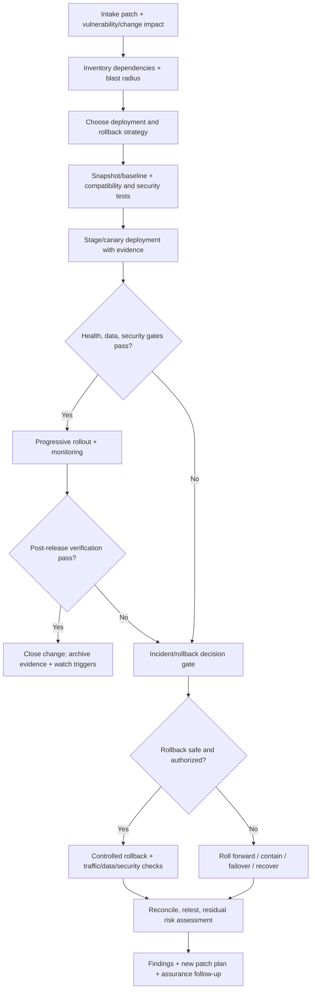
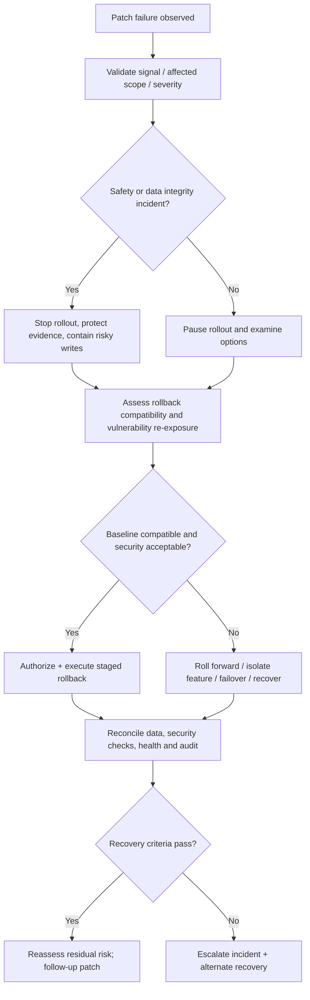

# Rollback patch: khôi phục có kiểm soát sau cập nhật bảo mật

## 1. Vì sao rollback patch là một năng lực bảo mật?

Một nhóm vận hành vừa triển khai bản vá khắc phục lỗ hổng nghiêm trọng cho dịch vụ payroll. Chỉ vài phút sau, tỷ lệ lỗi tăng mạnh và một số giao dịch xuất bảng lương bị treo. Nếu giữ bản vá, dịch vụ có thể không đáp ứng mục tiêu sẵn sàng; nếu quay về bản trước, lỗ hổng đã biết có thể xuất hiện trở lại. Nếu bản vá còn thay đổi cấu trúc dữ liệu, thao tác quay lại binary cũ có thể làm hỏng dữ liệu mới hoặc khiến hệ thống ghi sai số tiền. Lúc này, “bấm nút rollback” không đủ để ra quyết định an toàn.

**Rollback patch** là quy trình **chuyển một hoặc nhiều thành phần từ phiên bản/cấu hình đã cập nhật trở về trạng thái đã được phê duyệt trước đó hoặc một trạng thái phục hồi tương thích**, khi bản vá gây lỗi, không đáp ứng tiêu chí nghiệm thu, hoặc phát sinh nguy cơ vượt mức chấp nhận. Quy trình cần bảo vệ **bí mật, toàn vẹn, sẵn sàng**, tránh mất dữ liệu, giới hạn thời gian gián đoạn và ghi nhận đầy đủ quyết định/đường kiểm chứng.

Một rollback tốt phải giải quyết đồng thời ba câu hỏi:

1. **Có thực sự cần quay lại không?** Dựa trên ngưỡng sự cố, rủi ro, sự cố bảo mật và các lựa chọn như roll forward, tắt tính năng hoặc cô lập luồng.
2. **Quay lại cái gì và theo cách nào?** Chỉ application binary hay cả configuration, database schema, message contract, IAM, routing, secret hoặc hạ tầng?
3. **Làm sao biết đã an toàn?** Dùng health checks, kiểm tra dữ liệu, security controls, phiên bản thực tế, telemetry và bằng chứng để xác nhận hệ thống phục hồi mà không tạo rủi ro mới.

Trong chương **Patch management** của module **SECURITY_SECURITY_ASSURANCE**, rollback không chỉ là công cụ cứu sự cố vận hành. Đây là một **security control có thể đánh giá bằng bằng chứng**, gắn với risk assessment, security requirements, change control, thử nghiệm trước triển khai, audit trail, xử lý findings và security assurance liên tục trong phát triển lẫn vận hành.

### Kết quả học tập

Sau bài này, người học có thể:

- Phân biệt rollback, restore, failover, redeploy phiên bản cũ, roll forward và compensating mitigation.
- Xác định những điều kiện tiên quyết của một rollback an toàn: baseline, artifact, dependency, data compatibility và quyền thực hiện.
- Thiết kế chiến lược rollback cho ứng dụng, container, cấu hình, OS, firmware, database và cloud infrastructure.
- Thiết lập tiêu chí kích hoạt, người phê duyệt, RTO/RPO và điều kiện dừng theo mức rủi ro.
- Lập runbook, kiểm thử canary/blue-green, rehearsal, failure injection và phục hồi dịch vụ có trạng thái.
- Kiểm soát nguy cơ **khôi phục lại lỗ hổng** khi quay về phiên bản chưa vá.
- Thu thập evidence từ quyết định → hành động → kết quả → retest → residual risk.
- Báo cáo rollback một cách trung thực: điều gì đã phục hồi, phạm vi nào còn rủi ro, ai chịu trách nhiệm.

> Các giá trị thời gian, ngưỡng metric, lệnh và biểu mẫu trong bài là **minh họa**. Mỗi tổ chức phải chọn theo tính trọng yếu của tài sản, yêu cầu kinh doanh, kiến trúc, chính sách, hợp đồng và nghĩa vụ áp dụng. Không chạy thử khôi phục, xóa dữ liệu hay downgrade production ngoài phạm vi được phê duyệt.

## 2. Phân biệt các khái niệm thường bị nhầm

| Khái niệm | Ý nghĩa | Ví dụ | Điều cần kiểm tra |
| --- | --- | --- | --- |
| **Patch** | Thay đổi để sửa lỗi, lỗ hổng hoặc vấn đề chất lượng/bảo mật. | Cập nhật thư viện, OS package hoặc binary. | Phiên bản, scope, provenance và mục tiêu sửa. |
| **Rollback** | Quay về trạng thái thành phần đã được xác định trước. | Chuyển deployment từ image B về image A. | A còn tương thích và chấp nhận được về bảo mật không? |
| **Roll forward** | Sửa tiếp bằng một thay đổi mới thay vì quay lại. | Deploy image C sửa regression của B và giữ bản vá CVE. | Thay đổi mới đã được kiểm thử tối thiểu cần thiết chưa? |
| **Restore** | Khôi phục dữ liệu/trạng thái từ bản sao, snapshot hoặc backup. | Restore database từ backup trước sự cố. | Điểm khôi phục, mất dữ liệu, toàn vẹn, quyền và RPO. |
| **Failover** | Chuyển phục vụ sang instance/zone/site khác. | Chuyển traffic qua region dự phòng. | Dữ liệu/quyền/phiên bản ở nơi dự phòng có tương đương không? |
| **Redeploy** | Triển khai lại một artifact. | Deploy lại image cùng digest. | Không đồng nghĩa rollback nếu cùng phiên bản lỗi. |
| **Feature flag off** | Tắt đường tính năng hoặc hành vi đã thay đổi. | Tạm tắt export mới trong khi giữ hotfix. | Có thực sự đóng mọi đường truy cập hay chỉ ẩn UI? |
| **Containment** | Hạn chế tác động, thường tạm thời. | Chặn endpoint hoặc cô lập một workload. | Tác động nghiệp vụ và đường bypass. |
| **Compensating control** | Kiểm soát bù đắp khi chưa sửa tận gốc. | Thêm phân quyền, rate limit hoặc network policy. | Có chứng minh hiệu lực và expiry không? |
| **Backout plan** | Kế hoạch rút thay đổi khi triển khai thất bại. | Runbook đổi routing, image, config và kiểm tra. | Có owner, trigger, deadline và rehearsal không? |

**Rollback ứng dụng không đồng nghĩa rollback database.** Ngay cả khi dùng image cũ, các giao dịch được ghi bởi bản mới có thể vẫn tồn tại; đó thường là điều mong muốn để tránh mất dữ liệu, nhưng cần chứng minh binary cũ đọc/ghi được dữ liệu đó đúng cách.

### 2.1. Tách ba chiều của thành công

- **Service restoration:** người dùng có thể thực hiện workflow trọng yếu trong ngưỡng chấp nhận.
- **Data correctness:** không mất hoặc sửa sai giao dịch, không tạo bản ghi trùng, không phá tính toàn vẹn.
- **Security posture:** quyền, logging, isolation, patch exposure và detection vẫn đáp ứng mức rủi ro được phê duyệt.

Một rollback có thể “green” về CPU và HTTP 200 nhưng **failed về bảo mật** nếu phiên bản cũ lộ dữ liệu tenant hoặc không ghi audit. Ngược lại, rollback phục hồi an toàn dữ liệu nhưng không thể chấp nhận nếu khôi phục lỗ hổng đang bị khai thác và không có biện pháp giảm thiểu.

## 3. Các mục tiêu và ranh giới của rollback patch

### 3.1. Control objectives

| Mục tiêu | Câu hỏi đánh giá | Evidence mong đợi |
| --- | --- | --- |
| **Availability** | Dịch vụ trọng yếu có phục hồi trong thời hạn/điều kiện đã duyệt? | Timeline, SLI/SLO, synthetic transactions, incident record. |
| **Integrity** | Giao dịch trước/trong/sau rollback có chính xác, không mất/trùng? | Reconciliation, checksums, transaction/job references, tests. |
| **Confidentiality** | Phiên bản cũ có tạo đường truy cập không được phép? | Authorization tests, effective IAM, vulnerability assessment. |
| **Reproducibility** | Có biết đúng artifact/config/schema trước và sau? | Version/digest, signed artifact/provenance, change ID. |
| **Controlled execution** | Chỉ actor được phép và quy trình được duyệt mới thực hiện? | Approval, privileged session, deployment/audit logs. |
| **Bounded failure** | Nếu rollback cũng lỗi, có phương án dừng/contain/failover? | Runbook branching, fault drills, recovery plan. |
| **Traceability** | Có tái dựng được ai quyết định, làm gì, với kết quả gì? | Incident/change ticket, telemetry và evidence manifest. |
| **Residual risk** | Lỗ hổng quay trở lại được ghi nhận, giảm thiểu và xem xét? | CVE/asset mapping, risk decision, expiry, follow-up patch. |

### 3.2. Scope không phải chỉ một repository

Đánh giá rollback cho tất cả thành phần có trạng thái hoặc phụ thuộc:

1. Application images, runtime, dependencies và feature flags.
2. Database schema, dữ liệu, transaction state, search index và cache.
3. API contracts, message formats, queue consumers/producers.
4. Identity, session, service accounts, IAM, keys, certificates và secrets.
5. Network policy, gateway, load balancer, service discovery, DNS.
6. Infrastructure as Code (IaC), cloud resources, OS packages, firmware.
7. Monitoring, alerting, logging, audit và operational dashboards.
8. Bên thứ ba: payment provider, SaaS integration, managed services.

**Nguyên tắc:** quyết định theo **luồng dữ liệu và trust boundaries**, không chỉ theo tên deployment mà công cụ CI/CD biết.

## 4. Threat modeling: rollback có thể tạo ra rủi ro nào?

Một bản vá khắc phục vulnerability; rollback có thể mở lại attack path. Một số kịch bản cần nhận diện trước khi triển khai:

| Risk ID | Kịch bản | Hậu quả tiềm năng | Control cần review |
| --- | --- | --- | --- |
| **RB-R01** | Quay về image chứa CVE đang bị khai thác. | Tái phơi nhiễm dữ liệu/hạ tầng. | Vulnerability mapping, containment, approval và expiry. |
| **RB-R02** | Binary cũ đọc schema mới không tương thích. | Ghi sai, mất dữ liệu hoặc outage. | Expand-contract, compatibility matrix, data tests. |
| **RB-R03** | Rollback không khôi phục policy IAM được thay cùng patch. | Quyền bị mở rộng hoặc service bị khóa. | Effective IAM diff, security regression tests. |
| **RB-R04** | Chuyển traffic khi còn in-flight transactions. | Double charge, duplicate export, inconsistent state. | Drain, idempotency, reconciliation, retry semantics. |
| **RB-R05** | Rollback một service nhưng consumers/producers còn schema mới. | Message processing fail, poison queues, mất job. | Contract compatibility, queue replay và DLQ tests. |
| **RB-R06** | Artifact cũ không còn hoặc provenance không tin cậy. | Deploy nhầm/tampered image. | Signed immutable artifacts, digest pinning, admission controls. |
| **RB-R07** | Thử rollback trên production mà chưa diễn tập. | Sự cố kéo dài, kéo theo nhiều lớp. | Rehearsal, stop criteria, runbook ownership. |
| **RB-R08** | Snapshot/restore làm mất giao dịch mới. | Mất/tái tạo sai đơn hàng, bảng lương. | Explicit RPO, recovery point selection, data validation. |
| **RB-R09** | Key/certificate đã rotate, bản cũ không dùng được. | Không giải mã hoặc authentication fail. | Credential compatibility, no unsafe key restoration. |
| **RB-R10** | Admin rollback bằng quyền chung không có audit. | Không truy vết; khả năng misuse. | JIT access, change/incident ID, separate verification. |
| **RB-R11** | Bản cũ thiếu telemetry hoặc audit event mới. | Không phát hiện misuse và không có bằng chứng. | Security observability gate, compensating logs. |
| **RB-R12** | DNS/route cache vẫn trỏ vào bản lỗi. | Mixed versions, session inconsistencies. | Traffic validation, cache TTL, rollout tracking. |

### 4.1. Trường hợp rollback không an toàn

Không nên giả định có thể rollback chỉ vì tồn tại image trước đó. Nếu patch bao gồm **schema migration mất thông tin, thao tác rotate/revoke credential, thay đổi external API contract không tương thích hoặc firmware không cho downgrade**, cần một chiến lược khác: roll forward, restore có kiểm soát, cô lập, failover hoặc can thiệp của nhà cung cấp.

### 4.2. Đánh giá mối đe dọa khi quay về bản có lỗ hổng

Giả sử bản B vá một lỗi RCE của bản A. Nếu B làm chết dịch vụ, quay về A có thể phục hồi availability nhưng tái kích hoạt RCE. Quyết định cần:

- Xác định affected assets/versions và exploitability thực tế.
- Xem exploitation evidence, exposure, KEV/EPSS khi áp dụng, nhưng không suy “chưa thấy tấn công” = an toàn.
- Đánh giá alternative controls, ví dụ đóng endpoint, deny traffic hoặc cô lập workload.
- Chỉ rollback vào phạm vi và thời gian được duyệt; ưu tiên tạo bản C sửa regression **mà vẫn giữ security fix** nếu khả thi.
- Ghi risk owner, biện pháp bù đắp, thời hạn, monitoring và điều kiện quay lại nhánh đã vá.

Rollback là **một thay đổi mới có rủi ro**, không phải hành động vô điều kiện làm giảm rủi ro.

## 5. Vòng đời của một patch có thiết kế rollback

Một chiến lược tốt được chuẩn bị **trước khi triển khai**, không viết runbook lần đầu trong sự cố.



### 5.1. Các cổng quyết định

**Trước triển khai:** biết bản nào, môi trường nào, artifact nào là last known good, những phụ thuộc nào không rollback được, và ai có quyền quyết định.

**Trong triển khai:** đo health, error budget, data correctness, security controls, các chỉ báo exploitation hoặc outage.

**Tại điểm dừng:** ngưỡng nào buộc tạm dừng rollout, rollback, contain hoặc chuyển sang roll forward.

**Sau rollback:** xác minh actual traffic/version, trạng thái dữ liệu, security posture, audit và risk register; không chỉ dựa vào pipeline báo thành công.

## 6. Baseline: biết chính xác trạng thái “quay về” là gì

Từ “phiên bản trước” có thể mơ hồ trong môi trường microservices: deployment trước dùng image nào, commit nào, secrets/feature flags/schema nào, security policies ở thời điểm đó ra sao? Rollback đáng tin phải dựa trên **last known good baseline** được xác minh và lưu giữ.

### 6.1. Baseline manifest cần có

| Thành phần | Metadata nên ghi | Cách kiểm tra sau rollback |
| --- | --- | --- |
| Application | Immutable image digest/artifact ID, build provenance, dependency manifest. | Pod/container/server runtime digest, artifact verification. |
| Configuration | Config version, runtime flags, environment và owners. | Effective configuration, không chỉ Git commit. |
| Database | Schema version, migration history, backup/snapshot ID, replication state. | Schema introspection, sample business queries, integrity checks. |
| API/message | Contract versions và compatibility assumptions. | Contract tests, consumer compatibility, DLQ health. |
| Infrastructure | IaC revision, resource IDs, network/IAM/key policy. | Runtime state vs declared plan, drift detection. |
| Credentials | Key/cert/secret version references và lifecycle state. | Successful authenticated calls, không truy xuất plaintext secret. |
| Traffic | Routing rules, feature flags, canary percentages, service discovery. | Effective routes, endpoint/version telemetry. |
| Observability | Dashboards, alert rules, logging schema và health probes. | Event-to-alert tests và visibility sau thay đổi. |
| Security | Open vulnerabilities, controls và exception approvals của bản cũ. | Recheck CVE/reachability, authorization/segmentation tests. |

### 6.2. Last known good không chỉ là bản có HTTP 200

Định nghĩa “good” phải có cả **availability, data correctness, security acceptance và compatibility**. Một bản cũ từng vận hành ổn định nhưng chứa CVE đang bị khai thác không tự được xem là lựa chọn phục hồi hợp lệ.

Một baseline có thể là **bản A + policy hạn chế mới + feature flag off**, thay vì khôi phục toàn bộ trạng thái trong quá khứ. Cách phối hợp này chỉ an toàn khi có thiết kế/kiểm thử và quyền thay đổi rõ ràng.

### 6.3. Artifact provenance và availability

Cần giữ artifact bất biến được xây dựng từ nguồn đã phê duyệt, có digest và signature/attestation khi policy yêu cầu. Kiểm tra quyền truy xuất image registry, retention, ký/kiểm tra chữ ký, base image compatibility, architecture, credentials để kéo image. Không phát hành rollback bằng cách rebuild code cũ ngẫu nhiên nếu không chứng minh artifact tạo ra tương đương; dependency có thể đã thay và build không tái lập.

## 7. Rollback readiness trước khi phát hành patch

Mỗi change record nên trả lời:

1. Phạm vi: service, hosts, packages, tenants, regions, routes và dữ liệu nào sẽ thay đổi?
2. Lý do patch: vulnerability/finding ID, severity, priority và deadline?
3. Phiên bản trước/sau có artifact IDs và security posture như thế nào?
4. Những migration nào **không thể tự đảo ngược**?
5. Nếu rollback, ai phê duyệt và ai thực thi; có quyền tối thiểu và audit?
6. Ngưỡng dừng rollout dựa trên error, latency, data integrity và security controls?
7. Có cách drain traffic, xử lý transactions/jobs đang chạy và bảo toàn idempotency?
8. Khi database hoặc state store khác version, compatibility được bảo đảm ra sao?
9. Monitoring và synthetic transactions nào sẽ chứng minh khôi phục?
10. Nếu rollback thất bại, có containment, roll forward, failover hay restore plan không?
11. RTO/RPO/availability objectives được áp dụng theo business owner nào?
12. Đã diễn tập và biết những assumptions chưa kiểm chứng chưa?

### 7.1. Readiness checklist dạng gate

| Gate | Đạt khi | Không đạt thì |
| --- | --- | --- |
| **RDY-01 Scope** | Inventory đủ affected services và dependencies. | Khoanh phạm vi, tạm hoãn rollout hoặc chấp nhận unknown có thẩm quyền. |
| **RDY-02 Artifact** | Baseline artifact tồn tại, đúng digest và được phép deploy. | Không hứa có rollback; chuẩn bị alternate recovery. |
| **RDY-03 Data** | Database compatibility/backup/restore strategy đã được test. | Dừng destructive change, thiết kế expand-contract. |
| **RDY-04 Security** | Bản cũ được đánh giá lỗ hổng và mitigation. | Roll forward/contain; nếu buộc rollback, escalated risk decision. |
| **RDY-05 Observability** | Health, transactions, security events và alerts đo được. | Bổ sung canary/synthetic probe, không dùng dashboard “xanh” giả. |
| **RDY-06 Runbook** | Triggers, commands, owners, stop/retry/escalation rõ. | Rehearsal và hoàn thiện backout plan. |
| **RDY-07 Access** | Privileged identity đủ quyền, có approval và audit. | Cấp JIT theo policy; không dùng shared admin credential. |
| **RDY-08 Recovery** | Nếu rollback lỗi, có phương án B và bằng chứng diễn tập. | Không triển khai đổi trạng thái phá hủy khi chưa đánh giá. |

### 7.2. Phân loại độ khó rollback

**Trivial/low-complexity:** thay stateless image/config khi contracts vẫn tương thích, không đổi state.

**Conditional:** thay image đi kèm feature flag, cache contract hoặc network policy; cần kiểm tra dependencies/traffic.

**High-risk:** database migration, key/credential lifecycle, schema messages, external side effects, firmware hoặc OS stateful change.

**Potentially irreversible:** data đã chuyển đổi mất thông tin, key đã destroy, giao dịch đã xác nhận bên thứ ba, downgrade firmware bị cấm/không hỗ trợ.

Các nhãn này là **mô tả kiến trúc**, không phải severity của vulnerability. Một change nhỏ về file cấu hình IAM vẫn có thể có impact rất cao.

## 8. Chọn rollback, roll forward, containment hay failover

Một tình huống patch failure cần ít nhất ba góc nhìn: **độ cấp bách khôi phục dịch vụ, rủi ro bảo mật nếu quay lại và tính khả thi của phương án**.

| Điều kiện quan sát | Hướng hành động cân nhắc | Cảnh báo |
| --- | --- | --- |
| Release mới làm tăng lỗi, image cũ tương thích và không vi phạm security policy. | Rollback image/route đã thử. | Xác minh data/job và rollback không mở CVE. |
| Bản cũ chứa lỗ hổng có exploitation evidence, nhưng bản mới gây regression có thể sửa nhanh. | Roll forward bản vá bổ sung, cô lập chức năng lỗi tạm thời. | Ước tính thời gian và risk, không kéo dài vô hạn. |
| Hỏng một feature mới, phần còn lại và security fix ổn. | Disable feature flag hoặc tạm ngừng đường tính năng. | Kiểm tra feature flag thực sự chặn server-side, không chỉ UI. |
| Một region bị lỗi do patch, region khác được kiểm chứng tương thích. | Failover hoặc route away theo DR plan. | Data consistency, key/config parity và capacity. |
| Schema/data đã biến đổi không tương thích bản cũ. | Roll forward hoặc restore có RPO được duyệt. | Restore có thể mất các giao dịch hợp lệ sau snapshot. |
| OS/kernel patch gây panic, fallback image có security issue nghiêm trọng. | Vendor-supported fallback với network isolation và giới hạn thời gian. | Đánh giá khả năng khai thác và mức độ quan trọng của dịch vụ. |
| Root cause chưa rõ, error đang tăng và telemetry thiếu. | Tạm dừng rollout, contain, thu evidence và chọn bước giảm blast radius. | Đừng rollback nhiều lớp cùng lúc mà không ghi timeline. |

### 8.1. Một cây quyết định thực tế



### 8.2. Lựa chọn nào cũng phải có nguồn dữ liệu

Kết luận “rollback nhanh hơn” cần có rehearse time và environment similarity. Kết luận “không thể rollback” cần giải thích migration, key state, provider restriction hoặc compatibility evidence. Nếu một phương án yêu cầu mất dữ liệu, phải có **RPO và thẩm quyền nghiệp vụ**, không chỉ một ý kiến kỹ thuật.

## 9. RTO, RPO và ngưỡng kích hoạt rollback

### 9.1. RTO và RPO không thay thế nhau

- **Recovery Time Objective (RTO):** khoảng thời gian mục tiêu để khôi phục khả năng phục vụ sau sự cố theo kế hoạch đã phê duyệt.
- **Recovery Point Objective (RPO):** mức mất dữ liệu tối đa chấp nhận theo thời gian phục hồi dữ liệu.
- **SLI/SLO:** chỉ số/đích chất lượng dịch vụ, như tỷ lệ giao dịch thành công, độ trễ hoặc đáp ứng tính năng.
- **Error budget:** mức độ vi phạm SLO mà tổ chức chấp nhận trong khung đánh giá đã định.

Rollback image có thể khôi phục API nhanh mà không cần data restore, do đó không nhất thiết mất transaction đã commit. Nhưng nếu phải restore database từ snapshot, RPO trở thành vấn đề trọng yếu. Không dùng RTO của service để suy RPO của database.

### 9.2. Đặt trigger theo tín hiệu đa chiều

| Nhóm | Trigger minh họa | Cần tránh |
| --- | --- | --- |
| Availability | Tỷ lệ lỗi vượt ngưỡng liên tục trong window được duyệt. | Phản ứng theo một spike ngẫu nhiên không đủ ý nghĩa. |
| Latency | p95/p99 vượt ngưỡng và ảnh hưởng user flow. | Chỉ xem trung bình che đuôi trễ. |
| Data integrity | Reconciliation mismatch, mất/trùng transaction, sai tenant mapping. | Đợi CPU/HTTP health báo lỗi mới dừng. |
| Security | Authz bypass, audit gap, key/secret misuse hoặc patch re-exposure. | Rollback về bản vulnerable chỉ vì HTTP 200 phục hồi. |
| Business | Tỷ lệ hoàn tất payroll/payment/export dưới ngưỡng. | Dùng synthetic health endpoint thay thực giao dịch. |
| Operational | Crash loops, queue lag, DB migration stuck, node instability. | Không tính downstream/backlog và in-flight work. |

Các con số cụ thể phải nằm trong **service-level runbook/policy được duyệt**, không tự suy từ thang CVSS. Ngưỡng trigger cần kèm **thời gian quan sát, nguồn metric, owner và hành động dự kiến**.

### 9.3. Timebox quyết định

Trong outage, chờ root-cause analysis đầy đủ có thể vượt RTO; rollback bừa cũng có thể phá data. Một runbook nên chỉ định **decision window** và quy trình escalation, cho phép containment/stop writes khi chưa đủ thông tin. Với rủi ro cao, security/incident authority phải tham gia; không chờ tới khi SLA trễ mới thông báo.

## 10. Rollback ứng dụng stateless và container orchestration

Đây thường là trường hợp dễ nhất nhưng không tự động an toàn.

### 10.1. Những gì cần kiểm soát

- **Artifact identity:** chính xác image digest/version, không dùng tag mutable như `latest` làm nguồn sự thật.
- **Replica compatibility:** bản cũ và mới có thể chạy đồng thời trong rollout không?
- **Traffic draining:** request dài và connection đang mở được xử lý thế nào?
- **Health gates:** readiness khác liveness; health phải đo được khả năng phục vụ thật.
- **Feature flags/config:** release cũ có đọc được config đang deploy không?
- **Downstream contracts:** APIs, caches, queues, DB schema, session versions.
- **Security control:** bản cũ còn chính sách authorization, TLS/logging và vulnerability posture hợp lệ không?
- **Observability:** log/metric gắn version, deployment ID và route để xem traffic thực.

### 10.2. Chiến lược thường dùng

**Rolling deployment:** cập nhật từng nhóm replicas; khi lỗi, đổi desired image/route về digest đã duyệt, bảo đảm contract tương thích khi mixed versions.

**Blue-green:** duy trì hai environment tương đương; chuyển traffic bằng cơ chế có thể đảo lại. Việc “đảo route” không rollback dữ liệu hay external side effects.

**Canary:** triển khai cho ít traffic/tenants/region với metric gates, tăng dần khi đạt. Khi fail, dừng canary và rút traffic để giới hạn blast radius.

**Immutable infrastructure:** triển khai image/node mới rồi chuyển traffic; hạn chế thay trực tiếp hệ thống đang chạy để có khả năng quay về rõ hơn.

### 10.3. Trường hợp image rollback thất bại dù orchestrator báo success

Orchestrator có thể báo version A đã chạy, nhưng:

1. Một gateway vẫn route traffic tới B vì cache hoặc stale endpoint.
2. B đã ghi cache/schema mới mà A không hiểu.
3. Worker job vẫn chạy B trên queue khác.
4. Session/token phát bởi B không tương thích A.
5. A bị cấm tải secrets vì credential/key policy vừa rotate.
6. A chứa lỗ hổng đã vá ở B và thiếu monitoring control.

Vì vậy verification phải kiểm tra **effective traffic/version, customer actions, data và security**, không chỉ trạng thái rollout của controller.

## 11. Rollback database: phân biệt schema và dữ liệu đã phát sinh

Đây thường là rủi ro lớn nhất của rollback patch có trạng thái. Database có thể đã lưu dữ liệu hợp lệ do phiên bản mới ghi; quay về code/schema cũ có thể làm code đọc sai hoặc xóa những giá trị mới. Để đảo được schema không có nghĩa **có thể đảo được kết quả nghiệp vụ**.

### 11.1. Ba trạng thái cần phân biệt

1. **Schema state:** bảng, cột, index, constraint, enum, stored procedure, extension và version migration.
2. **Business data state:** record, transaction, approval, balances, payroll runs, inventory và event history.
3. **Operational state:** replication, locks, long-running queries, migration bookkeeping, backup, index building và CDC/outbox.

Một lệnh “down migration” có thể xóa cột; nếu cột đó đang chứa dữ liệu được tạo bởi B, **thông tin bị mất**. Đặc biệt nguy hiểm khi dùng `DROP COLUMN` hoặc chuyển type mất chính xác chỉ để chạy A.

### 11.2. Expand–migrate–contract

Một phương án hỗ trợ rollback tốt là triển khai theo các giai đoạn tương thích:

- **Expand:** thêm cột/bảng/contract mới nhưng chưa xóa cũ; cho phép A và B hoạt động trong giai đoạn chuyển tiếp.
- **Migrate:** chuyển dữ liệu qua backfill có checkpoint/reconciliation; đưa B vào vận hành, có thể dual-read/write khi được thiết kế rõ.
- **Contract:** chỉ xóa trường/đường cũ khi đã chắc chắn mọi producer/consumer cần dùng được chuyển và cửa sổ rollback đã đóng.

Ví dụ:

| Giai đoạn | Schema | App A | App B | Điều kiện rollback |
| --- | --- | --- | --- | --- |
| Trước patch | `employee.phone` | Đọc/ghi `phone`. | Chưa deploy. | Trạng thái baseline. |
| Expand | Thêm `phone_normalized` nullable, vẫn giữ `phone`. | Hoạt động như cũ. | Có thể đọc cả hai theo contract. | Có thể rollback B → A nếu data consistency được giữ. |
| Migrate | Backfill và xác minh mapping; ghi theo contract được duyệt. | Phải vẫn đọc đúng dữ liệu. | Dùng field mới với fallback. | Test A đọc các record do B vừa ghi. |
| Contract | Bỏ `phone` sau khi hết cửa sổ hỗ trợ A. | **Không còn tương thích.** | Hoạt động với schema mới. | Không được hứa rollback A đơn giản; cần forward fix/restore plan. |

**Điểm mấu chốt:** các bước expand/contract và dual-write cũng có thể lỗi. Phải xác định nguồn dữ liệu authoritative, idempotency và kiểm tra **giá trị hiện tại/biến đổi**, không chỉ câu SQL chạy thành công.

### 11.3. Một ví dụ migration minh họa

```sql
-- Expand step only: preserve the existing column.
ALTER TABLE employee
    ADD COLUMN phone_normalized VARCHAR(64) NULL;

-- Backfill should be implemented as a controlled, resumable job
-- with validation, tenant scoping and data-quality checks.
-- DO NOT drop the old column during the rollback window.
```

Đây là mẫu SQL khái niệm; cú pháp và chiến lược khóa bảng phụ thuộc DBMS, kích thước dữ liệu và khả năng online DDL. Không áp dụng trực tiếp production mà chưa kiểm tra backup, lock, rollback path và migration permissions.

### 11.4. Khi nào cần restore database?

Nếu bản vá đã phá dữ liệu hoặc schema không thể chuyển ngược an toàn, có thể cân nhắc restore từ snapshot/PITR. Nhưng cần:

- Xác định **mốc dữ liệu hợp lệ** và RPO có được business owner chấp nhận.
- Ghi và bảo toàn các giao dịch phát sinh sau mốc backup để quyết định replay/reconcile.
- Xác định external side effects như email, thanh toán, transfer, notification **không tự đảo ngược** theo database restore.
- Xác minh khóa giải mã, tenant, schema, replication, audit logs và dữ liệu khách hàng.
- Có kế hoạch rollback của chính thao tác restore nếu thao tác này thất bại.

**Restore có thể gây mất dữ liệu hợp lệ**, khác với đổi application image. Đây là thay đổi nhạy cảm cần approval và evidence riêng.

## 12. Stateful services, queue, cache và giao dịch phân tán

Một bản vá có thể đổi định dạng message, cache key hoặc thứ tự xử lý. Khi rollback một consumer nhưng producer vẫn phát schema mới, hệ thống có thể rơi vào poison-message loop, bỏ qua event hoặc lặp việc.

### 12.1. Message contract và schema evolution

Review:

- Event type, version, optional/required fields, enum và encoding có tương thích?
- Producer B có thể phát event A hiểu không?
- Consumer A có xử lý messages B đã lưu trong queue không?
- Có event DLQ hoặc không thể parse bị drop im lặng không?
- Có replay/resume từ offset phù hợp mà không xử lý trùng business action?
- Có deduplication key, transaction ID và kiểm soát idempotency không?

**Không dùng việc queue “empty” làm tiêu chí duy nhất.** Queue trống có thể vì messages bị drop, chuyển DLQ hoặc consumer xử lý sai.

### 12.2. In-flight transactions

Trước rollback:

1. Tạm dừng rollout và xác định workflow đang chạy.
2. Nếu cần, ngừng nhận write mới ở phạm vi nhỏ nhất có thể, được phép theo runbook.
3. Drain connections/requests/jobs đến checkpoint an toàn.
4. Ghi correlation/transaction IDs của những việc chưa rõ trạng thái.
5. Thực hiện đổi version/route.
6. Replay/reconcile theo idempotency rules; không gửi giao dịch thanh toán lặp vô thức.

### 12.3. Bên thứ ba và side effects không thể đảo

Một hệ thống có thể đã gửi lệnh thanh toán qua provider hoặc email/SMS tới khách hàng. Rollback code và DB không “rút lại” yêu cầu bên thứ ba. Cần xác minh transaction status ở provider bằng API/idempotency key, reconciliation và quy trình nghiệp vụ cho compensating transaction nếu có. Với hệ thống tài chính, không thực hiện tự động hoàn tiền/đảo giao dịch nếu không có thẩm quyền/quy tắc.

### 12.4. Cache/search index

Phiên bản B có thể ghi cache key/data format mới khiến A đọc lỗi hoặc trả dữ liệu sai tenant. Có thể cần namespace versioning, TTL, selective invalidation hoặc rebuild, nhưng **flush cache toàn hệ thống** cũng có thể gây thác lỗi và tăng tải DB. Search index được tạo lại phải có source-of-truth và logic đối soát; không xóa dữ liệu index có vai trò authoritative nếu chưa xác định.

## 13. Compatibility matrix và thứ tự rollback nhiều service

Nếu patch thay đồng thời API, worker, schema, gateway và storage, thứ tự rollback ảnh hưởng lớn tới kết quả. Không có một quy tắc “backend trước” hay “frontend trước” luôn đúng.

### 13.1. Compatibility matrix mẫu

| Component | A (baseline) | B (patched) | Có thể chạy mixed versions? | Điều kiện |
| --- | --- | --- | --- | --- |
| Public API | v1 | v2 | Có, nếu request/response contract tương thích. | Tests cho clients cũ/mới, token/session. |
| Payroll worker | v1 | v2 | Chỉ khi message schema tương thích. | DLQ/replay checks, idempotency. |
| Database | S1 | S2 (expanded) | Có, nếu app v1 đọc/ghi an toàn trên S2. | Không drop cột v1, constraint tương thích. |
| Export format | E1 | E2 | Có điều kiện. | Consumer bên thứ ba chấp nhận E1/E2. |
| Identity policy | P1 | P2 | Không mặc định. | Bản cũ không được dùng grant đã bị revoke. |
| Search index | I1 | I2 | Có thể rebuild. | Source data, index version và correctness tests. |

### 13.2. Xây một rollback DAG

Vẽ đồ thị phụ thuộc **component → contract/state**. Nếu worker v1 chỉ hiểu message v1, phải chặn/điều chỉnh producer trước khi quay worker về v1, hoặc có một adapter đã được kiểm chứng. Nếu API v1 chỉ đọc schema S1, không thể an toàn khi DB đã lên S2 phá tương thích.

Mẫu thứ tự khả thi cho một hệ thống tương thích ngược:

1. Stop rollout, khóa những thay đổi mới gây lỗi, giữ evidence.
2. Xác minh DB S2 vẫn tương thích với API/worker A.
3. Chuyển một nhóm nhỏ traffic về A, kiểm tra chức năng và bảo mật.
4. Chuyển worker/producer theo compatibility matrix.
5. Tăng traffic dần, xử lý queue/cache và in-flight work.
6. Giữ schema expanded, chưa drop dữ liệu; đóng cửa sổ rollback sau khi đã ổn.

**Đây là minh họa**, không phải quy trình áp dụng trực tiếp mọi hệ thống. Nếu có dependency đảo ngược, runbook phải thay thứ tự và ghi rõ.

### 13.3. Blast-radius control

Nên chia theo cells/tenant cohorts/regions khi kiến trúc và quyền riêng tư cho phép. Một canary có 1% traffic nhưng chứa các giao dịch phức tạp có thể phát hiện lỗi mà 100% synthetic health checks không thấy. Tuy nhiên, cần **bảo vệ khách hàng canary**: không dùng người thật làm thử nghiệm mất dữ liệu không có kiểm soát.

## 14. Rollback của configuration và Feature Flags

Nhiều sự cố “patch failure” xuất phát từ config hoặc feature rollout thay vì binary. Điều này tạo cơ hội phục hồi ít rủi ro hơn full rollback nếu control bảo vệ vẫn được giữ.

### 14.1. Config rollback cần version hóa

- Phiên bản config, source-of-truth, owner, signature/approval khi yêu cầu.
- Runtime effective values, không chỉ config file ở repository.
- Scope theo tenant, region, service và environment.
- Compatibility với cả A/B và cơ chế phân phối config.
- Quyền ai có thể sửa/rollback, audit thay đổi và review.
- TTL/cache/propagation để biết khi nào policy thực sự có hiệu lực.

### 14.2. Feature flag không thay authorization

Tắt flag giao diện có thể làm button biến mất nhưng API vẫn truy cập được. Khi containment một lỗ hổng, cần kiểm tra **server-side enforcement** và mọi đường gọi trực tiếp, worker, cache, storage hoặc admin path. Nếu flag chứa cấu hình bảo mật, khi rollback có thể vô tình bật lại tính năng nguy hiểm.

### 14.3. Configuration drift

Sau khi rollback application B → A, một số environment vẫn dùng config B. Review trạng thái thực ở production, ngoài Git: mounted config, environment vars, secret version, feature rollout và cloud control plane. Drift khiến kết luận “A restored” không đáng tin hoặc tạo security regression.

## 15. OS, kernel, firmware và managed infrastructure

Rollback patch không giới hạn trong application containers. Host, OS, kernel, firmware, hypervisor và cloud services có constraints khác nhau.

### 15.1. OS/package rollback

Cần kiểm tra:

- Package manager hỗ trợ downgrade và giữ version trước không?
- Kernel reboot/driver/module ABI có tương thích?
- Có filesystem snapshots/immutable node image được kiểm thử?
- Có nguy cơ downtime, boot failure, data corruption hoặc mất encryption support?
- Các services phụ thuộc vào version mới có còn chạy với version cũ không?
- Bản cũ có mở lại CVE và không được vendor support không?

Một phương án an toàn hơn trong một số kiến trúc là **replace node với image baseline đã kiểm chứng** và chuyển workload, thay vì gỡ từng package trực tiếp. Tuy nhiên stateful nodes, local disks và workload placement cần xử lý riêng.

### 15.2. Firmware, secure boot và rollback protection

Một số firmware hoặc thiết bị bảo mật có **anti-rollback protections** để ngăn downgrade tới phiên bản thiếu các security fixes. Không tìm cách vô hiệu hóa các cơ chế đó nếu chưa có cơ sở/vendor-approved procedure. Có thể cần boot slot dự phòng, vendor recovery process hoặc thay thiết bị, không phải “flash phiên bản cũ” tùy ý.

### 15.3. Managed cloud services

Không phải cloud provider nào cũng cho phép downgrade database engine hoặc control plane version; một số migration chỉ hỗ trợ tiến lên. Khi lên kế hoạch patch, đọc khả năng hỗ trợ của dịch vụ được dùng, compatibility, maintenance window, snapshot/PITR, failover design và quyền thao tác. Nếu rollback không được hỗ trợ, runbook phải nêu **roll forward/restore/failover** thay vì hứa nút rollback không tồn tại.

## 16. Rollback Infrastructure as Code và tài nguyên cloud

Revert một Git commit IaC không đảm bảo khôi phục an toàn trạng thái hạ tầng. Plan có thể **destroy/recreate resource**, đổi địa chỉ, mất dữ liệu hoặc mở mạng vì drift.

### 16.1. Quy trình an toàn

1. Xác định IaC version và **effective runtime state** trước patch.
2. Phân tích diff/plan của thao tác revert, đặc biệt action create/update/replace/destroy.
3. Đánh giá persistent volumes, databases, secrets, IAM policies, public endpoints và resource IDs.
4. Kiểm tra drift do hotfix/manual changes sau patch.
5. Xác nhận dependency giữa services, networking, identity, KMS và monitoring.
6. Yêu cầu approval tương ứng destructive actions và business impact.
7. Áp dụng trong phạm vi được phép, đo effective state, security checks và restore readiness.

### 16.2. Ví dụ risk

Một security patch thu hẹp cloud role và đổi resource identifier. Nếu revert IaC mà không review, role cũ có thể được cấp quyền wildcard trở lại; hoặc một storage bucket bị replace, làm mất objects. **Rollback infrastructure = một thay đổi bảo mật** cần policy review, guardrails và tests, không chỉ là thao tác “git revert”.

### 16.3. Security controls phải được bảo toàn

Tránh rollback đồng thời làm mất TLS policy, logging, encryption, security groups, audit trail hoặc key grants. Một số security controls phải được giữ ở phiên bản mới ngay cả khi application quay về A; cần kiến trúc hỗ trợ compatibility và ghi quyết định rõ.

## 17. Keys, certificates, secrets và session: những thay đổi khó đảo

Một bản vá có thể thay token validation, key library, TLS cipher policy, certificate chain hoặc secret references. Sau rollback, binary cũ có thể không hiểu key format mới, không tin issuer mới hoặc không giải mã được dữ liệu.

### 17.1. Những trạng thái không nên khôi phục mù quáng

| Thành phần | Điều có thể thay sau patch | Rủi ro rollback |
| --- | --- | --- |
| TLS certificate | Cert/key được rotate hoặc revoke. | Khôi phục cert hết hạn/đã thu hồi hoặc lỗi mutual TLS. |
| Data-encryption keys | DEK được rewrap/rotate; record dùng key version mới. | Code cũ không đọc được dữ liệu hoặc key policy đã cấm. |
| Signing keys | Thay key dùng cho JWT/artifact. | Token mới không xác minh được; phục hồi private key cũ có thể mở lại compromise. |
| API secrets | Credential đã revoke và cấp mới. | Code cũ gửi secret cũ, gây lỗi kết nối hoặc tạo đường lộ. |
| Sessions | Session schema, auth context hoặc token claims mới. | Session chưa hết hạn có thể bypass hoặc bị invalidate ngoài dự kiến. |
| IAM policy | Role/grants được thu hẹp để vá privilege escalation. | Rollback toàn bộ config có thể cấp lại quyền quá rộng. |
| Audit configuration | Event schema/collector đã đổi theo patch. | Quay về binary cũ làm mất audit coverage hoặc parser rejects. |

### 17.2. Nguyên tắc giữ kiểm soát bảo mật mới khi có thể

Nếu bản B vá lỗ hổng privilege escalation bằng thay authorization policy, còn regression nằm ở frontend, nên ưu tiên **giữ policy bảo mật của B** và rollback thành phần tương thích gây lỗi, thay vì tự revert mọi thứ về trước B.

**Không bao giờ coi khôi phục secret/khóa từng bị compromise là cách “quay về trạng thái ổn định”.** Nếu key đã bị revoke vì lộ, không mở lại chỉ để bản cũ hoạt động; cần migration, adapter hoặc roll forward tương thích với key lifecycle đã được phê duyệt.

### 17.3. Evidence về compatibility

Trước patch cần biết binary A/B có đọc/ghi được dữ liệu qua key versions nào, token/audience/issuer nào, cert trust chain nào. Sau rollback kiểm tra **login, privileged actions, service-to-service calls, KMS encrypt/decrypt, audit event ingestion** bằng dữ liệu thử. Không đưa plaintext secret hay key vào report.

## 18. Security regression sau rollback: kiểm tra bản cũ bị tái phơi nhiễm

Đây là điểm phân biệt **security-aware rollback** với thao tác thuần vận hành.

### 18.1. Checklist security của target rollback

- Artifact cũ chứa những CVE/findings nào theo inventory và scanner evidence?
- Vấn đề nào đang được khai thác thực tế hoặc có credible exploitation evidence?
- Đường bị ảnh hưởng có reachable trong architecture hiện tại không?
- Liệu bản B có sửa một API authorization hoặc tenant isolation và bản A sẽ mở lại?
- Có secret/token/key đã được rotate/revoke mà A yêu cầu dùng lại không?
- Có requirement về logging/audit/telemetry được B bổ sung mà A thiếu không?
- Các compensating controls hiện hành có chặn attack path liên quan không? Có bypass?
- Nếu được phép rollback, **trong bao lâu và ai chấp nhận residual risk**?
- Có plan triển khai bản C (giữ security fix và sửa regression) hoặc loại bỏ hẳn đường yếu không?
- Những nguồn như CI/CD, IaC, WAF, IdP, network hay KMS có thay đổi độc lập cần giữ lại không?

### 18.2. Một bảng decision có kiểm chứng

| Tình trạng | Điều kiện bảo mật | Quyết định phù hợp |
| --- | --- | --- |
| Target A không có finding quan trọng trong scope và tương thích state. | Có evidence security/compatibility hiện hành. | Có thể rollback theo change/incident policy. |
| A có vulnerability nhưng access path được cách ly có kiểm chứng. | Mitigation có scope, monitoring, bypass tests, expiry. | Xem xét rollback tạm khi risk authority duyệt. |
| A có RCE đang bị khai thác và trực tiếp Internet-facing. | Không có mitigation hiệu lực, dữ liệu nhạy cảm. | Ưu tiên contain/roll forward/failover; rollback có thể không được chấp nhận. |
| A phục hồi sẵn sàng nhưng không xử lý schema mới đúng. | Có nguy cơ phá tính toàn vẹn nghiệp vụ. | Không rollback theo cách đơn giản; đổi phương án phục hồi. |
| A thiếu audit event trên giao dịch trọng yếu. | Vi phạm yêu cầu accountability và không có kiểm soát bù đắp. | Chặn/giới hạn luồng hoặc giữ bản có audit, escalation. |

### 18.3. Current residual vs target residual risk

**Current residual risk** là mức rủi ro khi A đang thật sự chạy sau rollback, xét controls và evidence thực tế. **Target residual risk** là mức kỳ vọng sau khi bản vá sửa mới C được triển khai và kiểm chứng. Không ghi current risk “Low” chỉ vì đã có ticket xây bản C.

Nếu rollback do incident và chưa đủ thời gian đánh giá sâu, phải ghi **assumptions, unknowns, time-bounded decision và trigger rà soát khẩn**, không ngầm coi thiếu dữ liệu là an toàn.

## 19. Runbook rollback: từ tín hiệu đến phục hồi có thể tái hiện

Một runbook hữu ích phải cụ thể cho **service, môi trường, version, traffic, state và owners**. Nó không chỉ là một danh sách lệnh mà còn là bộ tiêu chí dừng và bằng chứng ra quyết định.

### 19.1. Mẫu cấu trúc runbook

| Mục | Nội dung bắt buộc |
| --- | --- |
| **Identity** | Runbook ID, version, service, asset/tenant/region, change/incident reference. |
| **Baseline** | Target image/config/schema, artifact digest, effective security settings. |
| **Dependencies** | DB, queue, worker, cache, auth/KMS, network, third parties, jobs. |
| **Preflight** | Ai phê duyệt, quyền nào, data backup/restore status, compatibility evidence. |
| **Trigger** | SLI/SLO, data/security criteria và thời gian quan sát. |
| **Stop condition** | Khi nào dừng rollout, chặn writes, bảo toàn evidence, escalate. |
| **Execution** | Thứ tự và thao tác cụ thể theo target environment; người thực hiện. |
| **Verification** | Functional, data, security, IAM, audit/monitoring và route checks. |
| **Fallback** | Nếu rollback không đạt: contain, roll forward, failover, restore, on-call. |
| **Closure** | Timeline, actual artifact, retest, finding/risk decision, new patch owner. |

### 19.2. Một runbook ví dụ theo trình tự

**Tình huống:** image B làm payroll export fail, trong khi schema vẫn tương thích với A.

1. Incident commander xác nhận trigger từ synthetic payroll export, error rate, queue backlog và customer impact.
2. Release owner tạm dừng tiến trình rollout; lưu evidence và xác định cohort/regions bị ảnh hưởng.
3. Security owner xem B có vá CVE nào của A và A có đủ điều kiện quay lại không.
4. Database owner xác nhận schema đang ở expanded state S2, A đọc/ghi đúng.
5. Operations drain traffic/jobs ở cohort sẽ thay, ghi nhận in-flight work.
6. Deployment operator chuyển cohort nhỏ về artifact A theo digest đã duyệt.
7. QA/Operations kiểm tra transaction data, export object, retries, tenant isolation, login, audit events và routing thực.
8. Nếu đạt gates, chuyển tiếp cohort/traffic theo kế hoạch; nếu fail, dừng và chuyển fallback.
9. Hòa giải jobs và data đã thực hiện trong window, đánh giá duplicate/missing; ghi completion time.
10. Ghi current residual risk, temporary controls và kế hoạch bản C để giữ security fix.

### 19.3. Stop conditions quan trọng

**Dừng rollback và escalation** nếu phát hiện mất/đổi dữ liệu bất ngờ, lộ quyền, target version sai signature/digest, không còn backup hợp lệ khi cần, mixed contracts không tương thích, hoặc downtime/risk vượt giới hạn được duyệt. Không tự chạy tiếp nhiều lệnh vì “đã đi được nửa đường”.

### 19.4. Communication là một control

Khi rollback ảnh hưởng khách hàng/đội vận hành, xác định đầu mối thông báo, nội dung được phép, mốc cập nhật trạng thái và ai xác nhận service restoration. Đừng tuyên bố “resolved” khi chỉ mới đổi image mà chưa hoàn tất data reconciliation/security verification.

## 20. Tự động hóa rollback: gates chứ không phải “auto-revert” vô điều kiện

Automation có thể giảm thời gian khôi phục, nhưng một bộ điều khiển chỉ xem CPU/HTTP error rồi quay về bản cũ **có thể tự mở lại lỗ hổng hoặc phá schema**. Mức tự động phù hợp phụ thuộc safety properties đã được thiết kế và kiểm chứng.

### 20.1. Những phép kiểm được phép tự động

- So sánh desired artifact với **signed approved baseline**.
- Kiểm tra environment/service/tenant scope và change ID.
- Chặn rollback khi target bị cấm vì vulnerability policy hoặc artifact không còn đáng tin.
- Kiểm tra compatibility flags, schema migration guard, queue protocol version.
- Đo SLO, health, data invariants và security canary signals.
- Tự động dừng progressive rollout khi guardrail fail.
- Ghi audit log của decision, approval, action, result và rollback attempts.

### 20.2. Những quyết định nên có human escalation theo policy

- Rollback sẽ tái phơi nhiễm vulnerability nghiêm trọng hoặc đang bị khai thác.
- Có thể mất dữ liệu hoặc rollback schema phá tính toàn vẹn.
- Cần restore production database/PITR và chấp nhận RPO.
- Thao tác destructive IaC hoặc firmware downgrade.
- Phải mở lại key, grant hoặc network access từng bị thu hồi vì bảo mật.
- Thay scope sang nhiều tenant/regions không có rehearsal.

### 20.3. Pseudocode điều phối quyết định

```text
event = monitoring.detect_patch_regression()
change = change_registry.lookup(event.release_id)
scope = asset_inventory.resolve(change.deployed_artifacts)
baseline = approved_baselines.lookup(change.service, change.environment)

if not event.is_confirmed_by_required_signals():
    request_validation()
    stop_progressive_rollout_if_threshold_requires()

if not baseline.exists_or_is_verified():
    escalate("No trusted rollback artifact")
    consider_containment_or_roll_forward()

if not compatibility_checks.pass_for(scope, baseline):
    block_simple_rollback()
    escalate("State or contract incompatible")

if risk_engine.detects_security_re_exposure(scope, baseline):
    require_authorized_risk_decision_and_mitigation()

if rollback_is_authorized_and_safe():
    pause_rollout()
    drain_or_checkpoint_in_flight_operations()
    rollback_one_cohort_to_verified_artifact()
    verify_business_data_security_and_observability()
    if gates_pass():
        proceed_with_bounded_rollout()
    else:
        stop_and_activate_fallback()

record_decision_trace_change_ids_and_evidence()
reassess_residual_risk_and_plan_secure_forward_fix()
```

Đây là logic khái niệm, **không phải script chạy production**. Các hàm như `risk_engine.detects_security_re_exposure` phải có nguồn threat/policy, owner, freshness và review; không được chỉ dựa vào tên file hoặc một boolean do client cung cấp. Lỗi truy xuất dữ liệu quan trọng thường phải **fail safely/escalate** chứ không mặc định allow rollback.

## 21. Một mẫu YAML rollback plan có thể review

Đây là **biểu mẫu kiến trúc học tập**, không phải Kubernetes manifest, GitHub Actions workflow hay cấu hình có thể áp dụng ngay. Các định danh, ngưỡng và evidence refs trong ví dụ là giả định.

```yaml
rollback_plan_id: "RB-PAYROLL-2026-008"
plan_version: "1.3"
service: "SECURITY_SECURITY_ASSURANCE / HR SaaS example"
chapter: "Patch management"
topic: "Rollback patch"
change_ref: "CHG-PAYROLL-2026-042"
trigger:
  event: "Post-patch payroll export regression"
  evaluation_policy_ref: "SLO-PAYROLL-EXPORT"
  security_guard_ref: "POL-RELEASE-ROLLBACK-SECURITY"
scope:
  environment: "production"
  regions: ["region-example-1"]
  tenants: "approved-canary-cohort"
  components: ["payroll-api", "payroll-export-worker"]
baseline:
  patched_image_ref: "registry.example/payroll@sha256:PATCHED_DIGEST_REFERENCE"
  rollback_image_ref: "registry.example/payroll@sha256:KNOWN_GOOD_DIGEST_REFERENCE"
  artifact_verification_ref: "EV-RB-ARTIFACT-01"
  approved_config_ref: "CONFIG-PAYROLL-BASELINE-A"
  database_schema_current: "S2-expanded"
  database_compatibility_ref: "EV-RB-SCHEMA-02"
security_assessment:
  vulnerability_ref: "VULN-PAYROLL-2026-009"
  old_version_exposure: "requires_review"
  threat_snapshot_ref: "EV-RB-THREAT-01"
  mitigation_ref: "MIT-RB-TEMP-01"
  risk_decision_ref: "DEC-RB-RISK-01"
preconditions:
  - "Artifact signature/digest checked"
  - "Schema S2 compatible with old application"
  - "Queue and message contracts compatible"
  - "Backup/recovery readiness verified"
  - "Security and change approval present"
execution:
  strategy: "canary_rollback_then_progressive_traffic"
  drain_and_checkpoint: true
  stop_conditions:
    - "Data reconciliation mismatch"
    - "Unexpected authorization or tenant isolation failure"
    - "Signature or runtime version mismatch"
    - "Critical monitoring unavailable"
validation:
  expected:
    - "Payroll export success meets approved SLO"
    - "No duplicate or missing logical exports"
    - "Cross-tenant negative tests deny"
    - "Audit events searchable and correct"
  tests: ["RB-T01", "RB-T05", "RB-T09", "RB-T16"]
fallback:
  preferred: "secure_roll_forward_or_isolate_export_feature"
  recovery_plan_ref: "DR-PAYROLL-01"
governance:
  release_owner_role: "Platform release lead"
  security_reviewer_role: "Security assurance"
  incident_commander_role: "On-call incident lead"
  business_risk_owner_role: "HR product risk owner"
  approval_ref: "APP-RB-01"
  max_temporary_exposure_ref: "POL-RISK-EXCEPTION-TIMEBOX"
evidence:
  planned_manifest_ref: "EVM-RB-008"
  storage_policy_ref: "POL-SECURITY-EVIDENCE"
  post_rollback_review_required: true
```

**Không sử dụng** các chuỗi `PATCHED_DIGEST_REFERENCE` hoặc `KNOWN_GOOD_DIGEST_REFERENCE` như digest thật. Trong production phải pin theo digest hợp lệ và kiểm chứng provenance; workflow không được coi trường `approval_ref` có giá trị là bằng chứng đã được phê duyệt nếu chưa xác minh trạng thái hiệu lực và scope.

## 22. Test matrix: chứng minh rollback an toàn trước và sau patch

Một chương trình rollback assurance cần **positive tests, negative tests, fault injection, data reconciliation và security regression tests**. Không chỉ kiểm tra “lệnh trả exit code 0”.

| Test ID | Tình huống | Expected outcome | Evidence |
| --- | --- | --- | --- |
| **RB-T01** | Quay application B về artifact A đã duyệt. | Runtime thực chạy đúng digest A; traffic chuyển đủ cohort. | Deployment manifest, signatures, runtime digest, route probes. |
| **RB-T02** | Registry không còn artifact A hoặc signature mismatch. | Block rollback, escalation và chọn fallback. | Artifact verification, deny/approval trace. |
| **RB-T03** | B đã thêm cột DB, A dùng schema S2 expanded. | A đọc/ghi đúng dữ liệu theo compatibility contract. | Schema/version, fixture tests và data checks. |
| **RB-T04** | Migration đã drop cột A cần. | Simple rollback bị chặn; alternate recovery được chọn. | Schema checks, gate decision, rollback DAG. |
| **RB-T05** | Canary của B lỗi; rút traffic về A. | Error/latency giảm đúng ngưỡng, không còn route tới B ngoài scope. | Traffic split, SLI timeline, version metrics. |
| **RB-T06** | B tạo message schema mới, consumer A thử đọc. | Compatibility đạt hoặc rollback bị chặn trước dữ liệu lỗi. | Contract tests, DLQ, consumer acknowledgments. |
| **RB-T07** | Worker bị dừng khi còn in-flight job. | Không mất hoặc double-execute business action. | Job IDs, idempotency/reconciliation records. |
| **RB-T08** | Payment provider trả timeout giữa rollback. | Kiểm tra trạng thái theo idempotency key, không gửi lặp vô kiểm soát. | Provider sandbox results, business ledger. |
| **RB-T09** | Cross-tenant authorization test trên A. | Không cho truy cập tenant khác; logs chứa deny event đúng. | API negative test, audit queries, policy reference. |
| **RB-T10** | A chứa CVE đã vá ở B. | Security risk gate ngăn tự động rollback hoặc yêu cầu phê duyệt/mitigation. | CVE mapping, policy decision, threat snapshot. |
| **RB-T11** | WAF/segmentation dùng làm mitigation tạm. | Attack path thuộc scope bị chặn, bypass đã được kiểm tra. | Effective policy, safe negative tests, limitations. |
| **RB-T12** | Key/certificate đã rotate sau B. | A dùng credential hiện hành an toàn, không mở lại secret đã revoke. | TLS/service auth tests, key version metadata. |
| **RB-T13** | Config A khác runtime config đã duyệt. | Drift được phát hiện; rollback không dùng config stale ngầm. | Effective config diff, approval, correction. |
| **RB-T14** | One region rollback, region khác giữ B. | Cross-region contracts/replication/session vẫn an toàn. | Compatibility matrix, region metrics, data consistency. |
| **RB-T15** | Rollback host/kernel cần reboot. | Service drain/failover và reboot theo plan, health/security pass. | Node image/kernel version, placement, recovery results. |
| **RB-T16** | Patch B và rollback A được giám sát. | Audit trail đầy đủ actor, change ID, artifact, decision và result. | CI/CD/IdP/control-plane audit events, correlation. |
| **RB-T17** | Rollback ảnh hưởng log schema và detector. | Critical security events vẫn được ingest và alert đúng. | Event-to-alert synthetic drill, parser/DLQ metrics. |
| **RB-T18** | Rollback storage/DB restore từ snapshot thử nghiệm. | Trong RPO/RTO được duyệt, dữ liệu và khóa truy xuất đúng. | Restore drill, time stamps, checksums/reconciliation. |
| **RB-T19** | IaC revert có plan xóa/recreate resource trọng yếu. | Gate dừng/destructive approval; không apply im lặng. | IaC plan, drift/destroy analysis, decision record. |
| **RB-T20** | Firmware không hỗ trợ downgrade. | Không bypass anti-rollback; thực hiện vendor-approved fallback. | Device policy, support statement, recovery test. |
| **RB-T21** | Monitor mất một phần metrics trong rollback. | Gate Unknown/Unverified, không tự báo Pass. | Observability health và escalation events. |
| **RB-T22** | Rollback đã thành công nhưng vuln A vẫn hiện diện. | Finding còn mở/mitigated, có timebound risk decision và plan secure patch. | Vulnerability scan, effective mitigation, risk register. |
| **RB-T23** | Artifact A chạy được nhưng data invariant fail. | Dừng mở rộng traffic, điều tra data và fallback. | Business reconciliation, invariant alert, recovery decision. |
| **RB-T24** | Thực hiện rollback drill trên staging giống production đủ mức. | RTO/steps, permissions, blockers, recovery và assumptions được ghi. | Drill report, gaps, action owners, rehearsed duration. |
| **RB-T25** | Patch được triển khai lại sau rollback và đã sửa regression. | Bản secure mới được deploy/test, temporary risk được đóng có evidence. | New build provenance, regression/security retest. |
| **RB-T26** | Giám sát sau rollback qua một business cycle. | Metrics, queue, data và security ổn trong window đã duyệt. | Observability timeline, incident closure review. |

### 22.1. Cấu trúc từng test

Mỗi test cần: test ID, risk/requirement/control refs, preconditions, environment, service/tenant/data scope, build và artifact versions, input giả, expected/actual, thời gian thực hiện, nguồn evidence, người thực hiện/verifier và limitations. **Pass** chỉ có nghĩa đạt trong phạm vi thử nghiệm.

### 22.2. Failure injection phải có kiểm soát

Đối với database restore, queue poison, network partition hoặc reboot, nên dùng môi trường cô lập và dữ liệu thử; muốn chạy production phải có runbook/approval và biện pháp giảm rủi ro phù hợp. Nếu một test làm mất business data thật, đó không phải phương pháp chứng minh an toàn được mặc định chấp nhận.

### 22.3. Không suy từ một synthetic health check

Một test GET `/health` trả 200 không chứng minh export payroll, authorization, data writes, queue/idempotency và audit đang hoạt động. Test plan phải gắn với **critical business journeys và security invariants**, có negative cases cho truy cập sai quyền và trạng thái không tương thích.

## 23. Rollback drill: diễn tập tạo năng lực trước sự cố

Diễn tập rollback giúp phát hiện assumptions thiếu: image cũ không còn, account hết quyền, database migration không tương thích, secret không thể lấy, runbook sai thứ tự hoặc hệ thống cảnh báo không hoạt động.

### 23.1. Giai đoạn chuẩn bị

1. Chọn kịch bản patch regression liên quan tài sản quan trọng nhưng dùng dữ liệu giả.
2. Xác định mục tiêu: availability, integrity, confidentiality, RTO/RPO và evidence.
3. Đóng băng/snapshot test environment và xác định recovery point, quyền.
4. Kiểm tra runbook, artifact provenance và data compatibility.
5. Thiết lập metrics, test identities, synthetic transactions, security checks và audit.
6. Phê duyệt fault injection và phạm vi, rollback của chính buổi diễn tập.

### 23.2. Thực thi và quan sát

Một kịch bản có thể:

- Deploy patch B vào staging tương đồng với production.
- Tạo các giao dịch giả với IDs để kiểm tra kết quả.
- Gây regression có kiểm soát, ví dụ một toggle test làm export worker fail.
- Kích hoạt tiêu chí dừng, ghi decision và người phê duyệt.
- Rollback một cohort từ B → A.
- Reconcile transaction/job state và kiểm tra cross-tenant authorization, audit ingestion, token/key.
- Đo thời gian thực hiện từng bước và thời gian hồi phục chức năng.
- Giả lập một blocker như registry unavailable để đánh giá fallback.

### 23.3. Kết quả diễn tập không chỉ là thời gian

| Drill output | Ý nghĩa |
| --- | --- |
| Measured recovery time | Khả năng phục hồi thực tế trong môi trường thử. |
| Data correctness/reconciliation | Có mất, trùng hoặc sai business state không. |
| Permission/access gaps | Operator có quyền đúng và đủ audit không. |
| Artifact/contract validation | Baseline và dependencies có tương thích. |
| Security regression results | Lỗ hổng và controls nào bị tái phơi nhiễm. |
| Observability quality | Có phát hiện trigger, mất log, thiếu metric/alert không. |
| Recovery branch success | Khi đường chính lỗi có phương án B được thử. |
| Findings/action items | Owner, deadline, retest và update runbook. |

Một drill “pass” trên staging **không bảo đảm production giống hệt**. Cần nêu khác biệt về data scale, traffic, key management, provider, network, region và privileges, rồi kiểm tra những giả định quan trọng trước release.

## 24. Evidence package: từ phát hiện lỗi đến quyết định khôi phục

Với SECURITY_SECURITY_ASSURANCE, giá trị của rollback nằm ở **chuỗi bằng chứng người khác có thể tái kiểm tra**:

**Patch risk/change → trigger → decision → target/version/provenance → execution → service/data/security verification → findings/remediation → current residual risk → follow-up patch → continuous monitoring.**

### 24.1. Các lớp evidence

| Evidence ID | Artifact minh họa | Claim được hỗ trợ | Giới hạn |
| --- | --- | --- | --- |
| **EV-RB-01** | Patch/advisory, vulnerability ID, change approval. | Tại sao patch và rollback có risk. | Chưa chứng minh asset hiện hành affected. |
| **EV-RB-02** | Baseline manifest, artifact digest/provenance. | Target A được định danh chính xác. | Artifact tồn tại không chứng minh tương thích. |
| **EV-RB-03** | Compatibility matrix, schema/queue tests. | A có thể chạy với state hiện tại theo scope thử. | Có thể thiếu production-specific contracts. |
| **EV-RB-04** | Trigger SLI/SLO và incident timeline. | Có căn cứ dừng patch/rollback. | Metrics cần correlation với business impact. |
| **EV-RB-05** | Review security risk target A và mitigations. | Quyết định có xét vulnerability re-exposure. | Risk acceptance không phải fix. |
| **EV-RB-06** | Approval, JIT access và CI/CD operation logs. | Ai quyết định/thực hiện, khi nào. | Ticket có chữ ký không chứng minh thao tác đúng. |
| **EV-RB-07** | Runtime image, config, routes, mixed-version state. | Target thực sự được triển khai trong scope. | Chưa chứng minh data correctness. |
| **EV-RB-08** | Transaction/job reconciliation, RPO/RTO results. | Data và recovery objectives đã thử. | Chỉ áp cho window và dataset được kiểm. |
| **EV-RB-09** | Authorization, secret/key, audit, security canary tests. | Các security invariants được bảo vệ trong scope. | Không khẳng định mọi attack path đã được kiểm. |
| **EV-RB-10** | Monitoring/detection và response drill. | Sự cố/controls còn có thể quan sát và xử lý. | Alert mẫu không thay threat detection coverage. |
| **EV-RB-11** | Finding/action, root cause, follow-up patch retest. | Kết quả rollback được cải thiện và risk review. | Không tự xóa vulnerability của A. |

### 24.2. Phân biệt ba loại bằng chứng

**Design evidence:** sơ đồ, compatibility matrix, runbook, SLA, patch plan và ADR cho biết tổ chức dự định làm gì.

**Implementation evidence:** code, IaC, CI/CD config, artifact, alert rules và permissions cho thấy giải pháp đã được xây.

**Operating evidence:** log thực, runtime digest, probes, reconciliation, security regression tests, measured recovery và review decision cho thấy hành vi đã diễn ra trong scope.

Không dùng design approval hoặc pipeline success làm bằng chứng duy nhất cho end-to-end recovery.

### 24.3. Metadata cho evidence

Mỗi evidence record nên có:

- ID và liên kết change/incident, vulnerability/risk/control/test.
- Environment, tenant/region/service, build/digest, policy/schema versions.
- Source system, query/filter, cách thu, ngày giờ, timezone.
- Expected/actual, result, limitations/confidence và scope exclusions.
- Người thực hiện, verifier, risk owner và thẩm quyền quyết định.
- Dấu vết toàn vẹn/provenance và nơi lưu được bảo vệ.
- Finding, remediation, retest và review trigger nếu còn sai lệch.

Tài liệu về vulnerabilities, hạ tầng, key references và kiến trúc cũng là dữ liệu nhạy cảm. Không đưa tokens, credentials, dữ liệu khách hàng hoặc secret thực vào evidence package; bảo vệ quyền truy cập và retention theo policy.

### 24.4. Evidence manifest minh họa

```yaml
manifest_id: "EVM-RB-PAYROLL-008"
service: "HR SaaS payroll"
change_ref: "CHG-PAYROLL-2026-042"
incident_ref: "INC-PAYROLL-2026-022"
scope:
  environment: "staging-drill"
  region: "region-example-1"
  tenants: ["tenant-test-A", "tenant-test-B"]
  from_release: "B-PATCHED"
  to_release: "A-APPROVED-BASELINE"
  artifact_ref: "EV-RB-ARTIFACT-01"
  schema_state: "S2-expanded"
verification:
  - test_id: "RB-T01"
    expected: "Runtime digest matches approved baseline"
    actual: "Matches in staging cohort"
    result: "pass_in_scope"
    evidence_ref: "protected-evidence-store:RB-T01"
  - test_id: "RB-T08"
    expected: "No duplicate or missing logical transactions"
    actual: "Reconciliation completed on synthetic jobs"
    result: "pass_in_scope"
    evidence_ref: "protected-evidence-store:RB-T08"
  - test_id: "RB-T10"
    expected: "Rollback does not reopen unmitigated critical exposure"
    actual: "Old version exposure requires security mitigation review"
    result: "unverified"
    finding_ref: "F-RB-02"
    evidence_ref: "protected-evidence-store:RB-T10"
review:
  verifier_role: "Security QA"
  release_owner_role: "Platform engineering"
  business_risk_owner_role: "HR product owner"
  risk_decision_ref: "DEC-RB-01"
  current_residual_risk: "pending_assessment"
  follow_up_patch_ref: "FIX-PAYROLL-C"
  next_trigger: "New patch, vulnerability exposure or failed monitoring"
```

Manifest trên là **ví dụ dữ liệu học tập**, không phản ánh test đã thực sự chạy. Giá trị `pass_in_scope` phải dựa trên artifact có thể kiểm tra. Mẫu minh họa tình huống chưa xác minh security rollback; không nên kết luận toàn bộ change Pass chỉ vì hai bài test chức năng đạt.

## 25. Case study: rollback bản vá bảo mật cho HR SaaS đa tenant

### 25.1. Kiến trúc và tình huống

Một nền tảng HR SaaS có payroll API, worker tạo tệp xuất, database PostgreSQL, object storage, queue, identity provider, KMS và API gateway. Hệ thống phục vụ nhiều tenant, cần bảo vệ dữ liệu lương và chính xác trạng thái export.

Đội kỹ thuật phát hiện bản **A** đang chạy chứa một điểm yếu ở thư viện xử lý đầu vào, được đánh giá có rủi ro đáng kể khi endpoint public. Họ triển khai bản **B** sửa weakness và đồng thời đổi định dạng job event. Bản B còn áp dụng bước **expand schema S1 → S2**: thêm cột metadata nhưng không xóa cột cũ.

Trong 10 phút đầu sau B:

- API health endpoint vẫn trả 200.
- Khoảng một phần các job export mới ở queue bị xử lý lỗi do worker/producer chưa thống nhất message contract.
- Một số job đã chạy thành công và gửi link cho user; một số đang ở trạng thái pending.
- SOC theo dõi lỗ hổng ở A có tín hiệu exploitation tại các hệ thống bên ngoài, nhưng chưa có chứng cứ attacker đã khai thác dịch vụ này.
- Ứng dụng B và worker B đang chạy lẫn với một số replica A trong giai đoạn canary.

Team cần quyết định: **rollback A, roll forward C, tắt export tạm thời hay tiếp tục B?**

### 25.2. Phân tích rủi ro và các lựa chọn

| Phương án | Lợi ích | Điều kiện/rủi ro | Quyết định mẫu |
| --- | --- | --- | --- |
| **Full rollback B → A** | Có thể phục hồi contract cũ nếu schema tương thích. | A tái phơi nhiễm vulnerability, queues chứa messages mới, in-flight jobs chưa rõ. | **Chưa duyệt** nếu không có mitigation/acceptance phù hợp. |
| **Roll forward B → C** | Giữ security fix, sửa parser/contract regression. | Cần build/verify nhanh, theo dõi khi còn backlog. | **Ưu tiên** nếu thời gian và safety đáp ứng. |
| **Pause export feature** | Giới hạn tác động tới dữ liệu, giữ các chức năng khác. | Gián đoạn export; phải chặn server/job routes thực, không chỉ UI. | **Containment** trong khi xây C. |
| **Canary rollback A trong isolated cohort** | Tìm hiểu compatibility, đo recovery. | Phải cô lập đường exploit và dùng data test hoặc scope được duyệt. | Có thể **rehearse** trong môi trường được phép. |
| **DB restore S2 → snapshot S1** | Khôi phục schema dữ liệu cũ. | Có thể làm mất transactions hợp lệ, không đảo external links. | **Không chọn mặc định** vì expanded S2 tương thích và dữ liệu đã phát sinh. |

Quyết định minh họa: **dừng rollout B, tạm vô hiệu hóa đường export nhạy cảm theo quy trình, giữ security fix, phát triển bản C sửa message parser**. Nếu không thể sửa trong RTO, incident commander và risk owner đánh giá phương án thay thế dựa trên dữ liệu; không rollback A tự động qua cảnh báo CPU/error.

### 25.3. Timeline minh họa của incident

| Mốc tương đối | Quan sát/hành động | Evidence |
| --- | --- | --- |
| T+00 | B deployed vào một canary cohort. | Change ID, signed artifact B, traffic mapping. |
| T+05 | Export failures tăng, API readiness vẫn xanh. | Queue lag, worker failures, synthetic job IDs. |
| T+07 | Release controller dừng rollout. | Automation decision trace, on-call acknowledgment. |
| T+10 | Security xác định A có risk re-exposure. | Vulnerability refs, threat snapshot, affected API scope. |
| T+14 | Operations chặn luồng tạo export mới, giữ job state. | Feature/server enforcement và traffic/queue snapshots. |
| T+20 | Engineering chứng minh producer/worker schema mismatch. | Contract test, DLQ records và build metadata. |
| T+35 | Bản C được build trong môi trường thử và qua critical tests. | Artifact provenance, parser/authorization tests. |
| T+45 | C triển khai canary, retry jobs theo idempotency rules. | Worker version, logical job IDs, reconciliation. |
| T+60 | Workflow hoàn tất ổn định trong window thử. | Business metrics, data integrity, audit/alerts. |
| Sau sự cố | Tổng hợp findings và cập nhật runbook/compatibility matrix. | Post-incident review, actions, risk decision. |

Các mốc chỉ minh họa cách ghi timeline; không phải cam kết thời gian khôi phục. Mọi thao tác thực tế phải dựa trên năng lực và thẩm quyền của hệ thống.

### 25.4. Vì sao không rollback database?

Migration chỉ **expand** và đã được test backward-compatible. Database S2 đang chứa giao dịch hợp lệ tạo sau khi patch, nên restore về S1 có thể mất thông tin. Cần giữ S2 và sửa application/worker contract; quyết định sẽ khác nếu S2 đã đổi dữ liệu sai hoặc migration thực sự mất thông tin, khi đó cần kế hoạch data recovery độc lập.

### 25.5. Findings sau incident

| Finding | Root cause hoặc gap | Action | Điều kiện retest |
| --- | --- | --- | --- |
| **RB-F01** | Không kiểm tra mixed-version message compatibility trước canary. | Thêm consumer-driven contract tests và versioned schemas. | A/B/C message flows, DLQ và retry pass. |
| **RB-F02** | Readiness chỉ đo HTTP, không có business export probe. | Thêm synthetic payroll export, backlog/lag metrics. | Test worker failure tạo alert/gate. |
| **RB-F03** | Default auto-rollback policy không xét vulnerability ở A. | Thêm security risk gate và approval. | RB-T10: blocked/authorized đúng scope. |
| **RB-F04** | Runbook thiếu in-flight job reconciliation. | Bổ sung job state map, idempotency và replay plan. | RB-T07/RB-T08 có known job set pass. |
| **RB-F05** | Audit export records chưa đủ gắn với worker version. | Bổ sung event correlation/source version. | Event-to-store/query tests trên C. |
| **RB-F06** | Cửa sổ rollback DB chưa được ghi rõ. | Đưa expand-contract và contract stage gate vào change review. | Schema compatibility/drill trên build mới. |

### 25.6. Assurance conclusion minh họa

> Căn cứ dữ liệu thử và telemetry trong phạm vi canary, nguyên nhân thất bại là sự không tương thích của message contract giữa producer và worker khi hỗn hợp phiên bản. Quyết định không rollback toàn bộ về A vì có nguy cơ tái phơi nhiễm lỗ hổng đã vá; nhóm sử dụng containment tạm thời và bản C giữ security fix. Bằng chứng cho thấy các giao dịch thử không mất/trùng và luồng export hoạt động sau C trong cửa sổ xác minh. Cần tiếp tục theo dõi production cohorts còn lại, hoàn thành retest/audit coverage và xử lý các findings để kết luận chung cho toàn hệ thống.

**Bài học:** rollback capability vẫn cần được thiết kế và diễn tập, kể cả khi phương án phù hợp trong một sự cố cụ thể là **không rollback**.

## 26. Governance, RACI và separation of duties

Rollback có thể thay security posture và state của nhiều hệ thống; người vận hành không nên tự quyết định mọi khía cạnh. Ma trận minh họa có **một A trên mỗi dòng**:

**R = Responsible (thực hiện), A = Accountable (chịu trách nhiệm giải trình), C = Consulted, I = Informed.**

| Hoạt động | Product/risk owner (PO) | Engineering (ENG) | Platform/SRE (SRE) | Security/GRC (SEC) | DBA/Data owner (DBA) | QA/Assessor (QA) | Incident lead (INC) |
| --- | :---: | :---: | :---: | :---: | :---: | :---: | :---: |
| Xác định business criticality và RTO/RPO | **A/R** | C | R | C | C | I | C |
| Lập patch change, target baseline và dependencies | I | **A/R** | R | C | C | C | I |
| Thiết kế DB compatibility/restore plan | C | R | C | C | **A/R** | C | I |
| Review vulnerability re-exposure và mitigations | C | C | C | **A/R** | I | R | C |
| Diễn tập rollback/rollforward trước release | C | R | **A/R** | C | R | R | I |
| Triaging incident khi rollout lỗi | I | R | R | C | C | C | **A/R** |
| Quyết định kỹ thuật thực thi rollback trong phạm vi đã duyệt | C | R | **A** | C | C | C | R |
| Chấp nhận business residual risk trong thẩm quyền | **A** | C | C | R | C | C | I |
| Thực thi rollback và traffic/drain controls | I | R | **A/R** | C | R | C | C |
| Kiểm chứng dữ liệu, schema và transactional consistency | C | R | R | I | **A/R** | R | I |
| Security regression/audit assurance retest | C | R | C | **A** | C | **R** | I |
| Phục hồi SLO và kết luận kỹ thuật sau thay đổi | C | R | **A** | C | C | R | R |
| Tổng hợp findings/post-incident improvement | C | R | R | **A** | R | R | C |

### 26.1. Tách quyền quyết định và quyền thực thi

Một release engineer có thể được phép chuyển traffic theo runbook đã duyệt, nhưng **không tự có quyền chấp nhận rủi ro khôi phục lại CVE nghiêm trọng**. Nếu sự cố yêu cầu thao tác ngay để bảo vệ dữ liệu/khả năng phục vụ, quy trình incident phải chỉ rõ quyền emergency, giới hạn, logging, escalation và hậu kiểm.

### 26.2. Break-glass có audit

Khi hệ thống identity/approval bình thường không khả dụng, một cơ chế break-glass được kiểm soát có thể cần thiết. Đòi hỏi principal riêng, mục đích/timebox, giám sát, log độc lập, review sau sử dụng và thu hồi session/credential theo policy. Không coi shared root password trong runbook là giải pháp mặc định.

### 26.3. Nhóm đánh giá phải hiểu cả rủi ro sửa và rủi ro không sửa

Rollback một security patch có thể gây xung đột giữa **availability** và **confidentiality/integrity**. Product owner cung cấp business impact, security owner giải thích exploit exposure, DBA xác nhận data integrity, SRE đo recovery; incident lead điều phối thời gian và review decision. Ghi các quan điểm và assumptions trọng yếu để sau này audit được lý do.

## 27. Exception, waiver và chấp nhận rủi ro sau rollback

Quay về bản chưa vá đôi khi là lựa chọn tạm thời được cân nhắc khi dịch vụ trọng yếu không thể hoạt động ở bản mới. Quy trình risk exception phải **giới hạn**, **có điều kiện**, và không biến bản vulnerable thành baseline lâu dài.

### 27.1. Hồ sơ exception cần có

- Vulnerability/CVE/finding refs, technical severity và exploitation context.
- Asset, version/digest, environment, tenant/region, đường được phơi nhiễm.
- Tại sao cần rollback hoặc chưa thể roll forward.
- Hậu quả business, security objectives và current residual risk.
- Controls bù đắp có owner, evidence, bypass analysis và monitoring.
- Người phê duyệt đúng thẩm quyền; không tự chấp nhận rủi ro vượt policy.
- Start/end time, expiry, triggers khi có exploit evidence/control drift.
- Action/deadline cho bản vá sửa mới, điều kiện đóng exception.
- Evidence decision, deployment, verification, risk review và audit.

### 27.2. Biện pháp bù đắp phải thử được

Ví dụ nếu target A có CVE ở endpoint chỉ admin dùng, có thể **tạm vô hiệu endpoint** và xác minh mọi đường direct/internal, thu hẹp IAM, cách ly network và tăng detection. Không dùng câu “đã có firewall” làm bằng chứng nó bảo vệ attack path liên quan. Nếu không có mitigation hiệu lực, risk owner có thể **không duyệt rollback** và yêu cầu phương án phục hồi khác.

### 27.3. Waiver không thay obligation

Một tổ chức có thể có điều khoản hợp đồng hoặc nghĩa vụ áp dụng không cho phép vận hành một phiên bản yếu theo cách nhất định. Exception nội bộ không tự miễn trừ các yêu cầu đó. Khi cần, mời nhóm risk/legal/compliance phù hợp; bài học không đặt deadline hoặc yêu cầu pháp lý giả định cho mọi doanh nghiệp.

### 27.4. Không dùng “Rollback completed” làm trạng thái kết thúc vulnerability

Sau rollback về A, finding đã vá ở B có thể lại **Open/Exposed** trên A. Ticket rollback hoàn tất và ticket vulnerability remediated là hai workflow khác nhau. Risk register phải phản ánh trạng thái hiện hành, kể cả khi một bản sửa mới C đang được phát triển.

## 28. Metrics: đo năng lực rollback chứ không chỉ đếm lần quay lại

Một tổ chức có thể báo “tất cả rollback thành công” vì chỉ tính những lệnh có exit code 0. Điều này che việc khách hàng không thực hiện được giao dịch, data bị lệch hoặc lỗ hổng đã vá quay trở lại.

| Chỉ số | Cách đo và mẫu số | Giới hạn |
| --- | --- | --- |
| **Rollback readiness coverage** | Critical services có runbook/baseline/compatibility/evidence review còn hạn / tổng critical services trong scope. | Inventory thiếu làm tỷ lệ cao giả. |
| **Rehearsal coverage** | High-risk change types đã có drill phù hợp / tổng high-risk changes dự kiến. | Staging drill khác production, phải ghi gaps. |
| **Trusted artifact availability** | Approved baselines còn có digest/signature/provenance truy xuất được / tổng baselines phải giữ. | Artifact tồn tại chưa chứng minh security compatibility. |
| **Automatic gate correctness** | Scenarios cho stop/proceed/rollback/deny được xử lý đúng / tổng scenarios trong test scope. | Chưa bao phủ các lỗi chưa được mô hình hóa. |
| **Measured recovery time** | Từ trigger xác nhận đến critical journey restored, theo phân vị. | Không dùng thời điểm command exit thay kết quả nghiệp vụ. |
| **RTO adherence** | Recovery cases đạt RTO đã duyệt / cases có RTO áp dụng. | Cần tách incident classes và assumptions. |
| **RPO/data-loss adherence** | Recovery events không vượt data-loss budget theo policy / events có RPO áp dụng. | Không coi mất dữ liệu chưa phát hiện là 0. |
| **Transaction reconciliation completeness** | Known logical business actions đã xác minh / actions trong rollback window. | Retry/duplicate và external side effects cần phân loại. |
| **Security regression check coverage** | Rollback executions có controls/vulnerability posture được test / tổng executions trong scope. | Có scan không đủ nếu object authorization chưa test. |
| **Vulnerability re-exposure duration** | Thời gian asset chạy target có known vulnerability trong scope, theo mức hậu quả. | Phải phân biệt exposure thực và installed package. |
| **Temporary mitigation effectiveness** | Mitigations có runtime/bypass tests hiện hành / tổng mitigations đang được credit. | Config “enabled” không tự là effective. |
| **Change/incident traceability** | Rollbacks có approval, actor, artifact, time, decision và evidence / tổng rollbacks. | Audit có event không chứng minh data correctness. |
| **Rollback failure/reopen rate** | Cases rollback phải chuyển fallback/reopen / số cases có điều kiện đánh giá. | Ít lần rollback không nhất thiết là ít rủi ro. |
| **Patch regression rate** | Patch changes gây regression xác nhận / tổng patch changes hợp lệ trong scope. | Phải tính mức nghiêm trọng, impact, detection delay. |
| **Mean time to secure forward fix** | Từ rollback/containment về bản cũ đến bản vá thay thế verified. | Không nên thưởng cho fix vội làm phát sinh lỗi khác. |
| **Unknown compatibility backlog** | Changes thiếu DB/queue/key/contract evidence, theo tuổi và asset criticality. | Unknown không được tính Pass. |
| **Exception aging** | Temporary security exceptions quá hạn/chưa review, theo risk. | Accepted risk không tương đương remediated. |
| **Post-rollback monitoring quality** | Critical journeys/alerts/reconciliation được review trong window / tổng journeys/controls yêu cầu. | Metrics xanh có thể chỉ vì mất telemetry. |

### 28.1. Số lần rollback thấp không chứng minh patch tốt

Một chương trình ít rollback có thể do patches ổn định, **hoặc vì rollback không có plan, không ai dám thực hiện**. Đo cả readiness, drill pass, mean recovery, safe alternatives, false-positive triggers và dependency coverage.

### 28.2. Không thưởng cho quyết định thiếu an toàn

Nếu đội vận hành được đánh giá chỉ bằng MTTR, họ có thể quay về phiên bản vulnerable để dashboard xanh nhanh, trong khi security exposure kéo dài. Đánh giá theo **availability + integrity + security posture + residual risk**; mọi trường hợp waiver/hạn mức phải được hiển thị rõ.

### 28.3. Báo cáo phải gắn scope

Ví dụ “rollback hoàn tất trong 4 phút” có thể chỉ đo 10% canary traffic, không bao gồm queue backlog, data verification hay tenant authorization. Ghi **traffic cohort, region, build, time windows, control tests và limitations** trước khi so sánh với RTO.

## 29. Anti-pattern: các sai lầm thường gặp

| Sai lầm | Hậu quả | Cách cải thiện |
| --- | --- | --- |
| Để tới khi patch lỗi mới viết rollback plan. | Runbook thiếu artifact/quyền/state context. | Chuẩn bị/rehearse trong change readiness. |
| Coi rollback đơn thuần là deploy image cũ. | Bỏ DB, queue, config, keys, IAM và third parties. | Scope theo data/control flows và compatibility matrix. |
| Dùng image tag mutable `latest`. | Không biết chính xác target binary. | Pin immutable digest, xác minh provenance/signature. |
| Quay về phiên bản còn CVE mà không đánh giá. | Khôi phục attack path đã vá. | Security gate, mitigation, timebound risk decision. |
| Tự động rollback khi health check fail, không xem data. | Có thể phá schema/data correctness. | Đa chiều SLI/business/security/data invariants. |
| Rollback database bằng down migration xóa cột. | Mất dữ liệu mới hoặc hỏng business records. | Expand-contract, compatible rollout, recovery plan. |
| Restore snapshot như thể không mất dữ liệu. | Xóa giao dịch hợp lệ sau restore point. | RPO approval, transaction replay/reconcile. |
| Chạy A/B mixed versions mà không test message contract. | Poison queue, trùng job, lỗi silent. | Contract tests và versioned messages. |
| Tắt worker ngay khi đang xử lý payment. | Side effect lặp hoặc mất trạng thái. | Drain/checkpoint và idempotency. |
| Rollback chỉ frontend flag, backend vẫn mở. | Security bypass tiếp tục tồn tại. | Server-side enforcement và direct API tests. |
| Revert IaC không xem plan. | Destroy/recreate resources, mở quyền mạng. | Plan review, destructive action gate, effective drift check. |
| Re-enable revoked secret để bản cũ hoạt động. | Phục hồi credential compromise. | Compatibility với key lifecycle hiện hành hoặc roll forward. |
| Hạ cấp firmware bất chấp anti-rollback. | Mở lại lỗ hổng hoặc brick thiết bị. | Vendor-supported recovery, không bypass protection. |
| Chỉ test `/health` trả 200. | Lỗi business/data/security không thấy. | Synthetic critical journeys, reconciliation, negative security tests. |
| Chỉ kiểm tra CI/CD exit code 0. | Actual routes/runtime version có thể sai. | Runtime digest, traffic, store và IAM verification. |
| Không lưu in-flight transaction IDs. | Không đối soát được double charge/export. | Correlation/idempotency keys, transaction ledger và audit. |
| Mọi người đều có quyền rollback production. | Tăng rủi ro lỗi/misuse, không có accountability. | JIT/PAM, roles, approval, audit và verifier. |
| Ghi “rollback safe” nhưng không có target security review. | Có thể mở lại vulnerability hiện hành. | CVE/exploitability/context reassessment. |
| Đánh dấu ticket vulnerability Fixed sau rollback. | Che vulnerability tồn tại trên bản cũ. | Trạng thái finding riêng; reopen/mitigate/accept có căn cứ. |
| Không có fallback nếu rollback cũng fail. | Sự cố kéo dài, runbook bế tắc. | Decision branches: contain, failover, restore, roll forward. |
| Xóa logs sau rollback để giảm storage. | Mất chain of evidence và khả năng điều tra. | Protected evidence, approved retention, access controls. |
| Chỉ diễn tập ở môi trường khác biệt quá lớn. | Tưởng có năng lực không tồn tại production. | Document gaps, test dependencies/permissions/scale tương ứng. |
| Tuyên bố hoàn tất khi traffic vừa chuyển. | Chưa kiểm dữ liệu, security và backlog. | Post-rollback verification window và closure gate. |
| Trì hoãn bản vá thay thế sau rollback thành công. | Phiên bản vulnerable trở thành baseline lâu dài. | Secure forward-fix owner, deadline, exception expiry và review. |

### 29.1. Câu hỏi mà một reviewer nên đặt sau câu “rollback success”

**Success ở tầng nào?** Controller, runtime artifacts, service SLO, business transactions, dữ liệu, security controls hay incident risk? Nếu báo cáo không phân biệt, chưa đủ căn cứ đóng change theo yêu cầu assurance.

## 30. Bài tập thực hành: rollback patch cho dịch vụ thanh toán đa tenant

**Bối cảnh:** một nền tảng thanh toán có API gateway, payment service, beneficiary service, message queue, database, payment-provider integration, fraud engine, KMS, secrets, CI/CD, audit store và hai vùng triển khai. Production chứa dữ liệu thật; môi trường thử dùng tenants/giao dịch giả.

Nhóm vừa vá một lỗ hổng thư viện liên quan endpoint public bằng phiên bản B. Bản vá cũng nâng schema từ S1 lên S2, đưa event format E2 vào queue và rotate một service credential. Sau triển khai:

- API payment status vẫn 200, nhưng một phần jobs bị retry do worker cũ đọc E2 sai.
- Một số giao dịch gửi tới provider đã nhận response ambiguous (timeout).
- Database S2 vẫn giữ một cột cũ nhưng đã ghi metadata mới.
- Một region chưa nhận config update; một region khác đã dùng secret mới.
- Bản A chưa vá vulnerability và access path Internet vẫn tồn tại.
- Rollback controller đề xuất quay hết traffic về A vì error rate vượt ngưỡng.
- Monitoring pipeline có khoảng trống 4 phút, chưa rõ có event bị mất hay không.
- Một operator đề xuất restore snapshot DB trước B để “đảm bảo sạch”.

### 30.1. Nhiệm vụ

1. **Lập scope:** liệt kê assets/versions, tenants, regions, data classifications, trust boundaries, external side effects và owners.
2. **Threat model:** ít nhất tám risks gồm re-exposure vulnerability, schema mismatch, double payment, secret incompatibility, data loss, IAM drift, log loss và cross-region inconsistency.
3. **Baseline manifest:** xác định image digests, config, schema, queue contracts, key references, routes, backup và last-known-good conditions.
4. **Tương thích:** xây bảng A/B/S1/S2/E1/E2, xác định đường rollback còn an toàn và đường đã mất compatibility.
5. **Decision gate:** phân biệt tạm dừng rollout, contain, rollback từng cohort, roll forward C, failover và restore DB; chọn dựa trên căn cứ.
6. **RTO/RPO:** nêu service objectives giả định được duyệt và hậu quả nếu restore snapshot.
7. **Runbook:** xây ít nhất 12 bước từ trigger tới verification, có người phụ trách, stop conditions, fallback và communication.
8. **Security gate:** phân tích việc A tái phơi nhiễm vulnerability; đánh giá WAF/network/auth controls, direct bypass paths và expiry của waiver.
9. **Data integrity:** đề xuất kiểm tra payment IDs/idempotency keys và provider status, không retry mù quáng.
10. **Key/session compatibility:** xác minh bản quay lại có dùng được credential hiện hành mà không restore secret đã revoke.
11. **Test matrix:** chọn ít nhất 16 tests từ RB-T01–RB-T26, gồm rollback traffic, schema, queue, key, risk gate, audit và recovery.
12. **Evidence manifest:** ghi source/version/time, expected/actual, scope, environment, test identity, limitations, protected storage và reviewer.
13. **RACI/exception:** ai có quyền thực thi, ai chấp nhận residual risk, ai phê duyệt destructive restore và ai đóng finding?
14. **Post-incident:** viết hai conclusions: trường hợp rollback A có mitigation được phê duyệt, và trường hợp không thể rollback vì rủi ro bảo mật; nêu remaining risks.
15. **Metrics:** thiết kế dashboard theo recovery time, data correctness, vulnerability re-exposure, exception expiry và security test coverage.

### 30.2. Bài nộp

Gói kết quả nên gồm **DFD/trust-boundary diagram, baseline manifest, compatibility matrix, decision tree, runbook, risk register, test matrix, evidence manifest, RACI, findings và report**. Mỗi assumption chưa kiểm cần owner và thời hạn. Không chạy destructive migration, payment operation, secret rotation hoặc rollback thật trên hệ thống không có thẩm quyền.

**Tiêu chí đạt:** người đánh giá khác có thể theo dõi chuỗi **patch change → observed regression → data/security impact → rollback options/approval → actual artifact/state → transaction/security tests → residual risk → action for secure re-patching**, mà không nhầm “service chạy lại” với “đã khôi phục an toàn”.

## 31. Câu hỏi tự kiểm tra

**1. Rollback patch là gì?**  
Là chuyển thành phần về một trạng thái baseline hoặc trạng thái phục hồi tương thích đã được xác định/phê duyệt khi patch gây vấn đề; phải kiểm soát cả availability, integrity và security.

**2. Rollback khác restore database thế nào?**  
Rollback có thể chỉ đổi binary/config, trong khi restore lấy dữ liệu từ recovery point và có thể làm mất giao dịch hợp lệ sau đó.

**3. Tại sao một bản “last known good” vẫn chưa chắc an toàn?**  
Vì có thể chứa lỗ hổng đã được patch, credential đã revoke hoặc không tương thích dữ liệu hiện tại.

**4. Khi nào nên chọn roll forward?**  
Khi sửa regression bằng bản mới giữ security fix an toàn/khả thi hơn quay về phiên bản vulnerable hoặc không tương thích.

**5. Tại sao cần immutable artifact digest?**  
Để biết chính xác binary đang triển khai và tránh tag mutable hoặc rebuild tạo nội dung khác.

**6. HTTP 200 trên health endpoint có chứng minh rollback hoàn tất?**  
Không. Phải đo business journeys, dữ liệu, queue/job, routing, authorization, audit và security posture.

**7. Expand-contract hỗ trợ rollback thế nào?**  
Giữ compatibility qua giai đoạn chuyển schema, tránh xóa dữ liệu/cột cũ trước khi hết cửa sổ rollback và kiểm tra các app versions.

**8. Vì sao down migration có thể nguy hiểm?**  
Nó có thể xóa thông tin được tạo bởi bản mới hoặc phá integrity dù câu SQL chạy thành công.

**9. RPO có giống RTO không?**  
Không. RTO nói về mục tiêu thời gian phục hồi; RPO nói về mức mất dữ liệu chấp nhận khi phục hồi.

**10. Rollback image có tự rollback các giao dịch đã gửi payment provider không?**  
Không. External side effects cần reconciliation, idempotency và quy trình riêng.

**11. Vì sao message schema ảnh hưởng thứ tự rollback?**  
Producer/consumer versions có thể không hiểu nhau, gây poison queues, drop hoặc duplicate processing.

**12. Feature flag off có đủ thay security mitigation không?**  
Không nếu chỉ ẩn UI; cần server-side enforcement và kiểm tra direct/alternate paths.

**13. Git revert của IaC có chắc hoàn tác cloud state không?**  
Không. IaC plan có thể destroy/recreate resources hoặc drift; cần effective-state review và approval.

**14. Có thể restore secret cũ đã bị revoke để chạy binary A không?**  
Không tự ý. Việc đó có thể mở lại compromise; nên giữ key lifecycle và chọn giải pháp tương thích/roll forward.

**15. Firmware có anti-rollback có nên bị bypass không?**  
Không. Cần tuân theo quy trình recovery do nhà cung cấp hỗ trợ và security policy.

**16. Khi nào auto-rollback phải dừng/escalate?**  
Khi target artifact không tin cậy, incompatibility, data risk, security re-exposure hoặc monitoring/approval không đủ theo gate.

**17. Vì sao phải đo data integrity sau rollback?**  
Vì service có thể sẵn sàng nhưng ghi sai, mất hoặc lặp các giao dịch và jobs.

**18. Rollback thành công có làm vulnerability đã vá biến mất không?**  
Không. Quay về bản cũ có thể mở lại lỗ hổng; finding phải phản ánh effective deployment.

**19. Những trường nào quan trọng trong evidence rollback?**  
Change/incident ID, source, artifact digests, config/schema versions, timestamps, decision/approvals, tests, actual results, reviewers và risk refs.

**20. Ai quyết định chấp nhận residual risk khi quay lại bản vulnerable?**  
Cấp có thẩm quyền theo risk governance, không mặc định là release engineer hoặc người xử lý ticket.

**21. Rollback drill được xem là đạt khi nào?**  
Khi các objectives và acceptance tests đã định đạt trong scope, có data/security verification, recovery time và limitations được ghi.

**22. Vì sao cần monitoring sau khi rollback controller báo Completed?**  
Để phát hiện delayed queue failures, data drift, mixed versions, authorization gaps, audit failures và re-exposure.

**23. Có thể kết luận production an toàn vì staging rollback pass không?**  
Không. Phải xét khác biệt về versions, traffic, secrets, data, providers, permissions và coverage; ghi unknowns.

**24. Khi nào được đóng rollback incident và security findings?**  
Theo các gate riêng: service/data/security phục hồi, evidence được review, remediation/follow-up patch có owner; security finding chỉ đóng khi fix/mitigation được xác minh và risk decision phù hợp.

## 32. Tổng kết

**Rollback patch là một phương án phục hồi có điều kiện, không phải nút hoàn tác không rủi ro.** Để thực hiện có trách nhiệm, phải xác định baseline/artifact đáng tin, compatibility giữa application–database–queue–configuration–key–infrastructure, điều kiện dữ liệu và external side effects, ngưỡng quyết định, người phê duyệt và phương án fallback. Một đường rollback nhanh có thể là sai lựa chọn nếu nó tái mở vulnerability đang bị khai thác, làm mất giao dịch hoặc phá tenant isolation.

Chương trình **SECURITY_SECURITY_ASSURANCE** cần đánh giá chuỗi bằng chứng **risk & patch scope → rollback readiness → tested baseline/compatibility → monitoring trigger → authorized decision → controlled execution → data/security/runtime verification → findings/remediation → residual risk → secure forward fix → continuous assurance**. Kết luận trung thực phải nêu rõ điều đã phục hồi, điều chưa kiểm chứng và thời hạn xử lý phần rủi ro còn lại. Khả năng rollback được chứng minh không chỉ bằng việc khôi phục sẵn sàng, mà bằng việc **giữ đúng dữ liệu, quyền và kiểm soát bảo mật trong phát triển lẫn vận hành**.
