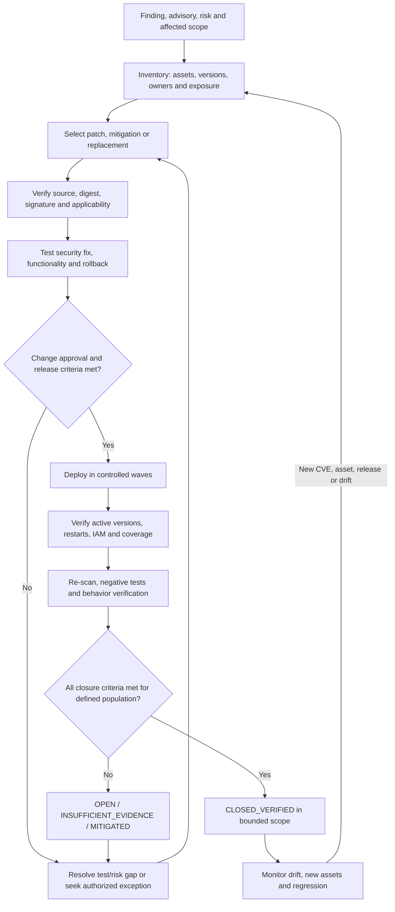
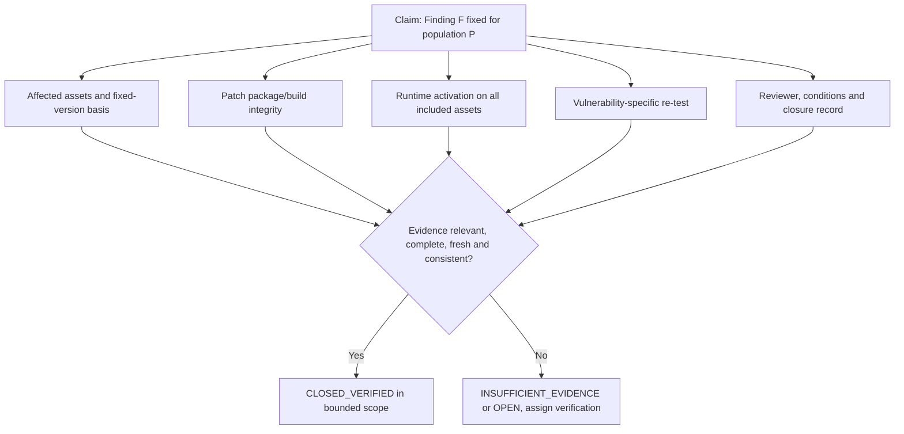
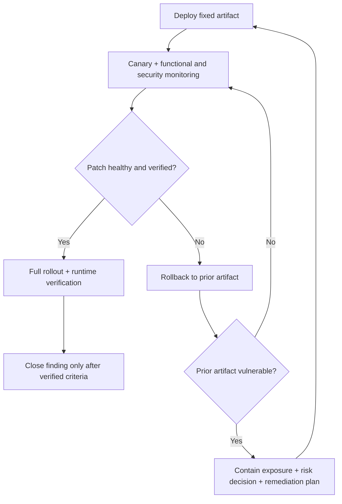

# Bằng chứng patch

## Mục tiêu học tập

Sau bài học này, bạn có thể:

- Giải thích **bằng chứng patch (patch evidence)** là gì, vì sao một thông báo “đã cài bản vá” hoặc ticket `Done` chưa đủ chứng minh lỗ hổng đã được khắc phục trong môi trường đang chạy.
- Phân biệt **patch available, patch approved, package downloaded, installed, activated, deployed, verified và vulnerability closed**; nêu đúng phạm vi của từng kết luận.
- Xây dựng chuỗi truy vết **finding/advisory → affected asset/component → patch/fixed version → kiểm tra tính xác thực → test → approval → triển khai → runtime verification → re-scan/re-test → đóng finding hoặc quản lý residual risk**.
- Chỉ ra yêu cầu bằng chứng khác nhau đối với **Java/Maven/Spring Boot, container/Kubernetes, máy ảo và OS/kernel, database, firmware, managed service và SaaS**.
- Thiết kế kiểm chứng **positive/negative, regression, config/IAM, trạng thái restart/reboot, khả năng rollback và hiệu lực của controls** theo nguy cơ được vá.
- Đánh giá chất lượng bằng chứng về **provenance, integrity, scope, freshness, completeness, reproducibility và independence**, tránh các kết luận “100% patched” dựa trên inventory thiếu.
- Soạn bộ hồ sơ patch có **owner, release/build/digest, timestamps, approval, rollout, downtime, canary, kết quả test, exceptions và re-verification trigger**.
- Áp dụng **Claim – Argument – Evidence (CAE)** để kết luận lỗ hổng đã được xử lý có kiểm chứng, hoặc ghi `INSUFFICIENT_EVIDENCE` khi chưa xác định được bản vá có hiệu lực.

## 1. “Bằng chứng patch” là gì?

**Bằng chứng patch** là tập hợp artifact, kết quả đo, nhật ký và quyết định có thể truy vết chứng minh **một thay đổi sửa lỗi hoặc giảm rủi ro đã được lựa chọn, kiểm tra, áp dụng và có hiệu lực đối với đúng hệ thống trong một phạm vi/thời điểm xác định**.

Với security assurance, câu hỏi quan trọng không chỉ là **“Có tải/cài bản vá chưa?”** mà còn:

1. Bản vá nhắm tới **lỗ hổng, phiên bản và cấu hình bị ảnh hưởng** nào?
2. Những **asset, service, pod, image, binary, database node, region, tenant** nào cần áp dụng?
3. Bản vá có đến từ nguồn tin cậy, đúng artifact và tương thích không?
4. Ai duyệt change, kiểm thử behavior và chuẩn bị rollback?
5. Có bằng chứng **bản vá thực sự chạy** trên các instance mục tiêu, không chỉ tồn tại trong artifact repository?
6. Nếu phải reboot, restart, reload, data migration hoặc key rotation thì những bước đó có hoàn tất không?
7. Đường có thể bị khai thác đã bị chặn chưa, và **phần nào chưa được kiểm**?
8. Có instance mới, image cũ, backup/DR, agent, sidecar, job hoặc environment khác còn mang phiên bản lỗi không?
9. Ai đã **kiểm chứng độc lập**, kết luận theo tiêu chí nào, và khi nào cần đánh giá lại?

Ví dụ, nhóm Java cập nhật `pom.xml` để nâng version thư viện xử lý PDF. PR merged, CI tests xanh, nhưng container đang chạy vẫn dùng image digest cũ. Khi đó có **bằng chứng đã sửa khai báo dependency trong source**, chưa có **bằng chứng production được vá**. Ngay cả khi rollout mới hoàn tất, vẫn cần kiểm resolved dependencies/artifact, các worker paths còn dùng library cũ và finding đã được khắc phục trong scope.

### 1.1. Vì sao patch evidence quan trọng trong SECURITY_SECURITY_ASSURANCE?

Dịch vụ học tập **SECURITY_SECURITY_ASSURANCE** hướng tới đánh giá có bằng chứng từ phân tích rủi ro, security requirements và controls đến test, audit, findings và remediation. Trong chuỗi này, patch evidence kết nối:

> **Lỗ hổng được xác định → yêu cầu giảm rủi ro → bản thay đổi được phê duyệt → evidence triển khai và hiệu lực → quyết định xử lý finding → giám sát tái phát.**

Không có chuỗi này, một dashboard có thể báo `PATCHED` vì agent cập nhật thành công, trong khi critical workload đã chạy kernel cũ, hoặc một Maven dependency vẫn được bundle qua đường transitive.

### 1.2. Patch evidence không phải “chứng minh mọi thứ an toàn”

Ngay cả khi patch đã hiệu lực:

- Nó có thể sửa **một CVE cụ thể**, không xử lý mọi lỗ hổng trong sản phẩm.
- Một version mới có thể có **vulnerability khác hoặc regression**.
- Cấu hình triển khai sai, IAM quá rộng, BOLA hoặc secret exposure có thể tồn tại độc lập với package version.
- Scan không báo CVE không chứng minh không có zero-day hoặc business logic vulnerability.
- Evidence thường chỉ đúng với **build, instance population, thời điểm và verification method** được nêu.

Do vậy, luôn giới hạn claim: “Bản vá V đã được kiểm chứng trên các workload thuộc inventory P trong môi trường X tại thời điểm T theo phương pháp M”, thay vì “Hệ thống đã an toàn tuyệt đối”.

## 2. Phân biệt patch, update, mitigation và verified closure

| Thuật ngữ | Ý nghĩa | Bằng chứng thường có | Điều chưa chứng minh |
| --- | --- | --- | --- |
| **Patch available** | Vendor/upstream đã phát hành bản sửa. | Advisory, release note, fixed version. | Customer đã nhận/cài/triển khai. |
| **Patch acquired** | Đã tải hoặc đồng bộ package/image. | Package repo, digest, download metadata. | Artifact nguồn tin cậy hoặc đang được chạy. |
| **Patch validated** | Đã kiểm tính xác thực, tính phù hợp và tương thích ở phạm vi chọn. | Signature/provenance verification, test results. | Mọi production instance được cập nhật. |
| **Patch approved** | Change được phê duyệt theo policy. | Change request, approver, scope, window. | Thay đổi đã thực hiện hoặc thành công. |
| **Patch installed** | Binary/package mới hiện diện trên asset. | Package manager log, installed version. | Process/kernel hiện tại dùng binary mới. |
| **Patch activated/effective** | Phiên bản/config phù hợp đang có hiệu lực. | Process image/runtime version, kernel/restart/config evidence. | Đã xử lý mọi exploit path và related assets. |
| **Patch deployed** | Artifact mới đã được đưa vào môi trường đích. | Deployment record, image digest/rollout results. | Tất cả pod, worker, sidecar/region đang dùng artifact đó. |
| **Mitigation** | Giảm exposure/khả năng khai thác mà chưa chắc sửa nguyên nhân. | Validated WAF/IAM/network rule, feature disable. | Vulnerable code/package đã được sửa. |
| **Remediation** | Xử lý nguyên nhân hoặc đưa control về trạng thái đáp ứng theo requirement. | Corrected code/config/version + tests. | Runtime đã áp dụng nếu mới ở source. |
| **Verified closure** | Reviewer đã xác nhận tiêu chí đóng finding trong scope bằng evidence. | Re-test, affected inventory reconciliation, sign-off. | Không còn nguy cơ nào ngoài scope hoặc trong tương lai. |
| **Risk acceptance/exception** | Residual risk được chấp nhận trong thẩm quyền và điều kiện quy định. | Risk decision, conditions, expiry, monitoring. | Technical vulnerability tự biến mất. |

**Patch là một phương án xử lý vulnerability**, không phải mọi remediation đều cần vendor patch. Với lỗi BOLA, remediation thường là **đổi code/policy và kiểm thử phân quyền**. Với exposed secret, remediation có thể cần **revoke/rotate credential**; chỉ nâng package không giải quyết được.

### 2.1. “Installed” khác “running”

Một số hệ thống cài bản cập nhật nhưng ứng dụng vẫn chạy binary hoặc process cũ:

- **Linux kernel:** có package kernel mới nhưng chưa reboot, nên kernel active chưa đổi.
- **Java service:** dependency được build lại nhưng pod/container cũ còn chạy trên node.
- **Web server/library:** file trên disk mới nhưng process chưa restart hoặc reload.
- **Database:** binary/extension được cập nhật ở một node nhưng cluster còn read replica/extension cũ.
- **Firmware:** image đã upload vào thiết bị nhưng chưa activate hoặc thiết bị boot vào partition cũ.
- **SaaS:** vendor phát hành fix, nhưng tenant/region/plan của khách hàng chưa được xác nhận đã nằm trên rollout.

Đọc đúng từng lớp tránh một lỗi phổ biến: **dựa vào trạng thái patch management agent hoặc package repository mà bỏ qua runtime thực tế**.

### 2.2. “Vulnerability fixed” khác “asset not affected”

Nếu phần mềm thuộc affected version nhưng cấu hình sản phẩm **đã được chứng minh không sử dụng code path nguy hiểm**, có thể ghi `NOT_AFFECTED` theo analysis/VEX hợp lệ. Đó **không phải** bằng chứng đã patch. Ngược lại, khi version mới đã chạy nhưng control chưa qua re-test, có thể ghi `PATCH_APPLIED_PENDING_VERIFICATION` thay vì `CLOSED_VERIFIED`.

## 3. Chuỗi chứng cứ theo vòng đời patch



### 3.1. Giai đoạn và artifact cần lưu

| Giai đoạn | Câu hỏi cần trả lời | Evidence phù hợp | Owner điển hình |
| --- | --- | --- | --- |
| **Discovery** | Finding nào, nguồn nào, độ tin cậy nào? | CVE/advisory/finding, scanner result, report ID. | AppSec/vulnerability analyst. |
| **Affected analysis** | Asset và build/config nào thực sự bị ảnh hưởng? | Asset inventory, SBOM, dependency tree, effective versions. | Service owner, platform, vendor. |
| **Decision** | Chọn patch nào, vì sao, ưu tiên theo risk ra sao? | Risk assessment, patch release notes, treatment rationale. | Service/security/risk owners. |
| **Artifact trust** | Package có đúng nguồn và nội dung không? | Publisher identity, artifact digest, signature/provenance verification. | Build/release owner, supplier assurance. |
| **Testing** | Bản vá xử lý threat và không phá hệ thống? | Unit/integration/security/compatibility/rollback test results. | Engineering, QA, AppSec. |
| **Approval** | Có quyền và điều kiện thực hiện change chưa? | Change request, risk decision, deployment window, approver. | Change/release authority. |
| **Deployment** | Đã cập nhật đúng môi trường/nhóm asset? | Release ID, pipeline logs, package install/rollout events. | SRE/operations/platform. |
| **Activation** | Phiên bản/config đã có hiệu lực trong process/kernel/cluster? | Running image digest, loaded library/runtime, reboot/restart evidence. | Operations/platform. |
| **Verification** | Lỗ hổng/behavior đã hết trong scope? | Targeted re-scan, positive/negative tests, runtime control review. | QA/AppSec/independent reviewer. |
| **Closure/monitoring** | Toàn bộ population đã xử lý, còn gap nào? | Reconciled asset list, closure decision, exception, recheck trigger. | Vulnerability owner, assurance reviewer. |

**Nguồn bằng chứng có giá trị khác nhau**. Screenshot ở console “Update completed” có thể chứng minh một công cụ đã chạy lệnh, nhưng không thay thế việc chứng minh tất cả workloads thực tế dùng version mới.

### 3.2. Khả năng truy vết tối thiểu

```text
Finding VM-042
    → Advisory / vulnerability definition
    → Product + affected version + environment inventory
    → Approved target version or exact mitigation
    → Change CR-018 and source/commit/build identity
    → Signed or otherwise source-verified artifact digest
    → Test report + canary + rollback approval
    → Deployment rollout and effective runtime evidence
    → Security re-test with positive/negative cases
    → Reviewer decision and finding closure scope
    → Monitoring / recheck triggers
```

Mỗi mũi tên cần **reference có truy cập kiểm soát**. Một danh sách file rời rạc không gắn với release/asset không đủ để dựng lại chuỗi quyết định trong audit.

## 4. Xác định “mẫu số” tài sản cần vá

### 4.1. Asset population là phần khó nhất

Giả sử team vá 18 trong số 18 pod đang được liệt kê bởi một câu lệnh. Chỉ số **100% patched** vẫn có thể sai nếu:

- Có namespace/cluster/region khác chạy image cũ.
- CronJob tạo pod tạm từ template chưa được update.
- Auto-scaling group tạo node mới từ **golden image/AMI cũ**.
- Một worker độc lập dùng cùng dependency nhưng không có trong service inventory.
- Backup/DR environment chỉ được bật khi có incident; artifact và key dependencies cũ.
- Sidecar, init container, agent hoặc third-party extension vẫn có affected version.
- Một tenant SaaS đang ở region rollout chậm hơn.
- Một instance đã được vá nhưng thay thế về sau bằng snapshot hoặc image lỗi thời.

Do đó, **coverage** phải bắt đầu từ population được truy vết qua asset inventory, cloud/Kubernetes accounts, runtime discovery, SBOM và deployment/CI records.

### 4.2. Một asset record cần có gì?

| Thuộc tính | Ví dụ / mục đích |
| --- | --- |
| Asset ID | Service/workload/node/database instance; danh tính ổn định phù hợp. |
| Business/service owner | Người chịu trách nhiệm impact và điều phối remediation. |
| Environment/region/cluster | Production/staging/DR; không gộp kết quả giữa các môi trường. |
| Component/package | Maven coordinates, image digest, OS package, kernel, firmware, DB engine/version. |
| Installed version | Bằng chứng package/binary mới hiện diện. |
| **Effective runtime version** | Process/kernel/container đang chạy version/digest nào. |
| Exposure/criticality | Internet-facing, privileged build runner, sensitive data, blast radius. |
| Desired/approved target | Patch version, security config, vendor advisory reference. |
| Deployment cohort | Canary/wave, ASG, replica group, tenant/region rollout. |
| Verification | Test IDs, scanner observation, observed time và reviewer. |
| Exceptions/unknowns | Asset chưa kiểm, maintenance delay, risk decision, expiry. |

Trong hệ thống động, việc lấy snapshot một lần chưa chắc đủ. Phải định nghĩa **mốc thời gian**, cách phát hiện assets mới và cách đảm bảo desired state không quay lại version cũ.

### 4.3. Công thức coverage cần mẫu số đáng tin

Nếu tính tỷ lệ đã được xác minh:

\[
\text{Verified Patch Coverage} = \frac{\text{Số tài sản thuộc phạm vi đã được xác minh hiệu lực}}{\text{Tổng số tài sản thực sự thuộc phạm vi cần xử lý}}\times100\%
\]

Với mẫu số thay đổi theo auto-scaling, phải ghi **snapshot window và discovery method**. Một tài sản `NOT_AFFECTED` được chứng minh có thể tách khỏi denominator của patch-required population, nhưng không được âm thầm loại tài sản có trạng thái `UNKNOWN` để tăng tỷ lệ.

### 4.4. Mỗi environment là một claim khác nhau

| Tình huống | Kết luận được phép | Chưa thể kết luận |
| --- | --- | --- |
| Staging image đã nâng version. | Bản build R2 đã được thử tại staging. | Production đang chạy R2. |
| CI có Maven dependency mới. | Dependency resolution của build được kiểm dùng version mới. | Runtime classpath/pod mới được triển khai. |
| Canary pod chạy digest mới. | Canary cohort đã cập nhật. | Full cluster/region/DR đều đạt. |
| Production rollout hoàn tất, runtime scan xác nhận. | Những assets được inventory và scan đã có bản vá trong observation window. | Không còn unmanaged assets hoặc bypass paths chưa xét. |
| Vendor thông báo SaaS đã fix. | Có vendor assertion hoặc release announcement. | Tenant/region customer cụ thể đã fix nếu chưa có evidence tương ứng. |

## 5. Bằng chứng trước khi patch: xác định root cause và lựa chọn xử lý

### 5.1. Xác định vulnerability và phạm vi bị ảnh hưởng

Với lỗ hổng đã được công bố, tối thiểu kiểm:

- **Advisory/CVE** chính xác; affected versions, fixed version(s), vendor-maintained branches và backports.
- Product/package coordinate, runtime build, image digest, OS release và configuration.
- Dependency path (direct/transitive) và code path có thể kích hoạt.
- Attack surface: API public, batch input, privileged runner, reachable service account hoặc local-only.
- Data assets, confidentiality/integrity/availability impact và known exploitation khi có nguồn tin cậy.
- Các controls bù trừ hiện hữu và evidence vận hành, không chỉ declarations.
- Liên kết finding, owner, SLA/risk policy và patch decision.

Không dựa vào **version number lớn hơn** để mặc định đã fix: vendor có thể backport bản vá vào nhánh version cũ, hoặc release mới vẫn bị affected vì phụ thuộc/config khác. Cần đối chiếu **advisory, changelog, artifact evidence và tests**.

### 5.2. Patch candidate và quyết định

| Câu hỏi | Evidence |
| --- | --- |
| Bản vá thực sự sửa vulnerability nào? | Vendor advisory/release note/fix statement có version scope. |
| Fixed version có được hỗ trợ không? | Vendor support matrix, compatibility notes. |
| Có transitive dependencies hoặc breaking changes? | Dependency diff, SBOM, change impact review. |
| Patch ảnh hưởng availability và dữ liệu? | Compatibility tests, schema migration/backup checks, RTO/RPO assumptions. |
| Có cần service restart hoặc reboot? | Vendor instructions, service design, active runtime check plan. |
| Có thể patch theo rolling update? | Replication/HA design, quorum checks và canary plan. |
| Nếu rollback, có quay lại vulnerable version không? | Rollback security trade-off, temporary mitigation và risk authority. |
| Có vendor/client obligations? | Contract/service scope, support window, notification requirements. |

### 5.3. “Không thể patch” cũng cần báo cáo

Nếu component không có bản sửa, không tương thích hoặc không còn được hỗ trợ:

1. Xác định affected assets/exposure và kiểm chứng limitations.
2. Cân nhắc **remove/replace component**, isolate, disable feature hoặc policy giảm exposure.
3. Đánh giá mitigation có thật sự chặn attack path hay chỉ che dấu scanner.
4. Đề xuất timeline khắc phục căn nguyên với owner và decision authority.
5. Nếu cần risk exception, phải có scope, residual risk, expiry, compensating controls và monitoring.
6. Không đánh dấu `PATCHED` hoặc `CLOSED_VERIFIED` chỉ vì chưa có patch.

## 6. Kiểm tra nguồn gốc và tính toàn vẹn bản vá

### 6.1. Vì sao patch package có thể là nguồn rủi ro?

Phần mềm cập nhật thường được phân phối qua registry, mirror, CI/CD, image repository hoặc hệ thống quản lý bản vá. Nếu publisher account, dependency registry, build runner hoặc signing key bị xâm nhập, người dùng có thể nhận **artifact độc hại mang nhãn update**.

Một chương trình patch security phải đánh giá **software supply-chain trust** tương xứng risk:

- Download/update từ **nguồn được phê duyệt** với publisher identity phù hợp.
- Xác minh package/image digest so với **trusted metadata**, không chỉ checksum lấy từ cùng nơi chưa được bảo vệ.
- Nếu có signature/attestation, xác minh signer/certificate identity, validity, trust roots và artifact binding.
- Đối chiếu artifact digest với **build/deploy/runtime subject**; tránh kiểm file A rồi triển khai file B.
- Kiểm provenance từ source revision, builder và materials khi yêu cầu assurance cao.
- Bảo vệ CI/update credentials, repository access và quyền release/rollback.
- Lưu kết quả verification và policy version; không chỉ ghi “signature present”.

**Signature hợp lệ không chứng minh patch không có lỗi hoặc mã độc**. Nó giúp xác minh nguồn gốc/tính toàn vẹn theo trust policy; behavior và vulnerability vẫn cần được test.

### 6.2. Phân biệt các loại artifact

| Artifact | Chứng minh được | Giới hạn |
| --- | --- | --- |
| Vendor release note/advisory | Vendor tuyên bố fix và versions/phạm vi. | Chưa chứng minh artifact deployed. |
| Package checksum/digest | Byte identity khi so với nguồn tin cậy. | Không tự chứng minh tính an toàn của nội dung. |
| Signed artifact/provenance | Identity/claims về nguồn/build nếu được **verify**, không chỉ lưu. | Phải kiểm trust policy, key compromise và subject binding. |
| SBOM trước/sau | Thành phần và versions trong artifact được kiểm kê. | Không tự chứng minh runtime hay mọi lỗ hổng hết. |
| VEX | Supplier assessment về affected/not affected/fixed cho product scope. | Không tự đúng với mọi customer config, mọi version. |
| SCA/OS scanner result | Tín hiệu về known vulnerabilities theo detection method. | Có false positives/negatives, có thể đọc package chứ không phải running process. |
| Deploy audit log | Hệ thống phân phối artifact nào, lúc nào. | Không tự chứng minh mọi process đang chạy artifact đó. |

### 6.3. Ví dụ kiểm chứng OCI image

```text
Approved release input:
  source_commit: <reviewed-commit-id>
  builder_identity: <trusted-builder-identity>
  image_digest: sha256:<actual-artifact-digest>
  package_sbom_ref: <SBOM-of-same-image>
  signature_verification: PASS under approved policy

Observed deployment:
  image_reference: repo/service@sha256:<same-verified-digest>
  running_pod_image_ids: <verified-observed-digests>
  verified_at: <actual-time>
```

Không phải chỉ có chuỗi `sha256:...` trong YAML là đã xác minh. **Evidence cần kết quả so khớp digest thực với danh tính phát hành tin cậy và với các process đang chạy**.

## 7. Kiểm thử patch trước triển khai

### 7.1. Những kiểm thử cần cân nhắc

| Nhóm | Điều cần xác minh | Evidence |
| --- | --- | --- |
| **Security fix** | Đường khai thác được mô tả trong finding không còn hành vi sai. | Safe targeted negative test/attack simulation theo authorization. |
| **Positive behavior** | Chức năng đúng vẫn hoạt động, không “deny-all” hoặc vô hiệu hóa feature ngoài ý muốn. | Functional/integration tests với dữ liệu synthetic. |
| **Regression** | Code paths quan trọng không bị hỏng khi patch dependency/framework. | Test suite phù hợp, failure analysis và coverage scope. |
| **Compatibility** | API contracts, schema, serialized messages, dependencies vẫn tương thích. | Contract tests, migration scripts, compatibility matrix. |
| **Data integrity** | Migration hoặc patch không làm sai/mất dữ liệu. | Backups, checksums, data reconciliation. |
| **Performance/availability** | Startup, latency, memory, resource use, retries và capacity còn phù hợp. | Staging/load canary metrics theo ngưỡng được phê duyệt. |
| **Security configuration** | TLS, cipher, IAM, environment variables và policy không bị reset sang default yếu. | Config diff, secrets audit, effective IAM checks. |
| **Rollback** | Có phương án an toàn nếu patch thất bại và cách kiểm soát quay lại version lỗi. | Rehearsal hoặc plan/test tương xứng rủi ro. |
| **Operational readiness** | Monitoring, alert, health/readiness và on-call/runbook hoạt động. | Dashboard, alert tests, deploy/rollback plan. |

### 7.2. Kiểm chứng hai hướng

Một bản patch authentication có thể vô tình **chặn tất cả requests**. Nếu chỉ kiểm negative exploit case, kết quả sẽ xanh nhưng hệ thống không thực hiện được nghiệp vụ. Ngược lại, test happy path thành công không chứng minh attacker bị chặn.

Vì vậy cần kết hợp:

1. **Positive control:** request/nghiệp vụ đúng được cho phép.
2. **Negative control:** trường hợp bị cấm hoặc vulnerable input không còn được xử lý sai.
3. **Failure-path check:** timeout, partial failure, stale job, unavailable policy source và retry theo security requirements.
4. **Side-effect assertion:** deny không ghi dữ liệu, không tạo export, không gửi notification/trả PII hoặc mở kết nối ngoài policy.
5. **Regression coverage:** không tạo bypass từ đường thay thế như worker, admin API, cache hay vendor callback.

### 7.3. Rollout và canary không thay thế full-scope verification

Canary hữu ích để phát hiện lỗi sớm nhưng chỉ chứng minh behavior trên **canary cohort**. Sau khi rollout, vẫn phải đối chiếu desired state và actual state trên toàn population, đặc biệt:

- Replica chưa restart/roll.
- Pod được scheduler khởi tạo lại từ image cũ.
- DB replica hoặc DR region chưa nâng cấp.
- Client library nằm trong worker/sidecar không cùng deployment.
- Configuration của region/tenant khác.

Một canary thành công là **bằng chứng của giai đoạn test/rollout**, không phải chứng chỉ toàn production đã được vá.

## 8. Bằng chứng triển khai: làm rõ chuyện gì đã xảy ra

### 8.1. Change record trước khi deploy

Một change record nên nêu:

- Change ID, asset/service, vulnerability/finding IDs, target artifact/patch versions.
- Approved scope: environment, regions, tenant sets, cohort/instances và exclusions.
- Risk/severity, urgency, expected exposure reduction và business availability impact.
- Test/compatibility/rollback results, approver và release window.
- Rollout strategy: canary, rolling, blue-green, sequential maintenance hoặc hotfix.
- Activation requirements: restart, reboot, reload, schema migration, image re-creation, firmware activation.
- Evidence collection plan và người xác minh; release gate/blocking conditions.
- Nếu emergency change: emergency approval workflow, audit trail và retrospective review theo policy.

### 8.2. Các mốc sự kiện nên ghi

```text
CR-018 approved at T1
  → package/image verified at T2
  → staging test completed at T3
  → canary deployment started at T4
  → canary health/security tests passed at T5
  → full rollout started at T6
  → rollout completed at T7
  → effective runtime versions reconciled at T8
  → targeted security re-test passed at T9
  → authorized reviewer closed finding at T10
```

Mốc thời gian thực tế phải được ghi bằng timestamp có timezone và nguồn; **không tự điền T10 nếu evidence mới dừng ở T7**. Với rollback, cần thêm nhánh riêng và risk decision khi quay lại version còn lỗ hổng.

### 8.3. Cách diễn giải deploy logs

| Log/sự kiện | Kết luận hợp lệ | Điểm cần kiểm thêm |
| --- | --- | --- |
| Pipeline “build succeeded” | Artifact build hoàn tất theo pipeline. | Binary/version, signing, deployed status. |
| Deployment object updated | Desired state đã thay đổi. | Pods/processes thực tế và rollout history. |
| Kubernetes rollout “success” | Controller thấy deployment đáp ứng điều kiện rollout. | Workload image digests, init/sidecars, autoscaling/DR và security test. |
| OS package manager “installed successfully” | Package cập nhật trên host. | Active kernel/process/reboot và dịch vụ liên quan. |
| Patch agent “compliant” | Agent đánh giá theo policy/inventory của agent. | Tool coverage, live runtime, unmanaged assets, policy freshness. |
| SaaS vendor “rolled out” | Vendor tuyên bố rollout hoàn tất theo scope của họ. | Tenant/customer region/plan, vendor evidence và integration behavior. |

## 9. Chứng minh patch đang có hiệu lực theo công nghệ

### 9.1. OS, kernel và hệ thống máy ảo

OS patch evidence cần phân biệt:

- **Installed package/update inventory:** gói đã được cài ở disk.
- **Active kernel/system build:** phiên bản hiện tại của kernel/OS đang thực thi.
- **Running processes:** các daemon có thể đang giữ thư viện cũ trong memory.
- **Required reboot/restart:** yêu cầu kích hoạt bản vá đã được đáp ứng chưa.
- **Host population:** VM, node, image template, bastion, jump host, DR và autoscaling nodes.
- **Effective mitigation:** cấu hình, sysctl, service unit, firewall hoặc workaround nếu fix cần điều kiện thêm.

Ví dụ một Linux host có kernel mới trên disk nhưng `uname -r` vẫn phản ánh kernel cũ. Kết luận tối đa lúc đó là **installed, pending activation**, trừ khi đang dùng cơ chế live patch có hiệu lực **và có evidence phù hợp cho vulnerability cụ thể**. Không coi mọi live patch là tương đương reboot hoàn toàn; cần đọc scope và limitations của cơ chế đó.

Trên Windows, trạng thái “KB installed” cũng có thể cần reboot để thay file/system components đang được sử dụng. Cần kiểm effective OS build/version và trạng thái pending reboot theo deployment policy, không chỉ ảnh console.

### 9.2. Container và Kubernetes

Với container, **patch node OS** và **patch ứng dụng trong image** là hai lớp độc lập. Nâng container base image không tự cập nhật package/JAR ở application layer; nâng JAR không tự sửa kernel của node.

Bằng chứng cần kết nối:

```text
Vulnerability affected package
   → Dependency / OS package in built image
   → Fixed image digest from approved build
   → Kubernetes workload image references
   → Actual running container imageIDs per pod
   → All required replicas, jobs and namespaces
   → Post-rollout scanner + targeted tests
```

Các vấn đề thường gặp:

1. Deployment manifest trỏ tag `latest`, nhưng các node/pod đã pull những digest khác nhau.
2. Helm values thay đổi nhưng CronJob template, init container hoặc sidecar vẫn dùng image cũ.
3. Một replica `Terminating` vẫn phục vụ traffic; dữ liệu chỉ nhìn vào desired replicas mà không thấy.
4. Pod được tạo sau qua autoscaler từ image cache hoặc deployment cũ.
5. Staging dùng image digest mới, production dùng digest khác dù tag giống nhau.
6. Node kernel hoặc CNI có vulnerability không được xử lý bằng thay application image.

Nếu dùng Kubernetes, phải đối chiếu **actual pod/container image IDs**, controller templates, namespaces/regions và các workload ngắn hạn; không chỉ sao chép `kubectl rollout status` làm chứng nhận đủ scope.

### 9.3. Java/Spring Boot

Các lớp cần kiểm:

| Lớp | Patch có thể nằm ở đâu? | Evidence phải gắn với |
| --- | --- | --- |
| Source dependency declaration | `pom.xml`, BOM, dependency management, Gradle constraints. | Commit, PR, dependency resolution. |
| Resolved classpath | Direct/transitive JAR và conflict resolution. | Dependency tree/lock data và build output. |
| Packaged application | Spring Boot executable JAR, shaded/fat JAR, native image. | Artifact digest, contained libraries/provenance. |
| Container image | App artifact + JDK/JRE + base OS packages. | Image digest, SBOM, signing, CI results. |
| Running workload | Pod/process JVM đang tải code nào. | Runtime image ID, deploy version, process/container scope. |
| External components | DB driver on other service, worker, sidecar, agent. | Related asset inventory và verification riêng. |
| Security behavior | Affected parsing/auth/API path đã được sửa chưa. | Negative/regression tests với approved fixtures. |

**Chỉ thay version trong `pom.xml` là một bước chuẩn bị**, không tự chứng minh Maven đã resolve version đó hoặc production JVM đang chạy code mới.

### 9.4. Database và stateful systems

Database patch có thể yêu cầu thay engine binary, driver, extension, plugin hoặc schema. Evidence cần:

- Engine version và build **trên từng writer/reader/replica**.
- Cluster topology, quorum/HA state, connection routing và failover test.
- Extension/version được load, storage engine hoặc SQL feature configuration.
- Backup snapshot **trước** thay đổi và restore plan/verification phù hợp.
- Replication lag, data integrity, schema migration và compatibility.
- Client drivers và connection pools trên các service liên quan.
- Rollback/restore safety, đặc biệt migration không tương thích ngược.

Một DB console báo “primary upgraded” chưa đủ khi replica hoặc ETL/DR node còn affected. Một upgrade thành công nhưng data integrity sai vẫn không thể coi change đã đạt acceptance.

### 9.5. Firmware, network và thiết bị bảo mật

Với firmware của router, switch, appliance hoặc HSM:

- Xác minh firmware image/vendor trust, model/hardware compatibility và điều kiện license.
- Phân biệt **uploaded image**, **installed image**, **active boot partition** và firmware actually running.
- Xem dual-image/HA pair, standby node, bootloader và yêu cầu reboot/failover.
- Kiểm policy/routing/access behavior sau activation, không chỉ software version.
- Đối chiếu asset inventory, serial/hardware identifier trong scope và DR/fallback devices.

Nếu thiết bị quay lại partition cũ sau rollback, finding phải được **reopened** hoặc ghi residual risk, không giữ kết luận patch cũ vô điều kiện.

### 9.6. SaaS và managed service

Với SaaS, khách hàng không luôn quan sát được installed packages. Thay vào đó, cần **vendor evidence được giới hạn theo product/tenant/region**, cùng customer-side verification khi khả thi:

- Advisory thông báo affected/fixed scope và release train.
- Rollout status của dịch vụ/region/plan khách hàng.
- Vendor attestation, independent review/incident follow-up nếu risk yêu cầu.
- Customer contract/API tests với behavior bị ảnh hưởng.
- Effective configuration: feature flags, tenant policy, encryption/IAM và service version info nếu cung cấp.
- Những trách nhiệm customer vẫn phải thực hiện: SDK update, token revoke, webhook verification, connector config.

Một email “All customers patched” có thể là đầu vào assessment, nhưng reviewer cần xác định **issuer, thời điểm, sản phẩm, môi trường và giới hạn**. Nếu không thể xác minh claim quan trọng, ghi `INSUFFICIENT_EVIDENCE` và giới hạn decision theo risk policy.

## 10. Case study: patch thư viện xử lý PDF trong Spring Boot

### 10.1. Tình huống

Một service `certificate-export-worker` tạo PDF chứng chỉ từ dữ liệu học tập synthetic. Nhà cung cấp thông báo thư viện parsing/rendering ở một số phiên bản có thể xử lý dữ liệu đầu vào không an toàn. Đội phát triển dùng Maven, đóng gói Spring Boot executable JAR rồi đưa vào OCI image và chạy trên Kubernetes.

Để tránh mô tả nhầm lỗ hổng thực, ví dụ dùng **package hư cấu** `com.example.training:demo-pdf-parser` và version giả định `1.0-demo` (affected) / `1.1-demo-fixed` (fixed). Không có CVE có thật được ngầm gán cho các version minh họa này.

### 10.2. Bằng chứng đầu vào

| Evidence ID | Câu hỏi | Kết quả ví dụ |
| --- | --- | --- |
| `E-PDF-ADVISORY` | Có advisory với vulnerable/fixed version và prerequisites? | Vendor statement có phạm vi sản phẩm giả định, cần verify issuer. |
| `E-PDF-RESOLUTION` | Worker thực sự dùng library nào? | Dependency tree cho thấy library qua direct hoặc transitive path. |
| `E-PDF-ARTIFACT-OLD` | Affected version nằm trong artifact nào? | Image digest/contained JAR matching affected version. |
| `E-PDF-RUNTIME-OLD` | Những production pods/regions nào đang chạy old digest? | Runtime inventory và snapshot time. |
| `E-PDF-RISK` | Input nào đến parser, mức phơi bày và hậu quả? | Synthetic attachment/certificate template path, trust assumptions. |

Đánh giá severity phải xét **input source, code path, privileges của worker, network, KMS và dữ liệu có thể đọc**, không chỉ package version.

### 10.3. Mục tiêu patch

Giả sử requirement `SR-PATCH-PDF-01` là:

> “Tất cả `certificate-export-worker` thuộc production asset inventory chạy artifact có version thư viện parsing đã được vendor xác nhận xử lý advisory tương ứng, không load affected code path; canary, regression và vulnerability-specific checks phải đạt; container digest và trạng thái triển khai phải được đối soát với inventory tại cửa sổ kiểm chứng.”

Điều kiện chấp nhận:

1. Resolved dependency đã thay sang approved fixed version.
2. Build artifact thực chứa version được phê duyệt, không còn bản affected được nạp qua transitive/shading khác trong scope.
3. Image được phát hành từ nguồn được phê duyệt với digest/provenance phù hợp.
4. Canary và full rollout chạy image digest đúng trên các instances trong inventory.
5. Safe parser regression tests xác minh behavior cần xử lý; các tính năng xuất PDF hợp lệ vẫn hoạt động.
6. Có re-scan/re-test, reviewer và decision; workloads chưa kiểm được ghi riêng, không tự pass.

### 10.4. Maven dependency resolution

Một bước evidence collection có thể sử dụng lệnh **minh họa** sau trong môi trường build được phép:

```bash
./mvnw dependency:tree -Dincludes=com.example.training:demo-pdf-parser
```

Output dependency tree chứng minh **Maven đã resolve dependency trong build context đó**. Nó không tự chứng minh Spring Boot fat JAR, container hoặc production runtime đã thay. Cần ghi Maven/JDK/build profile/settings, commit, build ID và artifact digest tương ứng; với multi-module project, xác định đúng module worker.

Đối với Maven BOM/transitive dependencies, phải kiểm **effective dependency resolution** thay vì tin một tag version trong `pom.xml`. Với dependency exclusions hoặc overrides, xem có thư viện khác vẫn mang vulnerable code/versions.

### 10.5. Build và packaging evidence

Một evidence bundle đúng nên gắn:

```text
SOURCE:
  commit: <reviewed-source-commit>
  dependency_resolution_ref: <verified-maven-dependency-tree>

BUILD:
  pipeline_run: <trusted-CI-run>
  artifact_digest: sha256:<actual-built-artifact-digest>
  SBOM_ref: <SBOM-of-exact-build>
  target_library: com.example.training:demo-pdf-parser
  resolved_version: 1.1-demo-fixed

IMAGE:
  image_digest: sha256:<verified-container-digest>
  provenance_result: <checked-under-build-policy>

DEPLOYED:
  workload: certificate-export-worker
  environment: production
  observed_running_digests_ref: <runtime-observation>
  observed_at: <timestamp>
```

Các giá trị trong dấu ngoặc góc phải là artifacts thật trước khi dùng để ký approval. **Build artifact/SBOM và running image phải mô tả cùng một sản phẩm được triển khai**.

### 10.6. Functional tests và security behavior

Worker cần kiểm các ca:

- Tạo PDF từ synthetic certificate hợp lệ; output vẫn đúng dữ liệu và format được duyệt.
- File lỗi/malformed synthetic được xử lý theo error policy, không lộ stack trace, secret hoặc raw learner data.
- Giới hạn kích thước, thời gian và tài nguyên cho parser theo threat model.
- Retry/timeout không tạo trùng file ngoài retention hoặc gửi email không đúng.
- Không mở URL/file/resource ngoài allowlist qua content hoặc template không tin cậy.
- Không làm suy giảm authorization trên course/tenant và issuance workflow.

Test malformed input **không đồng nghĩa vulnerability-specific exploit test đạt**, trừ khi được thiết kế để kiểm chính xác đường lỗi và tiêu chí của advisory, trong môi trường được phép. Có thể cần kết hợp code/advisory analysis và vendor fix evidence thay vì viết PoC nguy hiểm.

### 10.7. Spring Boot API security là control độc lập với patch

Giả sử API tạo request export PDF:

```java
@Configuration
@EnableMethodSecurity
class MethodSecurityConfiguration {}

@Service
class CertificateExportService {
    private final ExportJobRepository jobs;
    private final TrustedCourseCatalog courses;

    CertificateExportService(
            ExportJobRepository jobs,
            TrustedCourseCatalog courses
    ) {
        this.jobs = jobs;
        this.courses = courses;
    }

    @PreAuthorize(
        "@certificatePolicy.canExport(authentication, #courseId)"
    )
    public JobId requestExport(long courseId) {
        CourseScope trustedScope = courses.getScope(courseId);
        return jobs.createWithTrustedScope(trustedScope);
    }
}
```

Các types/bean là **ứng dụng giả định**, không phải Spring Boot tự cung cấp. `certificatePolicy` cần kiểm identity, tenant/course assignment và action từ nguồn tin cậy. Patch parser **không tự sửa BOLA** nếu controller/worker/download đang có quyền quá rộng.

### 10.8. MockMvc regression tests với đối chứng

Fixture synthetic: `teacher-a` được phép export course 42 tenant A; `teacher-b` cùng role nhưng không được phân công; course 99 thuộc tenant B.

```java
@SpringBootTest
@AutoConfigureMockMvc
class CertificateExportAccessIT {
    @Autowired
    MockMvc mockMvc;

    @Test
    @WithMockUser(username = "teacher-a", roles = "TEACHER")
    void assignedTeacherCanRequestExport() throws Exception {
        mockMvc.perform(post("/api/courses/42/certificates/export")
                .with(csrf()))
            .andExpect(status().isAccepted());
    }

    @Test
    @WithMockUser(username = "teacher-b", roles = "TEACHER")
    void unassignedTeacherCannotCreateJob() throws Exception {
        mockMvc.perform(post("/api/courses/42/certificates/export")
                .with(csrf()))
            .andExpect(status().isForbidden());
    }

    @Test
    @WithMockUser(username = "teacher-a", roles = "TEACHER")
    void crossTenantExportIsDenied() throws Exception {
        mockMvc.perform(post("/api/courses/99/certificates/export")
                .with(csrf()))
            .andExpect(status().isForbidden());
    }
}
```

Đây là **mẫu kiểm thử học tập**, cần controller/fixtures/Spring Security Test/config/imports để thực thi. Test denial cần kiểm thêm **không tạo job hoặc side effect**, và `403` có thể đến từ security config/route/CSRF sai thay vì policy thật; positive control và policy-path inspection là bắt buộc. MockMvc **không chứng minh bản vá thư viện parser đã triển khai**; nó là regression evidence cho control phân quyền bị ảnh hưởng khi nâng dependency.

### 10.9. Kết luận theo giai đoạn

| Evidence hiện có | Kết luận có thể ghi |
| --- | --- |
| Mới đổi `pom.xml` và merge. | `SOURCE_CHANGE_COMPLETE`, deployment chưa xác minh. |
| Resolved dependency tree và SBOM build mới đã kiểm. | `BUILD_PATCH_VALIDATED` cho artifact xác định. |
| Staging tests/canary pass. | `TEST_PASS_IN_STAGING`, production chưa chứng minh. |
| Production rollout thành công nhưng một batch worker chưa inventory. | `PATCH_APPLIED_PENDING_VERIFICATION` hoặc `INSUFFICIENT_EVIDENCE` cho toàn scope. |
| Toàn affected inventory được đối chiếu runtime, parser-specific test pass, reviewer ký. | `CLOSED_VERIFIED` **trong scope đã định**. |

## 11. Case study: OS/kernel patch và restart pending

### 11.1. Kịch bản

Một cluster Kubernetes chạy trên các Linux nodes, có kernel advisory được xác minh ảnh hưởng một số host. Patch manager báo `INSTALLED` cho mọi node trong group A nhưng một số node vẫn chưa reboot. Autoscaling group dùng golden image cũ; DR region chưa được inventory.

### 11.2. Bằng chứng cần thu

| Lớp | Bằng chứng | Vì sao quan trọng |
| --- | --- | --- |
| Affected inventory | Node IDs/instance IDs, environment, region, kernel installed/running. | Biết mẫu số thật. |
| Approved package | OS vendor advisory và fixed package/build metadata. | Xác định target đúng, tính backport. |
| Installation | Package history/patch agent per node, timestamp. | Chứng minh package trên disk. |
| Activation | Running kernel version hoặc validated live-patch coverage, reboot records. | Installed không tự là active. |
| Cluster readiness | Node drain/cordon, workload reschedule, pod health/quorum, rollback events. | Patch không làm mất availability. |
| New nodes | Launch template/golden image version, autoscaled instance scans. | Tránh hồi sinh version cũ. |
| Re-test | Scanner/runtime inspection trên các nodes, effective control/mitigation. | Chứng minh risk được xử lý trong scope. |
| DR/failover | Standby nodes và boot images, DR activation plan. | Recovery có thể bật lại kernel lỗi. |

### 11.3. Installed vs. active evidence minh họa

```text
Node A:
  installed_kernel: <fixed-package-build>
  running_kernel: <fixed-kernel-build>
  reboot_or_livepatch_verification: PASS
  status: EFFECTIVE_VERSION_VERIFIED

Node B:
  installed_kernel: <fixed-package-build>
  running_kernel: <older-affected-build>
  reboot_required: TRUE
  status: PATCH_INSTALLED_NOT_ACTIVE

New node template:
  approved_image: <old-image-version>
  status: REASSESS_REQUIRED
```

**Không thể ghi toàn group là fully patched** nếu node B hoặc launch template tiếp tục mang affected state. Tổ chức cần lên lịch reboot có kiểm soát/validation, sửa golden image, kiểm các node sinh sau và xử lý DR scope.

### 11.4. Những quyết định vận hành phải lưu

- Khi nào được drain node mà không vi phạm SLO, quorum hoặc data integrity?
- Có cần emergency maintenance và ai có authority?
- Nếu không reboot ngay, live patch/temporary mitigation có được chứng minh đủ với advisory không?
- Nếu patch gây lỗi network/CNI, rollback có đưa kernel vulnerable trở lại không và risk decision nào được áp dụng?
- Có thể dùng canary host rồi rollout wave-by-wave với health checks nào?
- Ai xác minh **effective kernel version** trên các nodes sau change?

Một ảnh package manager “update successful” không giải quyết những câu hỏi trên.

## 12. Kiểm chứng hiệu quả bản vá và đóng finding

### 12.1. Ba tầng kết quả phải tách

| Lớp | Claim | Evidence điển hình |
| --- | --- | --- |
| **Patch deployment** | Artifact mới được triển khai trên asset A. | Package/image/deployment records và digest. |
| **Patch activation** | Active process/kernel/firmware/config trên asset A đang dùng version/mitigation đúng. | Runtime version, restart/reboot, effective policy. |
| **Vulnerability remediation** | Finding F không còn thỏa điều kiện vulnerability trong scope được xác minh. | Targeted negative test, advisory-based analysis, re-scan, reviewer closure. |

Tầng thứ ba **không thể suy chỉ từ tầng thứ nhất**. Đôi khi vulnerability còn do một cấu hình độc lập; đôi khi vendor áp dụng backport mà số version không thay theo cách scanner kỳ vọng. Cần dùng **nhiều bằng chứng phù hợp với từng claim**.

### 12.2. Phương pháp xác minh sau triển khai

1. **Inventory reconciliation:** tất cả affected assets có phiên bản/condition đã xử lý chưa?
2. **Runtime observation:** active processes, images, loaded libraries, kernel/DB/firmware version.
3. **Advisory/patch analysis:** fixed behavior/affected configuration đã được thay theo vendor guidance.
4. **Targeted re-scan:** dùng công cụ/rule hiện hành, ghi engine/rule version và thời gian; phân tích false positives.
5. **Security regression:** safe positive/negative tests sát với threat, không bỏ đường bypass.
6. **Operational checks:** health, performance, logs, error path, data integrity và backup/DR.
7. **Drift and resurrection checks:** desired config/templates, image registry, auto-scaling, CronJobs/DR.
8. **Independent review:** reviewer kiểm evidence chất lượng, completeness, exceptions, ghi quyết định có căn cứ.

### 12.3. Tại sao re-scan xanh vẫn có thể sai?

| Trường hợp | Rủi ro false PASS | Cách xử lý |
| --- | --- | --- |
| Scanner không kiểm worker khi job không chạy. | Affected binary tồn tại nhưng runtime discovery bỏ sót. | Kiểm artifact/job templates và schedule test. |
| Tool chỉ đọc installed package chứ không đọc running kernel. | Patch pending reboot được báo pass. | Kiểm active kernel/livepatch evidence. |
| Scanner inventory thiếu một cluster/region. | Denominator bị thiếu. | Reconcile với cloud/K8s/service inventory. |
| Scanner không hiểu custom backport. | Có thể false positive chứ không phải unpatched thật. | Vendor backport evidence, build metadata, code/config verification. |
| VEX `not affected` áp dụng cho product khác. | Vulnerability bị bỏ qua sai. | Kiểm scope, issuer, version và điều kiện ảnh hưởng. |
| Scan result không có source/time/build. | Không thể gắn với release được đánh giá. | Lưu full provenance và environment. |
| Negative test 403 do route không tồn tại. | Authorization flaw chưa được kiểm đúng. | Positive control, xác minh enforcement, kiểm side effects. |
| Một WAF rule che exploit nhưng package cũ vẫn còn. | Báo cáo “patched” dù chỉ mitigated. | Giữ technical state, test mitigation và lên plan patch. |

### 12.4. Status model cho patch và finding

Không gộp tất cả vào một boolean `patched: true`. Một mô hình có hai lớp:

**Patch rollout status:** `PLANNED` → `APPROVED` → `TESTED` → `DEPLOYING` → `INSTALLED` → `ACTIVE_VERIFIED`; nhánh `ROLLED_BACK`, `FAILED` hoặc `PARTIALLY_APPLIED`.

**Finding status:** `OPEN` → `MITIGATED` hoặc `FIXED_PENDING_VERIFICATION` → `CLOSED_VERIFIED`; nhánh `INSUFFICIENT_EVIDENCE`, `NOT_AFFECTED`, `RISK_ACCEPTED` hoặc `REOPENED`.

Một asset có thể `ACTIVE_VERIFIED` về package mà finding vẫn `FIXED_PENDING_VERIFICATION` do chưa có vulnerability-specific test. Một risk decision `RISK_ACCEPTED` không thay technical state.

### 12.5. Khi nào được kết luận CLOSED_VERIFIED?

Một finding có thể đóng khi:

- Đã xác định và đối chiếu **affected population**, bao gồm các exclusions/unknowns hợp lý.
- Fix/mitigation được phê duyệt và thực thi theo requirement/patch scope.
- Đúng artifact/build/version được triển khai và **active trên asset** tương ứng.
- Test/analyze chứng minh vulnerability-specific acceptance criteria đạt với scope và môi trường.
- Regression và operational impact được kiểm phù hợp với rủi ro.
- Không còn known bypass trong phạm vi hoặc đã tách riêng finding không bị che.
- Reviewer có thẩm quyền xác minh hồ sơ, ghi decision, timestamp và recheck triggers.

Nếu chỉ một số host hoặc service được xử lý, có thể **đóng per-asset/per-cohort findings**, giữ finding tổng còn mở hoặc thu hẹp claim. Không tự tuyên bố “cả hệ thống đã vá” khi còn worker, replica hoặc vendor dependency chưa được xác minh.

## 13. Chất lượng bằng chứng patch và khả năng kiểm toán

### 13.1. Các thuộc tính evidence cần kiểm tra

| Thuộc tính | Câu hỏi | Dấu hiệu thiếu chất lượng |
| --- | --- | --- |
| **Relevance** | Artifact có trả lời đúng vulnerability, component, criteria và threat? | Test đăng nhập thành công cho lỗi parser PDF. |
| **Authenticity/provenance** | Ai/công cụ nào tạo, trên asset nào và có được xác thực nguồn? | Screenshot không rõ nguồn hoặc build. |
| **Integrity** | Evidence có bị chỉnh/sai lệch sau thu thập, có history không? | File report được ghi đè không lưu revision. |
| **Freshness** | Có đúng observation window, release và environment hiện tại? | Scanner pass trước khi rollback image. |
| **Completeness** | Inventory có đầy đủ all affected workloads/hosts/regions? | Chỉ nhìn một namespace và gọi toàn cluster pass. |
| **Reproducibility** | Có input/fixture, method, expected result và tool version? | “Engineer đã kiểm thử thành công” không artifact. |
| **Independence** | Reviewer và approver có phù hợp mức risk, tránh tự xác nhận hình thức? | Người thay config tự sửa `verified` không review. |
| **Explicit limitations** | Có ghi những đường chưa thử, false positives, delayed rollout? | “Patched” mà không ghi DR chưa update. |
| **Confidential handling** | Logs/screenshots có lộ API key, PII hoặc network secrets? | Export debug logs/raw request trong ticket mở rộng. |

**Không phải evidence nào cũng cần chữ ký mật mã.** Với một technical finding rủi ro cao, có thể cần artifact digests, signed build attestations, restricted test reports và approval integrity; với patch ít ảnh hưởng, source-controlled records và audit logs có thể phù hợp. Mức bảo đảm nên tương ứng threat/risk và nghĩa vụ.

### 13.2. Evidence lineage thay vì file rời rạc

Một package install log có asset ID nhưng không có version relation với finding; một CI report có build ID nhưng không có deployment ID. Từng phần trông “đầy đủ” nhưng **không nối được**.

Nên duy trì liên kết:

```text
Finding F
  ├─ advisory / affected version statement
  ├─ asset inventory version I at time T
  ├─ approved patch target and artifact digest D
  ├─ CI/build B with dependency provenance and test report
  ├─ change/approval C identifying scope I and artifact D
  ├─ deployment/activation records mapping B/D to assets
  ├─ vulnerability-specific verification report V
  ├─ unresolved items or risk exception E, if any
  └─ closure decision R with reviewer/time/scope
```

Mất một mối liên kết quan trọng có thể khiến claim không thể kiểm toán, ví dụ test trên build B nhưng production chạy digest không liên quan.

### 13.3. Cách bảo vệ artifact và thông tin nhạy cảm

Patch evidence có thể chứa thông tin không nên công khai: hostnames nội bộ, danh sách service, exposure, security controls, test payloads, vulnerability reproduction, API tokens, logs hoặc thông tin học viên.

- Dùng **storage có phân quyền**, lịch sử sửa đổi và retention theo governance.
- Lưu **references/sanitized excerpts** thay vì sao chép raw PII, tokens hoặc toàn bộ stack traces vào dashboard.
- Ghi collector/issuer, tool version, observation time và integrity metadata khi cần.
- Nếu bằng chứng thuộc investigation sự cố, tuân thủ preservation/chain-of-custody yêu cầu của incident process.
- Đảm bảo người có thẩm quyền có thể truy xuất evidence trong kỳ audit; không phụ thuộc log ngắn hạn đã bị xóa.
- Quản lý secret/certificate revocation nếu bản ghi patch vô tình làm lộ credential.

Một **checksum của một file log** không tự chứng minh mọi sự kiện đã được thu thập đầy đủ. Integrity và coverage là hai thuộc tính khác nhau.

### 13.4. Ma trận bằng chứng và kết luận

| Evidence hiện có | Claim có thể hỗ trợ | Kết luận không được tự ghi |
| --- | --- | --- |
| Advisory và download record | Fixed version có sẵn/đã được lấy. | Production đã patch. |
| Code PR nâng Maven version | Source thay đổi đã được review. | Artifact/runtime đã dùng version mới. |
| CI pipeline + SBOM + artifact digest | Build cụ thể chứa package được kê khai, tests thuộc build. | Tất cả host/pod đang chạy build. |
| Deploy tool log | Artifact đã được phân phối theo scope công cụ. | Active process đã reload/reboot xong. |
| Runtime process/image/kernel version | Asset quan sát dùng version mục tiêu. | Vulnerability-specific control đã qua verification. |
| Targeted re-scan pass | Scanner không phát hiện finding theo scope/rule/time của scan. | Không có issue ngoài coverage hoặc zero-day. |
| Positive/negative regression pass | Behavior được kiểm đạt theo fixture/build. | Mọi data flow/tenant/region đều đạt. |
| Reviewer sign-off + complete population | Closure decision có căn cứ theo scope. | Security assurance tuyệt đối, vô thời hạn. |

## 14. Claim – Argument – Evidence (CAE) cho patch assurance

**Claim – Argument – Evidence** buộc một kết luận patch nói rõ **đang khẳng định điều gì, vì sao có thể suy ra và evidence nào hỗ trợ**. Nên tách các claim theo vòng đời:

### 14.1. Claim A – Bản vá được chọn đúng

**Claim A:** “Patch candidate P được chọn phù hợp để xử lý finding F trên product/component/version và configuration đã được xác định trong assessment.”

**Argument:**

1. Finding và affected scope được xác nhận qua advisory, versions, SBOM/dependency tree hoặc runtime config.
2. Patch candidate thuộc trusted release channel và vendor nói rõ affected/fixed relation.
3. Artifact identity/digest/signature/provenance được kiểm theo chính sách cung ứng.
4. Compatibility và điều kiện activation đã được xem xét.
5. Risk owner/service owner đã quyết định xử lý theo policy, ghi các assumptions.

**Evidence:** finding/advisory references, affected analysis, trusted package metadata, verification results, patch approval, compatibility review.

**Giới hạn:** có bản vá đúng vẫn **không có nghĩa** đã deploy.

### 14.2. Claim B – Bản vá đã hiệu lực trên các asset

**Claim B:** “Trong production environment X, tại observation window T, các asset thuộc population P chạy fixed artifact/build và đã hoàn tất các bước activation cần thiết.”

**Argument:**

1. Population P được lấy từ nhiều nguồn inventory phù hợp, có exclusions và owner.
2. Artifact/target version được ánh xạ tới desired deployment.
3. Deployment events cho thấy patch đã đến các assets trong scope.
4. **Observed runtime** xác nhận image/kernel/process/DB engine/firmware version có hiệu lực.
5. Autoscaling/golden images, replicas, jobs và DR được kiểm trong phạm vi hoặc ghi gap.

**Evidence:** asset inventory snapshot, rollout history, process/kernel version logs, image IDs/digests, reboot/activation events, reconciliation report.

**Giới hạn:** running fixed version không tự chứng minh một business logic threat đã bị loại bỏ.

### 14.3. Claim C – Lỗ hổng được khắc phục có kiểm chứng

**Claim C:** “Finding F không còn đáp ứng điều kiện vulnerability trong phạm vi assets/build/environment P đã được reviewer xác minh vào thời điểm T.”

**Argument:**

1. Cơ chế ảnh hưởng, affected conditions và acceptance criteria của F đã được nêu rõ.
2. Runtime evidence chứng minh fixed version hoặc control remediation thực sự có hiệu lực.
3. Targeted verification/tests/re-scan được thực hiện với đúng environment/fixtures, positive và negative controls khi thích hợp.
4. Related bypass paths, configuration và dependencies được kiểm theo defined scope.
5. Các ngoại lệ/unknowns được giữ riêng và reviewer có quyền xác nhận closure.

**Evidence:** technical finding, runtime reconciling report, test result, scanner/tool version, code/config review, closure decision và ongoing monitoring plan.

**Giới hạn:** `CLOSED_VERIFIED` chỉ thuộc **finding F**, không chứng minh không có vulnerability khác.

### 14.4. Nhánh lập luận khi evidence thiếu



Nếu chỉ có Claim A và một phần Claim B, cần giữ Claim C chưa kết luận. **Không nâng cấp độ chắc chắn bằng câu chữ hay chữ ký lãnh đạo nếu bằng chứng kỹ thuật chưa đủ**.

## 15. Mẫu YAML cho hồ sơ bằng chứng patch

Mẫu dưới đây mô tả **một patch case giả định** của service Java/Spring Boot. Các values trong dấu ngoặc nhọn góc là placeholders; không có bằng chứng/approval thật. Trong mẫu, staging đã có kế hoạch test nhưng **production chưa được kiểm chứng**, nên overall status cố ý là `INSUFFICIENT_EVIDENCE` và finding chưa đóng.

```yaml
patch_case_id: "PATCH-EVIDENCE-EXAMPLE-010"
module_service: "SECURITY_SECURITY_ASSURANCE"
title: "Verify PDF parser dependency patch in certificate worker"
vulnerability:
  finding_id: "VM-PDF-EXAMPLE-001"
  advisory_ref: "<actual-vendor-advisory>"
  cve_id: null
  affected_component: "com.example.training:demo-pdf-parser"
  vulnerable_version: "1.0-demo"
  approved_fixed_version: "1.1-demo-fixed"
  affected_conditions_ref: "<verified-affected-analysis>"
  severity_and_priority_ref: "<approved-contextual-risk-assessment>"
  technical_finding_state: "OPEN"
scope:
  service: "certificate-export-worker"
  target_environment: "production"
  target_regions: ["<verified-region-list>"]
  workload_population_ref: "<approved-runtime-inventory-snapshot>"
  target_asset_count: null
  target_asset_count_status: "INSUFFICIENT_EVIDENCE"
  excluded_assets: []
  dependent_paths:
    - "pdf-worker"
    - "scheduled-exports"
    - "disaster-recovery-worker"
patch_selection:
  target_artifact_ref: "<candidate-artifact-digest>"
  vendor_release_ref: "<verified-release-notes>"
  source_commit_ref: "<reviewed-commit>"
  build_run_ref: "<trusted-build-run>"
  sbom_ref: "<sbom-of-same-build>"
  dependency_resolution_ref: "<actual-resolved-tree>"
  signature_or_provenance_verification_ref: "<if-required-by-policy>"
  artifact_trust_state: "NOT_VERIFIED"
change:
  change_id: "<change-record-id>"
  change_authority_role: "authorized-release-approver"
  change_approval_ref: null
  maintenance_window: null
  rollback_plan_ref: "<approved-rollback-and-risk-plan>"
  service_owner_role: "certificate-platform-lead"
  rollout_strategy: "CANARY_THEN_WAVES"
testing:
  security_test_plan_ref: "<approved-parser-retest-plan>"
  positive_regression_ref: "<actual-pdf-generation-test>"
  negative_regression_ref: "<actual-safe-malformed-input-test>"
  staging_results_ref: "<actual-test-results>"
  staging_verification_state: "NOT_VERIFIED"
  coverage_limitations:
    - "Production runtime and autoscaled worker not yet observed"
deployment:
  production_release_ref: null
  deployed_image_digest_ref: null
  canary_rollout_ref: null
  full_rollout_ref: null
  restart_or_activation_ref: null
  actual_running_image_ids_ref: null
  status: "NOT_DEPLOYED_OR_NOT_EVIDENCED"
runtime_verification:
  observed_at: null
  effective_version_ref: null
  workload_reconciliation_ref: null
  scanner_run_ref: null
  targeted_retest_ref: null
  verifier_role: "independent-security-qa"
  verification_state: "INSUFFICIENT_EVIDENCE"
assurance:
  patch_candidate_assessed: "NOT_CONCLUDED"
  production_patch_effective: "NOT_VERIFIED"
  vulnerability_fixed_in_scope: "INSUFFICIENT_EVIDENCE"
  finding_closure_state: "OPEN"
  decision_ref: null
outstanding:
  - id: "GAP-001"
    description: "Artifact trust and dependency resolution pending"
    owner_role: "build-release-owner"
  - id: "GAP-002"
    description: "Production worker and scheduled job population unknown"
    owner_role: "platform-operations"
  - id: "GAP-003"
    description: "Targeted re-test and runtime evidence pending"
    owner_role: "security-qa"
exceptions: []
monitoring:
  evidence_retention_policy_ref: "<approved-evidence-retention>"
  review_triggers:
    - "New worker image or CronJob template"
    - "Rollback or node/image drift"
    - "Vendor advisory revision or new exploit evidence"
    - "New cluster, tenant, region or disaster recovery activation"
```

### 15.1. Sử dụng hồ sơ đúng cách

Hồ sơ mẫu là **cấu trúc evidence**, không phải kết quả đã chạy. Trước khi chấp nhận:

1. Thay placeholders bằng **reference thật**, không điền câu “đã làm” nếu thiếu artifact.
2. Đồng bộ vulnerability/advisory ID với component/version và product scope thật.
3. Chốt affected asset population và observation time.
4. Đảm bảo build, SBOM, image digest, deployed workload và test thuộc **cùng artifact/requirement version**.
5. Phân biệt trạng thái staging và production; không tái dùng test staging làm production runtime evidence.
6. Xác định reviewer/approver có thẩm quyền và record decision bất biến theo workflow.
7. Ghi gaps, exceptions, planned verification và trigger đánh giá lại.

### 15.2. Mẫu báo cáo closure ngắn

```text
Finding ID / affected claim:
Original vulnerable versions and assets:
Approved remediation / fixed version:
Patch source and artifact integrity verification:
Actual deployed release/build/digest:
Activation evidence by environment, cohort and asset:
Vulnerability-specific test method and observed result:
Positive/regression checks and rollback outcome:
Coverage population, exclusions and unknowns:
Residual risk, open findings, exceptions:
Reviewer, closure authority, date/time:
Reopen triggers and monitoring:
Decision: CLOSED_VERIFIED / NOT_CLOSED / INSUFFICIENT_EVIDENCE
```

**Chỉ chọn `CLOSED_VERIFIED` khi có evidence phù hợp trong phạm vi**. Một trường `verified_at` được điền thủ công không thay thế log/test hoặc việc reviewer thực sự kiểm kết quả.

## 16. Vai trò, phê duyệt và trách nhiệm

| Vai trò | Trách nhiệm | Evidence |
| --- | --- | --- |
| **Vulnerability manager / AppSec** | Chuẩn hóa finding, affected criteria và verification plan; hỗ trợ risk prioritization. | Finding record, threat/advisory mapping, closure review. |
| **Service owner** | Xác định asset và business impact, remediation scope, nguồn lực và service-level quyết định. | Asset map, deployment scope, service acceptance. |
| **Developer / Build engineer** | Xác định package, sửa code/dependency, test và tạo artifact đáng tin. | PR, CI/build log, SBOM, package verification, tests. |
| **Platform/SRE/Operations** | Rollout/reboot/rollback, inventory actual runtime, monitoring và DR coverage. | Change record, runtime/version snapshots, rollout/activation. |
| **QA/Security verifier** | Thiết kế và chạy re-test đúng behavior, xác minh evidence độc lập tương xứng rủi ro. | Test reports, fixtures, reviewer decision, closure record. |
| **Change/release authority** | Chấp thuận patch window/gate, đánh giá readiness và rollback plan. | Approval, conditions, release/rollback decision. |
| **Risk owner** | Quyết định residual risk/exception trong thẩm quyền khi được policy cho phép. | Risk decision, scope, expiry, compensating controls. |
| **Asset/CMDB owner** | Chịu trách nhiệm coverage và inventory accuracy. | Reconciliation và missing asset actions. |
| **Supplier/vendor security** | Cung cấp advisory, fixed versions, compatibility và attestations phù hợp. | Vendor advisory, patch package, support records. |
| **Assurance/audit reviewer** | Kiểm traceability, evidence limitations, compliance với workflow. | CAE review, sampled patch cases, exceptions. |

### 16.1. Segregation of duties theo rủi ro

Với hệ thống nhạy cảm, nên tách phù hợp:

- Người **đề xuất/sửa** patch và người **duyệt production change**.
- Người **triển khai** và người **xác minh lỗ hổng đã đóng**.
- Người **phát hiện technical FAIL** và người **chấp nhận residual risk**.
- Người **cập nhật trạng thái evidence** và người **ra quyết định closure**.

Team nhỏ có thể kiêm nhiệm, nhưng phải có controls bù trừ như peer review, audit history và review độc lập cho các risk cao. Không để một cá nhân đổi `status: CLOSED_VERIFIED` không có artifact để vượt release gate.

### 16.2. Emergency patch vẫn phải có evidence

Khi có active exploitation, patch cần triển khai khẩn cấp; có thể không kịp quy trình thử nghiệm thông thường. Nhưng **emergency không đồng nghĩa bỏ chứng cứ**:

1. Ghi threat/risk và lý do emergency.
2. Chọn patch source đáng tin, kiểm xác thực tối thiểu theo khả năng.
3. Phê duyệt emergency theo quyền được giao, ghi scope/window.
4. Deploy trong phạm vi có rollback/containment plan.
5. Thu runtime active version, impact/health monitoring và targeted re-test.
6. Thực hiện retrospective, hoàn thiện records và rollback/drift checks.

Nếu một patch khẩn cấp chưa có đủ evidence, trạng thái phải phản ánh điều đó cho đến khi verification hoàn tất.

## 17. Patch thất bại, rollback và risk exception

### 17.1. Khi rollout không hoàn tất

Một patch có thể gặp failure ở nhiều điểm:

- Artifact không hợp lệ hoặc dependency conflict.
- Canary crash, health/readiness fail, latency tăng hoặc schema không tương thích.
- Một vài nodes không nhận được package do network, disk, agent lỗi.
- Reboot chưa được phép trong maintenance window.
- Stateful workload không fail over được.
- Database migration không rollback được dù binary rollback được.
- KMS/certificate/key material không tương thích.
- Rollback thành công nhưng **đưa lại vulnerability**.

Mỗi tình huống cần record **asset nào đã áp dụng, asset nào chưa, tình trạng hiện tại và current exposure**, không đánh dấu cả change `SUCCESS` nếu rollout partial.

### 17.2. Rollback có thể đảo ngược kết quả closure



Nếu rollback phục hồi vulnerable build, finding phải được **REOPENED/OPEN** hoặc nhận scope residual risk thích hợp. Không giữ dashboard ở trạng thái verified patched vì change trước đó từng thành công.

### 17.3. Biện pháp bù trừ

Mitigations có thể bao gồm tạm vô hiệu hóa feature, chặn route qua policy, network isolation, giới hạn quyền, chặn untrusted input, giảm blast radius hoặc phát hiện hành vi khai thác. Nhưng phải kiểm:

- Có **đúng attack path** được chặn không?
- Có bypass qua worker, alternate endpoint, admin plane hoặc egress?
- Rule có hiệu lực tại runtime và giám sát được không?
- Nếu mitigation bị gỡ/expire, ai nhận cảnh báo?
- Có ngày hết hạn và lộ trình patch/remediation thật?

Một WAF rule được khai báo nhưng không nhận traffic ở ingress đúng path **không phải bằng chứng hiệu lực**.

### 17.4. Risk acceptance không biến lỗi thành PASS

Một residual risk decision nên ghi:

```text
Risk decision ID:
Finding / asset population / vulnerability:
Current patch/mitigation status:
Exposure and impact:
Why patch cannot be applied now:
Compensating controls and verification:
Alternatives considered:
Authorized risk owner:
Approved scope, expiry, monitoring:
Trigger to revoke / re-review:
Remediation owner and target:
```

Không dùng risk acceptance để tự miễn các yêu cầu pháp lý/hợp đồng bắt buộc. **Technical finding vẫn cần trạng thái chính xác**, dù risk owner cho phép tiếp tục vận hành có điều kiện theo thẩm quyền.

## 18. Continuous assurance sau patch

### 18.1. Vì sao verification có thời hạn?

Một patch đã được xác minh hôm nay có thể không còn bao phủ hệ thống ngày mai vì:

- Auto-scaling tạo host mới từ **golden image cũ**.
- Deployment khác rollback image với dependency affected.
- CronJob hoặc task theo quý chạy template/container cũ.
- Vendor phát hành advisory bổ sung hoặc mở rộng affected version range.
- Một build profile mới kéo dependency transitive bị ảnh hưởng.
- Managed service chuyển tenant sang region/cluster khác.
- Người vận hành bật lại feature/configuration từng bị hạn chế.
- Backup/DR restore snapshot, database extension hoặc signing agent cũ.
- Thay identity/IAM/network làm giảm hiệu lực mitigation.
- Một lỗ hổng mới được phát hiện trên version đã patch.

Vì vậy, `CLOSED_VERIFIED` của một finding phải đi kèm **observation window, scope và trigger**. Continuous assurance không có nghĩa scan liên tục mọi giây mà là có cơ chế phát hiện thay đổi trọng yếu, đối soát và re-evaluate.

### 18.2. Những trigger cần mở lại assessment

| Trigger | Bằng chứng/hoạt động cần làm |
| --- | --- |
| Release mới hoặc image digest mới | Kiểm dependency SBOM/digest và vulnerable package status. |
| Autoscaling/host replacement | Kiểm gold image/base image và running kernel/packages. |
| Một pod/container quay về image cũ | Reopen affected asset, cảnh báo deployment drift. |
| New region/tenant/DR activation | Đưa assets mới vào population, verify rollout/activation. |
| Emergency rollback | Đánh giá lại vulnerability exposure và compensating controls. |
| Vendor phát hành advisory/CVE revision | Re-evaluate fixed version, configurations và previously `NOT_AFFECTED` claims. |
| Dependency resolver hoặc BOM thay đổi | Tạo dependency diff, kiểm transitive versions. |
| Key/identity/network change | Đánh giá hiệu lực patch-related mitigation và blast radius. |
| Scanner/verification logic được sửa | Reassess prior `FALSE_POSITIVE`/`NOT_AFFECTED` nếu rule trước không đủ. |
| Finding lặp lại hoặc dấu hiệu exploitation | Kết nối incident response, re-triage và re-test trong scope. |

### 18.3. Cần monitor cả desired state và effective state

Một vòng kiểm thường kết hợp:

1. **Desired state:** IaC/manifests/patch policies quy định bản build/version nào cần dùng.
2. **Actual state:** runtime discovery thấy image IDs, loaded versions, kernel, DB engine hoặc device firmware nào.
3. **Vulnerability state:** advisory/risk evaluation và targeted tests cho biết điều kiện vulnerable còn hay không.
4. **Decision state:** reviewer/owner có chấp nhận bằng chứng, ngoại lệ hoặc unknown nào?

Drift xảy ra khi **desired ≠ actual** hoặc khi desired/actual khớp nhưng **security property không đạt** vì config/threat assumptions thay đổi.

### 18.4. Gắn patch evidence với incident lessons learned

Khi một lỗ hổng dẫn tới sự cố, chương trình patch cần xem:

- Thời gian từ advisory đến triage, patch availability, deployment và exploitation.
- Asset nào không nằm trong inventory hoặc bị bỏ qua vì scan coverage thiếu.
- Có pending reboot, rollout partial, rollback hoặc exception quá hạn không?
- Quyết định release/risk có evidence đủ và đúng thời điểm?
- Có alert khi version vulnerable tái xuất hiện?
- Có cần sửa supply chain admission, CI, patch window, SRE runbook hoặc đào tạo developer?

Điều này biến patch evidence thành **đầu vào cải tiến controls và governance**, không chỉ kho lưu audit artifacts.

## 19. KPI/KRI và cách đọc báo cáo patch đúng

### 19.1. Chỉ số patch đáng đo

| Chỉ số | Câu hỏi | Diễn giải và giới hạn |
| --- | --- | --- |
| **Affected asset coverage** | Có biết đầy đủ những assets cần vá? | Mẫu số từ nhiều nguồn inventory; unknown assets không tự biến mất. |
| **Patch deployed coverage** | Bao nhiêu assets nhận được package/image mới? | Không đồng nghĩa active/effective. |
| **Active-version verified coverage** | Bao nhiêu assets đang thực sự chạy version phù hợp? | Cần process/kernel/runtime observation. |
| **Vulnerability verified closure coverage** | Bao nhiêu affected assets đã đạt tiêu chí đóng finding? | Có targeted test hoặc reasoned analysis trong scope. |
| **Time to patch (TTP)** | Mất bao lâu triển khai bản vá? | Nêu start/end event; tránh đổi deadline/reset clock. |
| **Time to verify (TTV)** | Từ deploy tới đủ evidence và reviewer closure mất bao lâu? | Không gộp với TTP; đo assurance gap. |
| **Overdue high-risk exposures** | Những finding/assets nào quá hạn theo policy? | Dựa contextual risk, known exploitation và owner. |
| **Patch pending activation** | Những instance cài nhưng chưa reboot/restart/load code mới? | Tách installed khỏi runtime active. |
| **Rollback/reintroduction count** | Bao nhiêu lần vulnerability quay lại qua rollback/image cũ? | Cần regression detection, không chỉ deploy logs. |
| **Exception aging/expiry** | Bao nhiêu residual risks được chấp nhận tạm, sắp hết hạn? | Ngoại lệ không tính là patched. |
| **Inventory reconciliation gap** | Asset/worker/region nào không được scanner quan sát? | Unknown cần được theo dõi như risk. |
| **Patch-caused incidents/regressions** | Bản vá có gây downtime/data integrity issues? | Phải phân biệt causal association và coincidence. |
| **Supplier/advisory response** | Patch vendor có đến đúng môi trường/customer không? | Vendor fix release khác customer verification. |

### 19.2. Ba tỷ lệ không nên gộp làm một

\[
\text{Deployed Coverage}=\frac{\text{Assets được ghi nhận đã triển khai patch}}{\text{All in-scope affected assets}}
\]

\[
\text{Active Coverage}=\frac{\text{Assets đã xác minh running fixed state}}{\text{All in-scope affected assets}}
\]

\[
\text{Verified Closure Coverage}=\frac{\text{Assets đã đạt đủ vulnerability closure criteria}}{\text{All in-scope affected assets}}
\]

Nếu mục tiêu là “tỷ lệ đã vá”, phải nói rõ **đang dùng phép tính nào, đơn vị đếm nào và ngày inventory nào**. Với tài sản chưa xác định affected, cần báo số lượng `UNKNOWN` riêng và nêu giới hạn, không cho chúng biến mất khỏi báo cáo.

### 19.3. Số liệu minh họa

Giả sử có 40 assets thuộc scope của một advisory, số liệu giả định như sau:

| Trạng thái tại thời điểm kiểm | Số asset | Cách hiểu |
| --- | ---: | --- |
| Có patch installed/rollout record | 36 | Có evidence deploy/install, chưa nhất thiết active. |
| Đã xác minh active fixed version | 32 | Running state được quan sát phù hợp. |
| Đã đạt đầy đủ vulnerability-specific criteria | 30 | Có evidence để xem xét verified closure ở phạm vi assets này. |
| Chưa cài hoặc patch thất bại | 4 | Open/remediation required. |
| Tài sản pending reboot/activation | 4 | Installed chưa effective. |
| Active version nhưng verification chưa đủ | 2 | `INSUFFICIENT_EVIDENCE` về closure, không phải tự PASS. |

Số liệu này **giả định các nhóm được đối chiếu nhất quán**, không phải số liệu hệ thống thật. Từ đó có thể trình bày:

- Deployed coverage: **36/40 = 90%**.
- Active-version coverage: **32/40 = 80%**.
- Verified closure coverage: **30/40 = 75%**.

Không báo “90% vulnerabilities fixed” chỉ dựa trên package installation. Ngoài ra, nếu inventory phát hiện thêm 5 affected assets sau thời điểm báo cáo, **mẫu số phải được cập nhật** và trend cần chú thích thay đổi phương pháp/population.

### 19.4. Metric có thể tạo hành vi xấu

Nếu KPI thưởng đội có “100% patch success”, nhân sự có thể:

- Loại assets khó vá khỏi report.
- Gộp unknown vào `NOT_AFFECTED` không căn cứ.
- Ghi `CLOSED_VERIFIED` sau khi PR merged.
- Bỏ qua regressions để tránh rollback.
- Patch theo version string mà không kiểm runtime.
- Trì hoãn tiếp nhận vendor advisory làm đồng hồ xử lý có vẻ ngắn.

Thiết kế KPI nên khuyến khích **sự thật về phạm vi, tốc độ giảm exposure, chất lượng evidence và phát hiện sớm drift**, không ép mọi status thành xanh.

## 20. Các sai lầm phổ biến về bằng chứng patch

| Sai lầm | Hậu quả | Cách làm đúng |
| --- | --- | --- |
| “Vendor đã phát hành bản vá nên hệ thống được vá.” | Chưa deploy bản sửa. | Liên kết advisory tới artifact/build và actual runtime. |
| “Đã sửa `pom.xml` là hết CVE.” | Resolved dependency/transitive artifact có thể còn version cũ. | Dependency resolution, packaged artifact/SBOM và runtime verification. |
| “Package manager báo installed là kernel mới đang chạy.” | Reboot pending khiến vulnerability chưa được xử lý. | Active kernel/process hoặc validated live-patch evidence. |
| “Kubernetes rollout success là mọi workload đã patch.” | Pod/CronJob/sidecar/region/DR có thể còn image cũ. | ImageIDs/digests, template/inventory reconciliation. |
| “Có SHA-256 là patch authentic.” | Checksum có thể cùng nguồn giả mạo. | Đối chiếu trusted publisher/digest/signature/provenance policy. |
| “Signed artifact là không có lỗ hổng.” | Signer có thể ký code có lỗi hoặc bị compromise. | Verification identity + vulnerability-specific tests. |
| “Scanner xanh chứng minh mọi issue đã hết.” | False negative, missing scope hoặc scan rule cũ. | Tool scope, provenance, targeted tests, manual review. |
| “Canary pass nghĩa full production pass.” | Canary chỉ là subset. | Full rollout and per-population verification. |
| “Rollback xong vẫn giữ `CLOSED_VERIFIED`.” | Vulnerable version có thể tái xuất hiện. | Reopen/reassess exposure, update risk decision. |
| “Có VEX not affected thì bỏ mọi scan finding.” | VEX có thể sai product/version/config. | Verify claim/issuer và track version/config changes. |
| “Patch installed sửa luôn BOLA và access policy.” | Logic flaw độc lập không được xử lý. | Control-specific remediation và negative tests. |
| “Không có CVE nên không cần patch.” | Internal/custom code vulnerability có thể không có CVE. | Theo finding/security requirement, không chỉ ID công khai. |
| “Chỉ nhìn primary DB đã updated.” | Replica, extension, DR hoặc client driver vẫn vulnerable. | Cluster-wide/version and dependency evidence. |
| “Cấu hình mitigation đủ, không cần plan fix.” | Root cause tồn tại, policy có thể bị bypass. | Verify mitigation, owner/expiry và remediation roadmap. |
| “Risk accepted tức patched.” | Che residual risk và sai kỹ thuật. | Technical state riêng risk decision. |
| “Mọi assets trong scanner đều đầy đủ.” | Thiếu unmanaged, ephemeral, shadow services và regions. | Reconcile scanner với infra/service/build inventories. |
| “Screenshot trạng thái xanh đủ để audit.” | Thiếu timestamp/build/method/coverage. | Evidence có provenance và linked artifacts. |
| “Thành công một lần thì evidence có hiệu lực mãi.” | Drift, rollback, mới sinh instance và new threats. | Recheck triggers, monitoring và expiry. |
| “Patch nhanh thì không cần regression.” | Có thể phá data integrity/availability, tạo security regression. | Risk-based tests và emergency retrospective. |
| “Không được sửa vì production quan trọng, cứ trì hoãn.” | Exposure tồn tại lâu, không ai chấp nhận risk. | Mitigation, risk owner, maintenance plan, escalation. |

## 21. Bài tập tình huống: chứng minh patch thực sự khắc phục lỗ hổng

**Bối cảnh:** một nền tảng học tập dùng Spring Boot, Maven, Kubernetes, PostgreSQL và cloud object storage. Đội security vừa nhận một vendor advisory ảnh hưởng phiên bản thư viện xử lý PDF trong export worker và một OS/kernel advisory trên cluster nodes.

Những dữ kiện thu được:

1. Developer nâng dependency trong `pom.xml` và báo “code đã fix”. Chưa có dependency tree cho worker module.
2. CI build xanh, nhưng SBOM gắn với image digest khác image deployment trong production.
3. Container registry có image mới đã ký, nhưng admission policy không kiểm publisher identity; deployment dùng mutable tag.
4. Canary gồm 2 pod đã rollout và healthy; còn 20 pods ở các namespaces khác nhau, một CronJob theo tháng và một DR worker chưa được kiểm.
5. Một scanner báo 16/16 scanned pods không có affected library, nhưng service catalog liệt kê 23 running/periodic workloads có thể liên quan.
6. Một VM/bastion đã install kernel patch, nhưng running kernel vẫn ở version bị advisory ảnh hưởng; operator chưa reboot.
7. Autoscaling group dùng launch template cũ; các node mới có thể dùng kernel/base image chưa update.
8. Database primary đã được bảo trì; một read replica và extension do đối tác vận hành chưa có version evidence.
9. Nhóm QA chỉ chạy chức năng xuất PDF happy path. Chưa có targeted parser security test, malicious-input handling test hoặc side-effect assertions khi lỗi.
10. Một auditor muốn xem bằng chứng patch cuối cùng trước release, nhưng báo cáo mới có screenshot “deployment succeeded”.
11. Operations cân nhắc rollback vì throughput giảm; image trước rollback vẫn chứa affected dependency.
12. Risk owner ký cho phép tạm dùng WAF rule trên API nhưng chưa có expiry, chưa kiểm worker input path hoặc evidence WAF thực sự chặn vulnerability.
13. Một vendor SaaS hỗ trợ xác minh chứng chỉ thông báo “all customers patched”; không rõ tenant/region của nền tảng đã nhận bản sửa.
14. Dashboard công bố **100% patches completed** vì tất cả change tickets đều có state `Done`.

### 21.1. Nhiệm vụ thực hành

1. **Phân loại bằng chứng** ở từng tình huống: patch available, source change, build valid, deployed, installed, active, verified hay unknown.
2. Viết **traceability matrix** từ advisory/finding tới affected assets, patch candidate, CI artifact, running workload và re-test decision.
3. Xác định **asset population** thực tế cho PDF worker: API, worker pods, CronJob, DR, namespaces/regions, image digests và autoscaling.
4. Phân tích vì sao scanner “16/16 pass” không chứng minh mọi worker đã patch; nêu cách tạo mẫu số đáng tin.
5. Xác định **những evidence còn thiếu** để kiểm artifact integrity/provenance giữa SBOM, container image và deployment.
6. Thiết kế acceptance criteria cho việc patch Spring Boot worker: dependency resolution, image digest, positive PDF tests, safe negative parser cases và runtime verification.
7. Kiểm tra **khi nào cần reboot hoặc restart** trên host/kernel/DB, và cách phát hiện patch installed nhưng chưa active.
8. Xây kế hoạch rollout canary → waves → full rollout và **rollback evidence** có điều kiện bảo vệ security risk.
9. Nếu rollback về vulnerable image, trạng thái finding, dashboard và risk decision phải thay đổi thế nào?
10. Đánh giá WAF mitigation: có kiểm đúng attack path không? Khi nào risk owner có thể quyết định tiếp tục vận hành tạm?
11. Với vendor SaaS, cần những evidence nào chứng minh tenant/region/product thực sự nằm trong bản rollout?
12. Viết **Claim – Argument – Evidence** riêng cho patch candidate, production activation và vulnerability verified closure; không gộp cả ba thành một claim.
13. Thiết kế YAML patch evidence record có các trường `finding_id`, `asset_population_ref`, `build_digest`, `runtime_image_ids`, `retest_ref`, `exception_ref` và `decision`.
14. Đề xuất **KPI/KRI** để phân biệt deployed coverage, active coverage, verified closure, pending reboot, overdue exceptions và patch regression.
15. Nếu team nói “không có thêm CVE mới” thì có thể coi patch evidence được chứng minh không? Vì sao?
16. Đặt trigger re-review khi xuất hiện node mới, rollback, vendor advisory revision, changed CI signer hoặc activation DR environment.

### 21.2. Gợi ý tự đối chiếu

- `pom.xml` được sửa **không chứng minh** transitive dependency trong final JAR đã thay; cần resolved classpath và packaged artifact evidence.
- SBOM của digest khác không thể dùng làm bằng chứng cho runtime image đang được kiểm.
- Chữ ký tồn tại nhưng chưa verify identity/trust policy không đủ cho admission assurance; mutable tag không cố định artifact.
- Canary 2 pod chỉ có claim cho canary, không tự bao phủ full workload population.
- Scanner 16/16 pass có thể đúng **trong 16 workloads được scan**, nhưng service catalog 23 có nghĩa phần khác cần discovery hoặc giải trình.
- Kernel installed nhưng running version cũ là **PATCH_INSTALLED_NOT_ACTIVE**, trừ khi live-patch cơ chế phù hợp có evidence thực tế.
- Golden image/launch template cũ có thể tạo **vulnerable instance mới** sau patch.
- QA happy path cần được bổ sung **security negative cases, failure paths, resource limits và parser-specific evidence** phù hợp.
- Database primary upgraded chưa chứng minh replica/extension state hoặc recovery path.
- Rollback về vulnerable image làm kết luận `CLOSED_VERIFIED` trước đó không còn phù hợp với active production; cần re-triage và risk/mitigation decision.
- WAF ở API có thể **không chặn worker nhận untrusted document** qua queue hoặc đường khác; mitigation phải chứng minh đúng trust boundary.
- SaaS announcement là vendor assertion, phải xác định product, tenant/region, time và customer-side integration evidence.
- Ticket `Done` là workflow trạng thái, **không phải evidence technical closure**.
- Nếu thiếu asset inventory, chỉ được kết luận giới hạn hoặc `INSUFFICIENT_EVIDENCE`, không tính unknown bằng zero.

### 21.3. Checklist kiểm tra một patch evidence bundle trước khi ký

- Finding, advisory, affected versions/configuration **đã được xác minh**?
- Asset inventory và **mẫu số** có đủ workloads/regions/DR/ephemeral instances?
- Patch artifact có nguồn/identity/version/digest/signature phù hợp trust policy?
- Build/test/SBOM/deployed/runtime có liên kết cùng **artifact và release**?
- Approval có đúng change/risk authority, scope, maintenance window và rollback plan?
- Test gồm **security negative + positive + compatibility + regression** phù hợp?
- Các bước restart/reboot/activation đã hoàn tất hoặc còn pending rõ ràng?
- Có **actual runtime evidence** cho từng cohort/asset trong scope?
- Re-scan/re-test kiểm đúng vulnerability và tool limitations?
- Có evidence về data integrity, service availability và không tạo security regression?
- Các assets ngoài scope/unknown, exception, rollback và due date đã được ghi rõ?
- Reviewer có authority, timestamps, evidence references và decision có thể audit?
- Có triggers để phát hiện **vulnerable version tái xuất hiện**?

## Tổng kết

**Bằng chứng patch** không chỉ là một bản cài đặt thành công, lệnh update, release note hay trạng thái ticket. Một chuỗi bằng chứng đáng tin phải kết nối **finding và affected scope → lựa chọn bản vá đúng/nguồn tin cậy → build/test/approval → triển khai trên đúng population → xác minh phiên bản thực sự có hiệu lực → vulnerability-specific re-test → reviewer closure → theo dõi drift, rollback và tái phát**.

Trong **security assurance**, cần phân biệt trung thực **đã có patch, đã cài patch, patch đang chạy và lỗ hổng đã được xác minh khắc phục**. Khi thiếu inventory, chưa restart, chưa re-test, chưa chứng minh rollout đầy đủ hoặc chỉ có vendor assertion, hãy ghi `INSUFFICIENT_EVIDENCE` hay trạng thái pending thích hợp; khi một mitigation chưa sửa căn nguyên, giữ residual risk và owner riêng. Chỉ kết luận `CLOSED_VERIFIED` khi evidence có **scope, version/build, provenance, observation time, verification criteria, người đánh giá và giới hạn rõ ràng**. Nhờ vậy, patch management trở thành một chương trình giảm rủi ro có thể kiểm toán và cải tiến liên tục, thay vì một bảng thống kê số lần cập nhật phần mềm.


