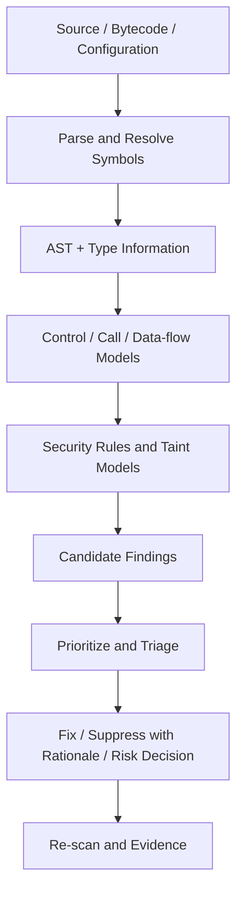
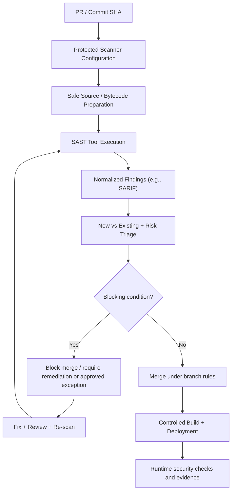

# SAST là gì? Phân tích bảo mật mã nguồn tĩnh và bằng chứng Security Assurance

## 1. Mục tiêu học tập

Sau khi hoàn thành bài học, người học có thể:

1. Giải thích **SAST (Static Application Security Testing)** và phân biệt SAST với khái niệm **static analysis** rộng hơn.
2. Trình bày vì sao SAST có thể phát hiện một số điểm yếu bảo mật **mà không cần khởi chạy ứng dụng**, và giới hạn của kết luận dựa trên mã nguồn.
3. Mô tả các khái niệm **parsing, AST, control-flow graph, call graph, data-flow analysis, taint analysis, source, sink, sanitizer, interprocedural analysis**.
4. Nhận diện các nhóm lỗi SAST thường hỗ trợ: injection, insecure API usage, cryptography misuse, hardcoded secrets, path traversal, SSRF, deserialization và một số cấu hình không an toàn.
5. Phân biệt **finding, warning, vulnerability, false positive, false negative, reachability và exploitability**; biết vì sao công cụ không tự đưa ra kết luận rủi ro cuối cùng.
6. So sánh SAST với **SCA, DAST, IAST, fuzzing, secret scanning, IaC scanning, code review và penetration testing**.
7. Thiết kế quy trình triển khai SAST trong SDLC/CI/CD: scope, baseline, pull request scan, full scan, quality gate, triage, suppression, remediation và retest.
8. Viết ví dụ Java/Spring Boot có nguy cơ SQL injection hoặc lỗi xử lý input, giải thích dữ liệu đi từ **untrusted source** tới **sensitive sink**.
9. Đánh giá những lỗi **authorization theo tài nguyên, tenant isolation, business logic, concurrency và runtime configuration** mà SAST không thể được coi là bằng chứng đầy đủ.
10. Chuyển kết quả SAST thành **risk–control–evidence mapping** để đánh giá design effectiveness và operating effectiveness một cách có phạm vi.
11. Thiết kế test cases/verification cho tool configuration, scan coverage, false-positive triage, rule drift và finding closure.
12. Lập báo cáo assurance nêu rõ **source revision, tool/ruleset version, scope, scan result, triage decisions, remediation, limitations và residual risk**.

Bài thuộc chương **Static analysis** của module **SECURITY_SECURITY_ASSURANCE**. Module hướng tới việc **đánh giá có bằng chứng** rằng hệ thống đáp ứng các mục tiêu bảo mật — từ phân tích rủi ro và yêu cầu, thiết kế security controls tới kiểm thử, audit, khắc phục finding và assurance liên tục trong phát triển/vận hành. Vì vậy, câu hỏi trọng tâm không chỉ là “SAST quét được bao nhiêu cảnh báo?” mà còn là:

> **Công cụ đã phân tích đúng mã nào, phát hiện điều gì, những giả định nào khiến kết quả đáng tin, ai xác minh finding, và kết quả đó hỗ trợ được security claim nào — với giới hạn gì?**

## 2. SAST là gì?

**SAST (Static Application Security Testing)** là nhóm phương pháp/công cụ kiểm tra **mã nguồn, mã trung gian, bytecode hoặc biểu diễn tĩnh khác của chương trình** để nhận diện các mẫu triển khai có thể gây mất an toàn, **không cần chạy ứng dụng như một hệ thống hoàn chỉnh và gửi request tấn công tới nó**.

Các công cụ SAST có thể:

- Phân tích cú pháp và cấu trúc chương trình.
- Tìm API hoặc patterns thường dẫn tới weakness.
- Theo dõi cách dữ liệu đầu vào lan truyền qua hàm, object và nhánh.
- Tìm dữ liệu chưa được kiểm soát đi vào thao tác nguy hiểm.
- So rule/policy với cách code xử lý input, output, credentials và errors.
- Đưa ra finding kèm vị trí file, dòng, đường dữ liệu, loại weakness, điều kiện và hướng dẫn sửa tùy công cụ.

Một số công cụ chỉ có **pattern matching**; một số phân tích ngữ nghĩa, data flow hoặc bytecode sâu; một số kết hợp công cụ và mô hình khác. Vì vậy, không được mặc định mọi sản phẩm gắn nhãn SAST có cùng năng lực hoặc độ chính xác.

### 2.1. Static analysis rộng hơn SAST

**Static analysis** có thể dùng để kiểm tra:

- Coding style, formatting và naming conventions.
- Unused variables, dead code, code complexity.
- Nullability, type correctness, resource leaks.
- Maintainability và architecture conventions.
- **Security weaknesses**.

**SAST** là phần kiểm tra **bảo mật ứng dụng** trong tập hợp đó. Linter báo biến không dùng chưa chắc là SAST finding; công cụ phân tích đường dữ liệu tới một SQL query nguy hiểm có thể là SAST finding.

### 2.2. “Không chạy ứng dụng” không có nghĩa scanner không chạy chương trình nào

Scanner vẫn là một chương trình chạy trên CI/workstation và có thể dùng parser, compiler front-end, dependency resolution hoặc build artifacts. Với Java, một số phân tích cần compile/bytecode/classpath; tool setup có thể thực thi bước build và **build scripts/plugins có khả năng chạy mã**. Cần phân biệt:

- **Phân tích tĩnh của mục tiêu:** không kích hoạt ứng dụng dưới dạng dịch vụ để thử exploit.
- **Vận hành công cụ phân tích:** có thể chạy compiler, build tasks hoặc helper scripts và vẫn cần isolation/secret controls.

Không kết luận “chạy SAST luôn an toàn với PR chưa tin cậy” chỉ vì nó là *static*.

## 3. Tại sao cần SAST?

Vấn đề bảo mật có thể hình thành khi developer:

- Nối input trực tiếp vào SQL hoặc shell command.
- Quên ràng buộc dữ liệu với tenant/owner ở một số code paths.
- Dùng cryptographic primitive không phù hợp.
- Log token, mật khẩu hoặc thông tin khách hàng.
- Deserialize dữ liệu chưa đáng tin bằng API không an toàn.
- Đọc file theo đường dẫn do caller tự kiểm soát.
- Gọi URL từ client qua server mà thiếu SSRF controls.
- Dùng hàm đã bị cấm bởi secure coding policy.
- Vô tình đưa configuration/debug route không an toàn vào mã.

SAST giúp phát hiện sớm **một phần** các patterns đó khi commit hoặc PR chưa tới production. Giá trị thường gồm:

1. **Shift left:** feedback nhanh hơn so với đợi hệ thống deploy.
2. **Scale:** có thể chạy trên nhiều files/commits và lặp lại.
3. **Consistency:** cùng ruleset cho các thay đổi cùng loại.
4. **Traceability:** finding gắn source file/line/flow và commit.
5. **Regression control:** lỗi đã sửa có thể bị cảnh báo nếu xuất hiện lại.
6. **Assurance input:** cung cấp evidence về control kiểm tra mã và remediation.

SAST **không có chức năng dự đoán mọi hành vi của hệ thống hoặc chứng minh không tồn tại vulnerability**. SAST pass là một quan sát có điều kiện: công cụ, ngôn ngữ, ruleset, code scope và phiên bản cụ thể không đưa ra finding vi phạm gate, chứ không phải “ứng dụng an toàn tuyệt đối”.

## 4. Những đầu vào SAST thường kiểm tra

Một quá trình quét có thể dùng một hoặc nhiều nguồn:

| Input | Mục đích | Rủi ro/giới hạn |
| --- | --- | --- |
| Source files | Đọc cấu trúc và logic code | Generated/dynamic code có thể thiếu |
| Compiled bytecode | Phân tích Java/Kotlin sau compile | Debug symbols/mapping và dependencies ảnh hưởng độ chính xác |
| Dependency stubs/classpath | Hiểu method calls và data types | Missing libraries có thể làm đứt data flow |
| Framework models | Nhận biết Spring controllers, DI, routes, annotations | Model không đúng version có thể bỏ sót paths |
| Configuration files | Tìm insecure API/settings patterns | Runtime config khác source |
| Custom rules | Kiểm tra quy ước riêng của tổ chức | Rule sai có thể gây false positives/negatives |
| Data-flow models | Gán source/sink/sanitizer cho framework-specific methods | Mô hình chưa đủ sâu có thể suy sai |
| Git diff/baseline | Chỉ quan sát thay đổi mới hoặc so xu hướng | Finding cũ hoặc paths ngoài diff vẫn còn |
| Generated code | Nhận diện patterns trong source được sinh | Độ nhiễu; mã mới chỉ sinh khi build có thể không được scan |

### 4.1. Scope là yếu tố quyết định

Một repository chứa:

- `src/main/java`, business services/controllers.
- `src/test/java`, test fixtures và helper code.
- Generated sources và annotation processors.
- YAML/properties/configuration.
- SQL migration scripts.
- Build scripts (`build.gradle.kts`, plugin logic).
- Worker/CLI và administrative tools.
- Nhiều modules/subprojects hoặc languages.

Nếu scanner chỉ nhìn một thư mục, kết luận **không bao gồm** các phần khác. Vì vậy phải xác nhận files, modules, branches, profiles, exclusions và scan mode.

### 4.2. Một repository không phải toàn bộ hệ thống

Một dịch vụ Java có thể sử dụng Cloud IAM, gateway, Terraform, Kubernetes, managed database, third-party APIs và worker queues. SAST đối với Java source không tự kiểm chứng security policies của tất cả thành phần đó.

## 5. SAST hoạt động ở mức khái niệm như thế nào?

Một công cụ có thể đi qua các giai đoạn sau:



Các bước có thể được gộp hoặc triển khai khác nhau theo công cụ. Sơ đồ là **mô hình giảng dạy**, không khẳng định một kiến trúc SAST chuẩn duy nhất.

### 5.1. Parsing và AST

Một parser biến source thành cấu trúc có ý nghĩa cú pháp. **AST (Abstract Syntax Tree)** thể hiện method declarations, expressions, calls, control statements và các phần khác. Nhờ đó rule có thể tìm “method nhận untrusted string rồi gọi database query builder” thay vì chỉ tìm từ khóa trong file text.

Ví dụ `"SELECT " + userInput` trong string literal khác với một câu SQL nằm trong comment hoặc test snapshot. Parser hỗ trợ giảm nhiễu khi phân tích context.

### 5.2. Control-flow graph (CFG)

CFG mô tả những nhánh có thể thực thi, giúp công cụ đánh giá:

- Đoạn code nằm trong `if` hay `try/catch`.
- Input có được kiểm tra trước khi tới sink không.
- Error handling có nhánh xử lý nguy hiểm không.
- Có đường bypass qua early return hoặc exception không.

CFG là mô hình tĩnh; với reflection, dynamic dispatch, native code hoặc concurrency, kết luận có thể xấp xỉ hoặc chưa đầy đủ.

### 5.3. Call graph

Call graph mô tả hàm nào có thể gọi hàm nào. Trong Spring Boot:

```text
HTTP request
  -> @RestController method
  -> @Service method
  -> Repository / JDBC helper
  -> SQL execution
```

Muốn tìm SQL injection, công cụ có thể cần theo dữ liệu qua nhiều method. Nếu bỏ qua framework-created entry points, dynamic proxies hoặc các interface implementation, đường call có thể bị thiếu.

### 5.4. Data-flow analysis

Data-flow analysis xem giá trị được định nghĩa, gán, truyền, biến đổi và sử dụng ở đâu. Công cụ có thể nhận diện một biến trong controller được truyền qua service, nối chuỗi rồi đưa vào SQL query.

### 5.5. Taint analysis

**Taint analysis** đánh dấu dữ liệu từ nguồn chưa đáng tin (**source**) và theo dõi đường chảy tới thao tác nguy hiểm (**sink**), xét liệu có bước kiểm soát/biến đổi an toàn (**sanitizer/validator/encoder**) phù hợp hay không.

SAST không bắt buộc phải có taint analysis để được gọi là SAST; các rules tìm cấu hình hoặc API nguy hiểm có thể chỉ dựa vào pattern hoặc syntax/semantic model.

## 6. Source, Sink, Sanitizer: ba khái niệm quan trọng

| Vai trò | Ý nghĩa | Ví dụ trong Java/Spring Boot |
| --- | --- | --- |
| **Source** | Đầu vào chưa được tin cậy hoặc có security context đặc biệt | `@RequestParam`, request body, HTTP headers, message payload, environment data từ bên ngoài |
| **Propagation** | Dữ liệu đi qua gán, method call, field, transformation | `service.search(input)`, DTO → entity → repository |
| **Sink** | Thao tác cần data control để tránh rủi ro | Dynamic SQL, shell execution, template rendering, file access, URL fetch |
| **Sanitizer/encoder** | Xử lý input theo ngữ cảnh nhằm ngăn kiểu tấn công | SQL parameter binding, context-aware HTML encoding, validated URL policy |
| **Validator** | Đảm bảo format/schema/bounds/policy | Enum allowlist, range check, resource authorization |
| **Barrier/guard** | Điều kiện làm đường độc hại không thể tới sink trong mô hình | Trusted authorization check, immutable data scope |
| **Finding path** | Đường dữ liệu được tool báo | Source file/line → propagation → sink |

### 6.1. Ví dụ luồng SQL injection

```text
Source: GET /users?name=<input>
  -> Controller passes name
  -> Service constructs WHERE name = '<input>'
  -> Sink: database query execution
Risk: attacker-controlled SQL syntax changes query meaning
```

Đây là mô tả khái niệm, không phải lời hướng dẫn khai thác. Control hiệu quả là **parameterized SQL với dữ liệu được bind**, không phải chỉ xóa một vài ký tự nguy hiểm.

### 6.2. Sanitizer phải đúng sink

- HTML encoding không làm input an toàn cho SQL.
- SQL parameter binding không làm string an toàn khi đưa vào shell.
- URL validation không chứng minh user có quyền truy cập resource.
- HTML encoding phụ thuộc ngữ cảnh (element text, attribute, JavaScript, URL); không có một “escape all” phù hợp mọi chỗ.
- Nếu sort column/table name được tạo động, parameter binding cho *values* không tự cho phép bind SQL identifiers; identifiers cần allowlist riêng.

Không nên coi một method tên `sanitize()` là bằng chứng đã loại bỏ taint nếu implementation và context chưa được kiểm chứng.

### 6.3. Sanitization có thể khác validation

Validation kiểm tra nội dung có thuộc domain cho phép; sanitization/encoding chuyển hoặc ràng buộc biểu diễn để dữ liệu không bị diễn giải như cú pháp nguy hiểm ở sink. Với dữ liệu bảo mật, **đúng kiểm soát tại sink** thường mạnh hơn việc xóa ký tự một cách mơ hồ ở đầu vào.

## 7. Taint analysis qua nhiều hàm

Xét ví dụ Java giản lược:

```java
@RestController
class SearchController {
    private final SearchService searchService;

    @GetMapping("/users/search")
    List<UserView> search(@RequestParam String name) {
        return searchService.searchByName(name);
    }
}

@Service
class SearchService {
    private final UserRepository users;

    List<UserView> searchByName(String name) {
        return users.queryByName(name);
    }
}

@Repository
class UserRepository {
    private final JdbcTemplate jdbc;

    List<UserView> queryByName(String name) {
        // Ví dụ KHÔNG AN TOÀN: nối user-controlled input vào SQL.
        String sql = "SELECT id, name FROM users WHERE name = '"
                   + name + "'";
        return jdbc.query(sql, (rs, i) ->
            new UserView(rs.getLong("id"), rs.getString("name")));
    }
}
```

Một công cụ data-flow SAST có thể báo:

```text
SOURCE: SearchController.search(name)
  -> SearchService.searchByName(name)
  -> UserRepository.queryByName(name)
SINK: JdbcTemplate.query(sql, ...)
RULE: Untrusted value enters SQL syntax without parameter binding
CWE CATEGORY: SQL injection weakness
```

**Cần chú ý:** Công cụ khác nhau có thể đặt tên rule, source/sink và severity khác nhau. “Có thể báo” không có nghĩa mọi SAST đều luôn tìm ra chính xác đường này.

### 7.1. Bản sửa dùng parameter binding

```java
@Repository
class UserRepository {
    private final JdbcTemplate jdbc;

    List<UserView> queryByName(String name) {
        String sql =
            "SELECT id, name FROM users WHERE name = ?";
        return jdbc.query(sql,
            (rs, i) -> new UserView(
                rs.getLong("id"), rs.getString("name")),
            name);
    }
}
```

Đây là ví dụ **cho một vấn đề SQL injection về value binding**. Hệ thống thực vẫn cần kiểm soát authentication/authorization, tenant scope, rate limits, query cost và data minimization. Truy vấn trên chưa có tenant predicate, do đó **“SQL injection fixed” không đồng nghĩa “user data access authorized”**.

### 7.2. What to verify

- Scanner còn báo cùng source–sink path không?
- Unit/integration tests xác nhận logic tìm kiếm vẫn đúng?
- Negative/boundary tests kiểm tra input đặc biệt theo cách an toàn?
- Query có parameter binding thật, không phải string escaping tùy ý?
- Tenant/resource authorization có được đánh giá độc lập?
- Runtime artifact có chứa fix đúng commit/build không?

## 8. Các mức phân tích và trade-offs

| Kiểu phân tích | Điểm mạnh | Giới hạn |
| --- | --- | --- |
| **Pattern/regex** | Nhanh, dễ giải thích, tìm API bị cấm | Dễ nhiễu, ít hiểu context |
| **AST/syntax aware** | Nhận biết cấu trúc code | Có thể thiếu dynamic behavior |
| **Semantic/type-aware** | Hiểu symbol/type/method signatures | Phụ thuộc compilation/classpath |
| **Intraprocedural data flow** | Theo dữ liệu trong một hàm | Bỏ sót paths xuyên nhiều hàm |
| **Interprocedural analysis** | Theo call chain across methods | Tốn tài nguyên; khó với dynamic dispatch |
| **Context-sensitive** | Phân biệt các context gọi | Chi phí phân tích tăng |
| **Path-sensitive** | Xét một số conditions/branches | State space lớn, cần xấp xỉ |
| **Whole-program analysis** | Phạm vi rộng hơn | Thiếu runtime code/reflection có thể vẫn bỏ sót |
| **Incremental/diff scanning** | Feedback PR nhanh | Có thể bỏ sót cross-file/legacy issues |
| **Bytecode analysis** | Quan sát mã sau compile | Mapping source và build profiles quan trọng |

Không có lựa chọn “càng sâu càng luôn tốt” cho mọi tổ chức. Cần cân bằng **risk, performance, scan latency, alert quality, language/framework support và khả năng triage**.

### 8.1. Soundness và completeness trong thực hành

Trong lý thuyết phân tích, muốn tránh bỏ sót mọi hành vi cần mô hình rất thận trọng, có thể sinh nhiều cảnh báo không thật. Công cụ thực tế thường dùng approximations để hoàn thành trong thời gian phù hợp. Vì vậy người đánh giá cần hiểu **false positives, false negatives và model limitations**, thay vì mong một scanner vừa báo không nhầm vừa không bao giờ bỏ sót.

## 9. SAST thường tìm loại điểm yếu nào?

Khả năng thực tế phụ thuộc ruleset, ngôn ngữ và mô hình framework.

| Nhóm điểm yếu | Pattern SAST có thể phát hiện | Điều cần kiểm chứng thêm |
| --- | --- | --- |
| SQL injection | Untrusted input tới dynamic SQL sink | Query thật, bindings, DB privilege |
| Command injection | Input ảnh hưởng shell/process command | Execution mode, arguments, environment |
| Path traversal | User path tới file access ngoài root | Canonical path, symlinks, filesystem permissions |
| XSS | Dữ liệu chưa encode tới HTML/template sink | Output context, browser behavior, sanitization |
| SSRF | Untrusted URL vào HTTP client | Redirects, DNS/IP, egress policies |
| Unsafe deserialization | Dữ liệu không tin cậy vào risky deserializer | Library config, allowed classes, reachability |
| Crypto misuse | Thuật toán/mode/key handling patterns không phù hợp | Threat model, data classification, crypto review |
| Hardcoded credentials | Secret-like literal hoặc credential API | Có phải secret thật, đã lộ chưa, rotate/revoke |
| Sensitive logging | Token/password/PII vào logger | Runtime format, redaction, access/retention |
| Insecure random | PRNG dùng cho security-sensitive token | Real use case, entropy/security guarantees |
| TLS misuse | Disabled hostname/certificate verification | Client config, deployed transport |
| File upload | Filename/path/content controls yếu | Storage policy, parser isolation, AV/size checks |
| Resource leaks | Unclosed resources ở sensitive paths | Runtime impact/DoS relevance |
| XML parsing | Unsafe parser config dẫn tới XXE | Specific library/version/config |
| Authentication misuse | Một số insecure API/routing patterns | Identity protocol/policy và bypass |
| Authorization omission | Một số missing-guard/framework patterns | Object/tenant/business semantics |

### 9.1. Một rule không định nghĩa hoàn toàn một vulnerability

Tool báo “weak cryptography” vì thấy algorithm tên cũ. Cần đánh giá **algorithms được dùng cho mục đích gì**, policy của tổ chức, dữ liệu bảo vệ và cách key được quản lý. Ngược lại, có thể code dùng approved library nhưng triển khai sai nonce, key lifecycle hoặc authenticated data semantics mà rule không thấy.

### 9.2. SAST có thể kiểm tra configurations nhưng không thay runtime verification

Một rule có thể tìm `permitAll()` trong Spring Security config, debug flag, risky XML settings hoặc secrets trong source; điều đó không chứng minh config/policy đang được deploy ở production. Design/implementation evidence khác operating evidence.

## 10. Những lỗi SAST khó hoặc không thể chứng minh đầy đủ

Một số nhóm vấn đề:

- **BOLA/IDOR:** user đã authenticated nhưng truy cập resource tenant khác.
- **Business authorization:** người tạo transfer tự phê duyệt; khách hàng được phép hủy giao dịch của người khác.
- **State machine:** một transfer đã CANCELLED vẫn được execute.
- **Logic giá/discount/quota:** rule nghiệp vụ phức tạp bị bypass.
- **Race/TOCTOU:** concurrent requests phá invariant.
- **Cross-service confused deputy:** worker dùng service account rộng làm thay client ít quyền.
- **Architecture-level trust error:** gateway tin token sai audience hoặc service tin mạng nội bộ.
- **Deployment drift:** source đúng nhưng config/policy runtime khác.
- **Supply-chain behavior:** package bị compromise dù source ứng dụng không có pattern lỗi.
- **Misconfiguration bên ngoài repo:** cloud IAM, storage ACL, cluster admission, network policy.
- **Vulnerability trong runtime/native dependency** mà source scan không thể thấy.
- **Bugs trong reflection/generated code/dynamic loading** chưa có model.

### 10.1. Ví dụ BOLA trong Spring Boot

```java
@GetMapping("/reports/{id}")
@PreAuthorize("hasAuthority('REPORT_VIEW')")
ReportDto getReport(@PathVariable UUID id) {
    Report report = reportRepository.findById(id)
        .orElseThrow(NotFoundException::new);
    return ReportDto.from(report);
}
```

Method có role check, vì vậy một SAST rule tìm “thiếu annotation” có thể không báo. Nhưng `findById` không có tenant/owner predicate. **User tenant B có cùng `REPORT_VIEW` có thể cố đọc report tenant A** nếu ID biết được và không có control khác.

SAST có custom rule hay data-flow model phù hợp *có thể* hỗ trợ phát hiện, nhưng vẫn cần **domain threat model, code review và negative integration test với resource có thật ngoài scope** để chứng minh.

### 10.2. API an toàn không được kết luận từ “zero findings”

Không phát hiện vấn đề trong một scan không chứng minh **mọi code path, mọi input, mọi environment hoặc mọi tenant** đều an toàn. Cần nêu công cụ không phân tích phần nào, scan errors, partial compilation, disabled rules và các yêu cầu ngoài SAST.

## 11. SAST và SCA: hai loại kiểm tra khác nhau

**SAST** tập trung vào cách code được viết và sử dụng các API/data flow; **SCA (Software Composition Analysis)** tập trung vào components/dependencies và các risks đã được biết/ghi nhận, thường thông qua package/version/SBOM mapping.

Ví dụ:

- Source của bạn nối `name` vào SQL query: SAST có thể báo SQL injection.
- Dependency JSON library có advisory về parser: SCA có thể báo version bị ảnh hưởng.
- Code gọi risky API của dependency trong conditions xác định: SAST/reachability-enhanced tools có thể hỗ trợ xác định đường sử dụng, nhưng không phải mọi SAST/SCA đều tự phân tích được.
- Developer tự viết insecure authorization: SCA có thể hoàn toàn không báo vì không phải vulnerability thuộc package đã có advisory.

### 11.1. Bảng so sánh SAST và các kỹ thuật khác

| Kỹ thuật | Đối tượng | Thế mạnh | Giới hạn |
| --- | --- | --- | --- |
| **SAST** | Source/bytecode/config tĩnh | Chỉ ra code location và flow | Không chứng minh runtime/exploitation |
| **SCA** | Dependency/package/SBOM | Biết advisory/affected versions | Không chứng minh actual exposure/behavior |
| **Secret scanning** | Patterns/credentials trong source/history/artifacts | Tìm secret-like material | Có thể miss transformed/temporary secrets |
| **DAST** | HTTP/API/app đang chạy | Quan sát response và runtime behavior | Cần deployment, test data, path coverage |
| **IAST** | Runtime app với instrumentation | Kết hợp execution context và code insight | Chỉ thấy những paths được exercise |
| **Fuzzing** | Parser/API/stateful interfaces | Tìm unexpected crashes/invariants | Phụ thuộc harness, oracle, corpus |
| **Manual code review** | Diff + domain/architecture context | Phát hiện business-logic, trust errors | Phụ thuộc reviewer và scope |
| **Threat modeling** | System/data flows/actors | Nêu attack paths trước khi code | Không xác nhận implementation |
| **IaC/cloud scanning** | Terraform/K8s/cloud policies | Phát hiện misconfig patterns | Không chứng minh runtime policy luôn đúng |
| **Penetration testing** | System/path theo phạm vi | Kiểm tra exploit chains cụ thể | Theo thời gian/phạm vi hữu hạn |
| **Audit/assurance** | Control design/operation/evidence | Kết luận có điều kiện và residual risk | Không tự sinh coverage kỹ thuật |

### 11.2. Đừng cộng số tool pass thành kết luận an toàn

SAST pass + SCA pass + DAST pass là **nhiều nguồn thông tin** nhưng có thể cùng bỏ sót một tenant authorization flaw hoặc dependency động. Các kết quả chỉ hỗ trợ claims tương ứng với **coverage, assumptions, test cases, target build và configuration**.

## 12. CWE, CVE, CVSS và tên finding

- **CWE:** phân loại weakness, ví dụ SQL injection/authorization-related weakness; hỗ trợ nhóm pattern/triage.
- **CVE:** mã định danh của vulnerability được ghi nhận trong một sản phẩm/phiên bản; không phải mọi SAST finding đều có CVE.
- **CVSS:** hệ thống chấm mức nghiêm trọng theo tiêu chí cụ thể; không tự đo mức rủi ro nghiệp vụ.
- **Finding ID:** định danh riêng do SAST hoặc issue tracker đặt, thường chứa rule ID, path/line hoặc fingerprint.
- **Priority:** quyết định thứ tự xử lý theo impact, exposure, reachability và deadline.
- **Severity:** mức độ nghiêm trọng của vấn đề theo framework/scoring policy.

### 12.1. Ví dụ

SAST báo `SQL Injection / CWE family` tại `ReportRepository.java`. Đây có thể là **candidate weakness**; không cần có CVE mới được xử lý. Khi kết luận, xem attacker-controlled input có tới query thực sự không, dữ liệu/DB privileges, row/tenant constraints, exploit preconditions và khả năng khắc phục.

### 12.2. Không bịa severity chính xác

Cùng một rule có thể có impact khác nhau giữa public payment API và offline test utility. Dùng scanner severity như **điểm khởi đầu** chứ không là quyết định duy nhất; tài sản và risk owner cần tham gia khi rủi ro quan trọng.

## 13. False Positive, False Negative và Unknown

**False positive (FP):** công cụ báo một vấn đề nhưng trong ngữ cảnh đã được xác minh, hành vi đó không xảy ra hoặc không tạo vulnerability tương ứng.

**False negative (FN):** vấn đề thực tế tồn tại nhưng scanner không phát hiện.

**True positive (TP):** finding đúng với weakness trong scope, sau verification phù hợp.

**Unknown/Needs review:** chưa đủ dữ liệu để xác nhận hoặc phủ định finding.

### 13.1. Một số nguyên nhân false positive

- Tool không nhận ra validator/sanitizer tùy chỉnh.
- Flow path không thể tới được vì một business guard nhưng scanner không model.
- Input thực tế là constant/trusted value.
- Code chỉ tồn tại trong test fixture không triển khai và không có risk tương tự.
- Rule không hiểu semantics/framework version.
- Đường reporting thiếu call context hoặc proxy logic.

### 13.2. Một số nguyên nhân false negative

- Scanner không hỗ trợ ngôn ngữ/framework/construct.
- Không phân tích toàn bộ modules/branches/generated code.
- Thiếu classpath khiến interprocedural analysis bị cắt.
- Dynamic reflection, runtime plugins hoặc native calls không được model.
- Missing source/sink/sanitizer rule hoặc rule bị disable.
- Scan timeout, error, sampling hoặc diff-only scope.
- Vulnerability phụ thuộc runtime deployment/business state.
- Custom code/pattern mới chưa có detection logic.

### 13.3. Cách hành xử khi chưa chắc

Không tự đánh dấu `false positive` chỉ vì “developer nói không sao”. Cần lưu **rationale, evidence (code path, control, test), reviewer, thời điểm, scope và trigger mở lại**.

Ngược lại, không tự coi một high-severity finding là sự cố đã bị khai thác nếu chưa có bằng chứng; nên phân biệt **potential weakness**, **confirmed vulnerability** và **confirmed exploitation**.

## 14. Quality của công cụ: precision, recall và coverage

Có thể đo detection quality bằng:

\[
\text{Precision} = \frac{TP}{TP + FP}
\]

\[
\text{Recall} = \frac{TP}{TP + FN}
\]

Trong hệ thống thực tế, **FN thường không được biết đầy đủ** vì không có danh sách tất cả vulnerabilities thật. Vì vậy recall trên benchmark/historical sample không được trình bày như recall tổng quát cho production.

### 14.1. Đừng đo chất lượng bằng số finding

- Tool báo ít finding có thể rất chính xác **hoặc** rule coverage yếu.
- Tool báo nhiều finding có thể tìm nhiều issues **hoặc** tạo triage fatigue.
- “Zero critical” có thể vì rule critical bị disabled, source chưa được scan, hoặc CI bỏ qua scanner exit code.
- “Nhiều issues closed” có thể vì mass suppression không có rationale.

Nên xem **supported languages, rule coverage, true-positive yield, false-positive rate trên reviewed samples, scan completeness, developer latency và escaped defects**.

### 14.2. Benchmark có giới hạn

Synthetic benchmarks giúp so sánh tool trên các vulnerability patterns đã biết. Nhưng kết quả có thể không phản ánh code Java với reflection, dependency injection, generated routes, real tenant workflows hoặc runtime configuration. Tool selection nên có **pilot trên code thực**, kết hợp review findings theo rủi ro.

## 15. SAST trong SDLC: chạy khi nào?

```mermaid
flowchart LR
    REQ["Risk / Requirements / Threat Model"] --> CODE["Code and Local Checks"]
    CODE --> PR["Pull Request / Incremental SAST"]
    PR --> REV["Triage and Security Review"]
    REV --> MERGE["Protected Merge Gate"]
    MERGE --> FULL["Full Repository / Release Scan"]
    FULL --> FIX["Remediation / Verified Exception"]
    FIX --> BUILD["Controlled Build + Deployment"]
    BUILD --> RUNTIME["DAST / Runtime Verification"]
    RUNTIME --> ASS["Assurance Evidence + Monitoring"]
    ASS -. "Lessons learned" .-> REQ
```



### 15.1. Local/IDE scan

Ưu điểm: phản hồi sớm, developer sửa khi context còn mới. Giới hạn: config và ruleset local có thể khác CI; local result không tự là bằng chứng gate đã enforce.

### 15.2. Pull request scan

Ưu điểm: tập trung finding mới, feedback nhanh, hỗ trợ branch protection. Giới hạn:

- Diff scan có thể bỏ sót thay đổi context ngoài diff.
- Scanner có thể cần full repository để theo data flow.
- Scan chỉ một file mới không kiểm tra logic trong module khác.
- Nếu PR thêm suppressions hoặc sửa config, có thể lách gate nếu không bảo vệ ruleset.
- Kết quả phải gắn đúng commit SHA; approval cũ không áp dụng cho commit mới.

### 15.3. Full scan định kỳ hoặc trước release

Bổ sung phát hiện ở code legacy, ruleset updates, dependency/framework models mới và scan phạm vi rộng. Cần policy về scan latency, compute resources, triage backlog và SLA theo risk.

### 15.4. Sau release

SAST của source không chứng minh code được deploy. Nên có **source-to-build-to-deployed artifact mapping**, runtime configuration tests và vulnerability/incident feedback. SAST finding mới trong source có thể cần truy xét versions/artifacts đã phát hành, không chỉ sửa main branch.

## 16. Baseline: phân biệt nợ bảo mật cũ và lỗi mới

Ở một codebase lớn, bật SAST lần đầu có thể xuất hiện nhiều findings lịch sử. Nếu chặn tất cả ngay lập tức, release bị tắc hoặc team tắt scanner. **Baseline** có thể được sử dụng có điều kiện:

- Ghi nhận findings tại thời điểm mở đầu, owners và risk class.
- Áp dụng gate nghiêm hơn với **newly introduced** issues.
- Lập kế hoạch xử lý những legacy findings high-risk.
- Không coi baseline là accepted risk vô thời hạn.
- Kiểm soát cách tính fingerprint khi file được move/refactor.
- Re-evaluate khi ruleset cập nhật hoặc threat exposure đổi.
- Không để developer tùy ý đẩy finding mới vào baseline mà thiếu review.
- Theo dõi backlog, reopen và due dates.

### 16.1. Baseline không phải whitelist mọi thứ cũ

Một flaw high-impact đang reachable/public vẫn có thể cần escalation/hotfix dù có từ trước. Risk owners cần quyền ưu tiên vượt chính sách “new code only”.

### 16.2. Kết luận report phải phân biệt

- Total findings hiện tại.
- New findings từ baseline.
- Existing open findings.
- False positives đã được xác minh.
- Suppressed findings theo policy.
- Findings đã remediated/retested.
- Unknown/unscanned code.

Chỉ nói “0 new vulnerabilities” có thể gây hiểu lầm nếu còn 50 historical high-risk findings.

## 17. Quy trình triage một SAST finding

**Triage** là việc xác minh và ra quyết định xử lý một candidate finding theo ngữ cảnh rủi ro thực tế. Không nên yêu cầu developer “fix mọi warning” mà không phân loại, cũng không nên để mọi finding tự động thành false positive.

### 17.1. Những thông tin cần thu

| Thông tin | Câu hỏi |
| --- | --- |
| Finding ID / rule ID | Công cụ phát hiện mẫu nào, dưới phiên bản ruleset nào? |
| Source revision | Code bị báo có thuộc đúng commit/build hiện tại? |
| File/line/flow | Đường từ input đến sink được chỉ ra ra sao? |
| Entry point | Public API, internal workload, CLI, test hoặc dead code? |
| Attacker control | Đầu vào có thật sự do chủ thể không đáng tin kiểm soát? |
| Existing guard | Có validation, parameterization, authorization hoặc sandbox đã được kiểm chứng? |
| Impact | Dữ liệu, privileges và business processes nào có thể bị tác động? |
| Exposure/reachability | Code path có thể chạy ở deployment hiện tại không? |
| Verification | Code review, unit/integration test hay safe reproduction nào hỗ trợ? |
| Decision | Confirmed, false positive, accepted risk, unknown, remediation required? |
| Owner/deadline | Ai sửa hoặc chấp nhận residual risk? |
| Evidence | Comment/code snippet đã redact, test results, config và reviewer? |

### 17.2. Một quy trình triage thực tế

1. **Xác minh scan integrity:** đúng repository, branch, commit SHA, ruleset, tool configuration.
2. **Mở finding path:** xem source, propagation và sink.
3. **Xem context:** code có thực sự reachable từ entry point, với dữ liệu chưa tin cậy?
4. **Xác định controls:** validation/sanitization, parameter binding, framework security, network/data constraints.
5. **Đánh giá impact:** data classification, tenant exposure, privilege của process, environment.
6. **Đưa ra disposition:** confirmed/false-positive/unknown/risk exception.
7. **Sửa root cause** hoặc đưa ra quyết định hợp lệ về mitigation/exception.
8. **Verify:** chạy lại SAST và kiểm thử kỹ thuật liên quan.
9. **Lưu evidence:** source revision, code diff, tests, reviewer, status.
10. **Reassess:** khi đổi dependency/framework, deployment, attacker exposure hoặc ruleset.

### 17.3. Finding path chưa phải exploitation path

Một scanner cho thấy đường luồng dữ liệu là bằng chứng về **code/data-flow model**. Attacker có thể vẫn thiếu điều kiện khai thác do ACL, preconditions, feature flags hoặc network. Ngược lại, “chưa chứng minh khai thác” không đủ để bỏ qua finding khi impact cao và evidence vẫn thiếu.

### 17.4. Mẫu triage note tốt

> **SAST-FIND-014 — Confirmed SQL injection candidate:** Input `name` từ endpoint `GET /users/search` được nối vào câu SQL tại repository, với request từ người dùng bên ngoài. Không có parameter binding trên flow được review. Đề xuất thay bằng prepared statement/JdbcTemplate bind parameters, bổ sung negative tests và rà soát các paths query tương tự. Owner: API team. Retest cần đúng commit đã sửa và runtime artifact.

Cần tránh kết luận “đã khai thác” nếu mới có code evidence.

## 18. Remediation: sửa nguyên nhân, không chỉ làm scanner im lặng

Một SAST finding có thể hết sau khi đổi vài ký tự nhưng weakness vẫn tồn tại ở đường khác. Vì vậy phải phân biệt:

- **Fix implementation:** thay code hoặc config.
- **Test fix:** chứng minh behavior/security invariant.
- **Scope review:** xem functions/paths tương tự.
- **Risk closure:** xác minh finding không còn trong build/deployment liên quan.
- **Documentation:** ghi quyết định và giới hạn.

### 18.1. Ví dụ sửa SQL injection

Bản sửa dùng **parameterized query** mạnh hơn escaping chuỗi thủ công. Nhưng phải kiểm tra cả:

- Dynamic ORDER BY, table/column identifier (allowlist).
- Query builder khác trong cùng module.
- Bulk/search/export paths dùng cùng helper.
- Tenant/owner predicate không bị thiếu.
- Result DTO chỉ trả fields được phép.
- Prepared statement parameterization thật trên driver đang dùng.

### 18.2. Ví dụ sửa path traversal

Nếu SAST báo `filePath = base + request.filename` rồi `Files.readAllBytes`, cần:

1. Xác định allowed root/namespace.
2. Canonicalize/resolution đúng API/platform.
3. Kiểm tra result vẫn nằm trong allowed root.
4. Xem symlink, race, filesystem permission và file type.
5. Test filenames không hợp lệ, path normalization, encoded forms.
6. Không để người gọi đọc file từ tenant khác dù path nằm trong allowed root.

Chỉ dùng `filename.replace("../", "")` có thể không giải quyết path traversal đầy đủ.

### 18.3. Ví dụ sửa SSRF

Đối với API fetch URL, cần xem:

- Ai được phép yêu cầu outbound fetch, với purpose gì?
- URL allowlist theo protocol/host/port và DNS/IP.
- Redirect policy và resolution/re-resolution behavior.
- Destination tới private/loopback/link-local/cloud metadata.
- Network-level egress restrictions.
- Credential leakage qua headers/redirects.
- Logging/monitoring và timeout/size limits.

Không cho rằng regex kiểm tra “bắt đầu bằng https” là mitigation đầy đủ.

### 18.4. Finding được đóng khi nào?

Tối thiểu cần:

- Code/config change được review.
- SAST re-scan theo đúng rule và commit.
- Security-specific test hoặc giải trình phương pháp xác minh.
- Không có alternate vulnerable path tương tự trong scope.
- Runtime deployment status rõ khi finding liên quan production.
- Evidence và residual risk có owner.

**SAST scan pass không thay thế test nghiệm thu security requirement**.

## 19. Suppression và accepted risk: khác nhau nhưng đều cần quản trị

Có những findings được xác minh là không áp dụng, hoặc một fix phải trì hoãn. Hai trường hợp cần được tách:

- **False-positive suppression:** công cụ báo một pattern không tương ứng security weakness ở context đã xác nhận.
- **Risk acceptance/exception:** weakness hoặc rủi ro tồn tại nhưng chủ thể có thẩm quyền chấp nhận có điều kiện, thời hạn và compensating controls.

### 19.1. Yêu cầu quản trị suppression

Một suppression lý tưởng phải có:

- Finding/rule/fingerprint ID.
- Scope nhỏ nhất (file, line, symbol hoặc flow).
- Lý do cụ thể được kiểm chứng.
- Người review và ngày quyết định.
- Evidence link hoặc testcase reference.
- Expiry/re-review trigger khi phù hợp.
- Audit history và kiểm tra khi rule/tool/version đổi.

Không suppression một nhóm file hoặc ruleset quá rộng chỉ để dashboard không đỏ.

### 19.2. Ví dụ rationale

> False positive: giá trị mà rule đánh dấu là attacker input thực tế được lấy từ enum server-side cố định sau identity validation, không thể do client điều khiển; đường code, test và reviewer reference được đính kèm. Re-review khi input source thay đổi.

Rationale này có thể đúng hoặc sai tùy code thực tế; **phải có evidence**, không chỉ câu chữ.

### 19.3. Accepted risk có thời hạn

> Đã xác nhận issue trên legacy admin workflow. Access giới hạn bởi dedicated network + JIT approval, có monitoring và plan thay thế. Risk owner chấp nhận đến ngày X; chưa được ghi “fixed”, và sẽ reassess khi exposure đổi hoặc exception hết hạn.

Dùng `accepted` thay cho `false positive` để tránh làm mất visibility rủi ro thực.

### 19.4. Suppression as code

Inline suppress comments có thể thuận tiện nhưng dễ bị lạm dụng. Cần protected review cho suppressions, allowlist rules hoặc centralized exception registry. Scanner không nên tự cho phép PR thay required ruleset mà không có independent approval.

## 20. Cấu hình và cập nhật ruleset

Công cụ không tự biết security objectives của từng tổ chức. Ruleset nên được quản trị như một **security control configuration**:

- Chọn language/framework profiles phù hợp.
- Bật rules cho các weakness liên quan threat model và data classes.
- Tạo rule/model cho internal wrappers, validated input sources, sanitizers, domain-specific sinks.
- Loại bỏ/baseline noisy rules có evidence thay vì tắt âm thầm.
- Theo dõi tool engine version, rule pack version và analyzer mode.
- Test chính ruleset bằng positive/negative fixtures.
- Phê duyệt thay đổi ruleset và policy gates.
- Lưu ngày triển khai, owner, backward compatibility và rollback.
- Reassess findings khi cập nhật engine/rulesets vì kết quả có thể đổi dù source không đổi.

### 20.1. Custom rules giúp gì?

Trong dự án Java, có thể xây custom rules để tìm:

- Gọi custom SQL executor bằng string concat.
- Dùng `RestTemplate`/HTTP client wrapper với URL do caller kiểm soát.
- Bỏ `tenantId` khỏi một số repository/query patterns theo convention.
- Logging một kiểu DTO chứa sensitive fields.
- Dùng custom crypto helper đã bị deprecated.
- Gọi raw `Runtime.exec` hoặc risky deserializer trong package được bảo vệ.

**Custom rule không tự chứng minh semantics** nếu chỉ kiểm tra method name/annotation. Chẳng hạn, repository có method `findByIdAndTenant` không có nghĩa mọi caller dùng đúng tenant đáng tin. Cần manual review và integration tests.

### 20.2. Rule test nên có cả ví dụ an toàn

Nếu rule bắt mọi method `query` là SQL injection, CI sẽ noisy. Nên có fixtures:

- Vulnerable concatenated SQL → expected finding.
- Parameterized SQL → expected no finding.
- Untrusted URL passed to fetch helper → finding nếu model hỗ trợ.
- URL hằng với approved host → không báo SSRF theo rule điều kiện.
- Trusted sanitizer đúng context → không báo nếu đã model.
- Bypassed sanitizer path → vẫn phải báo.

Không cần chạy exploit để kiểm tra rule; có thể kiểm tra detection behavior bằng synthetic code.

## 21. Tích hợp SAST vào CI/CD đúng cách

Một pipeline có thể gồm:



### 21.1. Những ranh giới cần bảo vệ

Một SAST scanner có thể được yêu cầu chạy source do PR kiểm soát. Nếu build preparation chạy Gradle plugins/test tasks của PR, môi trường scan có thể thực thi untrusted code.

Phải thiết kế:

- Low-trust PR runner không có production secrets.
- Minimal CI token permissions và independent branch protection.
- Không dùng PR source để điều khiển release signing/publishing.
- Scanner config/ruleset không bị PR tự ý vô hiệu hóa.
- Chỉ tin scan artifacts từ verified run/commit.
- Safe artifact upload tránh leak proprietary code, tokens hoặc data.
- Separate trusted promotion step nếu cần publish result.
- Network egress và dependency resolution theo risk.
- Job timeout/resources để tránh scan-induced denial of service.

### 21.2. CI gate cần xem kết quả thật

Một workflow có step tên “SAST passed” nhưng scanner fail và script dùng `exit 0` có thể cho commit đi qua. Gate cần kiểm tra:

- Scanner process thực sự thành công, không timeout/partial.
- Code coverage và rule set đúng policy.
- Findings được parse theo format/version dự kiến.
- Blocking findings chưa được approved exception thì chặn merge.
- Kết quả scan gắn SHA của code được merge.
- Branch rule không bị bypass ngoài audit.
- Tool unavailability có **fail-safe/exception** được định nghĩa, không tự permit.

### 21.3. Không gắn status “safe” khi scanner lỗi

Nếu scan infrastructure hỏng, kết quả phải được ghi là **scan failed/unknown**, khác với **scan completed/no blocking findings**. Tùy criticality có thể block merge hoặc cho exception có owner/time limit và hậu kiểm. Không làm giả một pass.

## 22. Mẫu CI pipeline minh họa

Mẫu dưới là **pseudo-configuration**, không phải workflow có thể copy chạy ngay. Mọi action ref, scanner command và permission phải thay bằng cấu hình cụ thể, được review trước production.

```yaml
name: security-static-analysis-example

on:
  pull_request:

permissions:
  contents: read

jobs:
  sast:
    runs-on: ubuntu-latest
    timeout-minutes: 30
    steps:
      - name: Checkout reviewed PR revision
        uses: actions/checkout@<APPROVED_PINNED_COMMIT>
        with:
          persist-credentials: false

      - name: Prepare language environment
        uses: actions/setup-java@<APPROVED_PINNED_COMMIT>
        with:
          distribution: temurin
          java-version: "21"

      - name: Run approved scanner
        shell: bash
        run: |
          # Replace with the actual approved scanner command,
          # project paths, ruleset, policy and SARIF output settings.
          echo "Scanner invocation intentionally omitted"

      - name: Evaluate policy gate
        shell: bash
        run: |
          # Replace with trusted status/report validation.
          # A real gate MUST NOT claim success if the scan did not run.
          echo "No effective gate in this training example"
```

### 22.1. Vì sao ví dụ này chưa đủ production?

- Scanner invocation và policy gate là placeholders; nó **không thực hiện quét**.
- Hosted runner image `ubuntu-latest` có thể thay đổi; production cần quản trị phiên bản/nguồn theo mục tiêu.
- Không có dependency resolution/compile isolation cho Java.
- Không có reports, commit SHA binding, branch enforcement, exceptions.
- Không có secure artifact upload và evidence retention.
- Không có coverage error handling hoặc tool failure behavior.

**Không dùng config trên để chứng minh SAST control hoạt động.** Nó chỉ minh họa vị trí step và ranh giới trust.

### 22.2. Repo có Gradle multi-module

Cần đảm bảo scanner xử lý đúng:

- `settings.gradle`/module discovery.
- Java source và generated code cần phân tích.
- `runtimeClasspath` hoặc `compileClasspath` khi analyzer yêu cầu.
- Profiles, Spring component scanning, framework models.
- Worker/CLI modules ngoài web API.
- JDK version và bytecode compatibility.
- Compile errors và partial analyses.
- Dependency/plugin execution trong isolated runner.

Trong nhiệm vụ tạo bài học này không chạy Gradle hoặc scanner trên repository; các lệnh chỉ mang tính hướng dẫn.

## 23. Java/Spring Boot: bề mặt kiểm tra thường gặp

| Thành phần | Ví dụ pattern cần chú ý | Cần kiểm chứng thêm |
| --- | --- | --- |
| Controller | `@RequestParam`/`@RequestBody` tới sensitive service | Validation và authorization |
| Service | String composition, data transformation | Context và business invariants |
| Repository | Dynamic JPQL/SQL, native query | Bind parameters, tenant constraints |
| HTTP clients | `RestTemplate`/`WebClient` nhận external URLs | SSRF/redirect/network egress |
| Serialization | Generic deserializer và polymorphic types | Trusted type controls, library config |
| XML processing | Factory/parser cho external entities | XXE protection theo API |
| Logging | Token/PII/request body vào logger | Redaction, retention và access |
| Cryptography | Hardcoded keys, risky modes | Algorithm policy, IV/nonce/key lifecycle |
| Auth/security config | Permissive matchers, disabled guards | Runtime filter chain và route coverage |
| File API | Client path/filename → filesystem | Canonicalization, permissions, tenancy |
| Async handlers | Message content → command/query | Producer trust, delegated scope |
| Build/config | Debug settings, credentials, vulnerable helpers | Environment-specific runtime state |

### 23.1. Spring annotations không tự tạo toàn bộ bảo mật

- `@Validated` hoặc bean validation giải quyết format/bounds, không chứng minh resource-level authorization.
- `@PreAuthorize` có thể kiểm tra coarse role nhưng thiếu tenant/owner/state.
- `@Transactional` hỗ trợ transaction semantics nhưng không tự bảo vệ mọi race/business invariant.
- `@Repository` không chứng minh queries dùng parameter binding.
- `@ControllerAdvice` có thể chuẩn hóa error nhưng vẫn cần tránh leak secrets/PII.
- Security filter chain trên một set of routes không tự bao phủ asynchronous jobs hay storage URLs.

### 23.2. Framework-specific SAST models

Nếu scanner có models cho Spring MVC/Security/JDBC, nó có thể theo data flow tốt hơn so với generic Java parser. Tuy nhiên versions, custom wrappers và DI proxies có thể làm flow bị thiếu hoặc bị ghép sai. Chọn pilot test thể hiện architecture đang dùng, không chỉ dựa vào quảng cáo “supports Java”.

## 24. Ví dụ Java: SSRF và giới hạn SAST

Một API nhận URL để server tải resource:

```java
@RestController
class PreviewController {
    private final RestTemplate httpClient;

    @GetMapping("/preview")
    String preview(@RequestParam String targetUrl) {
        // Ví dụ KHÔNG AN TOÀN: URL bên ngoài không được kiểm soát.
        return httpClient.getForObject(targetUrl, String.class);
    }
}
```

Một SAST tool có thể coi `targetUrl` là source và `getForObject` là HTTP sink, báo nguy cơ **SSRF**.

### 24.1. Điều scanner chưa chứng minh

- Server có network route tới internal/metadata hosts không?
- Service có proxy/egress policy chặn hay không?
- Redirect/DNS/rebinding được xử lý thế nào?
- URL có bị giới hạn ở approved targets bởi guards khác không?
- Caller cần authentication/permission gì?
- Response có bị lộ lại cho user hoặc logs không?
- HTTP client có tự gửi credentials/headers nhạy cảm không?

### 24.2. Hướng thiết kế an toàn

Không chỉ cho phép chuỗi `https://...` mà cần destination policy theo business use-case; canonical parsing, allowed host/port/scheme, DNS/IP checks liên quan, redirects, network-level egress restriction, token stripping và timeouts/resource quotas.

Nếu thật sự chỉ cần xem nội dung của vài internal templates, thiết kế tốt hơn có thể **không nhận arbitrary URL**, mà nhận key cho tài nguyên allowlisted. Một security design decision có thể loại bỏ toàn bộ attack surface thay vì tìm sanitizer phức tạp.

### 24.3. Verification

- SAST cho thấy code không còn untrusted URL trực tiếp tới sink, nếu model hỗ trợ.
- Review configuration để chắc destination policy đúng.
- Integration tests với allowed/denied targets trong sandbox.
- Test redirects, DNS/IP edge cases và network egress ở môi trường an toàn.
- Resource authorization/data minimization và logs được kiểm tra.

## 25. Ví dụ Java: Sensitive logging và thông tin bí mật

```java
@PostMapping("/login")
public LoginResponse login(@RequestBody LoginRequest request) {
    // Ví dụ KHÔNG AN TOÀN: có thể ghi password và PII.
    log.debug("login attempt payload={}", request);
    return authService.authenticate(request);
}
```

Nếu `LoginRequest.toString()` chứa password, log có thể vô tình giữ credential. SAST có thể nhận diện một số pattern đưa sensitive fields vào logger, nhưng chưa chắc biết DTO serialization, log appenders và runtime redaction.

### 25.1. Hướng xử lý

- Không log full request/response body cho credential endpoints.
- Ghi audit metadata tối thiểu như opaque subject ref, event type, reason code, correlation ID.
- Review `toString()`/serialization của DTO và error pathways.
- Dùng test data giả, kiểm tra logs tại sink/collector.
- Giới hạn access, retention và integrity của log store.

### 25.2. Nếu credential đã lộ

Xóa logging statement không đủ: cần đánh giá phạm vi đã ghi, access/retention, revoke/rotate credential và incident handling theo risk. Một SAST finding có thể là tín hiệu về **việc lộ đã xảy ra**, không chỉ lỗi tiềm năng trong source.

## 26. Testing SAST control: kiểm tra công cụ đang hoạt động đúng

Cần tách **test một rule scanner** và **test security behavior của ứng dụng**.

### 26.1. Rule detection test

Cho fixture Java có đường nối SQL nguy hiểm, kiểm tra scanner có nhận diện không. Cho phiên bản parameterized, kiểm tra false positive giảm. Xác minh scan error và rule activation.

### 26.2. End-to-end control test

Đưa code fixture không an toàn qua pipeline PR test (ở sandbox), xác minh:

- Scanner quét đúng commit.
- Rule tạo finding với dữ liệu được parse đúng.
- Policy gate chặn merge theo điều kiện.
- Tác giả không thể tắt config/ruleset mà thiếu review.
- Approved exception có scope/expiry.
- Retest sau fix cho trạng thái tương ứng.
- Evidence artifact có provenance và retention.

### 26.3. Application security test

Với SQL injection, dùng unit/integration tests để chứng minh parameter binding và không cho input đổi query semantics. Với BOLA, dùng token hợp lệ tenant B và resource có thật tenant A, xác minh deny + no side effects. Application tests bổ sung điều mà scanner không thể suy ra.

### 26.4. Failure injection

Nếu scanner unavailable, report format malformed, tool timeout hoặc build preparation failed, CI phải báo trạng thái **unknown/failure** đúng policy, không tự đổi thành “0 vulnerabilities”.

## 27. Scan completeness và code coverage của phân tích

**Scan coverage** không phải test line coverage. Nó trả lời code nào đã được tool đọc và phân tích theo những rule nào.

Các yếu tố:

- Tổng số repositories/modules trong population.
- Language/bytecode versions được hỗ trợ.
- Files/paths bị include hoặc exclude.
- Generated code và build profiles.
- Framework models/classpath completeness.
- Tình trạng compile failures và unresolved symbols.
- Full vs incremental scope.
- Rulesets và disabled categories.
- Max file size, timeout, resource cutoffs.
- Unscanned third-party components và binaries.
- Tested/assessed revision so với deployed revision.

### 27.1. False assurance từ denominator sai

Nếu scanner chỉ quét web API mà không quét background worker, dashboard “100% critical services scanned” có thể gây hiểu lầm. Phải định nghĩa **population** theo services/repos/modules/critical paths, không chỉ theo số job CI thành công.

### 27.2. Error budget cho analyzer không thay vulnerability budget

Một tool skip một số files do parser error có thể vẫn trả exit code zero tùy config. Cần alert và policy về **partial scans**. Đừng coi 95% files scanned đồng nghĩa 95% vulnerabilities covered.

## 28. Kết quả SAST chuẩn hóa và SARIF

Nhiều công cụ hỗ trợ định dạng báo cáo có cấu trúc; **SARIF (Static Analysis Results Interchange Format)** là một định dạng trao đổi kết quả phân tích tĩnh. Nó có thể mô tả tool, rules, results, locations, code flows và metadata.

### 28.1. Các trường cần quan tâm

- Scanner name/version và ruleset/analysis profile.
- Rule identifier, severity/level, CWE mapping nếu có.
- File path/line/column và message.
- Code flow/source–sink trace nếu có.
- Result fingerprint để track qua commits.
- Commit/repository/run identity và environment.
- Scan status, scope, errors và exclusions.
- Triage/resolution/suppression references.
- Provenance/integrity của report artifact.

### 28.2. SARIF là report, không phải proof security

Một report parse đúng SARIF không chứng minh:

- Scanner đã quét tất cả source.
- Rule đã nhận ra framework behavior.
- Findings đã được review.
- Code fix đã deploy.
- Hệ thống an toàn trước business logic flaws.

Cần kết hợp **report + scan config + pipeline logs + tested commit + reviewer decisions + runtime verification**.

### 28.3. Fingerprint drift

File rename, code movement và ruleset changes có thể làm một finding xuất hiện dưới ID mới hoặc bị coi là fixed giả. Baseline reconciliation cần xem matching logic và sample review, không chỉ đếm số findings biến mất.

## 29. Risk–Control–Evidence Mapping cho SAST

Để SAST đóng góp vào Security Assurance, cần liên hệ findings với security objectives và controls thay vì chỉ tổng hợp số warning.

| Risk scenario | Control objective | SAST / control contribution | Evidence và kiểm tra bổ sung |
| --- | --- | --- | --- |
| SAST-R01: Input điều khiển SQL | Query không thực thi cú pháp không được phép | Taint rule cho SQL sink | Source–sink trace, parameter binding review, test |
| SAST-R02: Shell command injection | Không đưa untrusted input vào shell | Rule phát hiện process/shell use | Code review, safe negative tests |
| SAST-R03: URL do client gây SSRF | Không truy cập destinations bị cấm | Taint rule cho HTTP sink | Egress/redirect/DNS tests |
| SAST-R04: Path traversal | Chỉ truy cập file trong authorized root | File-path source/sink detection | Filesystem/canonical path tests |
| SAST-R05: Token/PII trong logs | Không tiết lộ dữ liệu nhạy cảm | Sensitive-logging rules | Log inspection, redaction, retention |
| SAST-R06: Crypto primitive không phù hợp | Dùng crypto theo policy | Insecure algorithm/API rules | Crypto review và config/test vectors |
| SAST-R07: Insecure deserialization | Input không tạo unsafe object execution | Deserializer pattern rule | Deserialization config, sandbox tests |
| SAST-R08: BOLA trong report API | Chỉ đúng tenant/owner đọc được | SAST may catch a missing-guard pattern | **Cross-tenant integration test bắt buộc** |
| SAST-R09: User tự approve transfer | SoD và business-state authorization | SAST có coverage hạn chế | Domain rule review, state/SoD tests |
| SAST-R10: Scanner không quét worker | Không bỏ sót critical code paths | Scanner scope policy | Module/worker scan coverage report |
| SAST-R11: Rule bị tắt trong PR | Không bypass security gate | Protected scanner config và approval | Ruleset diff, branch policy audit |
| SAST-R12: False positive bị suppress tùy tiện | Triage có căn cứ | Suppression workflow | Rationale, reviewer, expiry, evidence |
| SAST-R13: Tool crash được coi là pass | Chặn false assurance | Fail-safe scan status handling | Tool outage/failure tests |
| SAST-R14: Fix chỉ nằm ở branch main | Production phải chạy code đã fix | Source-to-deploy trace | Build/deploy digest, runtime verification |
| SAST-R15: Legacy high-risk backlog tồn đọng | Xử lý risk theo thời hạn | Risk-based baseline và backlog review | Finding owner, SLA, escalation |
| SAST-R16: Missing framework model | Đánh giá các paths quan trọng | Model validation và complementary testing | Pilot test, negative ruleset tests |
| SAST-R17: Malicious PR lạm dụng scanner | Bảo vệ CI identity và secrets | Isolated scan runner | Token permissions, secret/network denial |
| SAST-R18: Report bị sửa/thay thế | Evidence integrity | Provenance và protected artifact store | SHA/report run ID, audit |
| SAST-R19: Advisory trong dependency | Xử lý known vulnerable package | **SCA**, không chỉ SAST | SBOM, vendor advisory, affectedness |
| SAST-R20: Runtime drift của IAM/config | Policy đang chạy đúng yêu cầu | Runtime policy verification, ngoài SAST | Deployed config, IAM/PEP tests |

### 29.1. Một risk có thể cần nhiều controls

Với SQL injection, SAST là **detection**; parameterized query và restricted DB privileges là **preventive controls**; integration test là **verification**; monitoring là **detective control** ở runtime. Không thay thế một nhóm bằng nhóm khác.

### 29.2. Đừng tính findings thành coverage

Một SAST tool có thể phát hiện 5 SQL injections nhưng bỏ qua 3 background jobs. Việc tìm được nhiều vấn đề có thể chứng minh tool hữu ích, **không chứng minh đã quét mọi attack path**.

### 29.3. Evidence tính theo control claim

Không dùng báo cáo “zero new critical findings” để chứng minh tenant isolation, crypto key rotation hay production access governance. Cần evidence đúng từng objective.

## 30. Claim–Argument–Evidence: SAST như một thành phần assurance

### 30.1. Ví dụ claim

> **CLAIM-SAST-001:** Các thay đổi Java/Spring Boot của Transfer API thuộc protected branches được quét SAST bằng ruleset đã phê duyệt trước merge; các findings vượt mức rủi ro cho phép được triage, sửa hoặc xử lý bằng exception hợp lệ và được xác minh theo phạm vi chính sách.

### 30.2. Argument

1. Có repository/module inventory và phân loại những code paths cần scan.
2. CI chính thức kích hoạt scanner cho mọi protected PR và release change trong scope.
3. Tool và ruleset hỗ trợ Java/Spring Boot patterns đang dùng, được kiểm tra bằng fixtures.
4. Scan results có tình trạng thành công/thất bại, commit SHA và config version.
5. Quality gate đọc results thật và chặn findings theo ngưỡng, không bypass không audit.
6. Triage lưu owners, finding status, evidence, false-positive rationale và exceptions.
7. Remediation được kiểm tra qua re-scan và security-relevant tests.
8. Merged/deployed revision có traceability tới kết quả review/build và runtime.
9. Periodic full scans, drift review, incident feedback và metrics phản ánh gaps.

### 30.3. Evidence dự kiến

- Approved SAST policy, threat/risk mapping và ruleset.
- Tool language/framework support & fixture validation.
- CI workflow/ruleset version và branch protection.
- PR/source/merge commit IDs và run IDs.
- SARIF/findings reports có provenance, scan coverage, errors.
- Reviewer triage notes, exceptions và deadlines.
- Remediation commits cùng re-scan/retest.
- Release artifact digest và runtime deployment mapping.
- Population/coverage report, missed scans và security assessment.

### 30.4. Assumptions và limitations

- Inventory repos/modules đầy đủ theo scope đã xác định.
- CI platform/counter-signing/evidence store đáng tin trong giới hạn được phê duyệt.
- Tool rules không bao phủ đầy đủ business logic và runtime policies.
- Finding absence không chứng minh không có lỗ hổng.
- Dynamic/reflection/third-party code có thể ngoài analyzer coverage.
- Các scans bị lỗi và bypass phải được ghi riêng, không cộng vào pass.

### 30.5. Kết luận phù hợp

Nếu CI scan và ruleset đúng, evidence có thể hỗ trợ kết luận **“SAST control operated effectively for the sampled PR population within the stated scope”**. Nó không hỗ trợ kết luận **“mọi API đều không có security vulnerability”**.

## 31. Mẫu YAML hồ sơ SAST assurance

Mẫu sau **chỉ minh họa cách tổ chức bằng chứng**, không phải cấu hình hoạt động của scanner hay dữ liệu đánh giá thật.

```yaml
sast_assurance:
  assessment_id: "SAST-DEMO-001"
  service: "transfer-api"
  module: "SECURITY_SECURITY_ASSURANCE"
  period: "<review-period>"
  scope:
    repository: "<repository-id>"
    modules:
      - "api"
      - "application"
      - "report-worker"
    protected_refs: ["<approved-branch-ref>"]
    exclusions: ["<documented-exclusion>"]
    primary_language: "java"
    framework: "spring-boot"
  policy:
    policy_id: "<sast-security-policy-id>"
    version: "<approved-policy-version>"
    owner: "<appsec-owner>"
    gate: "<blocking-findings-rule>"
    baseline: "<reviewed-baseline-reference>"
    suppression_workflow: "<suppression-policy>"
  scanner:
    name: "<approved-scanner>"
    engine_version: "<scanner-version>"
    ruleset_id: "<ruleset-reference>"
    ruleset_version: "<ruleset-version>"
    framework_models: ["<model-ids>"]
    analysis_mode: "<full-or-incremental>"
  sample_run:
    ci_run_id: "<ci-run-id>"
    commit_sha: "<scanned-commit>"
    started_at: "<UTC-time>"
    finished_at: "<UTC-time>"
    scan_status: "not_assessed"
    compilation_status: "not_assessed"
    analyzed_modules: []
    skipped_files: []
    report_ref: "<protected-report-link>"
    report_integrity_ref: "<digest-or-signed-evidence>"
  finding_summary:
    candidate: null
    confirmed: null
    false_positive: null
    unresolved: null
    accepted_exception: null
    blocking_open: null
  sampled_finding:
    finding_id: "<finding-id>"
    rule_id: "<scanner-rule-id>"
    severity: "<rule-severity>"
    context_risk: "<risk-assessment-reference>"
    disposition: "pending"
    owner: "<engineering-owner>"
    fix_commit: null
    retest_run_id: null
    verification_ref: null
  related_controls:
    - id: "SAST-CI-GATE"
      evidence: "<branch-protection-audit>"
    - id: "SAST-TRIAGE"
      evidence: "<finding-review-log>"
    - id: "SAST-RULE-QUALITY"
      evidence: "<rule-fixture-test>"
  runtime_trace:
    build_digest: "<artifact-digest>"
    deployment_id: "<deployment-id>"
    environment: "<environment>"
    limitations:
      - "Business authorization verified separately"
  evidence_provenance:
    collector: "<authorized-collector>"
    collected_at: "<UTC-time>"
    storage: "<restricted-evidence-store>"
    integrity_reference: "<managed-integrity-id>"
  assessment:
    design_effectiveness: "not_assessed"
    operating_effectiveness: "not_assessed"
    conclusion: "insufficient_evidence"
    residual_risk_owner: "<risk-owner>"
    next_review_trigger:
      - "Scanner or ruleset change"
      - "New framework or module"
      - "Security incident or escaped vulnerability"
      - "Change to protected CI configuration"
```

### 31.1. Vì sao ghi scan status rõ ràng?

Một report không tồn tại có thể do scan chưa chạy, scan lỗi, chưa upload được artifact hoặc thực sự không có findings. Chỉ trường `scan_status` cùng logs mới phân biệt được; không ghi `0 findings` cho scan chưa thực thi.

### 31.2. Chỉ lưu identifiers và evidence được phép

Không đưa raw secrets, access tokens, password, customer data hoặc proprietary code không cần thiết vào finding notes. Tool artifacts có thể chứa source excerpts/flows và cần controlled access/retention.

## 32. Case study: triển khai SAST cho nền tảng chuyển tiền đa tenant

### 32.1. Bối cảnh hệ thống

Giả sử tổ chức phát triển hệ thống:

- Java/Spring Boot API dành cho khách hàng và nhân viên.
- PostgreSQL lưu account/transfer/report metadata.
- Kafka hoặc broker tương tự xử lý payment/export jobs.
- Kubernetes chạy nhiều replicas và workers.
- Identity provider và policy engine cấp quyền theo tenant/action/resource.
- Gradle multi-module build có direct/transitive dependencies.
- CI tạo JAR/container images và promotion pipeline.
- Dữ liệu tài chính và PII có classification nhạy cảm.

Nhóm AppSec triển khai SAST để tìm **unsafe data-flow patterns, insecure APIs, cryptographic/logging misuse** trước khi merge.

### 32.2. Lập risk scope

| Risk | SAST contribution | Bắt buộc bổ sung |
| --- | --- | --- |
| Input vào SQL | Data-flow rule | DB parameterization/test |
| File upload/path | Path source/sink | Filesystem permissions/test |
| Partner callback URL gây SSRF | HTTP source/sink | Egress/redirect tests |
| Token được log | Sensitive logging rule | Log inspection/incident treatment |
| Report thuộc tenant khác | Custom missing guard có thể hỗ trợ | Resource authorization negative test |
| Maker tự approve | SAST khó suy nghĩa domain | State-machine/SoD tests |
| Payment execute lặp | Có thể thấy risky patterns nhưng không đủ | Idempotency/concurrency/provider tests |
| Vulnerable dependency | Ngoài SAST truyền thống | SCA/SBOM/vendor advisory |
| Public object storage | Ngoài Java source scan | IaC/cloud/runtime verification |

### 32.3. Findings phát hiện trong PR

Một PR thêm tính năng tìm kiếm báo cáo có:

1. **SAST-F01:** `reportName` được nối vào native SQL trong repository.
2. **SAST-F02:** `ReportRequest.toString()` có trường customer email và payment metadata, được truyền tới debug log.
3. **SAST-F03:** `previewUrl` đi tới HTTP client, chưa có destination policy rõ.
4. **SAST-F04:** một helper xử lý đường dẫn từ upload filename chưa có canonical path handling được kiểm chứng.

Trong khi đó security reviewer phát hiện thêm:

5. **MANUAL-F05:** `GET /reports/{id}` chỉ kiểm tra role và thiếu tenant/resource authorization.
6. **MANUAL-F06:** export worker tin `tenantId` trong job payload từ nguồn chưa được xác minh.
7. **MANUAL-F07:** transfer maker có thể approve chính giao dịch nếu có hai roles.

### 32.4. Phân tích bài học

- **SAST hỗ trợ phát hiện một số patterns cụ thể** và giúp chỉ ra vị trí sửa.
- **Reviewer/domain tests** phát hiện authorization, delegation và SoD mà SAST có thể không nhận ra.
- Không được gọi ba findings manual là “SAST missed” một cách không có context nếu chúng nằm ngoài ruleset được thiết kế. Thay vào đó phải ghi **coverage gap và cần control bổ sung**.
- Scanner có thể vẫn báo false positive; phải triage từng rule/source/sink.

### 32.5. Kế hoạch xử lý

- F01: dùng parameterized SQL và kiểm tra tên cột động, tenant scope.
- F02: thay logging full DTO bằng metadata đã giảm thiểu dữ liệu; xem historic logs và secret exposure khi có.
- F03: thiết kế server-side approved destination list/egress policy và tests.
- F04: canonical file handling, allowlisted storage, resource authorization.
- F05: subject–action–resource authorization và tenant-scoped query.
- F06: trusted producer/job context/worker identity, reauthorization và replay control.
- F07: creator–approver relation check cùng state-machine tests.

### 32.6. Acceptance matrix của case

| Case | Verification | Evidence |
| --- | --- | --- |
| F01 SQL | Source–sink SAST scan và safe integration tests | Scan report + query test |
| F02 Logging | Negative log inspection với fake PII | Log/audit result |
| F03 SSRF | Destination/network policy test | HTTP client config + egress trace |
| F04 Path | Traversal/boundary tests trên sandbox | File access tests |
| F05 BOLA | Valid tenant A token → existing report B denied | API + DB/no-side-effect result |
| F06 Worker | Forged/out-of-scope job rejected | Queue/worker policy test |
| F07 SoD | Maker cannot approve own transfer | Business state test |

### 32.7. Phân tích phiên bản và deployment

PR re-scan sạch trên commit B nhưng production còn chạy artifact từ commit A. Trong báo cáo phải phân biệt **source remediated** và **production remediated**. Để đóng finding có production impact, cần trace source → tested build digest → deployed digest, runtime verification và incident assessment nếu có dấu hiệu khai thác trước fix.

### 32.8. Review decision

Nếu F01–F04 đã sửa nhưng F05–F07 vẫn có nguy cơ nghiêm trọng, không nên approve release chỉ vì “SAST 0 high findings”. Cần điều kiện release riêng cho manual findings và evidence của các controls.

## 33. Test matrix cho chương trình SAST assurance

Các tình huống sau dành cho **môi trường sandbox, fake data và test repositories đã được phép**, không phải khuyến nghị chạy mã nguy hiểm trên production.

| Test ID | Điều kiện / hành động | Kết quả mong muốn |
| --- | --- | --- |
| SA-T01 | Fixture Java có untrusted input nối vào SQL | Rule nhận diện source–sink nếu policy yêu cầu |
| SA-T02 | Cùng query dùng bind parameters | Không báo cùng finding sai |
| SA-T03 | Input đi qua controller → service → repository | Interprocedural rule nhận diện theo hỗ trợ |
| SA-T04 | Scanner thiếu classpath cần thiết | Báo partial/incomplete, không coi pass |
| SA-T05 | File generated code chứa risky API | Inclusion/exclusion theo policy được ghi |
| SA-T06 | PR thay file ngoài configured scan paths | Coverage gap được phát hiện/escalate |
| SA-T07 | Rule set thay đổi giữa hai runs | Version history và rebaseline rõ |
| SA-T08 | PR cố tắt scanner hoặc blocking rule | Protected configuration/approval gate chặn |
| SA-T09 | Scanner process timeout | CI status failed/unknown, không ghi zero findings |
| SA-T10 | Scanner trả output malformed | Parser/gate fail-safe |
| SA-T11 | Scanner báo confirmed high-risk finding | Blocking gate theo policy |
| SA-T12 | Finding được gắn false positive không có rationale | Triage review từ chối |
| SA-T13 | Suppression hợp lệ nhưng quá hạn | Re-review trigger |
| SA-T14 | Legacy high-risk finding đã baseline | Risk backlog còn visible và owner |
| SA-T15 | Finding đã fixed ở PR nhưng source revision đổi tiếp | Re-scan/approval freshness |
| SA-T16 | Scan report thuộc commit khác merge commit | Gate không nhận nhầm |
| SA-T17 | Valid SQL injection path sửa code | SAST re-scan và security test đạt |
| SA-T18 | Input từ header đi tới HTTP client URL | SSRF taint rule hoạt động nếu có model |
| SA-T19 | Sensitive DTO vào logger | Rule hoặc compensating review/test phát hiện |
| SA-T20 | Key/secret-like literal là fake fixture | Triage có căn cứ, không che real secrets |
| SA-T21 | Tool báo CVE không thuộc source weakness | Điều hướng SCA/affectedness đúng |
| SA-T22 | Source SAST sạch nhưng runtime dependency lỗi | SCA tiếp tục phát hiện |
| SA-T23 | API có BOLA dù method role check | Negative cross-tenant API test phát hiện |
| SA-T24 | Maker self-approve trái policy | Domain test phát hiện ngoài SAST |
| SA-T25 | PR scan pass nhưng worker module chưa được quét | Coverage report chưa pass tổng thể |
| SA-T26 | Report SARIF bị thay đổi sau generation | Artifact integrity/provenance check |
| SA-T27 | Scanner không được nhận production secrets | CI identity/secret isolation test |
| SA-T28 | Scan hiện tại “0 findings” nhưng 5 open baseline issues | Dashboard hiển thị đầy đủ |
| SA-T29 | Fix chỉ được deploy một region | Scope/production status báo partial |
| SA-T30 | Vulnerability xuất hiện lại sau refactor | Reopen hoặc new fingerprint được reconcile |
| SA-T31 | New framework version chưa có analyzer model | Tool validation và risk review |
| SA-T32 | Evidence store không truy xuất được | Assessment ghi insufficient evidence |
| SA-T33 | Wrong scanner owner quyền thay gate trực tiếp | Change governance phát hiện và xử lý |
| SA-T34 | SAST false-negative trong known benchmark | Ghi tool limitation và compensating test |
| SA-T35 | Direct API request dùng invalid token để test BOLA | Test oracle bị bác vì chưa chạm authz |
| SA-T36 | Release artifact không khớp source đã scan | Traceability gate/assessment fail |

### 33.1. Phân biệt test detection và test effectiveness

- **Detection test:** scanner nhận biết known coding pattern.
- **Process/control test:** pipeline có chạy scanner, gate/triage/remediation theo chính sách.
- **Application test:** runtime behavior không vi phạm security requirement.
- **Assurance sample:** chọn population PR/commits/runs để đánh giá control thực tế.

Một lớp pass không thay thế các lớp khác.

### 33.2. Negative test oracle phải chính xác

Nếu test chỉ kiểm tra CI exit code nhưng không xác nhận scanner chạy, step có thể in “scan success” rồi trả 0. Nếu test chỉ đếm số findings nhưng không xác nhận scan file/module, con số 0 có thể là **không quét**. Luôn kiểm tra preconditions, run status, policy configuration và evidence.

## 34. Quality gate: chọn ngưỡng theo rủi ro và khả năng xử lý

Một gate có thể xét:

- New confirmed high/critical findings trong changed code.
- Các rule categories có tác động đặc biệt (ví dụ credential exposure).
- Scan completeness và tool health.
- Mức độ confidence, exploitability/reachability khi có evidence.
- Mandatory triage cho findings trong security-critical modules.
- Historical risk backlog và exception validity.
- Reviewer approval của suppression/risk acceptance.
- Công việc code review và security tests bắt buộc cho một số requirements.

### 34.1. Tại sao không phải “chặn mọi warning”?

Một rule noisy quá mức có thể khiến developers bỏ qua kết quả hoặc tắt scanner. Risk-based gate tốt hơn khi có **detection quality, review ownership, time budget và escalation**.

### 34.2. Tại sao không phải “chỉ chặn critical”?

Một finding moderate trong API exposed có dữ liệu nhạy cảm hoặc nhiều tenant có thể là rủi ro cao. Gate dựa đúng context thay vì một scalar severity mặc định.

### 34.3. Khi scanner hỏng

Nên có status riêng:

```text
SCAN_SUCCESS + NO_BLOCKING_FINDING
SCAN_SUCCESS + BLOCKING_FINDING
SCAN_PARTIAL / ANALYSIS_INCOMPLETE
SCAN_FAILED / INFRASTRUCTURE_ERROR
SCAN_NOT_RUN / SKIPPED
EXCEPTION_APPROVED_WITH_SCOPE_AND_EXPIRY
```

Không gộp bốn trạng thái sau thành “SAST passed”.

## 35. Metrics và dashboards có giá trị

| Metric | Câu hỏi trả lời | Cảnh báo về diễn giải |
| --- | --- | --- |
| Repos/modules trong scan population | Có quét đúng nơi cần không? | Thiếu worker/admin/legacy code |
| Scan success vs failure/partial rate | Scanner có hoạt động? | Zero findings khi tool không chạy |
| Critical code paths covered | Có quét paths rủi ro cao? | Lines scanned không bằng vulnerability coverage |
| New confirmed findings by category | Weakness nào được phát hiện | Tăng có thể do detection tốt hơn |
| True-positive yield/triage accuracy | Rules có hữu ích? | Sample bias và unknown |
| False-positive rate | Noise ảnh hưởng developer | Suppression sai có thể làm số đẹp |
| Median time-to-triage | Nhận định finding nhanh không? | Nhanh không đồng nghĩa chính xác |
| Time-to-remediate by risk | Findings được xử lý đúng hạn? | Ticket closed không đồng nghĩa deployed |
| Reopened findings | Fix/regression quality | Fingerprint drift cần reconciliation |
| High-risk backlog / expired exceptions | Residual risk | Baseline không phải pass |
| Security rule coverage | Mục tiêu bảo mật có rules/tests tương ứng? | Scanner không thể cover mọi domain invariant |
| Tool/ruleset drift | Configuration còn đúng policy? | Version mới chưa chắc tốt hơn |
| Blocked merges with confirmed findings | Gate có tác dụng? | Nhiều block không tự chứng minh system safe |
| SAST findings escaped to production | Improvement opportunities | Không biết mọi escaped defects |
| Evidence build/commit alignment | Kết quả có còn áp dụng? | Scan đúng commit không chứng minh deploy |
| Developer review load | Quy trình có bền vững? | Đếm comments dễ gây hình thức |
| Security-specific tests accompanying fixes | Verifiability | Tên test không bảo đảm test oracle đúng |

### 35.1. Denominator cho scan coverage

```text
SAST Process Coverage =
  Required source revisions/modules with completed,
  policy-compliant SAST runs
  ---------------------------------------------
  All source revisions/modules requiring SAST
  during the assessment period
```

Tách **not run, failed, partial, exception** khỏi completed. Không gọi chỉ số này là “tỷ lệ vulnerabilities đã phát hiện”.

### 35.2. Zero findings không phải KPI thành công độc lập

Có thể tool không hỗ trợ một framework hoặc developer suppress toàn bộ findings. Kết hợp **coverage, quality, remediation, incidents, independent testing và rule validation**.

## 36. Vai trò và trách nhiệm

| Vai trò | Trách nhiệm |
| --- | --- |
| **Application/Service Owner** | Chịu trách nhiệm risks trong codebase và release decision |
| **Development Team** | Sửa weaknesses, cập nhật tests, tham gia triage |
| **Security/AppSec** | Policy, ruleset, findings review và security guidance |
| **SAST Platform Owner** | Tool configuration, availability, CI integration và version |
| **Build/CI Platform Team** | Runner isolation, tokens, branch protection, artifact provenance |
| **Security Architect** | Mapping threat/requirements với SAST và controls khác |
| **QA/Security Testing** | Positive/negative tests và verification of fixes |
| **SCA/Supply Chain Team** | Dependencies, SBOM, package/advisory affectedness |
| **SecOps/Incident Response** | Risk/exploitation signals, credential/data incident handling |
| **Risk Owner** | Phê duyệt exceptions và residual risk có scope/expiry |
| **Independent Assessor/Audit** | Đánh giá design/operating effectiveness theo evidence |
| **Data/Privacy Owner** | Sensitive fields, log retention và data-handling requirements |

### 36.1. Ai có quyền đóng finding?

Tùy policy: developer đề xuất fix/triage, reviewer hoặc AppSec xác minh; risk owner chấp nhận rủi ro vượt ngưỡng; release authority quyết định go/no-go. Không để cùng một người tự thay scanner rule, suppress finding và bypass protected branch mà không có kiểm soát tương xứng.

## 37. Sai lầm thường gặp khi sử dụng SAST

| Sai lầm | Vì sao nguy hiểm | Hướng cải thiện |
| --- | --- | --- |
| “SAST là static analysis duy nhất” | Bỏ qua lint/type/semantic analysis khác | Hiểu scope từng phương pháp |
| “SAST không chạy code nên runner vô hại” | Build preparation/plugins có thể chạy | CI sandbox và least privilege |
| “SAST pass = hệ thống an toàn” | Bỏ qua runtime/domain/architecture | Complementary testing + threat model |
| “Zero findings = zero vulnerabilities” | FN, unscanned paths, disabled rules | Coverage/limitations report |
| “CVE = SAST finding” | Nhầm vulnerability package với code weakness | Phân biệt SCA/CVE/CWE |
| “Scanner severity = risk cuối cùng” | Không xét exposure/impact/asset | Context-aware triage |
| “Scanner report chắc chắn exploitable” | Có false positives và assumptions | Validate conditions và test |
| “SAST luôn tìm được BOLA” | Tenant/business authorization cần domain logic | Negative resource tests |
| “Có role annotation là đúng authorization” | Object/tenant/field scope có thể sai | Resource-specific policy tests |
| “Tăng tool count sẽ tăng coverage chắc chắn” | Tools có thể cùng bỏ sót một flaw | Complementary independent evidence |
| “Chỉ scan diff là đủ” | Legacy và interprocedural paths bị bỏ qua | Full/periodic scans |
| “Chỉ scan web module” | Worker/CLI/admin paths mất coverage | Inventory modules và entry points |
| “Exclude generated code không ảnh hưởng” | Generated/runtime paths có thể quan trọng | Scope decision và tests |
| “Sửa scanner warning bằng escaping tùy ý” | Có thể sai sink/context | Root-cause control |
| “Fix warning là fix production” | Chưa deploy đúng artifact | Build/deploy traceability |
| “Suppress là false positive” | Accepted risk bị giấu | Rationale, owner, expiry |
| “Tool lỗi tính là scan sạch” | Tạo false assurance | Fail-safe status handling |
| “CI job tên sast nghĩa là quét thật” | Step có thể chạy no-op/exit 0 | Validate execution/report |
| “Code đi qua scanner là không có secrets” | Secrets có thể trong logs/build | Secret scanning và access review |
| “Precision cao nghĩa recall cao” | Hai thước đo khác nhau | Pilot, benchmark và independent tests |
| “New tool version luôn tốt hơn” | Rule/model drift và regression | Validation/rollback |
| “Kết quả SARIF là bằng chứng đủ” | Không có provenance, triage, runtime | Full evidence package |
| “Compliance đạt khi 100% scanned” | Chưa chứng minh requirements | Design + operating effectiveness |
| “Lỗi mới nào cũng phải chặn mọi merge” | Noise và availability impact | Risk-based thresholds + exceptions |
| “Zero high-risk backlog vì chuyển baseline” | Che rủi ro đã biết | Backlog visibility và ownership |

## 38. Checklist SAST cho Security Assurance

### 38.1. Scope và mục tiêu

- [ ] SAST objectives gắn risk register, threat model và security requirements?
- [ ] Repository/module/API/worker/CLI inventory đầy đủ?
- [ ] Ngôn ngữ, framework, JDK và generated sources được tool hỗ trợ?
- [ ] Scan type full/incremental và exclusions có lý do?
- [ ] Có xác nhận compiler/classpath/framework models đúng?
- [ ] Baseline và risk backlog có owner/review trigger?
- [ ] Không nhầm SAST với SCA/DAST/pen test và runtime controls?

### 38.2. Tool, rule và pipeline

- [ ] Tool/engine/ruleset version được pin/log và phê duyệt?
- [ ] Có positive/negative fixtures xác nhận rule detection?
- [ ] CI jobs có least privilege và không lộ production secrets?
- [ ] Build preparation cho PR chưa tin cậy có isolation?
- [ ] Protected branch/ruleset không bị PR tự ý vô hiệu hóa?
- [ ] Scan lỗi, timeout, partial được phân biệt với pass?
- [ ] Kết quả scan gắn commit SHA, CI run và policy version?
- [ ] Reports/artifacts có integrity/provenance và access/retention?
- [ ] Quality gate xử lý blocking findings và approved exceptions đúng?
- [ ] Có periodic full scan và re-scan khi tool/ruleset thay đổi?

### 38.3. Triage và remediation

- [ ] Finding có rule, source–sink flow, file/line và evidence đủ?
- [ ] Reviewer xác minh attacker control, reachability và impact?
- [ ] Đánh giá severity theo context, không chỉ scanner default?
- [ ] False-positive suppression có rationale/owner/expiry phù hợp?
- [ ] Accepted risk tách khỏi false positive và fixed status?
- [ ] Fix giải quyết root cause thay vì đổi code để tránh rule?
- [ ] Có security-specific unit/integration/negative tests?
- [ ] Test oracle và preconditions đúng boundary?
- [ ] Có review các paths tương tự và bypass conditions?
- [ ] Re-scan/test đúng commit sau fix, finding closure có reviewer?

### 38.4. Evidence và operating effectiveness

- [ ] Population/denominator của scan coverage được định nghĩa rõ?
- [ ] Có report số completed/failed/skipped/partial runs?
- [ ] Evidence cho design effectiveness và operating effectiveness tách biệt?
- [ ] Source-to-build-to-deployed digest traceability tồn tại khi cần?
- [ ] Có kiểm tra runtime authz/PII/config ngoài SAST?
- [ ] Tool findings kết nối risk–control–requirement–test–evidence?
- [ ] Backlog/incident trends và escaped defects được dùng cải thiện rules?
- [ ] Scanner limitations và untested domains được công bố?
- [ ] Kết luận nêu repository, modules, revisions, period, environment và residual risk?
- [ ] Dữ liệu logs/report được bảo vệ, không chứa secrets/PII không cần thiết?

Checklist là công cụ chuẩn hóa câu hỏi, **không tự chứng minh mọi control hiệu quả**. Reviewer phải kiểm tra evidence cụ thể, đặc biệt các đường authorization và runtime logic mà SAST không thể kết luận một mình.

## 39. Bài tập vận dụng

**Bài 1 — Khái niệm.** Giải thích SAST là gì và phân biệt static analysis về style/nullability với security-oriented rules.

**Bài 2 — Cấu trúc chương trình.** Dùng một method Java đơn giản để mô tả AST, CFG và call graph; chỉ ra vì sao regex không đủ trong một số trường hợp.

**Bài 3 — Source–Sink–Sanitizer.** Cho controller lấy `@RequestParam` rồi nối vào SQL. Đánh dấu source, propagation, sink; đề xuất parameter binding và tests.

**Bài 4 — Sanitizer đúng ngữ cảnh.** Giải thích vì sao HTML encoding không phải SQL protection, và parameterized SQL không thay file-path authorization.

**Bài 5 — Interprocedural flow.** Một chuỗi controller → service → repository truyền input qua 4 methods. Nêu scanner models/classpath cần thiết và cách kiểm tra finding.

**Bài 6 — False positive.** Scanner báo SSRF nhưng URL được chọn từ enum server-side. Viết triage rationale cần source, guard, evidence và reviewer.

**Bài 7 — False negative.** SAST không thấy SQL injection trong dynamic query builder. Đề xuất rule model/pilot tests và kiểm tra bổ sung.

**Bài 8 — BOLA.** Method có `@PreAuthorize("hasAuthority('REPORT_VIEW')")` rồi `findById(id)`. Giải thích vì sao SAST pass không là proof tenant isolation; thiết kế negative integration test.

**Bài 9 — SAST vs SCA.** Một dependency có advisory nhưng application code không có warning. Chỉ rõ trách nhiệm của SCA/affectedness và runtime version verification.

**Bài 10 — Scanner policy.** Chọn tiêu chí gate cho high-risk Java PR: tool health, changed findings, severity/context, approved exceptions, scan completeness và report integrity.

**Bài 11 — CI failure.** Scanner timeout nhưng workflow dùng `exit 0`. Nêu control gap và negative test bảo đảm gate fail-safe.

**Bài 12 — Suppression.** Một developer thêm suppression toàn package để release gấp. Thiết kế approval/risk exception/expiry thay vì coi mọi finding là false positive.

**Bài 13 — Baseline.** Dự án có 40 historical findings, trong đó 3 thuộc public auth API. Lập kế hoạch baseline, risk triage, remediation và disclosure của backlog.

**Bài 14 — Sensitive logging.** DTO login có password trong `toString()`. Viết review finding, risk, remediation, historic exposure assessment và test log redaction.

**Bài 15 — SSRF.** Controller nhận URL từ client. Đề xuất destination/redirect/DNS/egress controls và xác định phần SAST không chứng minh được.

**Bài 16 — Tool comparison.** Thiết kế pilot chọn scanner Java/Spring theo supported rules, triage quality, scan runtime, cost, data handling, language/framework models và report format.

**Bài 17 — Report/SARIF.** Một report chứa 0 finding nhưng thiếu scan status và analyzed files. Trình bày vì sao evidence chưa đủ và những metadata cần bổ sung.

**Bài 18 — Rule quality.** Soạn 3 positive và 3 negative fixtures cho rule SQL injection (concatenation, parameterized, trusted constant, untrusted path across methods).

**Bài 19 — Case transfer platform.** Tạo risk–control–evidence mapping cho SQL injection, BOLA, transfer self-approval, sensitive logging và SSRF; xác định kỹ thuật ngoài SAST.

**Bài 20 — Source-to-production.** SAST re-scan pass trên commit mới nhưng cluster vẫn chạy image cũ. Viết kết luận assurance đúng trạng thái và plan kiểm tra deployed digest.

**Bài 21 — Metrics.** Dashboard báo “100% SAST passed”; xác định denominator, partial scans, disabled rules, baseline debt và các chỉ số chất lượng cần thêm.

**Bài 22 — Claim–Argument–Evidence.** Viết assurance case “các thay đổi thuộc protected Java API modules được kiểm tra SAST trước merge”, gắn policy, CI run, source SHA, triage và exceptions.

**Bài 23 — Business logic.** Scanner không phát hiện việc maker tự approve. Thiết kế threat scenario, resource/state authorization requirement và Gherkin tests.

**Bài 24 — Regression.** Sau khi sửa SQL injection, refactor về sau đưa nối chuỗi vào helper mới. Thiết kế scanner coverage/fingerprint tracking và regression test.

**Bài 25 — Tổng hợp.** Thiết kế chương trình SAST cho 5 services Java, 2 workers, GraphQL gateway và CI multi-repository: inventory, rule set, PR/full scan, owner, gate, remediation, evidence, monitoring và residual risk report.

## 40. Kết luận

**SAST (Static Application Security Testing)** là hoạt động phân tích mã nguồn, bytecode hoặc các biểu diễn tĩnh để phát hiện **những mẫu triển khai có khả năng tạo điểm yếu bảo mật**, thường không cần khởi chạy ứng dụng như một hệ thống đầy đủ để khai thác. Một số công cụ dựa vào pattern/AST, một số dùng **control-flow, interprocedural data-flow và taint analysis** để theo dữ liệu từ untrusted source tới sensitive sink. Nhờ đó SAST giúp phát hiện sớm các vấn đề như injection, risky API usage, cryptography misuse, path traversal, SSRF hoặc logging dữ liệu nhạy cảm — tùy language, framework và ruleset.

**SAST không chứng minh ứng dụng không có vulnerability.** False positives, false negatives, code chưa được quét, dynamic behavior, authorization theo resource/tenant, business workflow, runtime configuration và deployment drift đều giới hạn ý nghĩa của scan result. Vì vậy SAST cần kết hợp **threat modeling, secure design/code review, SCA, negative integration tests, DAST/runtime verification và vận hành controls**.

Trong **SECURITY_SECURITY_ASSURANCE**, một kết luận đáng tin phải nối **risk/security objective → SAST requirement và ruleset → source revision/modules → scan execution/status → finding triage → remediation và retest → build/deployment traceability → evidence, limitations và residual risk**. Trạng thái “scanner pass” chỉ có ý nghĩa khi đúng scope, tool/rules hoạt động, finding decisions được review và result gắn đúng code. Khi source, framework, tool/ruleset hoặc môi trường thay đổi, cần đánh giá lại evidence để duy trì security assurance liên tục trong phát triển và vận hành.
