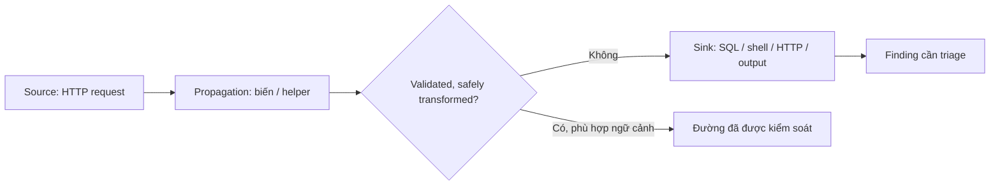
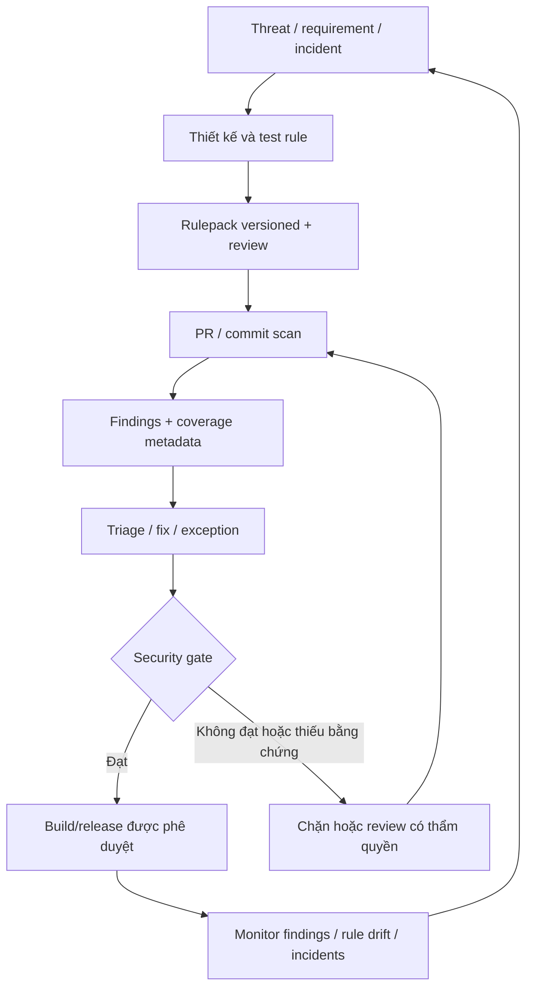

# Rule static analysis

Một dịch vụ Java cho phép người dùng tìm kiếm tài liệu theo mã định danh. Trong lúc thêm tính năng, developer nối trực tiếp tham số HTTP vào câu SQL. Bộ kiểm thử chức năng với dữ liệu thông thường vẫn đạt và code review không nhận ra lỗi. Một **rule static analysis** được cấu hình trong pipeline phát hiện lời gọi JDBC thực thi câu SQL tạo bằng phép nối chuỗi và báo vị trí cần kiểm tra. Tuy vậy, rule cũng có thể cảnh báo một đoạn SQL chỉ ghép các hằng số vô hại, đồng thời bỏ sót trường hợp giá trị không đáng tin được tạo qua nhiều hàm. Kết quả quét là **tín hiệu để phân tích và kiểm chứng**, không phải phán quyết tự động rằng mọi cảnh báo đều là lỗ hổng hoặc mọi đoạn mã không bị cảnh báo đều an toàn.

**Rule static analysis** là một **quy tắc dùng để kiểm tra mã nguồn hoặc biểu diễn tĩnh của chương trình mà không cần thực thi ứng dụng theo luồng nghiệp vụ đầy đủ**. Quy tắc mô tả loại cấu trúc, thao tác, đường dữ liệu hoặc điều kiện nào cần được nhận diện; công cụ phân tích trả về findings, vị trí mã nguồn và thông tin giải thích trong phạm vi mà rule có thể quan sát.

Trong module **SECURITY_SECURITY_ASSURANCE**, các rule là một phần của chương trình *security assurance*: đưa mục tiêu bảo mật, yêu cầu và security controls thành những phép kiểm tra có thể tái lập; lưu bằng chứng kiểm tra, phân loại phát hiện, khắc phục và xác minh lại. **Rule tốt phải trả lời được “đang kiểm tra điều gì, bằng phương pháp nào, có giới hạn gì và bằng chứng nào cho phép rút ra kết luận?”**

## 1. Rule static analysis là gì?

Một công cụ **static analysis** có thể phân tích source code, cú pháp đã parse, biểu diễn trung gian, luồng điều khiển, luồng dữ liệu hoặc quan hệ giữa các hàm để phát hiện những mẫu lập trình đáng quan tâm.

**Rule** là đơn vị chính sách hoặc logic tìm kiếm, ví dụ:

- Không ghép đầu vào không đáng tin trực tiếp vào câu SQL.
- Không dùng thuật toán mật mã hoặc tham số cấu hình bị cấm theo chính sách.
- Không đặt secret rõ ràng trong mã nguồn.
- Không vô hiệu hóa kiểm tra chứng chỉ TLS trong HTTP client.
- Không ghi token truy cập, password hoặc dữ liệu nhạy cảm vào log.
- Kiểm tra một số điểm gọi HTTP có URL do người dùng kiểm soát để đánh giá rủi ro SSRF.
- Nhận diện các đường xử lý tài nguyên nhạy cảm cần review phân quyền.

Một rule có thể phục vụ **chất lượng mã**, **an toàn bộ nhớ**, **correctness**, **maintainability**, **compliance** hoặc **security**. Không phải cảnh báo static analysis nào cũng là vulnerability. Nhóm cần phân biệt rule phục vụ mục tiêu gì và hậu quả nào xảy ra nếu điều kiện bị vi phạm.

### 1.1. Rule, scanner, finding và policy không phải một khái niệm

| Khái niệm | Vai trò | Ví dụ |
| --- | --- | --- |
| **Rule** | Mô tả mẫu hoặc thuộc tính cần kiểm tra | Phát hiện đối số SQL được tạo bằng phép cộng chuỗi |
| **Rule pack / ruleset** | Tập các rule và cấu hình đi kèm | Bộ quy tắc security cho các dịch vụ Java |
| **Scanner / analyzer** | Công cụ chạy rule trên mã hoặc biểu diễn tĩnh | Phân tích repository tại một commit |
| **Finding** | Kết quả phát hiện tại vị trí và ngữ cảnh xác định | `FIND-SAST-021`, vị trí, rule ID và thông điệp |
| **Risk assessment** | Đánh giá liệu finding thể hiện rủi ro thực tế trong môi trường ứng dụng | SQL nhận input từ HTTP và đi tới DB |
| **Release policy / gate** | Quy định khi nào kết quả được chấp nhận, chặn hoặc cần review | Không triển khai nếu còn lỗi injection quan trọng chưa xử lý |
| **Evidence** | Kết quả có thể truy vết của lần quét, review và retest | Commit, rule version, scan run, artifact, quyết định |

Một scanner chạy thành công chỉ chứng minh công cụ đã hoàn thành công việc trong **phạm vi được cấu hình**. Nó không tự chứng minh mọi security requirement đều đã đạt.

### 1.2. Tại sao tổ chức cần rule riêng?

Bộ rule mặc định có ích để bắt đầu, nhưng ứng dụng thực tế có **framework, pattern, data model và yêu cầu nghiệp vụ riêng**. Ví dụ, một hệ thống SaaS nhiều tenant cần hạn chế truy cập chéo tenant trong API, worker, cache và database. Một rule chung về SQL injection chưa đánh giá đầy đủ logic phân quyền theo tenant.

Tổ chức có thể xây rule bổ sung để:

1. Phát hiện API nội bộ không được phép gọi trực tiếp;
2. Cảnh báo việc tạo query thiếu ràng buộc tenant ở những module đã biết;
3. Tìm chỗ truy cập secret từ cấu hình không được chấp thuận;
4. Ngăn một kiểu disable security filter đã từng gây incident;
5. Thực thi quy ước mã hóa, logging hoặc quyền trong một framework cụ thể.

Rule tùy chỉnh phải có **threat model, phạm vi áp dụng và bộ test**; nếu quá rộng hoặc không phù hợp cách kiến trúc thực sự hoạt động, nó chỉ tạo nhiễu và làm đội phát triển mất niềm tin vào công cụ.

## 2. Các cách rule phân tích chương trình

Không phải mọi rule đều quan sát mã ở mức độ sâu như nhau.

| Phương pháp | Khả năng thường dùng | Giới hạn cần nhận biết |
| --- | --- | --- |
| **Text / regex matching** | Tìm chuỗi, từ khóa, mẫu đơn giản | Không hiểu cú pháp, alias hoặc luồng dữ liệu; dễ false positive |
| **AST pattern matching** | Nhận diện node cú pháp, lời gọi hàm, annotation, toán tử | Có thể bỏ sót dữ liệu đi qua nhiều biến/hàm |
| **Semantic/type-aware matching** | Kiểm tra kiểu, symbol, binding, framework API | Phụ thuộc khả năng parse và resolve dự án |
| **Control-flow analysis** | Xem nhánh, vòng lặp, điều kiện và đường thực thi khả dĩ | Độ chính xác phụ thuộc mô hình, đường động và độ phức tạp |
| **Dataflow / taint analysis** | Theo dõi dữ liệu từ nguồn đến sink, có xét transformation | Có thể quá rộng hoặc bỏ sót nguồn/sink/sanitizer |
| **Interprocedural analysis** | Theo luồng hoặc quan hệ qua nhiều hàm | Tốn tài nguyên, phụ thuộc mô hình thư viện và dynamic behavior |
| **Symbolic / abstract interpretation** | Suy luận thuộc tính cho nhiều trạng thái chương trình | Có thể phải xấp xỉ, sinh cảnh báo không thể xảy ra |
| **Custom organizational rule** | Kiểm tra kiến trúc và quy ước nội bộ | Chỉ mạnh khi tổ chức định nghĩa đúng pattern và kiểm chứng thường xuyên |

Một số engine kết hợp nhiều phương pháp. Khi chọn rule, cần biết **engine có thực sự hỗ trợ loại phân tích mà rule tuyên bố hay không**; việc tìm thấy tên method giống “sink” không đồng nghĩa đã chứng minh dòng dữ liệu nguy hiểm đi tới đó.

### 2.1. AST giúp tốt hơn regex như thế nào?

Ví dụ đoạn mã Java:

```java
logger.info("login rejected");  // Nội dung log tĩnh.
logger.info(request.getParameter("token")); // Có dữ liệu client cần xem xét.
```

Một regex tìm `logger.info` sẽ cảnh báo cả hai lời gọi. Rule hiểu cú pháp có thể nhận diện đối số là lời gọi `request.getParameter` và tập trung hơn. Nhưng nếu token được lưu vào biến, truyền qua helper rồi mới log, rule chỉ dựa trên cấu trúc một dòng vẫn có thể bỏ sót.

### 2.2. Taint analysis: source, propagation, sanitizer và sink

**Taint analysis** mô hình hóa dữ liệu có xuất xứ không tin cậy hoặc nhạy cảm và xem chúng có tới một hành động nguy hiểm không.

- **Source:** điểm dữ liệu đi vào, như HTTP request, header, webhook, queue hoặc file không tin cậy.
- **Propagation:** giá trị được gán, nối, truyền hàm hoặc biến đổi.
- **Sink:** thao tác có thể nguy hiểm khi nhận dữ liệu không kiểm soát, như SQL execution, command execution, file path, HTTP request hoặc HTML output.
- **Sanitizer / validator:** bước được chứng minh đủ để loại bỏ điều kiện nguy hiểm **trong ngữ cảnh cụ thể**.
- **Barrier / trusted boundary:** điều kiện mà một engine coi dữ liệu đã được chặn/giới hạn; phải được mô hình hóa thận trọng.



Một validator “giới hạn chiều dài chuỗi” không tự làm dữ liệu an toàn cho mọi sink. SQL nên được tham số hóa; dữ liệu ghi HTML cần encoding theo ngữ cảnh; thao tác filesystem cần kiểm soát đường dẫn; URL đi ra cần chính sách điểm đến. **Không nên xây một sanitizer dùng chung để tuyên bố mọi dữ liệu đã an toàn.**

### 2.3. Giới hạn của mô hình tĩnh

Phân tích có thể sai khi:

- Reflection, dynamic class loading hoặc dependency injection che giấu lời gọi;
- interface hoặc polymorphism khiến target của lời gọi khó xác định;
- code generation, macro hay preprocessor thay đổi mã thực thi;
- framework xác thực/phân quyền dùng interceptor hoặc annotation đặc biệt;
- thư viện third-party thiếu source hoặc summary;
- native code, runtime plugin, remote API không được engine bao phủ;
- cấu hình production và quyền runtime khác môi trường phân tích;
- dữ liệu hoặc điều kiện triển khai chỉ xuất hiện khi chạy.

**Finding không xuất hiện** có thể nghĩa là không có mẫu vi phạm trong phạm vi rule, chứ không có nghĩa không có rủi ro.

## 3. Cấu trúc một security rule có thể quản trị

Một rule có ích cho security assurance cần nhiều hơn pattern.

| Trường | Vai trò | Ví dụ |
| --- | --- | --- |
| **rule_id** | Định danh ổn định, không phụ thuộc tên file | `JAVA-SQL-001` |
| **title / message** | Nêu mẫu rủi ro và hướng kiểm tra | “SQL được nối chuỗi trước executeQuery” |
| **objective / requirement** | Vì sao rule tồn tại | `SR-INJ-01`: không đưa input không tin cậy vào SQL như mã lệnh |
| **language / framework** | Điều kiện áp dụng | Java, JDBC |
| **pattern / dataflow model** | Logic phát hiện | Nối chuỗi tại đối số executeQuery |
| **scope** | Repo, module, thư mục và phần được loại trừ | Chỉ mã ứng dụng, không áp trên generated code theo policy |
| **severity** | Mức nghiêm trọng kỹ thuật của mẫu | ERROR/WARNING theo engine |
| **confidence** | Mức tin cậy rằng kết quả mô tả đúng nguy cơ | MEDIUM |
| **owner** | Người duy trì và xử lý false positive | AppSec team |
| **remediation** | Cách sửa an toàn | PreparedStatement và bind parameters |
| **references** | CWE, tài liệu nội bộ, rule design | CWE-89 hoặc requirement ID |
| **test cases** | Mã dương/âm chứng minh rule hoạt động như dự kiến | Mẫu unsafe, safe, edge case |
| **version / changelog** | Truy vết thay đổi logic rule | Rule pack commit hoặc version |
| **suppression policy** | Cơ chế loại cảnh báo sai có review | Owner, lý do, hạn xem lại |

Các trường như `confidence`, `owner` hay `requirements` có thể nằm trong metadata hoặc hệ thống quản trị riêng, không nhất thiết được scanner hỗ trợ tự động. **Điều quan trọng là có nguồn chuẩn và có thể truy vết**, không phải thêm field tùy ý vào mọi định dạng.

### 3.1. Severity, confidence và risk không đồng nhất

- **Severity** của rule mô tả mức tác động tiềm năng của mẫu.
- **Confidence** mô tả độ tin cậy của kết quả phân tích.
- **Business risk** phụ thuộc mức phơi nhiễm, dữ liệu, quyền và control thực tế.

Một rule có `severity=ERROR` và `confidence=LOW` cần được điều tra kỹ, không nhất thiết tự kết luận phát hiện là vulnerability. Ngược lại, một finding confidence cao ở code chạy với quyền nhạy cảm có thể có rủi ro cần ưu tiên dù severity mặc định thấp.

### 3.2. ID và phiên bản rule cần ổn định

Đổi tiêu đề, message hoặc đường dẫn file không nên tự tạo rule ID hoàn toàn mới nếu semantics vẫn giữ nguyên. Khi logic thay đổi đáng kể, cần có version và changelog; nếu thay đổi phạm vi phát hiện hoặc lý do bảo mật, phải đánh giá ảnh hưởng tới findings cũ và baseline.

Một rule “bắt nhiều hơn” sau cập nhật có thể tạo hàng loạt finding trên mã cũ mà không có thay đổi code. Dashboard phải phân biệt **newly introduced code issue** với **newly discovered issue due to rule evolution**.

## 4. Ví dụ Java: rule phát hiện SQL được nối chuỗi

Đây là ví dụ phù hợp để hiểu sự khác biệt giữa **pattern-based finding** và **đánh giá rủi ro thực tế**.

### 4.1. Đoạn mã cần kiểm tra

```java
import java.sql.Connection;
import java.sql.ResultSet;
import java.sql.Statement;
import java.sql.SQLException;

class DocumentLookup {
    ResultSet unsafeLookup(Connection connection, String userInput)
            throws SQLException {
        Statement stmt = connection.createStatement();
        String query = "SELECT id, tenant_id FROM documents WHERE id = '"
                + userInput + "'";
        return stmt.executeQuery(query);
    }
}
```

Đoạn mã có vấn đề vì dữ liệu không tin cậy được lắp vào cấu trúc câu SQL. Một attacker có thể điều khiển giá trị theo cách thay đổi cú pháp truy vấn tùy ngữ cảnh SQL và quyền database. Ví dụ còn có vấn đề về **quản lý tài nguyên JDBC** vì trả về `ResultSet` mà không giữ vòng đời Statement/Connection đúng cách; đây là chủ đề correctness riêng.

Một rule AST chỉ nhìn thấy phép nối chuỗi ngay trong đối số `executeQuery(...)` có thể **không phát hiện ví dụ này** vì query được nối trước vào biến. Rule dataflow phù hợp hơn khi cần lần theo dữ liệu qua các phép gán.

### 4.2. Bản sửa sử dụng tham số và phạm vi tenant

```java
import java.sql.Connection;
import java.sql.PreparedStatement;
import java.sql.ResultSet;
import java.sql.SQLException;
import java.util.UUID;

class DocumentRepository {
    DocumentView findAccessible(Connection connection,
                                UUID documentId,
                                UUID tenantId) throws SQLException {
        String sql = """
            SELECT id, tenant_id, title
            FROM documents
            WHERE id = ? AND tenant_id = ?
            """;

        try (PreparedStatement ps = connection.prepareStatement(sql)) {
            ps.setObject(1, documentId);
            ps.setObject(2, tenantId);

            try (ResultSet rs = ps.executeQuery()) {
                if (!rs.next()) {
                    return null;
                }
                return new DocumentView(
                    rs.getObject("id", UUID.class),
                    rs.getString("title")
                );
            }
        }
    }
}
```

Đây là ví dụ Java/JDBC với giả định database driver hỗ trợ thao tác UUID như đã dùng và `DocumentView` được định nghĩa riêng trong ứng dụng. **`tenantId` phải lấy từ principal được xác thực hoặc control được tin cậy**, không lấy trực tiếp từ header tùy ý của client. Kiểm tra quyền theo đối tượng và các quy tắc chia sẻ khác vẫn có thể cần thiết.

Một query tham số hóa giúp chống việc dữ liệu trở thành cấu trúc SQL, nhưng **không tự chứng minh authorization theo tenant**. Đây là hai yêu cầu và hai nhóm phép kiểm tra khác nhau.

## 5. Viết rule đơn giản với Semgrep: nhận diện mẫu cú pháp

Ví dụ sau dùng **cú pháp rule mang tính minh họa** của Semgrep cho Java: phát hiện lời gọi `executeQuery` hoặc `executeUpdate` khi đối số có một phép nối chuỗi trực tiếp.

```yaml
rules:
  - id: java.jdbc.inline-concat-query
    languages: [java]
    severity: WARNING
    message: >-
      JDBC query được tạo bằng nối chuỗi ngay tại lời gọi.
      Kiểm tra nguồn dữ liệu và chuyển sang parameterized query
      nếu có đầu vào không tin cậy.
    pattern-either:
      - pattern: $STMT.executeQuery($LEFT + $RIGHT)
      - pattern: $STMT.executeUpdate($LEFT + $RIGHT)
    metadata:
      category: security
      technology: [jdbc]
      confidence: LOW
      cwe: ["CWE-89"]
      requirement_id: "SR-INJ-01"
```

**Rule này có chủ đích rất hẹp:** chỉ cảnh báo phép nối chuỗi trực tiếp tại lời gọi mà engine nhận diện được. Nó có thể cảnh báo phép nối hai hằng số, không chứng minh dữ liệu đến từ người dùng, không nhận diện query được tạo ở biến như `unsafeLookup` và không kiểm tra mọi API/JDBC wrapper. Mục đích là minh họa **điểm mạnh và giới hạn của pattern rule** chứ không phải quy tắc bảo vệ SQL injection hoàn chỉnh.

Nếu sử dụng một phiên bản/cấu hình công cụ khác, cần kiểm tra schema, phạm vi AST và hành vi thực tế bằng bộ test rule trước khi bật gate. Không nên copy ví dụ vào production và coi nó là bảo đảm toàn diện.

### 5.1. Mẫu test cho rule cú pháp

```java
// ruleid: java.jdbc.inline-concat-query
stmt.executeQuery("SELECT * FROM documents WHERE id=" + input);

// ruleid: java.jdbc.inline-concat-query
stmt.executeUpdate("UPDATE documents SET status=" + rawStatus);

// ok: java.jdbc.inline-concat-query
stmt.executeQuery("SELECT id FROM documents");

// ok: java.jdbc.inline-concat-query
preparedStatement.executeQuery();

// Pattern đơn giản có thể bỏ sót trường hợp này.
String sql = "SELECT * FROM documents WHERE id=" + input;
stmt.executeQuery(sql);
```

Trong hệ sinh thái Semgrep, comment `ruleid:` và `ok:` thường được dùng trong test fixture để đánh dấu vị trí được mong đợi báo hoặc không báo. Đây là **mẫu test fixture**, không phải bằng chứng test đã chạy ở dự án hiện tại. Nếu rule bỏ sót trường hợp có query trong biến, cần đổi mô hình phát hiện hoặc thêm một rule khác thay vì chỉnh test để che khoảng trống.

### 5.2. Khi nào dùng taint rule?

Nếu câu hỏi là “HTTP request parameter có chảy tới SQL execution hay không?”, mô hình nguồn–sink có thể phù hợp hơn:

```text
SOURCE:
  servletRequest.getParameter(...)
  hoặc dữ liệu không tin cậy từ request body/queue

PROPAGATION:
  assignment, concatenation, helper methods

SINK:
  Statement.executeQuery(query)
  Statement.executeUpdate(query)

SAFE MECHANISM:
  Tham số hóa SQL bằng PreparedStatement / binding phù hợp;
  không coi mọi thao tác String.replace hoặc giới hạn độ dài là sanitizer.

REPORT:
  Nêu source, đường dẫn dữ liệu (nếu engine hỗ trợ),
  sink và giới hạn mô hình.
```

Đây là **mô tả logic**, không phải cấu hình Semgrep có thể chạy trực tiếp. Một taint rule thật cần xác định API nguồn/sink chính xác, cách mô hình hóa frameworks và điều kiện loại trừ; có bộ test cho direct flow, multi-step flow và safe cases. Rule không nên coi một hàm tự đặt tên `sanitize()` là an toàn nếu chưa có căn cứ về ngữ nghĩa.

## 6. Ví dụ thứ hai: rule về phân quyền trong hệ thống đa tenant

Trong nền tảng SaaS, security requirement có thể là:

> **SR-AUTH-017:** Mọi thao tác đọc, tải và xuất tài liệu phải kiểm tra quyền của principal đã được xác thực đối với tài liệu và tenant trước khi trả dữ liệu nhạy cảm.

Một số developer dùng:

```java
// Chỉ minh họa: truy vấn này không tự ràng buộc tenant.
return documentRepository.findById(documentId);
```

Rule nội bộ có thể cảnh báo những lời gọi `findById` trong các service nhạy cảm để **yêu cầu review**. Nhưng nó không được kết luận chắc chắn rằng đoạn code thiếu phân quyền:

- Authorization có thể đã được thực thi ở một service khác hoặc qua policy layer.
- Có thể đó là thao tác quản trị đã được cho phép với điều kiện riêng.
- Method có thể chỉ truy vấn dữ liệu công khai.
- Ngược lại, lời gọi có tên `findByIdAndTenantId` chưa chứng minh `tenantId` đến từ danh tính tin cậy.

### 6.1. Quy tắc kiểm tra kiến trúc theo phạm vi

Một thiết kế rule hợp lý có thể là:

```yaml
rule_design:
  id: "JAVA-TENANT-REVIEW-01"
  description: >-
    Nhận diện truy vấn đọc tài liệu chưa thể hiện tenant context
    trong những module có dữ liệu nhạy cảm để yêu cầu review.
  applies_to:
    modules: ["document-api", "document-export-worker"]
    components: ["service", "repository-adapter"]
  candidate_patterns:
    - "documentRepository.findById(...)"
    - "documentRepository.findAll(...)"
  exclusions_require_review: true
  evidence_required:
    - "authorization-design-review"
    - "negative-cross-tenant-integration-test"
  intended_decision: "NEEDS_REVIEW"
  limitation: >-
    Tên method không đủ để chứng minh đúng/sai về phân quyền.
    Cần xem identity source, service-account permissions và code path.
```

Đây là **schema thiết kế minh họa**, không phải một rule Semgrep/CodeQL có thể chạy nguyên văn. Rule chỉ đóng vai trò phát hiện chỗ cần xem xét; **negative tests** cho user B yêu cầu tài liệu tenant A, export worker, cache và download URL mới cung cấp bằng chứng hành vi.

### 6.2. Khi nào rule tùy chỉnh đáng đầu tư?

Thường có giá trị khi:

1. Một pattern nguy hiểm đã gây sự cố hoặc lặp lại trong nhiều module.
2. Control quan trọng có API/kiến trúc đủ ổn định để viết rule.
3. Có thể mô tả điều kiện match và ngoại lệ rõ ràng.
4. Có một tập positive/negative fixtures đại diện.
5. Finding trả về cho developer hướng sửa cụ thể.
6. Có người chịu trách nhiệm duy trì khi framework và kiến trúc thay đổi.

Nếu chỉ có một trường hợp đặc biệt hoặc logic phân quyền phụ thuộc nhiều dữ liệu runtime, một checklist review và integration tests có thể hiệu quả hơn rule quá phức tạp.

## 7. Rule quality: precision, recall, false positives và false negatives

Một rule là một công cụ phát hiện, có cả lỗi bỏ sót và lỗi cảnh báo sai.

| Thuật ngữ | Ý nghĩa | Hệ quả |
| --- | --- | --- |
| **True positive (TP)** | Rule báo đúng mẫu/rủi ro trong phạm vi mục tiêu | Cần triage và xử lý phù hợp |
| **False positive (FP)** | Rule báo nhưng điều kiện nguy hiểm không áp dụng | Tạo nhiễu, tăng chi phí review |
| **False negative (FN)** | Có vấn đề trong phạm vi mục tiêu nhưng rule không báo | Rủi ro bị bỏ sót |
| **True negative (TN)** | Không có vấn đề trong một trường hợp được đánh giá và rule không báo | Khó đo toàn diện với mã nguồn thực tế |

**Precision** đo trong các cảnh báo được rule tạo ra, bao nhiêu cảnh báo là đúng:

\[
\text{Precision}=\frac{TP}{TP+FP}
\]

**Recall** đo trong các trường hợp thực sự có vấn đề thuộc phạm vi được xét, rule phát hiện được bao nhiêu:

\[
\text{Recall}=\frac{TP}{TP+FN}
\]

Trong thực tế, thường khó xác định đầy đủ `FN` vì không biết mọi lỗ hổng thực sự tồn tại. Do đó, đánh giá recall thường dựa trên **bộ test có ground truth, mẫu code được gán nhãn hoặc review chọn mẫu**, không tự suy từ kết quả scanner production.

### 7.1. Ví dụ trade-off

Một rule tìm mọi lời gọi `Statement.executeQuery(...)` có thể phát hiện nhiều vị trí nhưng nhiễu rất lớn. Thu hẹp để chỉ tìm `executeQuery("..." + input)` làm giảm số cảnh báo nhưng bỏ qua SQL được dựng từ biến/hàm. Taint analysis có thể tìm nhiều đường hơn nhưng cần mô hình chuẩn về source/sink và có thể tốn tài nguyên.

**Không có rule luôn tối ưu đồng thời precision, recall và chi phí thực thi.** Chọn cấu hình theo tài sản, mức rủi ro, pipeline latency và năng lực triage.

### 7.2. Coverage không chỉ là “scanner đã chạy”

Nên kiểm tra:

- Ngôn ngữ, framework và phiên bản nào được hỗ trợ?
- Các module và đường dẫn nào được quét?
- Generated code, test code, vendored libraries hoặc IaC được xử lý thế nào?
- Những loại lỗ hổng nào có rule phù hợp?
- Phân tích có chạy trên đủ dependencies/types để resolve symbol không?
- Rule pack nào được bật/tắt, và vì sao?
- Có parse errors, timeout, partial scan hoặc file quá lớn bị bỏ qua không?
- Rule có được test trên những pattern an toàn và nguy hiểm thực tế của codebase không?

Một báo cáo “0 critical findings” **không** nói lên điều gì về các loại lỗi không có rule, các module không quét hoặc các job bị skip.

## 8. Thiết kế bộ kiểm thử cho rule

**Rule cũng là mã** và cần được kiểm thử như các thành phần kiểm soát quan trọng khác. Bộ test cho rule phải đi kèm version rule và được chạy khi thay đổi logic/engine.

### 8.1. Các nhóm test nên có

| Nhóm test | Ví dụ | Kiểm tra điều gì? |
| --- | --- | --- |
| **Positive direct** | Nối input trực tiếp vào SQL execution | Rule nhận diện trường hợp rõ |
| **Positive indirect** | Input qua biến/helper trước sink | Rule dataflow có bắt trường hợp mục tiêu không |
| **Negative safe** | SQL được tham số hóa | Không cảnh báo nếu rule nhắm tới injection |
| **Negative irrelevant** | Nối chuỗi để tạo log thông thường | Không áp cảnh báo SQL vào code không liên quan |
| **Framework-specific** | Spring MVC, repository, reactive code | Rule hiểu API và convention đang dùng |
| **Edge syntax** | Method chain, lambda, multi-line, generic, overload | Rule ổn định với cách viết mã khác nhau |
| **Cross-file** | Source và sink nằm ở các file khác nhau | Kiểm tra giới hạn interprocedural |
| **Rule suppression** | Ngoại lệ hợp lệ / không hợp lệ | Chính sách không bị bypass |
| **Engine compatibility** | Version analyzer nâng cấp | Kết quả không drift ngoài dự kiến |
| **Performance** | Monorepo và module lớn | Scan hoàn thành trong ngân sách phù hợp |

Cần giữ test fixtures **đủ nhỏ để hiểu** nhưng có thêm những mẫu lấy từ lỗi thật đã được khử dữ liệu nhạy cảm. Khi rule từng bỏ sót một lỗ hổng, bổ sung regression test cho rule trước khi chỉnh logic.

### 8.2. Một bảng expected-result minh họa

| Trường hợp | Kỳ vọng với rule JDBC inline-concat | Lý do |
| --- | --- | --- |
| `stmt.executeQuery("..." + userInput)` | Finding | Có phép nối trực tiếp |
| `stmt.executeUpdate(prefix + suffix)` | Finding | Mẫu cú pháp giống điều kiện rule, chưa chứng minh injection |
| `stmt.executeQuery("SELECT 1")` | Không finding | Không có nối chuỗi |
| `preparedStatement.executeQuery()` | Không finding | Lời gọi không mang chuỗi SQL trong đối số |
| `String sql = prefix + input; stmt.executeQuery(sql)` | Có thể bỏ sót | Cần dataflow rule hoặc review bổ sung |
| `dbWrapper.execute(sql)` | Không được bảo đảm | Wrapper không nằm trong sink của rule ví dụ |

Nếu một test case “kỳ vọng không tìm” chỉ vì rule chưa đủ mạnh, phải ghi đây là **known limitation**, không đưa vào nhóm “safe”. Đây là nguyên tắc quan trọng để tránh tự đánh lừa khi tính độ chính xác.

## 9. Triage finding: từ cảnh báo tới quyết định có căn cứ

Một finding của static analysis cần đi qua bước đánh giá trước khi trở thành vulnerability được xác nhận hoặc quyết định release.

### 9.1. Các trạng thái hữu ích

- `NEW`: công cụ mới phát hiện, chưa đánh giá.
- `CONFIRMED`: có căn cứ rằng pattern/rủi ro áp dụng.
- `FALSE_POSITIVE`: rule match sai hoặc điều kiện không áp dụng với bằng chứng.
- `NEEDS_INVESTIGATION`: thiếu thông tin về luồng hoặc runtime.
- `MITIGATED`: control bù đã được kiểm chứng, có thể chưa sửa tận gốc.
- `FIX_IN_PROGRESS`: đang sửa.
- `VERIFIED_FIXED`: bản sửa được kiểm tra và phù hợp phạm vi yêu cầu.
- `ACCEPTED_RISK`: rủi ro được phê duyệt có điều kiện/thời hạn theo chính sách.
- `REOPENED`: giả định cũ không còn đúng hoặc lỗi tái xuất hiện.

Một công cụ có thể dùng tên trạng thái khác, nhưng cần giữ **ý nghĩa không nhập nhằng**. “Dismissed” chỉ có giá trị assurance khi có lý do, người quyết định và bằng chứng.

### 9.2. Xác minh một finding có ảnh hưởng hay không

Người triage nên xem:

1. Rule có đúng ngôn ngữ/API không?
2. Dữ liệu có thật sự không tin cậy hoặc nhạy cảm không?
3. Có đường dữ liệu tới sink trong build/config đang vận hành không?
4. Có authorization, validator hoặc control khác đã được xác minh không?
5. Mã có được đóng gói và thực thi trong môi trường đích không?
6. Lỗ hổng có tác động đến tài sản nào?
7. Có cách tái hiện an toàn hoặc kiểm chứng bổ sung không?
8. Nếu sửa, test nào chứng minh behavior đã đổi đúng?
9. Nếu không sửa, decision/exception nào hợp lệ?

Không nên kết luận false positive chỉ vì lập trình viên nói “đoạn này không bao giờ chạy”. Cần có căn cứ về đường gọi, cấu hình, test hoặc phạm vi triển khai.

### 9.3. False positive vẫn có giá trị cải tiến rule

Một false positive được xác minh có thể phản ánh scope quá rộng, thiếu type constraint hoặc một helper an toàn chưa được mô hình hóa. Tập hợp các trường hợp này thành test fixtures giúp cải thiện precision mà không bỏ các true positives.

Không xóa finding gốc khỏi lịch sử nếu cần audit; dùng trạng thái và lý do rõ, đồng thời giữ đường truy vết tới rule version đã báo.

## 10. Suppression, exception và baseline

**Suppression** là việc không báo hoặc không chặn một finding theo quy tắc được phê duyệt. Nó không làm mã tự trở nên an toàn.

### 10.1. Các loại suppression

| Loại | Ví dụ | Rủi ro |
| --- | --- | --- |
| **Inline suppression** | Chỉ dẫn tại một dòng hoặc block code | Dễ bị lạm dụng và bị quên khi mã thay đổi |
| **File/path exclusion** | Bỏ một thư mục khỏi quét | Có thể che nhiều lỗi thật |
| **Rule disable** | Tắt rule ở repository | Mất cả coverage của loại lỗ hổng |
| **Finding waiver** | Chấp thuận một finding cụ thể có thời hạn | Phải theo dõi owner, hạn và điều kiện |
| **Baseline** | Ghi nhận tồn đọng cũ để tập trung vào findings mới | Dễ biến tồn đọng thành “vô hình” nếu không có backlog và SLA |

### 10.2. Quy tắc suppression tốt

Một ngoại lệ nên gắn:

- Finding fingerprint hoặc rule ID và code location;
- bối cảnh source/commit/release áp dụng;
- lý do kỹ thuật và risk assessment;
- người đề xuất và người phê duyệt có thẩm quyền;
- bằng chứng rằng đó là false positive hoặc control bù có hiệu lực;
- ngày hết hạn hoặc sự kiện cần xem lại;
- ticket khắc phục nếu còn rủi ro;
- phạm vi rõ ràng để không che findings không liên quan.

Ví dụ bản ghi minh họa:

```yaml
suppression:
  id: "SAST-EXC-<id>"
  rule_id: "JAVA-SQL-001"
  finding_fingerprint: "<stable-fingerprint>"
  repository: "<repo>"
  affected_component: "<module>"
  reason: "<technical-analysis>"
  risk_status: "<false-positive|accepted-risk|mitigated>"
  compensating_control_evidence: "<ref-if-any>"
  requested_by: "<owner>"
  approved_by: "<authorized-reviewer>"
  approved_at: "<timestamp>"
  expires_at: "<timestamp>"
  review_triggers:
    - "code-change"
    - "rule-version-change"
    - "environment-exposure-change"
```

Đây là schema quản trị **minh họa**, không phải định dạng suppression mặc định của scanner. Khi ngoại lệ hết hạn, công cụ báo cáo/gate phải đưa finding trở lại trạng thái cần xem xét. Với finding rủi ro cao, không nên cho phép chính người tạo code tự phê duyệt suppression nếu chính sách yêu cầu review độc lập.

### 10.3. Baseline không có nghĩa tồn đọng đã được giải quyết

Có thể áp chính sách “chặn findings mới, quản lý legacy findings trong backlog” để tránh tạo hàng nghìn cảnh báo làm dừng toàn bộ delivery. Tuy nhiên:

- Lỗ hổng đã biết đang bị khai thác không nên được bỏ qua chỉ vì là legacy.
- Backlog cần owner, priority, SLA và lịch xử lý.
- Baseline phải gắn commit/rule version và cơ chế fingerprint hợp lý.
- Khi rule thay đổi, cần xem các findings “mới phát hiện” thuộc mã cũ.
- Dashboard phải hiển thị cả **new findings** và **open legacy risk**.

## 11. Tích hợp rule vào Secure SDLC và CI/CD

Một chương trình quản trị rule tốt chạy sớm, lặp lại và có enforcement phù hợp với rủi ro.



### 11.1. Nên chạy ở đâu?

- **IDE/pre-commit:** phản hồi sớm cho developer, có thể chạy rule nhanh.
- **Pull request:** phát hiện vấn đề được giới thiệu trong thay đổi và yêu cầu sửa trước merge.
- **Protected branch:** quét đầy đủ hơn, có snapshot để kiểm toán.
- **Release build:** lưu evidence đúng commit/artifact, xác nhận policy được áp dụng.
- **Scheduled rescan:** kiểm tra các rule mới và mã cũ khi policy, threat model hoặc analyzer cập nhật.
- **Incident follow-up:** bổ sung regression rule hoặc test sau khi xác định pattern lỗi hệ thống.

Việc quét nhiều lần không có ý nghĩa nếu cùng một tập rule, scope và evidence không thể truy vết hoặc nếu kết quả bị bỏ qua. Cần thiết kế nơi phát hiện có giá trị và nơi thực thi quyết định.

### 11.2. Pipeline minh họa

```yaml
# Pseudocode mô tả logic, không phải cấu hình thực thi của CI cụ thể.
pipeline:
  - step: "checkout-approved-source"
    output: ["source_commit"]

  - step: "load-reviewed-ruleset"
    output: ["rulepack_version", "rulepack_digest"]

  - step: "static-analysis"
    inputs: ["source_commit", "rulepack_digest"]
    output:
      - "scanner_version"
      - "scan_scope"
      - "findings"
      - "parse_and_execution_errors"

  - step: "risk-triage-and-baseline"
    inputs: ["findings", "approved_suppressions", "risk_policy"]
    output: ["accepted_findings", "blocking_findings", "unknowns"]

  - step: "security-gate"
    requirements:
      - "required_rules_executed_successfully"
      - "coverage_matches_release_scope"
      - "no_unaccepted_blocking_findings"
      - "exceptions_authorized_and_current"

  - step: "archive-assurance-evidence"
    output: ["scan_run_id", "gate_decision", "evidence_manifest"]
```

**Không được coi job không chạy, lỗi parse hoặc timeout là “0 finding”.** Một số scanner trả non-zero exit khi tìm thấy finding, số khác khi gặp lỗi hoặc cấu hình sai. Pipeline cần phân biệt **rule finding** với **engine failure**, và xử lý riêng theo policy.

### 11.3. Những lớp kiểm soát bảo vệ pipeline

1. Rule pack nằm trong version control, có review và quyền sửa rõ.
2. Không cho một PR chưa được tin cậy sửa đồng thời code, rule và gate để tự bỏ kiểm tra.
3. CI runner và token có quyền tối thiểu; không đưa secret production vào scanner job nếu không cần.
4. Dependency và binary của analyzer có nguồn được phép, version kiểm soát.
5. Báo cáo scan và audit record không thể bị sửa trái phép hoặc thay bằng kết quả của commit khác.
6. Rule/version/scope được ghi cùng release; artifact triển khai được đối chiếu với commit đã quét.
7. Có đường xử lý khẩn cấp khi scanner lỗi, không chỉ một cờ `skip-security=true` dùng tùy ý.

Rule mạnh nhưng enforcement yếu thì vẫn có thể phát hành qua đường triển khai trực tiếp mà không cần qua gate.

## 12. Từ findings đến quyết định release gate

Không nhất thiết mọi finding đều chặn release. Quyết định nên dựa trên **mức rủi ro, tính chắc chắn và chính sách**.

| Điều kiện | Hành động minh họa |
| --- | --- |
| Phân tích tĩnh bắt buộc không chạy hoặc lỗi | `BLOCK` hoặc `NEEDS_REVIEW`, không đánh dấu `PASS` |
| Finding injection rõ, có đường tới dữ liệu không tin cậy và ảnh hưởng cao | `BLOCK` cho production theo policy rủi ro |
| Finding cần điều tra reachability / điều kiện áp dụng | `NEEDS_REVIEW` với owner và thời hạn |
| Finding được xác định false positive có bằng chứng | Ghi disposition, không coi là vulnerability thực |
| Finding tồn đọng có risk acceptance hợp lệ và còn hạn | `CONDITIONAL_APPROVAL` nếu policy cho phép |
| Không có blocking findings và scan coverage hợp lệ | Có thể `PASS` cho **tiêu chí SAST**, không đồng nghĩa toàn bộ sản phẩm an toàn |
| Artifact, commit hoặc rulepack không khớp evidence | Đánh giá lại, không áp dụng kết quả cũ tự động |

### 12.1. Tách đánh giá technical rule khỏi risk decision

Scanner thường biết mã phù hợp với pattern nào. Nó có thể không biết dữ liệu trong môi trường thật có nhạy cảm hay không, mức exposure của endpoint, quyền cloud của workload và khả năng ứng cứu. Security gate có thể kết hợp output của scanner với asset inventory, threat model, risk triage và quyết định ngoại lệ.

Không nên thay `severity` của rule thành “low” chỉ để pipeline xanh nếu rủi ro vẫn cao. Nếu cần triage thành false positive hoặc accepted risk, ghi lại trường đánh giá riêng và evidence tương ứng.

### 12.2. Phát hiện mới và finding tái xuất hiện

Khi fingerprint thay đổi do refactor, một finding cũ có thể xuất hiện thành “new”. Ngược lại, suppression quá rộng có thể che code mới. Nên đối chiếu rule ID, đường mã, symbol, dữ liệu và review để quyết định có phải vấn đề cũ hay mới. Việc đóng lại rồi mở ticket khác không được dùng để reset remediation SLA.

## 13. Quản trị và bảo trì bộ rule

Rule static analysis là một **security control phải được bảo trì** cùng với ứng dụng.

### 13.1. Vòng đời của rule

1. **Đề xuất:** xuất phát từ threat model, security requirement, incident, audit hoặc chính sách.
2. **Đặc tả:** xác định hành vi nguy hiểm, source/sink hoặc cấu trúc cần kiểm tra, phạm vi.
3. **Thiết kế:** lựa chọn engine, kỹ thuật matching, severity/confidence và hướng dẫn sửa.
4. **Kiểm thử:** positive/negative fixtures, framework variants, hiệu năng và known limitations.
5. **Review:** security engineer và owner framework xác nhận logic/rủi ro.
6. **Pilot/advisory mode:** đo noise, khả năng chấp nhận của developer và coverage.
7. **Enforcement:** bật chính sách gate theo risk tier khi đủ tin cậy.
8. **Theo dõi:** FP/FN, incident escapes, broken rule và thời gian scan.
9. **Cập nhật:** versioning, migration baseline, thông báo thay đổi rule.
10. **Retire:** khi API không còn, rule bị thay hoặc semantics không còn phù hợp, giữ lịch sử.

### 13.2. Hành vi khi công cụ/engine đổi version

Một analyzer mới có thể thay AST, khả năng resolve symbol hoặc thuật toán taint, khiến số findings thay đổi ngay cả khi code không đổi. Cần chạy bộ test rule với version mới, so sánh baseline và ghi thay đổi detection coverage; không tự xem tất cả findings mới là code regression.

### 13.3. Quyền chỉnh rule và exception

Nếu một người có thể sửa source, tắt rule, tự phê duyệt ngoại lệ và deploy production, gate thiếu tính độc lập. Cần thiết lập branch protection, review phù hợp, phân quyền và audit theo rủi ro. Không nhất thiết mọi rule cần phê duyệt của tổ chức lớn, nhưng các rule bảo vệ dữ liệu nhạy cảm hoặc quyền production nên được quản trị tương ứng với mức tác động.

## 14. Security assurance: chứng minh điều gì bằng rule?

Một báo cáo SAST “scan passed” là **một mảnh bằng chứng**, không phải assurance case hoàn chỉnh.

### 14.1. Claim – Argument – Evidence

**Claim minh họa:**

> **CLM-SAST-01:** Đối với release `document-api` được đánh giá, các pattern mã nguy hiểm thuộc phạm vi rulepack bảo mật bắt buộc đã được phân tích trên mã nguồn và cấu hình build tương ứng; các findings vượt ngưỡng chính sách được xử lý hoặc có quyết định rủi ro hợp lệ.

Claim này **không khẳng định** hệ thống không có lỗ hổng hay các security requirements không có rule đều đạt.

**Argument:**

- Rulepack được xác định phiên bản, do người có thẩm quyền review và có test.
- Phạm vi scan phù hợp repository/module/commit dùng tạo release.
- Scanner chạy đầy đủ, không lỗi parse đáng kể hoặc thiếu rule bắt buộc.
- Kết quả phân loại theo rule ID, ngữ nghĩa và risk assessment.
- Findings có owner, trạng thái sửa, retest hoặc ngoại lệ.
- Release decision gắn với bằng chứng của chính source/artifact.
- Những loại rủi ro ngoài phạm vi SAST được xử lý bằng kiểm thử, review hoặc control khác.

**Evidence:**

| Evidence ID | Hiện vật | Hỗ trợ kết luận | Giới hạn |
| --- | --- | --- | --- |
| `EV-SAST-01` | Rulepack ID, commit/digest, review | Bộ rule được quản trị | Không chứng minh rule không bỏ sót |
| `EV-SAST-02` | Rule fixtures + test run | Rule hoạt động trên các case đã thiết kế | Test set có thể chưa đại diện production |
| `EV-SAST-03` | Scanner version, config, source commit, scope | Scan chạy trên đầu vào xác định | Không thấy runtime behavior |
| `EV-SAST-04` | Findings và parse/coverage report | Những mẫu code được nhận diện | Có FP/FN và vùng ngoài phạm vi |
| `EV-SAST-05` | Triage, review và finding disposition | Rủi ro đã được đánh giá | Có thể còn giả định chưa kiểm tra |
| `EV-SAST-06` | PR fix, rescan, security regression tests | Có sửa và tái kiểm chứng | Cần xác minh deployment |
| `EV-SAST-07` | Release manifest, artifact digest, gate decision | Evidence gắn release | Source scan không tự chứng minh artifact giống source |
| `EV-SAST-08` | DAST/pentest/authorization tests | Hành vi thực tế ở các đường được thử | Không thay thế mọi trường hợp sử dụng |

### 14.2. Mẫu hồ sơ một lần quét

```yaml
static_analysis_assurance_record:
  claim_id: "CLM-SAST-01"
  service: "document-api"
  release_id: "<release-id>"
  source_commit: "<commit-sha>"
  source_scope:
    modules: ["document-api", "document-export-worker"]
    included_paths: ["<path-glob>"]
    excluded_paths: ["<documented-exclusion>"]
    languages: ["java"]
  rulepack:
    id: "JAVA-SECURITY"
    version: "<version>"
    digest: "sha256:<rulepack-digest>"
    reviewed_by: "<rulepack-reviewer>"
    rule_test_run: "<test-run-id>"
  analyzer:
    name: "<tool-name>"
    version: "<tool-version>"
    configuration: "<config-ref>"
    scan_run_id: "<scan-run-id>"
    completed_at: "<timestamp>"
    execution_status: "<complete|partial|failed>"
    parse_errors: ["<errors-if-any>"]
  findings:
    total: "<count>"
    blocking_open: "<count>"
    triage_register: "<finding-records>"
    approved_exceptions: ["<exception-id-if-any>"]
  remediation_evidence:
    pull_requests: ["<change-ref>"]
    rescan_reports: ["<rescan-ref>"]
    runtime_tests: ["<security-test-ref>"]
  artifact:
    digest: "sha256:<artifact-digest>"
    build_run: "<build-run-id>"
  assessment:
    outcome: "<pass|block|needs-review|conditional>"
    limitations: ["<uncovered-risks-or-paths>"]
    reviewer: "<authorized-reviewer>"
    decided_at: "<timestamp>"
```

Các giá trị trong ngoặc nhọn là **placeholders**, không phải dữ liệu đã kiểm chứng. Đặc biệt, trường `execution_status=complete` chỉ có ý nghĩa khi engine và pipeline đã thực sự hoàn tất các kiểm tra bắt buộc; thông báo “job success” không đủ nếu có file không parse được.

### 14.3. Ma trận truy vết yêu cầu → rule → evidence

| Security requirement | Rule / kiểm tra | Evidence mong đợi | Điều chưa được chứng minh |
| --- | --- | --- | --- |
| `SR-INJ-01`: input không làm thay đổi cấu trúc SQL | JDBC AST/taint rules; code review | Scan + triage + regression SQL test | Những wrapper và đường động ngoài model |
| `SR-AUTH-017`: tài liệu không đọc chéo tenant | Rule review điểm truy vấn + security tests | Review logic quyền, negative integration tests | Rule cú pháp tự nó không chứng minh authorization |
| `SR-LOG-03`: secret không bị đưa vào log | Logging source-to-sink rules + test | Scan + log verification | Hành vi logging của thư viện và runtime config |
| `SR-CRYPTO-02`: không dùng thuật toán bị cấm | Rule về API/config cấm + review | Scan + config check | Key management và cấu hình vận hành |
| `SR-CI-01`: không bypass kiểm soát phát hành | Rule workflow/IaC + gate enforcement | Policy review, protected branch, audit | Không chứng minh từng code path ứng dụng an toàn |

Với yêu cầu bảo mật quan trọng, nên có **nhiều phương pháp kiểm chứng bổ trợ**. Static analysis tốt cho những mẫu code định nghĩa được, còn test hành vi và đánh giá thiết kế tốt hơn cho các điều kiện động hoặc nghiệp vụ.

## 15. Chỉ số đánh giá chất lượng chương trình rule

Đếm “số warnings giảm” là chưa đủ: số cảnh báo có thể giảm vì sửa lỗi, nhưng cũng có thể do scanner tắt, ruleset thay đổi hoặc code bị loại khỏi phạm vi.

| Chỉ số | Đặt câu hỏi gì? | Giới hạn |
| --- | --- | --- |
| **Rule coverage** | Các nhóm requirement quan trọng có rule hoặc phương pháp khác phù hợp chưa? | Có rule chưa chứng minh rule đúng |
| **Scan completion / coverage** | Những repo/module/language phải quét có được quét thành công không? | Phải ghi parse errors và exclusions |
| **Precision on reviewed sample** | Trong cảnh báo đã review, bao nhiêu là true positive? | Mẫu review có thể thiên lệch |
| **Known-case recall** | Rule bắt được bao nhiêu testcase dương tính đã gán nhãn? | Không đo được mọi lỗ hổng ngoài thực tế |
| **False positive rate** | Mức nhiễu có làm chậm developer không? | Cần mẫu số và trạng thái triage rõ |
| **Time to triage** | Finding mất bao lâu để có kết luận ban đầu? | Không đồng nghĩa thời gian sửa |
| **Time to verified fix** | Bao lâu từ phát hiện tới kiểm chứng bản sửa? | Đừng kết thúc tại PR merge |
| **Suppression debt** | Bao nhiêu ngoại lệ còn hiệu lực hoặc quá hạn? | Có thể chứa rủi ro quan trọng |
| **Rule regression incidents** | Rule từng bỏ sót hoặc báo sai sau update bao nhiêu lần? | Phụ thuộc mức phát hiện trong review |
| **Security escape rate** | Lỗi ngoài production đáng lẽ thuộc phạm vi rule nào? | Phải điều tra nguyên nhân, không chỉ đổ lỗi rule |
| **Scan latency** | Quy trình có phản hồi đủ nhanh để dev sử dụng không? | Nhanh không có nghĩa đầy đủ |

Cần phân tầng theo rule ID, severity, confidence, mức rủi ro và service. Một rule precision thấp có thể vẫn có ích nếu nó phát hiện lỗi có tác động nghiêm trọng nhưng khó tìm; khi đó nên đưa vào **review queue** thay vì gate cứng mọi lần match.

## 16. Các sai lầm thường gặp

| Sai lầm | Hệ quả | Hướng khắc phục |
| --- | --- | --- |
| Dùng regex đơn giản để kết luận tồn tại vulnerability | Nhiều FP và thiếu ngữ cảnh | AST/dataflow phù hợp, review finding |
| Coi không có finding là không có lỗ hổng | Bỏ qua loại lỗi không có rule, config và runtime | Công khai coverage và kết hợp các phép kiểm khác |
| Gộp severity, confidence và business risk | Triage và gate sai | Tách metadata rule khỏi risk assessment |
| Chỉ dựa vào rule mặc định | Bỏ qua control/kiến trúc đặc thù | Rule tùy chỉnh có threat model và tests |
| Rule quá rộng không có test âm tính | Nhiễu làm developer tắt scanner | Bổ sung safe cases, scope và review |
| Chỉ test các mẫu phát hiện được | Không nhận ra FP và known FN | Dùng positive/negative/edge fixtures |
| Coi method tên `sanitize` là an toàn cho mọi sink | Có thể dẫn đến false negative nguy hiểm | Kiểm tra semantics theo ngữ cảnh |
| Không ghi phiên bản rulepack | Không tái dựng được kết quả quét | Version/digest và changelog |
| Thay rule nhưng không đánh giá baseline | “New findings” bị hiểu nhầm là code regression | So sánh code/rule/engine version |
| Tắt rule để giảm số warning | Mất coverage và che rủi ro | Suppression có phạm vi, owner, hạn |
| Quét không thành công nhưng pipeline xanh | Thiếu bằng chứng vẫn được phát hành | Phân biệt scan failure và clean result |
| Dùng SAST để kết luận logic phân quyền đã đúng | Lỗ hổng nghiệp vụ vẫn tồn tại | Threat model + negative integration tests |
| Đóng finding khi PR merge | Bản deploy có thể chưa có sửa | Rescan, regression test và verify deployment |
| Cho developer tự phê duyệt bỏ gate | Dễ vô hiệu hóa security control | Protected rules/gates và separation of duties |
| Quét mã khách hàng/secret mà không bảo vệ report | Thêm rủi ro lộ thông tin | Quyền scanner/report, redaction, retention |

## 17. Quy trình triển khai rule static analysis trong tổ chức

### Bước 1: Chọn mục tiêu bảo mật có giá trị cao

Dựa trên risk register, incident history, threat model và security requirements để chọn một số vấn đề cần phát hiện. Ví dụ: injection, sử dụng API mật mã bị cấm, secret exposure, logging nhạy cảm và vi phạm quy ước authorization tại những module cố định.

### Bước 2: Chọn analyzer và phương pháp phù hợp

Xác định ngôn ngữ/framework, khả năng AST/taint, độ chính xác mong đợi, thời gian quét, khả năng xử lý monorepo và định dạng evidence. Không chọn rule chỉ vì có điểm severity cao nếu công cụ không phân tích được codebase.

### Bước 3: Viết đặc tả và bộ test trước enforcement

Mỗi rule cần mục đích, pattern, scope, false-positive conditions, remediation guidance, positive/negative fixtures và owner. Ghi known limitations.

### Bước 4: Chạy thử và lấy mẫu findings

Dùng advisory mode trong một giai đoạn có giới hạn để đo chất lượng. Review một mẫu gồm cả cảnh báo và đường rủi ro đáng quan tâm mà rule có thể bỏ sót. Điều chỉnh logic khi có căn cứ.

### Bước 5: Đưa vào PR và release pipeline

Quét trước merge, dùng baseline có quản trị để tập trung vào lỗi mới, đồng thời tiếp tục xử lý backlog rủi ro cao. Với rule đã đủ chất lượng, áp dụng gate theo chính sách và mức rủi ro.

### Bước 6: Xây quy trình triage và ngoại lệ

Mọi finding cần owner, kết luận, evidence, action và deadline khi có rủi ro. Suppression phải có review, phạm vi và thời hạn. Không dùng các quyết định thủ công không ghi dấu.

### Bước 7: Liên kết tới assurance và vận hành

Gắn scan với commit/build/release; kết hợp test hồi quy, DAST/pentest, configuration/IaC checks và incident outcomes. Khi lỗi lọt production, hỏi có cần sửa rule/model hoặc bổ sung phương pháp kiểm chứng khác không.

### Bước 8: Đánh giá lại theo chu kỳ và khi có thay đổi

Nâng analyzer, framework, dependency hoặc kiến trúc có thể làm ruleset lỗi thời. Định kỳ chạy rule regression tests, phân tích noise, coverage và cập nhật policy khi threat model hoặc nghĩa vụ thay đổi.

## 18. Checklist đánh giá rule static analysis

- [ ] Rule có ID ổn định, owner và phiên bản quản lý được.
- [ ] Mỗi rule bảo mật có nguồn từ risk/threat/requirement hoặc policy rõ ràng.
- [ ] Rule mô tả điều kiện match, phạm vi ngôn ngữ/framework và hạn chế.
- [ ] Phân biệt match cú pháp, taint/dataflow và đánh giá rủi ro thực tế.
- [ ] Có hướng xử lý cụ thể, không chỉ message chung chung.
- [ ] Severity và confidence không bị đánh đồng với risk decision.
- [ ] Có test dương tính, âm tính, edge cases và known limitations.
- [ ] Có review rule khi nâng scanner/engine hoặc thay framework.
- [ ] Có đo parse errors, scan exclusions và rule execution failures.
- [ ] Kết quả quét liên kết với đúng repository, commit, rulepack và analyzer version.
- [ ] Có quy trình triage, review, remediation và retest cho findings.
- [ ] Suppression có lý do, owner, reviewer, phạm vi và thời hạn.
- [ ] Baseline không che findings cũ có rủi ro cao hoặc đang bị khai thác.
- [ ] CI/CD gate không coi scan timeout/skip là clean result.
- [ ] Có kiểm soát quyền sửa ruleset, workflow, exception và deploy.
- [ ] Rule không được dùng thay cho authorization tests hoặc dynamic verification khi cần.
- [ ] Evidence của release thể hiện rõ cả phần đã kiểm tra và phần chưa bao phủ.
- [ ] Những rule từng bỏ sót sự cố được cập nhật cùng regression fixtures.
- [ ] Scanner và kho báo cáo được phân quyền, bảo vệ secret và dữ liệu nhạy cảm.
- [ ] Kết luận security assurance có phạm vi, thời điểm và rủi ro còn lại rõ.

## 19. Câu hỏi tình huống để vận dụng

### Tình huống A: Semgrep rule không báo SQL injection

Đoạn mã tạo SQL bằng phép nối chuỗi trong một biến, sau đó truyền biến vào `executeQuery(query)`. Rule chỉ match `executeQuery($LEFT + $RIGHT)` không báo gì. Có thể kết luận mã an toàn không?

**Không.** Đây là giới hạn của rule cú pháp. Cần xem dataflow/taint rule hoặc code review và test bổ sung. Không gọi test này là “safe negative” chỉ vì pattern không match.

### Tình huống B: rule báo mọi lời gọi `findById`

Một service đọc dữ liệu công khai và một service đọc tài liệu nhạy cảm cùng gọi `findById`. Rule gắn ERROR cho cả hai. Có cách nào làm rule hữu ích hơn?

**Có.** Giới hạn theo module/tài nguyên, phân biệt mục đích, xem type và control thực tế. Nếu không đủ dữ liệu để kết luận, cảnh báo nên hướng tới **NEEDS_REVIEW**, kết hợp negative authorization tests thay vì chặn tự động mọi lời gọi.

### Tình huống C: PR tắt rule thay vì sửa lỗi

Một developer sửa workflow để bỏ SAST rule đang chặn merge, rồi yêu cầu phê duyệt release vì “scanner quá nhiễu”. Đây có phải cách giải quyết hợp lệ không?

**Không nếu không có review và chính sách phù hợp.** Cần triage false positive, sửa rule hoặc tạo ngoại lệ có phạm vi và hạn. Việc thay rule/gate phải được bảo vệ bởi review và quyền riêng, không phải đường vòng tự do.

### Tình huống D: rule pack thay đổi, code không thay đổi

Sau khi analyzer được nâng cấp, số findings tăng. Có thể báo tất cả là lỗ hổng mới do developer giới thiệu không?

**Không.** Phải phân biệt code change và detection change. Cần xem thay đổi engine/ruleset, chạy regression tests, triage và cập nhật baseline có kiểm soát.

### Tình huống E: pipeline xanh do scan bị skip

Job SAST bị bỏ qua vì biến cấu hình sai. Hệ thống vẫn cho deploy vì không có finding. Kết quả gate hợp lệ không?

**Không.** Không có evidence scan hoàn thành. Phải tách `NOT_RUN` hoặc `ERROR` khỏi `PASS`, xử lý theo chính sách và ghi nhận quyết định nếu có đường dự phòng hợp lệ.

### Tình huống F: rule phát hiện logging có thể làm lộ token

Rule báo `logger.info(request.getHeader("Authorization"))`. Developer cho rằng header luôn rỗng vì gateway đã xóa trước khi gửi xuống. Có được dismiss ngay không?

**Chưa đủ.** Cần xác minh kiến trúc/gateway, các đường đi vòng, staging/production config và khả năng đổi policy. Nếu thực sự không thể có token trong phạm vi, lưu lý do và evidence; cân nhắc sửa code để không log thông tin nhạy cảm ngay cả khi giả định gateway thay đổi.

### Tình huống G: SAST không có findings ở release

Security team tuyên bố sản phẩm đáp ứng đầy đủ mọi mục tiêu bảo mật vì SAST báo 0. Nhận định này có đúng không?

**Không.** SAST kiểm tra một tập mẫu trong scope đã cấu hình. Nó không tự chứng minh logic phân quyền, cấu hình runtime, quy trình ứng cứu, dữ liệu bên thứ ba hoặc lỗ hổng chưa được mô hình hóa. Claim cần gắn requirement, coverage, test và evidence bổ sung.

### Tình huống H: finding đã sửa nhưng production vẫn dùng artifact cũ

Developer khắc phục pattern và rescan commit mới không còn finding. Một cluster production vẫn chạy image build từ commit cũ. Có thể đóng finding trên toàn production?

**Không.** Cần xác minh artifact và deployment thuộc phạm vi; bằng chứng source rescan chỉ áp dụng cho phiên bản đã quét, không tự xác nhận image cũ đã được thay.

## 20. Kết luận

**Rule static analysis** chuyển những mẫu mã nguy hiểm và yêu cầu bảo mật có thể mô hình hóa thành phép kiểm tra có thể tự động chạy, lặp lại và truy vết. Hiệu quả phụ thuộc vào **định nghĩa đúng hành vi cần tìm, lựa chọn kỹ thuật AST/dataflow thích hợp, chất lượng test của chính rule, phạm vi quét, quản trị ngoại lệ và cách xử lý findings**.

Trong **security assurance**, rule không phải mục tiêu cuối cùng. Nó là một phần của chuỗi **security objective → risk → requirement/control → rule và phương pháp kiểm chứng → finding → sửa/đánh giá rủi ro → evidence → quyết định release**. Kết quả đáng tin cần ghi đúng commit, phiên bản rule, scan scope, lỗi công cụ, kết quả triage và giới hạn của claim; những điều mà phân tích tĩnh không thể quan sát phải được kiểm tra bằng phương pháp bổ sung.

**Một rule có giá trị không phải vì nó tạo thật nhiều cảnh báo hoặc làm dashboard xanh, mà vì nó phát hiện được những vấn đề có ý nghĩa, giải thích được căn cứ và giới hạn của kết quả, giúp nhóm sửa đúng rủi ro và tạo bằng chứng có thể kiểm tra.**
