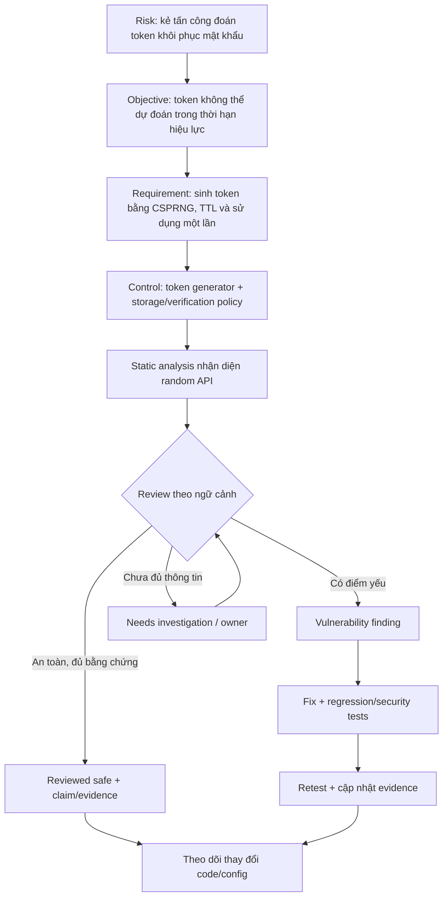
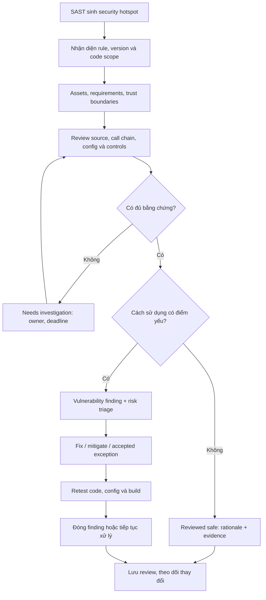
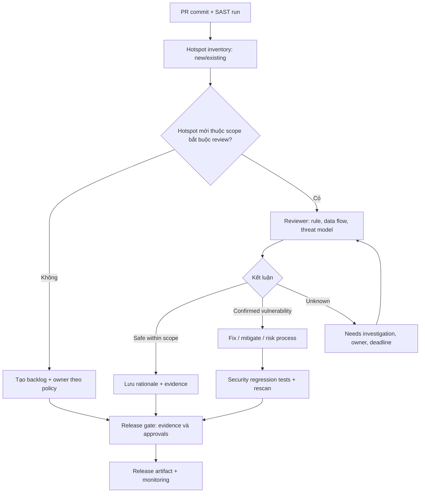
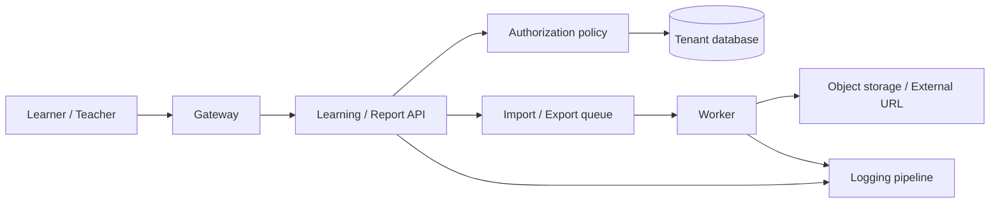

# Security hotspot trong Static Analysis: nhận diện điểm nhạy cảm và review theo ngữ cảnh

## 1. Vì sao security hotspot quan trọng?

Một nhóm phát triển nền tảng học tập Java/Spring Boot chạy static analysis trước khi merge pull request. Công cụ phát hiện các đoạn mã sử dụng API mã hóa, cấu hình CORS, sinh số ngẫu nhiên và ghi log dữ liệu người dùng. Chúng đều được gắn nhãn **security hotspot**. Trưởng nhóm hỏi: “Có bốn hotspot, vậy có phải hệ thống đang có bốn lỗ hổng không?”

**Không nhất thiết.** Một lời gọi API mật mã có thể được sử dụng hoàn toàn hợp lệ; một cấu hình CORS rộng có thể là quyết định có căn cứ trong một ứng dụng chỉ phục vụ dữ liệu công khai; một lời gọi `Random` có thể dùng để tạo dữ liệu mô phỏng không liên quan đến bảo mật. Nhưng cũng chính các cấu trúc này, trong ngữ cảnh khác, có thể làm lộ thông tin xác thực, mở rộng quyền truy cập hoặc khiến người tấn công đoán được token.

Đây là mục đích của **security hotspot**: **chỉ ra những vị trí mã hoặc cấu hình có tác động tiềm tàng đến bảo mật, nơi con người cần xem xét ngữ cảnh trước khi đưa ra kết luận**.

Security hotspot không nên được xử lý bằng cách luôn sửa tất cả, cũng không nên bị gạt bỏ bằng một cú nhấp “Safe” để làm đẹp dashboard. Review tốt phải giải thích **đoạn mã làm gì, dữ liệu nào đi qua, ai có thể tác động, giả định bảo mật nào được áp dụng, rủi ro có thật hay không và bằng chứng nào hỗ trợ kết luận**.

Trong chương **Static analysis** của module **SECURITY_SECURITY_ASSURANCE**, hotspot review là một mắt xích của **security assurance liên tục**: kết nối risk scenarios và security requirements với các controls trong mã nguồn, verification evidence, audit và quá trình khắc phục findings suốt phát triển và vận hành.

### Mục tiêu học tập

Sau bài này, bạn có thể:

1. Định nghĩa security hotspot và phân biệt với vulnerability finding, code smell, false positive và risk acceptance.
2. Đọc đúng nội dung một hotspot: rule, vị trí, ngữ cảnh, nguồn dữ liệu, sink, phiên bản mã và phạm vi kiểm tra.
3. Thực hiện quy trình review có căn cứ, từ hiểu chức năng đến đưa ra trạng thái và hành động.
4. Đánh giá ví dụ Java/Spring Boot về mã hóa, random, CORS, CSRF, logging, redirect, SSRF và phân quyền.
5. Ghi kết quả review đủ để audit và liên kết với requirement, control, test, build/release.
6. Thiết kế quy tắc CI/CD và chỉ số quản trị hotspot mà không đánh đồng chất lượng với số lượng cảnh báo.

## 2. Khái niệm nền tảng

**Static application security testing (SAST)** phân tích source code, bytecode hoặc artifact liên quan để tìm mẫu có thể ảnh hưởng bảo mật mà không nhất thiết phải chạy ứng dụng. Các công cụ có cách tổ chức rule và loại kết quả khác nhau: warning, issue, vulnerability, security hotspot hoặc một nhãn tương đương.

**Security hotspot** là dấu hiệu cho biết code đang dùng một thao tác hoặc cấu hình **nhạy cảm về bảo mật**, và cần **review thủ công theo bối cảnh**. Nó **chưa tự khẳng định** code có điểm yếu có thể khai thác.

| Khái niệm | Ý nghĩa | Hành động phù hợp |
|---|---|---|
| **Security hotspot** | Đoạn mã cần người đánh giá xem xét tính an toàn trong ngữ cảnh | Review code, data flow, yêu cầu và controls; ghi kết luận |
| **Vulnerability finding** | Công cụ hoặc người đánh giá chỉ ra điểm yếu bảo mật có cơ sở | Xác minh, ưu tiên, sửa/giảm thiểu và retest |
| **Potential vulnerability** | Có dấu hiệu lỗ hổng, nhưng exploitability hoặc điều kiện áp dụng chưa rõ | Triage với evidence; không tuyên bố chắc chắn |
| **False positive** | Cảnh báo khẳng định hoặc nhận diện sai trường hợp trong phạm vi đã kiểm tra | Ghi cơ sở bác bỏ và kiểm soát rule/suppression |
| **Safe after review** | Vị trí nhạy cảm đã được kiểm tra, cách sử dụng phù hợp các tiêu chí bảo mật | Ghi phạm vi, lý do, reviewer và bằng chứng |
| **Remediated hotspot** | Cấu trúc nhạy cảm đã được thay đổi/loại bỏ, kiểm tra theo tiêu chí | Review diff và test/scan lại bản phù hợp |
| **Risk acceptance** | Chủ rủi ro có thẩm quyền cho phép tồn tại rủi ro đã biết trong điều kiện xác định | Ghi approval, phạm vi, controls, thời hạn và trigger |
| **Code smell** | Dấu hiệu về khả năng bảo trì/thiết kế code, không nhất thiết là lỗ hổng bảo mật | Xử lý theo chất lượng phần mềm và ảnh hưởng thực tế |

### Lưu ý về tên trạng thái

Các công cụ khác nhau có thể cung cấp trạng thái như “To Review”, “Reviewed”, “Safe”, “Fixed”, “Acknowledged” hoặc quy ước khác. **Không nên giả định một nút hay trạng thái trong công cụ có cùng ý nghĩa bảo mật ở mọi sản phẩm/phiên bản.** Tổ chức cần chuẩn hóa ý nghĩa nội bộ: khi nào gọi là đã review, khi nào xác nhận có lỗ hổng và khi nào một quyết định rủi ro hợp lệ.

### Hotspot là tín hiệu, không phải kết luận

Một hotspot về `SecureRandom` có thể đúng và an toàn nếu dùng để tạo token; một hotspot về `java.util.Random` có thể không có vấn đề nếu sinh thứ tự hiển thị ngẫu nhiên. Nhưng nếu `Random` sinh mã reset mật khẩu, đây là trường hợp cần điều tra và có khả năng xác nhận một vulnerability.

Một rule tĩnh thường không nhìn thấy đầy đủ ý định nghiệp vụ, dữ liệu nhạy cảm, chính sách truy cập, cấu hình runtime hoặc các lớp kiểm soát bên ngoài. Vì vậy hotspot review phải kết hợp **ngữ cảnh hệ thống** và **phương pháp kiểm chứng bổ sung**.

## 3. Mối quan hệ giữa security hotspot, risk và security assurance

Mục tiêu của security assurance không phải “không còn biểu tượng cảnh báo”, mà là có đủ căn cứ để kết luận các mục tiêu bảo mật đang được đáp ứng trong phạm vi xác định.

Một chuỗi truy vết ví dụ:

**Risk scenario → Security objective → Requirement → Control → Sensitive code → Hotspot review → Evidence → Finding/decision → Monitoring.**



Hotspot review tạo **bằng chứng thiết kế và thực thi** cho security controls. Một kết luận có giá trị cần trả lời:

- Code nào đang được xét, ở revision nào?
- Chức năng thuộc luồng nghiệp vụ nào và bảo vệ tài sản gì?
- Điều kiện nào khiến code này an toàn hoặc nguy hiểm?
- Đã xem những nguồn dữ liệu, đường đi và lớp kiểm soát nào?
- Có test hoặc cấu hình nào hỗ trợ kết luận?
- Người nào review; còn giả định và khoảng trống nào?
- Khi thay đổi thiết kế hoặc threat model, kết luận có cần xem lại không?

## 4. Vì sao công cụ phát hiện được hotspot nhưng chưa thể tự kết luận?

Static analyzer thường nhận diện những **security-sensitive APIs** hoặc **security-sensitive configurations**. Ví dụ:

- Tạo số ngẫu nhiên hoặc token.
- Mã hóa, hash, ký hoặc quản lý khóa.
- CORS, CSRF, cookie và các security headers.
- Ghi file, gọi URL, đọc nội dung từ nguồn bên ngoài.
- Deserialization, xử lý XML, HTML/template hoặc chạy command.
- Ghi log, hiển thị exception và lưu dữ liệu nhạy cảm.
- Xác thực, phân quyền, kiểm tra chứng thư TLS.

Cùng một đoạn mã có thể có hành vi khác biệt tùy **data flow, threat model và runtime configuration**.

### Ví dụ một đoạn mã có thể an toàn hoặc không

```java
Random random = new Random();
int value = random.nextInt(1000000);
```

| Ngữ cảnh sử dụng `value` | Nhận định sơ bộ |
|---|---|
| Hiển thị một câu hỏi ngẫu nhiên trong giao diện demo | Thường không đòi hỏi tính không dự đoán được về bảo mật |
| Tạo mã khôi phục mật khẩu cho người dùng thật | Không phù hợp nếu dùng generator không bảo mật |
| Sinh tên file tạm trong luồng chứa dữ liệu nhạy cảm | Phải xét khả năng đoán, collision và quyền truy cập; có thể không an toàn |
| Sinh request ID để tương quan log | Đánh giá yêu cầu về uniqueness, trust boundary và khả năng đoán; không tự động xem như secret |

Kết luận không thể chỉ dựa trên từ khóa `Random`. Reviewer phải xem **giá trị được dùng làm gì, ai nhìn thấy nó, nó bảo vệ tài sản nào và có yêu cầu secrecy/unpredictability hay không**.

### Những giới hạn của static analysis

| Giới hạn | Ý nghĩa khi review |
|---|---|
| Không biết đầy đủ ý định nghiệp vụ | Cần requirement hoặc giải thích của feature owner |
| Taint/data flow chưa đủ sâu | Cần xem cả caller, callee và nguồn nhập |
| Reflection và code sinh động | Cần review framework wiring, plugin, serialization, runtime |
| Cấu hình theo môi trường | Dev/staging/prod có thể khác nhau |
| Authorization ở lớp khác | Một code path không thể đánh giá độc lập với policy enforcement |
| Điều kiện threat thay đổi | “Nội bộ” hôm nay có thể thành public endpoint ngày mai |
| Rule và analyzer được cập nhật | Cảnh báo có thể xuất hiện/biến mất vì rule version, không phải vì code an toàn hơn |
| Test không bao phủ mọi nhánh | Test pass không chứng minh không có lỗ hổng ngoài phạm vi thử |

**Không có cảnh báo không đồng nghĩa không có lỗ hổng.** Hotspot là một tín hiệu trong tập biện pháp bảo đảm, cần phối hợp với threat modeling, code review, kiểm thử và quan sát vận hành.

## 5. Những câu hỏi nền tảng khi review một hotspot

Trước khi bấm “Safe” hoặc sửa code, reviewer nên trả lời theo thứ tự:

1. **Rule phát hiện điều gì?** Security property bị ảnh hưởng, trường hợp an toàn và nguy hiểm được mô tả ra sao?
2. **Đây là code nào?** Repository, module, file, method, commit, branch và bản build liên quan.
3. **Vị trí này chạy trong ngữ cảnh nào?** Build-time, test, development, production, scheduled job hay internal tool?
4. **Những dữ liệu nào được xử lý?** Public, internal, credential, personal data, điểm thi, file do người dùng cung cấp.
5. **Nguồn dữ liệu có đáng tin không?** User input, HTTP header, queue, database, file, third-party API, config hay secret store.
6. **Ai có thể kích hoạt đoạn mã?** Người học, giảng viên, admin, workload nội bộ, Internet client hoặc kẻ chiếm tài khoản.
7. **Có trust boundary nào bị vượt qua?** Browser → API, API → worker, service → database, tenant A → tenant B.
8. **Control nằm ở đâu?** Authorization, validation, sandbox, TLS, input limits, policy, logging, rate limiting.
9. **Control có áp dụng cho mọi đường không?** Export, batch, cache, async jobs, admin path và error path.
10. **Bằng chứng nào xác nhận kết luận?** Review call graph, config, test, runtime trace, CI, audit event.
11. **Kết luận có giới hạn gì?** Chưa kiểm thử tenant đặc biệt, plugin, môi trường hoặc feature flag.
12. **Ai có quyền ra quyết định?** Reviewer code, security reviewer, service owner và risk owner tùy mức rủi ro.

Những câu hỏi này biến hotspot thành một **review có phương pháp**, tránh hai cực đoan: phán đoán hời hợt hoặc yêu cầu sửa mọi code nhạy cảm mà không xét tác động.

## 6. Quy trình review security hotspot có thể kiểm toán

### Bước 1 — Ghi nhận hotspot

Thu thập rule ID, mô tả, file, vị trí, source revision, tool version, thời điểm scan, project/branch và trạng thái. Nếu pipeline phân tích snapshot khác release mục tiêu, phải ghi giới hạn ngay.

### Bước 2 — Xác định tài sản và yêu cầu bảo mật

Làm rõ endpoint/feature liên quan, dữ liệu nhạy cảm, security objective và acceptance criteria. Nếu chưa có requirement, review là dịp phát hiện nhu cầu bổ sung.

### Bước 3 — Lần theo luồng dữ liệu và đường thực thi

Từ nơi nhận đầu vào đến hành vi nhạy cảm, xem caller/callee, exception handling, worker, cache và các nhánh điều kiện. Đừng chỉ xem ba dòng code mà scanner đánh dấu.

### Bước 4 — Phân tích điều kiện gây rủi ro

Phát biểu kịch bản cụ thể: tác nhân nào, input gì, quyền nào, điều kiện nào và hậu quả gì. Liên hệ CWE/OWASP nếu phù hợp; phân biệt lỗ hổng thực tế với dấu hiệu chung.

### Bước 5 — Xác minh controls và giả định

Code/config/thiết kế có control phù hợp không? Control có thể bị bypass không? Có phụ thuộc vào “chỉ chạy nội bộ”, “người gọi luôn đáng tin” hoặc “không có ai gửi giá trị lạ” mà chưa kiểm chứng?

### Bước 6 — Chọn quyết định và ghi rationale

- **Safe within reviewed scope:** có bằng chứng đủ để cho rằng cách sử dụng phù hợp.
- **Vulnerability confirmed:** có điểm yếu cần quản lý như security finding.
- **Needs investigation:** chưa đủ thông tin, giao owner, deadline và evidence cần bổ sung.
- **Risk acceptance/exception:** có rủi ro đã biết nhưng được chấp nhận trong thẩm quyền, có điều kiện/hạn.

Tùy công cụ, trạng thái kỹ thuật có thể không tương ứng trực tiếp với bốn nhãn này. Dùng issue/risk register để giữ ý nghĩa quyết định rõ ràng.

### Bước 7 — Sửa và xác minh khi cần

Nếu phát hiện vulnerability, lập ticket liên kết hotspot, sửa đúng nguyên nhân, chạy test/scan lại, kiểm tra release artifact và xác nhận finding closure. Nếu quyết định safe, lưu lý do, test/config/ADR và trigger re-review.

### Bước 8 — Giám sát tác động của thay đổi

Khi đổi source, caller, feature flag, quyền hoặc exposure, kết luận cũ có thể không còn đúng. Cần chính sách reopen/tái review cho hotspot bị ảnh hưởng.



## 7. Ví dụ 1 — Random và token bảo mật trong Java

### 7.1. Hotspot: sử dụng generator không dành cho bảo mật

Giả sử một dịch vụ gửi mã xác nhận để reset mật khẩu:

```java
// Không phù hợp để tạo bí mật xác thực hoặc token khôi phục.
Random random = new Random();
String resetCode = String.format("%06d", random.nextInt(1_000_000));
```

Đoạn mã có một điểm nhạy cảm: `java.util.Random` là generator phục vụ thống kê/mô phỏng thông thường, **không phải cryptographically secure pseudorandom number generator (CSPRNG)**.

Nếu `resetCode` là yếu tố bảo vệ tài khoản, cần xét:

- Kẻ tấn công có thể đoán hoặc thử mã không?
- Mã có TTL, giới hạn số lần thử và ràng buộc với người dùng/hành động không?
- Có dùng một lần rồi vô hiệu hóa không?
- Mã có bị ghi vào log, URL, analytics hoặc lưu plaintext lâu dài không?
- Có rủi ro brute force ngay cả khi dùng CSPRNG, do mã chỉ có sáu chữ số không?

Với cùng `Random` dùng để chọn câu hỏi minh họa trong một bài học không bảo mật, kết luận có thể là **safe after review**. Với reset code, cần quản lý như vulnerability hoặc design defect tùy tiêu chí.

### 7.2. Hướng thiết kế tốt hơn

```java
private static final SecureRandom RNG = new SecureRandom();

String resetCode = String.format("%06d", RNG.nextInt(1_000_000));
// Cần bổ sung TTL, giới hạn thử, ràng buộc người dùng/hành động,
// sử dụng một lần và lưu trữ an toàn; CSPRNG riêng lẻ là chưa đủ.
```

Đây là **minh họa một phần của control**, không phải thiết kế reset mật khẩu hoàn chỉnh. CSPRNG không giải quyết hết rủi ro brute force đối với mã ngắn. Nếu dùng token dài, có thể chọn cách sinh byte ngẫu nhiên đủ entropy, mã hóa thành chuỗi an toàn cho URL, và bảo vệ vòng đời token phù hợp.

### 7.3. Evidence và quyết định

| Trường hợp | Quyết định có thể phù hợp | Evidence cần có |
|---|---|---|
| Random phục vụ sắp xếp danh sách gợi ý | Safe trong phạm vi tính năng | Data flow và requirement không đòi hỏi unpredictable |
| Random sinh mã reset mật khẩu | Confirm vulnerability/require fix | Call chain, auth requirements, threat scenario |
| SecureRandom tạo token nhưng không giới hạn số lần thử | Cần review thêm control toàn bộ flow | Design doc, rate-limit test, token-lifecycle tests |
| Token dùng trong thử nghiệm và không vào runtime production | Scope-specific safe/không ảnh hưởng production theo bằng chứng | Build scope, test config, runtime inventory |

## 8. Ví dụ 2 — Cryptographic API và mục đích sử dụng

Hotspot liên quan mật mã không thể được kết luận chỉ dựa vào tên thuật toán. Phải xác định **mục đích sử dụng, tài sản, cách quản lý khóa, chế độ hoạt động và ngữ cảnh**.

### 8.1. Hash có thể hợp lệ hoặc không

```java
MessageDigest digest = MessageDigest.getInstance("SHA-256");
byte[] hash = digest.digest(inputBytes);
```

SHA-256 có thể phù hợp để tạo checksum hoặc định danh nội dung trong một số trường hợp, nhưng **không thích hợp để lưu mật khẩu người dùng chỉ bằng một lần hash nhanh, không có cơ chế password hashing phù hợp**.

| Mục đích | Câu hỏi review |
|---|---|
| Kiểm tra file có thay đổi | Digest được lấy và đối chiếu từ nguồn tin cậy nào? Có cần chống giả mạo hay chỉ cần phát hiện thay đổi ngẫu nhiên? |
| Lưu password | Có dùng password hashing chuyên dụng, salt riêng và cost parameter phù hợp? |
| Chứng thực message | Có cần MAC/chữ ký với khóa, thay vì chỉ hash không khóa? |
| Chống trùng file | Có xử lý collision risk và quyền truy cập tới hash/dữ liệu? |

Không nên quy mọi hotspot dùng SHA-256 thành nguy hiểm. Nhưng cũng không được gắn “safe” khi nhóm dùng digest không khóa như một cơ chế xác thực mà không có threat model.

### 8.2. Mã hóa và quản lý khóa

Hotspot có thể xuất hiện khi code:

- Chọn thuật toán/chế độ mã hóa.
- Sinh IV/nonce.
- Tạo hoặc nạp encryption key.
- Bỏ qua kiểm tra chứng thư.
- Viết custom cryptography thay vì thư viện được đánh giá.

Reviewer cần hỏi:

1. Bài toán là encryption, integrity, signature hay password hashing?
2. Thuật toán và mode có phù hợp tiêu chuẩn/chính sách tổ chức?
3. Nonce/IV có yêu cầu uniqueness/unpredictability như thế nào và đã đáp ứng chưa?
4. Key lấy từ nguồn tin cậy nào; rotation/revocation và phân quyền ra sao?
5. Có authenticated encryption hoặc integrity protection khi yêu cầu?
6. Error path có lộ ciphertext, plaintext, key hoặc thông báo có thể tạo oracle?

Một câu lệnh mật mã có thể **trông đúng nhưng toàn bộ thiết kế không đúng**, ví dụ dùng AES-GCM nhưng tái sử dụng nonce với cùng key. Bằng chứng phải xem rộng hơn một dòng `Cipher.getInstance(...)`.

## 9. Ví dụ 3 — CORS trong Spring Boot

**CORS (Cross-Origin Resource Sharing)** là chính sách browser kiểm soát việc đọc response từ origin khác trong các trường hợp áp dụng. Nó **không phải cơ chế thay thế authentication hoặc authorization ở server**.

### 9.1. Cấu hình cần review

```java
@CrossOrigin(origins = "*")
@RestController
class PublicCourseController {
    // Endpoint minh họa trả dữ liệu danh mục khóa học công khai.
}
```

Wildcard origin là một security-sensitive configuration. Nhưng câu hỏi cần trả lời là:

- API chỉ trả thông tin công khai, hay có dữ liệu người học/tenant?
- Trình duyệt có gửi cookie hoặc credential gì không?
- Các origin khác có được phép đọc response hay không?
- Có endpoint trên cùng controller trả dữ liệu nhạy cảm?
- CORS thực tế có được định nghĩa ở gateway, Spring MVC và Spring Security nhất quán?
- Có cấu hình allow credentials đi cùng logic origin phù hợp và giới hạn không?

**Nếu endpoint thật sự chỉ trả dữ liệu công khai và không dùng credential**, CORS rộng có thể được chấp nhận theo thiết kế. Nếu controller cũng cung cấp thông tin cá nhân, quyền truy cập cần được bảo vệ và cấu hình phải được đánh giá chặt hơn.

### 9.2. Thiết kế theo allowlist khi cần

```java
@Bean
CorsConfigurationSource corsConfigurationSource() {
    CorsConfiguration config = new CorsConfiguration();
    config.setAllowedOrigins(
        List.of("https://app.example.org", "https://admin.example.org")
    );
    config.setAllowedMethods(List.of("GET", "POST", "PUT", "DELETE"));
    config.setAllowedHeaders(List.of("Authorization", "Content-Type"));
    config.setAllowCredentials(false); // Ví dụ API dùng bearer token, cần review riêng.

    UrlBasedCorsConfigurationSource source =
        new UrlBasedCorsConfigurationSource();
    source.registerCorsConfiguration("/api/**", config);
    return source;
}
```

Đoạn code trên chỉ minh họa cấu hình, chưa gồm đầy đủ Spring Security filter-chain wiring và policy của một ứng dụng cụ thể. Tên miền là ví dụ giả định. Việc thiết lập `allowCredentials(false)` **không chứng minh** ứng dụng không dùng cookie hoặc token ở những đường khác; cần review luồng xác thực thực tế.

### 9.3. Evidence

- Data classification và danh mục API.
- Danh sách origin được phép và business rationale.
- Security config theo môi trường production.
- Integration tests với `Origin` hợp lệ và không hợp lệ.
- Test rằng server-side authorization vẫn từ chối request không đủ quyền, kể cả khi request không xuất phát từ browser.

**CORS không chặn mọi loại client.** Một script hay HTTP client không bị ràng buộc bởi cơ chế kiểm soát đọc cross-origin của browser như một trang web; server-side permissions phải độc lập.

## 10. Ví dụ 4 — CSRF và cấu hình Spring Security

Hotspot thường xuất hiện khi code vô hiệu hóa CSRF protection:

```java
http.csrf(csrf -> csrf.disable());
```

Không thể kết luận ngay đây là một lỗ hổng hoặc cấu hình an toàn. **CSRF risk phụ thuộc vào cách trình duyệt tự động gửi credentials và khả năng một website khác kích hoạt yêu cầu có side effects**.

| Bối cảnh | Hướng review |
|---|---|
| Web app dùng session cookie để xác thực request thay đổi dữ liệu | Cần CSRF protection phù hợp; disable có thể nguy hiểm |
| API chỉ nhận bearer token do client chủ động gắn trong `Authorization` và không chấp nhận ambient credentials | Có thể có cơ sở disable CSRF cho một tập endpoint nếu threat model xác nhận |
| API hỗn hợp cookie và bearer | Cần phân vùng rõ cơ chế bảo vệ theo endpoint/security filter chain |
| Endpoint công khai nhưng có hành động thay đổi quan trọng | Xem xét request abuse, rate limiting và business authorization, không chỉ CSRF |
| Stateless service nhưng dùng Basic Auth hoặc cookie browser tự gửi | Nhãn “stateless” một mình không chứng minh không có CSRF risk |

### Những điểm phải xem

1. Browser xác thực bằng cookie/session, HTTP Basic, client certificate hay token do JS tự gửi?
2. Có endpoint thay đổi dữ liệu nào được gọi từ browser?
3. `SameSite`, CORS, CSRF token và session handling thực tế như thế nào?
4. Có filter chain/route không thuộc cấu hình đang review?
5. Có điều kiện fail-open hoặc bypass qua method khác, multipart/form hoặc GraphQL?

**Kết luận “CSRF disabled là safe” chỉ hợp lệ khi chứng minh các giả định về authentication và endpoint scope.** Nếu đổi sang cookie-based session, phải review lại.

## 11. Ví dụ 5 — Logging và dữ liệu nhạy cảm

### 11.1. Đoạn mã nhạy cảm

```java
log.info("Login request: {}", request);
```

Nếu đối tượng `request` có phương thức `toString()` chứa password, token, email hoặc thông tin cá nhân, đây có thể là lộ dữ liệu qua log. Nhưng trong ngữ cảnh đối tượng chỉ chứa metadata phi nhạy cảm, đoạn logging có thể được chấp nhận sau review.

### 11.2. Những câu hỏi cần trả lời

- Có dữ liệu gì trong object khi render log thực tế?
- Lombok/record/generated `toString()` có bao gồm secret không?
- Log được gửi tới đâu: console, file, SIEM, cloud logging, support dashboard?
- Ai có quyền đọc, retention bao lâu, có masking/redaction và export logs không?
- Log level có thay đổi theo environment hoặc debugging flag?
- Có log headers như `Authorization`, session cookie, signed URL, reset token không?
- Log user input có thể gây injection, newline forgery hoặc định dạng không an toàn?

### 11.3. Hướng cải thiện

```java
log.info(
    "login_attempt correlationId={} principalRef={} outcome={}",
    correlationId,
    safePrincipalReference,
    "DENIED"
);
```

Đây là ví dụ **structured logging có chọn lọc**, không đưa raw request vào log. `safePrincipalReference` phải được tạo theo chính sách dữ liệu tối thiểu và không làm lộ tài khoản không cần thiết. Các security audit events có thể cần thông tin sâu hơn, nhưng phải lưu ở kênh được phân quyền, có integrity và retention phù hợp.

### 11.4. Bằng chứng phù hợp

Code review và unit test cho redaction; mẫu log của integration test với secret giả; cấu hình log exporter; quyền truy cập và retention; kết quả kiểm tra rằng token/PII không xuất hiện trong luồng log thuộc phạm vi.

**Không chỉ review source code.** Một filter, proxy hoặc exception mapper bên ngoài method có thể tự động ghi toàn bộ request/response, làm vô hiệu mục tiêu giảm dữ liệu.

## 12. Ví dụ 6 — Gọi URL bên ngoài và nguy cơ SSRF

Một service tạo thumbnail hoặc import tài liệu nhận URL từ user rồi tải nội dung:

```java
@PostMapping("/api/import")
public ImportResult importFromUrl(@RequestParam String url) {
    return importService.downloadAndProcess(URI.create(url));
}
```

Đoạn controller đơn lẻ là **hotspot cần xem luồng dữ liệu**, chưa chứng minh tồn tại Server-Side Request Forgery (SSRF). Nhưng nếu `downloadAndProcess` cho phép client điều khiển đích truy cập mà không giới hạn, service có thể bị lợi dụng để truy cập địa chỉ nội bộ hoặc metadata service.

### Câu hỏi review

- URL là do người dùng nhập hay lấy từ danh sách đối tác cố định?
- Ứng dụng cho phép những scheme và host nào?
- Có kiểm tra DNS resolution, địa chỉ IP nội bộ/link-local và redirect chain?
- Khi DNS thay đổi giữa lúc xác minh và kết nối, có cơ chế chống bypass phù hợp?
- Request có mang credential, token hoặc header nội bộ ra ngoài không?
- Có giới hạn kích thước tải xuống, thời gian, chuyển hướng và loại nội dung?
- Worker xử lý file tải về có chạy trong sandbox và quyền tối thiểu?
- Có egress network policy ngăn kết nối ngoài phạm vi cho phép?

### Thiết kế giảm rủi ro

Một cách tiếp cận thường phù hợp là **allowlist những host đích đáng tin** và xác minh kết nối ở nhiều lớp, xử lý redirects cẩn trọng, không tự động forward secrets, giới hạn timeout/size, và áp dụng egress network controls. Nếu hệ thống thực sự cần tải URL tùy ý, cần threat model và môi trường cô lập tương ứng.

### Bằng chứng

- Data flow diagram: actor → API → downloader → network.
- Code/config review của validation, DNS/redirect và HTTP client.
- Egress policy thực tế và giới hạn IAM.
- Negative tests dùng đích kiểm thử nội bộ giả được dựng trong môi trường có quyền, không gọi metadata endpoint thật ngoài phạm vi.
- Kết quả test error handling và download limits.

**Vẫn là hotspot cho tới khi có bằng chứng về điều kiện rủi ro.** Nếu kiểm tra xác nhận đường tấn công, cần mở vulnerability finding và xử lý thay vì chỉ gắn trạng thái “reviewed”.

## 13. Ví dụ 7 — TLS và kiểm tra chứng thư

Một codebase có thể tạo HTTP client tùy chỉnh, trust manager hoặc hostname verifier. Đây là khu vực nhạy cảm bởi xác thực phía máy chủ và chống giả mạo kênh truyền có thể bị vô hiệu hóa.

### Cấu hình nguy hiểm điển hình

```java
// Pseudocode minh họa sai sót cần tìm trong review.
hostnameVerifier = (hostname, session) -> true;
```

Nếu đây thực sự là verifier được dùng trong kết nối TLS production, việc chấp nhận mọi hostname có thể làm mất một phần xác minh danh tính server và tăng nguy cơ man-in-the-middle. Nhưng cần kiểm tra code path và nơi cấu hình được áp dụng, thay vì kết luận mọi file chứa lambda này đều chạy trên production.

### Reviewer cần xác định

- Đây có phải đường HTTP client thực tế được tạo bởi dependency injection không?
- Có code chỉ dùng ở unit test hoặc môi trường local development?
- Có profile/feature flag nào vô tình bật ở production không?
- Certificate chain validation và hostname verification có đang được kiểm soát đúng?
- Có quản lý truststore và certificate rotation không?
- Những request nào mang personal data, token, secret hoặc quản trị đặc quyền?

Nếu cần kết nối tới một service dùng chứng thư chưa hợp lệ, **không nên dùng “trust all” làm giải pháp lâu dài**. Cần sửa hệ thống chứng thư, trust anchor hoặc cách triển khai tích hợp đúng chính sách.

### Evidence

TLS client configuration, environment profiles, actual connection tests với chứng thư không tin cậy/hostname sai, runtime property, review các đoạn code test-only và production path.

## 14. Ví dụ 8 — Object-level authorization và multi-tenant access

Mặc dù công cụ static analysis có thể đánh dấu một số đoạn security-sensitive code, những lỗi **business authorization** thường đòi hỏi kiến thức domain để xác nhận.

Ví dụ:

```java
@GetMapping("/api/results/{resultId}")
public ResultDto getResult(@PathVariable UUID resultId) {
    return resultService.findById(resultId);
}
```

Tại controller, chưa nhìn thấy kiểm tra quyền đối tượng. Không thể kết luận chỉ từ method name: `resultService.findById` có thể đã enforcement bên trong, hoặc có thể chưa.

Reviewer cần theo dõi:

1. Security context/identity lấy từ đâu?
2. Backend xác định tenant của `resultId` và quyền của user thế nào?
3. Repository có scope theo tenant không?
4. Có đường export, cache, batch hoặc job dùng cùng service mà không qua policy?
5. Request sai tenant có bị từ chối trước khi dữ liệu được đọc/trả về không?
6. Có kiểm thử cho learner, teacher, admin với đối tượng thuộc tenant khác?

Một cách thể hiện design intention rõ hơn:

```java
@GetMapping("/api/results/{resultId}")
public ResultDto getResult(
        @PathVariable UUID resultId,
        Authentication authentication) {
    return resultService.findAuthorizedResult(
        authentication, resultId
    );
}
```

Tên hàm `findAuthorizedResult` chỉ là gợi ý; **không tự chứng minh đã kiểm soát quyền**. Evidence cần code review policy thực, test âm tính và kiểm tra side effects (không có export/job/file được tạo trái quyền).

Trong security assurance, review của hotspot có thể mở ra finding về lỗ hổng nghiệp vụ **không có CVE hoặc rule SAST trực tiếp**. Đây là lý do không được giới hạn review vào cảnh báo công cụ.

## 15. Tình huống “safe” có căn cứ và “safe” không có căn cứ

### 15.1. Ví dụ kết luận an toàn có căn cứ

Hotspot: `Random` trong `LessonSuggestionDemo`.

Reviewer xác nhận:

- Giá trị chỉ ảnh hưởng thứ tự thẻ gợi ý trong module hướng dẫn.
- Không được dùng làm credential, session, token, key, nonce hoặc quyết định phân quyền.
- Code path chạy trong tính năng công khai, không có side effect dữ liệu nhạy cảm.
- Tests và code references xác nhận giới hạn này ở commit `C`.
- Chủ tính năng xác nhận requirement không đòi hỏi unpredictability.

Kết luận hợp lý: **Safe within reviewed scope**, kèm commit, call graph/evidence, reviewer và trigger nếu giá trị random sau này được dùng cho authentication.

### 15.2. Ví dụ kết luận không đủ căn cứ

Hotspot: tắt CSRF trong Spring Security.

Ghi chú: “Ứng dụng là REST API nên không cần CSRF”.

Thiếu thông tin:

- REST API có dùng cookie/session hoặc Basic Auth mà browser tự gửi không?
- Có endpoint dùng browser và thay đổi trạng thái không?
- `csrf.disable()` áp dụng toàn bộ filter chain hay chỉ một API?
- Có chứng cứ test/architecture để xác nhận không có ambient credentials?

Trạng thái phù hợp là **Needs investigation** hoặc finding nếu xác định có điểm yếu. Không nên xem nhận xét một dòng là evidence đủ để approve.

### 15.3. Ví dụ chấp nhận rủi ro không phải “safe”

Nhóm phát hiện logger đang ghi metadata nhạy cảm, nhưng chưa thể thay vì yêu cầu vận hành. Nếu risk owner có thẩm quyền chấp nhận tạm thời, record cần có phạm vi, ảnh hưởng, controls (giảm quyền đọc log, rút retention, masking), thời hạn và kế hoạch sửa. Đây là **accepted residual risk**, **không phải “safe”**.

Nếu công cụ không hỗ trợ trạng thái chi tiết, hệ thống issue/risk register phải bảo toàn thông tin này. Không dùng “Safe” để che giấu lỗ hổng chưa sửa hoặc được miễn trừ.

## 16. Phân biệt hotspot review với các hoạt động kiểm chứng khác

| Hoạt động | Câu hỏi chính | Điểm mạnh | Giới hạn |
|---|---|---|---|
| **Security hotspot review** | Cách dùng code nhạy cảm này có an toàn trong bối cảnh đã xét? | Buộc xem ngữ cảnh, giảm việc sửa máy móc | Phụ thuộc kiến thức hệ thống và evidence |
| **SAST vulnerability analysis** | Có mẫu/data flow cho thấy khả năng vi phạm control? | Phân tích quy mô lớn, sớm trong SDLC | False positive/negative và coverage |
| **Code review** | Diff có đúng logic, requirement và policy? | Kết hợp domain knowledge | Dễ bỏ sót nếu không có checklist/risk |
| **Threat modeling** | Ai có thể làm gì qua đường tấn công nào? | Xem toàn kiến trúc và trust boundaries | Không chứng minh implementation đã đúng |
| **DAST/API tests** | Ứng dụng đang chạy phản hồi thế nào khi thử? | Kiểm chứng hành vi thực ở scope thử | Chỉ bao phủ đường được thử |
| **SCA/dependency review** | Dependency bị ảnh hưởng bởi advisory nào? | Quản lý lỗ hổng thành phần | Không hiểu đầy đủ business logic |
| **Penetration testing** | Có thể kết hợp điều kiện thành đường tấn công? | Phát hiện vấn đề liên lớp/ngữ cảnh | Tính thời điểm, chi phí và phạm vi |
| **Audit/assurance review** | Claim/control có bằng chứng và quyết định đủ tin cậy? | Truy vết, độc lập, quản trị risk | Phụ thuộc chất lượng và freshness evidence |

Kết hợp các hoạt động theo risk. Ví dụ SAST đánh dấu CORS hotspot; architecture review xác định các origin/cookie; integration test kiểm tra response; audit đối chiếu approval với bản release đang chạy.

## 17. Thiết lập ownership và workflow quản lý hotspot

### 17.1. Vai trò

| Vai trò | Trách nhiệm |
|---|---|
| **Developer/feature owner** | Hiểu code path, data flow, requirement; đề xuất giải pháp và evidence |
| **Code reviewer/tech lead** | Kiểm tra tính đúng đắn của reasoning, source/diff và scope |
| **AppSec/security reviewer** | Hướng dẫn threat scenarios, tiêu chí an toàn và ưu tiên rủi ro |
| **Service owner** | Đảm bảo finding, remediation và test được thực hiện trong dịch vụ |
| **Risk owner** | Quyết định residual risk/exception trong thẩm quyền, không mặc định là AppSec |
| **Platform/DevOps** | Vận hành analyzer, CI, rule set, credentials, retention và report |
| **Audit/assurance reviewer** | Kiểm tra mẫu record, quality of evidence và hiệu lực quyết định |

### 17.2. Phân quyền đánh giá “safe”

Không nên để mọi người bấm “Safe” với bất kỳ hotspot nào mà không có trách nhiệm giải trình. Một chính sách có thể quy định:

- Người thực hiện review phải hiểu code và requirement.
- Với code nhạy cảm (cryptography, authentication, authorization, data export), yêu cầu thêm reviewer có năng lực bảo mật.
- Người tự viết code có thể cung cấp evidence, nhưng quyết định ở risk cao cần mức độc lập phù hợp.
- Những review thiếu evidence không được tính là hoàn tất.
- Nếu xác nhận vulnerability vượt risk appetite, cần route đến triage/remediation và thẩm quyền release gate.

Quy định mức review phải cân xứng với tác động, không gây chậm không cần thiết cho mọi hotspot có rủi ro thấp.

## 18. Tích hợp security hotspot vào quy trình CI/CD

Hotspot review hiệu quả nhất khi diễn ra **gần thời điểm code được thay đổi** và vẫn giữ đường truy vết tới release.

### 18.1. Quy trình pull request

1. Phân tích trên đúng commit/branch hoặc pull request.
2. Hiển thị hotspot mới/chưa review và rule metadata.
3. Định danh owner, loại source/config thay đổi và phạm vi ảnh hưởng.
4. Reviewer phân tích data flow và security requirement.
5. Nếu an toàn, lưu rationale/evidence ở tool hoặc issue có liên kết.
6. Nếu có vulnerability, mở finding, ưu tiên xử lý và test bản sửa.
7. Ghi quyết định trước merge theo policy, liên kết CI result với commit.
8. Sau merge/release, bảo đảm records có thể truy xuất và kiểm tra lại khi code/config thay đổi.

### 18.2. Tránh các release gate gây hiểu nhầm

Hai cách cực đoan đều có vấn đề:

- **Chặn mọi hotspot:** dễ khiến nhóm sửa code hợp lệ, tạo suppression không có rationale hoặc bỏ qua scanner để giảm cảnh báo.
- **Không quản lý hotspot:** cảnh báo tích tụ và những vị trí nhạy cảm không bao giờ được kiểm tra.

Chính sách hợp lý thường phân biệt:

- Hotspot **mới trong code thay đổi**, có owner và thời hạn review rõ.
- Hotspot **trọng yếu với risk cao**, cần review trước merge/release.
- Hotspot **đã review an toàn**, có evidence và trigger tái review.
- Hotspot **đã xác nhận vulnerability**, được quản lý theo vulnerability/remediation gate.
- Hotspot **chưa đủ thông tin**, cần điều tra, không tự động đóng.

Một quality gate phụ thuộc công cụ và phiên bản; không nên tuyên bố tất cả hệ thống SAST đều cho phép chặn “unreviewed hotspots” theo cùng một cơ chế. Tổ chức có thể kiểm soát bằng API công cụ, ticket workflow hoặc policy CI bên ngoài.



## 19. Baseline, false positives và quy tắc suppression

Trong một dự án lớn, scan lần đầu có thể sinh hàng trăm hotspot. Nếu buộc xử lý tất cả ngay, đội ngũ dễ rơi vào hoạt động hình thức. **Baseline** giúp phân biệt cảnh báo đã có từ trước với hotspot phát sinh trong thay đổi mới, nhưng không xóa trách nhiệm với rủi ro cũ.

### 19.1. Baseline đúng cách

- Ghi snapshot commit, rule set, analyzer version và tổng số hotspot.
- Phân loại theo service, security-sensitive categories, mức exposure và chủ sở hữu.
- Ưu tiên review các đường authentication, authorization, payment, export dữ liệu, key và secret.
- Giao mốc xử lý backlog với risk owner và thẩm quyền rõ.
- Đặt quy tắc chặt cho hotspot mới trong code thay đổi.
- Theo dõi các thay đổi làm hotspot cũ trở nên rủi ro hơn.

### 19.2. Suppression khác quyết định safe

**Suppress** có thể làm công cụ không hiển thị hoặc không tính một cảnh báo trong một phạm vi. Nó là hành động đối với công cụ, **không phải bằng chứng về tính an toàn**.

Trước suppression cần có:

1. Lý do cụ thể liên quan đến rule/case.
2. Phạm vi tối thiểu: file, rule, method hoặc issue, không vô hiệu hóa toàn bộ bộ quy tắc nếu không cần.
3. Reviewer/approver và trách nhiệm giải trình.
4. Evidence supporting false positive hoặc safe usage.
5. Thời hạn/trigger review lại nếu ngữ cảnh có thể thay đổi.
6. Kiểm tra suppression không che các finding khác do rule tương tự.

Một rule kém phù hợp có thể được cấu hình lại ở cấp project, nhưng quyết định phải dựa trên dữ liệu về false positives, coverage và risk, không chỉ nhằm giảm số cảnh báo.

## 20. Ma trận review cho các nhóm hotspot phổ biến

| Nhóm hotspot | Risk scenario cần xét | Evidence nên xem | Khi nào cần escalated review |
|---|---|---|---|
| **Random/token** | Token có thể đoán, brute force | Data flow, TTL, token policy, tests | Token xác thực, reset mật khẩu, signing secrets |
| **Cryptography** | Weak mode, nonce reuse, key exposure | Threat model, crypto config, key lifecycle | Mã hóa dữ liệu nhạy cảm hoặc xác thực message |
| **CORS** | Cross-origin data read ngoài policy | API data classification, security filters, browser tests | API dùng cookie/credential và dữ liệu cá nhân |
| **CSRF** | Trình duyệt kích hoạt side effect trái ý user | Auth flow, cookie/session, endpoint tests | Tắt CSRF trong app có ambient credentials |
| **TLS verification** | MITM/impersonation | Truststore, client config, negative TLS tests | Production client bỏ hostname/certificate check |
| **Logging** | Lộ PII/secret hoặc log injection | Redaction tests, log sink permissions, sample | Logging token, password, auth headers |
| **SSRF/URL fetch** | Truy cập mạng nội bộ hoặc exfiltration | URL flow, egress policy, redirect/DNS tests | URL do user chọn đến service có đặc quyền |
| **Serialization** | Hành vi nguy hiểm từ dữ liệu không tin cậy | Input origin, allowlist types, parser config | Deserialization input chưa kiểm soát |
| **File handling** | Path traversal, upload abuse, overwriting | Canonical path checks, storage permissions, tests | Tạo file từ user-supplied paths |
| **Command execution** | Chạy command dưới quyền service | Argument/source validation, subprocess environment | Command string có dữ liệu bên ngoài |
| **Errors** | Lộ stack trace hoặc thông tin nội bộ | Error contract, response samples, exception mapping | Lỗi chứa credential, query hoặc topology |
| **Authorization** | Truy cập dữ liệu trái quyền/tenant | Access matrix, policy implementation, negative tests | Multi-tenant data và admin endpoints |

Một bảng chung không thể thay thế threat model theo nghiệp vụ. Nó chỉ giúp reviewer **biết cần thu thập thông tin gì**, chứ không cho phép kết luận theo nhãn rule.

## 21. Hồ sơ review chuẩn hóa

Một review record có ích cho security assurance nên đủ để người khác kiểm tra lại kết luận, ngay cả khi reviewer ban đầu đã rời dự án.

### 21.1. Metadata nên có

| Trường | Nội dung |
|---|---|
| **Hotspot identity** | Tool, rule ID, issue ID, category, severity/priority theo tool nếu có |
| **Code scope** | Repo, module, path, method, branch, commit/build, line range |
| **Context** | Tính năng, endpoint, loại dữ liệu, actor, trust boundary, environment |
| **Security objective** | Risk/requirement/control ID và tiêu chí cần đạt |
| **Sensitive operation** | API/cấu hình tạo hotspot, ý nghĩa và source/sink liên quan |
| **Threat scenario** | Cách tác nhân có thể gây tác động nếu control sai |
| **Review evidence** | Call graph, code review, config, test, ADR, runtime evidence |
| **Conclusion** | Safe within scope, vulnerability, unknown hoặc exception |
| **Rationale** | Vì sao evidence đủ/chưa đủ để hỗ trợ kết luận |
| **Owner/reviewer** | Người chịu trách nhiệm, người đánh giá, ngày thực hiện |
| **Action** | Remediation, regression test, bổ sung evidence, risk review |
| **Limitations/trigger** | Phần chưa bao phủ và khi nào cần mở review lại |
| **Artifact/release linkage** | Commit, CI run, artifact digest và release nếu liên quan |

### 21.2. Ví dụ YAML của một hotspot đã review

```yaml
hotspot_id: "HS-DEMO-014"
tool:
  name: "example-static-analyzer"
  rule: "SECURITY_SENSITIVE_RANDOM_API"
  version: "<analyzer-version>"
scope:
  repository: "learning-platform"
  module: "lesson-suggestion-service"
  source_commit: "<verified-commit>"
  file: "src/main/java/example/LessonSuggestionService.java"
  environment: "production"
context:
  data_classification: "public"
  actors:
    - "authenticated learner"
  sensitive_operation: "Random.nextInt for display ordering"
  output_usage: "Sắp xếp ngẫu nhiên các gợi ý không nhạy cảm"
  trust_boundary: "API -> public recommendation response"
assessment:
  threat_scenario: "Đoán thứ tự gợi ý; không dùng làm bí mật bảo mật"
  decision: "SAFE_WITHIN_REVIEWED_SCOPE"
  rationale: >
    Giá trị không dùng cho authentication, recovery token,
    authorization, cryptographic nonce hoặc session identity.
  evidence:
    - "code-review://<review-id>"
    - "test-report://<test-id>"
    - "requirement://<requirement-id>"
  limitations:
    - "Phải review lại nếu random trở thành security token"
owner: "suggestion-service-owner"
reviewer: "authorized-code-reviewer"
reviewed_at: "<review-timestamp>"
release_reference: "<release-or-build-id>"
```

Mẫu trên là **dữ liệu giả định**, các URI và giá trị phải thay bằng evidence thực. Trạng thái `SAFE_WITHIN_REVIEWED_SCOPE` là cách tổ chức ghi nhận lý do, không phải một trạng thái tiêu chuẩn bắt buộc trong mọi công cụ.

### 21.3. Ví dụ hotspot chuyển thành vulnerability

```yaml
hotspot_id: "HS-DEMO-021"
rule: "UNREVIEWED_CSRF_PROTECTION_CHANGE"
security_requirement: "REQ-WEB-SESSION-02"
assessment:
  decision: "VULNERABILITY_CONFIRMED"
  reason: >
    Endpoint thay đổi thông tin thanh toán sử dụng session cookie
    nhưng CSRF protection bị tắt trong filter chain áp dụng.
  evidence:
    - "design://<web-auth-flow>"
    - "test://<csrf-negative-test>"
finding:
  id: "F-WEB-031"
  status: "OPEN"
  owner: "web-platform-team"
  priority: "Theo risk assessment của tổ chức"
  remediation:
    - "Thiết lập CSRF protection phù hợp với session-based requests"
    - "Review toàn bộ state-changing endpoints liên quan"
    - "Retest trong build mới và cấu hình production tương ứng"
review_requirements:
  - "Security reviewer sign-off"
  - "Verified regression tests"
```

Tình huống minh họa, không phải finding của hệ thống đang chạy. Nếu công cụ chỉ có nhãn “Reviewed”, cần dùng ticket để giữ rõ **lỗ hổng vẫn mở và đang được xử lý**.

## 22. Ví dụ xuyên suốt: hotspot ở nền tảng học tập nhiều tenant

### 22.1. Bối cảnh

Nền tảng Java/Spring Boot gồm:

- `identity-service` quản lý session, token và khôi phục mật khẩu.
- `learning-api` trả nội dung công khai lẫn dữ liệu riêng của học viên.
- `report-service` cho giảng viên xuất bảng điểm theo lớp và tenant.
- `document-import-worker` nhận file qua queue và xử lý nền.
- Hệ thống dùng gateway, PostgreSQL, object storage và logging tập trung.

Một pull request bổ sung chức năng xuất báo cáo và thay một số security configurations. SAST tạo bốn hotspot:

| Hotspot | Vị trí | Dấu hiệu |
|---|---|---|
| HS-01 | `identity-service` | Sinh mã khôi phục mật khẩu bằng `Random` |
| HS-02 | `learning-api` | `@CrossOrigin(origins="*")` |
| HS-03 | `report-service` | Ghi `ExportRequest` vào debug log |
| HS-04 | `document-import-worker` | Gọi `URI.create(inputUrl)` rồi tải tài liệu |

### 22.2. Review theo dữ liệu và rủi ro

| Hotspot | Câu hỏi cần xác minh | Kết luận minh họa |
|---|---|---|
| **HS-01** | Mã random có phải secret auth và có TTL/rate limit? | Nếu dùng reset mật khẩu, cần sửa và test |
| **HS-02** | Controller chỉ có dữ liệu public? Có cookie/credential? | Có thể safe nếu hoàn toàn public theo scope đã review; nếu dữ liệu tenant, cần thay cấu hình |
| **HS-03** | `ExportRequest.toString()` có chứa token, điểm thi, PII, signed URL? | Có thể là vulnerability nếu log nhạy cảm không kiểm soát |
| **HS-04** | Input URL do ai tạo? Redirect, DNS, egress có giới hạn? | Needs investigation cho tới khi có evidence SSRF controls |

Đừng dùng một trạng thái chung “4/4 reviewed” mà bỏ qua các kết quả khác nhau: có thể một cái an toàn, hai cái cần sửa, một cái chưa đủ thông tin.

### 22.3. Truy vết luồng từ user đến worker



Một reviewer cần xét tính nhạy cảm của code trong **toàn bộ data flow**, gồm queue payload, background job và các kết nối ra ngoài. Ví dụ:

- HS-03 có thể nguy hiểm dù log level `DEBUG` bị tắt ở production hôm nay, vì có khả năng bật lại khi điều tra.
- HS-04 có thể nguy hiểm dù worker không expose HTTP public, vì một user có thể gửi request qua API và queue.
- HS-02 có thể chấp nhận ở một public controller nhưng không thể tự suy ra các endpoint private khác có cùng tính chất.
- HS-01 có thể gây nguy cơ ngay cả khi mã reset được gửi qua email, vì số lượng khả năng đoán nhỏ và có thể bị brute force nếu thiếu controls.

### 22.4. Đưa ra quyết định và kế hoạch

Một kế hoạch giả định:

1. **HS-01:** chuyển sang generator phù hợp và bổ sung rate limit, TTL, one-time use; mở vulnerability finding nếu xác nhận mã dùng cho auth.
2. **HS-02:** chia rõ API public/private; review CORS và auth ở từng vùng, lưu policy và test.
3. **HS-03:** thay raw object logging bằng event metadata tối thiểu, test redaction, kiểm tra log sink/retention.
4. **HS-04:** xác định business requirement tải URL, allowlist/egress controls và kiểm thử URL/redirect/DNS trong môi trường được phép.
5. Liên kết quyết định, PR, tests, CI run, artifact/release và các nguy cơ còn mở.
6. Chặn hoặc escalation theo policy nếu hotspot trở thành vulnerability ảnh hưởng dữ liệu nhạy cảm.

### 22.5. Ma trận assurance

| Claim | Evidence cần có | Điều kiện đạt |
|---|---|---|
| **CLM-HS-01** — Token khôi phục có tính không dự đoán được theo yêu cầu | Code review generator, token flow, TTL/rate-limit tests | Các yêu cầu về token và chống đoán được xác minh |
| **CLM-HS-02** — Browser access đúng cross-origin policy | CORS config, danh mục API, browser/API tests | Chỉ origin và credentials được phép đọc đúng loại dữ liệu |
| **CLM-HS-03** — Log export không chứa secret/dữ liệu trái chính sách | Log samples giả, redaction tests, access policy | Dữ liệu nhạy cảm không xuất hiện trên log paths được kiểm |
| **CLM-HS-04** — Downloader không truy cập đích ngoài policy | Code/config/egress review, URL/redirect negative tests | Đường kết nối ngoài allowlist bị từ chối theo yêu cầu |
| **CLM-HS-05** — Review có trách nhiệm giải trình | Tool records, reviewer, linked tickets/evidence | Mọi hotspot bắt buộc có quyết định hoặc owner/trạng thái điều tra |

Kết luận chỉ áp dụng cho **commit, cấu hình và môi trường được đánh giá**. Thay đổi luồng xác thực, cách ghi log hoặc network policy có thể đòi hỏi review lại.

## 23. Negative tests và regression tests

| Test case | Thiết lập | Kết quả mong đợi |
|---|---|---|
| Random used for recovery | Tạo token trong môi trường test và kiểm tra implementation | Dùng CSPRNG; token flow có TTL/rate limit/one-time controls |
| Public vs private CORS | Dùng origin được/không được phép trên endpoint tương ứng | Header CORS đúng policy; auth server-side vẫn bắt buộc |
| CSRF with cookie | Gửi state-changing request không có token CSRF khi ứng dụng sử dụng session cookie | Từ chối theo chính sách; không side effect |
| CSRF stateless path | Test luồng bearer-only và các request không có auth | Không bypass auth; thiết kế CSRF được giải thích rõ |
| Sensitive logging | Gửi request chứa dummy secret/PII | Secret giả không xuất hiện trong logs/traces |
| TLS hostname mismatch | Dùng test server với hostname không khớp | Client từ chối trừ trường hợp test-only được cô lập |
| Untrusted URL | Cung cấp URL không thuộc allowlist | Import bị từ chối; không gọi network tới đích bị cấm |
| Redirect to internal destination | Dùng HTTP test server redirect đến đích giả nội bộ | Không bypass SSRF controls |
| Unauthorized result read | Người dùng tenant A yêu cầu result tenant B | Bị từ chối; không trả dữ liệu hoặc tạo side effect |
| Rule/config change | Thay rule set hoặc config security trong branch test | Hotspot/review coverage được cập nhật, không kế thừa safe blindly |
| Old review after code change | Đổi mục đích `Random` từ UI sang token | Kết luận safe cũ được đánh dấu cần review lại |
| CI release evidence link | Kiểm tra build có hotspot review và finding trạng thái đúng | Release gate phản ánh chính sách, không nhầm unreviewed với safe |

**Test phải xác minh đúng claim.** Ví dụ xác nhận CORS header bị giới hạn không có nghĩa server đã chặn truy cập trái quyền. Với API nhạy cảm, test nên kiểm tra cả HTTP response, database, queue, cache, object storage và audit tùy đường thực thi.

## 24. Chất lượng evidence và cách đọc kết quả

| Tiêu chí | Câu hỏi | Evidence yếu thường gặp |
|---|---|---|
| **Relevance** | Review có trực tiếp chứng minh cách dùng hotspot theo risk cụ thể? | “Nhìn code có vẻ ổn” |
| **Completeness** | Có xét các caller, môi trường, quyền, data flow và alternative paths? | Chỉ xem dòng được highlight |
| **Correctness** | Tiêu chí an toàn có đúng cho loại dữ liệu/mục đích? | Xem SHA-256 là đủ để hash password |
| **Freshness** | Record gắn commit và config hiện tại? | Review từ version cũ trước khi đổi auth |
| **Provenance** | Reviewer, test, tool/rule version có rõ không? | Ảnh chụp dashboard không gắn build |
| **Repeatability** | Người khác có thể kiểm tra lại reasoning và test? | Chỉ có nhãn “Safe” |
| **Independence** | Có phản biện phù hợp mức rủi ro? | Người viết tự chấp thuận code mã hóa trọng yếu |
| **Traceability** | Có nối đến requirement, claim, test và release? | Note nằm riêng trong chat không truy xuất được |
| **Integrity/retention** | Hồ sơ có lịch sử sửa, lưu đủ để audit? | Link CI/report đã xóa hoặc ghi đè |
| **Honest uncertainty** | Có chỉ rõ giả định và phần chưa kiểm tra? | Kết luận “an toàn tuyệt đối” sau một test |

Security assurance **không yêu cầu mọi hotspot trở thành một tài liệu dài**. Nhưng một hotspot liên quan đến mã hóa dữ liệu cá nhân hoặc authorization đa tenant cần bằng chứng sâu hơn một random dùng cho UI công khai. Độ sâu review phải dựa trên risk và impact.

## 25. Metrics đo chất lượng chương trình hotspot review

| Chỉ số | Giá trị sử dụng | Giới hạn |
|---|---|---|
| **New hotspot review coverage** | Tỷ lệ hotspot mới được review theo chính sách | Review số lượng không cho biết chất lượng |
| **Time to first review** | Phát hiện chỗ chưa có owner hoặc backlog kéo dài | Review vội có thể tạo quyết định sai |
| **Age of unreviewed hotspots** | Theo dõi phần tồn đọng trên code trọng yếu | Cần chia theo asset criticality |
| **Verified safe rationale rate** | Tỷ lệ kết luận safe có evidence, scope và reviewer | Không nên dùng để khuyến khích gắn safe |
| **Hotspot-to-vulnerability conversion** | Số hotspot được review và xác nhận điểm yếu | Tỷ lệ cao/thấp đều cần xem ngữ cảnh |
| **Finding remediation verification** | Lỗ hổng phát sinh từ hotspot đã được retest? | Closed ticket không đồng nghĩa verified |
| **Re-review trigger compliance** | Những safe decisions bị tác động bởi thay đổi có review lại? | Phụ thuộc mapping code/config/change |
| **High-risk category coverage** | Review cryptography, auth, data export, TLS, secret | Cần danh mục risk đủ và cập nhật |
| **Suppression audit exceptions** | Có suppression không lý do/thẩm quyền? | Cần inspect cả công cụ và repository |
| **CI/rule effectiveness** | Analyzer có quét đúng phạm vi, commit, ngôn ngữ? | Không có alert có thể do scan thiếu |
| **Evidence retrievability** | Record còn truy xuất được khi audit/incident? | Phải có retention và access control |

**Không nên tối ưu “0 security hotspots” bằng cách loại rule, tắt scan hoặc bấm Safe hàng loạt.** Một chương trình tốt nâng chất lượng review, xác nhận nhanh rủi ro thật và duy trì quyết định có thể kiểm chứng.

## 26. Sai lầm phổ biến

| Sai lầm | Vì sao có vấn đề? | Cách khắc phục |
|---|---|---|
| Mọi hotspot đều là lỗ hổng | Tốn thời gian, sửa code hợp lệ, tạo nhiễu | Review theo threat/context |
| Mọi hotspot đều chỉ là “thông báo” không cần xử lý | Bỏ sót lỗi bảo mật | Có ownership và review policy |
| Gắn Safe để dashboard xanh | Không có evidence; che giấu vulnerability | Rationale, reviewer, audit trail |
| Chỉ xem dòng code được highlight | Bỏ qua caller, dữ liệu và control khác | Trace data flow/trust boundaries |
| Dựa vào test pass mà không xét phạm vi | Có thể thiếu negative path | Mapping claim → test → artifact |
| Nghĩ CORS thay thế authorization | Client không phải browser vẫn gọi được API | Enforce quyền tại server |
| Thấy “stateless” thì chắc chắn CSRF vô hại | Basic Auth/cookie có thể là ambient credentials | Phân tích auth thực tế |
| Thấy thuật toán SHA-256 thì coi password storage an toàn | Hash nhanh không dành cho password | Review mục đích, dùng password hashing phù hợp |
| Gọi `java.util.Random` ở đâu cũng cấm | Không phải ngữ cảnh nào cũng cần secrecy | Phân biệt randomness chức năng và bảo mật |
| Chỉ review logging ở source | Agent/proxy có thể ghi secret | Review toàn pipeline log |
| Tắt rule vì nhiều false positives | Bỏ sót những trường hợp nguy hiểm | Điều chỉnh rule/suppression theo evidence |
| Kết luận safe vĩnh viễn | Code/config/exposure thay đổi | Re-review triggers, versioning |
| Chuyển finding thành “accepted” nhưng không có thẩm quyền | Rủi ro tồn tại không được quản trị | Risk owner/approval/expiry |
| Đánh giá chỉ bằng số cảnh báo | Mất trọng tâm security outcome | Đo coverage, evidence và verification |

## 27. Checklist review security hotspot

### Xác định dữ liệu đầu vào

- [ ] Đúng issue ID/rule ID, source commit, module, file, tool/rule version?
- [ ] Đã hiểu rule phát hiện security-sensitive operation nào?
- [ ] Đã xác định code chạy production, build, test hay chỉ demo?
- [ ] Đã tìm được risk/security requirement liên quan hoặc ghi điểm chưa rõ?

### Phân tích ngữ cảnh và điều kiện bảo mật

- [ ] Có xem dữ liệu đầu vào, nguồn tin cậy và loại dữ liệu?
- [ ] Có xác định actor, quyền, tenant, trust boundary và business impact?
- [ ] Có truy vết caller/callee, async worker, cache và error paths nếu liên quan?
- [ ] Có kiểm tra policy và cấu hình thực tế theo môi trường?
- [ ] Có đối chiếu những điều kiện khiến hotspot an toàn hoặc nguy hiểm?
- [ ] Có đánh giá các kiểm soát bù đắp và khả năng bypass?
- [ ] Có mô tả những giả định chưa kiểm chứng?

### Quyết định và evidence

- [ ] Kết luận là safe, vulnerability, unknown hay exception có lý do rõ?
- [ ] Nếu safe, rationale nêu rõ phạm vi, mã/phiên bản và evidence?
- [ ] Nếu vulnerability, có finding, owner, priority, remediation và retest?
- [ ] Nếu unknown, có owner, thời hạn và danh sách evidence cần bổ sung?
- [ ] Nếu exception, có risk owner, approval, điều kiện, expiry, controls?
- [ ] Test/scan/report gắn đúng commit/build/release và có thể truy xuất?
- [ ] Review có người đủ năng lực và mức độc lập tương ứng với rủi ro?
- [ ] Có trigger review lại khi usage, data classification, auth hoặc config thay đổi?

Checklist là công cụ hỗ trợ. **Một kết luận “reviewed safe” chỉ đáng tin khi điều kiện an toàn được chứng minh trong ngữ cảnh đã định**, không phải khi người review đã đọc qua vài dòng code.

## 28. Bài tập tình huống

Một nhóm phát triển API cho nền tảng học tập nhiều tenant có bốn hotspot sau:

```java
// (A) Sinh mã tham gia kỳ thi
Random generator = new Random();
String examInviteCode = Integer.toString(generator.nextInt(1_000_000));

// (B) Cấu hình endpoint
@CrossOrigin(origins = "*")
@GetMapping("/api/results/{resultId}")
public ResultDto result(@PathVariable UUID resultId) {
    return resultService.read(resultId);
}

// (C) Logging
log.info("Export request: {}", exportRequest);

// (D) Tải tài liệu từ URL của đối tác
return importer.fetch(URI.create(requestedUrl));
```

Thông tin bổ sung:

- Mã mời kỳ thi cho phép người có mã tham gia phòng thi; chưa rõ có xác thực bổ sung.
- API kết quả yêu cầu JWT; có thể sử dụng trình duyệt với cookie hoặc bearer token tùy client.
- `ExportRequest` có class ID, tenant ID và có thể có thông tin người học.
- `requestedUrl` lấy từ cấu hình do đối tác tạo; backend có quyền truy cập mạng nội bộ.

**Yêu cầu:**

1. Với từng hotspot, nêu security objective, threat scenario và những điều kiện cần xác minh.
2. Phân biệt bằng chứng nào đủ để cho rằng `Random` ở (A) an toàn và khi nào cần xác nhận vulnerability.
3. Chỉ ra vì sao wildcard CORS ở (B) chưa thể kết luận độc lập với authentication và object-level authorization.
4. Thiết kế hai tests cho (C) để kiểm tra dữ liệu nhạy cảm không xuất hiện trong logs.
5. Đề xuất SSRF controls và negative tests cho (D), lưu ý redirects, DNS và egress.
6. Điền ma trận `hotspot → risk → control → evidence → decision` cho cả bốn trường hợp.
7. Cho biết trường hợp nào nên ghi `NEEDS_INVESTIGATION` nếu chưa có dữ liệu, thay vì bấm `SAFE`.
8. Thiết kế workflow PR/release để hotspot được review và vulnerability được xử lý, không đánh đồng hai trạng thái.

**Gợi ý đánh giá:** Một đáp án tốt không mặc định bốn lỗ hổng; cũng không gạt bỏ chúng vì “đã có JWT”, “chỉ chạy nội bộ” hoặc “log ở debug”. Từng kết luận phải gắn với dữ liệu, quyền, đường thực thi, controls và evidence. Những câu trả lời chưa thể xác định cần được ghi rõ độ bất định và owner.

## 29. Câu hỏi tự ôn tập

1. Security hotspot khác vulnerability finding ở điểm nào?
2. Vì sao một hotspot có thể được review safe nhưng cùng rule ở chỗ khác là lỗi nghiêm trọng?
3. Khi dùng `Random`, yếu tố nào quyết định cần CSPRNG?
4. Tại sao dùng SHA-256 để hash file có thể phù hợp nhưng dùng trực tiếp để lưu password lại không?
5. CORS có bảo vệ API khỏi mọi HTTP client không? Vì sao?
6. Khi nào disable CSRF trong Spring Security có thể phù hợp, và giả định nào cần kiểm chứng?
7. Một URL được lấy từ queue nội bộ có mặc nhiên đáng tin không?
8. Khi hotspot logging bị gắn safe, cần kiểm tra những đường log nào ngoài source method?
9. Một reviewer chỉ ghi “false positive” không kèm evidence có đủ để audit không?
10. Vì sao kết luận safe ở commit A có thể không còn đúng ở commit B?
11. Hotspot được xác nhận là vulnerability phải đi theo workflow nào?
12. Làm sao thiết kế gate CI mà không buộc sửa mọi hotspot hợp lệ và cũng không bỏ sót hotspot trọng yếu?

## 30. Ghi nhớ

- **Security hotspot là điểm nhạy cảm cần xem xét theo ngữ cảnh, không tự động là lỗ hổng.**
- Review phải xem **asset, actor, input, data flow, trust boundary, security requirement, controls và business impact**.
- “Safe” cần có **rationale, phạm vi, commit, reviewer, evidence và trigger tái review**; “không có bằng chứng lỗi” không đủ để gọi là safe.
- Nếu xác nhận vulnerability, phải lập finding, ưu tiên theo risk, sửa hoặc quản lý residual risk đúng thẩm quyền và **retest trên build phù hợp**.
- Các ví dụ về **random, cryptography, CORS, CSRF, logging, TLS, SSRF và authorization** cho thấy một API/cấu hình có thể an toàn ở ngữ cảnh này nhưng nguy hiểm ở ngữ cảnh khác.
- **Suppression và dashboard xanh không phải security assurance**. Trọng tâm là tính hiệu lực của controls và bằng chứng có thể kiểm toán.
- Hotspot review là phần của **security assurance liên tục**, bổ sung cho threat modeling, code review, SAST, DAST, audit, vulnerability management và giám sát thay đổi.

### Tài liệu tham khảo định hướng

- **SonarSource — Security Hotspots / Security Hotspot Review:** tham khảo mô hình cảnh báo code nhạy cảm cần review thủ công và quản lý kết luận; trạng thái và workflow phụ thuộc phiên bản công cụ.
- **OWASP Application Security Verification Standard (ASVS):** gợi ý yêu cầu và tiêu chí kiểm chứng cho authentication, access control, cryptography, API và logging.
- **OWASP Code Review Guide:** phương pháp code review chú trọng data flow, threat model và các vấn đề bảo mật ứng dụng.
- **OWASP Cheat Sheet Series:** các hướng dẫn chuyên đề về CORS, CSRF, Cryptographic Storage, Password Storage, Logging, SSRF Prevention và TLS.
- **MITRE Common Weakness Enumeration (CWE):** phân loại các dạng điểm yếu, hỗ trợ diễn giải risk khi một hotspot trở thành vulnerability finding.
- **NIST SP 800-218 — Secure Software Development Framework (SSDF):** thực hành tích hợp security review, verification và quản lý lỗ hổng vào SDLC.
- **NIST SP 800-53 — Security and Privacy Controls for Information Systems and Organizations:** tham chiếu controls liên quan đến phân quyền, xử lý dữ liệu, audit và bảo vệ hệ thống.

Các tài liệu trên là nguồn tham khảo định hướng, không thay thế yêu cầu riêng của tổ chức. Khi áp dụng thực tế, cần kiểm tra phiên bản rule/tool và tiêu chuẩn liên quan, đối chiếu thiết kế, kết quả kiểm thử và môi trường đang sử dụng. **Security hotspot chỉ tạo giá trị assurance khi có review có căn cứ và quyết định được kiểm chứng bằng evidence.**
