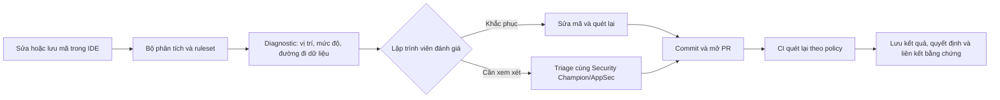

# Tích hợp Static Analysis vào IDE

## 1. Mục tiêu và bối cảnh

**Tích hợp IDE (Integrated Development Environment)** trong chương trình **Static Analysis** là đưa việc phân tích mã tĩnh vào môi trường lập trình hằng ngày: lập trình viên nhìn thấy cảnh báo ngay khi mở, sửa hoặc lưu mã nguồn; đọc được nguyên nhân; sửa và kiểm tra lại trước khi tạo pull request (PR).

Trong phạm vi **Security Assurance**, mục tiêu không dừng ở việc có một tiện ích quét mã. Ta cần một quy trình tạo được **bằng chứng có thể kiểm tra** rằng các yêu cầu và security controls liên quan đến mã nguồn đã được đánh giá, các phát hiện đã được xử lý hoặc chấp nhận rủi ro theo thẩm quyền. Kết quả trong IDE giúp phản hồi sớm; kết quả quét độc lập trong CI, hồ sơ xử lý phát hiện và các hoạt động kiểm thử, audit giúp xác nhận kết luận ở cấp hệ thống.

Sau bài học, người học có thể:

1. Phân biệt static analysis trong IDE với quét trong CI và các kỹ thuật bảo mật bổ trợ.
2. Chọn công cụ và hình thức tích hợp phù hợp với ngôn ngữ, IDE, kho mã và yêu cầu bảo mật dữ liệu.
3. Thiết lập luồng phát hiện → phân tích → khắc phục → kiểm tra lại → lưu bằng chứng.
4. Phân loại cảnh báo, giảm nhiễu và xử lý trường hợp false positive hoặc phát hiện cần đánh giá thủ công.
5. Xác định các tiêu chí đo lường để đánh giá hiệu quả tích hợp.

## 2. IDE đóng vai trò gì trong chương trình Static Analysis?

Static analysis xem xét mã nguồn, mã trung gian hoặc cấu hình **mà không cần chạy ứng dụng**. Công cụ có thể tìm pattern dễ gây lỗi, thực hiện phân tích luồng điều khiển và dữ liệu, hoặc theo dõi dữ liệu từ **source** không tin cậy đến **sink** nhạy cảm. Độ sâu phụ thuộc công cụ, bộ quy tắc, khả năng dựng dự án và ngữ cảnh được cung cấp.

| Khía cạnh | Phân tích trong IDE | Phân tích trong CI/CD |
|---|---|---|
| Thời điểm | Khi viết, mở hoặc lưu file; theo thao tác của lập trình viên | Khi push, tạo PR, merge hoặc theo lịch |
| Phạm vi thường gặp | File đang sửa, module hoặc project cục bộ | Phạm vi xác định của repository/build |
| Ưu điểm | Phản hồi nhanh, sửa ngay tại dòng mã liên quan | Tái lập được, dùng chung chính sách, lưu kết quả tập trung |
| Giới hạn | Phụ thuộc cấu hình máy, plugin và những gì IDE phân tích được | Phản hồi muộn hơn, có thể tốn thời gian và tài nguyên |
| Vai trò assurance | Hỗ trợ phòng ngừa và khắc phục sớm | Bằng chứng kiểm soát trước khi hợp nhất/phát hành |

Luồng điển hình:



**Lưu ý về phạm vi:** security-oriented SAST khác với formatter, linter kiểu mã, kiểm tra dependency (SCA), quét secret, kiểm thử động (DAST) và kiểm thử xâm nhập. Một IDE có thể hiển thị cảnh báo từ nhiều loại công cụ, nhưng sự hiện diện của tất cả chúng trên cùng một bảng **Problems/Inspections** không khiến chúng tương đương nhau. “Không còn cảnh báo trong IDE” cũng không có nghĩa là hệ thống đã an toàn.

## 3. Chọn hình thức tích hợp

Có ba cách thường gặp, có thể kết hợp với nhau:

| Hình thức | Ví dụ sử dụng | Điểm cần đánh giá |
|---|---|---|
| **Plugin/extension IDE** | Tiện ích SAST hoặc kiểm tra mã hiển thị diagnostic ngay trong VS Code, IntelliJ IDEA hay IDE tương thích | Ngôn ngữ được hỗ trợ, khả năng phân tích theo file/project, mức độ cập nhật, quyền plugin |
| **CLI chạy trong terminal/task của IDE** | Chạy bộ quy tắc của repository và xem vị trí lỗi từ đầu ra CLI | Tính tái lập, tốc độ chạy, đường dẫn file, định dạng SARIF/JSON nếu cần tích hợp |
| **Connected mode / đồng bộ máy chủ phân tích** | Extension nhận quality profile, trạng thái hoặc quy tắc chung từ nền tảng quản trị | Quyền kết nối, xác thực, phiên bản tương thích, dữ liệu nào ra khỏi máy |

Ví dụ nhóm công cụ có thể cân nhắc (kiểm tra tính tương thích và tính năng ở phiên bản đang dùng):

- **SonarQube for IDE**: kiểm tra ngay trong editor; có thể kết nối với nền tảng SonarQube để đồng bộ một phần cấu hình và ngữ cảnh phân tích.
- **Semgrep**: quét theo quy tắc và, tùy cách triển khai, đưa kết quả đến developer qua IDE hoặc thông qua lệnh trong terminal; thích hợp với các pattern cần quy tắc tùy biến.
- **CodeQL**: hỗ trợ truy vấn bảo mật có phân tích dữ liệu; extension trong VS Code phục vụ điều tra và phát triển truy vấn, còn quét tự động cấp repository thường cấu hình qua pipeline.
- **SpotBugs kết hợp Find Security Bugs** trong hệ sinh thái Java: bổ sung các detector lỗi và rủi ro bảo mật ở cấp bytecode; kết quả có thể được đưa tới quy trình phát triển qua plugin hoặc tác vụ build.

Không nên quyết định chỉ dựa vào số lượng quy tắc. Hãy đánh giá công cụ trên một đoạn mã có lỗi đã biết, một đoạn mã đã sửa, một case false positive có chủ đích và một project thật có dependency/build tương đương môi trường làm việc.

### Tiêu chí chọn công cụ

1. **Phạm vi kỹ thuật:** nhận diện đúng ngôn ngữ, framework, source/sink và cách build; có hỗ trợ phân tích liên file/liên hàm nếu yêu cầu.
2. **Tính liên tục:** dùng ruleset và phiên bản tương thích giữa IDE, máy developer và CI; xác định rõ trường hợp kết quả có thể khác nhau.
3. **Khả năng hành động:** diagnostic chỉ rõ file, dòng, quy tắc, nguyên nhân, gợi ý sửa; khi có thể, hiển thị đường đi dữ liệu.
4. **Quản lý chính sách:** ai cập nhật rule, đổi mức độ, loại trừ, phê duyệt false positive và theo dõi thay đổi.
5. **Bảo vệ mã nguồn:** quyền extension, dữ liệu gửi tới dịch vụ từ xa, token, telemetry, dữ liệu nhạy cảm, quy định doanh nghiệp.
6. **Hiệu năng:** thời gian phản hồi với project lớn, cache, giới hạn tài nguyên và cơ chế quét theo file đang thay đổi.

## 4. Thiết lập IDE theo quy trình có thể tái lập

### Bước 1 — Xác định phạm vi và baseline

Xác định repository, nhánh mặc định, ngôn ngữ, framework, phiên bản JDK/build tool nếu là Java, thư mục mã ứng dụng và thư mục mã sinh tự động. Thống nhất security policy: nhóm vấn đề phải phát hiện (ví dụ injection, truy cập tài nguyên, xử lý input không an toàn, rò rỉ dữ liệu), mức độ ưu tiên và quy tắc xử lý ngoại lệ.

Trong mã nguồn cũ, ghi nhận **baseline** các phát hiện hiện có để đo riêng phát hiện mới. Baseline không đồng nghĩa với miễn trừ mãi mãi: mỗi phát hiện tồn đọng vẫn cần người sở hữu và thời hạn xem xét thích hợp.

### Bước 2 — Cài tiện ích từ nguồn được tin cậy

- **VS Code:** mở **Extensions**, tìm tên công cụ và kiểm tra đúng nhà phát hành, quyền yêu cầu, khả năng hỗ trợ ngôn ngữ. Cài extension và mở workspace dự án.
- **IntelliJ IDEA/IDE JetBrains:** mở **Settings/Preferences → Plugins**, chọn plugin tương ứng, khởi động lại IDE nếu được yêu cầu và mở module cần phân tích.
- **IDE khác:** sử dụng cơ chế extension/plugin được nhà cung cấp công cụ chính thức hỗ trợ; nếu không có, dùng CLI qua terminal hoặc task của IDE.

Để extension đọc được thông tin build hoặc symbol, hãy import project đúng cách và đợi IDE hoàn tất indexing. Thiếu dependency hoặc lỗi cấu hình project có thể khiến một số kiểm tra bị bỏ qua hay tạo cảnh báo sai.

### Bước 3 — Cấu hình policy và kết nối

Ưu tiên quy tắc chung được version-control cùng repo hoặc được quản trị tập trung. Nếu dùng connected mode, cấu hình máy chủ, xác thực theo quyền tối thiểu và quality profile được dự án phê duyệt; không ghi token vào source code, tài liệu hay cấu hình được commit.

Ghi lại tối thiểu: tên công cụ và phiên bản, bộ quy tắc/profile, phạm vi quét, đường dẫn loại trừ kèm lý do, quyền sở hữu policy. Đường dẫn loại trừ nên tập trung vào mã sinh ra hoặc mã bên thứ ba mà nhóm không sở hữu; việc loại trừ mã ứng dụng chỉ để giảm số cảnh báo sẽ làm yếu chương trình assurance.

Về quyền riêng tư, kiểm tra điều khoản xử lý mã nguồn, telemetry, vùng lưu trữ dữ liệu và khả năng tắt tính năng gửi dữ liệu ra ngoài trước khi bật kết nối cloud cho repository nhạy cảm.

### Bước 4 — Kích hoạt và xác nhận vòng phản hồi

Chọn cách chạy phù hợp: tự động khi mở/lưu file, theo lệnh “analyze”, hoặc quét cả module theo yêu cầu. Trên project lớn, nên dùng phân tích tăng dần trong lúc gõ và quét đầy đủ trước PR/ở CI.

Tạo hoặc mở một đoạn mã kiểm thử đã biết, xác nhận:

1. Diagnostic xuất hiện đúng file/dòng và hiển thị tên quy tắc cùng mức độ.
2. Khi nhấn vào phát hiện, người dùng đọc được giải thích và vị trí cần sửa.
3. Sửa mã rồi quét lại làm thay đổi trạng thái phát hiện như mong đợi.
4. Kết quả quét theo cùng quy tắc ở CI được đối chiếu; bất đồng phải được điều tra.

### Bước 5 — Chuẩn hóa cách xử lý phát hiện

Nhóm cần quy tắc rõ về việc ai sửa, khi nào escalation, điều kiện để đánh dấu false positive/accepted risk và nơi lưu quyết định. Hãy tách **severity của rule** khỏi **mức độ rủi ro thực tế**: quy tắc đánh giá mức nguy hiểm điển hình, còn triage phải xét dữ liệu đi vào, điều kiện khai thác, tác động, kiểm soát giảm thiểu và độ tin cậy của phát hiện.

## 5. Ví dụ Java: IDE cảnh báo SQL Injection

Giả sử một API Spring nhận tham số `name` từ HTTP request rồi tự ghép chuỗi SQL:

```java
@RestController
class UserController {
    private final JdbcTemplate jdbcTemplate;

    UserController(JdbcTemplate jdbcTemplate) {
        this.jdbcTemplate = jdbcTemplate;
    }

    @GetMapping("/users")
    public List<Map<String, Object>> search(@RequestParam String name) {
        return jdbcTemplate.queryForList(
            "SELECT id, name FROM users WHERE name = '" + name + "'");
    }
}
```

Đây là đoạn minh họa, đã lược bỏ `import`. Dữ liệu do người gọi kiểm soát đi từ **source** (tham số HTTP `name`) tới **sink** (câu SQL đưa vào `queryForList`) mà không được bind dưới dạng tham số. Người gọi có thể cung cấp chuỗi như `Alice' OR '1'='1` làm biến đổi điều kiện truy vấn. Một SAST có hỗ trợ nhận diện kiểu nối chuỗi hoặc luồng dữ liệu phù hợp có thể chỉ ra đường đi này; không phải mọi plugin hay mọi ruleset đều phát hiện được.

**Cách khắc phục:** dùng parameterized query để driver truyền giá trị tách biệt với cú pháp SQL.

```java
@GetMapping("/users")
public List<Map<String, Object>> search(@RequestParam String name) {
    return jdbcTemplate.queryForList(
        "SELECT id, name FROM users WHERE name = ?", name);
}
```

Sau khi sửa:

- Chạy lại phân tích trong IDE; kiểm tra phát hiện tương ứng đã được giải quyết.
- Thêm test với input có dấu nháy và các chuỗi dễ gây injection; xác nhận API trả kết quả theo dữ liệu, không làm đổi cấu trúc truy vấn.
- Push thay đổi và xác nhận job SAST cùng test tại CI pass; liên kết PR, kết quả và commit sửa lỗi với ticket nếu phát hiện được theo dõi tập trung.

**Ranh giới của ví dụ:** bind parameter xử lý **giá trị**, không dùng để thay thế động tên bảng, tên cột hay hướng `ORDER BY`. Những thành phần SQL này phải lấy từ danh sách cho phép (allowlist) do ứng dụng kiểm soát; không nối trực tiếp tên cột do client cung cấp.

### Cách đọc một cảnh báo trong IDE

Một diagnostic hữu ích có thể bao gồm:

| Thành phần | Câu hỏi cần trả lời |
|---|---|
| Rule ID và thông điệp | Quy tắc nào bị vi phạm, hành vi nào có rủi ro? |
| Vị trí source | Dữ liệu không tin cậy bắt đầu ở đâu? |
| Đường truyền dữ liệu | Có bước gán biến, gọi hàm, chuyển đổi hoặc validation nào? |
| Sink | Thao tác nhạy cảm nào sử dụng dữ liệu đó? |
| Severity và confidence | Mức ưu tiên mặc định và độ chắc chắn của kết quả là gì? |
| Hướng khắc phục | Có cách sửa tại nguyên nhân, tránh chỉ che cảnh báo không? |

Trong ví dụ trên, việc nhìn thấy dấu gạch chân ở dòng `queryForList` chỉ là điểm bắt đầu. Người review cần xác minh tham số `name` đến từ HTTP, câu truy vấn được xây dựng ra sao và bản sửa thực sự loại bỏ khả năng thay đổi cú pháp SQL.

## 6. Đưa công cụ dòng lệnh vào workflow IDE

Khi extension không có tính năng cần thiết, developer vẫn có thể chạy SAST từ **terminal tích hợp** của IDE. Chẳng hạn với Semgrep đã cài sẵn và file quy tắc đã được nhóm quản lý trong repository:

```bash
semgrep scan --config ./security/semgrep.yml .
```

Lệnh trên **chỉ là ví dụ** cho project có file `security/semgrep.yml`; không giả định file này tồn tại ở mọi repository. Nội dung quy tắc và phiên bản CLI nên được pin, review, rồi dùng chung trong CI. Nếu công cụ hỗ trợ đầu ra SARIF/JSON, có thể xuất kết quả để tích hợp công cụ quản lý phát hiện; không cần đưa toàn bộ output vào issue khi chỉ một phần liên quan.

Đối với Java, một số công cụ cần bytecode, dependency hoặc thông tin build; khi đó workflow IDE cần bước build/import project phù hợp. Nếu phân tích fail do lỗi cấu hình, phải ghi nhận là **chưa đánh giá được**. Không nên tự diễn giải “0 findings” khi thực tế job không chạy thành công.

## 7. Triage, false positive và ngoại lệ

Lập trình viên cần phân biệt ba trạng thái:

- **True positive:** có đường khai thác hoặc hành vi rủi ro được xác nhận; sửa theo mức độ ưu tiên và kiểm tra lại.
- **False positive:** quy tắc báo nhưng ngữ cảnh thực tế chứng minh điều kiện nguy hiểm không tồn tại; ghi lại bằng chứng và người đánh giá.
- **Chưa kết luận:** thiếu ngữ cảnh như call graph, cấu hình runtime, validation hoặc kiểm soát bù trừ; cần review và thử nghiệm thêm.

Quy trình triage đề xuất:

| Bước | Hành động | Bằng chứng tối thiểu |
|---|---|---|
| 1. Xác minh | Đọc rule, kiểm tra source → sink và bối cảnh thực thi | Rule ID, file/dòng, revision, phần mã liên quan |
| 2. Đánh giá | Xác định khả năng khai thác, dữ liệu ảnh hưởng, quyền cần có và mức tác động | Nhận định rủi ro cùng giả định |
| 3. Quyết định | Fix, cần điều tra thêm, false positive hoặc accepted risk | Người quyết định, lý do, thời hạn xem xét nếu còn rủi ro |
| 4. Khắc phục | Sửa nguyên nhân, bổ sung test/kiểm soát phù hợp | Commit/PR, test result |
| 5. Xác nhận | Quét lại trong IDE và trên pipeline | Kết quả công cụ, phiên bản ruleset, liên kết job CI |

Tránh dùng suppression diện rộng để biến cảnh báo mất khỏi IDE. Nếu buộc phải loại trừ một rule hoặc location, cần mô tả phạm vi nhỏ nhất, lý do, người phê duyệt và thời điểm xem xét lại. Một cảnh báo thuộc **security hotspot** yêu cầu người có hiểu biết xác minh; không nên tự động coi mọi hotspot là lỗ hổng đã xác nhận.

### Khi IDE và CI cho kết quả khác nhau

Kiểm tra lần lượt:

1. Cùng commit, file và phạm vi quét chưa?
2. Công cụ, phiên bản rule, profile và ngưỡng hiển thị có giống nhau?
3. IDE có index/compile đủ dependency, còn CI có bỏ qua module hoặc file không?
4. Có phân tích riêng file trong IDE nhưng phân tích dataflow toàn project trong CI không?
5. Có baseline, suppression hoặc path exclusion khác nhau không?

Chỉ đóng finding sau khi xác nhận nguyên nhân chênh lệch và có kết quả quét đáng tin cậy. Không tự chỉnh rule để che bất đồng.

## 8. Kết nối với security assurance và quality gate

Các phát hiện tại IDE có giá trị cho **feedback sớm**, nhưng không phải bằng chứng duy nhất để thông qua thay đổi. Có thể thiết lập chuỗi bằng chứng:

**Security requirement/control → Rule hoặc phân tích liên quan → Finding → Triage → Commit khắc phục → Test → Kết quả CI → Quyết định review.**

Ví dụ, một yêu cầu “API không được đưa input không tin cậy trực tiếp vào SQL” có thể gắn với rule phát hiện SQL injection, test cho input nguy hiểm và kiểm tra mã trong PR. Rule chỉ thể hiện một phần phạm vi của yêu cầu; cần kết hợp code review, kiểm thử và kiến thức kiến trúc để đánh giá đầy đủ.

Một quality gate áp dụng cho **mã mới** có thể yêu cầu không có phát hiện Critical/High chưa được xử lý hoặc chưa được chấp nhận rủi ro theo quy trình. Với mã cũ, dùng baseline để theo dõi nợ bảo mật và kế hoạch giảm dần. Tiêu chí gate, ngưỡng severity và cơ chế ngoại lệ phải được công bố rõ, nhất quán trong CI và có người chịu trách nhiệm.

**Phân chia trách nhiệm:**

| Vai trò | Trách nhiệm chính |
|---|---|
| Developer | Phân tích cảnh báo trong IDE, sửa mã, viết test và ghi thông tin triage |
| Security Champion/Tech Lead | Hỗ trợ đánh giá ngữ cảnh, review bản sửa và ngoại lệ thông thường |
| AppSec/Security Assurance | Định nghĩa ruleset, đánh giá rủi ro quan trọng, kiểm tra chất lượng bằng chứng |
| CI/Platform owner | Duy trì công cụ trong pipeline, xuất report và kiểm soát phiên bản/chính sách |

## 9. Đo hiệu quả thay vì chỉ đếm cảnh báo

Nên theo dõi một số chỉ số có định nghĩa nhất quán:

- **Tỷ lệ tích hợp:** bao nhiêu repository/nhóm đã cấu hình đúng IDE và CI theo policy.
- **Thời gian khắc phục:** thời gian trung vị từ lúc finding mới được ghi nhận tới lúc bản sửa được xác minh; tách theo severity.
- **Finding mới tại PR:** tỷ lệ PR còn Critical/High chưa xử lý ở thời điểm quality gate.
- **Mức độ nhiễu:** tỷ lệ phát hiện được xác minh là false positive và số ngoại lệ quá hạn cần xem lại.
- **Tính nhất quán:** mức độ trùng khớp giữa IDE và CI trên cùng mã, cùng ruleset và cùng phạm vi.

Các chỉ số phải xét cả **coverage**: không quét được một module có thể làm số cảnh báo giảm giả tạo. Khuyến khích developer báo false negative và chất lượng rule; không dùng số lượng cảnh báo cá nhân làm thước đo năng suất.

## 10. Bài thực hành

**Bối cảnh:** nhóm phát triển Java/Spring có một endpoint tìm kiếm và đã dùng SAST trong CI. Nhiệm vụ là đưa phản hồi tương đương tới IDE của developer.

1. Chọn một công cụ có hỗ trợ ngôn ngữ/framework của dự án; xác định cài qua plugin hay CLI, version và phạm vi quét.
2. Mở đoạn mã SQL injection ở mục 5, kiểm tra xem công cụ có phát hiện hay không. Nếu không, ghi rõ giới hạn ruleset/thực thi, không tự tuyên bố an toàn.
3. Sửa bằng bind parameter, tạo test với dữ liệu đầu vào chứa dấu nháy, chạy lại phân tích.
4. Viết một ghi chú triage ngắn: rule ID (nếu có), source, sink, rủi ro, phương án sửa, bằng chứng test và kết quả CI.
5. Thử một trường hợp cảnh báo không đúng; giải thích vì sao là false positive và đề xuất cách ghi ngoại lệ có phạm vi hẹp.

**Tiêu chí hoàn thành:** IDE hiển thị hoặc trả được kết quả phân tích có thể tra cứu; có bằng chứng bản sửa và quét lại; xác định được những gì công cụ **chưa** kiểm chứng; và luồng xử lý kết nối được với PR/CI.

## 11. Những sai lầm thường gặp

| Sai lầm | Hệ quả | Cách cải thiện |
|---|---|---|
| Chỉ cài extension, không quản lý ruleset | Mỗi máy cho kết quả khác nhau | Version hóa policy, đối chiếu với CI |
| Coi IDE không báo lỗi là an toàn | Bỏ sót luồng liên file, cấu hình runtime, dependency hoặc lỗ hổng logic | Kết hợp review, test, SCA/DAST phù hợp |
| Suppress cả thư mục để giảm nhiễu | Che lỗ hổng mới | Triage từng nhóm vấn đề, giới hạn ngoại lệ |
| Bật quá nhiều rule không liên quan | Developer bỏ qua cảnh báo quan trọng | Ưu tiên rule có tín hiệu tốt và đo false positive |
| Coi job lỗi như kết quả sạch | Không có bằng chứng phân tích thực sự | Theo dõi exit status, phạm vi quét và bản report |
| Gửi mã/token tới dịch vụ ngoài khi chưa đánh giá | Rủi ro lộ thông tin hoặc vi phạm chính sách | Kiểm tra quyền plugin và luồng dữ liệu trước khi kết nối |

## 12. Tổng kết kiến thức

Tích hợp Static Analysis vào IDE đưa phản hồi bảo mật đến gần thời điểm tạo lỗi, giúp developer hiểu, sửa và kiểm tra ngay khi còn đầy đủ ngữ cảnh. Để đóng góp vào Security Assurance, kết quả đó phải được đặt trong một quy trình có **ruleset được quản lý**, **triage có trách nhiệm**, **bằng chứng xác minh** và **quét độc lập tại CI**. Mục tiêu là rút ngắn vòng đời phát hiện và khắc phục rủi ro mà vẫn giữ được khả năng kiểm tra, giải thích và truy vết quyết định.
