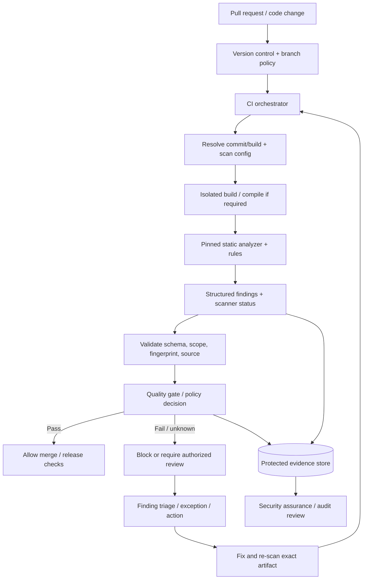
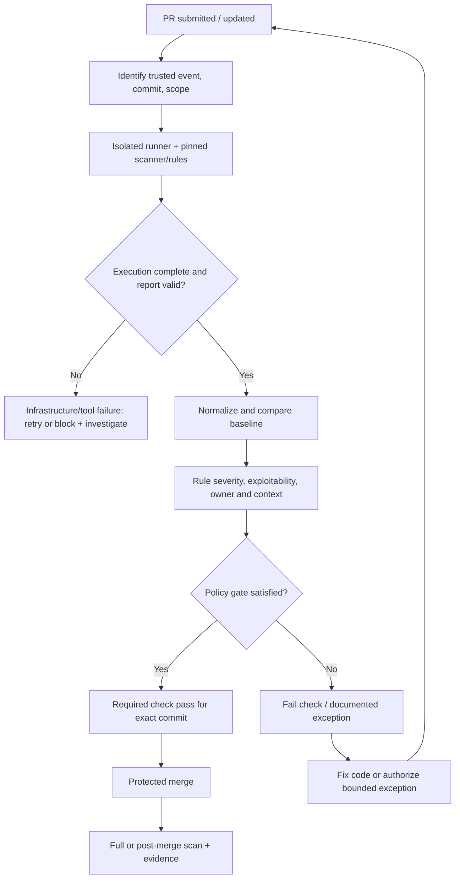

# Tích hợp CI: đưa Static Analysis vào quy trình đảm bảo bảo mật liên tục

## 1. Tại sao phải tích hợp Static Analysis vào CI?

Một nhóm phát triển Java SaaS quản lý nhân sự có quy định rằng mọi thay đổi code phải được kiểm tra bảo mật trước khi merge. Trên máy cá nhân, một số developer chạy static analyzer nhưng một số khác bỏ qua vì thiếu thời gian, cấu hình khác nhau hoặc không biết cách xử lý kết quả. Một bản sửa lỗi xác thực được merge mà không có kiểm tra; vài tuần sau, báo cáo pentest chỉ ra một đoạn code mới sử dụng input không tin cậy để xây dựng câu truy vấn.

Nếu chỉ gửi thông báo “nhớ chạy SAST”, tổ chức không có căn cứ rằng **mọi thay đổi thuộc phạm vi đã được kiểm tra**. CI (Continuous Integration) có thể trở thành một **điểm kiểm soát thống nhất**, nơi mỗi thay đổi được build, chạy công cụ phân tích tĩnh, ghi lại kết quả và quyết định theo chính sách trước khi tiến tới merge/release.

**Tích hợp CI cho Static Analysis** là việc đưa các phép phân tích mã nguồn, bytecode, cấu hình hoặc artifacts tương ứng vào pipeline CI theo các sự kiện đã định; bảo vệ cách chạy công cụ, chuẩn hóa finding, áp dụng quality gate theo rủi ro và lưu **bằng chứng có thể kiểm tra** về phạm vi, phiên bản, kết quả, ngoại lệ và quyết định.

Trong chương **Static analysis** thuộc module **SECURITY_SECURITY_ASSURANCE**, mục tiêu không chỉ là “thêm bước chạy scanner”. Chúng ta xây dựng năng lực đánh giá **có bằng chứng** rằng thay đổi phần mềm đáp ứng những yêu cầu bảo mật thuộc phạm vi kiểm tra, từ threat/risk và security controls đến kiểm thử, audit, remediation và continuous assurance trong phát triển/vận hành.

### Mục tiêu học tập

Sau bài này, người học có thể:

1. Phân biệt SAST, linting, bytecode analysis, SCA, secret scanning, IaC scanning và dynamic testing trong CI.
2. Thiết kế pipeline phân tích tĩnh cho pull/merge request, protected branch, release và scheduled scan.
3. Chọn phạm vi, scanner, rule set, runner và cơ chế cache phù hợp theo risk và khả năng vận hành.
4. Thiết lập **new findings gate**, baseline, triage, suppression có kiểm soát và chính sách xử lý khi scanner không chạy.
5. Bảo vệ pipeline khỏi untrusted code/PR, token lộ, quyền ghi quá rộng và dependency/toolchain compromise.
6. Tích hợp kết quả như SARIF hoặc format tương đương mà vẫn giữ nguồn, phiên bản, artifact và limitations.
7. Xây test plan cho pipeline, negative cases và bypass attempts; kiểm chứng quality gate hoạt động trên thực tế.
8. Chuyển cảnh báo thành finding, remediation, retest, risk decision và evidence dùng được cho audit.

> **Giới hạn:** những lệnh và YAML trong bài là ví dụ minh họa, cần điều chỉnh và kiểm chứng với phiên bản CI platform, build tool và analyzer đang dùng. Không có static analyzer nào đảm bảo tìm được mọi lỗ hổng. Quy tắc gate, thời hạn xử lý và nghĩa vụ pháp lý phải theo chính sách/phạm vi của tổ chức.

## 2. Đặt đúng Static Analysis trong hệ sinh thái CI

**Static analysis** phân tích code hoặc artifacts mà không cần thực thi luồng ứng dụng đích như một bài kiểm thử chức năng hoàn chỉnh. Tùy công cụ, phân tích có thể dựa trên văn bản, AST, control/data flow, bytecode hoặc mô hình của ngôn ngữ/framework.

| Phương pháp | Đối tượng chính | Tìm/đánh giá được gì? | Giới hạn đáng nhớ |
| --- | --- | --- | --- |
| **SAST** | Source/AST/data flow | Patterns như injection, insecure API usage, tainted data flow, hardcoded decisions. | Phụ thuộc rule, framework modeling, không thấy mọi runtime context. |
| **Bytecode static analysis** | Java bytecode/JAR | Nhiều kiểu lỗi API, nullness, concurrency hoặc security patterns. | Có thể thiếu business semantics và source mappings. |
| **Lint/style** | Source code | Conventions, maintainability, simple antipatterns. | Không nên gọi mọi style violation là security vulnerability. |
| **SCA/dependency analysis** | Manifest, lockfile, SBOM, package metadata | Known vulnerable dependencies, licenses, affected versions. | Không tự xác minh runtime reachability hoặc exploitation. |
| **Secret scanning** | Source, commits, history, configuration | Chuỗi có khả năng là token/key/credential. | False positives, khó xác định token còn sống/đã lộ. |
| **IaC/config analysis** | Terraform, Kubernetes, cloud config | Policy yếu, public exposure, thiếu encryption hoặc IAM guardrail. | Không tự đại diện effective cloud state/drift. |
| **DAST** | Ứng dụng đang chạy | Hành vi HTTP/runtime có thể quan sát được. | Không phải static analysis, cần môi trường và quyền thử. |
| **Unit/integration/security tests** | Code chạy với dữ liệu thử | Business rules, authorization, contracts và runtime security properties. | Coverage phụ thuộc test design. |
| **Manual design/code review** | Architecture, trust boundary, use cases | Logic nghiệp vụ, misuse, assumptions, control gaps. | Cần chuyên môn và bằng chứng, không thay tự động hóa. |

SAST có thể phát hiện một đường dữ liệu chưa được validate đi tới SQL sink. Nhưng lỗi **BOLA/IDOR**—một endpoint trả dữ liệu của tenant khác khi đã đăng nhập—có thể không bị phát hiện chỉ từ source nếu analyzer không hiểu quyền/ownership nghiệp vụ. Phải kết hợp **SAST + authorization tests + threat modeling + design review + runtime evidence**.

### 2.1. CI không đồng nghĩa Security Assurance

CI trả lời “job này có chạy và trả kết quả gì?”. Assurance trả lời sâu hơn: **đúng code/artifact nào đã được quét, tool/rules version nào, đầy đủ hay chưa, kết quả có chính xác/được triage không, điều gì bị bỏ qua và có bằng chứng remediation/retest không**. Một biểu tượng check màu xanh không đủ nếu pipeline không chạy trên branch thực sự được merge.

### 2.2. Quality gate không giống scanner execution

Một scanner có thể chạy thành công nhưng phát hiện High vulnerability; job báo “execution success” không có nghĩa policy pass. Ngược lại, scanner crash có exit code lỗi; pipeline không được tự coi kết quả rỗng là “0 findings”. Tách ba trạng thái:

- **Execution:** scanner có chạy hoàn chỉnh trên đúng scope không?
- **Analysis:** findings, uncertainty và coverage ra sao?
- **Policy decision:** merge/release được phép, bị chặn hay cần review/exception?

## 3. Các mục tiêu kiểm soát của tích hợp CI

| Control objective | Claim cần chứng minh | Evidence kỳ vọng |
| --- | --- | --- |
| **Coverage** | Mọi code change trong protected scope đi qua scanner phù hợp. | Trigger/branch policies, commit SHA, path scope, job records. |
| **Consistency** | Tool, rule set và build settings có version/policy được quản trị. | Scanner digest/version, configuration hash, rule policy ref. |
| **Correctness** | Rule/security findings được map tới code và bối cảnh đủ để triage. | Source location, rule ID, taint path, triage/repro notes. |
| **Enforcement** | Findings vượt gate không thể bypass tùy ý. | Required checks, failed-PR negative tests, override audit. |
| **Reliability** | Scan failure/missing report không bị hiểu là Pass. | Error handling, timeout/retry behavior, job health. |
| **Isolation** | Untrusted PR code không được lấy secrets hoặc quyền publish/release. | Token permissions, runner policy, fork behavior tests. |
| **Integrity** | Scanner, rules và result artifacts không bị sửa trái phép. | Pinned tool versions, provenance, artifact digest/signatures khi cần. |
| **Triage** | False positive và exceptions được quản lý có owner/lý do/hạn. | Finding state history, suppression records, review evidence. |
| **Remediation** | Mọi finding nghiêm trọng có owner, action và retest trước closure. | PR, commit, build, new scan, manual verification. |
| **Auditability** | Người khác tái dựng được quyết định cho một merge/release. | Change ID, source/target SHA, scan outcome, gate decision, reviewer. |

Không dùng một giá trị `scanner_enabled=true` làm bằng chứng tổng hợp cho cả mười mục tiêu trên.

## 4. Định nghĩa phạm vi quét theo tài sản và rủi ro

Trước khi sửa YAML CI, hãy lập danh sách **repositories, modules, ngôn ngữ, builds, artifacts, services và deployment paths**. Đừng chỉ dựa vào phần code developer vừa mở.

### 4.1. Các câu hỏi phạm vi

- Repository là monorepo hay nhiều repositories? Có Java/Kotlin, JavaScript frontend, IaC, Dockerfile, generated code?
- Code từ pull request có được build vào image/production không? Có riêng nhánh maintenance/hotfix?
- Các dependency được quản lý ở đâu? Maven/Gradle, transitive dependencies, vendor JARs?
- Có background workers, serverless functions hoặc job nội bộ khác với public APIs không?
- Scanner cần source code, compiled bytecode, debug symbols hay dependency resolution?
- Modules nào chứa secrets, quyền admin, payroll, payment, authorization hoặc cryptographic code?
- Những đường nào được excluded, tại sao, ai duyệt và bao giờ xem lại?
- PR từ fork, contributors bên ngoài hoặc generated code có trust profile riêng không?

### 4.2. Inventory và coverage table

| Scope ID | Source/artifact | Rủi ro | Scan requirement | Owner |
| --- | --- | --- | --- | --- |
| `SRC-API-01` | Payroll Java API | Tenant isolation, authorization, injection. | PR SAST + full branch scan + security tests. | API team. |
| `SRC-WORKER-02` | Export worker | Sensitive data handling, jobs, deserialization. | Bytecode/source SAST theo tool support. | Worker team. |
| `SRC-WEB-03` | Frontend | XSS, unsafe DOM, secrets. | Frontend static rules + test. | Web team. |
| `SRC-INFRA-04` | IaC/Kubernetes | Network/IAM, secret exposure, config. | IaC analysis, policy-as-code. | Platform. |
| `SRC-DEPS-05` | Maven dependencies | Known CVEs/supply chain. | SCA/SBOM (đường kiểm soát riêng, có link). | Engineering + VM. |
| `SRC-CI-06` | CI workflow definitions | Token permissions, unsafe triggers, unpinned actions. | CI config/security review. | DevSecOps. |

**Không suy luận “coverage 100%” từ số repository đã được bật scanner.** Cần mẫu số theo artifacts thực sự được build/deploy, including hotfix branches, scheduled jobs và đường release.

## 5. CI events: quét lúc nào và với độ sâu nào?

Các sự kiện CI khác nhau tạo cơ hội và rủi ro khác nhau. Một pipeline duy nhất cho mọi loại event có thể quá chậm hoặc thiếu coverage.

| Trigger | Mục tiêu | Scan đề xuất | Gate/limitation |
| --- | --- | --- | --- |
| **Pull/merge request** | Phản hồi nhanh trước merge. | Incremental/new-code scan và rules ưu tiên. | Không để untrusted PR đọc secrets; required check. |
| **Protected branch push** | Xác nhận trên commit sau merge. | Full scan hoặc scan bảo đảm integration coverage. | Phát hiện vấn đề do merge combination/branch differences. |
| **Release/tag candidate** | Xác minh artifact dự định triển khai. | Full scan phù hợp + security tests/artifact provenance. | Release gate cần gắn exact commit/artifact. |
| **Nightly/scheduled** | Quét sâu và phát hiện rule/tool updates. | Full repo, resource-intensive rules, historical trend. | Findings có owner, không chỉ tạo báo cáo bỏ quên. |
| **New rule/scanner version** | Nhận diện regression/detection coverage đổi. | Baseline migration, comparison scan. | Không coi new findings là code regression nếu do rule change. |
| **Emergency/hotfix** | Khẩn cấp nhưng vẫn có kiểm soát tối thiểu. | Risk-proportional fast scan + mandatory follow-up. | Exception có thẩm quyền, TTL, không bypass vô thời hạn. |
| **Manual re-run** | Reproduce scan hoặc retest sau fix. | Exact input/config/version được ghi. | Không thay mandatory check nếu re-run branch khác. |

### 5.1. Kết hợp fast feedback và full assurance

Một thiết kế thực tế:

1. PR: compile/test tối thiểu, SAST rules ưu tiên, findings on changed lines/flows.
2. Protected branch: quét rộng hơn để bao phủ đường dữ liệu xuyên modules.
3. Release: kiểm tra exact artifact, vulnerability/requirements và policy gate.
4. Nightly: deep scan, query/rule updates, trend/reconciliation với findings trước đó.

Khi ruleset chỉ quét diff để nhanh, có thể bỏ qua **source/sink nằm ngoài diff** hoặc exploit chain qua modules không thay đổi. Đừng gắn nhãn “full coverage” cho differential scan; full scan định kỳ và release checks phải giải quyết phần còn lại.

### 5.2. Chú ý lịch sử branch/commit

CI phải phân biệt **PR head SHA, merge commit/synthetic merge SHA, protected branch head và artifact build SHA**. Kết quả scan trên PR head có thể không đại diện artifact kết hợp sau merge nếu conflict, generated sources hoặc dependency resolution thay đổi. Review branch protection và việc required check có buộc chạy lại khi base branch đổi theo policy không.

## 6. Kiến trúc tích hợp Static Analysis vào CI

Một kiến trúc tham chiếu cần tách **runner** (chạy code không tin cậy), **analyzer** (quét), **results store** (lưu evidence), **policy engine** (quyết định), **triage** (review findings) và **release gate** (enforce).



### 6.1. Trust boundaries trong sơ đồ

**Source PR → CI runner:** contributor có thể sửa code/build script, nên xem source như input không tin cậy. Đừng cấp production token cho runner chạy PR từ nguồn ngoài.

**Runner → scanner/toolchain:** scanner binary, plugins, rule packs và dependency resolution cũng là supply-chain inputs. Phải quản lý nguồn, version/digest và quyền.

**Scanner → report/policy engine:** report có thể thiếu, sai format hoặc bị ghi đè. Policy gate phải xác minh trạng thái execution và scope, không chỉ parse số findings.

**Policy engine → merge/release:** required check và approval controls phải thực sự được enforce trên protected branches; một script exit code 0 không đủ nếu branch cho phép skip.

**Report → analyst/dashboard:** findings chứa paths, snippets và đôi khi secrets; phân quyền, thời hạn lưu và chống log injection cần tương ứng.

### 6.2. Không đánh đồng upload SARIF với enforce gate

Một workflow upload SARIF thành công có thể làm findings xuất hiện trong giao diện nhưng **không tự chặn merge**. Enforce cần cơ chế required check/policy decision độc lập có fail-state rõ ràng. Tùy nền tảng, chức năng upload/phân tích và khả năng tạo required check có quyền, cấu hình hoặc giới hạn khác nhau.

## 7. Lựa chọn công cụ và rule set

Không có một scanner phù hợp mọi nguồn và loại lỗi. Chọn công cụ theo **ngôn ngữ, framework models, chất lượng rules, khả năng triage, tích hợp CI, năng lực build và support**.

### 7.1. Các nhóm công cụ minh họa

| Nhóm | Ví dụ thường gặp | Phạm vi tham khảo |
| --- | --- | --- |
| Source SAST đa ngôn ngữ | Semgrep, CodeQL hoặc công cụ thương mại tương đương. | Rule/query, data flow theo khả năng từng ngôn ngữ. |
| Java bytecode analysis | SpotBugs với rules/plugins thích hợp, Find Security Bugs khi dùng phù hợp. | Patterns trên compiled classes, security API misuse. |
| Java rule/policy checks | PMD, static rules trong quality platforms. | Code quality và một số security patterns; cần phân loại rule. |
| Secret scanner | Công cụ phát hiện secret trong code/commits. | Credential patterns; cần xử lý validation/revocation. |
| Infrastructure static checks | Policy-as-code/IaC scanners. | Cloud/IAM/K8s config patterns; không thay effective runtime policy review. |
| SCA/SBOM | Dependency scanners và generators. | Known CVEs ở dependencies; **không phải SAST code logic**. |

Tên công cụ chỉ là ví dụ về chức năng; khả năng hỗ trợ versions, licensing, SARIF và CI permissions có thể thay đổi. Khi áp dụng phải kiểm tra tài liệu/chính sách công cụ đang dùng, không sao chép nguyên pipeline cũ không được duy trì.

### 7.2. Chọn rules theo threat model

Ví dụ Java SaaS chứa dữ liệu nhạy cảm nên ưu tiên:

- SQL/command/template injection và unsafe deserialization.
- Hardcoded secrets, insecure crypto, authentication/session misuse.
- Unsafe file/path operations, SSRF theo framework models.
- Logging sensitive data và error-handling patterns.
- Dangerous security configuration/API usage.
- Những patterns custom đặc trưng của dịch vụ, ví dụ cấm bỏ qua `tenantRef` ở repository helpers khi có thể kiểm soát static rules.

**Phải ghi rõ gaps:** SAST không chắc hiểu đầy đủ tenant ownership, business approval, authorization across services, runtime IAM hoặc feature flags. Những gaps cần mapping sang design review, tests và operating assurance, không gắn nhãn “covered” chỉ vì một rule trùng từ khóa.

### 7.3. Rule quality và customization

Một rule tốt cần có: ID/version, mô tả threat/weakness, phạm vi ngôn ngữ/framework, ví dụ true positive/false positive, severity metadata, detection limitations, rationale và owner. Custom rules nên được test như code, không push vào CI chỉ vì chạy được một file ví dụ.

## 8. Quy trình tích hợp CI từ đầu đến khi có gate

Không nên bắt đầu bằng một cấu hình “fail nếu có bất kỳ finding nào” trên repository có hàng nghìn cảnh báo cũ. Cách triển khai cần bảo đảm có **baseline và quyền xử lý**, nhưng vẫn tránh biến baseline thành tấm chắn vĩnh viễn che những lỗi đã biết.

### 8.1. Giai đoạn 1 — Discover

1. Inventory repositories, modules, artifacts, CI entry points và owner.
2. Xác định threat/risk/security requirements để chọn tool/rules.
3. Thử scanner trên một build đại diện, ghi version/config/capabilities.
4. Đo runtime, chi phí, false-positive rate và findings coverage.
5. Phân loại existing findings, high-impact exposures và areas chưa hỗ trợ.
6. Ghi baseline về các issues hiện có kèm owner/deadline và decision.

Kết quả giai đoạn này là **bản đồ coverage và gaps**, không phải bằng chứng tool có thể phát hiện mọi weakness.

### 8.2. Giai đoạn 2 — Observe

Chạy scanner trong CI ở chế độ quan sát, **không tự động chặn mọi merge**, nhưng phải thu report/metadata và xử lý những lỗ hổng thực sự nghiêm trọng theo quy trình. Đo tần suất scan không chạy, thiếu quyền, scanner crash, memory/timeouts và noise. Với critical vulnerabilities đang reachable hoặc exploitation evidence, không đợi kết thúc toàn bộ giai đoạn tuning mới escalation.

### 8.3. Giai đoạn 3 — Enforce

Định nghĩa quality gate, ví dụ:

- Scanner phải chạy đầy đủ và report hợp lệ trên đúng commit.
- New confirmed findings thuộc nhóm đã duyệt không được merge nếu không có exception.
- Critical security rules không được tắt vì developer tự sửa config từ untrusted PR.
- Branch protection yêu cầu CI check thành công tại branch/commit phù hợp.
- Reviewer có thể dùng quy trình exception có expiry nhưng không được “bấm rerun và bỏ qua”.

Đánh giá tác động tới tốc độ development, capacity và chất lượng signal; enforcement quá ồn mà không có triage thường dẫn tới bypass không chính thức.

### 8.4. Giai đoạn 4 — Continuous assurance

Quét định kỳ trên protected branch/releases; cập nhật scanner/rules có quy trình; kiểm chứng việc required checks không bị tháo; quản lý technical debt và SLA; đo outcomes, false negatives qua pentest/incident; cập nhật threats/requirements và retest.

### 8.5. Một quy trình PR end-to-end



## 9. CI runner là một trust boundary bảo mật

PR code có thể thay script, test, build plugin hoặc dependency và thực thi lệnh tùy ý khi CI build. Điều này đặc biệt quan trọng với **forked pull requests** và contributors ngoài tổ chức. Một job scanner thường được xem là “đọc source” nhưng có thể thực thi **build script, dependency installers, compiler plugins và lifecycle hooks**.

### 9.1. Nguyên tắc runner isolation

- Chạy PR từ nguồn không tin cậy trên runner biệt lập, ngắn hạn nếu khả thi.
- Hạn chế outbound network và quyền cloud/cluster theo scope của job.
- Không mount docker socket, host credentials hoặc production secrets cho job chỉ cần quét.
- Dùng token CI với permissions tối thiểu và lifetime giới hạn.
- Không dùng một cache writable từ untrusted PR làm đầu vào cho privileged release job.
- Tách job phân tích source khỏi job có quyền publish, deploy hoặc ký artifact.
- Giới hạn resource/time để tránh resource exhaustion hoặc fork PR lạm dụng.
- Đánh giá công cụ/runner do bên thứ ba cung cấp và nơi source code/report được gửi.

### 9.2. PR fork và sự kiện có đặc quyền

Trong một số CI platforms, sự kiện pull request bình thường có quyền hạn chế, còn một sự kiện chạy theo **context của repository mục tiêu** có thể có quyền rộng hơn. Nếu một workflow privileged checkout và chạy code từ PR không tin cậy, contributor có thể đạt được token/secrets của job nếu kiểm soát đủ đường build. **Không áp dụng mẫu privileged PR execution để “sửa lỗi scanner thiếu quyền” mà chưa threat-model.**

Với nhu cầu comment kết quả lên PR, một kiến trúc an toàn hơn có thể **tách scan job không đặc quyền** tạo artifact không tin cậy và **job báo cáo có quyền hạn chế** chỉ đọc/validate report theo quy trình đã kiểm chứng, không thực thi PR code. Cần bảo vệ provenance, identity của artifact và chống injection vào nội dung PR/comment.

### 9.3. Runner tự host

Self-hosted runners có thể tồn tại lâu và có network access tới môi trường nội bộ. Nếu chạy PR không tin cậy, một malicious build script có thể làm bẩn workspace/cache, lấy credential hoặc truy cập mạng. Phải định nghĩa **runner groups, isolation, cleanup/reimage, workload identity, egress và assignment rules**. Việc “runner ở VPC riêng” không tự có nghĩa an toàn.

### 9.4. CI logs là tài sản nhạy cảm

SAST output có thể chứa code snippets, paths nội bộ, findings chưa sửa hoặc secrets được analyzer phát hiện. Review masking/retention/access của console logs, build artifacts và integration dashboards. **Không in token thật vào log để chứng minh secret scanner hoạt động.**

## 10. Cơ chế cấp quyền: source checkout, findings upload và release

Một pipeline chuẩn nên phân chia quyền:

| Job | Quyền tối thiểu có thể cần | Không nên mặc định có |
| --- | --- | --- |
| PR static scan | Đọc source, tải dependencies từ nguồn được phép, output local. | Deploy production, write repository, signing keys. |
| Report upload | Đọc scanner output và quyền upload security results theo platform. | Khả năng chạy shell tự do với secrets và PR-controlled scripts. |
| Policy gate | Đọc validated findings, baseline và policy version; đăng required check nếu kiến trúc yêu cầu. | Sửa source hoặc tự phê duyệt exception. |
| Protected branch/full scan | Đọc code và necessary artifacts; quyền kết quả hạn chế. | Credential của môi trường production nếu không cần. |
| Release | Đọc artifact đã được kiểm chứng, quyền publish/deploy theo môi trường. | Lấy input untrusted từ PR để thực thi privileged steps. |
| Exception approval | Quyền quản lý finding/waiver theo role, có audit. | Tắt required checks cho toàn repository vô hạn. |

### 10.1. Phân quyền theo môi trường

Một workflow CI có thể có quyền ghi results nhưng vẫn không được viết release artifacts. Với deployment cần approval/protected environment, tách runner và credentials. Không đính secrets deploy vào step scan chỉ vì cùng file YAML.

### 10.2. Bảo vệ configuration của CI

YAML, rule configs, exception lists và script gate là **security-sensitive code**. Cần protected branches, code owners/review, diff audit và tests. Nếu PR có thể sửa workflow để xóa scan step, điều khiển required check giả hoặc set `continue-on-error`, phải có chính sách ngăn bypass hoặc cơ chế kiểm tra cấu hình từ nguồn được tin cậy.

## 11. Supply chain của analyzer, rules và build dependencies

Scanner là một chương trình có quyền đọc source code, đôi khi cả artifacts và secrets của môi trường build. Nó là thành phần thuộc **software supply chain** chứ không chỉ “một plugin”.

### 11.1. Các yếu tố cần pin và theo dõi

- Version/digest của analyzer binary/container và runtime.
- Rule/query packs, custom configuration, plugin versions.
- CI actions/orbs/templates hoặc shared pipeline libraries.
- Build tool, JDK/runtime, Maven/Gradle plugins và dependency repositories.
- Base runner image và các công cụ tải lúc chạy.
- Thông tin về license, provenance/attestation, maintainer và đường update.

**Không dùng download-and-execute từ URL không được kiểm chứng** trong privileged job. Với external actions, cân nhắc pin theo full commit SHA hoặc digest đã kiểm soát nếu platform hỗ trợ, và có quy trình cập nhật vì pin vô hạn vào version cũ cũng để lại vulnerabilities.

### 11.2. Cache, lockfile và reproducibility

Cache dependencies giúp giảm thời gian nhưng có thể tạo kết quả khác nếu untrusted PR ghi vào cache key được trusted jobs đọc. Dùng **scope riêng theo trust level**, cache provenance và invalidation theo lockfile/toolchain khi phù hợp. Maven/Gradle dependency resolution và plugin downloads cần nguồn đáng tin, checksum và phương án khi repository bên ngoài lỗi.

Một scan khác kết quả giữa hai lần trên cùng commit có thể do **rule update, dependency download, env flag, scanner version hoặc cache poisoning**, không nhất thiết là code đã thay đổi. Evidence phải cho phép truy nguồn.

### 11.3. Phân tích report cũng cần threat model

Một SARIF/report có thể chứa chuỗi attacker-controlled từ source code. Nếu kết quả được render trong dashboard, exported CSV hoặc tự động comment, cần sanitize/output encoding, giới hạn kích thước và quyền. Đừng tin mọi trường severity hay rule metadata do một report từ PR tự khai nếu policy yêu cầu nguồn được kiểm chứng.

## 12. Thiết kế các bước CI rõ trạng thái lỗi

Một pipeline nên tách:

1. **Resolve inputs:** commit SHA, repo/branch, modules, analyzer config và policy.
2. **Prepare:** JDK/toolchain, dependencies, compile nếu analyzer cần.
3. **Analyze:** chạy tool; ghi version/config, logs và exit status.
4. **Validate report:** xác định file tồn tại, parse đúng format, coverage đúng scope.
5. **Normalize/triage:** map rule IDs/severity, fingerprints, baseline, false positives.
6. **Policy evaluate:** new critical/high findings và exceptions trong scope.
7. **Publish:** upload report, annotate PR, evidence store theo quyền.
8. **Enforce:** required check success/fail/unknown trên exact commit.
9. **Follow-up:** ticket/action, reviewer, remediation và rescan.

### 12.1. Không được “nuốt” exit code

Các anti-pattern như `scanner || true`, `exit 0` sau lỗi, hoặc step có `continue-on-error: true` mà **không có bước kiểm tra status tách riêng** có thể khiến pipeline báo xanh dù scan chưa hoàn thành. Nếu cần scan non-blocking ở giai đoạn quan sát, report phải hiển thị rõ `informational_only` và risk owner biết.

### 12.2. Fail-safe không có nghĩa làm sập mọi phát triển vô hạn

Một scanner timeout hoặc service bên ngoài tạm lỗi nên được phân loại **Infrastructure/Analysis Unavailable**, không phải Pass hoặc “High vulnerability”. Có thể retry có giới hạn, dùng mirror/fallback được duyệt, tạm dừng merge protected scope và escalation. Emergency exception có thể tồn tại nhưng phải rõ authority, timebox, verification follow-up và risk. Không tạo hệ thống khiến một scanner outage chặn mọi bản vá khẩn trong thời gian vô hạn mà không có đường xử lý được phê duyệt.

### 12.3. Bảng trạng thái đề xuất

| Execution | Findings/coverage | Policy decision |
| --- | --- | --- |
| Complete, report hợp lệ | Không có findings vượt gate trong scope | Pass. |
| Complete, report hợp lệ | New finding vi phạm rule đã duyệt | Fail, triage/remediation/exception. |
| Complete, report hợp lệ | Existing accepted findings còn hiệu lực | Pass/Conditional theo policy, vẫn theo dõi debt. |
| Complete, report hợp lệ | Rule newly introduced tạo new findings | Triage theo baseline/policy version, có thể gate tùy urgency. |
| Incomplete/timeout | Không xác định | Unknown/Block hoặc documented contingency, **không coi 0 findings**. |
| Report missing/invalid | Không xác định | Fail validation/Unknown, investigate. |
| Partial scan/exclusion thiếu approval | Coverage không đủ | Fail/Needs information theo risk. |
| Scanner executed trên wrong SHA | Kết quả không thuộc artifact | Không dùng kết quả đó để authorize release. |

## 13. Ví dụ cấu trúc CI cho ứng dụng Java

Với Java, một số analyzers đọc source trực tiếp; các analyzer khác cần **compiled classes** hoặc build graph để có thông tin tốt. Vì vậy phải định nghĩa rõ mục đích:

- **Compile/test** để tool có bytecode và xác minh project build được.
- **SAST** sử dụng source/bytecode phù hợp framework và rule set.
- **SCA** phân tích dependencies theo pipeline riêng nhưng liên kết cùng release.
- **Secrets/IaC** nếu thuộc scope, không nhập chung vào “SAST passed” thiếu diễn giải.
- **Policy check** chỉ dùng report từ nguồn và version được phép.

### 13.1. Thứ tự logic của một job

```text
resolve exact repository/commit and protected CI policy
        |
prepare trusted runner and pinned JDK/build tool
        |
compile/build using approved dependency repositories
        |
run source/bytecode static analyzers with pinned rules
        |
verify scanner completed; validate and retain reports
        |
normalize findings; compare accepted baseline/new code
        |
evaluate policy; record evidence and required check
        |
publish annotations to authorized destinations
```

### 13.2. Lưu ý về Maven/Gradle

- **Maven:** analyzer cần compiled classes thì chạy sau phase compile; nếu dùng Maven plugin, khóa version plugin và cấu hình build reproducibility. Có thể tách plugin ở profile/security job để tránh thay mọi build.
- **Gradle:** task analyzer cần dependency đúng với tasks compile/classes; dùng wrapper/version đã kiểm soát và lock dependencies khi áp dụng.
- **Multi-module:** nếu scan chỉ module `api` mà thiếu `domain` hoặc `worker`, các luồng xuyên module có thể bị bỏ qua. Mô tả module graph và nghĩa vụ scan.
- **Generated code:** xem nguồn sinh/taint path; exclude nếu có căn cứ và người duyệt. Code được generate rồi ship production vẫn có thể chứa điểm yếu.
- **Annotation processors/build plugins:** chạy code trong CI, do đó nằm trong trust model như các dependencies khác.

### 13.3. Chọn tiêu chí gate khác nhau cho từng nguồn

Ví dụ **injection findings từ SAST** có thể yêu cầu owner đánh giá đường source→sink; **CVE dependencies** thuộc policy SCA; **style warnings** không nên bị gán severity bảo mật High. Một CI dashboard chung vẫn có thể tổng hợp, nhưng phải giữ **tool class, rule type và quyết định** riêng.

## 14. Mẫu GitHub Actions: SAST gate tách khỏi deploy

Ví dụ sau là **khung minh họa kiến trúc CI**, không phải workflow chạy ngay. Các chuỗi `APPROVED_*` phải được thay bằng **full commit SHA hoặc bản phát hành đã được phê duyệt** theo cơ chế CI; profile Maven và script gate chỉ tồn tại khi nhóm chủ động triển khai trong repository. Không có giả định rằng module hiện tại đã dùng Maven, GitHub Actions hoặc một scanner cụ thể.

```yaml
name: "Static analysis policy gate (illustrative)"

on:
  pull_request:
    branches: ["main"]
  push:
    branches: ["main"]
  workflow_dispatch:

permissions:
  contents: read

jobs:
  sast:
    name: "SAST - validate and gate"
    runs-on: ubuntu-latest
    timeout-minutes: 30

    steps:
      - name: "Checkout exact revision"
        uses: actions/checkout@APPROVED_FULL_SHA_CHECKOUT
        with:
          persist-credentials: false

      - name: "Prepare Java toolchain"
        uses: actions/setup-java@APPROVED_FULL_SHA_SETUP_JAVA
        with:
          distribution: "temurin"
          java-version: "21"

      - name: "Build and analyze"
        shell: bash
        run: |
          set -euo pipefail
          # The security-ci profile is assumed to be implemented
          # and pinned in the repository's reviewed build config.
          ./mvnw -B -ntp -Psecurity-ci verify

      - name: "Validate report and apply approved policy"
        shell: bash
        run: |
          set -euo pipefail
          test -s target/security-reports/sast-results.json
          # This command is a placeholder for a reviewed policy gate.
          ./ci/sast-gate \
            --report target/security-reports/sast-results.json \
            --policy ci/security/sast-policy.yml \
            --scope pull-request-or-branch

      - name: "Upload sanitized diagnostics"
        if: always()
        uses: actions/upload-artifact@APPROVED_FULL_SHA_UPLOAD_ARTIFACT
        with:
          name: sast-run-evidence
          path: target/security-reports/approved-evidence/**
          if-no-files-found: error
          retention-days: 7
```

### 14.1. Vì sao ví dụ không dùng `scanner || true`?

Nếu build, scanner hoặc policy gate lỗi, job phải báo failure/unknown theo cơ chế được duyệt. Một step upload evidence chạy với `if: always()` giúp giữ chẩn đoán, **không chuyển kết quả fail thành pass**. Cần bảo đảm artifact upload không chứa raw secrets, không ghi file report vượt classification và có quyền truy cập phù hợp.

### 14.2. Vì sao chưa thêm quyền `security-events: write`?

Quyền upload SARIF hoặc security reports phụ thuộc CI provider và repository configuration. **Job quét PR từ nguồn không tin cậy không cần mặc định có quyền ghi security results.** Khi cần, triển khai job báo cáo riêng có quyền hạn chế, được cung cấp validated artifact qua trust boundary được thiết kế; hoặc chỉ lưu evidence nội bộ theo policy. Không thay quyền read-only thành write-all để đẩy kết quả lên dashboard.

### 14.3. Baseline và policy phải được bảo vệ

Vì code từ PR có thể thay file `ci/security/sast-policy.yml` hoặc script `./ci/sast-gate`, thực tế không được tin bản policy do chính PR muốn được duyệt cung cấp khi đánh giá quyền merge. Một mô hình được kiểm soát phải xác định **policy source của protected branch hoặc trusted central policy repository**, thiết kế review/cross-version compatibility, và đảm bảo job có cơ chế thực thi chính sách đã tin cậy.

### 14.4. Vì sao sử dụng placeholder?

Pin full SHA và Maven plugin configuration phụ thuộc tổ chức/toolchain. Ghi một SHA hoặc version bịa đặt sẽ biến ví dụ thành cấu hình nguy hiểm/không hoạt động. Mẫu này dạy **bố cục và các trust decisions**, không tuyên bố là workflow production-ready.

## 15. Ví dụ GitLab CI và nền tảng CI khác: giữ nguyên nguyên tắc

Tên keyword và cơ chế rules/secrets của các hệ thống CI khác nhau, nhưng yêu cầu vẫn là **quét đúng commit, có artifact, policy decision, protected merge gate và phân quyền**.

### 15.1. Mẫu GitLab CI khái niệm

```yaml
# Illustrative .gitlab-ci.yml fragment; adapt to the actual platform.
stages:
  - build
  - analyze
  - gate

variables:
  SCAN_POLICY_REF: "approved-security-policy"

build_java:
  stage: build
  script:
    - ./mvnw -B -ntp -DskipTests package
  artifacts:
    paths:
      - target/classes/
    expire_in: "1 day"

analyze_static:
  stage: analyze
  needs: ["build_java"]
  script:
    - ./ci/run-approved-sast
    - test -s target/security-reports/sast-results.json
  artifacts:
    when: always
    paths:
      - target/security-reports/approved-evidence/

apply_policy:
  stage: gate
  needs: ["analyze_static"]
  script:
    - ./ci/run-trusted-policy-gate
```

Những lệnh `./ci/...` là **giao diện giả định** của scripts đã được duyệt, không phải executables chuẩn. Trên hệ thống thật, cần chỉ rõ cách build artifact được chuyển giữa jobs, cách report validation fail-safe, quyền của runner, rules cho merge requests/forks, branch protection và quyền đọc evidence. Nếu `analyze_static` fail trước khi phát report, gate và merge policy vẫn phải cho kết quả **fail/unknown**, không “pass vì gate job không được tạo”.

### 15.2. Không giả định workflow file là chính sách thực thi cuối cùng

Ở nhiều nền tảng, cấu hình required checks/approval, protected branch, merge trains, release environments và inherited/shared CI policies nằm ngoài repository. Đánh giá **effective settings** qua giao diện/API được cấp quyền; YAML alone chưa chứng minh một check bắt buộc trước merge.

## 16. SARIF và định dạng kết quả: nội dung nào làm thành bằng chứng?

**SARIF** (Static Analysis Results Interchange Format) là định dạng có cấu trúc để biểu diễn kết quả phân tích tĩnh. Nhiều công cụ và nền tảng có thể đọc/ghi SARIF; ngoài ra còn JSON/XML hoặc schema riêng. Chọn format không tự tăng độ chính xác; quan trọng là **nguồn, phạm vi, status, semantics và khả năng tái truy xuất**.

### 16.1. Thành phần cần có của một result

| Field/khái niệm | Dùng để làm gì? |
| --- | --- |
| Tool/driver name/version | Xác định công cụ đã chạy và khả năng tương thích. |
| Rule ID và rule metadata | Biết loại vấn đề, mức độ, remediation guidance và rule version. |
| Source location | Path, line/column, artifact URI, mapping sau build/generated sources. |
| Message | Giải thích hành vi bị phát hiện, không chứa secret. |
| Level/severity metadata | Đầu vào triage; cần map theo policy, không tin tuyệt đối. |
| Code flow/taint path nếu có | Source, propagation và sink để reviewer xác minh. |
| Fingerprint/identity | Liên kết finding qua scans khi code di chuyển. |
| Baseline state | Đối chiếu new/existing/unchanged khi công cụ hỗ trợ. |
| Run metadata | SHA, scanner/rules versions, config, timestamps, environment. |
| Analysis status | Complete/partial/failed, coverage và error diagnostics. |

**Lưu ý:** nhiều metadata CI cần được lưu ở **evidence manifest bao ngoài SARIF**, vì không phải mọi report tự mang đầy đủ thông tin về protected policy, runner identity, approval, secret handling hoặc scan coverage.

### 16.2. SARIF fragment minh họa

```json
{
  "version": "2.1.0",
  "$schema": "https://json.schemastore.org/sarif-2.1.0.json",
  "runs": [
    {
      "tool": {
        "driver": {
          "name": "ExampleStaticAnalyzer",
          "version": "example-1.0",
          "rules": [
            {
              "id": "EXAMPLE-UNSAFE-QUERY",
              "shortDescription": {
                "text": "Untrusted data reaches query construction"
              }
            }
          ]
        }
      },
      "results": [
        {
          "ruleId": "EXAMPLE-UNSAFE-QUERY",
          "level": "error",
          "message": {
            "text": "Review the parameterization of this query"
          },
          "locations": [
            {
              "physicalLocation": {
                "artifactLocation": {
                  "uri": "src/main/java/example/ReportDao.java"
                },
                "region": {
                  "startLine": 41
                }
              }
            }
          ]
        }
      ]
    }
  ]
}
```

Đoạn trên là **fragment illustrative**; một report phục vụ hệ thống thật nên được tạo bởi tool, xác nhận schema và chứa fingerprints/flows khi có. Không dùng JSON tự viết như bằng chứng rằng analyzer đã chạy. Giá trị `level: error` không tự đồng nghĩa vulnerability Critical trong chính sách tổ chức.

### 16.3. False positive và fingerprint drift

Nếu code đổi dòng hoặc renamed file, fingerprint có thể thay. Nếu tool thay algorithm fingerprint, một finding cũ có thể xuất hiện như new. Cần cơ chế **identity matching có kiểm chứng**, reviewer xử lý duplicate/fork/rename và audit history. Không xóa finding từ database chỉ vì fingerprint cũ biến mất khỏi report nếu scan scope bị thu hẹp.

### 16.4. Report không đủ phải fail validation

Một file SARIF có `results: []` nhưng analyzer crash trước khi chạy rule không chứng minh “0 vulnerabilities”. Gate phải biết **scanner completed, tool output expected modules, report validity, run coverage và exact commit**. Với parser lỗi, report thiếu hoặc wrong project, trả Unknown/Failed theo policy.

## 17. Quality gate: cách đặt ngưỡng không bị lạm dụng

Đặt gate chỉ theo số findings có thể gây false sense of security hoặc tạo động cơ sửa nhãn để qua kiểm tra. Một gate hiệu quả dùng **risk scenario, rule severity/confidence, asset criticality, new vs existing, state của finding và exception validity**.

### 17.1. Mẫu policy decision

| Điều kiện | Ví dụ quyết định | Điều kiện ràng buộc |
| --- | --- | --- |
| New confirmed critical issue trong scope | Block merge/release. | Có triage và reviewer, trừ quy trình emergency exception hợp lệ. |
| New high finding theo rule có độ tin cậy tốt | Block hoặc require security review theo policy. | Không chỉ dựa label do scanner tự khai. |
| Medium finding dễ khai thác ở API nhạy cảm | Có thể nâng urgency. | Cần xác minh asset/data/exploit context. |
| Existing finding đã được accepted có hạn | Conditional pass/monitor. | Exception còn hiệu lực, đúng asset/rule/version. |
| Scanner rule tạo false positive được xác minh | Suppress scoped hoặc mark false positive. | Có evidence, reviewer và recheck trigger. |
| Analyzer failed/coverage thiếu | Không pass silently. | Retry/troubleshoot hoặc authorized contingency. |
| New PR chỉ đổi tài liệu không ảnh hưởng code/build | Có thể skip scanner theo policy. | Path filtering không làm sót generated code/workflows. |
| Tool/rule update sinh nhiều new alerts | Triage baseline/migration. | Không tắt toàn bộ security gates không giới hạn. |

### 17.2. Một baseline cần quản trị

Baseline là tập findings hiện có đã được ghi nhận tại một thời điểm, với rule/tool versions và scope. Dùng baseline giúp tập trung vào **new code findings** để ngăn nợ kỹ thuật tăng thêm. Nhưng phải:

1. Review và phân loại critical/high existing findings theo risk.
2. Giữ owner và deadline remediation, không biến thành “accepted forever”.
3. So sánh cùng project/branch/scope và report format tương thích.
4. Phân biệt new tool detection với new code regression.
5. Có trạng thái Unknown khi scan incomplete khiến baseline comparison sai.
6. Có cảnh báo khi baseline/phần excluded bị mở rộng không phê duyệt.

Một dự án có 100 High findings cũ không nên được quảng bá là “security pass” tổng thể chỉ vì PR mới không tạo findings. Báo cáo đúng là **new-code gate pass, existing risk backlog vẫn còn**.

### 17.3. Ngưỡng theo policy, không tự coi CVSS là SAST priority

SAST rules đôi khi có `severity=ERROR`, `confidence=MEDIUM`; những labels này không nhất thiết là CVSS Base scores. Reviewer nên đánh giá CWE/class of weakness, taint path, reachability, authorization context và business impact. Nếu tổ chức dùng CVSS cho finding nội bộ, phải tính theo phương pháp và version đúng, không tự đổi ERROR thành 9.0.

### 17.4. Quality gate cần chống bypass

Kiểm tra negative scenarios: PR tắt scanner, đổi config exclude, sửa policy rule, giả result file, gửi status check từ nhánh khác hoặc tạo workflow xanh không liên quan. Branch protection/CI governance phải buộc đúng check trên **merge candidate**, không chỉ tin bất kỳ string `sast/pass` nào xuất hiện.

## 18. Suppression, false positive, accepted risk và waiver

Mục tiêu không phải giữ dashboard hết cảnh báo bằng mọi giá. Suppression có thể cần khi rule sai hoặc finding đã được giảm thiểu thực sự, nhưng là **quyết định quản trị rủi ro**, không chỉ là comment trong source.

### 18.1. Phân biệt trạng thái

| Trạng thái | Điều kiện hợp lệ | Việc không được hiểu nhầm |
| --- | --- | --- |
| **Confirmed/open** | Finding có evidence vulnerability trong scope. | Không phải incident đã xảy ra. |
| **Needs validation** | Thiếu xác minh source/sink, build, asset hoặc framework model. | Không tự gán false positive. |
| **False positive** | Có evidence rule báo sai trong bối cảnh đã thử. | Không có nghĩa rule sai mọi trường hợp. |
| **Not applicable/not affected** | Code path/component không thuộc affected scope với bằng chứng. | Không chỉ vì test chưa phát hiện exploitation. |
| **Mitigated** | Control giảm risk có runtime evidence. | Lỗ hổng có thể vẫn tồn tại. |
| **Accepted risk/waiver** | Cấp có quyền chấp nhận residual risk trong scope/hạn. | Không đồng nghĩa fixed hoặc scanner error. |
| **Fixed/retested** | Code/config đã deploy và retest đúng behavior. | Không đóng chỉ vì PR merge. |

### 18.2. Một suppression record tối thiểu

- Finding ID/fingerprint và rule ID/version.
- Source location hoặc semantic scope, repository/branch/artifact.
- **Reason:** false positive/not affected/mitigation/accepted risk.
- Evidence ref, reviewer, asset/risk owner và approval.
- Creation time, expiry/review trigger và remediation plan nếu cần.
- Tác động lên policy gate, change history và các related findings.

**Không dùng file ignore với wildcard rộng như “ignore all injection rules”** để vượt qua release. Đối với false positive, khoanh vào rule/path/fingerprint cần thiết với evidence. Khi refactor code hoặc update rule, tự động/tới kỳ đánh giá lại suppression.

### 18.3. Khi có tranh cãi kỹ thuật

Một developer có thể cho rằng input đã được sanitize. Reviewer phải xem **validator semantics, encoding context, actual sink, bypass path và tests**; không chỉ xem annotation. Nếu vẫn chưa rõ, giữ trạng thái Needs validation và chính sách tạm thời theo risk, không ép hệ thống thành Pass/Fail vô căn cứ.

## 19. Chuyển SAST finding thành công việc sửa có trách nhiệm

Một cảnh báo scanner mới chỉ là **đầu vào**. Chương trình vulnerability management/assurance cần triage và đưa đến fix.

### 19.1. Triage workflow

1. Normalize rule/locations và liên kết commit, service, asset.
2. Xác định source/sink, exploit preconditions, trust boundary và data class.
3. Loại duplicate/fingerprint drift và kiểm tra affected runtime path.
4. Đánh giá technical severity, confidence, exploitability và context.
5. Quyết định remediation priority, SLA theo policy và escalation.
6. Giao owner, code changes/mitigation, tests và review.
7. Scan lại **exact commit/build**, kiểm tra original path và các biến thể.
8. Cập nhật finding/evidence, residual risk và trigger review.

### 19.2. Ví dụ finding trong Java

Một analyzer phát hiện việc nối `sortColumn` từ request vào SQL `ORDER BY`. Nếu code dùng prepared statements cho **giá trị** nhưng tên cột/keyword được nối chuỗi, reviewer phải hiểu cách phân biệt **query identifiers** và bind parameters; danh sách cho phép identifier và mapping nội bộ là biện pháp phổ biến. Nếu query chỉ dùng một enum nội bộ đã xác thực, rule có thể bị false positive theo context.

Không chỉ thêm annotation `ignore` để gate xanh. Cần **code fix, negative tests với input ngoài allowlist, validation rule và evidence**. Khi finding liên quan authorization across tenants, SAST pattern không đủ; bổ sung multi-tenant negative integration tests.

### 19.3. Retest không chỉ là “finding disappeared”

Finding có thể biến mất vì file được đổi tên, rule bị disable, path excluded hoặc scan thất bại. Để đóng, cần chứng minh **code issue được xử lý, analyzer chạy đầy đủ với rule có hiệu lực, test thực hành cho behavior liên quan đạt**, và chưa có alternate bypass đã biết.

## 20. Xử lý findings tồn đọng và SLA theo rủi ro

Một tổ chức không nên hạ gate bằng cách giấu tất cả lỗi legacy, nhưng cũng không nên tự động chặn mọi fix khi scanner lần đầu bật lên có nhiều findings cũ.

### 20.1. Kế hoạch hai tuyến

**Tuyến new code:** enforce quy tắc không tạo new critical/high findings mới, bắt đầu tại baseline/commit đã chuẩn hóa.

**Tuyến existing debt:** triage theo severity, exploit signals, asset exposure, business impact và due dates; quản lý backlog có owner, exceptions có hạn và theo dõi age/time-at-risk.

Hai tuyến cần cùng taxonomy finding và evidence để tránh một issue có hai trạng thái mâu thuẫn.

### 20.2. Hạn xử lý không mặc định theo CVSS

Deadline cho findings có thể phụ thuộc policy security, criticality, exploit evidence, data sensitivity, nơi triển khai và nghĩa vụ cụ thể. Một finding High trên production đang được khai thác có thể cần escalation khẩn; một finding chưa xác minh cần thời hạn validation. Đừng bịa một SLA toàn cục như “High phải sửa trong 7 ngày” nếu tổ chức chưa duyệt.

### 20.3. Quá hạn và ngoại lệ

Khi fix không kịp, cần owner và escalation: containment, compensating controls, chấp nhận risk đúng thẩm quyền với thời hạn và tiếp tục scan/monitor. Không tự cho waiver vô hạn chỉ vì finding từng tồn tại trước baseline.

## 21. Java example: phát hiện và sửa một lỗi qua CI

Ví dụ dưới đây là **code học tập với dữ liệu giả**, không phải một ứng dụng độc lập biên dịch được. Mục tiêu là thấy mối quan hệ giữa **source → sink → scanner finding → code fix → SAST rerun → security regression test**.

### 21.1. Đường query không an toàn

```java
// Illustrative anti-pattern: DO NOT use in production.
String employeeId = request.getParameter("employeeId");
String sql = "SELECT * FROM employee WHERE id = '" + employeeId + "'";
try (Statement statement = connection.createStatement();
     ResultSet rows = statement.executeQuery(sql)) {
    // ...
}
```

Nếu `employeeId` là dữ liệu không tin cậy, nối chuỗi thành SQL có thể tạo SQL injection. Một SAST engine hiểu taint flow có thể báo đường từ request parameter tới `executeQuery`, nhưng mức confidence phụ thuộc framework/source/sink models và cách code được triển khai.

### 21.2. Code theo mô hình tham số hóa

```java
// Illustrative fix: use bind parameters for data values.
String employeeId = request.getParameter("employeeId");
String sql = "SELECT id, tenant_id, name FROM employee WHERE id = ?";
try (PreparedStatement statement = connection.prepareStatement(sql)) {
    statement.setString(1, employeeId);
    try (ResultSet rows = statement.executeQuery()) {
        // Consume authorized rows only.
    }
}
```

Prepared statements bảo vệ phần giá trị được bind khỏi việc trở thành cú pháp SQL, nhưng **chưa chứng minh user được đọc employeeId đó**. Trong SaaS đa tenant, cần ràng buộc **tenant/resource ownership** từ authenticated context và database/application authorization, không lấy tenant ID do client tự khai. Reviewer cần thiết kế **negative tests tenant A không đọc được record tenant B**.

### 21.3. Đầu ra mà CI cần ghi

| Giai đoạn | Expected evidence |
| --- | --- |
| PR trước fix | Rule/finding ID, source/sink path, commit SHA và scanner version. |
| Triage | Confirmed/Needs validation, asset/endpoint context, security requirement và owner. |
| Sau fix | PR diff, code review, unit/integration tests cho unsafe input và tenant ownership. |
| Rescan | Report tương ứng commit mới, rule vẫn enabled, scan complete. |
| Policy | New finding không còn hoặc được xử lý hợp lệ; required check true trên exact commit. |
| Closure | Runtime/follow-up test nếu cần, evidence refs, reviewer và residual risk. |

### 21.4. Khi analyzer không phát hiện lỗi

Có thể do framework chưa được modeling, rule disabled, file excluded, code sinh động hoặc build chưa hoàn chỉnh. Không kết luận code an toàn vì kết quả là zero findings. Một test fixture chứa vulnerable pattern trong bộ **scanner regression tests** giúp phát hiện scanner/rule bị vô hiệu hóa sau update.

## 22. Tạo và kiểm thử custom static rules

Tổ chức có thể viết rules cho coding standards quan trọng khi công cụ chung không hiểu framework nội bộ. Nhưng một rule tùy chỉnh là **một chương trình phân tích cần QA**, không phải một câu regex đủ làm policy.

### 22.1. Ví dụ rule đơn giản với Semgrep-like syntax

```yaml
# Educational example; test against your actual scanner version.
rules:
  - id: java-avoid-system-exit-in-server-code
    languages:
      - java
    severity: WARNING
    message: "Review System.exit in server code: it may terminate the process."
    pattern: System.exit(...)
```

Rule này minh họa khả năng kiểm tra một API call trong source; **không chứng minh mọi `System.exit` là lỗ hổng bảo mật**. Một CLI tool có thể cố ý exit khi hoàn thành. Nếu dùng cho backend service, cần giới hạn phạm vi, severity theo risk, positive/negative fixtures, exception process và review của người hiểu application lifecycle.

### 22.2. Rule testing matrix

| Test | Input | Expected |
| --- | --- | --- |
| Positive | Gọi `System.exit(1)` trong server path. | Flag tại vị trí phù hợp. |
| Negative | Code chỉ chứa text `"System.exit(1)"` trong comment/string. | Không tạo finding dựa trên literal đơn giản nếu parser hoạt động. |
| Negative/context | Tool CLI có `System.exit` nhưng được phép bởi policy. | Có scoped exception/ownership; không tắt toàn bộ rule. |
| Adversarial | Cách gọi qua import/static helper khác. | Biết giới hạn pattern, bổ sung logic nếu có yêu cầu. |
| Version migration | Scanner/rules update. | Diff và expected rule behavior được xác minh. |
| Reporting | File source đổi tên/line move. | Finding identity và triage không bị mất vô cớ. |

### 22.3. False negatives quan trọng hơn chỉ giảm noise

Nếu tổ chức đặt mục tiêu false-positive rate thấp, không được tune bằng cách bỏ qua toàn bộ sinks hay disabled rules. Đo cả **test fixture detection rate, review-confirmed misses, incident/pentest feedback và tool coverage**. False-negative “không được nhìn thấy” trong dashboard không thể được đo chỉ bằng số findings đã báo.

## 23. CI policy as code: version, governance và rollback rule

Quality gate có thể được mô tả như một chính sách độc lập để các pipelines dùng thống nhất. Một policy tốt phải có **version, approved source, scope, rule groups, handling of unknowns, exceptions và audit**.

### 23.1. Policy record minh họa

```yaml
policy_id: "SEC-CI-SAST-01"
version: "2.1"
owner_role: "Application security"
approval_ref: "APP-SEC-CI-017"
scope:
  repositories: ["hr-api", "hr-export-worker"]
  target_branches: ["main", "release/*"]
  event_types: ["pull_request", "protected_push", "release"]
  environments: ["production-bound-builds"]
requirements:
  scan_execution: "complete"
  report_validation: "required"
  commit_match: "required"
  runner_trust: "isolated_for_untrusted_pr"
  protected_policy_source: "central-security-policy"
  ruleset_ref: "RULESET-JAVA-SECURITY-V4"
  scanner_ref: "APPROVED-SCANNER-RELEASE"
gate:
  new_confirmed_critical: "block"
  new_confirmed_high: "block_or_review_per_policy"
  new_other_findings: "track_with_owner"
  report_missing_or_invalid: "unknown_block"
  scanner_failed: "unknown_block"
  partial_coverage: "requires_review"
baseline:
  baseline_ref: "BASE-HR-SAST-2026-Q4"
  existing_findings: "tracked_with_sla"
exceptions:
  approval_required: true
  expiry_required: true
  reviewer_independent_of_pr_author: true
  evidence_ref_required: true
evidence:
  retention_policy_ref: "RET-SEC-CI-01"
  access_policy_ref: "IAM-SEC-CI-01"
review_triggers:
  - "New application entry point"
  - "Scanner/rules version update"
  - "Branch protection or token permission change"
  - "Security incident or unexpected scan bypass"
```

**Chú ý:** mô tả trên là schema minh họa để thiết kế chính sách, **không phải cấu hình thực thi tự động**. Cần policy evaluator có đầu vào report được xác thực, rules rõ và tests; không được để PR thay các trường chính sách của gate đang đánh giá chính nó.

### 23.2. Policy version migration

Khi đổi ruleset từ V3 sang V4, người review cần:

1. Chạy comparison trên một snapshot commit/corpus đại diện.
2. Xem rules bị thêm/bỏ/sửa semantics, code frameworks mới hỗ trợ.
3. Phân loại findings mới do detector thay đổi hoặc code thay đổi.
4. Cập nhật baseline và exception mappings có audit, không tự whitelist.
5. Kiểm tra required gate behavior qua negative tests.
6. Thông báo owners và áp dụng thời gian chuyển đổi theo risk policy nếu cần.
7. Giữ source/version/timestamp để giải thích kết quả cũ khi audit.

Không rollback scanner/rules về bản cũ chỉ vì nhiều findings xuất hiện mà không đánh giá liệu đó là **coverage improvement** hay false positives. Nếu tool update bị regression, dùng quy trình rollback toolchain được duyệt và ghi gaps.

## 24. Evidence package cho một CI security scan

Để chứng minh một change được kiểm tra, cần giữ **report có nguồn** và thông tin liên quan tới commit, runner, rule version, decision. Không bắt buộc giữ toàn bộ console logs mãi mãi; phải phân loại dữ liệu và retention theo chính sách.

### 24.1. Mapping bằng chứng

**Security requirement → rule/coverage mapping → scanner configuration → CI run → source/artifact SHA → findings/validation → policy gate → triage/fix/waiver → retest → protected evidence → release decision.**

| Artifact | Claim được hỗ trợ | Giới hạn |
| --- | --- | --- |
| Inventory/risk-control mapping | Tại sao quét những thành phần/rules này. | Chưa chứng minh pipeline thật chạy. |
| Branch protection/CI config | Workflow/gates dự kiến và effective settings snapshot. | Config có thể drift sau snapshot. |
| Scanner/rules provenance | Công cụ và rules nào được thực thi. | Không chứng minh tool có thể phát hiện mọi vulnerability. |
| Build/commit SHA | Scan thuộc version source/artifact nào. | Không chắc production chạy đúng artifact nếu thiếu deploy proof. |
| Completion/coverage record | Scan thành công và bao phủ modules cụ thể. | Coverage có thể thiếu business logic hoặc dynamic code. |
| Raw structured report | Findings được scanner tạo, source location và metadata. | False positives/negatives, có thể chứa snippets nhạy cảm. |
| Normalized findings/triage | Reviewer đã xác minh và quyết định. | Không thay runtime exploitability test. |
| Quality gate decision | Merge/release được chặn/cho qua có lý do. | Có thể thiếu enforcement nếu branch settings sai. |
| Effective merge/release record | Thay đổi nào thực sự được merge/deploy. | Không chứng minh issue đã biến mất khỏi runtime. |
| Retest/evidence closure | Code fix được kiểm chứng trên đúng build. | Chỉ có giá trị trong scope và thời điểm đã thử. |

### 24.2. Evidence manifest YAML minh họa

```yaml
manifest_id: "EVM-SAST-HR-007"
assessment_type: "ci_static_analysis"
service: "SECURITY_SECURITY_ASSURANCE"
chapter: "Static analysis"
topic: "Tích hợp CI"
repository_ref: "repo-hr-payroll-api"
ci_event: "pull_request"
source_sha: "EXAMPLE_SOURCE_SHA"
merge_candidate_sha: "EXAMPLE_MERGE_SHA"
scan:
  scanner_ref: "APPROVED_SCANNER_DIGEST_OR_VERSION"
  ruleset_ref: "RULESET-JAVA-SECURITY-V4"
  build_tool_ref: "APPROVED_MAVEN_WRAPPER"
  environment_ref: "CI-RUNNER-ISOLATED-01"
  execution_status: "complete"
  report_valid: true
  scope:
    modules: ["payroll-api", "payroll-domain"]
    excluded_paths:
      - path: "generated-docs/"
        approval_ref: "APP-EXCLUDE-002"
  evidence_refs:
    - "protected-evidence-store:SAST-RUN-123"
    - "protected-evidence-store:SAST-REPORT-123"
baseline:
  reference: "BASE-HR-SAST-2026-Q4"
  review_status: "approved_for_new_code_comparison"
findings:
  - id: "F-SAST-001"
    rule_id: "EXAMPLE-UNSAFE-QUERY"
    location_ref: "src/main/java/example/ReportDao.java:41"
    classification: "needs_validation"
    business_risk_ref: "R-SAST-01"
    owner_role: "Payroll engineering lead"
gate:
  policy_ref: "SEC-CI-SAST-01-v2.1"
  decision: "blocked_pending_triage"
  decision_at: "2026-11-28T10:30:00+07:00"
  reviewer_role: "Application security"
  approval_ref: null
limitations:
  - "Dynamic authorization logic not fully modeled"
  - "Deployment/runtime exposure not assessed in this scan"
reassessment_triggers:
  - "Change to the scanned source commit"
  - "New scanner/rules release"
  - "Security finding remediation or accepted-risk expiry"
```

Đây là **bản ghi ví dụ, không phản ánh CI run thật**. Các SHA/digest viết hoa là placeholders; khi vận hành phải lưu giá trị và provenance thực. Tương tự, `report_valid: true` trong manifest phải do validation/check có bằng chứng tạo, không được người dùng tự điền rồi coi là Pass.

### 24.3. Bảo vệ bằng chứng

SAST report có thể chứa vị trí lỗ hổng chưa sửa, snippet code, secrets hoặc thông tin API. Áp dụng classification, access control, encryption khi phù hợp, retention và audit export. Evidence share cho auditor nên **che secrets**, bảo toàn source/context cần đánh giá và ghi provenance; không công khai bản báo cáo chi tiết của sản phẩm nhạy cảm chỉ vì cần giao ticket.

## 25. Các bài kiểm tra bắt buộc với chính CI integration

Việc CI chạy scanner không đủ; cần **test CI controls** để phát hiện bypass. Với những thử nghiệm phá hủy, malicious build hoặc fork PR, chỉ chạy trong repository/môi trường thử được ủy quyền.

| Test ID | Tình huống kiểm chứng | Expected | Evidence |
| --- | --- | --- | --- |
| **CI-SAST-T01** | PR thêm code có pattern SAST test đã biết. | Scanner phát đúng rule và gate chặn theo policy. | Test commit, report, failed required check. |
| **CI-SAST-T02** | PR sửa finding và thêm security regression test. | Rescan trên commit mới; issue được triage/closed theo bằng chứng. | Before/after reports, tests và reviewer. |
| **CI-SAST-T03** | PR không thay code thuộc scope. | Filter hợp lệ và lý do skip có thể audit. | Path/change mapping, check status. |
| **CI-SAST-T04** | Scanner crash/timeout. | Unknown/fail, không báo 0 findings/pass. | Job status, retry/escalation records. |
| **CI-SAST-T05** | Report rỗng/thiếu/malformed. | Validation fail, không pass gate. | Schema validation và policy result. |
| **CI-SAST-T06** | Scanner chạy sai commit SHA. | Gate từ chối kết quả cho release candidate. | Source SHA, merge SHA, artifact provenance. |
| **CI-SAST-T07** | PR thay config để disable rule quan trọng. | Protected gate/config governance phát hiện và chặn hoặc yêu cầu review. | Diff, branch settings, decision. |
| **CI-SAST-T08** | PR thay `continue-on-error` hoặc bỏ scanner step. | Không thể bypass required security check trong protected scope. | Negative CI config test, merge policy. |
| **CI-SAST-T09** | Forked PR chạy build script không tin cậy. | Không có production/deploy secrets hoặc quyền write repo. | Runner identity/perms, controlled security test. |
| **CI-SAST-T10** | Untrusted PR thử ảnh hưởng trusted cache. | Cache được cô lập, release job không dùng untrusted output. | Cache keys/scopes, runner config. |
| **CI-SAST-T11** | Scanner/rules updated. | Comparison/fixture tests cho detection regressions và new findings. | Tool version, rule diff, corpus results. |
| **CI-SAST-T12** | Finding cũ đổi line/file. | Identity/dedup và baseline không bị bỏ sai. | Fingerprint matching, triage history. |
| **CI-SAST-T13** | Một exception hết hạn. | Gate không còn áp dụng suppression vô hạn; escalates. | Expiry, decision, run result. |
| **CI-SAST-T14** | Exception chỉ scope module A, issue xuất hiện module B. | Gate xử lý như finding mới nếu chưa được duyệt. | Scope comparison, results. |
| **CI-SAST-T15** | New rule báo candidate false positive. | Needs validation, owner và evidence; không auto ignore toàn rule. | Rule output, reviewer notes. |
| **CI-SAST-T16** | Public API Java service đổi dependency và generated code. | Scan coverage không mất module/source quan trọng. | Build graph, scan include/exclude, report. |
| **CI-SAST-T17** | Scanner chỉ chạy trên changed lines, source nằm ở file cũ. | Full/deep scan hoặc coverage limitation được ghi đúng. | Cross-file taint test, scope disclosure. |
| **CI-SAST-T18** | Scanner báo ERROR severity nhưng không phải security bug. | Policy mapping/risk triage tách rule class đúng. | Rule metadata, classification decision. |
| **CI-SAST-T19** | Developer cố tạo check xanh giả. | Protected merge yêu cầu check có identity/source đúng. | Effective branch rules, negative test. |
| **CI-SAST-T20** | Report chứa marker kiểu secret/HTML/CSV. | Viewer/export không lộ credential hoặc thực thi nội dung. | Safe marker scan và rendering/export tests. |
| **CI-SAST-T21** | Scheduled full scan tìm issue legacy. | Finding có owner/action, không chỉ archive report. | Nightly report, issue tracking, SLA. |
| **CI-SAST-T22** | Scanner service ngoài/registry tạm unavailable. | Retry/approved contingency, không silent pass. | Error/retry logs, gate decision. |
| **CI-SAST-T23** | Release được build từ merge commit khác PR scan. | Release gate xác minh exact artifact/source và quét cần thiết. | Build SHA, report link, provenance. |
| **CI-SAST-T24** | PR có BOLA logic nhưng không có finding. | Coverage gap được biết, authorization tests/design review vẫn bắt buộc. | Negative tenant test, mapping to requirement. |
| **CI-SAST-T25** | Security issue được fix nhưng rule bị xóa cùng PR. | Gate/protected policy không chấp nhận disappearance không có evidence. | Rule config diff, scanner comparison, security review. |
| **CI-SAST-T26** | CI execution pass nhưng findings vượt policy. | Gate báo Fail riêng, merge/release bị chặn. | Execution record, policy decision, required check. |
| **CI-SAST-T27** | Có finding mới trong hotfix khẩn. | Triage và exception timebound theo policy, không tắt gate vĩnh viễn. | Risk/approval/expiry record. |
| **CI-SAST-T28** | Audit kiểm tra một release cũ. | Reconstruct source SHA, tool/rules, report, gate, exceptions và deploy ref. | Evidence manifest, protected artifacts, audit. |

### 25.1. Negative tests là phần cốt lõi

Một gate chỉ được test bằng “PR sạch sẽ pass” thì chưa chứng minh nó sẽ **block khi có vấn đề**. Test fixtures có intentional vulnerability patterns, wrong SHA, missing reports và permissions boundary phải được chạy trong môi trường được phép. Không inject secrets thật hoặc exploit systems production để test policy.

### 25.2. Mỗi test cần provenance

Ghi test ID, scenario, expected/actual, test repo, commits, scanner/policy versions, runner identity, thời gian, người thực hiện, reviewer, artifact ref và limitations. Nếu test có result Partial, không ghi Pass. Nếu scan/tool version thay, các kiểm thử trọng yếu cần được chạy lại.

### 25.3. Đối soát scan scope

Không đo coverage chỉ bằng `jobs succeeded / jobs scheduled`. Cần đối chiếu **deployed artifacts/build graph** với **scan inputs**, và verify critical modules/files/rules nằm trong report. Một job thành công chỉ trên thư mục `docs/` không chứng minh application code được quét.

## 26. Case study: SAST CI cho HR SaaS nhiều tenant

### 26.1. Kiến trúc và vấn đề ban đầu

Một SaaS quản lý nhân sự có:

- `payroll-api` viết Java, kết nối database, phục vụ authenticated users từ nhiều tenant.
- `export-worker` tiêu thụ queue và tạo CSV trên object storage.
- Frontend web, identity provider và service-to-service integrations.
- CI kiểm tra unit tests và build JAR; một scanner SAST được developer chạy tùy ý trên máy cá nhân.
- Release pipeline tạo container image, deploy canary rồi chuyển traffic.
- Existing security findings gồm SQL query construction, log sensitive information, unsafe deserialization candidate và một lỗi authorization across tenants từng được tìm thủ công.

Rủi ro chính là **code mới lọt qua review mà không có quét/triage nhất quán**, trong khi mỗi team dùng rule version khác nhau. Một số lần report công cụ trống do scanner lỗi mạng nhưng dashboard vẫn đánh dấu “No findings”.

### 26.2. Các thiếu sót quan sát được

| Finding ID | Quan sát | Risk/impact | Thiết kế control |
| --- | --- | --- | --- |
| **F-CI-01** | Scanner job chỉ chạy thủ công, không required cho PR. | Changes quan trọng có thể merge không scan. | Required CI check + protected branch enforcement. |
| **F-CI-02** | Tool download latest version không pin. | Kết quả thay đổi, supply-chain compromise risk. | Approved versions/digests và update review. |
| **F-CI-03** | Workflow dùng `scanner || true`. | Scanner crash bị xem là pass. | Execution status validation và fail-safe gate. |
| **F-CI-04** | PR từ fork chạy build trên self-hosted runner có registry credentials. | Untrusted code có thể lấy token hoặc ghi vào registry. | Isolated runner/read-only PR, separate release credentials. |
| **F-CI-05** | Chỉ quét thư mục `api/src`, bỏ `worker` và generated sources. | Coverage thiếu đường dữ liệu/export. | Build graph và scan scope inventory. |
| **F-CI-06** | New-code baseline là một danh sách ignore wildcard. | Legacy issues và regressions bị che. | Scoped finding baseline, exceptions có owner/expiry. |
| **F-CI-07** | SARIF upload hiển thị alerts nhưng không có required policy check. | Security findings không ảnh hưởng merge. | Policy evaluator + required check + negative tests. |
| **F-CI-08** | Gate tin severity label từ report của PR-controlled script. | Attacker có thể đánh dấu finding Low. | Trusted policy/rule source và report provenance. |
| **F-CI-09** | Unit tests chỉ kiểm tra happy path của user cùng tenant. | Không phát hiện BOLA dù SAST pass. | Security requirement + negative multi-tenant tests. |
| **F-CI-10** | Scanner update làm fingerprint thay và tạo 200 “new alerts”. | Triage bị quá tải, khó phân biệt issue mới. | Versioned migration, comparison scan và identity review. |

Đây là **findings giả định** để học cách thiết kế controls; mức severity/priority thực tế phải dựa trên asset, exploitability, business impact và bằng chứng.

### 26.3. Thực hiện theo giai đoạn

**Giai đoạn A — Inventory/baseline:** security team map service→repo→artifact→CI event. Quét toàn bộ modules, phân loại legacy findings, mở tickets cho issues có hậu quả cao. Lưu phiên bản scanner/rules và baseline với hạn review.

**Giai đoạn B — PR gate:** chạy SAST trên isolated runner, token read-only; kết quả parse/validate, new findings qua protected policy; required check trên merge candidate. Developer nhìn thấy annotation được bảo vệ khỏi leakage.

**Giai đoạn C — Full/release scan:** quét protected branch và release artifacts. Nếu PR scan incomplete hoặc source/build mismatch, release gate giữ trạng thái Unknown. Không cho upload SARIF “xanh” thay logic enforcement.

**Giai đoạn D — Remediation:** finding query injection được fix theo prepared statements, code review và regression tests; BOLA được xử lý bằng authorization tests không phụ thuộc scanner; baseline debt có owner/SLA.

**Giai đoạn E — Assurance:** test negative CI-SAST-T01, T04, T07, T09, T19, T23, T24 và audit một release thực tế. Theo dõi scan drift, bypass attempts, false positives và thời hạn exceptions.

### 26.4. Một tình huống PR cụ thể

Developer mở PR thêm endpoint tra cứu export. Scanner phát hiện pattern xây SQL với user-controlled `sort`; report có rule ID, source/sink path và commit SHA. Tuy nhiên reviewer thấy giá trị `sort` đã map từ enum allowlist trước khi xây SQL. Để quyết định **false positive**:

1. Xem enum/mapping và bảo đảm không có fallback dùng raw input.
2. Test những trường hợp không thuộc danh sách và ký tự nguy hiểm trong môi trường thử.
3. Kiểm tra toàn bộ endpoint sử dụng helper tương tự.
4. Ghi finding-specific suppression với evidence, reviewer và expiry nếu phù hợp.
5. Giữ scanner/rule enabled; không sửa report để “xóa” cảnh báo.

Một PR khác thêm endpoint trả employee theo ID. SAST không báo vì thiếu rule model authorization. Reviewer biết rủi ro BOLA, nên negative integration test **tenant A không được xem record B** vẫn là yêu cầu release. Đây là minh họa rõ nhất rằng **SAST gate pass ≠ toàn bộ authorization assurance pass**.

### 26.5. Decision record mẫu

| Điều kiện | Kết luận được phép |
| --- | --- |
| Scanner complete, đúng SHA, scope đủ, no new disallowed findings. | SAST new-code gate Pass trong phạm vi. |
| SAST pass nhưng BOLA negative test fail. | Release/security gate Fail, dù SAST không có findings. |
| Scanner timeout, SARIF không có file. | Scan result Unknown/Fail; không ghi No vulnerabilities. |
| Finding được xác minh false positive, exception đúng scope. | Gate có thể Pass theo policy và lưu decision/evidence. |
| Report được tạo trên fork PR có token nhạy cảm. | Security incident/control gap cần review độc lập, không chỉ triage code finding. |

### 26.6. Kết luận assurance minh họa

> Trong build được kiểm tra, static analyzer chạy đầy đủ trên các modules đã đưa vào inventory và quality gate đã chặn được test finding mới trên exact commit. Các PR từ nguồn không tin cậy không có quyền deploy theo cấu hình đã review. Tuy nhiên, kết quả SAST không chứng minh mọi điều kiện authorization giữa tenants, nên negative integration tests tiếp tục là yêu cầu bắt buộc. Baseline legacy findings vẫn có owner và thời hạn. Việc đóng findings và chấp nhận release phải dựa trên bằng chứng code, policy, branch protection và runtime artifact trong phạm vi xác minh.

## 27. Findings management: khi CI gate fail thì ai làm gì?

Một pipeline chặn merge không tự khắc phục lỗ hổng. Cần workflow để cảnh báo có **owner, triage, remediation, reviewer và quyết định** mà không buộc kỹ sư mò mẫm trong một dashboard chung.

### 27.1. Từ finding tới action

| Stage | Owner minh họa | Output |
| --- | --- | --- |
| Scanner generated | CI/DevSecOps | Rule, location, commit, execution metadata, report. |
| Triage technical | AppSec/repository maintainer | Confirmed/FP/Needs validation, impact và confidence. |
| Business context | Asset/data owner | Data sensitivity, criticality, exposure và risk. |
| Assignment | Engineering lead | Fix/mitigation task, expected tests, due per policy. |
| Remediation | Developer | Code/architecture change và unit/integration/security tests. |
| Verification | QA/AppSec reviewer | Rescan, source/sink check, runtime path tests nếu cần. |
| Decision | Authorized risk/security owner | Gate/exception/acceptance/residual risk record. |
| Closure/monitor | Vulnerability program owner | Evidence retention, recurrence triggers, overdue review. |

### 27.2. Scanning quality failures cũng là findings

Một analyzer không chạy do thiếu license, timeout hoặc broken JDK là **coverage/control failure**, không phải code weakness của developer. Có thể mở incident/ticket cho CI platform với owner và deadline. Nếu lỗi kéo dài và blocked releases ảnh hưởng business continuity, cần authorized contingency, không tự sửa policy sang allow-all.

### 27.3. Ownership của custom rules

Nếu rule yêu cầu service dùng `AuthorizationService.requireTenant` mà API mới có legitimate exception, AppSec và framework owner nên cùng xem rule assumptions, false negatives và compatibility. Không ai được tự disable rule ở protected policy chỉ vì khó sửa.

## 28. RACI: phân công trách nhiệm vận hành CI SAST

**R = Responsible (thực hiện), A = Accountable (chịu trách nhiệm cuối cùng), C = Consulted, I = Informed.** Ma trận minh họa có một A trên mỗi hoạt động; mỗi tổ chức phải điều chỉnh theo quyền thực tế.

| Hoạt động | Product/Asset owner (PO) | AppSec/GRC (SEC) | Developer (DEV) | CI/Platform (OPS) | QA/Assessor (QA) | Risk owner (RISK) |
| --- | :---: | :---: | :---: | :---: | :---: | :---: |
| Xác định business data/criticality | **A/R** | C | C | I | C | C |
| Chọn threat scenarios/rules/coverage | C | **A/R** | R | C | C | C |
| Thiết kế CI runner/trust permissions | I | R | C | **A/R** | C | C |
| Quản lý analyzer versions/provenance | I | R | C | **A/R** | R | I |
| Viết security policy/gate semantics | C | **A/R** | C | R | R | C |
| Tích hợp pipeline vào repository | I | C | **R** | **A/R** | C | I |
| Triage finding technical/false positive | C | **A** | **R** | C | R | C |
| Chuyển finding thành remediation | C | R | **A/R** | C | C | I |
| Kiểm thử rule, gate bypass và retest | I | C | R | R | **A/R** | C |
| Đánh giá impact/residual risk | R | R | C | C | C | **A** |
| Phê duyệt exception/risk acceptance | C | R | C | C | C | **A** |
| Tính toàn vẹn evidence và reports | I | **A** | C | R | R | C |
| Đánh giá chương trình định kỳ | C | **A/R** | R | R | R | C |

### 28.1. Người viết code không nên tự phê duyệt mọi exception

Với findings quan trọng, người tạo PR có thể cung cấp chứng cứ và fix, nhưng không nên có quyền duy nhất sửa suppression, đổi gate, chấp nhận risk và merge PR mà không có reviewer theo policy. Tách người giữ **policy authority** khỏi **code change author** giúp chống bypass vì áp lực tiến độ.

### 28.2. CI platform owner không nhất thiết là risk owner

Platform có quyền thay runner, token hoặc check settings; điều này không có nghĩa được quyết định risk của lỗ hổng payroll hoặc nghĩa vụ dữ liệu cá nhân. Khi scanner outage, platform sửa lỗi kỹ thuật; security/asset/risk owners quyết định contingency và tradeoff.

## 29. Metrics và KRI: đo hiệu lực hơn là số lượng alerts

| Chỉ số | Định nghĩa/đơn vị có mẫu số | Diễn giải đúng |
| --- | --- | --- |
| **Repository/artifact coverage** | Repos/artifacts critical có scan trên exact commit / tổng trong inventory. | Repo đã bật tool không chắc release artifacts được quét. |
| **PR gate coverage** | Protected merges có SAST check valid/pass/authorized exception / tổng merges thuộc policy. | Cần xem effective branch rules, không chỉ workflow logs. |
| **Scan completion reliability** | Complete valid scans / scheduled scans, theo failure reason. | Scanner timeout là gap, không phải no findings. |
| **Median/p95 scan latency** | Thời gian từ event tới policy decision theo loại trigger. | Long tail làm tắc PR và khuyến khích bypass. |
| **False-positive confirmation rate** | Confirmed FPs / findings thực sự được review, theo rule và context. | Không phải toàn bộ alerts đều đã triage. |
| **Known-fixture detection coverage** | True-positive fixtures có rule match / tổng fixture assertions. | Không thể thay đo false negatives thực tế. |
| **New finding rate** | Confirmed new findings trên units code/PRs trong scope. | Noise/tool updates ảnh hưởng kết quả. |
| **Existing debt aging** | Open findings theo severity/context và tuổi, owner. | Không được “xóa” nhờ baseline. |
| **Time to triage** | Từ scanner alert tới confirmed/FP/needs validation decision. | Khác time to fix và time at risk. |
| **Time to remediate & retest** | Từ confirmed tới verified fix trên đúng artifact. | PR merged không phải closure. |
| **Gate bypass/exception rate** | Authorized waivers, expired waivers và unauthorized bypass attempts. | Mục tiêu không phải mọi exception = zero. |
| **Policy drift** | Branch checks, token perms, ruleset/configs khác baseline protected. | Repo YAML đúng không đủ khi UI settings drift. |
| **Report/evidence provenance** | Releases có manifest đầy đủ/source versions / tổng releases trong scope. | Manifest tự điền không thay raw evidence. |
| **Risk coverage gaps** | High-risk flows không có tool models/security tests hoặc owners. | Zero alerts không có nghĩa zero risk. |
| **Tool/rule freshness** | Scans dùng approved supported versions / tổng scans, có expiry. | Update cần regression testing, không chỉ newest. |
| **Leakage controls** | Logs/reports/export paths đạt data minimization tests / tổng paths được đánh giá. | Sensitive snippets có thể ở tool/vendor khác. |
| **Release change traceability** | Deployments liên kết required CI evidence, artifact digest và approval. | Scan SHA không có ý nghĩa nếu deploy artifact khác. |

### 29.1. Một dashboard tốt phải hiển thị Unknown

Nếu tuần này alerts Critical giảm từ 15 xuống 2 nhưng scanner thất bại trên 40% modules, không được báo cải thiện. Hiển thị scan failures, missing modules, rules disabled, reclassified findings, ignored suppressions và legacy debt. **Unknown không phải Pass**.

### 29.2. “Zero new High” có thể là tín hiệu tích cực nhưng giới hạn

Nó chỉ nói trong **scope/quy tắc/phiên bản** đã chạy, không có findings mới được tool và policy xác định là High. Vẫn có thể có BOLA, logic flaws, IaC runtime drift, vulnerable dependencies hoặc scanners không hỗ trợ ngôn ngữ/phần module. Các gaps này cần controls khác.

### 29.3. Vòng feedback liên tục

Khi pentest hoặc incident phát hiện lỗi code mà SAST bỏ qua, ghi vào **rule/model improvement backlog**: xác định có thể detect tĩnh hay phải dùng test khác, tạo fixtures, update rules/coverage và test gate. Đây là một vòng assurance có học hỏi, không chỉ thống kê alerts.

## 30. Anti-patterns khi tích hợp Static Analysis vào CI

| Sai lầm | Vì sao nguy hiểm? | Cách cải thiện |
| --- | --- | --- |
| “Đã thêm scan step” nên coi hoàn tất bảo mật. | Chưa biết branch protection, coverage, findings/gate. | Kiểm tra end-to-end PR→scan→policy→merge. |
| Scanner chạy ở local nhưng không có CI check. | Developer dễ bỏ qua, tool/rules không nhất quán. | Mandatory CI event và approved scanner versions. |
| CI chạy scanner nhưng luôn exit 0. | Không phân biệt execution fail và findings. | Tách analysis/execution/policy states; fail-safe validation. |
| `scanner || true` trong required job. | Lỗi scan trở thành kết quả xanh giả. | Bỏ swallow hoặc giám sát/report non-blocking có chủ đích. |
| Chỉ upload SARIF, không đặt quality gate. | Alert có thể không ngăn merge. | Separate policy evaluator + required check. |
| Dùng `latest` cho analyzer/actions không có kiểm soát. | Kết quả drift, supply-chain risk. | Pinned supported versions/digests và upgrade process. |
| Chạy untrusted PR với deployment secrets. | Build script có thể lấy token hoặc thay artifact. | Isolated runner, least privilege, split trusted jobs. |
| Cho PR tự thay policy gate và suppression. | Attacker/author có thể tự cho Pass. | Protected policy source, code owners, effective settings review. |
| Dùng `pull_request_target` để chạy fork code không tin cậy. | Code PR có thể chạy trong privileged context. | Tách trust boundaries, không checkout/run untrusted head ở privileged job. |
| Dùng shared cache writable giữa untrusted/trusted jobs. | Cache poisoning hoặc dependency substitution. | Cache scoping, provenance, trusted rebuild. |
| Quét chỉ changed lines rồi nói full coverage. | Bỏ qua taint/data flow qua module khác. | Full/release scans và coverage disclosure. |
| Quét theo source SHA nhưng deploy artifact khác. | Scan không đại diện production build. | Attested SHA/artifact digest, release gate. |
| Parser/SARIF thiếu nhưng report “0 findings”. | Không có dữ liệu bị diễn giải là an toàn. | Missing/invalid report = Unknown/Fail. |
| Mọi rule ERROR tự coi Critical. | Level của analyzer không đồng nghĩa CVSS severity. | Contextual triage và approved taxonomy mapping. |
| Không có baseline nhưng block tất cả legacy alerts. | Development tắc, áp lực bypass lớn. | Risk-based baseline + debt owner/SLA. |
| Baseline wildcard ignore toàn code cũ mãi mãi. | Findings có thật bị che vô hạn. | Scoped exceptions, expiration và risk register. |
| Chấp nhận false positive bằng cảm giác. | Có thể bỏ thật lỗ hổng. | Source→sink evidence, framework context, reviewer. |
| “Finding disappeared” nghĩa là fixed. | Tool/rules/scopes có thể đổi hoặc scan lỗi. | Confirm exact commit, rule enabled, behavior/security tests. |
| Chỉ xem số cảnh báo giảm. | Scanner có thể ngừng chạy hoặc loại module. | Scan health, coverage, drift, Unknown dashboard. |
| Quên code generated, worker hoặc scripts deploy. | Đường sản phẩm bị bỏ sót. | Build-artifact inventory, source graph và scope review. |
| Đưa raw source/snippets/secrets vào public report. | Rò kiến trúc, keys hoặc vulnerabilities chưa sửa. | Access controls, minimization, secure evidence. |
| Không test required check bằng PR có deliberate finding. | Không biết gate có thật chặn. | Negative security CI tests với fixtures. |
| CI bảo “SAST pass” và bỏ authorization tests. | Business logic/BOLA có thể vượt ngoài analyzer. | Security requirements, negative integration tests và design review. |
| Dùng waiver để xử lý scanner outage mãi mãi. | Coverage suy giảm, không có escalation. | Contingency timebound + action restore analyzer. |
| Sửa tool/rules nhưng không retest policy. | Một update có thể đổi semantics/false negatives. | Ruleset regression fixtures, comparison scan. |
| Coi CI check success là risk acceptance. | Quyền quyết định risk không nằm ở runner. | Explicit owner/approval/expiry và residual risk. |

### 30.1. Ba lỗi CI dễ bị che nhất

**Lỗi 1 — Scan job có chạy nhưng branch không yêu cầu nó:** CI pipeline có thể thấy status pass, song repository vẫn cho merge nếu job cancel/skip. Cần kiểm tra **effective branch protection**, không chỉ YAML.

**Lỗi 2 — Report sạch vì scope mất:** sửa cấu hình exclude khiến scanner không còn đọc module payroll. Không có findings mới nhưng coverage giảm; cần đối soát scanner inputs với **critical build artifacts**.

**Lỗi 3 — Tool báo lỗi nhưng result parser đếm zero:** một script grep trên stdout của scanner có thể trả 0 khi stderr báo lỗi. Cần xử lý exit code, execution status và **validated report** trước khi tính số vulnerabilities.

## 31. Bài tập thực hành: thiết kế CI SAST cho nền tảng thanh toán Java

**Bối cảnh:** nền tảng thanh toán đa tenant gồm payment API, beneficiary service, worker xử lý giao dịch, frontend, IaC, database, KMS và CI/CD tạo container images. Team dùng Maven cho một số modules, Gradle cho dịch vụ khác; release phải qua protected branch. Sản phẩm có một số tích hợp bên ngoài và dịch vụ có quyền cao.

Hiện trạng do nhóm kiểm tra phát hiện:

- Static analyzer chỉ chạy trên `main` vào cuối tuần, PR không bị chặn.
- Một job dùng `continue-on-error` và báo Pass khi tool timeout.
- Một workflow PR dùng self-hosted runner có token deploy staging; token đó có quyền cloud rộng hơn nhu cầu.
- Mỗi developer sử dụng một ruleset version khác nhau; custom rule chưa có regression fixtures.
- SARIF report được upload nhưng không có required check liên kết với gate.
- Baseline chỉ chứa danh sách ignore paths, không có owner/hạn.
- Source module `payment-worker` không được scanner xử lý vì build graph thiếu dependency.
- Một PR gây lỗi object authorization giữa tenants nhưng SAST không cảnh báo.
- Scanner update khiến nhiều fingerprints bị coi là findings mới.
- Một urgent patch cần merge khi scanner vendor đang outage, chưa có contingency được phê duyệt.

### 31.1. Nhiệm vụ thực hiện

1. **Asset inventory:** xác định repos, service ownership, languages, build tools, deployed artifacts và business criticality.
2. **Threat model CI:** liệt kê ít nhất tám threat scenarios: untrusted fork, secret theft, cache poisoning, fake check, bypass required policy, tool compromise, report injection, missing modules.
3. **Scan coverage:** thiết kế các classes SAST/source/bytecode/secret/IaC/SCA phù hợp, chỉ rõ phần nào không thuộc SAST và cần test khác.
4. **Trigger matrix:** PR, protected push, release, scheduled và emergency hotfix; nêu run depth, performance budget và gates.
5. **Runner trust:** phân chia isolated PR job, protected report job, release job; gắn token permissions và artifact trust boundary.
6. **Tool governance:** chọn version/rule-policy source, update cadence, provenance, cache và dependency source policy.
7. **Workflow draft:** viết GitHub Actions hoặc GitLab CI conceptual pipeline có build, analyzer, validated report, gate và evidence upload; giải thích exit code.
8. **Rule fixture:** xây một intentionally unsafe Java SQL query test case và một safe prepared-statement negative control; ghi limits.
9. **Gate policy:** phân loại new/existing, severity/risk, confirmed vs unknown, scanner fail và allowed exceptions.
10. **Baseline:** tạo finding register cho legacy issues gồm owner/SLA, chứ không ignore all.
11. **Security tests bổ sung:** thiết kế negative tenant authorization tests mà SAST không nhất thiết tự tìm được.
12. **Negative CI testing:** chọn tối thiểu 18 ca từ CI-SAST-T01 tới CI-SAST-T28, gồm fake check, wrong SHA, missing report, privileged PR và exception expiry.
13. **Evidence manifest:** ghi commit/build artifact, scanner/rules/config version, runner, scope, report, policy decision, reviewer và limitations.
14. **RACI:** chỉ định AppSec, CI Platform, engineering, QA, business owner và risk acceptance authority.
15. **Contingency:** nếu analyzer outage trong một bản vá khẩn, trình bày authorized timeboxed path mà không silent pass.
16. **Metrics:** báo cáo coverage, scanner health, time-to-triage, bypass, legacy debt, false positives và missing risk controls.
17. **Reassessment:** mô tả trigger khi có scanner update, new language, new release branch hoặc incident finding SAST bỏ qua.

### 31.2. Bộ tài liệu nộp

Gói kết quả tối thiểu gồm: CI/data-flow diagram, runner trust model, tool/rules inventory, trigger matrix, workflow sample, policy YAML, baseline register, test matrix, evidence manifest, findings/action register, RACI và một trang kết luận assurance.

**Tiêu chí đạt:** reviewer khác có thể lần theo **source change → exact commit/build → scan execution/coverage → findings validation → policy decision → required merge gate → remediation/retest/exception → protected evidence → authorized release** và nêu được các lỗ hổng không nằm trong khả năng phát hiện của SAST. Không cần hoặc được phép dùng token production hay exploit môi trường thật để làm bài tập.

## 32. Câu hỏi tự kiểm tra

**1. Tích hợp SAST vào CI khác với chạy scanner local như thế nào?**  
CI tạo đường kiểm tra nhất quán cho changes/releases, có rule/policy version, required checks và evidence; chạy local hữu ích để phản hồi sớm nhưng không tự chứng minh mọi changes đã quét.

**2. CI báo xanh có chứng minh phần mềm an toàn không?**  
Không. Cần xác định scan đúng artifact/scope, đúng rules, tool không fail, policy enforce và các controls khác như authorization tests.

**3. SAST và SCA khác nhau gì?**  
SAST phân tích code/bytecode patterns; SCA chủ yếu map dependencies/versions tới known vulnerabilities và supply-chain metadata.

**4. Vì sao cần chạy cả PR và protected-branch scan?**  
PR giúp phản hồi sớm; merge có thể thay code/dependencies/artifacts. Protected-branch/full scans cung cấp coverage và evidence khác trên commit kết hợp.

**5. Vì sao scan diff không chứng minh full coverage?**  
Đường data flow có thể qua file không thay đổi; tool cần build/analysis context ngoài changed lines.

**6. Scanner execution pass và policy gate pass có giống nhau?**  
Không. Scanner có thể chạy thành công và báo finding vượt gate; hoặc fail rồi không có report, cần Unknown/Fail.

**7. Có thể dùng `scanner || true` trong required CI check không?**  
Không nên, trừ trường hợp non-blocking được thiết kế riêng với status/evidence/gate rõ. Nếu không, scanner failure bị nuốt thành pass.

**8. SARIF upload có tự chặn merge không?**  
Không mặc định. Cần required policy gate và effective branch protection theo nền tảng.

**9. PR từ fork có thể chứa code nguy hiểm cho runner thế nào?**  
Build scripts/plugins có thể chạy lệnh và truy cập filesystem/network; do đó không cấp production secrets hoặc quyền deploy.

**10. Tại sao phải pin versions của scanner và CI actions?**  
Để kiểm soát provenance, tính tái lập và supply-chain risk; vẫn cần quy trình cập nhật, không giữ version cũ vô hạn.

**11. Baseline dùng làm gì?**  
Phân biệt debt đã tồn tại và findings mới, giúp thiết lập new-code gate nhưng không xóa trách nhiệm sửa lỗi cũ.

**12. Có thể suppress rule toàn repo khi gặp false positive không?**  
Không nên. Suppression cần scoped rule/finding, reason, evidence, reviewer, expiry và trigger.

**13. Một finding biến mất khỏi report có nghĩa đã được sửa?**  
Không. Có thể do exclude, scanner version/rule thay, fingerprint drift, wrong commit hoặc scan incomplete.

**14. Có thể kết luận không có BOLA vì SAST không báo không?**  
Không. Logic ownership/authorization có thể cần threat model và negative integration tests.

**15. Vì sao cần report validity ngoài exit code của scanner?**  
Một bước có thể trả 0 nhưng report sai schema, thiếu modules, không đúng commit hoặc trống vì lỗi downstream.

**16. Vì sao effective branch protection là evidence?**  
Vì workflow YAML tồn tại không chứng minh required check thật sự bắt buộc trước merge.

**17. Phải làm gì khi scanner vendor outage?**  
Ghi Unknown, retry/triage, dùng contingency được phê duyệt có thời hạn khi cần; không tự coi pass và bỏ qua theo mặc định.

**18. Scanner/rules update có thể làm gì với baseline?**  
Tạo findings mới từ detection improvement, thay fingerprints hoặc parser; cần comparison scan, migration và review.

**19. Developer có nên tự phê duyệt waiver của finding mình tạo?**  
Với rủi ro thuộc diện review, không; phải theo separation of duties và risk authority của tổ chức.

**20. Một PR có scanner pass nhưng deployment build khác SHA thì sao?**  
Kết quả scan không đủ cho deployment đó; release gate phải liên kết exact source/artifact hoặc chạy kiểm tra tương đương.

**21. Vì sao CI report cũng cần bảo vệ thông tin?**  
Nó có thể chứa code nội bộ, findings chưa sửa, snippets hoặc secrets; cần phân quyền, sanitization và retention.

**22. Metrics nào giúp tránh “zero alerts = secure”?**  
Scan health, artifact coverage, ruleset state, code fixture detection, missing reports, unknowns và các gaps từ pentest/incident.

**23. Khi nào được đóng finding SAST?**  
Khi giải pháp được triển khai/kiểm chứng trong scope, rule còn hoạt động, rescan đúng build và regression tests đáp ứng điều kiện.

**24. CI SAST đóng góp gì cho SECURITY_SECURITY_ASSURANCE?**  
Nó cung cấp một đường kiểm soát liên tục và bằng chứng có thể truy vết cho source change, findings, quyết định merge/release và remediation, song phải kết hợp các controls khác.

## 33. Tổng kết

**Tích hợp Static Analysis vào CI là xây dựng một cơ chế phát hiện và quyết định có thể kiểm chứng, không chỉ thêm lệnh chạy scanner.** Một thiết kế tốt phải biết **đúng source/artifact, tool/rules version, run scope, trust level của PR, trạng thái execution, report validity, new/existing findings, policy gate và quyền merge/release**. Nó phải chống được các lỗi vận hành như scanner timeout, missing report, untrusted workflow, fake status và baseline lạm dụng.

Trong **SECURITY_SECURITY_ASSURANCE**, chuỗi đảm bảo là **risk và security requirements → source/artifact inventory → SAST rule coverage → CI runner & pipeline security → validated analysis results → protected quality gate → findings triage/remediation → security regression/retest → evidence và residual risk → release decision → continuous monitoring/reassessment**.

Kết luận trung thực không phải “CI đã xanh nên hệ thống không còn lỗ hổng”, mà là: **những artifacts nào đã được quét, bằng phương pháp nào, kết quả được xử lý theo chính sách nào, những hạn chế/unknowns nào còn lại và bằng chứng gì chứng minh quyết định bảo mật có thể được kiểm tra lại**. Đây mới là giá trị thực tế của việc tích hợp CI vào chương trình static analysis và security assurance liên tục.
