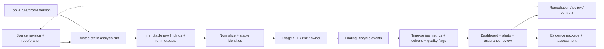
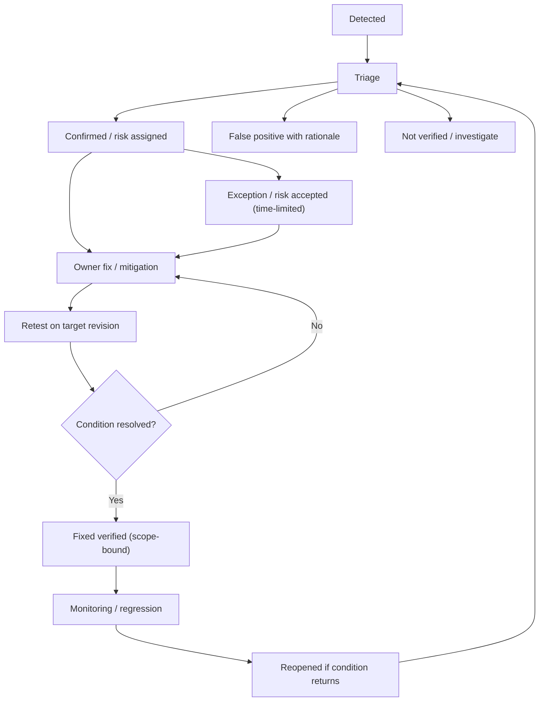

# Theo dõi xu hướng trong Static Analysis: từ lịch sử findings đến bằng chứng cải thiện bảo mật

## 1. Theo dõi xu hướng là gì và tại sao cần?

**Theo dõi xu hướng (trend monitoring)** trong *static analysis* là việc thu thập, chuẩn hóa, so sánh và diễn giải kết quả phân tích tĩnh **qua nhiều thời điểm, phiên bản phần mềm và phạm vi kiểm tra** để biết các điểm yếu, mức phơi nhiễm, nợ bảo mật và chất lượng kiểm soát đang **cải thiện, xấu đi, tái phát hay chỉ thay đổi cách đo**.

Phân tích tĩnh (static analysis) kiểm tra mã nguồn, bytecode, cấu hình hoặc artifact mà **không phải vận hành toàn bộ luồng nghiệp vụ như một người dùng cuối**. Trong bảo mật, một nhóm nổi bật là **SAST (Static Application Security Testing)**, tìm dấu hiệu injection, unsafe deserialization, misuse of crypto, tainted data flow và các kiểu lỗi khác theo khả năng của engine/ruleset. Ngoài SAST, static analysis còn có thể đo code quality, complexity, maintainability, bugs hoặc configuration violations.

Một lần scan tạo **ảnh chụp tại thời điểm T**. Theo dõi xu hướng trả lời câu hỏi khó hơn:

- Trong những bản release đã triển khai, **điểm yếu mới xuất hiện nhanh hay chậm hơn tốc độ khắc phục**?
- Những finding *critical/high* còn tồn đọng **bao lâu**, thuộc service nào, và có vượt deadline xử lý không?
- Team đang sửa tận gốc hay lỗi cùng loại **tái phát sau nhiều đợt refactor**?
- Việc “số finding giảm” có đến từ fix thật hay do **scanner bị tắt, giảm coverage, đổi ruleset, suppress hàng loạt hoặc chuyển mã sang repo khác**?
- Code mới có giữ mức rủi ro phù hợp với security baseline trước khi merge không?
- Có bằng chứng rằng các security controls đã hoạt động **liên tục**, thay vì chỉ được cấu hình một lần?

Trong module **SECURITY_SECURITY_ASSURANCE**, mục tiêu chung là **đánh giá có bằng chứng** rằng hệ thống đáp ứng mục tiêu bảo mật, từ phân tích rủi ro và yêu cầu đến controls, kiểm thử, audit và khắc phục. Vì vậy, biểu đồ xu hướng chỉ có giá trị khi có thể lần tới **scan runs, rule versions, source revisions, owner decisions, code fixes, deployment và assessment evidence**.

> **Nguyên tắc:** Xu hướng findings là **tín hiệu về rủi ro được phát hiện**, không phải phép đo trực tiếp “hệ thống an toàn bao nhiêu phần trăm”. Không thể kết luận hệ thống an toàn hơn chỉ vì đường biểu diễn đi xuống.

### Mục tiêu học tập

Sau bài này, người học có thể:

1. Xác định **đối tượng so sánh**: repository, branch, commit, release, service, team, runtime exposure và thời gian.
2. Phân biệt stock/flow metrics: **open, new, fixed, reopened, suppressed, accepted risk, overdue**.
3. Thiết kế baseline và **stable finding identity** để theo dõi qua refactor, đổi file hoặc cập nhật scanner.
4. Tính và giải thích trends về severity, risk, age, remediation time, recurrence, coverage và quality gates.
5. Phân biệt cải thiện thực với **rule drift, tool drift, coverage drift, scope changes và denominator effects**.
6. Xây dashboard, alert và governance có khả năng drill-down tới evidence gốc.
7. Kết nối SAST với CI/CD, Java/Spring Boot, triage, security requirements và operating effectiveness.
8. Đưa ra kết luận **PASS/FAIL/NOT VERIFIED/EXCEPTION** theo claim và phạm vi đã xác định.

## 2. Theo dõi findings khác theo dõi security risk

Một **finding** là quan sát của scanner: “rule R khớp với đoạn mã/đường dữ liệu P tại revision C”. Nó có thể là một vulnerability thực, false positive, logic chưa đủ ngữ cảnh hoặc kỹ thuật chưa đánh giá được.

| Đối tượng | Ví dụ | Có thể kết luận | Không thể suy ra |
| --- | --- | --- | --- |
| **Raw scanner finding** | Rule phát hiện SQL string concatenation. | Có pattern cần review trong code được scan. | Đã khai thác được ở production. |
| **Validated vulnerability** | User input đến SQL sink không parameterize. | Có weakness được xác minh trong scope. | Mức tác động giống mọi dịch vụ khác. |
| **Accepted false positive** | Rule nhầm input đã qua parameter binding. | Finding cụ thể có rationale không áp dụng. | Toàn bộ rule luôn sai. |
| **Compensated risk** | Vulnerable path bị isolate bằng policy đã test. | Một lớp exposure được giảm theo điều kiện. | Source weakness đã được sửa. |
| **Remediated finding** | Code fix được kiểm lại trên revision mới. | Điều kiện cũ không còn trong target đã retest. | Bản sửa đã lên production nếu chưa đối chiếu release. |
| **Production exposure** | Runtime image chứa commit chưa fix. | Tài sản vận hành còn có rủi ro cần đánh giá. | Raw SAST count đủ mô tả mọi attack path. |
| **Security assurance claim** | Các release thuộc scope đáp ứng gate và deadline triage. | Khi có evidence đủ, có thể đánh giá control effectiveness. | Mọi lỗ hổng chưa biết đã bị loại bỏ. |

Static analysis có thể tìm **security**, **reliability** và **maintainability issues**. Khi làm báo cáo bảo mật, **không trộn stylistic lints và security weaknesses** thành một số “vulnerabilities”. Nếu dashboard tổng hợp nhiều loại, phải phân nhóm và công bố ý nghĩa từng loại.

## 3. Ví dụ xuyên suốt: nền tảng học tập Java/Spring Boot

Giả sử hệ thống có các components:

| Thành phần | Chức năng | Rủi ro cần chú ý | Static-analysis target |
| --- | --- | --- | --- |
| `identity-api` | Đăng nhập, token và session. | Unsafe JWT validation, secret handling, broken auth. | Java source, security config, filter code. |
| `submission-api` | Nhận và lưu bài tập. | SQLi, path traversal, unsafe file parsing, resource exhaustion. | Controller/service/repository, upload pipeline. |
| `grade-service` | Quản lý điểm, lớp và tenant. | Object-level authorization, data disclosure, mass assignment. | Controller, service, persistence, authorization policy. |
| `notification-worker` | Gửi email/tin nhắn. | Unsafe templates, log PII, retry misuse. | Worker Java code, templates, configuration. |
| `web-frontend` | UI trình duyệt. | Unsafe rendering, client-side secrets. | TypeScript/template source; dùng scanner đúng ngôn ngữ. |
| `build-workflows` | Build, kiểm thử và publish. | Hard-coded tokens, untrusted action/script, artifact trust. | CI YAML, build scripts, secrets/IaC scanners khi áp dụng. |

**Đơn vị so sánh phải được định nghĩa.** Một finding trên `grade-service` ở branch feature không giống một finding đã đi vào release production; một cảnh báo từ Java analyzer không được áp trực tiếp cho frontend TypeScript nếu tool/ruleset khác.

### Hai chiều xu hướng

- **Xu hướng chất lượng thay đổi**: code mới trong pull requests có thêm weakness so với baseline không?
- **Xu hướng tồn đọng và phơi nhiễm**: toàn bộ các findings đã xác minh và còn liên quan tới release/runtime hiện tại đang diễn biến thế nào?

Hai chiều bổ sung nhau. Code mới ít issue nhưng backlog legacy cao là một tình trạng khác với backlog giảm nhanh nhưng mọi release mới vẫn sinh lỗi nghiêm trọng.

## 4. Chọn đúng unit of analysis và measurement window

| Chiều phân tích | Giá trị thường dùng | Vấn đề nếu bỏ qua |
| --- | --- | --- |
| **Repository/module** | `learning-api`, `grade-service`. | Có thể double-count mã copy/shared libraries. |
| **Branch/commit** | Protected main, release tag, commit SHA. | PR branch và main tính trùng cùng finding. |
| **Build/artifact** | JAR/image digest, build run ID. | Không biết findings tương ứng binary nào. |
| **Environment** | CI, staging, prod, DR. | Sửa trên source nhưng prod vẫn cũ. |
| **Owner/team** | Service owner, security reviewer. | Ownership bị đổi làm giả hiệu suất team. |
| **Rule/category** | CWE/OWASP ASVS category, SAST rule ID. | Một rule nhiều findings làm méo toàn bộ xu hướng. |
| **Severity/risk** | Tool severity, validated contextual risk. | Đánh đồng score tool với business risk. |
| **Time** | Scan timestamp, merge time, release/deploy time. | “Đã sửa” trên branch khác ngày deployed. |
| **Population/cohort** | Active repos, languages, risk tiers, scanned LOC. | Số code/repo tăng làm raw counts khó so sánh. |

### Rolling hay fixed windows?

- **Daily/weekly** giúp phát hiện thay đổi đột ngột; dễ biến động khi scan không đều.
- **Sprint/release** phù hợp truy trách nhiệm và quyết định promotion; các release có thời lượng và lượng code khác nhau.
- **Rolling 30/90 days** hỗ trợ đánh giá backlog/aging; phải ghi thời điểm snapshot.
- **Quarterly** tốt cho governance nhưng có thể che một regression kéo dài vài tuần.

Không kết luận chỉ từ một cửa sổ. Kết hợp **trend dài hạn** và **tín hiệu ngắn hạn**, tránh so sánh tháng có 3 scans với tháng có 300 scans nếu không chuẩn hóa population.

## 5. Chu trình thu thập và biến findings thành tín hiệu xu hướng



Pipeline cần lưu **dữ liệu gốc** (có redaction), trạng thái triage và phép tính metric versioned. Một dashboard chỉ có số tổng đã làm tròn mà không truy về underlying records khó audit và không hỗ trợ giải thích xu hướng bất thường.

### Những điểm nối quan trọng

1. Source commit ↔ scan run: kết quả của chính revision được kiểm.
2. Rule/tool version ↔ finding: khi rules thay đổi phải nhận diện.
3. Finding identity ↔ lifecycle: new/reopen/fix/suppress không lẫn nhau.
4. Fix revision ↔ build/release digest: source fix chưa phải production remediation.
5. Release digest ↔ runtime: xác định rủi ro đã đi vào hoặc rời khỏi production.
6. Risk decision ↔ exception expiry: accepted risk không biến mất khỏi exposure tracking.

## 6. Thiết kế baseline trước khi vẽ xu hướng

**Baseline** là mốc được phê duyệt dùng để so sánh. Không nhất thiết là “số finding = 0”; ở hệ thống legacy, baseline có thể chứa debt đã được triage và kế hoạch xử lý.

### Một baseline tốt phải ghi

- **Scope:** repositories, directories, languages, branches, services và excluded paths.
- **Reference point:** commit/tag/release, scan run ID và thời gian.
- **Tooling:** engine version, rule/profile version, configuration, severity mapping.
- **Coverage:** scanned files/LOC hoặc coverage measures phù hợp; skipped/failed targets.
- **Finding population:** new/open/accepted FP/exceptions, validated risk states.
- **Ownership:** service/team/assessor, người phê duyệt và deadline.
- **Integrity:** evidence storage, digest/reference, change-control history.
- **Comparison policy:** cách so khi rename/move code, rules thay đổi hay repo chia tách.

### Legacy baseline vs new-code gate

Một team có thể chấp nhận tạm thời 120 validated existing findings ở baseline, đồng thời yêu cầu **không tạo finding nghiêm trọng mới chưa xử lý** trên phần code mới. Nhưng baseline không được dùng để **vĩnh viễn miễn sửa lỗ hổng cũ**: phải có owner, risk evaluation, due dates, ngoại lệ và monitoring riêng.

**Không “reset baseline” mỗi khi dashboard đỏ** để làm trend đẹp. Việc thay baseline cần change record với old/new scope, các findings đã migrated, risk decisions và lý do có thể kiểm chứng.

## 7. Phân biệt stock, flow và trạng thái finding

Trong phân tích theo thời gian:

- **Stock** là lượng tồn tại tại một thời điểm: bao nhiêu finding đang OPEN.
- **Flow** là sự kiện trong một khoảng: new, fixed, reopened, invalidated, newly excluded.
- **Aging** đo thời gian tồn của từng finding, đặc biệt sau khi được xác minh.
- **Lead/lag** phản ánh khoảng trễ giữa phát hiện, triage, fix, deploy và verification.

### Công thức cân đối backlog

Nếu quy tắc kế toán trạng thái xác định rõ:

\[
\mathrm{Open}_{t} =
\mathrm{Open}_{t-1} +
\mathrm{New}_{t} +
\mathrm{Reopened}_{t} -
\mathrm{VerifiedFixed}_{t} -
\mathrm{OtherApprovedExits}_{t}
\]

**OtherApprovedExits** phải được phân loại (false positive, not applicable, chuyển scope, decommission...) và **không tự được gọi “fixed”**. Nếu metric chỉ theo validated open findings, các lần triage từ unverified sang confirmed cũng cần event được hạch toán.

### Ví dụ kiểm toán số lượng

Giả sử chỉ theo dõi **validated open findings** trên cùng tập repositories, với một quy tắc đơn giản không có departures khác ngoài verified fixes:

| Tuần | Open đầu kỳ | New | Reopened | Verified fixed | Open cuối kỳ |
| --- | ---: | ---: | ---: | ---: | ---: |
| 1 | 120 | 18 | 2 | 25 | **115** |
| 2 | 115 | 27 | 1 | 20 | **123** |
| 3 | 123 | 8 | 0 | 31 | **100** |
| 4 | 100 | 12 | 3 | 28 | **87** |

Ví dụ minh họa: sau bốn tuần backlog từ 120 xuống 87, nhưng tuần 2 đã **tăng từ 115 lên 123**. Phải điều tra liệu một release, rule change hay đợt discovery mới gây tăng; không kết luận tự động rằng developer kém hơn ở tuần 2.

**Đối soát:** từ dữ liệu trong bảng, tuần 4 bằng `100 + 12 + 3 - 28 = 87`. Nếu số cuối kỳ không khớp, có thể thiếu lifecycle events, duplicate handling hoặc scope drift. Khi không reconcile được, dashboard cần gắn **data-quality warning**, không âm thầm chỉnh số.

## 8. “New”, “Fixed”, “Closed” và “Not observed” không đồng nghĩa

| Nhãn | Định nghĩa đề xuất | Không nên diễn giải |
| --- | --- | --- |
| **NEW** | Finding identity chưa xuất hiện trong baseline cùng scope/rule mapping. | Chắc chắn weakness vừa được developer tạo; có thể rule mới tìm ra lỗi cũ. |
| **CONFIRMED** | Đã có reviewer/evidence xác minh condition là vulnerability. | Exploitability thực tế đã chắc chắn ở mọi môi trường. |
| **IN_REMEDIATION** | Có fix/mitigation được thực hiện nhưng chưa verified closure. | Đã xử lý xong. |
| **FIXED_VERIFIED** | Retest trên target revision/release cho thấy condition không còn. | Runtime production cũng đã fix nếu chưa deploy check. |
| **REOPENED** | Lỗi cũ xuất hiện lại sau closure hoặc evidence mới bác bỏ fix. | Luôn do cùng developer tái tạo lỗi. |
| **FALSE_POSITIVE** | Finding cụ thể được review là không áp dụng/không đúng. | Rule có thể tắt toàn cục. |
| **RISK_ACCEPTED/EXCEPTION** | Weakness còn nhưng residual risk được phê duyệt xử lý tạm theo authority. | Lỗi đã được khắc phục. |
| **NOT_VERIFIED** | Thiếu target, data, scan success, reviewer hoặc retest. | Không có rủi ro. |
| **NOT_OBSERVED** | Scanner không phát hiện trong run hiện tại. | Đã fix nếu rule/coverage/tool/identity thay đổi. |

### Vòng đời mẫu



**Lifecycle events phải có timestamp, actor, reason, source run và version.** Không thể dựng đúng xu hướng bằng cách chỉ lưu trạng thái hiện tại của finding mà không lưu lịch sử transitions.

## 9. Stable finding identity: theo dõi một lỗi qua nhiều commits

Nếu scanner định danh finding bằng **file path + line number**, một lần format hoặc thêm import có thể biến cùng một issue thành “fixed” và “new” dù code không thay đổi về rủi ro.

### Fingerprint nên xem xét

- Repository/module và language/ecosystem.
- Scanner rule identity, CWE/category mapping, rule version khi cần.
- Semantic location: function/method/class, source/sink data flow, AST structure.
- Normalized code context và một fingerprint của data-flow path nếu engine hỗ trợ.
- Stable resource identifier hoặc AST node thay vì chỉ line number.
- Triage linkage và merge/split record khi một finding thay đổi identity.

### Hai trường hợp cần xử lý

**File rename:** `src/legacy/GradeService.java` được chuyển sang `src/grades/GradeService.java`, cùng lỗ hổng SQLi. Fingerprint có thể bảo toàn identity nếu có semantic context; nếu không, reviewer phải ghi **finding equivalence mapping**, tránh fake new/fixed.

**Một vulnerability có hai sinks:** Khi refactor tách một unsafe path thành hai entry points, có thể cần **split** thành hai findings có cùng root cause, hoặc giữ one-to-many linkage theo chính sách. Tránh giảm hoặc tăng tổng số chỉ vì thuật toán fingerprint khác.

**Không tạo fingerprint bằng dữ liệu cá nhân hoặc secrets nguyên văn.** Hash normalized context/paths trong phạm vi truy cập phù hợp; scanner raw traces có thể chứa PII từ source/test fixtures và cần redaction.

## 10. Chốt thời điểm “đã fix”: source, release và runtime

| Milestone | Ví dụ | Kết luận phù hợp |
| --- | --- | --- |
| **Fix authored** | Developer commit bản sửa vào branch. | Có candidate fix. |
| **Fix merged** | Review/CI pass trên protected branch. | Fix nằm trong main theo evidence. |
| **Fix built** | Artifact digest mới chứa commit và đúng dependencies. | Fix candidate có thể phát hành. |
| **Fix released** | Approved build được publish/promote. | Fix sẵn cho deployment, chưa chắc đang chạy. |
| **Fix deployed** | Production dùng new digest/config ở target instances. | Đã triển khai trong phạm vi được xác minh. |
| **Fix verified** | Targeted retest và security regression trên version đang chạy đạt. | Có cơ sở đóng finding theo scope. |

**Time to fix in source** và **time to remediate production** là hai chỉ số khác nhau. Nếu issue critical được fix trong một ngày nhưng production chờ triển khai 20 ngày, báo “MTTR = 1 ngày” có thể che rủi ro thực.

### Release lineage

Một security finding nên có chuỗi: `finding-id → code-fix commit → CI run → artifact digest → release approval → cluster/workload digest → targeted retest result`.

Không cần xem trend “đã sửa” là hoàn chỉnh nếu không xác định được version đang vận hành.

## 11. Tách scanner severity và contextual risk

**Scanner severity** thường dựa trên rule và giả định của công cụ; **organizational risk** cần có thêm business context. Hai trục không nên bị gộp thành một trường không có nguồn gốc.

| Thông tin | Ví dụ | Khi theo dõi |
| --- | --- | --- |
| Tool severity | HIGH, MEDIUM... theo scanner cụ thể. | Versioned mapping, không so raw giữa tools khác schema. |
| Weakness class | CWE, taint source/sink, insecure API. | Theo dõi nhóm recurring root causes. |
| Asset criticality | Public auth API vs internal report generator. | Weight/segment theo tác động. |
| Exposure | Internet-facing, role required, tenant reachability. | Có thể đổi mà source không đổi. |
| Exploitability | Preconditions, exploit evidence, reachable paths. | Phải ghi confidence và reviewer. |
| Data sensitivity | PII, bài nộp, điểm, keys. | Ưu tiên hơn style issues. |
| Mitigation | Segmentation, feature disabled, validation controls. | Chưa phải code fix, cần test effectiveness. |
| Validated risk | Decision theo policy và risk owner. | Theo dõi open high-risk backlog và SLA. |

### Ví dụ

Một SAST finding HIGH ở một test helper không có production reachability có thể được triage khác một finding MEDIUM về **cross-tenant data exposure** được manual test xác nhận. Số lượng HIGH thô giảm nhưng số **validated high business risks** tăng là tín hiệu xấu đáng chú ý.

**Không đặt công thức “risk = CVSS × LOC”** để có vẻ khách quan. Cần công bố quy tắc risk scoring, assumptions và trường hợp không thể định lượng.

## 12. Những thước đo nền tảng nên có

| Metric | Cách hiểu | Nguy cơ diễn giải |
| --- | --- | --- |
| **Open backlog** | Số validated/unresolved findings tại snapshot. | Raw backlog phụ thuộc repo size/coverage. |
| **New findings** | Findings mới được nhận diện trong kỳ, theo fingerprint. | Rule update có thể sinh new findings từ code cũ. |
| **Verified fixed** | Findings có evidence retest closure trong kỳ. | Chưa chắc production nếu không kiểm deploy. |
| **Reopened/recurrence** | Weakness quay lại hoặc fix bị regression. | Fingerprint drift gây fake recurrence. |
| **Finding age** | Tuổi kể từ detection hoặc confirmation, nêu mốc. | Những findings chưa triage cần tính riêng. |
| **Time to triage** | Từ detection tới validated disposition. | Ticket auto-created không phải human triage. |
| **Time to verified fix** | Từ detection/confirmation tới verified closure. | Cần ghi target source/prod và censoring. |
| **Overdue risk findings** | Unresolved findings quá hạn theo risk policy. | Accepted exceptions cần hiển thị riêng. |
| **False-positive proportion** | Tỷ lệ confirmed false positives trong reviewed sample. | Tắt rule hoặc suppress làm số đẹp giả. |
| **Coverage and scan health** | % code/assets/rulesets đạt required scan profile. | Mẫu số inventory thiếu. |
| **New-code risk gate** | Security issues mới chưa được xử lý trong PR/release. | Baseline/PR diff sai sẽ chặn nhầm hoặc bỏ lọt. |
| **Runtime exposure** | Findings gắn artifact đang chạy. | SAST source không tự map đủ image/runtime. |

Nên hiển thị **cả số tuyệt đối và tỷ lệ/coverage**. Với critical risk chỉ có một issue cũng có thể cần hành động; tỷ lệ được chuẩn hóa không thay việc xem finding cụ thể.

## 13. Chuẩn hóa số finding: khi nào nên dùng tỷ lệ?

Một team tăng số lượng repository hoặc quét nhiều thư mục hơn có thể có raw issue count tăng dù **quality per unit** được cải thiện. Nhưng việc chuẩn hóa cũng dễ gây hiểu sai.

### Ví dụ metric density

\[
\mathrm{FindingDensity} = 
\frac{\mathrm{ValidatedFindings}}
{\mathrm{EligibleScannedKLOC}}
\]

Trong đó *KLOC* là một nghìn dòng code thuộc **quy tắc đếm đã định**, thường loại generated/vendor code nếu chính sách nêu rõ. Density có ích khi **tooling, rule coverage, languages, code-base composition** tương đối so sánh được.

### Tại sao KLOC không phải thước đo rủi ro đầy đủ?

- Một dòng code sử dụng API sai có thể có blast radius lớn hơn hàng nghìn dòng code khác.
- Generated code, templates, bytecode, dependencies được tính/loại khác nhau theo tool.
- Số lượng endpoints, trust boundaries, privileges và business sensitivity không tỷ lệ tuyến tính với LOC.
- Một team xóa code nguy hiểm có thể khiến denominator nhỏ, density tăng dù absolute risk giảm.
- Một scanner mới hỗ trợ thêm annotation/framework sẽ tìm nhiều issue hơn trên cùng KLOC.

**Đề xuất thực hành:** báo đồng thời **open high-risk count, new-code introduction rate, verified closure rate, affected critical services, scan coverage** và density khi phù hợp. Luôn ghi denominator/method, không lập bảng xếp hạng nhân viên chỉ bằng “issues per developer”.

## 14. Tính age, MTTR, percentile và backlog aging đúng cách

Các metrics thời gian đặc biệt quan trọng vì một finding chưa sửa trong sáu tháng có rủi ro và nghĩa vụ khác một finding vừa xuất hiện hôm qua.

### Định nghĩa các mốc thời gian

| Mốc | Diễn giải | Không nên thay thế |
| --- | --- | --- |
| `first_detected_at` | Lần đầu scanner phát hiện identity trong scope đã định. | Lúc vulnerability được developer tạo ra. |
| `confirmed_at` | Lúc reviewer xác minh vulnerability và điều kiện áp dụng. | Scan timestamp nếu triage bị trì hoãn. |
| `assigned_at` | Lúc có owner chịu trách nhiệm xử lý. | Due date. |
| `fix_merged_at` | Lúc code fix đi vào branch approved. | Production remediation. |
| `deployed_at` | Lúc new artifact/config hiện diện trong target environment. | Fix verified. |
| `verified_at` | Lúc assessor/test xác minh vulnerability condition đã xử lý. | Chỉ dựa vào scanner “không thấy nữa”. |
| `reopened_at` | Lúc condition xuất hiện trở lại hoặc closure bị bác bỏ. | Một finding hoàn toàn mới, nếu identity được giữ. |

**Time to triage** = `confirmed_at - first_detected_at` với findings đã triage. **Time to verified remediation** = `verified_at - first_detected_at` hoặc `verified_at - confirmed_at` theo chính sách; phải công bố điểm bắt đầu. **Time to deploy fix** và **time to verify fix** nên được hiển thị riêng khi có SLA production.

### Đừng bỏ qua findings chưa đóng

Nếu tính **mean time to remediate (MTTR)** chỉ trên findings đã closed, backlog khó nhất chưa được sửa sẽ **biến mất khỏi phép tính**. Đây là **survivorship/censoring bias**: báo MTTR 2 ngày có thể đi cùng 50 findings 180 ngày chưa xử lý.

Vì thế cần kết hợp:

- Median/p75/p90 **thời gian sửa các finding đã verified closed** trong kỳ;
- Median/p90 **current age của open findings**;
- Số lượng và tỷ lệ **overdue** theo risk tier;
- Oldest unresolved items và top critical services;
- Tỷ lệ findings được triage/closed trong policy deadlines trên một **cohort đã đủ thời gian quan sát**.

Khi muốn phân tích thời gian sống của toàn bộ cohorts, có thể dùng phương pháp **survival analysis với right-censoring** thay cho phép trung bình đơn giản. Đây là kỹ thuật nâng cao, không nhất thiết bắt buộc cho mọi đội; quan trọng là không làm mất những finding chưa đóng.

### Quy tắc timezone

Lưu timestamps dạng UTC có timezone/offset rõ. Khi so theo ngày làm việc, phải định nghĩa **timezone, ngày nghỉ, business hours và pause policy**. Không tùy ý dừng đồng hồ SLA bằng cách chuyển finding sang “on hold” nếu chưa có quy định được duyệt.

## 15. New-code introduction rate và prevention effectiveness

Một mục tiêu thực dụng là **ngăn weakness mới đi vào protected branch/release**. Có thể tính:

\[
\mathrm{IntroductionRate} =
\frac{\mathrm{ValidatedNewWeaknessesOnNewCode}}
{\mathrm{EligibleMergedChanges}}
\]

hoặc tính trên số PR/commit, new code KLOC, thời gian hoặc active services. **Mẫu số lựa chọn khác nhau không thể so sánh trực tiếp**. Nếu dùng PR làm denominator, một PR 3 dòng và một PR 30.000 dòng không có mức exposure tương đương.

### Những trạng thái quan trọng

| Tín hiệu | Ý nghĩa |
| --- | --- |
| New finding detected trong PR | Có dấu hiệu mới cần review theo diff và baseline. |
| New finding validated | Điểm yếu mới được xác minh; cần treatment. |
| New finding fixed trước merge | Prevention gate phát hiện và chặn sớm. |
| New finding merged với exception | Risk được chấp thuận trong scope, vẫn cần theo dõi. |
| New finding discovered sau release | Có thể là missed detection do scanner coverage/rules. |
| New finding caused by rule update | Discovery improvement, không tự là code regression. |

**Lưu cả “detected-and-fixed-before-merge”** để đánh giá hiệu quả shift-left. Nếu chỉ tính issues xuất hiện trong main, một team có quality gate tốt sẽ có số new thấp, nhưng dashboard không thấy các vấn đề đã được ngăn chặn; đó là hai metrics khác nhau.

### Không dùng số finding như chỉ số thưởng-phạt cá nhân

Một team triển khai scan sâu hơn, mở rộng coverage hoặc chủ động khai báo rủi ro có thể có số findings tăng **vì minh bạch hơn**. Dùng raw counts làm mục tiêu thưởng phạt tạo động lực **tắt rules, không scan, suppress hoặc tránh review**. Ưu tiên trends gắn với outcome, context và evidence quality.

## 16. Closure rate và remediation throughput

Số findings “fixed” mỗi tuần giúp đo **năng lực xử lý**, nhưng cần kiểm liệu throughput đang vượt incoming risk hay không.

### Flow comparison

- **Incoming confirmed**: các validated new findings trong kỳ.
- **Verified exits**: các findings được retest và đóng đúng scope trong kỳ.
- **Reopened**: các conditions tái xuất hiện.
- **Exceptions/other dispositions**: tách khỏi verified fixes.

Một backlog có xu hướng giảm khi **verified exits vượt incoming confirmed + reopened**, với cùng population và không có changes khác bị bỏ qua. Nhưng nếu scanner mất coverage, “new” giảm có thể là tín hiệu xấu.

### Ưu tiên triage và throughput theo risk

| Metric | Lý do |
| --- | --- |
| Fixed critical/high per period | Xem team có giảm rủi ro lớn hay chỉ đóng low severity dễ sửa. |
| New critical/high per release | Xem regression trong release critical. |
| Overdue critical/high | Nhìn risk tồn quá deadline. |
| Findings at risk of overdue | Chuyển từ báo cáo hậu kiểm sang cảnh báo sớm. |
| Reopen after closure | Đo độ bền của fixes và kiểm thử. |
| Production exposure days | Xem risk thực sự tồn tại bao lâu trong deployed artifacts. |

**Không gom mọi finding bằng nhau** khi đánh giá risk. Tuy vậy, nếu thiết kế một điểm risk-weighted total, phải ghi **weighting policy/version và cách xử lý missing risk**, không phát biểu con số như một xác suất tấn công.

## 17. Recurrence: xu hướng lỗi lặp lại và root-cause families

**Recurrence** có thể được hiểu ở ít nhất ba cấp:

1. **Same-finding reopen:** đúng condition đã closed xuất hiện lại ở một path/release.
2. **Same weakness pattern:** finding khác nhưng cùng nhóm CWE/rule trong code mới.
3. **Systemic recurrence:** cùng root cause do kiến trúc, coding convention, build template, thiếu library an toàn hoặc quy trình review.

### Ví dụ với Java/Spring Boot

Một finding SQL injection ở `grade-service` được sửa bằng `PreparedStatement`/parameter binding. Vài sprint sau, một service mới lại nối chuỗi SQL từ query parameter. Đó không nhất thiết là **reopened same finding**, nhưng là **recurrence cùng CWE/root-cause family**.

### Phân tích nguyên nhân

| Tín hiệu | Câu hỏi cần xem | Hướng cải tiến |
| --- | --- | --- |
| SQL injection patterns lặp | Team thiếu safe query abstraction? | Parameterized query helpers, code review guardrail, focused tests. |
| Hardcoded secrets xuất hiện nhiều | CI/dev workflow có hướng dẫn secret manager? | Secret-less local workflow, scanners, policy, training. |
| Authorization findings ở nhiều services | Có shared policy library và threat-model negative tests? | Centralized patterns + per-object authz tests. |
| Unsafe deserialization tái phát | Third-party input formats và allowed types có được kiểm? | Safe parser/config, strict data contracts. |
| Scanner suppressions tăng | Rules có nhiều FP hoặc developers né gate? | Tune profile, independent reviews, targeted fixes. |

**Theo dõi recurrence phải phân biệt kỹ thuật sửa lỗi cụ thể và việc học tổ chức.** Nếu cứ đóng cùng một rule mà root cause không đổi, tốc độ xử lý ticket có thể cao nhưng security assurance không tiến bộ.

## 18. Rule drift, tool drift và detection bias

Một trong những vấn đề lớn nhất của trend monitoring là **sự thay đổi hệ thống đo**:

| Thay đổi | Dấu hiệu trên dashboard | Diễn giải đúng |
| --- | --- | --- |
| **Scanner engine upgrade** | Đột ngột thêm hàng loạt findings. | Có thể do phân tích được flows mới; chưa chắc code kém hơn. |
| **Rule set expanded** | New issues ở code không đổi. | Discovery coverage tăng, cần tách “newly detected legacy debt”. |
| **Rule disabled** | Open issues giảm bất thường. | Không được tự tính là fixed. |
| **Severity remapped** | Critical giảm, High tăng. | Có thể chỉ là taxonomy change. |
| **Path exclusions added** | Scan LOC giảm và số findings giảm. | Coverage drift, cần phê duyệt và minh bạch. |
| **Build failed/skipped scan** | Không có report hoặc 0 issues. | NOT VERIFIED, không là security improvement. |
| **Language/tool support changed** | Java coverage tốt hơn, Kotlin chưa scan. | So sánh theo language cohorts riêng. |
| **Repository split/merge** | Findings tăng/giảm do chuyển source. | Dùng lineage/canonical IDs, tránh double count. |
| **Fingerprint algorithm changed** | Nhiều new/fixed cùng ngày. | Data migration/mapping và annotation break in series. |

### Quy tắc phân tích interrupted series

Khi thay engine/ruleset/profile, đánh dấu **measurement break** trên dashboard. Nếu khả thi, chạy scanner cũ và mới trên **cùng source revision và test inputs** để ước lượng mức khác nhau do tool, không làm thay đổi production.

Một kết luận có ích có thể là:

> “Tuần 3, số findings tăng 40% sau khi bật rule group mới. Trên 20 repositories giữ nguyên revision, ruleset mới phát hiện thêm các unsafe deserialization patterns. Đây chủ yếu là tăng khả năng phát hiện; số lỗi mới thực sự do code trong tuần cần đánh giá riêng.”

Không suy “40% rủi ro tăng” nếu không biết tính duy nhất, validation, exposure và baseline của các nhóm vừa được quét.

## 19. Coverage drift: thiếu dữ liệu nguy hiểm hơn biểu đồ đỏ

Một dashboard trend có thể trông tốt chỉ vì scanner không còn đọc được code cần kiểm.

### Các loại coverage

| Coverage dimension | Câu hỏi | Ví dụ bằng chứng |
| --- | --- | --- |
| **Repository coverage** | Repo thuộc scope có scan hợp lệ không? | Repo inventory vs CI scan run list. |
| **Branch/release coverage** | Main, release tags và protected PRs có scan đúng revision? | Commit IDs, build IDs, scan policy. |
| **Language coverage** | Scanner hiểu Java/Kotlin/TypeScript/config trong scope không? | Supported-language list, actual analyzed files. |
| **File/LOC coverage** | Có generated/vendor code hoặc paths excluded không? | Path filters, analyzed LOC, exclusions rationale. |
| **Rule/category coverage** | Đã bật nhóm rules liên quan threat model chưa? | Rule inventory, CWE mapping và profile version. |
| **Build-resolution quality** | Bytecode, classpath, dependencies có đủ để SAST phân tích flow không? | Analyzer diagnostics, compilation/semantic analysis logs. |
| **Scan completion** | Job hoàn tất đúng target, không skip/timeout/license outage? | Exit/run state + evidence integrity. |
| **Runtime representation** | Scan revision có map tới artifact deployed không? | Source–image digest–deployment lineage. |

### Healthy scan không nhất thiết là “exit code 0”

Một scanner process có thể thoát thành công dù **không phân tích được classpath** hoặc không tìm thấy file nào. Tùy tool, các trường như analyzed files/LOC, diagnostics, skipped rules và authenticated source access phải được kiểm riêng. Nếu required coverage không đạt, record cần **UNHEALTHY_SCAN/NOT VERIFIED**, không nhập “0 finding” vào historical time-series.

## 20. So sánh cohorts đúng: apples-to-apples

Nếu tuần 1 quét 2 repositories Java, tuần 2 quét 10 repositories đủ ngôn ngữ và tuần 3 thêm config security rules, một line chart raw count đơn nhất không cho biết code quality đang đi đâu.

### Cách làm

1. **Định nghĩa cố định cohort**: tập repos/services, rule profile, language, release branch và risk tier.
2. Giữ **raw total toàn hệ thống** riêng để thể hiện exposure thực.
3. Dùng **fixed-scope trend** trên cohort ổn định để xem xu hướng code behavior.
4. Khi mở rộng scope, đánh dấu thời điểm và lập **newly onboarded backlog** riêng.
5. Dùng **per-service drill-down** để phát hiện một high-risk hotspot bị trung bình chung che.
6. Nếu cohort được điều chỉnh, công bố mapping old/new và rebaseline có audit.

### Ví dụ

Một security team onboard thêm `grade-worker` vào SAST, thấy thêm 45 warnings. Một biểu đồ toàn hệ thống sẽ tăng. Trong **fixed cohort** của các API đã scan từ trước, findings có thể giảm. Kết luận nên phân biệt:

- **Tổng exposure được phát hiện:** tăng vì phạm vi scan mở rộng.
- **Xu hướng trong cohort cũ:** giảm nếu fixes đã được verified.
- **Thay đổi thực trên worker mới:** chưa biết vì trước đó không có baseline/coverage.

Không ép một đường trend trả lời cả ba câu hỏi.

## 21. Phân tích theo severity, CWE, service và risk hotspots

Một trend tổng có thể giảm mạnh vì team sửa hàng trăm code smells nhưng vẫn để **một lỗi authz nghiêm trọng** trong dịch vụ quản lý điểm.

### Các chiều drill-down

| Dimension | Insight có giá trị | Anti-pattern |
| --- | --- | --- |
| **Validated risk tier** | High-risk unresolved trên critical services. | Lấy severity tool làm risk decision. |
| **CWE/rule family** | Root cause nào tiếp tục được tạo mới. | Gộp rules tương đồng nhưng semantics khác mà không mapping. |
| **Service/asset criticality** | Vùng có PII/grades/auth đạt deadline không. | Xếp hạng team bằng raw count không xét codebase size. |
| **Code ownership** | Ai có thể sửa và ai phê duyệt. | Thay team owner rồi đánh “lỗi chuyển đi đã fix”. |
| **Exposure/release** | Finding nào đã đi vào production. | Chỉ báo branch main. |
| **Age/SLA** | Những risk kéo dài vượt tolerance. | Chỉ nhìn average age. |
| **Root-cause cluster** | Chung unsafe library/template hay review gap. | Tạo nhiều ticket lẻ mà bỏ systemic control. |
| **False positive/unknown** | Tool hiệu quả và review quality. | Dismiss cả rule chỉ vì một case. |

### Pareto và hotspot

Phân tích nhóm top CWE/repo giúp chọn đầu tư: chẳng hạn quy tắc unsafe deserialization chiếm nhiều validated risk findings trong nhóm upload services. Nhưng “nhóm phát hiện nhiều nhất” không đồng nghĩa “rủi ro lớn nhất”; cần **exposure, exploitability, blast radius và user impact**.

## 22. Suppressions, waivers và exceptions phải là dữ liệu trend

Một trong những nguy cơ lớn là “dọn dashboard” bằng các thao tác:

- Disable rule/profile toàn cục.
- Exclude file hoặc directory có findings.
- Mark false positive không có rationale.
- Tạo exemption vô thời hạn.
- Dời code sang repo không được scan.
- Đổi threshold mà không giữ lịch sử.

### Các metrics riêng

| Metric | Cần theo dõi |
| --- | --- |
| **Active suppression count** | Bao nhiêu finding/rule/path bị suppress, trong scope nào. |
| **New suppressions per period** | Ai tạo, vì sao, approval và risk context. |
| **Expiring/overdue exceptions** | Những risk không được xử lý có thể bị bỏ quên. |
| **Accepted residual risk** | Business/risk owner đã duyệt, compensation đã test chưa. |
| **Rule/global exclusions** | Coverage bị ảnh hưởng bao nhiêu, có owner và policy review? |
| **Reopened after suppression review** | Chất lượng disposition ban đầu có vấn đề không. |

### Cách biểu diễn dashboard

Đừng xóa suppressed findings khỏi mọi biểu đồ. Có thể hiển thị:

- **Actionable confirmed backlog**: cần remediation.
- **Accepted residual exposure**: cần risk review/expiry.
- **Confirmed false positives**: tín hiệu về precision của scanner.
- **Unknown/not verified**: cần bổ sung evidence.
- **Coverage exclusions**: phần hệ thống chưa được kiểm.

Khi total actionable giảm vì accepted risk tăng, dashboard phải cho thấy rõ **treatment chuyển trạng thái**, không tự kể câu chuyện “security improved”.

## 23. Quality gates: kiểm code mới và ngăn regression

Một **quality gate** dùng kết quả static analysis và chính sách để quyết định **pass, hold hoặc fail** tại PR/release. Đối với security assurance, gate phải vừa **ngăn weakness mới** vừa **không làm biến mất rủi ro legacy**.

### Ví dụ policy logic

| Điều kiện | Quyết định gợi ý | Điều cần kiểm |
| --- | --- | --- |
| New confirmed critical weakness trong PR. | FAIL/HOLD, bắt buộc fix hoặc exception có thẩm quyền nếu được phép. | Rule/fingerprint đúng target, validation đủ. |
| New tool warning chưa triage, thuộc sensitive path. | HOLD_FOR_REVIEW. | Severity/asset context và scanner confidence. |
| No new issue, required scan healthy. | Có thể PASS gate này. | Không suy toàn bộ security assurance PASS. |
| Scan skipped, rule feed unavailable, semantic analysis failed. | NOT VERIFIED / HOLD nếu scan required. | Exit code và coverage metadata. |
| Legacy backlog tồn trong baseline nhưng có owner và remediation plan. | Giám sát debt riêng, áp deadline. | Không cho baseline tự reset/suppress. |
| Vulnerability fixed trong PR nhưng image prod còn cũ. | PR gate pass có giới hạn; production finding chưa đóng. | Release/runtime identity. |
| Exception hết hạn hoặc sai repo/commit scope. | FAIL/HOLD, reapproval/risk review. | Không auto-bypass. |

### Gate không nên chỉ dựa raw issue count

Nếu bật rule mới và phát hiện một số issues legacy, có thể cần **tách migration/rebaseline** khỏi **new-code security regression** để tránh block toàn bộ sản phẩm vô thời hạn. Nhưng các issue critical có active exploitation và production exposure phải được **risk triage ngay**, không chờ cleanup để làm dashboard đẹp.

## 24. CI/CD: thu thập trend evidence từ build

### Ví dụ workflow logic (mẫu khái niệm)

```yaml
# Illustrative internal policy, NOT a runnable scanner or CI schema.
static_analysis_pipeline:
  service: "grade-service"
  source_revision: "APPROVED_COMMIT_SHA"
  branch: "protected-main"
  analysis:
    engine: "APPROVED_SAST_ENGINE"
    engine_version: "RECORDED_VERSION"
    rule_profile: "sast-java-profile-v3"
    require_semantic_analysis: true
    fail_if_no_files_analyzed: true
    require_coverage_report: true
  finding_tracking:
    identity_scheme_version: "fingerprint-v2"
    baseline: "approved-baseline-2026-q4"
    separate_legacy_new_code: true
    capture_lifecycle_events: true
  gate:
    policy_version: "sec-quality-gate-v4"
    hold_on_required_scan_failure: true
    hold_on_untriaged_new_high_risk: true
    require_exception_approval_and_expiry: true
  evidence:
    save_raw_results: true
    save_normalized_results: true
    redact_secrets: true
    bind_to_build_and_artifact_digest: true
```

Đây là **mô hình dữ liệu minh họa**; không chạy trực tiếp trong GitHub Actions, GitLab CI, SonarQube, CodeQL hoặc Semgrep. Mỗi tool có CLI/API và điều kiện gating khác nhau, cần đọc tài liệu đúng phiên bản và kiểm exit/status semantics.

### Nguồn thực tế cần lưu

- CI run ID, workflow/ref/trigger và source SHA.
- Tool/analyzer versions, rule profile/config hash, build/classpath diagnostics.
- Raw SARIF/JSON/vendor-specific report theo cơ chế tool.
- Số analyzed files/LOC, supported languages và excluded paths.
- Finding fingerprint IDs + state transitions + reviewer decisions.
- Release artifact digest và mapping deployment khi có.
- Quality-gate policy/decision, permissions, bypass/exception record.

### Chống tampering

Một PR không tin cậy không được sửa scanner config để tắt rules hoặc upload giả kết quả **với cùng quyền** mà release gate chấp nhận. Cần protected workflow/policy, trusted execution identity, scoped credentials và validation report provenance theo threat model.

## 25. SARIF, dữ liệu từ nhiều scanners và mapping rules

**SARIF (Static Analysis Results Interchange Format)** là một định dạng trao đổi kết quả phân tích tĩnh, thường được dùng để đưa findings vào các hệ thống code scanning. Nó giúp lưu rule IDs, locations, fingerprints/partial fingerprints và metadata theo schema được hỗ trợ.

### Những cạm bẫy hợp nhất dữ liệu

| Vấn đề | Tác động | Xử lý |
| --- | --- | --- |
| CodeQL và Semgrep cùng báo một SQLi. | Double count nếu cộng raw alerts. | Link observations tới một canonical finding khi có validation. |
| Rule IDs khác nhau nhưng cùng CWE. | Gộp quá rộng nếu chỉ theo CWE. | Review source/sink và semantic context; giữ raw IDs. |
| Một tool thiếu stable fingerprints. | New/fixed giả khi line numbers đổi. | Fingerprint migration và reviewer linkage. |
| Severity levels khác nhau. | Dễ diễn giải sai trend HIGH/CRITICAL. | Versioned severity mapping; giữ native severity. |
| Tool hỗ trợ Java tốt nhưng Kotlin không đủ. | Count thấp bất thường ở Kotlin repo. | Language coverage/unsupported rule metadata. |
| Baseline được generate theo branch khác. | PR new-code results lệch. | Source revision, merge-base và comparison policy rõ. |

**Không dùng CWE làm duy nhất key dedup:** hai lỗ hổng khác nhau trong hai endpoint có thể cùng CWE; ngược lại một vulnerability có thể được nhiều rules/CWEs mô tả.

### SARIF là evidence container, không phải assessor

Một report đúng SARIF schema vẫn có thể có sai target, thiếu paths, fake source metadata hoặc false positives. Phải xác minh **provenance, trusted tool run, completeness và disposition**.

## 26. Data model theo event sourcing cho finding lifecycle

Muốn dựng lại trạng thái tại thời điểm bất kỳ, nên lưu **các sự kiện có timestamp** thay vì chỉ bảng current findings.

### Mẫu record

```yaml
finding:
  canonical_id: "SA-FIND-0042"
  fingerprint_scheme: "semantic-v2"
  repository: "learning/grade-service"
  rule:
    engine: "APPROVED_SAST"
    native_rule_id: "java.sql.example-rule"
    mapped_cwe: "CWE-89"
    mapping_version: "rule-map-v3"
  first_seen:
    scan_run: "scan-001"
    source_revision: "COMMIT_OLD"
    detected_at: "2026-11-01T08:00:00Z"
  exposure:
    production_artifact_digest: "sha256:REPLACE_WITH_REAL_DIGEST"
    service_risk_tier: "critical"
  status: "IN_REMEDIATION"
  owner: "grade-service-owner"
  risk_review_ref: "RISK-123"
  events:
    - type: "DETECTED"
      occurred_at: "2026-11-01T08:00:00Z"
      evidence_ref: "scan-001/result-42"
    - type: "CONFIRMED"
      occurred_at: "2026-11-02T09:00:00Z"
      evidence_ref: "review-012"
    - type: "IN_REMEDIATION"
      occurred_at: "2026-11-03T10:00:00Z"
      evidence_ref: "ticket-099"
```

Đây là **schema giáo dục**, không là input chính thức của công cụ nào. Digest và IDs là placeholders. Trong hệ thống thật cần có access control, optimistic concurrency/duplicate-event handling, ingestion replay idempotency và audit tamper resistance.

### Event types nên tách

`DETECTED`, `CONFIRMED`, `RISK_RECLASSIFIED`, `OWNER_ASSIGNED`, `FIX_STARTED`, `FIX_MERGED`, `DEPLOYED`, `RETEST_PASS`, `RETEST_FAIL`, `CLOSED_VERIFIED`, `REOPENED`, `FALSE_POSITIVE`, `EXCEPTION_APPROVED`, `EXCEPTION_EXPIRED`, `SCOPE_CHANGED`, `RULE_MIGRATED`.

**Không dùng một event `RESOLVED` cho mọi hình thức đóng:** không thể phân biệt fix, false positive, risk acceptance và asset decommission khi làm assurance hoặc phân tích MTTR.

## 27. Từ event log tới chỉ số: ví dụ SQL tổng hợp

Giả sử một hệ thống tổng hợp static-analysis findings đã **normalize/deduplicate** các observations và lưu lịch sử dưới bảng `finding_events`:

| Field | Ý nghĩa |
| --- | --- |
| `event_id` | ID duy nhất của lifecycle event, chống ingestion duplicate. |
| `canonical_finding_id` | Identity của weakness qua các runs. |
| `event_type` | CONFIRMED, CLOSED_VERIFIED, REOPENED... |
| `occurred_at` | Event time có timezone. |
| `repository` | Repository canonical name. |
| `scope_id` | Fixed-scope cohort hoặc agreed policy scope. |
| `scan_run_id` | Nguồn scanner observation nếu event phát sinh từ scan. |
| `review_ref` | Bằng chứng human triage/retest khi có. |
| `rule_profile_version` | Phục vụ phân biệt tool/rule drift. |

### SQL minh họa theo tuần

```sql
-- PostgreSQL illustration.
-- Assumption: each lifecycle transition is unique and validated
-- during ingestion; one CONFIRMED event is recorded only when
-- a finding first becomes a confirmed, in-scope issue.
SELECT
    date_trunc('week', occurred_at AT TIME ZONE 'UTC') AS week_utc,
    COUNT(*) FILTER (
        WHERE event_type = 'CONFIRMED'
    ) AS newly_confirmed,
    COUNT(*) FILTER (
        WHERE event_type = 'CLOSED_VERIFIED'
    ) AS verified_fixed,
    COUNT(*) FILTER (
        WHERE event_type = 'REOPENED'
    ) AS reopened
FROM finding_events
WHERE scope_id = 'protected-main-fixed-cohort-v1'
  AND occurred_at >= TIMESTAMPTZ '2026-10-01 00:00:00+00'
  AND occurred_at <  TIMESTAMPTZ '2027-01-01 00:00:00+00'
GROUP BY 1
ORDER BY 1;
```

### Cách hiểu đúng

- Query đếm **events theo tuần**, không tạo ra `open_as_of_week`; stock cần **replay event stream** hoặc snapshot/temporal query với điểm thời gian và state semantics được xác minh.
- Nếu một finding được CONFIRMED hai lần do ingestion bug, query đếm sai. Cần **unique constraints/idempotent ingestion** và sửa event lineage.
- Nếu `CLOSED_VERIFIED` còn bao gồm “accepted FP” hoặc “closed do decommission” thì `verified_fixed` sai. State taxonomy phải tách nguyên nhân.
- UTC week boundaries và `scope_id` phải phù hợp với dashboard/reporting contract.
- Nếu finding được reclassified sau khi có approval, cần historical correction/restate policy; không âm thầm sửa số kỳ trước mà không lưu changelog.

**Không tính trend chỉ bằng cách truy bảng current state rồi nhóm theo ngày `updated_at`**; một record đổi owner hoặc priority hôm nay có thể bị tính nhầm là vulnerability mới hoặc vulnerability được sửa.

## 28. Thiết kế dashboard theo tầng quyết định

Một dashboard tốt phục vụ **những người ra quyết định khác nhau** nhưng dùng chung dữ liệu có thể truy vết.

### Tầng 1 – Executive / risk owner

| Mục | Hiển thị khuyến nghị | Quyết định hỗ trợ |
| --- | --- | --- |
| **Validated high-risk exposure** | Open critical/high theo business criticality, production scope. | Cần bổ sung nguồn lực/containment ở đâu? |
| **Overdue and exception aging** | Tuổi, hạn, owner, comp control và expiry. | Risk acceptance có còn hợp lệ? |
| **Coverage confidence** | Tỷ lệ scan profiles healthy, missing sources/regions. | Có đủ thông tin để tin xu hướng không? |
| **New vs verified fixed** | Theo tháng/quý, fixed cohort và actual scope. | Nợ bảo mật đang tăng hay giảm? |
| **Recurrence/root causes** | CWE/rule family tái xuất ở critical services. | Đầu tư prevention nào hiệu quả hơn xử lý từng ticket? |

### Tầng 2 – AppSec / engineering lead

| Mục | Hiển thị | Hành động |
| --- | --- | --- |
| PR issues prevented before merge | Count validated new issues fixed trong PR. | Đánh giá shift-left feedback. |
| New code introduction by CWE | Theo service/owner/risk, có confidence. | Code review, secure abstraction, test coverage. |
| Time to triage/fix | Median, p90, right-censored backlog. | Xử lý bottleneck review hoặc deployment. |
| False positive/unknown trends | Theo rule, tool, reviewer, policy. | Tune rules, training, manual validation. |
| Rule drift and scan failures | Changelog overlays, skipped files/runs. | Sửa scanner configuration/CI pipeline. |

### Tầng 3 – Developer / service owner

| Mục | Hiển thị | Hành động |
| --- | --- | --- |
| Own actionable findings | Finding ID, method, evidence, proposed safe fix. | Tạo PR và regression tests. |
| New issues in current diff | Fingerprint + baseline comparison. | Ngăn merge high-risk patterns. |
| Affected paths and releases | Commit/source → image digest → workload. | Xác định đã fix prod chưa. |
| Retest status | Last scan/reviewer, targeted vulnerability result. | Closure hoặc cần bổ sung proof. |
| Exception deadlines | Temporary mitigations và review dates. | Tránh bypass kéo dài. |

### Thiết kế drill-down

Một thẻ “open high risk: 12” nên cho phép truy từ **12 canonical finding IDs → validated evidence → owner → target revision → risk decision → runtime scope → remediation status**, thay vì chỉ mở trang scanner raw alert.

**Không dùng badge màu hoặc ranking thiếu căn cứ để tạo cảm giác chắc chắn.** Cần thể hiện rõ khi scanner coverage thiếu, sản phẩm chỉ ở staging hoặc scan result chưa được validated.

## 29. Biểu đồ nào phù hợp với loại xu hướng nào?

| Loại biểu đồ | Dữ liệu | Điều nên nhìn | Điều nên tránh |
| --- | --- | --- | --- |
| **Line** | Open risk backlog tại snapshot theo tuần. | Hướng và biến động qua thời gian. | Kết luận chỉ từ một điểm spike. |
| **Stacked area/bar** | Backlog theo validated risk tier. | Phần critical/high có giảm không. | Đánh đồng mọi severity. |
| **Bar – new vs verified fixed** | Lifecycle flows theo kỳ. | Incoming vs remediation throughput. | Dùng khác cohort/mốc thời gian. |
| **Aging distribution/boxplot** | Tuổi open findings theo risk/service. | Long tail và outliers. | Chỉ dùng mean. |
| **Cumulative flow** | Confirmed, in remediation, verified closed. | Bottlenecks và tiến độ xử lý. | Không định nghĩa state transitions. |
| **Cohort table** | PR/release cohorts và 7/30/90-day status. | Closure/fix effectiveness theo cohort. | Coi cohort chưa đủ tuổi là thất bại. |
| **Heatmap** | CWE × service/risk tier theo thời gian. | Recurrent patterns và hotspots. | Dùng color thay thông tin thực. |
| **Coverage vs finding count** | Scan population + findings cùng thời gian. | Phát hiện giảm do thiếu scan. | Chỉ nhìn đường findings. |
| **Annotated timeline** | Rule upgrades, major releases, rebaseline events. | Giải thích change points. | Gắn mọi spike cho developers. |

### Thông tin đi kèm tối thiểu

Mỗi biểu đồ cần mô tả: **time window, cohort, numerator/denominator, severity/risk mapping, scanner versions/profile, coverage health, data refresh timestamp và known limitations**. Nếu export cho audit, lưu definition/query/version cùng artifact evidence.

## 30. Trend anomalies: cảnh báo thay đổi có ý nghĩa

Một monitoring program không nên chỉ kiểm “số finding vượt 100” cho mọi dịch vụ. Có nhiều tín hiệu nguy hiểm:

- New critical findings xuất hiện ở `identity-api` hoặc `grade-service` sau release.
- **Overdue high-risk** tăng dù tổng backlog giảm.
- Reopened findings cùng CWE tăng trên nhiều services.
- Scanner không chạy trong vài ngày và chart “0 new” trông đẹp hơn.
- Rule suppression/exclusion tăng đột ngột sau khi bật quality gate.
- Số tool findings giảm mạnh đồng thời analyzed LOC giảm.
- Trong một cohort mới, time-to-triage p90 tăng liên tục.
- Số production-exposed weaknesses giữ nguyên dù code fixes trên main được merge đều.

### Một alert contract minh họa

> **TRND-ALERT-01:** Nếu có ít nhất một *validated critical* new finding trong protected release được đánh giá, tạo alert cho service owner/AppSec trong quy trình đã duyệt. Nếu required scan coverage/engine diagnostics thiếu, tạo **sensor-health alert** riêng; không tự biến thiếu scan thành “0 critical”.

Một alert khác có thể dành cho **error budget của remediation SLA** hoặc **exception expiry**. Không chọn thresholds phổ quát từ ví dụ; phải căn cứ business criticality, alert fatigue, on-call capacity, false-positive burden và quy định tổ chức.

### Thống kê có ích nhưng cần cẩn trọng

- **Moving average/median:** giảm nhiễu ngắn hạn; có thể che spike critical.
- **Rate of change:** hữu ích để phát hiện sudden change; phải xem mẫu số và cohort.
- **Change point detection/control charts:** hỗ trợ nhận diện thay đổi so với baseline; giả định về quá trình sinh dữ liệu có thể không phù hợp khi rule/tool thay đổi.
- **Forecast backlog:** có thể hỗ trợ capacity planning; không hứa “đến ngày X sẽ hết lỗ hổng” nếu incoming rate/scan scope biến động.

**Critical security event không cần đợi statistical significance** nếu có evidence rõ. Thống kê là công cụ ưu tiên điều tra, không thay threat context và human decision.

## 31. Đưa Java/Spring Boot SAST vào vòng phản hồi xu hướng

### Ví dụ code gây dấu hiệu injection

```java
// Demonstration of an unsafe coding pattern.
// Assume request parameter "studentId" may be attacker-controlled.
@GetMapping("/grades/search")
public List<Map<String, Object>> search(@RequestParam String studentId) {
    String sql = "SELECT * FROM grades WHERE student_id = '" + studentId + "'";
    return jdbcTemplate.queryForList(sql);
}
```

Một Java SAST analyzer hiểu taint source và SQL sink có thể cảnh báo injection. Nhưng việc scanner phát hiện hay không **phụ thuộc engine/ruleset, code semantics, classpath và configuration**.

### Ví dụ cải thiện

```java
// Illustrative excerpt; actual service must enforce subject/tenant scope.
@GetMapping("/grades/search")
public List<Map<String, Object>> search(@RequestParam String studentId) {
    String sql = """
        SELECT id, student_id, score
        FROM grades
        WHERE student_id = ? AND tenant_id = ?
        """;
    String tenantId = trustedPrincipal.tenantId();
    authorization.requireCanReadGrades(trustedPrincipal, studentId);
    return jdbcTemplate.queryForList(sql, studentId, tenantId);
}
```

Đây là **đoạn trích minh họa**, không phải class độc lập để biên dịch trực tiếp: `jdbcTemplate`, `trustedPrincipal` và `authorization` là dependencies do ứng dụng định nghĩa/cấp tin cậy. **Tenant ID phải đến từ authenticated context được xác minh**, không dùng request parameter do client tự khai. Parameter binding giảm SQLi, nhưng phải kiểm object-level authorization riêng.

### Theo dõi tiến bộ đúng

1. Run ở commit C1 có một validated SQLi finding.
2. Developer tạo fix C2; SAST ở C2 không còn pattern.
3. Unit/integration test kiểm input injection an toàn, negative tenant access test.
4. Release R2 chứa C2, image digest khác R1; production thực sự dùng R2.
5. Targeted retest tại R2 đạt; finding chuyển `CLOSED_VERIFIED`.
6. Đưa verified closure vào time-series theo `verified_at`, không theo lúc developer khởi tạo PR.
7. Theo dõi CWE-89 recurrence ở các services mới để quyết định có cần secure query abstraction hoặc review rule.

**Một PR làm biến mất line number của finding** không chứng minh code đã sửa; xem data-flow context và tests.

## 32. Static analysis có giới hạn với logic nghiệp vụ

Trong hệ thống học tập, *broken object-level authorization* ở quản lý điểm có thể tồn tại dù không có SAST finding: API nhận `gradeId`, service load record hợp lệ và trả data, nhưng không kiểm **giáo viên có phụ trách lớp của bản ghi đó hay không**.

### Không thể chỉ dựa vào SAST trend

| Security requirement | SAST hỗ trợ được gì? | Cần thêm bằng chứng |
| --- | --- | --- |
| Cross-tenant authorization | Có thể tìm thiếu auth annotations/hardcoded bypass patterns. | Role/tenant/object negative integration tests. |
| JWT audience/issuer validation | Có thể flag insecure API misuse/config patterns. | Protocol/config tests và invalid token tests. |
| Data privacy/PII handling | Có thể phát hiện log taint flows hoặc secrets. | Data mapping, retention/access tests, log review. |
| SQL injection | Taint analysis cho source→sink. | Runtime parameter binding/negative tests. |
| Rate limiting/DoS | Có thể tìm unbounded operations. | Load/stress/backpressure/observability tests. |
| Unsafe file upload | Có thể nhận diện path concatenation, parser misuse. | Storage authorization, sanitization, malware flow, size limits. |

### Assurance takeaway

Khi static-analysis findings giảm, chỉ có thể nói **“patterns được engine/ruleset đo đã thay đổi theo phương pháp xác định”**. Để claim hệ thống đáp ứng security objectives, cần ghép với **DAST, SCA, authorization tests, configuration assessment, threat modeling và production evidence** theo rủi ro.

## 33. Trend review meeting: từ dashboard tới quyết định

Một buổi review không nên chỉ đọc dashboard và yêu cầu “giảm số đỏ”. Thay vào đó đi theo thứ tự:

1. **Trustworthiness check:** scans có healthy, rule versions và asset coverage đúng không?
2. **Headline risk:** có validated critical/high production exposures, new or overdue?
3. **Change attribution:** biến động do code, scope, scanner upgrade, false-positive/exception hoặc regression?
4. **Root cause:** CWE/service nào tái diễn, có systemic fix không?
5. **Response decisions:** prioritize patch/code fix, rule tuning, negative test, staffing, owner/escalation.
6. **Risk acceptance:** chưa sửa được có approver, compensation, expiry và monitoring không?
7. **Evidence:** quyết định gắn scan runs, findings, source and runtime releases, retests.
8. **Follow-up:** owner, deadline, metric/quality gate change, reassessment trigger.

### Không dùng họp để tự thay kết quả assessment

Một nhóm có thể quyết định **chấp nhận rủi ro tạm thời** cho một finding, nhưng không biến trạng thái technical assessment **FAIL thành PASS**. Báo cáo vẫn cần phân biệt **weakness còn tồn tại, risk accepted, remediation progress và residual risk**.

## 34. Trend monitoring control và measurement contract

Mỗi metric nên có **measurement contract** để dashboard không tùy ý thay định nghĩa.

### Ví dụ cho metric “Open confirmed high risk”

| Thuộc tính | Giá trị minh họa |
| --- | --- |
| Metric ID | `MET-SA-OPEN-HIGH-v1` |
| Purpose | Đo tồn đọng các validated high-risk vulnerabilities. |
| Scope | Protected release artifacts của services T1/T2 đã onboard scan. |
| Time basis | Snapshot cuối ngày theo UTC. |
| Identity | Canonical finding identity theo `semantic-v2`. |
| Included statuses | CONFIRMED/IN_REMEDIATION và REOPENED chưa verified closure. |
| Included risks | Organizational risk HIGH/CRITICAL theo policy version. |
| Exclusions | Non-applicable/validated FP, nhưng phải report riêng. |
| Exceptions | Hiển thị accepted risk riêng; không xóa im lặng. |
| Coverage requirement | Required scan profile healthy trên toàn scope hoặc gắn data-quality flag. |
| Source of truth | Finding event store + release/runtime inventory + approved risk decisions. |
| Owner | AppSec measurement owner, security assurance reviewer. |
| Change process | Metric schema/version, baseline mapping, backfill/restate log. |

### Vì sao cần versioning?

Nếu quý 4 bắt đầu tính cả code từ mobile app, trong khi quý 3 chỉ Java backend, dashboard “tăng gấp đôi” có thể chủ yếu do **measurement scope**. Việc đổi metric definition nên tạo **v2**, annotate series break và giải thích các giai đoạn không tương đương.

## 35. Xây evidence package để assessor xác minh xu hướng

Một claim “tỷ lệ critical security findings giảm 30%” cần được hỗ trợ bằng dữ liệu đủ để người khác hiểu **30% được tính từ số gì và vì sao giảm**.

| Evidence | Mục đích | Giới hạn cần ghi |
| --- | --- | --- |
| **Metric specification** | Định nghĩa numerator, denominator, statuses và scope. | Version drift. |
| **Asset/source inventory** | Xác định population và owner. | Missing/shadow repos hoặc services. |
| **Scan run lineage** | Run ID, source SHA, tool/ruleset, analyzed files và build. | Engine coverage và failures. |
| **Raw reports** | Căn cứ từng finding ban đầu. | Có thể chứa false positives/secret paths. |
| **Canonical finding map** | Dedupe, fingerprint migration và merge/split. | Human mapping uncertainty. |
| **Triage history** | Confirm/FP/risk, reviewer và justification. | Decision bias, timeliness. |
| **Fix/deploy mapping** | Commit, artifact digest, deployed workloads. | Partial deployment, long-tail DR/worker. |
| **Retest results** | Vulnerability condition không còn trong target. | Chỉ đúng các tests/scope được đánh giá. |
| **Exceptions/suppressions** | Những risks chưa sửa và các phần bị loại. | Expiry, scope và compensating controls. |
| **Calculation query/export** | Cách tính chart, filters, timezone, snapshot. | Missing-data/censoring. |
| **Change annotations** | Tool/profile/rule/organization/scope changes. | Attribution có thể chưa chắc chắn. |
| **Review decisions** | Owner, actions, approvals, outcomes và follow-up. | Decision không thay proof of fix. |

### Chuỗi chứng cứ tối thiểu

**Claim → metric definition → population → scan runs → canonical findings → triage → fixes/deploy/retest → computed series → reviewer conclusion.**

Evidence phải **đủ mới, đúng release, toàn vẹn, có thể tái tính** và tránh phơi lộ PII/credentials/source code ngoài quyền. Một ảnh PNG của dashboard thiếu query/time window và scan coverage không đủ cho assurance claim mạnh.

## 36. Design, implementation và operating effectiveness của control

| Lớp assessment | Câu hỏi | Evidence |
| --- | --- | --- |
| **Design effectiveness** | Chính sách trend monitoring có đo các rủi ro/controls quan trọng, hạn và completeness không? | Risk model, approved metric contracts, scan baseline/coverage design. |
| **Implementation effectiveness** | Pipeline thực sự ingest đúng runs, dedup và tính trends đúng không? | Ingestion/reconciliation tests, config/rule versions, query review. |
| **Operating effectiveness** | Theo thời gian, coverage và quality gates có chạy, findings/alerts được xử lý không? | Run histories, data-quality flags, alerts, meeting decisions, retest records. |

Ví dụ, một policy nói “scan mỗi PR và cảnh báo critical findings” có thể **PASS về thiết kế** nhưng **FAIL về vận hành** nếu 40% pull requests bypass scan. Một dashboard cho thấy backlog giảm cũng không thể bù một **required scan coverage gap** trong kỳ.

## 37. Baseline security controls cho theo dõi xu hướng

Các mã `SA-TR-01` đến `SA-TR-20` là **mã ví dụ nội bộ phục vụ học tập**, không là định danh điều khoản của NIST, OWASP, ISO hay một sản phẩm scanner.

| Control ID | Requirement về trend monitoring | Bằng chứng kiểm chứng |
| --- | --- | --- |
| **SA-TR-01** | Mỗi static-analysis target có owner, scope, risk tier và source/release identity. | Repo/service inventory, classification, ownership mapping. |
| **SA-TR-02** | Có baseline được duyệt, đủ scan/profile/source/coverage metadata. | Baseline record, source SHA, scanner config/hash, approval. |
| **SA-TR-03** | Các required scans thực thi trên đúng protected changes và release revisions. | CI runs, path/branch coverage, required checks history. |
| **SA-TR-04** | Các scan failures/skips/unanalysed files được ghi và không thành “0 finding”. | Scan health reports, negative test, coverage alerts. |
| **SA-TR-05** | Rule/engine/profile versions, exclusions và severity mapping được version hóa. | Tool config diff, rule inventory, change records. |
| **SA-TR-06** | Findings có canonical ID và linkage qua code moves/refactors. | Stable fingerprint tests, merge/split logs, raw mappings. |
| **SA-TR-07** | Lifecycle events lưu được detected, validated, fixed, reopened, FP và exceptions. | Event history, reconciliation tests, actor/time/evidence references. |
| **SA-TR-08** | New-code findings được phân biệt với existing debt và rule-discovery events. | Merge-base/baseline logic, PR reports, profile annotations. |
| **SA-TR-09** | Scanner severity được lưu riêng với validated organizational risk. | Severity/risk mapping, reviewer decisions, source indicators. |
| **SA-TR-10** | Metrics open/new/fixed/reopened/aging dùng definitions và windows có version. | Metric contracts, SQL/query review, historical snapshots. |
| **SA-TR-11** | Trend báo cả scan coverage, population và denominator changes. | Inventory comparison, language/rule scope, dashboard overlay. |
| **SA-TR-12** | Rule/tool/scope changes được annotate và có bridging/rebaseline process. | Changelog, parallel runs on fixed revision, reviewer notes. |
| **SA-TR-13** | Quality gates chặn new unaccepted high-risk weaknesses theo policy. | PR/release deny tests, exception approvals, decision logs. |
| **SA-TR-14** | Suppressions/false positives/accepted risks được quản lý riêng có rationale. | Dispositions, approvers, expiry, reopen tests, coverage impact. |
| **SA-TR-15** | Closure của production risk cần fix→artifact→runtime→retest linkage. | Deploy digest, targeted security test, assessor review. |
| **SA-TR-16** | Dashboard/alerts phân biệt critical risk, overdue, scanner health và missing data. | Alert definitions, test events, on-call acknowledgments. |
| **SA-TR-17** | Root-cause recurring patterns có review và prevention actions. | CWE trend, corrective action, follow-up tests. |
| **SA-TR-18** | Metrics và raw evidence có integrity, access, retention và secret/PII protection. | IAM, audit, retention, redaction sampling. |
| **SA-TR-19** | Independent assessor có thể reproduce số liệu và đánh giá claims với limitations. | Query/config export, sampled findings, review decisions. |
| **SA-TR-20** | Governance reassesses metrics sau incidents, major changes, rules upgrades và exceptions. | Change/incident triggers, review records, retests. |

### Thiết kế acceptance criteria

Để một control có thể kiểm, ngoài statement cần **owner, timing/window, scope, measurement method, sample size (nếu dùng), expected result, failure behavior và evidence**.

Ví dụ:

> **SA-TR-04 acceptance:** Trong mỗi release pipeline thuộc scope, required static-analysis scan chỉ được tính **HEALTHY** nếu tool hoàn tất, đúng source revision, scan profile hợp lệ, có actual analyzed files/coverage và report được lưu. Job bị skip, no-files, semantic-analysis failure hoặc mất report phải được đánh dấu **NOT VERIFIED/HOLD** theo policy, tạo alert/finding có owner.

Như vậy kết quả “pipeline green” không đủ để chấm control; cần chạy các **negative tests** cho trường hợp scanner thực sự bị lỗi.

## 38. Test matrix: xác minh hệ thống theo dõi xu hướng hoạt động đúng

Các mã `TC-SAT-01` đến `TC-SAT-40` là bài kiểm tra **minh họa**, thực hiện trên hệ thống/test data đã được ủy quyền. Đặc biệt, không tạo lỗ hổng vào production hoặc cố ý tắt security gates của môi trường thật để thử.

| Test ID | Tình huống | Expected result |
| --- | --- | --- |
| **TC-SAT-01** | Một repository mới được thêm vào critical service inventory. | Hệ thống phát hiện chưa có baseline/scan và tạo onboarding gap. |
| **TC-SAT-02** | Source revision được quét không khớp protected merge commit. | Trend ingest/quality gate giữ run ngoài eligible cohort, gắn mismatch. |
| **TC-SAT-03** | Scan job skip do path filter sai. | Missing scan alert/NOT VERIFIED; không ghi zero new findings. |
| **TC-SAT-04** | Scanner process thành công nhưng không phân tích được Java classpath. | Scan diagnostics/coverage fail, không tính run healthy. |
| **TC-SAT-05** | Code line numbers thay đổi vì format nhưng vulnerability giữ nguyên. | Canonical finding identity không tạo fake fixed/new. |
| **TC-SAT-06** | File chứa finding được rename và chuyển package. | Fingerprint/migration linkage giữ đúng identity hoặc ghi manual mapping. |
| **TC-SAT-07** | Một finding được hai scanners phát hiện cùng path. | Không tự double-count canonical weakness; vẫn giữ raw observations. |
| **TC-SAT-08** | Hai vulnerabilities cùng CWE ở hai endpoints. | Không bị dedup nhầm thành một finding. |
| **TC-SAT-09** | Ingestion nhận lặp cùng event ID. | Event store idempotent, metrics không tăng trùng. |
| **TC-SAT-10** | Finding đổi owner nhưng không thay condition. | Không tạo event NEW hoặc FIXED giả. |
| **TC-SAT-11** | Finding được xác minh FP. | Rời actionable backlog theo đúng disposition, FP trend còn hiển thị. |
| **TC-SAT-12** | Reviewer suppress một rule toàn repository không có approval. | Policy phát hiện scope/authority violation, bảo toàn audit. |
| **TC-SAT-13** | Một accepted-risk exception hết hạn. | Expiry trigger và finding risk được review/escalate. |
| **TC-SAT-14** | Quality gate block high-risk issue mới trên PR. | Merge bị chặn hoặc exception đúng authority theo policy. |
| **TC-SAT-15** | Baseline cũ có high-risk debt nhưng new code không phát sinh weakness. | New-code gate đánh giá riêng và legacy backlog vẫn hiện. |
| **TC-SAT-16** | Ruleset mới bật rule phát hiện issues trong code không đổi. | Chú giải tool/rule drift, không tự gán tất cả là developer regression. |
| **TC-SAT-17** | Tool upgrade làm native rule IDs đổi. | Versioned rule mapping/rebaseline không tạo spike sai. |
| **TC-SAT-18** | Severity mapping từ HIGH sang MEDIUM đổi. | Dashboards ghi change annotation; raw source severity lưu lại. |
| **TC-SAT-19** | Scanner mới bổ sung Kotlin nhưng Java cohort giữ nguyên. | Fixed Java cohort và overall coverage series được tách. |
| **TC-SAT-20** | Phần lớn findings giảm sau khi thêm path exclusions. | Coverage alert, không tính tất cả là verified fixes. |
| **TC-SAT-21** | Số analyzed LOC giảm đột ngột nhưng new findings giảm. | Data-quality warning và investigation. |
| **TC-SAT-22** | Repo được split thành hai repos và code chuyển chỗ. | Lineage/migration mapping tránh double count. |
| **TC-SAT-23** | Developer merge fix nhưng production vẫn chạy image cũ. | Source fix có record; production finding chưa CLOSED_VERIFIED. |
| **TC-SAT-24** | Scanner không còn cảnh báo vì rule bị disabled sau fix. | Closure không PASS nếu thiếu targeted retest/coverage equivalence. |
| **TC-SAT-25** | Vulnerability được retest và closed, sau đó xuất hiện lại. | Reopened event và recurrence metric tăng đúng. |
| **TC-SAT-26** | Một CWE mới xuất hiện ở service khác. | Same-family recurrence metric cập nhật, không nhầm same-finding reopen. |
| **TC-SAT-27** | Mười findings được closed, một finding critical lâu ngày còn mở. | Report cho thấy backlog aging/overdue và critical exposure. |
| **TC-SAT-28** | MTTR chỉ tính closed findings. | Report kèm open aging/censoring warning; không che backlog. |
| **TC-SAT-29** | Tháng này có gấp ba số PR so với tháng trước. | Metric thể hiện raw count cùng cohort/denominator normalization. |
| **TC-SAT-30** | Critical asset reclassified sau business impact review. | Risk trend có versioned reclassification event, không âm thầm sửa lịch sử. |
| **TC-SAT-31** | Giao diện dashboard mất link tới source scanner evidence. | Assessor đánh dấu evidence gap/NOT VERIFIED cho claim tương ứng. |
| **TC-SAT-32** | Raw scan report chứa test token/PII. | Redaction/access policy ngăn export trái quyền và ghi incident nếu lộ. |
| **TC-SAT-33** | Metric query sử dụng updated_at để tính NEW count. | Data validation phát hiện state changes bị tính sai và sửa query. |
| **TC-SAT-34** | Cohort open stock không khớp tổng previous + flow events. | Reconciliation alarm, không chấp nhận series chưa giải thích. |
| **TC-SAT-35** | New high-risk finding xuất hiện trong protected release. | Alert tới đúng service owner/AppSec, có triage và evidence. |
| **TC-SAT-36** | Telemetry/ingestion job ngừng nhưng không có findings mới. | Sensor-health alert, missing-data status, không báo cải thiện. |
| **TC-SAT-37** | Cùng một event timestamp ở hai timezones. | Truy xuất UTC/window ổn định, không double count ngày. |
| **TC-SAT-38** | Một finding được marked FIXED nhưng deployment ở DR còn cũ. | Closure chỉ PASS cho scope đúng; DR risk tách riêng. |
| **TC-SAT-39** | Thay severity policy nhưng dashboard không version change. | Governance control từ chối silent rewrite/restatement. |
| **TC-SAT-40** | Bài audit yêu cầu tái tính trend 90 ngày tại thời điểm trước. | Historical source/report/config/event/query đủ để reproduce hoặc ghi rõ NOT VERIFIED. |

### Ghi chép một phép kiểm

Mỗi test record cần **target service/repo, branch/commit, analyzer/rule version, baseline/scope, expected và actual outcome, test data, timestamps, evidence reference, reviewer, impact và limitations**. Nếu làm fault injection để kiểm scanner health, chỉ dùng sandbox được phép; không làm thiếu kiểm soát trên release pipeline production.

### Những phép kiểm mạnh nhất

- **Negative scan-health tests**: chứng minh job skip/no-files/failed analyzer không tạo “0 issue”.
- **Fingerprint stability tests**: chứng minh rename/move code không tạo xu hướng giả.
- **Backlog reconciliation tests**: chứng minh stock/flow nhất quán.
- **Rule-drift tests**: có thể phân biệt newly detected legacy debt và new-code regression.
- **Production closure tests**: chứng minh fix đã đến release/runtime và được retest.
- **Evidence reproduction tests**: assessor tái tính số báo cáo từ nguồn dữ liệu đã chốt.

## 39. Kết luận assessment và quản lý exceptions

Một control theo dõi xu hướng có thể có dashboard đẹp nhưng vẫn thiếu evidence về **mức độ bao phủ, độ chính xác hoặc phản ứng trước findings**. Cần phân loại kết quả độc lập với việc biểu đồ đi lên hay xuống.

| Kết quả | Khi nào dùng | Ví dụ |
| --- | --- | --- |
| **PASS** | Control/requirement đạt theo definition, phạm vi, thời điểm và evidence đã kiểm. | Required PR scans healthy, new-code gate deny khi có high-risk không được xử lý, history tái tính được. |
| **FAIL** | Evidence cho thấy requirement không đạt. | Pipeline cho merge khi scanner bị skip hoặc critical vulnerability không được triage theo policy. |
| **NOT VERIFIED** | Thiếu dữ liệu, scan failed, tool mismatch, migration mapping chưa xong hoặc chưa kiểm test bắt buộc. | Có dashboard 0 findings nhưng không có analyzed LOC và source revision. |
| **N/A** | Requirement thực sự không áp dụng theo scope đã duyệt, có reviewer/rationale. | Một rule Java-specific không áp dụng cho repository chỉ có Terraform. |
| **EXCEPTION / ACCEPTED GAP** | Requirement áp dụng nhưng có gap được chấp thuận tạm theo đúng thẩm quyền nếu được phép. | Legacy rule khó xử lý, đã có compensating controls, owner, expiry. |

### Không “risk-accept” một phép đo sai rồi gọi là PASS

Ví dụ tổ chức tạm chấp nhận thiếu scan coverage cho một hệ thống legacy. Hồ sơ exception có thể cho phép vận hành có hạn, nhưng **trend assurance vẫn phải nêu rõ population chưa đo**. Không lặng lẽ loại legacy service khỏi denominator để tuyên bố 100% coverage toàn bộ.

### Mẫu finding về trend monitoring

| Trường | Giá trị minh họa |
| --- | --- |
| Finding ID | `FIND-SA-TREND-07` |
| Control | `SA-TR-04/11/16` – scan health, coverage và alerting. |
| Expected | Required scans có đủ source revision, analyzed file count và ruleset; unknown được báo riêng. |
| Actual | Sau khi nâng JDK, analyzer không resolve được classpath cho 8 modules; dashboard ghi “0 new issues”. |
| Evidence | CI run logs, analyzed files diagnostics, config change, screenshot/query source. |
| Impact | False assurance; high-risk Java paths có thể bị bỏ sót. |
| Owner | AppSec tool owner cùng Java build/platform owner. |
| Treatment | Sửa classpath/builder config, rerun full scans, annotate/restate affected trends. |
| Retest | `TC-SAT-04/21/31/36` và benchmark fixture coverage. |
| Closure | Assessor chứng minh scans healthy, data history được sửa có audit và alerts hoạt động. |

Finding về **hệ thống đo** có thể cần ưu tiên cao ngay cả khi không có vulnerability cụ thể được xác nhận, vì nó làm thiếu khả năng đánh giá rủi ro trên một vùng lớn.

### Exception record

Ghi rõ *control ID, affected repositories/rules/branches, nguyên nhân, exposure/risk, compensating manual review, approver, expiration, owner và retest plan*. Một exception cho một rule ở một repo không nên tự được áp dụng toàn bộ repositories.

## 40. Case study 1: “Findings giảm 65%” nhưng scan đã bị thu hẹp

### Bối cảnh

Sau khi bật quality gate nghiêm ngặt, đội kỹ thuật báo cáo số **raw high warnings** trong cùng tập repositories giảm từ 200 còn 70 ở cuối quý. Điều này được trình bày như một cải thiện 65%.

Assessor kiểm source records và thấy trong một **tình huống minh họa, các nhóm không chồng lặp**:

| Nguyên nhân thay đổi | Số raw warnings không còn trên dashboard |
| --- | ---: |
| Code fixes đã retest đạt | 15 |
| Findings được xác nhận false positive bằng evidence | 5 |
| Rule families bị disable không có approved change | 70 |
| Directory bị exclude khỏi scanner | 40 |
| **Tổng giảm** | **130** |

Con số mới hiển thị là `200 - 130 = 70`. Tuy nhiên, chỉ **15** được ghi nhận là *verified fixes*, **5** là *false-positive dispositions*, còn **110** cảnh báo biến mất **vì mất detection coverage**. Nếu giả định không có code changes/new findings khác, còn **180 raw issues chưa được giải quyết bằng fix/FP**, trong đó 110 không còn được quan sát theo profile hiện hành. Không được suy 180 đều là vulnerabilities đã xác minh; cần triage và restore coverage trước khi đánh giá.

### Những điều assessor phải làm

1. Xác định chart là **raw warnings** hay **confirmed vulnerabilities**; không đổi đơn vị giữa hai mốc.
2. Kiểm scan runs, analyzed LOC, rule profiles, exclusions và policy versions trước/sau.
3. Mapping 15 verified fixes tới commit, release và retest; phân biệt source closure với production.
4. Xem rationale/authority của 5 false positives.
5. Restore hoặc phê duyệt lại rule/exclusion theo risk; chạy **same-revision comparative scans** khi phù hợp.
6. Recompute trend với categories **verified fixed, FP, newly unobserved due to coverage, still actionable, not verified**.
7. Mở finding đối với unauthorized coverage reductions; đánh giá releases đã bị scanner bỏ sót.
8. Bảo toàn lịch sử dữ liệu, annotate measurement break, không xóa dashboard cũ không có audit.

### Kết luận đúng

> “Raw warnings hiển thị giảm 65%, nhưng phần lớn thay đổi đến từ thu hẹp rules/paths chứ không phải khắc phục. Trong 130 warnings rời khỏi dashboard, 15 đã có evidence verified fixed và 5 được xác nhận false positive. Cần tái lập coverage và triage 110 warnings không còn quan sát trước khi kết luận xu hướng rủi ro.”

Đây là ví dụ **vì sao trend monitoring phải theo dõi sensor health cùng risk metrics**.

## 41. Case study 2: đóng nhiều findings nhưng một họ lỗi vẫn tái diễn

### Bối cảnh

Team phụ trách `grade-service` đóng nhiều SAST tickets SQL injection qua ba sprint. Báo cáo khoe **verified fix throughput tăng**, nhưng CWE-89 tương tự tiếp tục xuất hiện ở các API mới; một số PR lặp lại cách nối chuỗi SQL từ request parameters. Các điểm yếu được sửa trước merge, song nhiều vòng review tốn thời gian.

### Phân tích

| Quan sát | Ý nghĩa tiềm năng | Bằng chứng cần thêm |
| --- | --- | --- |
| Closed verified tăng. | Team phản ứng nhanh với findings. | Retest/target revision, code change evidence. |
| New CWE-89 vẫn xuất hiện mỗi sprint. | Prevention/coding patterns chưa cải thiện. | Rule/callsite stable mapping, code review findings. |
| High-risk code thường được fix trước merge. | PR gate đang ngăn issue vào main. | CI gate history, denied merge examples. |
| Similar bugs ở nhiều service methods. | Root cause từ thiếu safe query abstraction/training. | Shared library/code review analysis. |
| Một phương pháp safe helper mới được ban hành. | Có thể giảm future introduction. | Adoption coverage, negative tests, trend theo comparable cohorts. |

### Corrective action có tính hệ thống

1. Review các validated SQLi findings để phân nhóm root cause và exposure.
2. Tạo reusable parameterized repository methods/template nếu thiết kế phù hợp.
3. Thêm code review checklist cho raw SQL, dynamic WHERE/ORDER BY, tenant filtering.
4. Tạo targeted SAST/custom rule hoặc typed API guardrail khi có nguồn lực.
5. Thêm integration/negative tests với untrusted studentId, wrong tenant và safe query behavior.
6. Theo dõi **new CWE-89 introduced per eligible change** ở cohort cố định, cùng số findings fixed before merge.
7. Kiểm coverage/rule versions không thay và đối chiếu nguyên nhân nếu trend giảm đột ngột.
8. Sau vài sprint, đánh giá liệu **introduction rate, recurrence và reviewer effort** có giảm đồng thời.

### Kết luận có giới hạn

Một reduction của CWE-89 new findings trong cohort ổn định, có scanner coverage khỏe, có thể là tín hiệu prevention hiệu quả. Nhưng **không chứng minh mọi injection hay business authorization đã được loại bỏ**; cần kết hợp DAST/negative tests và runtime evidence.

## 42. Roles, RACI và nhịp vận hành review

| Vai trò | Trách nhiệm chính |
| --- | --- |
| **Security assurance owner** | Xác định claims, metric contracts, evidence quality và assessor review. |
| **AppSec/SAST program owner** | Scanner tool/rule/profile, severity mapping, triage policy, benchmark tests. |
| **Platform/CI owner** | Build pipeline, trusted scans, source SHA, logs, coverage checks, tool availability. |
| **Engineering/service owner** | Code risk context, fix, tests, ownership, deployment và recurring root causes. |
| **Data/metrics owner** | Canonical finding model, event ingestion, dedup, query version, dashboards. |
| **Release/runtime owner** | Mapping artifact digest tới deployed workloads, long-tail DR/worker coverage. |
| **Risk owner** | Residual risk, priority và exceptions theo thẩm quyền. |
| **Independent assessor** | Recalculate trends, review sample findings và kiểm claims/limitations. |
| **Incident response** | Investigate signs of exploitation, emergency containment, post-incident changes. |
| **Business owner** | Business criticality, impact, deadlines và service-level context. |

### RACI minh họa

R = Responsible, A = Accountable, C = Consulted, I = Informed; tổ chức phải tự điều chỉnh theo cơ cấu và quyền phê duyệt.

| Hoạt động | AppSec/Security | Engineering | CI/Data platform | Assessor | Risk owner |
| --- | :---: | :---: | :---: | :---: | :---: |
| Baseline/rule/method contract | **A/R** | C | C | C | I |
| Healthy scan/ingestion | **A** | C | **R** | C | I |
| Finding identity và lifecycle data | **A** | C | **R** | C | I |
| Finding validation/risk context | **A/R** | **R** | I | C | C |
| Fix/retest/source release | C | **A/R** | R | C | I |
| Dashboard và data-quality reports | **A** | C | **R** | C | I |
| Independent trend assessment | C | C | C | **A/R** | I |
| Accepted risk/exception | C | C | I | C | **A/R** |
| Root-cause prevention program | **A** | **R** | C | C | I |
| Incident reassessment | **A/R** | R | R | C | C |

### Nhịp vận hành gợi ý

| Nhịp | Đối tượng | Nội dung |
| --- | --- | --- |
| **Mỗi PR/build** | Developer + CI | New findings, scan health và quality gate. |
| **Hằng ngày/tuần tùy risk** | AppSec/service owners | New high-risk, overdue, rule/coverage drift, urgent remediation. |
| **Mỗi sprint/release** | Engineering lead + AppSec | Backlog flow, recurrence, false positives, source→production closure. |
| **Hằng tháng/quý tùy governance** | Security assurance + risk owner | Risk trends, exceptions, KPI integrity, scanner effectiveness, investment decisions. |
| **Sau incidents/rule changes** | Assessor + owners | Rebaseline/measure break, retrospective, targeted coverage tests. |

Không áp dụng cadence ví dụ như yêu cầu bắt buộc: một môi trường critical có thể cần phản ứng liên tục theo alerts, hệ thống ít đổi có thể dùng lịch khác; mọi missed/failed required scans vẫn phải được theo dõi theo policy.

## 43. Bài tập phân tích xu hướng và đáp án định hướng

### A. Raw findings tăng 50% sau khi cập nhật scanner

Team nâng static analyzer; code gần như không đổi nhưng có thêm hàng chục issues.

**Hỏi:** Có nên thông báo code security xấu đi 50%?

**Định hướng:** Không thể suy như vậy. Kiểm source revisions, rule/profile changes, scan coverage, duplicate mappings và validation. Chạy scanner cũ/mới trên cùng input trong môi trường được phép nếu khả thi; đánh dấu measurement break và phân loại newly detected legacy debt.

### B. Backlog giảm từ 80 xuống 20 sau khi exclude `legacy/`

**Hỏi:** Đội đã khắc phục 60 issues chưa?

**Định hướng:** Chưa có bằng chứng. Kiểm change/exclusion approval, số analyzed LOC, finding lifecycle events và verified fix records; các issues ngoài scan phải chuyển coverage gap/accepted risk theo policy, không được ghi FIXED.

### C. PR gate xanh nhưng release chứa vulnerable code

Một PR đã fix finding trong source. Production image dùng commit trước fix.

**Hỏi:** Metric nào sai nếu báo closed production?

**Định hướng:** Thiếu phân biệt source fix vs deployed and verified closure. Cần artifact digest, running workload mapping và targeted retest; production finding chưa được đóng.

### D. MTTR chỉ 2 ngày, có nhiều issues tồn 180 ngày

**Hỏi:** Có thể nói remediation nhanh?

**Định hướng:** MTTR chỉ closed cases có survivorship bias; phải báo open aging, overdue counts, p90 và risk tier, cũng như cohort/time basis.

### E. Một finding đổi file và line number sau refactor

**Hỏi:** Dashboard ghi một issue fixed và một issue new có hợp lý?

**Định hướng:** Cần stable semantic identity, raw evidence, source/sink fingerprint hoặc human equivalence review. Nếu condition giống nhau, không tự tạo hai lifecycle transitions.

### F. Scanner chỉ báo 0 warnings ở một repo có Java và Kotlin

Scanner log cho biết Java phân tích đầy đủ nhưng Kotlin không được hỗ trợ.

**Hỏi:** Báo cáo gì?

**Định hướng:** PASS chỉ với claim/coverage liên quan Java nếu đủ evidence; Kotlin là unknown/not covered, không là no vulnerability. Điều chỉnh tool selection và required scan profile.

### G. Count high severity giảm, critical tăng

Một policy đổi severity mapping sau tháng trước.

**Hỏi:** Là risk tăng hay classification đổi?

**Định hướng:** Phải xem raw rule severity, risk assessment versions, code/exposure changes và mapping. Annotate policy change; nếu cần, restate historical data **có audit**, không so trực tiếp hai định nghĩa khác nhau.

### H. New findings thấp nhưng security exceptions quá hạn

**Hỏi:** Có đạt continuous assurance không?

**Định hướng:** Không thể kết luận từ new issues. Open/overdue risk, exception aging, remediation và coverage là các controls riêng. Cần escalation và risk reassessment.

### I. Đội vừa bật lại rule phát hiện unsafe deserialization

**Hỏi:** Những findings cũ vừa xuất hiện có tính là developer tạo mới?

**Định hướng:** Tách *newly detected* và *newly introduced*. Dùng source history và same-revision scan nếu đủ; risk triage ngay nếu current exposure cao, không đợi giải quyết cách gán nguồn.

### J. Sonar-like quality gate báo success nhưng analyzed LOC = 0

**Hỏi:** Đánh giá trạng thái scan?

**Định hướng:** Unhealthy/NOT VERIFIED cho required code coverage. Điều tra scanner path, classpath, token, execution scope và CI report; tạo sensor-health alert thay vì ghi “0 finding”.

### K. Hai tools báo cùng CWE nhưng ở hai endpoints khác nhau

**Hỏi:** Có nên deduplicate không?

**Định hướng:** Không theo CWE đơn lẻ. So source/sink/callsite/assets/semantic context; có thể là hai vulnerabilities riêng. Lưu canonical IDs và raw tool observations.

### L. Hiệu suất code review tăng nhưng SQLi pattern vẫn tái phát

**Hỏi:** Nên cải tiến điều gì thay vì chỉ tăng tốc đóng tickets?

**Định hướng:** Phân tích root cause, thiết kế safe query abstraction, review checklist, focused developer enablement, negative tests và theo dõi introduction rate trong fixed cohort.

### M. Số new findings = 0 trong ba tuần nhưng release vẫn liên tục

**Hỏi:** Nên chúc mừng hay điều tra?

**Định hướng:** Cả hai khả năng tồn tại, nhưng phải kiểm run coverage, rule updates, scope, source SHA, healthy scanner, suppression và expected scan population. Nếu tất cả khỏe thì zero new là tín hiệu tích cực; nếu không, NOT VERIFIED.

### N. Một SAST finding có false-positive rationale ở version R1

Version R2 đổi code flow đáng kể nhưng dashboard giữ suppression mãi.

**Hỏi:** Hợp lý không?

**Định hướng:** Suppression phải gắn scope/version/expiry và reassessment triggers; R2 cần revalidate condition trước khi tiếp tục suppress.

### O. Risk owner chấp nhận một high-risk finding tạm thời

**Hỏi:** Metric fixed count có tăng không?

**Định hướng:** Không. Chuyển sang risk-accepted/exception exposure được hiển thị riêng, có mitigation/owner/expiry; technical fix không được ghi.

## 44. Checklist kết thúc và tài liệu tham khảo

### Checklist triển khai trend monitoring có thể kiểm chứng

1. **Context:** Xu hướng phục vụ security objective và risk decision nào, không chỉ KPI thẩm mỹ?
2. **Population:** Scope repos/services/branches/releases/languages/tenants/regions có được định nghĩa?
3. **Baseline:** Có approved revision, time, rule profile, severity/risk mappings, exclusions và owner?
4. **Stable ID:** Findings có canonical identity qua file moves, renames và scanner changes?
5. **Events:** Có DETECTED/CONFIRMED/FIXED/REOPENED/FP/EXCEPTION riêng với evidence?
6. **Stock vs flow:** Open snapshots có reconcile được với new/reopened/fixed/other exits?
7. **Metric contracts:** Numerator, denominator, window, timezone, snapshot, policy version được ghi?
8. **Severity vs risk:** Scanner score và contextual business risk không bị trộn vô căn cứ?
9. **New vs legacy:** New-code gate và pre-existing debt được đo khác nhau?
10. **Coverage:** Analyzed LOC/files, languages, rule families, branches và scan success có được kiểm?
11. **Missing data:** Scanner failure/skip/no-files có thành NOT VERIFIED thay vì “0 findings”?
12. **Tool drift:** Upgrade engine, rules, exclusions và fingerprint version được annotate/rebaseline có audit?
13. **Cohorts:** Fixed-scope trend và overall-population trend có được phân biệt?
14. **Normalization:** Raw counts và rates/density có denominator/limitations rõ?
15. **Aging:** Median/p90 open age và overdue backlog có hiển thị, không chỉ closed MTTR?
16. **Triage:** FP, unknown, risk acceptance và suppressed findings có review/owner/expiry?
17. **Prevention:** Recurring CWE/root cause và fixes-before-merge có được theo dõi?
18. **Release lineage:** Source fix được liên kết CI artifact digest, deployment và targeted retest?
19. **Quality gates:** Required scans và new high-risk findings được xử lý theo policy được kiểm thử?
20. **Dashboard:** Có drill-down từ headline tới source evidence, scan config và risk decision?
21. **Alerts:** Critical risk, overdue, data-quality loss và exceptions có owner/escalation?
22. **Data integrity:** Event ingestion/dedup, recomputation và access/retention được bảo vệ?
23. **Privacy/secrets:** Source traces, raw scanner logs và reports không lộ thông tin nhạy cảm?
24. **Independent assessment:** Assessor có thể tái tính trends, lấy sample và kiểm trạng thái không?
25. **Findings:** Gaps có PASS/FAIL/NOT VERIFIED/EXCEPTION đúng nghĩa, với owner/remediation/retest?
26. **Continuous assurance:** Tool/rule/source/risk/incident changes tạo reassessment khi cần?

### Tài liệu tham khảo định hướng

- **NIST SP 800-218 – Secure Software Development Framework (SSDF):** quản trị và thực hành secure development, rà soát vulnerabilities và cải tiến chương trình theo phạm vi phiên bản áp dụng.
- **NIST SP 800-53 / SP 800-53A:** security controls và phương pháp assessment như examine/interview/test; liên quan vulnerability monitoring, flaw remediation, configuration, audit và continuous control evaluation.
- **NIST Cybersecurity Framework (CSF):** gắn risk governance, protection, detection, response và measurement của chương trình.
- **OWASP Application Security Verification Standard (ASVS):** security requirements để xác định SAST rules cần kết hợp với manual/integration tests.
- **OWASP Web Security Testing Guide và OWASP API Security Top 10:** những phạm vi mà SAST đơn lẻ không đủ, nhất là business authorization, API logic và runtime behavior.
- **OWASP SAMM:** mô hình maturity và tổ chức các secure development practices/metrics; cần kiểm phiên bản hiện hành khi triển khai.
- **CWE và MITRE weakness taxonomy:** grouping recurring weakness patterns; không đồng nhất CWE với CVE.
- **FIRST CVSS, EPSS và các nguồn known exploitation intelligence:** các tín hiệu severity/exploitability để ưu tiên, cần xét độ mới và applicability; không thay business risk assessment.
- **OASIS SARIF specification:** định dạng lưu/trao đổi static-analysis results, rule IDs, locations và fingerprints, tùy phiên bản/schema được tool hỗ trợ.
- **CodeQL, Semgrep, SonarQube và các Java static analyzers:** tài liệu sử dụng, rules, triage, project/branch/PR baselines, data export và engine diagnostics theo phiên bản cụ thể; không giả định chúng có identical APIs hoặc quality gates.
- **Spring Boot, Spring Security, Java và Gradle/Maven documentation:** cấu hình framework, static analysis classpath/bytecode, CI compilation và security regression tests theo versions.
- **SLSA/in-toto và phần mềm build provenance guidance:** gắn source revisions/build outputs với trusted release để đối chiếu findings trên artifact thực tế.
- **Google SRE/operational monitoring practices:** nguyên tắc measurement, alerting, error budgets và tránh dashboard thiếu nguồn dữ liệu; áp dụng có chọn lọc cho security metrics.

**Kết luận:** Theo dõi xu hướng trong static analysis không phải việc vẽ đường “findings giảm”. Đó là **một cơ chế assurance liên tục** kiểm tra cả **rủi ro được phát hiện, hiệu quả khắc phục, chất lượng phép đo và độ đầy đủ của bằng chứng**. Xu hướng có giá trị khi biết **đo trên ai/cái gì, bằng rule nào, trong cửa sổ nào, có đủ coverage không, finding đã được xác minh và sửa tới production chưa**, cùng khả năng truy lại decisions và limitations.

**Lưu ý học thuật:** Các IDs, số liệu, SQL/YAML/Java snippets, security controls và cases trong bài mang tính **minh họa**. Chúng không chứng nhận môi trường thực tế đạt yêu cầu bảo mật; khi triển khai phải xác nhận tool/version, scan quyền hợp lệ, risk context, coverage, data-quality checks, release/runtime evidence và independent review.
