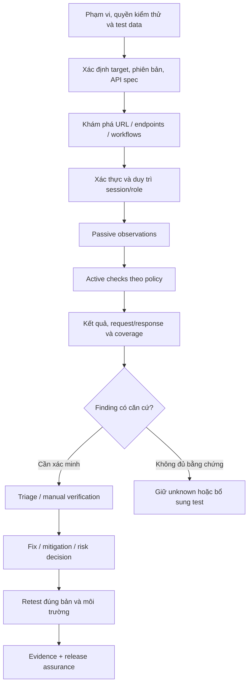
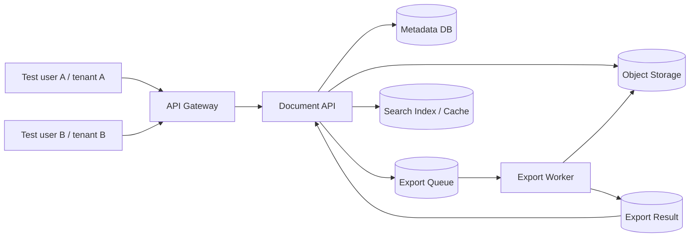
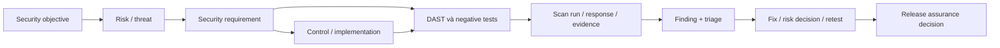

# DAST là gì

Một nền tảng SaaS xử lý tài liệu cho nhiều tổ chức triển khai phiên bản mới của API tìm kiếm và xuất dữ liệu. Nhóm phát triển đã chạy unit test, code review và static analysis. Sau khi service được triển khai trên môi trường staging, một công cụ kiểm thử gửi các HTTP request tới ứng dụng đang chạy, quan sát response, cookie, header và những dấu hiệu xử lý đầu vào không an toàn. Công cụ phát hiện một endpoint trả thông tin lỗi quá chi tiết và một cookie thiếu thuộc tính bảo vệ theo chính sách. Nhưng công cụ không tự nhận ra rằng tài khoản của tenant B có thể dùng đường export để lấy tài liệu tenant A, vì không có hai tài khoản, dữ liệu mẫu và luồng nghiệp vụ tương ứng.

Ví dụ này cho thấy cả **giá trị** lẫn **giới hạn** của **DAST**. Nó có thể giúp phát hiện các biểu hiện lỗ hổng ở ứng dụng đang chạy mà không cần đọc mã nguồn, nhưng độ tin cậy và độ bao phủ phụ thuộc vào môi trường, phạm vi endpoint, phiên đăng nhập, test data, cấu hình công cụ và cách người đánh giá xác minh findings.

**DAST** là viết tắt của **Dynamic Application Security Testing** — *kiểm thử bảo mật ứng dụng bằng cách tương tác với ứng dụng trong khi nó đang chạy*. DAST gửi request hoặc thực hiện các hành động như một client, quan sát response và hành vi, rồi phân tích xem ứng dụng có biểu hiện của lỗ hổng hay vi phạm chính sách bảo mật hay không. Nhiều công cụ DAST hoạt động theo cách **black-box**, nghĩa là không cần mã nguồn để thực hiện kiểm thử; một số giải pháp kết hợp thông tin đăng nhập, đặc tả API và hiểu biết kiến trúc để tăng độ bao phủ.

Trong module **SECURITY_SECURITY_ASSURANCE**, DAST là một phương pháp thu thập bằng chứng cho mục tiêu **đánh giá có căn cứ rằng hệ thống đáp ứng các yêu cầu và security controls**. Kết quả DAST cần được đặt trong chuỗi **risk → security requirement → control → phép kiểm thử → evidence → finding/remediation → quyết định assurance**, chứ không chỉ là báo cáo có bao nhiêu cảnh báo.

## 1. DAST kiểm tra điều gì?

DAST kiểm tra **hành vi quan sát được** tại những điểm giao tiếp với ứng dụng hoặc dịch vụ đang hoạt động. Với một ứng dụng web/API, DAST thường tương tác thông qua HTTP(S), session, form, URL, request body, header, tham số truy vấn hoặc các quy trình nghiệp vụ có thể mô phỏng.

Những câu hỏi DAST có thể hỗ trợ trả lời gồm:

- Khi nhận đầu vào bất thường, ứng dụng phản hồi thế nào?
- Có hành vi cho thấy dữ liệu được đưa vào một ngữ cảnh xử lý nguy hiểm không?
- Endpoint có để lộ thông tin debug, cấu hình, phiên bản hoặc dữ liệu không cần thiết không?
- Cookie và một số HTTP security headers có được thiết lập phù hợp chính sách không?
- Một số endpoint có cho phép truy cập khi chưa xác thực không?
- Session có hoạt động và bị thu hồi như dự kiến trong các trường hợp được kiểm thử không?
- Giao diện và API có lộ các điểm vào ngoài danh sách đã biết không?
- Các control có hoạt động trên phiên bản và cấu hình của môi trường kiểm thử không?

Kết quả của một phép thử phải được diễn giải **trong giới hạn của request, session, dữ liệu và môi trường đã dùng**. Ví dụ, việc một request bị từ chối không chứng minh mọi request trái quyền khác đều bị chặn.

### 1.1. DAST không cần thấy source code, nhưng cần biết bối cảnh

Một scanner có thể quan sát rằng request dẫn tới thông báo lỗi đáng ngờ. Tuy nhiên, để biết đó là lỗ hổng thực sự hay lỗi xử lý thông thường, người đánh giá có thể cần đối chiếu log, cấu hình, mã nguồn hoặc test nghiệp vụ.

DAST không nhất thiết hoàn toàn “mù” với ứng dụng. Nhóm thường cung cấp:

- **Base URL** và danh sách host được phép;
- **API specification** như OpenAPI để biết những endpoint và tham số;
- **Tài khoản thử nghiệm** theo vai trò, tenant hoặc scope;
- **Workflow đăng nhập** và cách duy trì session;
- **Test data** với quyền sở hữu rõ ràng;
- **Danh sách chức năng được phép kiểm tra** và mức độ tác động cho phép;
- **Tiêu chí bảo mật** để đối chiếu kết quả;
- **Thông tin phiên bản** của artifact/config đang chạy.

DAST được tăng bối cảnh vẫn là kiểm thử động, vì bằng chứng chính đến từ **hành vi của hệ thống đang thực thi**.

## 2. So sánh DAST với SAST, SCA, IAST và pentest

Các phương pháp kiểm thử bảo mật bổ trợ cho nhau. Chọn đúng kỹ thuật phụ thuộc loại rủi ro cần đánh giá.

| Phương pháp | Quan sát gì? | Điểm mạnh | Giới hạn đáng chú ý |
| --- | --- | --- | --- |
| **SAST** (*Static Application Security Testing*) | Mã nguồn hoặc biểu diễn tĩnh, không cần thực thi ứng dụng đầy đủ | Phát hiện mẫu lỗi sớm, dẫn tới vị trí code; hữu ích ở PR | Có thể thiếu hành vi runtime, cấu hình thật và luồng nghiệp vụ |
| **DAST** | Hành vi của ứng dụng đang chạy qua điểm vào được phép | Thấy response và control thực tế ở các đường được thử; không nhất thiết cần source | Có thể không tới endpoint ẩn hoặc business flow phức tạp; khó xác định root cause |
| **SCA** (*Software Composition Analysis*) | Thành phần/dependency và advisory đã biết | Nhận diện version/rủi ro supply chain | Không chứng minh dependency đang bị khai thác hay API ứng dụng có lỗi |
| **IAST** (*Interactive Application Security Testing*) | Thông tin trong ứng dụng khi chạy kết hợp request/test | Thêm ngữ cảnh code path/dataflow; có thể giảm khoảng trống quan sát | Phụ thuộc instrumented runtime, độ bao phủ traffic và chi phí vận hành |
| **Manual penetration testing** | Tình huống tấn công và chuỗi hành vi do chuyên gia thiết kế trong phạm vi được phép | Phát hiện logic lỗi, kết hợp nhiều điều kiện và đánh giá tác động | Phụ thuộc phạm vi/thời gian/kỹ năng; không phải kiểm chứng mọi đường |
| **Security integration/negative tests** | Kịch bản cụ thể do nhóm chủ động viết | Dễ kiểm tra quyền, tenant và quy tắc nghiệp vụ có đầu ra rõ | Chỉ bao phủ những kịch bản đã thiết kế |

**Không thể thay thế SAST bằng DAST hoặc ngược lại.** SAST có thể tìm chuỗi dữ liệu nguy hiểm trong code nhưng không biết môi trường deploy; DAST có thể quan sát header/cookie hoặc hành vi lỗi nhưng không tự thấy mọi nhánh code; manual testing có thể phát hiện IDOR/BOLA từ workflow mà crawler không suy ra được.

### 2.1. Ví dụ cùng một yêu cầu qua nhiều phương pháp

**Yêu cầu:** `SR-AUTH-017` — chỉ người dùng được cấp quyền mới được đọc tài liệu, không có truy cập chéo tenant.

- **SAST:** phát hiện những lời gọi repository không thể hiện tenant context trong các module đã xác định; cần review ngữ nghĩa.
- **DAST:** gửi request từ phiên không có quyền tới tài liệu đã biết của tenant khác và quan sát response, khi scan được cung cấp đúng tài khoản/fixture.
- **Integration test:** chuẩn bị hai tenant, hai người dùng, tài liệu thuộc tenant A; xác nhận user B không nhận metadata/nội dung qua API đọc, tải và export.
- **Pentest:** xem xét các đường gián tiếp như link chia sẻ, cache, worker và kết hợp quyền.
- **Assurance review:** tổng hợp các bằng chứng, kiểm tra phạm vi còn thiếu, findings và quyết định rủi ro.

Kết quả “DAST passed” mà không có thông tin tài khoản tenant B và test object tenant A **không đủ** để chứng minh yêu cầu trên.

## 3. DAST hoạt động như thế nào?

DAST thường gồm **khám phá bề mặt ứng dụng**, **thiết lập bối cảnh phiên**, **kiểm tra thụ động**, **gửi phép thử chủ động trong phạm vi được phép**, **phân tích response**, sau đó **triage và retest**.



Không phải mọi scanner đều dùng chính xác thứ tự này. Với một API-only service, có thể bắt đầu từ OpenAPI specification thay vì crawler; với single-page application có thể cần trình duyệt tự động; với service không có UI, các test ở mức API có thể mang lại độ bao phủ tốt hơn việc quét trang web.

### 3.1. Bước 1 — Khai báo target và kiểm soát phạm vi

Ví dụ target được phê duyệt là `https://staging.example.test` và các API thuộc `/api/documents/*`. Nhóm phải xác định những domain, path, method, thông tin đăng nhập và mức tần suất được phép.

Phạm vi nên nêu rõ:

- Môi trường staging hay production; chủ sở hữu và quyền cho phép;
- Mức kiểm thử thụ động/chủ động; giới hạn tốc độ và song song;
- URL/host được phép, redirect và các host bên ngoài bị loại trừ;
- Endpoint có thể tạo giao dịch, gửi email, xóa dữ liệu hoặc phát sinh chi phí;
- Cách cô lập test data, tenant, webhook, queue và downstream;
- Điểm liên hệ và quy tắc dừng khi hệ thống không ổn định;
- Cách quản lý log, báo cáo và dữ liệu nhạy cảm thu được.

**Không tiến hành active scanning trên hệ thống không thuộc quyền kiểm thử hoặc ngoài phạm vi được phê duyệt.** Ngay cả một scanner phổ biến cũng có thể gây thay đổi trạng thái hoặc tải đáng kể.

### 3.2. Bước 2 — Khám phá attack surface

Scanner cần biết các điểm vào. Cách khám phá gồm:

- Theo liên kết từ giao diện;
- Đọc biểu mẫu, tham số, JavaScript và các route được client sử dụng;
- Nhập danh sách endpoint hoặc OpenAPI specification;
- Ghi nhận traffic hợp lệ từ browser/proxy;
- Cung cấp workflow cho chức năng cần đăng nhập;
- Xem những URL hoặc service có cùng cơ chế xác thực.

Một crawler không nhìn thấy endpoint không liên kết từ UI, API chỉ dùng bởi mobile app hoặc route xuất hiện khi tài khoản có role khác. Nếu phần khám phá yếu, kết quả quét có thể rất ít findings dù hệ thống có lỗ hổng.

### 3.3. Bước 3 — Duy trì bối cảnh xác thực

Một DAST scan không đăng nhập thường chỉ kiểm tra trang công khai và những API trả `401` hoặc redirect về login. Để kiểm tra chức năng nội bộ cần test account với:

- Role và permission rõ ràng;
- Dữ liệu tài khoản được cấp phép;
- Session/cookie hoặc token hợp lệ;
- Cách refresh/renew phiên khi hết hạn;
- CSRF token hoặc workflow đăng nhập nếu ứng dụng yêu cầu;
- Quy tắc phát hiện đăng xuất bất ngờ;
- Tách biệt các phiên khi kiểm tra nhiều role/tenant.

Nếu scanner mất session giữa chừng, nó có thể quét hàng trăm response login và vẫn báo “scan completed”. Cần kiểm tra **authentication health** và coverage thực tế, không chỉ trạng thái job.

### 3.4. Bước 4 — Kiểm thử và quan sát

Scanner có thể ghi nhận header, cookie, response, cách xử lý input và các dấu hiệu bất thường. Với active scan, công cụ có thể gửi các request biến đổi trong phạm vi được phép rồi so sánh kết quả với baseline. Việc gửi request biến đổi có thể làm thay đổi dữ liệu hoặc tải hệ thống nên phải đánh giá trước tác động.

### 3.5. Bước 5 — Xác minh finding và lưu evidence

Một finding hữu ích cần có: **endpoint, method, request/response đã được xử lý thông tin nhạy cảm, rule/plugin ID, thời điểm, severity/confidence, session/role, phiên bản service, môi trường và bước xác minh an toàn**.

Một response lỗi bất thường có thể do WAF, rate limit, trạng thái ứng dụng hoặc dữ liệu thiếu; không nên tự coi mọi sai khác response là khai thác thành công.

## 4. Passive scanning và active scanning

Đây là sự phân biệt quan trọng vì **mức tác động và yêu cầu phê duyệt** khác nhau.

| Đặc điểm | Passive scanning | Active scanning |
| --- | --- | --- |
| Cách tiếp cận | Quan sát traffic/response sẵn có, phân tích đặc điểm | Chủ động gửi request hoặc biến đổi tham số để kiểm tra |
| Ví dụ nội dung | Cookie attributes, security headers, thông tin lỗi trong response, dữ liệu truyền tải qua HTTP | Kiểm tra hành vi xử lý đầu vào và những bất thường tại endpoint |
| Tác động lên ứng dụng | Thường ít tác động hơn nếu chỉ quan sát traffic đã có | Có thể tạo tải, thay đổi trạng thái hoặc kích hoạt xử lý tốn tài nguyên |
| Coverage | Phụ thuộc traffic được quan sát | Phụ thuộc endpoint khám phá, policy và kịch bản được thực hiện |
| Thích hợp | Quan sát và kiểm tra cấu hình phản hồi | Kiểm chứng một số lớp lỗ hổng ở hệ thống test được phê duyệt |
| Hạn chế | Không phát hiện vấn đề cần chủ động gửi input khác | Có false positives/negatives và rủi ro vận hành |

**Passive scan không có nghĩa toàn bộ quá trình khám phá là thụ động**: crawler có thể vẫn gửi request, và request GET có thể gây tác dụng phụ nếu ứng dụng thiết kế sai. Cần phân biệt **chính hoạt động thu thập traffic** với **bước phân tích thụ động** trên traffic.

### 4.1. Cấu hình mức tác động theo môi trường

- **Môi trường test/staging cô lập:** có thể cho phép nhiều phép kiểm tra chủ động hơn với dữ liệu giả lập.
- **Môi trường shared staging:** cân nhắc ảnh hưởng tới nhóm khác, queue, email sandbox và upstream.
- **Production:** chỉ thực hiện phép kiểm được owner phê duyệt; ưu tiên quan sát an toàn, kiểm tra giới hạn tần suất và phương án dừng. Một số phép thử không phù hợp để chạy tự động.
- **Hệ thống của vendor:** phạm vi kiểm thử do hợp đồng/quyền cho phép quy định; không mặc định được active scan chỉ vì tổ chức có tài khoản người dùng.

**Giới hạn tần suất, thời gian và phạm vi** là một security control của chính quy trình kiểm thử, không chỉ là tùy chọn hiệu năng.

## 5. DAST có thể phát hiện những nhóm vấn đề nào?

Khả năng cụ thể phụ thuộc công cụ, rule và bối cảnh được cung cấp. DAST thường hữu ích với một số dấu hiệu ở lớp web/API:

| Nhóm vấn đề | Dấu hiệu hoặc phép kiểm tra | Giới hạn cần giải thích |
| --- | --- | --- |
| **Input handling / injection** | Một số phản hồi bất thường khi tham số được xử lý | Không tự chứng minh mọi biến thể injection; cần triage kỹ |
| **Thông tin lỗi bị lộ** | Stack trace, chi tiết hệ thống hoặc dữ liệu không cần thiết trong response | Có thể là môi trường debug, chưa chắc tồn tại trên production |
| **HTTP headers** | Thiếu/sai header cần thiết theo chính sách | Header phù hợp phụ thuộc loại nội dung và luồng ứng dụng |
| **Cookie/session settings** | Thuộc tính Secure, HttpOnly, SameSite và phạm vi cookie | Cần hiểu bối cảnh trình duyệt, HTTPS và session |
| **Authentication workflows** | Một số endpoint chưa đăng nhập vẫn trả nội dung | Có thể là tài nguyên được công khai có chủ đích |
| **TLS/certificate-related observations** | Cấu hình kết nối tại endpoint được phép kiểm tra | Scanner không chứng minh mọi hop nội bộ dùng TLS đúng |
| **Redirect và URL handling** | Một số redirect ngoài dự kiến hoặc xử lý URL bất thường | Cần xác minh tác động và chính sách URL |
| **Exposure of sensitive information** | Response chứa thông tin nhạy cảm trong các test case | Không chứng minh mọi loại dữ liệu đều được bảo vệ |
| **Một số lỗi cấu hình** | Trang debug, endpoint kiểm tra, danh mục truy cập được | Không thay thế configuration/IaC review toàn hệ thống |
| **Một số lỗi authorization** | Request trái quyền có dữ liệu mẫu rõ trả thông tin | Scanner tổng quát thường thiếu logic tenant/role để đánh giá đầy đủ |

Những vấn đề như **business logic authorization, multi-tenant isolation, race condition, workflow abuse, server-side permissions và xử lý bất đồng bộ** thường cần test case chuyên biệt hoặc review bổ sung. Trạng thái “không có finding” ở một công cụ không bảo đảm tất cả các nhóm đó an toàn.

### 5.1. DAST không bảo đảm phát hiện SQL Injection

DAST có thể kiểm tra biểu hiện bất thường ở đầu vào SQL, nhưng độ chính xác phụ thuộc endpoint, dữ liệu, lỗi trả về, query behavior và control. Nếu không có response khác biệt hoặc đường thực thi không được chạm tới, scanner có thể không phát hiện. SAST, review truy vấn, test tham số hóa và negative tests giúp bổ sung căn cứ.

### 5.2. DAST không tự đánh giá đầy đủ Authorization

Một endpoint trả `200` cho tài khoản đã đăng nhập không có nghĩa authorization đúng. Với BOLA/IDOR, scanner cần biết **đối tượng nào thuộc người nào** và **khi nào truy cập là trái quyền**. Không có dữ liệu về owner/tenant, công cụ không thể luôn phân biệt response hợp lệ với lộ dữ liệu.

### 5.3. DAST và lỗ hổng dependency

Nếu một dependency có CVE nhưng đường mã lỗi chưa bị kích hoạt trong scan, DAST có thể không thấy. **SCA/SBOM** tốt hơn cho việc đối chiếu version với advisory; DAST có thể bổ sung kiểm chứng hành vi trong một phạm vi được phép. Ngược lại, SCA báo phiên bản bị ảnh hưởng không tự chứng minh endpoint đang khai thác được.

## 6. Ví dụ xuyên suốt: DAST với SaaS nhiều tenant

Giả sử dịch vụ `document-api` phục vụ hai tenant A và B, có:

- `POST /api/documents`: tạo tài liệu;
- `GET /api/documents/{id}`: đọc metadata;
- `GET /api/documents/{id}/download`: tải nội dung;
- `POST /api/documents/export`: tạo job export;
- `GET /api/exports/{id}`: theo dõi và nhận kết quả export;
- `GET /api/documents/search`: tìm kiếm;
- worker bất đồng bộ và object storage.

Tài khoản `user-a` thuộc tenant A; `user-b` thuộc tenant B. Tài liệu `doc-a` thuộc A và `doc-b` thuộc B. Cả hai tài khoản là **test identities được cấp phép**, dùng với dữ liệu giả lập.

### 6.1. Security objective và threat scenario

**Objective `OBJ-DATA-01`:** Không lộ dữ liệu giữa tenant.

**Threat scenario `RISK-AUTH-09`:** User B sử dụng một object ID hoặc export job ID thuộc A để đọc metadata, tải file hoặc lấy kết quả export, do API/worker không kiểm tra quyền theo đối tượng.

**Security requirement `SR-AUTH-017`:**

> Mọi đường đọc, tải và xuất tài liệu phải xác minh principal được xác thực có quyền đối với đối tượng và tenant; request không được phép không được trả dữ liệu cần bảo vệ.

### 6.2. Những phép thử cần thiết

| Test ID | Session | Request hoặc hành vi | Kết quả cần xác nhận |
| --- | --- | --- | --- |
| `TC-DAST-01` | User A | Đọc `doc-a` | Truy cập hợp lệ theo chính sách |
| `TC-DAST-02` | Không đăng nhập | Đọc `doc-a` | Bị từ chối theo hợp đồng API |
| `TC-DAST-03` | User B | Đọc `doc-a` | Bị từ chối; không lộ metadata nhạy cảm |
| `TC-DAST-04` | User B | Tải nội dung `doc-a` | Không trả file hoặc URL có thể dùng để lấy file |
| `TC-DAST-05` | User B | Tạo export chứa `doc-a` | Từ chối hoặc không xuất tài liệu ngoài quyền |
| `TC-DAST-06` | User B | Xem kết quả job export của A | Không truy cập được kết quả trái quyền |
| `TC-DAST-07` | User A/B | Tìm kiếm cùng từ khóa và kiểm tra cache | Không trả kết quả của tenant khác |
| `TC-DAST-08` | Tài khoản đã thu hồi quyền | Thử truy cập sau sự kiện thu hồi | Hành vi phù hợp thời hạn thu hồi đã quy định |

Các phép thử này có thể được **automation harness** thực hiện bằng request động, nhưng một scanner DAST tổng quát không tự tạo đầy đủ khi không có test identities, fixture và logic kỳ vọng. Cần ghi rõ phép thử nào do scanner sinh, phép thử nào do nhóm thiết kế riêng.

### 6.3. Ví dụ HTTP request an toàn trong môi trường được phép

Ví dụ minh họa với service test chạy tại `http://localhost:8080`. Các token là **dữ liệu giả** của tài khoản thử nghiệm. Không gửi request tới hệ thống thực ngoài phạm vi đã cho phép.

```bash
# User A: đọc đối tượng thuộc tenant A trong test fixture.
curl -i \
  -H "Authorization: Bearer $TEST_TOKEN_A" \
  "http://localhost:8080/api/documents/doc-a"

# User B: cùng đối tượng doc-a, phải bị từ chối theo API contract.
curl -i \
  -H "Authorization: Bearer $TEST_TOKEN_B" \
  "http://localhost:8080/api/documents/doc-a"
```

Các placeholder `doc-a` và token cần thay bằng fixture hợp lệ trên hệ thống thử nghiệm. Nếu `doc-a` không tồn tại, một response `404` ở cả hai trường hợp không chứng minh phân quyền đúng. Cần positive control: tài khoản A được phép truy cập, tài khoản B không được. Hệ thống có thể chọn `403` hoặc `404` cho truy cập trái quyền; tiêu chí phải phù hợp hợp đồng API và chính sách chống lộ thông tin.

### 6.4. Vì sao cùng một status code chưa đủ?

Giả sử request của user B trả `403` nhưng response body vẫn chứa tên hoặc nhãn tài liệu A. Đó vẫn có thể là lộ dữ liệu. Ngược lại, API trả `404` có thể đúng nếu policy muốn không tiết lộ sự tồn tại của đối tượng.

Test phải xem **status, body, headers, URL được sinh, side effects, audit event và tài nguyên phát sinh** khi phù hợp. Nếu job export được tạo bất đồng bộ, chỉ kiểm tra response ban đầu `202 Accepted` là chưa đủ: cần theo dõi job đến kết quả, bảo đảm không xuất dữ liệu ngoài quyền.

### 6.5. Đường đồng bộ và bất đồng bộ



DAST tại API gateway có thể quan sát hành vi phía ngoài, nhưng kiểm tra sâu cần biết worker dùng identity nào, job được xác minh ra sao và quyền tới object storage. Đây là nơi kết hợp **DAST có kịch bản**, integration test, kiến trúc security review và kiểm tra cấu hình runtime.

## 7. Quét ứng dụng có đăng nhập: những khó khăn phổ biến

### 7.1. Phiên hết hạn làm sai coverage

Nếu session hết hạn giữa quá trình quét, công cụ có thể nhận trang login cho mọi endpoint và kết luận nhầm là các path đều được kiểm tra. Nên dùng một endpoint/session check được phép để theo dõi trạng thái xác thực; nếu hết phiên, gia hạn an toàn hoặc ghi scan là partial.

### 7.2. Một tài khoản không đại diện mọi vai trò

Admin, nhân viên, support, user thông thường và service account có quyền khác nhau. Cần xác định role matrix và test theo quyền. Không dùng tài khoản admin duy nhất rồi tuyên bố đã kiểm tra authorization: admin có thể truy cập hợp lệ những thứ user thường không được phép.

### 7.3. CSRF token và quy trình nhiều bước

Form có CSRF token hoặc session-specific nonce cần workflow hợp lệ. Nếu scanner dùng token cũ, request bị từ chối ở lớp đầu vào và không đi tới hành vi cần kiểm tra. Phải phân biệt **bị chặn bởi anti-CSRF** với **đã kiểm tra an toàn của chức năng phía sau**.

### 7.4. MFA, CAPTCHA và identity provider bên ngoài

DAST cần cơ chế đăng nhập được tổ chức cho phép, ví dụ tài khoản test với luồng xác thực phù hợp hoặc access token ngắn hạn do môi trường test cấp. Không nên phá hoặc vô hiệu hóa các control production chỉ để scanner đăng nhập dễ hơn. Nếu môi trường test dùng luồng đặc biệt, phải ghi rằng kết quả **không bao phủ trọn vẹn login production flow**.

### 7.5. Token và secret trong báo cáo

Scan logs và request/response có thể chứa cookie, bearer token, thông tin cá nhân và dữ liệu giả nhạy cảm. Cần bảo vệ scanner credentials, redact token khi lưu bằng chứng, giới hạn người xem và áp retention. Tránh đưa token production vào cấu hình được commit trong repository.

## 8. DAST với REST API, GraphQL, SPA và WebSocket

DAST truyền thống theo hyperlink có thể không đủ đối với ứng dụng hiện đại.

### 8.1. REST API

Một API không có trang HTML để crawler điều hướng. Cần dùng **OpenAPI specification**, danh sách endpoint, dữ liệu thử và workflow. Review độ đầy đủ của spec so với route thực tế: endpoint nội bộ hoặc deprecated có thể không được liệt kê.

Quan tâm các phương thức có side effects như `POST`, `PUT`, `PATCH`, `DELETE`. Các request này cần dữ liệu thử cô lập và kế hoạch cleanup; không quét tự động lên giao dịch thật.

### 8.2. GraphQL

Nhiều thao tác đi qua một endpoint, nên coverage chỉ tính theo URL rất dễ gây hiểu nhầm. Cần đánh giá **operation, field, resolver, identity, object và quyền truy cập**, kể cả query lồng nhau và giới hạn tài nguyên. Một scanner chỉ thấy `POST /graphql` không có nghĩa đã kiểm tra mọi resolver.

### 8.3. Single-page application (SPA)

Các route và request có thể được sinh động bởi JavaScript. Công cụ có browser automation hoặc traffic recording có thể thu thập nhiều điểm vào hơn crawler tĩnh. Nhưng một UI flow cần thao tác đặc biệt, feature flag hoặc quyền riêng vẫn có thể bị bỏ sót.

### 8.4. WebSocket và giao thức ngoài HTTP thông thường

Một phần workflow có thể chuyển qua WebSocket, gRPC hoặc message queue. Không phải scanner DAST web nào cũng hỗ trợ đầy đủ. Cần đánh giá công cụ theo giao thức và bổ sung test harness chuyên biệt hoặc kiểm thử tích hợp cho những đường mà scanner không quan sát được.

### 8.5. Những API không được liệt kê

Shadow API, endpoint cũ còn hoạt động hoặc route từ mobile client có thể không nằm trong spec. Việc đối chiếu **API gateway routes, service inventory, telemetry và API spec** giúp tìm khoảng trống, nhưng telemetry cũng có giới hạn. DAST chỉ kiểm tra những điểm vào nó biết hoặc khám phá được.

## 9. Lập kế hoạch DAST có thể đo được coverage

Một scan có số request lớn chưa chắc có coverage tốt. Cần định nghĩa **coverage của phạm vi thử nghiệm**, không đánh đồng số URL với số security requirement đã kiểm chứng.

### 9.1. Một coverage matrix minh họa

| Khu vực | Mức ưu tiên | Có trong scan? | Loại kiểm chứng | Khoảng trống |
| --- | --- | --- | --- | --- |
| Login / session | Cao | Có | Passive + workflow checks | Thu hồi session cần test riêng |
| Metadata API | Cao | Có | Active checks và negative authorization | Cần fixture tenant A/B |
| Download URL | Cao | Có một phần | Response và URL lifetime checks | Chưa kiểm tra sharing policy |
| Export worker | Rất cao | Chưa đủ | Business workflow test | Scanner chỉ quan sát request ban đầu |
| Search/cache | Cao | Có một phần | Authenticated requests | Cần cache hit/miss giữa tenant |
| Admin API | Rất cao | Chưa | Role-specific test | Chưa có tài khoản test được phê duyệt |
| Public help pages | Thấp | Có | Passive scan | Độ ưu tiên thấp hơn API dữ liệu |

Cần nêu rõ **lý do** endpoint bị loại: không thuộc scope, không thể quét an toàn, scanner không hỗ trợ hay thiếu fixture. Những trường hợp khác nhau cần quyết định tiếp theo khác nhau.

### 9.2. Chất lượng test data

Dữ liệu thử cần đại diện cho security objectives:

- Có ít nhất một đối tượng hợp lệ và một đối tượng trái quyền cho test authorization;
- Có các role khác nhau theo chính sách;
- Có tài liệu/metadata nhạy cảm giả lập để xác định lộ dữ liệu;
- Có workflow thành công trước khi kiểm tra workflow bị cấm;
- Có dữ liệu cleanup được, không tạo side effects khó đảo ngược;
- Có dữ liệu cho trạng thái token hết hạn, quyền bị thu hồi và job đang chạy nếu đó là mục tiêu test.

Nếu scanner được cho một database trống, nhiều endpoint có thể trả `404` và không bao giờ thực hiện logic quan trọng, dẫn tới false negative trong suy luận coverage.

### 9.3. Dữ liệu giả lập và bảo vệ môi trường

Dùng test tenant, test email sink, mock downstream khi cần, storage riêng và quotas phù hợp. Nếu hệ thống thử nghiệm kết nối dịch vụ bên ngoài, cần bảo đảm không gửi dữ liệu hay request có ảnh hưởng ngoài phạm vi được phép.

## 10. Triển khai DAST an toàn trong CI/CD

DAST có thể chạy theo những mức khác nhau:

- **Smoke security checks:** phép thử ngắn, ít tác động, kiểm tra endpoint quan trọng sau deploy.
- **PR/preview environment scan:** kiểm tra thay đổi trong môi trường riêng được dựng cho nhánh.
- **Nightly hoặc scheduled deep scan:** phạm vi rộng hơn trên môi trường được thiết kế cho active testing.
- **Pre-release scan:** gắn kết quả với release candidate và policy gate.
- **Post-deploy verification:** phép kiểm an toàn để xác nhận artifact/config mới có hành vi dự kiến.
- **Manual workflow testing:** các kịch bản khó tự khám phá, đặc biệt phân quyền và logic nghiệp vụ.

Mỗi cấp độ phải nêu **độ bao phủ và điều kiện an toàn**, không dùng kết quả smoke scan để thay cho deep scan.

### 10.1. Pipeline logic minh họa

```yaml
# Mẫu kiến trúc pipeline, không phải cấu hình chạy trực tiếp của một CI product.
dynamic_security_testing:
  target:
    environment: "<approved-staging-environment>"
    release_id: "<release-id>"
    artifact_digest: "sha256:<digest>"
    base_url: "<approved-url>"
  prerequisites:
    - "authorized-scope-reviewed"
    - "test-accounts-and-fixtures-ready"
    - "data-reset-or-cleanup-defined"
    - "traffic-limits-approved"
    - "stop-contact-and-rollback-defined"
  discovery:
    api_spec_ref: "<openapi-ref>"
    authenticated_workflow_ref: "<workflow-ref>"
    allowed_paths: ["<allowed-paths>"]
    excluded_paths: ["<excluded-paths-with-reason>"]
  scans:
    passive: true
    active: "<enabled-only-if-authorized>"
    rate_limit: "<approved-limit>"
  evaluation:
    required_coverage: "<requirements-and-flows>"
    on_scan_failure: "BLOCK_OR_NEEDS_REVIEW"
    on_missing_authentication: "NEEDS_REVIEW"
    on_unaccepted_high_risk_finding: "BLOCK"
  evidence:
    scan_run_id: "<run-id>"
    policy_version: "<policy-version>"
    report_ref: "<report-ref>"
    retest_refs: ["<test-run-ids>"]
```

Không đặt token hoặc password thật trong tệp policy. Secrets nên được cấp qua cơ chế quản lý credentials của môi trường CI phù hợp, hạn chế quyền và thời gian hiệu lực, đồng thời tránh đưa vào log/artifacts.

### 10.2. Release gate cần phân biệt bốn trạng thái

| Tình huống | Kết quả phù hợp |
| --- | --- |
| Scan đã chạy đủ phạm vi yêu cầu, không có finding vượt ngưỡng chưa xử lý | Có thể `PASS` **cho tiêu chí DAST cụ thể** |
| Scanner lỗi, timeout, mất session hoặc chỉ quét một phần | `INCOMPLETE` / `NEEDS_REVIEW`, không tự ghi `PASS` |
| Có finding rủi ro cao được xác nhận, chưa xử lý | `BLOCK` theo policy |
| Có rủi ro còn lại với ngoại lệ đã được phê duyệt đúng thẩm quyền | `CONDITIONAL_APPROVAL` khi policy cho phép, có hạn và control bù |

Một gate có thể yêu cầu **DAST + SAST + SCA + security regression + kiến trúc review** trước release. DAST chỉ là một nguồn evidence; việc đạt một gate không tự chứng minh mọi mục tiêu bảo mật đều đạt.

### 10.3. Không để kết quả scan tách rời artifact

Giả sử DAST kiểm tra staging với image digest `sha256:A`, nhưng production deploy image `sha256:B`. Nếu B khác A ở code hoặc cấu hình liên quan, bằng chứng DAST không tự áp dụng cho B. Cần bảo đảm cơ chế build/promote đáng tin và đối chiếu release artifact, environment configuration.

Nếu scan diễn ra sau khi deploy, phải lưu thời điểm, phiên bản đang chạy và thay đổi cấu hình trong lúc scan. Kết quả DAST không phải thuộc tính bất biến của một repository; nó phụ thuộc **trạng thái đang thực thi**.

## 11. Một finding DAST nên được triage như thế nào?

Đầu ra scanner là **finding candidate**. Quy trình tiếp theo cần xác minh tính áp dụng và mức rủi ro.

### 11.1. Các bước triage

1. Xác nhận endpoint/method, tài khoản, request/response và môi trường đúng.
2. Kiểm tra thông tin nhạy cảm đã được redact trong evidence.
3. Xem công cụ báo dấu hiệu gì, rule/plugin hoạt động theo cơ chế nào.
4. Phân biệt lỗi ứng dụng với WAF/proxy, caching, rate limit hoặc dữ liệu test.
5. Xác định ảnh hưởng tới confidentiality, integrity, availability và người dùng/tenant nào.
6. Tái kiểm tra an toàn với dữ liệu giả lập, đúng phạm vi đã cho phép.
7. Đối chiếu code, config, logs hoặc review kiến trúc nếu cần.
8. Ghi kết quả `CONFIRMED`, `FALSE_POSITIVE`, `INCONCLUSIVE` hoặc trạng thái phù hợp.
9. Nếu có rủi ro, giao owner, ưu tiên, SLA, khắc phục và retest.
10. Chỉ đóng khi bằng chứng xử lý đủ phạm vi hoặc có quyết định rủi ro hợp lệ.

### 11.2. False positive, false negative và unknown

- **False positive:** scanner cảnh báo, nhưng review có căn cứ chứng minh mẫu không gây vi phạm trong phạm vi.
- **False negative:** lỗ hổng tồn tại trong trường hợp thực tế nhưng scanner không phát hiện.
- **Unknown/untested:** scanner không kiểm tra hoặc không đủ dữ liệu để kết luận.

Không nên gọi `UNKNOWN` là `FALSE_POSITIVE` chỉ vì chưa tái hiện được. Với các finding cần đăng nhập hoặc luồng nhiều bước, thiếu test data rất dễ làm đánh giá bị thiếu.

### 11.3. Finding khác với proof of exploitation

Một số scanner dựa vào signature, differential behavior hoặc heuristic. Kết quả cần được đối chiếu mức confidence; không nên viết báo cáo như thể đã chiếm được hệ thống nếu công cụ chỉ quan sát một chuỗi lỗi đáng ngờ.

Đồng thời, không nên yêu cầu chứng minh khai thác hoàn toàn trước khi xử lý mọi finding. Với rủi ro rõ và nghiêm trọng, evidence kỹ thuật về điều kiện lỗ hổng có thể đủ để kích hoạt remediation, containment hoặc review khẩn theo chính sách.

## 12. Khắc phục và kiểm chứng lại sau DAST

Một finding phải được liên kết với **yêu cầu bảo mật**, **control cần sửa**, **artifact/config** và **kết quả retest**.

Ví dụ finding cho thấy endpoint metadata trả thông tin lỗi chi tiết khi input không hợp lệ:

- **Requirement:** không để lộ chi tiết implementation hoặc dữ liệu nhạy cảm ngoài phạm vi cần thiết.
- **Finding:** error response chứa thông tin nội bộ theo request test xác định.
- **Root cause giả định:** exception handler đưa stack trace ra HTTP response trong một profile cấu hình.
- **Fix:** điều chỉnh exception handling và cấu hình, giữ correlation ID để điều tra nội bộ.
- **Test:** request đã tạo finding nay chỉ trả thông điệp phù hợp, log nội bộ vẫn đủ dữ liệu điều tra và không chứa secret.
- **Evidence:** PR/config version, test run, DAST retest, artifact digest và deployment record.
- **Closure:** người có trách nhiệm đánh giá kết quả và xác nhận phạm vi.

### 12.1. Phân biệt fix merged với verified remediation

| Mốc | Giá trị chứng minh |
| --- | --- |
| PR được tạo | Có phương án sửa |
| PR được review/merge | Source đã thay đổi có review |
| CI build và tests pass | Một số tiêu chí đạt trong môi trường test |
| Retest trên artifact mới đạt | Dấu hiệu lỗi gốc không còn trong bài thử |
| Artifact/config được deploy | Bản thay đổi có mặt tại môi trường được ghi |
| Retest/verification trên scope đích hoàn tất | Có căn cứ kết luận remediation trong phạm vi |

Nếu production vẫn chạy image cũ, không thể tự đóng finding trên toàn production chỉ vì DAST scan của staging đã sạch.

### 12.2. Kết hợp DAST với regression tests bền vững

Khi scanner phát hiện một lỗ hổng có thể tái hiện, nên bổ sung **automated security regression test** mô tả chính xác điều kiện lỗi. Những test chủ đích này thường ổn định và dễ giải thích hơn so với việc kỳ vọng một crawler tổng quát lặp lại đúng đường phát hiện.

DAST vẫn tiếp tục hữu ích để phát hiện những vấn đề khác hoặc regression ngoài các test đã viết.

## 13. DAST trong threat modeling và security requirements

Chọn nội dung quét theo **risk-driven requirements**, không chỉ theo tập plugin mặc định của công cụ.

### 13.1. Từ rủi ro đến test objective

| Risk scenario | Security requirement | DAST/test objective | Evidence cần có |
| --- | --- | --- | --- |
| User đọc tài liệu tenant khác | Authorization theo đối tượng/tenant | Kiểm tra cross-tenant với fixture A/B | Request, response, test identity, outcome |
| Token xuất hiện trong log/response | Data protection và logging | Kiểm tra response và log test có kiểm soát | Redacted trace, logging review |
| Phiên không bị thu hồi | Session management | Dùng token/session sau sự kiện thu hồi | Test run, quy tắc hết hiệu lực |
| Thông tin nội bộ lộ qua lỗi | Error handling | Input không hợp lệ trong phạm vi | Response, config/version |
| Endpoint nguy hiểm không có bảo vệ | Access control và least privilege | Thử request trái quyền được phê duyệt | Auth matrix, request/response, audit event |
| Xuất file qua worker không kiểm quyền | Background job authorization | Workflow tạo job và truy cập output trái quyền | Job fixture, trạng thái, output verification |
| Thư viện lỗi xử lý input | Software supply chain | Kiểm tra hành vi an toàn được phép nếu có kịch bản | SCA/advisory + regression; DAST chỉ hỗ trợ một phần |

Nếu mục tiêu bảo mật là kiểm soát khóa mã hóa hoặc phân tách quyền quản trị cloud, DAST web không phải phương pháp chính. Cần kiểm tra cấu hình, key management, IAM và kiến trúc phù hợp.

### 13.2. DAST là verification, không thay assurance argument

Việc test `TC-DAST-03` pass hỗ trợ claim rằng một đường truy cập chéo tenant cụ thể bị chặn. Để khẳng định tất cả đường đọc, tải và export được bảo vệ, phải giải thích **vì sao tập endpoint và tài khoản được thử đại diện cho phạm vi claim** và chỉ ra những phần chưa kiểm chứng.

## 14. Thu thập evidence DAST đáng tin cậy

Một báo cáo dùng cho security assurance nên trả lời: **Ai kiểm tra? Cái gì được kiểm tra? Bằng cách nào? Kết quả nào? Với phiên bản và môi trường nào? Điều gì chưa kiểm tra?**

### 14.1. Metadata của một scan run

- `scan_run_id` và thời điểm bắt đầu/kết thúc;
- Target host, environment, tài sản, service, release và artifact digest;
- Scanner name/version, rule/plugin set và policy version;
- Phạm vi endpoint, giao thức, method, role và tenant;
- Cách khám phá endpoints: crawler, API spec, traffic recording, scripted workflow;
- Trạng thái xác thực và session health;
- Loại scan passive/active, limits, exclusions;
- Kết quả coverage, lỗi scan, timeout và phần chưa được đánh giá;
- Danh sách finding có rule ID, severity/confidence và trạng thái triage;
- Test result, retest, disposition và quyết định ngoại lệ;
- Reference tới báo cáo gốc, log đã xử lý dữ liệu nhạy cảm và reviewer.

### 14.2. Mẫu hồ sơ minh họa

```yaml
dast_assurance_record:
  service: "document-api"
  release_id: "<release-id>"
  environment: "<approved-staging>"
  artifact_digest: "sha256:<artifact-digest>"
  scan:
    id: "<scan-run-id>"
    scanner: "<name-and-version>"
    ruleset_version: "<policy-version>"
    started_at: "<UTC-timestamp>"
    completed_at: "<UTC-timestamp>"
    execution_status: "<complete|partial|failed>"
    target: "<authorized-target-url>"
    discovery:
      api_spec_ref: "<openapi-version>"
      workflow_ref: "<authenticated-workflow>"
    scope:
      allowed_paths: ["<path-pattern>"]
      excluded_paths: ["<path-and-reason>"]
      identities:
        - "test-user-tenant-a"
        - "test-user-tenant-b"
      methods: ["GET", "POST"]
    scan_modes: ["passive", "<active-if-authorized>"]
    safeguards:
      rate_limit: "<approved-value>"
      test_data_ref: "<isolated-fixture>"
      stop_conditions_ref: "<runbook-ref>"
    authentication:
      verified: "<true|false>"
      session_health_ref: "<result-ref>"
    coverage:
      endpoints_tested: "<list-or-report-ref>"
      requirements_covered: ["SR-AUTH-017", "SR-ERROR-02"]
      unknowns: ["<missing-coverage>"]
  findings:
    report_ref: "<redacted-findings-report>"
    confirmed: ["<finding-ids>"]
    untriaged: ["<finding-ids>"]
    false_positives_with_justification: ["<finding-ids>"]
  remediation:
    fix_refs: ["<PR-or-config>"]
    retest_run_ids: ["<retest-id>"]
    deployment_ref: "<deployment-evidence>"
  assurance_decision:
    status: "<pass|block|needs-review|conditional>"
    reviewer: "<authorized-reviewer>"
    decided_at: "<UTC-timestamp>"
    limitations: ["<scope-and-test-limitations>"]
    residual_risk: "<description>"
```

Mẫu YAML là **mô hình quản trị minh họa**, không phải schema trực tiếp của một scanner. Những placeholder không phải bằng chứng đã có. Khi sử dụng thực tế cần liên kết tới evidence gốc, bảo vệ token và dữ liệu test, giữ timestamp và quyền truy cập phù hợp.

### 14.3. Đảm bảo tính tin cậy và khả năng tái kiểm tra

Một bằng chứng đáng tin cần:

1. **Relevant:** hỗ trợ trực tiếp security requirement hoặc claim.
2. **Traceable:** gắn tới scan run, rule, artifact/config và test case.
3. **Reliable:** có fixture, session, xác minh behavior và điều kiện test phù hợp.
4. **Current:** còn hiệu lực sau thay đổi code/config/identity/workflow.
5. **Complete enough:** phản ánh phạm vi và những đường quan trọng đã xét.
6. **Transparent:** hiển thị false positives, findings chưa triage, coverage gaps và ngoại lệ.
7. **Protected:** log/report không lộ token, dữ liệu khách hàng hoặc thông tin nhạy cảm.

Một screenshot của dashboard với trạng thái “Success” **không đủ** nếu không biết scanner có thực sự quét các API cần thiết hay chưa.

## 15. Claim – Argument – Evidence cho DAST

Trong security assurance, một **assurance case** liên kết tuyên bố bảo mật với lập luận và bằng chứng.

### 15.1. Claim có phạm vi

> **CLM-DAST-01:** Bản phát hành `document-api` trong môi trường được đánh giá đã hoàn thành các phép kiểm thử động được phê duyệt cho các API và workflow trong danh sách phạm vi; những findings vượt ngưỡng chính sách đã được xử lý hoặc có quyết định rủi ro hợp lệ.

Claim này **không** có nghĩa “không tồn tại lỗ hổng” hay “mọi đường nghiệp vụ đều an toàn”.

### 15.2. Argument

- Target và artifact được xác định đúng.
- Danh sách endpoint/workflow được lấy từ nguồn hợp lệ và đối chiếu phạm vi quan trọng.
- Phiên đăng nhập và fixture đủ để thực hiện những test cần xác thực.
- Passive/active scans được chạy trong giới hạn an toàn và có logs kết quả.
- Findings được triage với bằng chứng, không bỏ qua lỗi công cụ.
- Các yêu cầu nguy cơ cao như cross-tenant authorization có test chuyên biệt khi scanner tổng quát không đủ.
- Bản sửa có retest và verification trên đúng phiên bản.
- Exclusions, unknowns và residual risks được ghi rõ.

### 15.3. Evidence matrix

| Evidence ID | Tài liệu/kết quả | Hỗ trợ điều gì? | Giới hạn |
| --- | --- | --- | --- |
| `EV-DAST-01` | Approved test plan/scope | Mục tiêu, quyền và ràng buộc an toàn | Không chứng minh scan đã chạy |
| `EV-DAST-02` | API inventory và auth workflow | Bề mặt dự kiến và phương thức truy cập | Inventory có thể thiếu endpoint |
| `EV-DAST-03` | Scanner run, version, config, logs | Scan đã thực thi trong bối cảnh cụ thể | Chỉ bao phủ các đường đã tới |
| `EV-DAST-04` | Coverage/authentication health | Phạm vi và phiên đăng nhập đã dùng | Không tự chứng minh hành vi đúng |
| `EV-DAST-05` | Findings và triage record | Những rủi ro được phát hiện/đánh giá | Có FP/FN và các vùng chưa thử |
| `EV-DAST-06` | Negative business tests | Các trường hợp trái quyền cụ thể bị chặn | Không đại diện mọi kịch bản |
| `EV-DAST-07` | Fix PR, config, retest run | Khắc phục trong trường hợp đã kiểm tra | Phải gắn artifact và môi trường |
| `EV-DAST-08` | Release/deployment evidence | Phiên bản kiểm tra liên quan bản triển khai | Có thể còn drift hoặc instance cũ |
| `EV-DAST-09` | Exception và risk approval | Căn cứ xử lý phần chưa đạt | Không đồng nghĩa lỗ hổng đã biến mất |

### 15.4. Traceability từ yêu cầu tới release



Không nên chèn một link “DAST report” vào requirement rồi kết luận requirement đã đạt. Cần xác định **test case cụ thể**, outcome, code/artifact được đánh giá và những đường chưa được kiểm tra.

## 16. Metrics đánh giá chất lượng DAST

Một chương trình hiệu quả không tối đa hóa số cảnh báo. Nó cần cho thấy **độ bao phủ có ý nghĩa và tốc độ giảm rủi ro có bằng chứng**.

| Chỉ số | Câu hỏi được trả lời | Cảnh báo khi diễn giải |
| --- | --- | --- |
| **Target coverage** | Bao nhiêu dịch vụ/release cần quét đã được quét hợp lệ? | “Có scan” không đồng nghĩa scan đầy đủ |
| **Endpoint/operation coverage** | Những API, method, operation quan trọng đã được thử? | Chỉ đếm URL sẽ sai cho GraphQL hoặc workflow |
| **Authenticated coverage** | Bao nhiêu luồng có phiên đăng nhập hợp lệ? | Session có thể hết hạn âm thầm |
| **Role/tenant coverage** | Những phân vùng quyền nào đã được kiểm tra? | Một tài khoản admin không bao phủ user thường |
| **Scan completion rate** | Bao nhiêu run không lỗi/timeout/skip? | Job success có thể che các path không parse |
| **Confirmed finding rate** | Trong alerts đã triage, bao nhiêu là vấn đề thật? | Mẫu review có thể thiên lệch |
| **Time to triage** | Bao lâu từ finding tới đánh giá ban đầu? | Không đồng nghĩa khắc phục |
| **Time to verified remediation** | Bao lâu từ finding tới retest+deployment evidence? | Không dùng thời điểm merge PR thay thế |
| **False positive / suppression debt** | Có nhiều cảnh báo bị loại không, lý do và hạn? | Tắt rule có thể làm “đẹp” số liệu |
| **High-risk coverage gaps** | Những yêu cầu/luồng quan trọng nào chưa được kiểm tra? | Đây có thể là rủi ro lớn nhất dù báo cáo sạch |
| **Repeat findings** | Lỗi đã sửa có tái xuất hiện qua release không? | Cần regression tests và root-cause analysis |

Chỉ số “0 vulnerabilities” có thể do hệ thống tốt, nhưng cũng có thể do không đăng nhập được, không khám phá endpoint hoặc scan bị bỏ qua. Luôn xem cùng **coverage, scan status, exclusions và quality of evidence**.

## 17. Những sai lầm thường gặp khi dùng DAST

| Sai lầm | Hậu quả | Cách cải thiện |
| --- | --- | --- |
| Chỉ quét trang login rồi ghi “đã kiểm tra ứng dụng” | Bỏ toàn bộ nghiệp vụ nội bộ | Thiết lập authentication và coverage checks |
| Active scan trên production mà không duyệt | Có thể gây tải, side effects hoặc lộ dữ liệu | Scope, phê duyệt, rate limit và stop conditions |
| Tin mọi alert là lỗ hổng chắc chắn | Nhiều false positives và ưu tiên sai | Triage theo bằng chứng và ngữ cảnh |
| Tin “0 findings” nghĩa là an toàn | Lỗi ngoài phạm vi và false negatives bị che | Báo coverage, unknowns và test bổ sung |
| Không quản lý test account/fixture | Scanner không tới được luồng cần kiểm tra | Role/tenant test identities và data hợp lệ |
| Dùng một tài khoản admin cho mọi test | Không chứng minh phân quyền người dùng | Role/tenant matrix và negative tests |
| Scan chỉ nhìn HTTP status | Có thể bỏ lộ dữ liệu trong body hoặc side effects | Xem nội dung và tác động phù hợp |
| Coi mọi 404 là pass của IDOR test | Dữ liệu test có thể không tồn tại | Positive control xác minh object có thật |
| Quét endpoint bất đồng bộ rồi dừng ở 202 | Không kiểm tra worker hoặc output | Theo dõi workflow đến kết quả |
| Không quét các API không có UI | Shadow/internal API bị bỏ sót | API spec, gateway inventory, traffic review |
| Scanner lỗi nhưng pipeline vẫn xanh | Thiếu bằng chứng được coi là đạt | Fail closed hoặc needs review theo policy |
| Báo cáo chứa token/session thật | Tạo lỗ hổng mới trong evidence | Redaction, least privilege, retention |
| Dùng kết quả staging cho artifact production khác | Claim không gắn bản phát hành | Digest/config verification |
| Đóng finding khi sửa source mà chưa retest | Rủi ro có thể còn trên bản đang chạy | Retest đúng phạm vi, deploy evidence |
| Dùng DAST thay SAST/IAST/pentest | Các loại lỗi cần kỹ thuật khác bị bỏ sót | Phối hợp phương pháp theo threat model |
| Không quản lý scanner version và rulepack | Không thể tái tạo hoặc so sánh kết quả | Versioned scan configuration và audit trail |

## 18. Quy trình triển khai DAST cho một nhóm phát triển

### Bước 1: Xác định mục tiêu bảo mật và phạm vi

Chọn rủi ro và yêu cầu cần chứng minh, ví dụ session protection, dữ liệu trả về, authorization, xử lý lỗi và API exposure. Liệt kê dịch vụ, môi trường, asset và những endpoint không được kiểm tra.

### Bước 2: Thiết lập môi trường an toàn

Có test data cô lập, account/tenant có quyền rõ, cơ chế cleanup, rate limit, liên hệ khẩn cấp và policy cho active testing. Bảo đảm downstream và vendor không bị ảnh hưởng ngoài phạm vi.

### Bước 3: Chuẩn hóa API/workflow inventory

Lấy OpenAPI, route inventory và các luồng đăng nhập. Đối chiếu với ứng dụng đang chạy để tìm thiếu sót. Không mặc định crawler sẽ khám phá hết.

### Bước 4: Cấu hình scanner và chứng minh session hoạt động

Dùng scanner phù hợp công nghệ, import spec nếu cần, chạy passive checks và chủ động theo policy. Kiểm tra scanner có thật sự tới protected endpoints với identity hợp lệ.

### Bước 5: Chạy quét và ghi metadata

Lưu run ID, target, release, artifact/config, scanner version, ruleset, coverage, lỗi và report. Không chỉ lưu screenshot dashboard.

### Bước 6: Triage và xác minh findings

Xác nhận rủi ro, phân biệt false positive, unknown và finding thực. Có owner, priority, remediation plan và trạng thái theo SLA.

### Bước 7: Bổ sung test nghiệp vụ cho khoảng trống

Với multi-tenant, export, payment, workflow approval và các quy tắc quyền động, thiết kế negative tests có fixture rõ. Chọn phương pháp review, integration test hoặc pentest khi DAST tổng quát không phù hợp.

### Bước 8: Retest và liên kết release

Sau sửa, chạy lại bài thử gốc trên artifact/config mới; đối chiếu deployment trong phạm vi và quyết định release gate. Nếu rủi ro chưa thể sửa, phải có phê duyệt ngoại lệ có hạn và control bù.

### Bước 9: Theo dõi sau phát hành và đánh giá lại

Khi endpoint, role, identity integration, worker, API spec hoặc cấu hình security thay đổi, cập nhật workflow DAST và test data. Review các lần lỗ hổng lọt production để cải thiện coverage.

## 19. Checklist DAST trước khi chấp nhận kết quả

- [ ] Có phạm vi kiểm thử được phê duyệt, bao gồm host, URL, method, environment và thời hạn.
- [ ] Mức passive/active được xác định, có rate limit, stop conditions và contact chịu trách nhiệm.
- [ ] Dùng test data và tài khoản được phép; không thực hiện kiểm thử có tác dụng phá hoại ngoài phạm vi.
- [ ] Đã xác định bản phát hành, artifact digest và cấu hình đang chạy.
- [ ] Có API/workflow inventory và xác minh endpoint quan trọng được khám phá.
- [ ] Có cơ chế kiểm tra authentication/session health trong suốt scan.
- [ ] Đã xét role, tenant, admin/user, trạng thái quyền và các luồng cần phân quyền.
- [ ] Những endpoint có side effects có fixture, cleanup và policy riêng.
- [ ] Các luồng API, SPA, GraphQL, async worker hoặc WebSocket được bao phủ bằng phương pháp phù hợp.
- [ ] Scanner/ruleset version và scan config được lưu lại.
- [ ] Không có lỗi scan/timeout/skip bị hiểu nhầm là kết quả sạch.
- [ ] Coverage và exclusions được ghi cùng lý do.
- [ ] Findings được triage, không đồng nhất alert với vulnerability confirmed.
- [ ] Có negative tests cho security requirement quan trọng không thể suy từ crawler.
- [ ] Những finding cần sửa có owner, priority, remediation SLA và test tái hiện.
- [ ] Retest trên đúng artifact/config xác minh hành vi đã thay đổi.
- [ ] Kết quả production và staging không bị đánh đồng khi phiên bản/cấu hình khác.
- [ ] Báo cáo, token, log và response được bảo vệ và redact phù hợp.
- [ ] Release gate phân biệt pass, incomplete, block và conditional approval.
- [ ] Assurance claim nêu rõ phạm vi, evidence, giới hạn và residual risk.

## 20. Câu hỏi tình huống để vận dụng

### Tình huống A: scanner báo không có vulnerability

DAST chạy trên staging và cho kết quả “0 findings”. Khi xem log, toàn bộ request tới `/api/documents/*` đều trả redirect về login. Có thể báo đã kiểm tra xong tài liệu nhạy cảm không?

**Không.** Scanner chưa kiểm tra hành vi của protected endpoints khi có session hợp lệ. Cần cấu hình xác thực và đánh giá coverage; trạng thái phù hợp là chưa đủ bằng chứng trong phần phạm vi đó.

### Tình huống B: kiểm tra cross-tenant bằng tài liệu không tồn tại

Tài khoản B gọi `GET /api/documents/doc-a` và nhận `404`. Nhóm kết luận authorization đúng. Điều gì cần kiểm tra thêm?

Phải chứng minh `doc-a` có thật và user A được phép xem, sau đó kiểm tra user B không nhận dữ liệu. Nếu tài liệu không tồn tại, response `404` không phân biệt được logic phân quyền đúng với lỗi dữ liệu test.

### Tình huống C: active scan có thể tạo giao dịch

Một scanner được cấu hình kiểm tra `POST /api/orders` trên production và có thể tạo đơn hàng thật. Có được chạy mặc định vì mục tiêu là bảo mật không?

**Không.** Cần phê duyệt phạm vi, kiểm soát side effects, môi trường và data. Ưu tiên môi trường thử nghiệm với giao dịch giả lập; không tạo đơn hàng thật ngoài quyền cho phép.

### Tình huống D: DAST phát hiện header thiếu

Scanner báo thiếu một HTTP security header tại API JSON. Có phải chắc chắn là lỗ hổng Critical?

**Không.** Cần hiểu header có áp dụng cho nội dung/luồng đó không, cơ chế bảo vệ tương đương và hậu quả kỹ thuật. Rule finding là tín hiệu review, không thay risk assessment.

### Tình huống E: SAST báo injection nhưng DAST không tìm được

SAST thấy dòng dữ liệu có khả năng đi vào SQL execution; DAST không phát hiện trên request đang thử. Có thể đóng cảnh báo SAST không?

**Không chỉ dựa vào kết quả DAST âm tính.** Có thể scanner chưa tới đường lỗi, input không đúng hoặc control làm thay đổi response. Cần triage code path, điều kiện khai thác và test chuyên biệt.

### Tình huống F: export worker xử lý sau khi API trả 202

DAST gửi lệnh export và nhận `202 Accepted`, không có cảnh báo. Có đủ để khẳng định quyền export đúng không?

**Không.** Cần kiểm tra job và kết quả bất đồng bộ, danh tính worker, quyền trên tài liệu và quyền truy cập output. Status của request ban đầu không phản ánh toàn bộ workflow.

### Tình huống G: báo cáo chứa bearer token

Một báo cáo DAST tự động lưu request header có token test với quyền rộng. Có phải chỉ là vấn đề tài liệu?

**Không.** Token trong report có thể bị dùng lại nếu còn hiệu lực. Cần hạn chế quyền token, bảo vệ và redact báo cáo, thu hồi/luân chuyển token khi có nguy cơ lộ, đồng thời sửa quy trình thu thập evidence.

### Tình huống H: scan sạch ở staging, production chạy image khác

Staging được quét trên image digest A, nhưng production phát hành digest B. Có thể dùng scan A làm bằng chứng trực tiếp cho B không?

**Không tự động.** Cần chứng minh khác biệt không ảnh hưởng các điều kiện đã kiểm tra hoặc chạy kiểm chứng phù hợp trên artifact/config đích. Evidence phải gắn với đúng đối tượng claim.

### Tình huống I: không thể quét API GraphQL bằng crawler hiện có

Scanner chỉ phát hiện một URL `/graphql`; nhóm báo endpoint coverage là 100%. Kết luận này có ý nghĩa gì?

**Rất hạn chế.** Một URL có thể chứa nhiều operation/resolver với quyền và dữ liệu khác nhau. Cần coverage theo operation/field/role và test harness phù hợp, không chỉ đếm URL.

## 21. Kết luận

**DAST (Dynamic Application Security Testing)** là phương pháp **kiểm thử bảo mật dựa trên hành vi của ứng dụng đang chạy**, thường bằng cách gửi request tới web/API trong phạm vi được phép và quan sát phản hồi. DAST hữu ích để phát hiện một số vấn đề xuất hiện ở ranh giới client–server, response, session, cấu hình web và xử lý đầu vào. Nó bổ sung cho SAST, SCA, review thiết kế, integration tests, IAST và penetration testing.

Một chương trình DAST đáng tin không chỉ cần scanner, mà còn cần **target đúng phiên bản, phạm vi có quyền, account và fixture phù hợp, session ổn định, điều kiện an toàn, coverage rõ, triage có căn cứ và retest trên artifact đã sửa**. Những khoảng trống — đặc biệt business logic, multi-tenant authorization, các luồng bất đồng bộ và endpoint không khám phá được — phải được ghi nhận và kiểm chứng bằng phương pháp khác.

Trong **security assurance**, kết quả DAST chỉ có giá trị khi nối được tới **security requirements, controls, findings, remediation, evidence và release decision** với giới hạn minh bạch.

**DAST không chứng minh một hệ thống “không có lỗ hổng”; nó cung cấp bằng chứng quan sát được về những hành vi bảo mật đã được kiểm tra trong một phạm vi xác định, giúp tổ chức ra quyết định và cải thiện an toàn phần mềm có cơ sở.**
