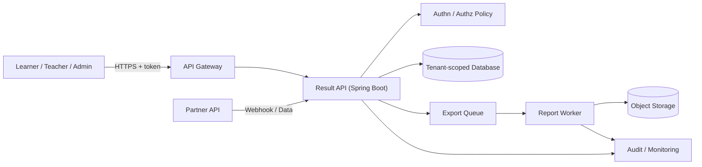
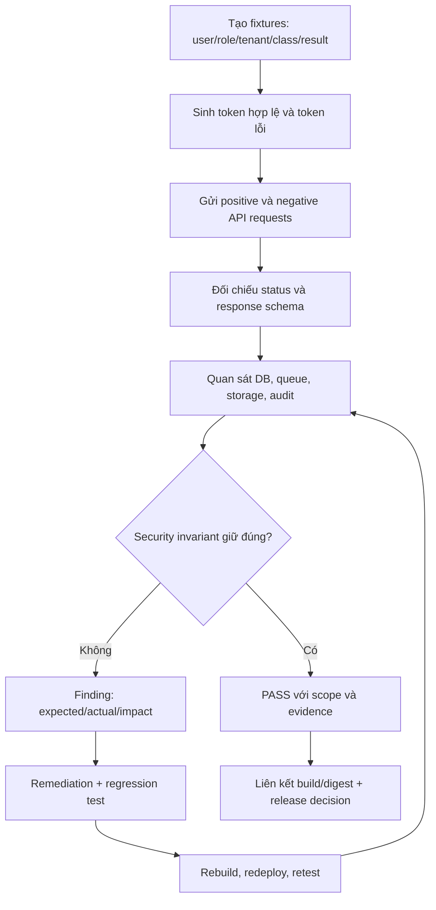

# API security testing: kiểm chứng bảo mật API đang chạy bằng bằng chứng thực nghiệm

## 1. Vì sao cần kiểm thử bảo mật API?

Một nền tảng học tập trực tuyến viết bằng Java/Spring Boot cung cấp API xem điểm, nộp bài, quản lý lớp và xuất kết quả thi. Nhóm đã sử dụng HTTPS, xác thực JWT qua OAuth 2.0/OIDC và chạy SAST trước khi phát hành. Tuy nhiên, endpoint `GET /api/results/{resultId}` chỉ kiểm tra người gọi đã đăng nhập mà không xác nhận kết quả thuộc người học hoặc tenant được phép.

Nếu người dùng của tenant A gửi `resultId` của tenant B và server vẫn trả kết quả, ứng dụng có **lỗi phân quyền mức đối tượng** dù cơ chế xác thực token, TLS và quá trình build đều hoạt động bình thường. Việc này khó được chứng minh bằng một bài test đăng nhập thành công hoặc chỉ bằng mã nguồn của controller.

**API security testing (kiểm thử bảo mật giao diện lập trình ứng dụng)** là hoạt động kiểm tra có hệ thống các thuộc tính bảo mật của API qua request, response, trạng thái hệ thống và các tác động phụ trong môi trường được phép. Trọng tâm là chứng minh:

- Chủ thể không đủ quyền **không đọc, sửa, xóa hoặc tạo tài nguyên** vượt phạm vi của mình.
- API xác minh đúng danh tính, quyền, dữ liệu đầu vào và trạng thái nghiệp vụ.
- Những tình huống bất thường không làm lộ thông tin hoặc bỏ qua security controls.
- Các giới hạn về tài nguyên, tốc độ, giao dịch và tích hợp được thực thi trong phạm vi đã định.
- Mỗi kết luận được gắn với **version, môi trường, dữ liệu thử nghiệm, expected/actual và bằng chứng**.

Trong chương **Dynamic testing** của module **SECURITY_SECURITY_ASSURANCE**, API security testing không chỉ để tìm lỗi. Nó cung cấp **bằng chứng thực nghiệm cho security assurance liên tục**: từ risk scenario, yêu cầu và security controls đến test results, audit, finding, remediation và kiểm chứng lại sau mỗi thay đổi.

### Mục tiêu học tập

Sau bài này, bạn có thể:

1. Phân biệt API security testing với kiểm thử chức năng, SAST, DAST, fuzzing và penetration testing.
2. Lập phạm vi và test plan dựa trên tài sản, trust boundaries, role, tenant, hành động và risk.
3. Thiết kế positive, negative, boundary, stateful và abuse-case tests cho API.
4. Kiểm thử các nhóm rủi ro quan trọng: broken authentication, BOLA, BFLA, BOPLA, injection, SSRF, thiếu giới hạn tài nguyên và sai logic nghiệp vụ.
5. Xây dựng kiểm thử tự động minh họa cho Java/Spring Boot và kiểm tra cả side effects.
6. Phân tích false positives, giới hạn test, mức độ chắc chắn và cách quản lý findings.
7. Lập assurance claims và evidence cho một release có API nhạy cảm.

## 2. API security testing nằm ở đâu trong chương trình assurance?

Một API có thể đáp ứng contract chức năng nhưng vẫn vi phạm yêu cầu bảo mật.

**Functional test** thường hỏi: “Giảng viên có quyền xem kết quả lớp mình thì API trả đúng điểm không?”

**Security test** bổ sung: “Một giảng viên của lớp khác, người học, tài khoản hết hạn hoặc một workload không được cấp quyền có đọc được cùng kết quả không? Có tác động phụ trái phép xảy ra trước khi API trả lỗi không?”

| Hoạt động | Câu hỏi chính | Loại bằng chứng |
|---|---|---|
| **Unit test** | Một hàm hoặc rule xử lý đúng với dữ liệu thử? | Assertion trên logic nhỏ, mocks |
| **Integration/API functional test** | API hoạt động đúng với nghiệp vụ hợp lệ? | HTTP response, dữ liệu/trạng thái sau thao tác |
| **API security test** | Hành vi API có giữ đúng security invariants trước input, quyền và trạng thái bất thường? | Negative requests, response, DB/queue/storage/audit assertions |
| **SAST/code review** | Có cấu trúc code hoặc luồng dữ liệu có rủi ro? | Static findings, code path, review |
| **SCA/dependency review** | Thành phần phần mềm có lỗ hổng đã biết? | Component inventory, advisories |
| **DAST** | Ứng dụng đang chạy có biểu hiện lỗi bảo mật từ giao diện bên ngoài? | Scanner traffic, candidate findings, reproducible tests |
| **API fuzzing/property-based testing** | API giữ invariants với nhiều biến thể input và chuỗi hành động? | Generated cases, shrinking/reproduction logs |
| **Penetration test** | Các điểm yếu có thể được kết hợp thành đường tấn công trong scope? | Attack narrative, observed impact, evidence |
| **Audit/assurance review** | Claims và controls có evidence còn hiệu lực, truy vết được? | Coverage, traceability, exception, sign-off |

Những phương pháp này **bổ sung nhau, không thay thế nhau**. API security testing có thể dùng DAST hoặc fuzzing nhưng cũng cần test viết tay theo nghiệp vụ và phân quyền. Một scanner không biết giảng viên nào được xem lớp nào sẽ khó tự xác định BOLA nếu không có dữ liệu phân quyền đúng.

### Khái niệm security invariant

**Security invariant** là điều bắt buộc vẫn đúng trong mọi đường thực thi thuộc phạm vi, kể cả luồng lỗi.

Ví dụ:

> Người dùng thuộc tenant A không được đọc, sửa hoặc xuất kết quả thuộc tenant B; nếu bị từ chối, không có job, file, event hoặc cache entry trái phép được tạo.

Khi viết test, invariant phải được chuyển thành **tiêu chí quan sát được**. `403` hoặc `404` là một quan sát, nhưng có thể chưa đủ; phải kiểm tra trạng thái sau request khi thao tác có side effect.

## 3. Xác định phạm vi và nguyên tắc kiểm thử an toàn

API security testing nên diễn ra trong môi trường được cấp phép, với tài khoản và dữ liệu thử nghiệm được kiểm soát. Một bài test có thể gây side effects như tạo hàng nghìn job, gửi email, trừ tiền, thay đổi quyền hoặc tải file nhạy cảm. Do đó phạm vi và điều kiện dừng là một phần của thiết kế kiểm thử.

### 3.1. Những thông tin cần có trước khi chạy test

- **Application/release:** source commit, build ID, image digest, environment, API version.
- **Assets/data classification:** dữ liệu điểm thi, hồ sơ người học, token, file export, thông tin cá nhân.
- **API inventory:** host, base path, routes, methods, schemas, versions, GraphQL/gRPC endpoints nếu có.
- **Roles và identity:** anonymous, learner, teacher, tenant admin, platform admin, service accounts.
- **Tenant/object ownership:** người dùng và tài nguyên thuộc tenant nào; ai có thể thao tác tài nguyên nào.
- **Trust boundaries:** client → gateway → service → queue → worker → database/storage/third-party.
- **Security requirements:** policy xác thực, phân quyền, giới hạn tài nguyên, logging, retention và dữ liệu đầu vào.
- **Test environment/data:** tài khoản giả, token test, fake data, mức cô lập, cách reset.
- **Authorization to test:** hệ thống/URL được phép, mốc thời gian, giới hạn tải, thao tác bị cấm.
- **Operational safeguards:** giám sát, rollback, người liên hệ, điều kiện dừng khi có ảnh hưởng bất thường.

Đối với production, hoạt động thử nghiệm tải lớn, mutation nguy hiểm hoặc fuzzing có thể gây gián đoạn; chỉ thực hiện khi được ủy quyền cụ thể và có kế hoạch bảo vệ. Những ví dụ trong bài này nhằm **kiểm chứng phòng thủ**, không yêu cầu tấn công hệ thống ngoài phạm vi.

### 3.2. Phân biệt thử nghiệm và dữ liệu thật

Ưu tiên dùng tenant, lớp học, học viên, tài liệu và kết quả thi **giả định**. Token, secret hoặc credential dành cho test không nên được hardcode trong repository hay lưu nguyên vẹn trong báo cáo. Khi cần log request/response, lọc `Authorization`, cookie, PII và các field nhạy cảm. Không lưu dữ liệu thật của người học trong ảnh chụp màn hình hoặc artifact test được chia sẻ rộng.

### 3.3. Khung scope minh họa

| Thuộc tính | Giá trị minh họa |
|---|---|
| API | `https://api.test.example.org` |
| Environment | Staging cô lập, dữ liệu giả |
| Service | `result-service` và `report-export-worker` |
| In scope | Đăng nhập, đọc/sửa điểm, export, download, luồng queue liên quan |
| Out of scope | Dịch vụ thanh toán bên ngoài, production, load test phá hoại |
| Test identities | Learner A, Teacher A, Admin A, Learner B, Teacher B |
| Giới hạn | Yêu cầu thông thường, retry có giới hạn, không phá dữ liệu |
| Rollback/reset | Truncate dữ liệu fixture, hủy job test, xóa file tạo trong bucket test |

Tên miền `example.org` và các tên service trong bài là **ví dụ minh họa**, không phải môi trường có sẵn cần truy cập.

## 4. Khám phá API và attack surface

Không thể kết luận “API đã được kiểm thử” nếu chỉ kiểm tra những endpoint có mặt trong một collection cũ. Cần xác định **tập interface thực sự tồn tại và các cách truy cập khác nhau**.

### 4.1. Những nguồn để tạo API inventory

| Nguồn | Thông tin hữu ích | Giới hạn cần kiểm tra |
|---|---|---|
| OpenAPI/Swagger contract | Paths, methods, schema, security schemes, response codes | Có thể khác runtime; tài liệu có thể thiếu endpoint nội bộ |
| Source/router mappings | Controller endpoints, guards, filters | Không chứng minh route được expose hoặc config tại môi trường đích |
| Gateway/ingress routes | URL public, rewrites, route policies | Có thể bỏ qua service-to-service hoặc WebSocket |
| Runtime telemetry/access logs | Endpoint được gọi, versions, caller patterns | Không thấy request không có nghĩa endpoint không tồn tại |
| GraphQL schema/introspection nếu được phép | Queries, mutations, types, fields | Field auth thường phải xem resolver và policy |
| gRPC service descriptors/proto | RPC methods, request/response types | Không mô tả đầy đủ authn/authz runtime |
| API gateway/catalog/CMDB | Owner, môi trường, lifecycle, API versions | Inventory có thể stale |
| Client code/SDK | API mà ứng dụng di động/web thực sự gọi | Không đầy đủ server-only functions |

Nên đối chiếu **spec ↔ gateway ↔ implementation ↔ observed runtime**; ghi rõ những interface còn chưa xác minh.

### 4.2. Vẽ luồng dữ liệu và trust boundaries



Từ sơ đồ này cần kiểm tra cả những đường có thể bỏ qua giao diện chính:

- API nội bộ gọi trực tiếp mà không qua gateway.
- Queue message bị gửi từ nguồn không được phép.
- Worker chạy sau khi quyền của người tạo job đã thay đổi.
- File export được tải qua object storage mà không qua lần kiểm tra quyền phù hợp.
- Webhook đến từ nhà cung cấp nhưng không được xác thực.
- Bản API cũ hoặc endpoint debug vẫn được expose.

### 4.3. Inventory nên lưu đến mức nào?

Đối với API nhạy cảm, có thể lưu: `service / environment / method / path / business action / data classification / auth scheme / allowed roles / object scope / rate policy / owner / tests`.

**Một endpoint có thể có nhiều security contexts**: cùng `GET /api/results/{id}` được gọi bằng learner token, teacher token, admin token hoặc workload identity, mỗi trường hợp có quy tắc quyền khác nhau.

## 5. Nhóm rủi ro API thường cần kiểm thử

OWASP API Security Top 10 (bản **2023**) là một tài liệu tham khảo hữu ích để gợi ý các lớp lỗi. Đây không phải danh sách đầy đủ hoặc một test suite tự động.

| Nhóm rủi ro (OWASP API 2023) | Ví dụ trong nền tảng học tập | Test cần quan tâm |
|---|---|---|
| **API1 — Broken Object Level Authorization (BOLA)** | Learner A đọc kết quả Learner B bằng ID | Cross-user/cross-tenant access tests |
| **API2 — Broken Authentication** | Token không hợp lệ được chấp nhận | Expired/forged/wrong audience token |
| **API3 — Broken Object Property Level Authorization (BOPLA)** | API trả field nhạy cảm hoặc cho sửa `finalGrade` ngoài quyền | Field-level read/write authorization |
| **API4 — Unrestricted Resource Consumption** | Export nhiều file khổng lồ, query không giới hạn | Quota, pagination, upload/time/concurrency limits |
| **API5 — Broken Function Level Authorization (BFLA)** | Learner gọi endpoint dành riêng cho admin | Cross-role action matrix |
| **API6 — Unrestricted Access to Sensitive Business Flows** | Tự động đăng ký chỗ học hoặc nộp bài hàng loạt vượt policy | Abuse cases, velocity, transaction rules |
| **API7 — Server Side Request Forgery (SSRF)** | Import file từ URL tùy ý bằng network quyền cao | Allowlist, redirect/DNS, egress restrictions |
| **API8 — Security Misconfiguration** | Debug endpoint, CORS, TLS hoặc error handling sai | Config/response/security headers |
| **API9 — Improper Inventory Management** | API v1 cũ vẫn public, chưa còn owner | Version/inventory/deprecated endpoint checks |
| **API10 — Unsafe Consumption of APIs** | Tin hoàn toàn vào dữ liệu webhook của partner | Validate input, identity, schema, timeouts |

Không nên đồng nhất tất cả nhóm trên với “các cuộc tấn công bằng payload”. Nhiều lỗi quan trọng, đặc biệt BOLA/BFLA/BOPLA và nghiệp vụ, chỉ được nhận diện khi test biết **quyền, tenant, tài nguyên và trạng thái đúng**.

### Dựa vào threat model để bổ sung test

Ngoài danh mục trên, tùy hệ thống cần xét:

- CSRF khi dùng session/cookie hoặc credentials browser tự gửi.
- Replay attacks trên token, webhook, chuyển trạng thái hoặc payment/submit flow.
- Race conditions và inconsistent state khi cập nhật điểm hoặc nộp bài.
- Business object mass assignment và unsafe deserialization.
- Data leakage trong log, error messages, cache, exports hoặc response headers.
- Request smuggling/proxy boundary khi có nhiều tầng HTTP.
- Secrets lộ trong OpenAPI, debug endpoints hoặc exception traces.
- WebSocket, GraphQL, gRPC hoặc API phiên bản cũ với policy không nhất quán.

Các mục này phải được chọn theo **risk scenarios thực tế**; không cần chạy tất cả scanner hay stress test trên mọi service.

## 6. Thiết kế test: từ requirement đến security assertion

### 6.1. Tách positive, negative, boundary và stateful tests

| Loại test | Ý nghĩa | Ví dụ |
|---|---|---|
| **Positive** | Chủ thể hợp lệ thực hiện hành động được phép | Teacher A xem điểm lớp được phân công |
| **Negative authorization** | Chủ thể không đủ quyền bị từ chối | Teacher A không sửa điểm lớp tenant B |
| **Negative authentication** | Credential thiếu/sai/hết hạn không được chấp nhận | Token sai audience không truy cập API |
| **Boundary/invalid input** | Dữ liệu ngoài định dạng, phạm vi, giới hạn được xử lý an toàn | Upload quá giới hạn, page size bất thường |
| **Stateful** | Chuỗi hành động giữ invariant qua thay đổi trạng thái | Thu hồi role sau khi tạo export job |
| **Abuse case** | Hành vi hợp lệ ở từng request nhưng nguy hiểm khi lặp/kết hợp | Tạo quá nhiều job, thao túng số lần nộp bài |
| **Fault injection** | Security controls vẫn đúng khi dependency lỗi | Policy service timeout không thành allow |
| **Regression** | Lỗi đã sửa không tái diễn trên build mới | Cross-tenant access test trên release candidate |

### 6.2. Ma trận role × action × object

Giả sử có hai tenant A và B. Mỗi tenant có learner, teacher và admin. Test chỉ dùng một tài khoản admin sẽ bỏ sót nhiều lỗi.

| Actor | Tài nguyên | Read | Update grade | Export class |
|---|---|---|---|---|
| Learner A | Kết quả của chính mình, tenant A | Allow theo policy | Deny | Deny |
| Learner A | Kết quả người khác, tenant A | Deny, trừ rule được cấp | Deny | Deny |
| Learner A | Kết quả tenant B | Deny | Deny | Deny |
| Teacher A | Lớp được phân công, tenant A | Allow | Allow theo workflow | Allow theo workflow |
| Teacher A | Lớp không được phân công, tenant A | Deny theo policy | Deny | Deny |
| Teacher A | Lớp tenant B | Deny | Deny | Deny |
| Tenant Admin A | Tài nguyên trong tenant A | Allow theo role | Có điều kiện | Có điều kiện |
| Tenant Admin A | Tenant B | Deny | Deny | Deny |
| Anonymous | Dữ liệu kết quả riêng tư | Deny | Deny | Deny |

Các ô là **chính sách giả định phục vụ học tập**, không áp dụng mặc định cho mọi hệ thống. Trong dự án thật, phải đọc access matrix được phê duyệt và chuyển mỗi ô thành test có expected result.

### 6.3. Assertion phải kiểm tra tác động thực

Với request bị từ chối, kiểm tra ít nhất:

1. HTTP/gRPC status đúng theo hợp đồng.
2. Response không chứa dữ liệu của chủ thể khác và không làm lộ thông tin ngoài policy.
3. Không có bản ghi, message, job, file hoặc cache entry trái phép được tạo.
4. Audit/security event phản ánh đúng quyết định, không log token/secret.
5. Những đường thay thế của cùng nghiệp vụ tuân thủ quy tắc tương đương.

Ví dụ **`403 Forbidden` cùng một file export đã được tạo** là thất bại bảo mật, không phải test pass.

## 7. Kiểm thử authentication: API tin ai?

Authentication security tests kiểm tra cách server chứng minh danh tính user hoặc workload, vòng đời session/token và phản ứng khi credential sai.

### 7.1. Ma trận thử nghiệm

| Test | Kết quả mong đợi |
|---|---|
| Không gửi credential | Từ chối endpoint bắt buộc xác thực |
| Gửi token sai định dạng | Không xác thực, không kích hoạt nghiệp vụ |
| Token hết hạn | Từ chối, không tự gia hạn quyền |
| Token sai chữ ký | Từ chối, không chấp nhận dữ liệu claims chưa xác minh |
| Token issuer không được phép | Từ chối |
| Token audience không đúng service/API | Từ chối |
| Token dùng thuật toán/chính sách không cho phép | Từ chối, không fallback lỏng lẻo |
| Token đúng cấu trúc nhưng scope thiếu | Có thể xác thực nhưng phải từ chối thao tác không được phép |
| Tài khoản bị vô hiệu/thu hồi quyền | Hành vi tuân theo cơ chế revocation và độ trễ được duyệt |
| API key bị thu hồi/rotate | Key cũ không tiếp tục có hiệu lực ngoài policy |
| Nhầm credential giữa môi trường | Token staging không tự động có quyền ở production |
| Identity provider không khả dụng | Không biến xác minh quyền bắt buộc thành allow mặc định |

**Phân biệt `401` và `403`:** `401 Unauthorized` thường dùng khi chưa có thông tin xác thực hợp lệ; `403 Forbidden` khi principal hợp lệ nhưng không được phép. `404` có thể được dùng trong một số resource authorization scenarios để che giấu sự tồn tại đối tượng. Phải theo API contract và kiểm thử tính nhất quán, không biến chọn status thành cách bỏ qua enforcement.

### 7.2. Với JWT/OAuth 2.0/OIDC

Reviewer cần biết API dùng **access token** gì, ai cấp, cho audience/scope nào, thuật toán nào và ở đâu token được xác minh. Những claim như `iss`, `aud`, `exp`, `nbf`, subject và scope/authorities cần được đánh giá theo profile thực tế.

Không nên chấp nhận một JWT chỉ vì có thể parse phần payload Base64URL hoặc vì token trông hợp lệ. **Chữ ký, issuer, audience, thời hạn và những điều kiện bắt buộc phải được xác minh bằng cấu hình tin cậy**; API không được để client tự chọn thuật toán không an toàn hoặc nguồn khóa không được kiểm soát.

### 7.3. Phân biệt kiểm thử filter với kiểm thử logic quyền

Trong Java/Spring, test sử dụng `spring-security-test` và mock user/mock JWT rất hữu ích để kiểm tra authorization logic, nhưng một số test helpers có thể **bỏ qua việc xác thực chữ ký JWT thực sự**. Vì vậy cần hai tầng:

- **Authorization logic tests:** kiểm tra role, tenant, object permissions với principal giả được tạo có kiểm soát.
- **Authentication integration tests:** gửi token đã ký đúng/sai qua đường HTTP thực với cấu hình resource server/JWKS/issuer tương ứng, để kiểm tra verifier thực tế.

Không suy từ một test `with(jwt())` pass rằng production đã kiểm tra signature, issuer và audience đúng.

## 8. Kiểm thử BOLA: quyền trên từng đối tượng

**Broken Object Level Authorization (BOLA)** xảy ra khi API cho phép truy cập hoặc tác động tới object mà chủ thể không có quyền, thường khi ID do client cung cấp được dùng để truy vấn nhưng thiếu kiểm tra ownership/tenant.

Ví dụ endpoint:

```http
GET /api/results/6fdc8b31-9a07-4e61-9331-1e4ef379a32e HTTP/1.1
Host: api.test.example.org
Authorization: Bearer <test-access-token>
Accept: application/json
```

UUID là ID giả định. Một ID khó đoán giúp giảm khả năng dò nhưng **không thay thế authorization**. Test có thể biết trước ID của tài nguyên khác do fixture tạo nên không cần đoán/brute force.

### 8.1. Ma trận đối tượng cần thử

| Caller | Object ID | Kỳ vọng |
|---|---|---|
| Learner A | Kết quả Learner A | Allow theo policy |
| Learner A | Kết quả Learner khác, tenant A | Deny theo policy |
| Learner A | Kết quả Learner B, tenant B | Deny |
| Teacher A | Kết quả lớp được phân công | Allow |
| Teacher A | Kết quả lớp chưa được phân công | Deny |
| Admin tenant A | Kết quả tenant B | Deny |
| Anonymous | Kết quả bất kỳ | Deny |
| Workload token chỉ có quyền export | Đọc tài nguyên ngoài scope | Deny |

Test cả **GET, PUT/PATCH, DELETE, bulk actions, export, download và resource relationship endpoints**. Cùng một ID có thể được kiểm tra ở controller đọc nhưng không được kiểm tra trong service cập nhật hoặc worker.

### 8.2. Cần kiểm tra những chỗ tưởng không phải đối tượng

- `classId`, `courseId`, `tenantId`, `examId` trong body/query.
- ID nằm trong nested URL như `/classes/{classId}/students/{studentId}`.
- Batch requests nhận danh sách ID nhiều tenant.
- Cursor/page token chứa ID hoặc tenant scope.
- File path/object key hoặc presigned URL.
- Queue job ID và trạng thái job.
- GraphQL resolver field trả đối tượng liên quan.
- Cache keys được chia sẻ giữa tenant.

**Từ chối phải xảy ra trước dữ liệu hoặc side effects trái phép.** Nếu API trả `404` nhưng worker vẫn chạy export và tạo file, BOLA vẫn tồn tại.

## 9. BFLA và BOPLA: quyền trên chức năng và từng thuộc tính

### 9.1. BFLA — chức năng vượt quyền

**Broken Function Level Authorization (BFLA)** thường xuất hiện khi endpoint hoặc thao tác quản trị được expose mà kiểm tra vai trò/quyền không đầy đủ.

Ví dụ:

```http
POST /api/admin/users/learner-001/disable HTTP/1.1
Host: api.test.example.org
Authorization: Bearer <learner-token>
Content-Type: application/json

{}
```

Tài khoản learner không được phép gọi thao tác quản trị theo policy giả định. Dùng test identities được tạo sẵn; không cần thử trên tài khoản thật.

Kiểm thử nên bao phủ:

- Vai trò khác nhau gọi cùng endpoint.
- Thay đổi HTTP method hoặc đường API v1/v2.
- Admin của tenant A thực hiện hành động trên tenant B.
- Hidden/debug endpoints và các chức năng chỉ xuất hiện trong SDK hoặc source.
- Workload token thực hiện thao tác vốn dành cho user/admin.

### 9.2. BOPLA — thuộc tính nhạy cảm được đọc/ghi sai quyền

Một API có thể kiểm tra ownership đúng nhưng vẫn trả thừa field hoặc chấp nhận sửa field không được phép.

Ví dụ object:

```json
{
  "studentId": "student-001",
  "displayName": "Learner Demo",
  "finalGrade": 86,
  "moderationFlag": true,
  "internalNotes": "private-review",
  "tenantId": "tenant-A"
}
```

Nếu learner chỉ được xem điểm và tên hiển thị, API không nên trả `internalNotes` hay các flag nội bộ theo policy. Nếu client gửi `tenantId`, `finalGrade` hoặc `role` trong request tạo/sửa object mà server tự bind không kiểm soát, có nguy cơ **mass assignment/over-posting**.

### 9.3. Test property-level

| Case | Kỳ vọng |
|---|---|
| Learner đọc kết quả của mình | Chỉ field được phép |
| Teacher đọc kết quả lớp mình | Những field đúng vai trò, không lộ metadata ngoài policy |
| Learner gửi thêm `finalGrade` vào request sửa profile | Field bị từ chối/bỏ qua an toàn theo contract, không bị sửa |
| Client gửi `tenantId` khác trong body | Server xác minh tenant thực, không chuyển quyền theo body |
| Bulk update chứa một object ngoài quyền | Không làm sai trạng thái; hành vi atomic/partial được định nghĩa |
| GraphQL query chọn field nhạy cảm | Resolver/field policy từ chối hoặc không trả dữ liệu ngoài quyền |

**BOLA, BFLA và BOPLA là ba chiều khác nhau**. Một API có thể chặn đối tượng ngoài tenant nhưng vẫn cho learner thay `finalGrade` trên record của chính mình, hoặc cho gọi chức năng admin mà không đủ quyền.

## 10. Kiểm thử input handling, injection và SSRF

Các endpoint nhận JSON, file, URL, query, header hoặc message có thể đưa dữ liệu không tin cậy đến parser, database, template, command executor và downstream service. Kiểm thử cần đánh giá **validation, encoding, serialization, resource limits và cách xử lý lỗi**.

### 10.1. Thiết kế nhóm input tests

| Nhóm | Ví dụ dữ liệu thử | Tiêu chí |
|---|---|---|
| Sai schema | Trường thiếu, sai kiểu, object thay string | Trả lỗi contract, không gây side effect |
| Giá trị giới hạn | Rỗng, quá dài, âm khi chỉ nhận dương, vượt số chữ số | Validation và overflow handling phù hợp |
| Ký tự đặc biệt | Dấu nháy, Unicode, control chars | Không làm hỏng query/log/serialization |
| JSON nested sâu | Object/array vượt giới hạn test | Giới hạn xử lý và lỗi an toàn |
| Duplicate/unknown fields | Field lặp, field không khai báo | Hành vi parser/API contract xác định; không bypass controls |
| Dữ liệu bất thường | ID không đúng format, enum không tồn tại | Không rò rỉ stack trace/schema nội bộ |
| File upload | Sai type, quá size, nội dung không khớp extension | Kiểm tra loại nội dung, giới hạn và sandbox theo yêu cầu |
| Headers | Dài, trùng, định dạng sai hoặc thông tin không đáng tin | Proxy/app xử lý nhất quán, không tin header giả mạo |
| Pagination/filter | Page size quá lớn, sort field tùy ý | Bound và allowlist; tránh query không kiểm soát |
| Content type | Gửi media type không phù hợp | Từ chối hoặc xử lý theo contract |

Đối với SQL injection, command injection hoặc template injection, nên dùng **test fixtures không gây phá hoại**, môi trường cô lập và assertions trên hành vi. Điều cần chứng minh là input không được nối trực tiếp vào cấu trúc lệnh/query hoặc giải thích theo ngữ nghĩa nguy hiểm, thay vì cố gắng khai thác dữ liệu thật.

### 10.2. SSRF khi API nhận URL

Ví dụ API:

```http
POST /api/documents/import-url HTTP/1.1
Host: api.test.example.org
Authorization: Bearer <authorized-test-token>
Content-Type: application/json

{
  "url": "https://files.partner.example.org/demo-document.pdf"
}
```

Những câu hỏi cần kiểm chứng:

- URL có được giới hạn scheme và host theo policy?
- Có theo redirects tới đích ngoài allowlist không?
- Có xác minh địa chỉ thực sau DNS resolution và khi kết nối không?
- Có chặn đích nội bộ, link-local hoặc các vùng mạng bị cấm theo threat model?
- Có forward token/header nội bộ sang host do caller chọn?
- Có giới hạn response size, timeout, file type và egress network policy?
- Có quản lý metadata service, service credentials và proxy settings đúng cách?

Để kiểm thử, tạo **test server/đích giả được cấp phép** đại diện cho allowlisted và denied destinations; không gửi request đến các endpoint nội bộ thật hoặc cloud metadata service ngoài phạm vi.

### 10.3. Tránh kết luận từ status đơn lẻ

API trả `400` cho URL không được phép là tốt nếu nó **không phát sinh kết nối ra đích bị cấm**. Dùng network logs hoặc test HTTP server để xác nhận; nếu client vẫn cố kết nối rồi mới trả lỗi, security control có thể đã không bảo vệ được trust boundary.

## 11. Kiểm thử abuse logic và giới hạn tài nguyên

Một request có thể hoàn toàn hợp lệ nhưng trở thành lạm dụng khi được thực hiện quá nhanh, quá nhiều hoặc ở trạng thái không phù hợp.

### 11.1. Những nghiệp vụ cần threat modeling riêng

- Đăng ký chỗ học có số lượng giới hạn.
- Nộp bài thi, nộp lại và gia hạn thời gian.
- Đổi vai trò giáo viên hoặc chuyển học viên giữa lớp.
- Xuất báo cáo hàng loạt chứa dữ liệu cá nhân.
- Tạo tài khoản, gửi email khôi phục và xác minh mã.
- Lấy báo cáo trả phí hoặc truy cập nội dung theo gói.
- Nhận điểm, duyệt điểm và công bố kết quả.

### 11.2. Test scenarios

| Kịch bản | Security invariant |
|---|---|
| Nộp cùng bài thi hai lần do retry | Không tạo hai bản ghi có hiệu lực trái quy tắc |
| Gửi hai request đăng ký chỗ học đồng thời | Không vượt số chỗ hoặc ràng buộc duy nhất |
| Tạo nhiều export jobs trong khoảng ngắn | Tuân thủ quota theo identity/tenant, không ảnh hưởng tenant khác |
| Dùng lại idempotency key với payload khác | Không bị hiểu thành request hợp lệ khác |
| Gọi endpoint trước/sau thời điểm đóng kỳ thi | Quy tắc trạng thái được thực thi ở backend |
| Thu hồi vai trò khi export job đang chạy | Job/download xử lý theo policy revocation |
| API limit theo user nhưng shared token | Giới hạn theo các chiều đã được thiết kế, tránh bypass đơn giản |
| File upload rất lớn | Giới hạn dung lượng, timeout và số job theo yêu cầu |

Khi kiểm thử rate limiting/resource consumption, **không cần và không nên tạo tải phá hoại**. Có thể cấu hình quota thấp trong môi trường test, gửi một số ít request được cho phép rồi xác minh `429`/quota behavior, trạng thái job, metric và thời gian khôi phục.

### 11.3. Race conditions và state transitions

Các lỗ hổng business logic có thể xuất hiện ở ranh giới giữa **đọc trạng thái → quyết định → ghi trạng thái**. Dùng concurrency tests có kiểm soát để xác minh lock, transaction, optimistic version, uniqueness và idempotency. Chỉ kiểm tra response của hai request chưa đủ; phải kiểm tra trạng thái cuối, audit và downstream side effects.

## 12. Kiểm thử data protection, lỗi, CORS, CSRF và cấu hình HTTP

### 12.1. Dữ liệu trong response, cache và log

Với API xử lý PII hoặc kết quả thi, nên kiểm tra:

- Response chỉ có field/record được phép.
- Sensitive API không bị cache không phù hợp bởi trình duyệt/proxy/shared cache.
- Response/error không chứa token, secret, SQL, stack trace hoặc object của tenant khác.
- Pagination, search, export và error paths có cùng logic bảo vệ dữ liệu.
- Audit log đủ truy vết và không ghi raw credential hoặc PII ngoài chính sách.
- File download có đúng access check/TTL/permission và không tồn tại link bị lộ sau khi thu hồi.

### 12.2. TLS và HTTP security configuration

Một số điểm có thể kiểm tra động:

- Endpoint HTTP nhạy cảm có được buộc qua HTTPS theo chính sách?
- Chứng thư, hostname, trust chain và cấu hình TLS có hợp lệ?
- Proxy có đặt header bảo vệ đúng trong phạm vi áp dụng?
- Response có lộ chi tiết version, stack trace, debug data hoặc route nội bộ không?
- `Cache-Control`, cookie flags như `Secure`/`HttpOnly`/`SameSite` có phù hợp với thiết kế?
- File upload/download có đúng `Content-Type`, `Content-Disposition` và các header liên quan?

Các header cần đánh giá theo ngữ cảnh: API thuần trả JSON và ứng dụng web trả HTML có yêu cầu khác nhau. Không nên coi thiếu một header không áp dụng là lỗ hổng tự động.

### 12.3. CORS không thay thế authorization

Một browser có thể kiểm tra CORS khi JavaScript từ origin khác đọc response. **HTTP clients ngoài browser không chịu cùng giới hạn đọc cross-origin**; backend vẫn phải xác minh quyền.

Test có thể gửi `Origin` được phép hoặc không được phép và kiểm tra response headers; sau đó test riêng rằng token không đủ quyền vẫn bị từ chối. API trả đúng CORS headers không có nghĩa BOLA/BFLA đã được xử lý.

### 12.4. CSRF phụ thuộc cơ chế credential

Nếu API xác thực bằng cookie/session hoặc credentials browser tự gửi, state-changing requests có thể cần chống CSRF phù hợp. Nếu API chỉ nhận bearer token do client chủ động gắn và không dựa trên ambient credentials, threat model khác.

Không kết luận “REST API thì không cần CSRF”. Test phải kiểm tra kiểu credential thực tế, endpoint có side effect, `SameSite`/CSRF token/cookie policy và các filter chains đang áp dụng.

### 12.5. Error contract và fail-safe behavior

Với lỗi auth, input, dependency hoặc policy:

- Status/code phù hợp, không tiết lộ nội bộ.
- Không biến timeout khi kiểm tra quyền thành mặc định allow.
- Không trả `200 OK` nếu side effect đã thất bại hoặc trạng thái chưa xác định mà contract yêu cầu phân biệt.
- Retry không tạo side effects trùng lặp trái quy tắc.
- Có correlation ID đáng tin và audit/security event theo chính sách.

Một API có thể trả thông điệp lỗi an toàn nhưng vẫn tạo file export trước khi nhận ra quyền không đủ. Cần quan sát **hệ thống sau lỗi**, không chỉ body.

## 13. Kiểm thử API tích hợp, webhook và phiên bản cũ

Một nền tảng học tập thường nhận dữ liệu từ nhà cung cấp video, hệ thống quản lý trường học, cổng thanh toán hoặc dịch vụ chấm thi. **Dữ liệu từ bên thứ ba không tự trở thành đáng tin chỉ vì đến từ một API đã tích hợp.**

### 13.1. Inbound webhooks

Một webhook báo rằng người học đã hoàn thành thanh toán hoặc bài thi đã được duyệt có thể gây thay đổi trạng thái quan trọng. Test nên kiểm tra:

1. Sender được xác minh bằng chữ ký/MAC, mutual TLS hoặc cơ chế được thống nhất?
2. Có phân biệt khóa/identity của từng nhà cung cấp và từng môi trường?
3. Body được xác minh trên đúng bytes/chuẩn canonicalization theo hợp đồng?
4. Replay của event cũ có bị giới hạn bằng timestamp, event ID, nonce hoặc cơ chế tương đương?
5. Event trùng có được xử lý idempotent không?
6. Payload có được validate schema và ràng buộc với tài nguyên/tenant thực không?
7. Error/retry behavior của bên gửi có làm hệ thống xử lý trùng không?
8. Secret/webhook signature có vô tình bị log hoặc trả về client không?

### 13.2. Outbound third-party calls

Khi API gọi downstream, cần kiểm thử timeout, TLS validation, rate limit, circuit breaker, dữ liệu đầu vào không tin cậy, schema changes và phản hồi chứa giá trị bất thường. Không nên dựa vào một HTTP response `200` của partner để tự động chấp nhận thay đổi quyền hoặc số điểm.

### 13.3. API inventory và phiên bản cũ

Những câu hỏi thường bị bỏ sót:

- `/api/v1` vẫn được truy cập trực tiếp dù UI mới dùng `/api/v2`?
- Endpoint debug/health/docs có tiết lộ thông tin nhạy cảm?
- Một service nội bộ có route public do cấu hình ingress?
- Một bản beta hoặc feature flag làm xuất hiện API chưa được đánh giá?
- Bản v1 có enforcement authorization khác bản v2?
- API key, scope và credential nào còn hiệu lực sau khi deprecate?

Nếu phát hiện API shadow/zombie, cần xác định owner, loại dữ liệu, phương án retirement và policy chặn hoặc kiểm soát trong thời gian chuyển đổi.

## 14. Kiểm thử GraphQL, gRPC và WebSocket

Không phải mọi API đều dùng REST/JSON. Những protocol khác nhau cần cùng các security objectives nhưng cách kiểm chứng khác nhau.

### 14.1. GraphQL

GraphQL thường đưa nhiều business operations qua một HTTP endpoint. Kiểm tra `POST /graphql` trả `200` không chứng minh mọi resolver đều có object-level/field-level authorization.

Ví dụ query minh họa:

```graphql
query StudentResult($id: ID!) {
  result(id: $id) {
    id
    finalGrade
    internalNotes
    student {
      email
    }
  }
}
```

Với learner token, cần xác minh từng field và nested relationship được bảo vệ theo policy. Đặc biệt kiểm tra:

- Field-level authorization ở resolver; không dựa vào việc UI ẩn field.
- Query theo ID của tenant khác và nested object.
- Mutations có mass assignment hoặc bỏ qua trạng thái nghiệp vụ không.
- Query depth/complexity/cost, alias và batching có vượt tài nguyên/quota không.
- Introspection và errors có làm lộ thông tin nhạy cảm theo chính sách không.
- Persisted queries, subscriptions và context propagation có giữ đúng identity.
- Response có thể gồm `data` và `errors` cùng lúc; phải kiểm tra dữ liệu bị lộ chứ không chỉ HTTP status.

**GraphQL introspection không mặc nhiên là một lỗ hổng.** Rủi ro phụ thuộc loại dữ liệu schema, môi trường, chính sách, authorization và các controls khác. Test kết luận cần có ngữ cảnh.

### 14.2. gRPC

gRPC thường dùng HTTP/2 với Protocol Buffers; status không nhất thiết được phản ánh như mã HTTP của REST. Test cần xét:

- TLS/mTLS và xác minh danh tính workload.
- Metadata/token, scope và authorization trên từng RPC method.
- Object-level permissions trong message fields.
- Validation field, kích thước message, deadline, cancellation và resource limits.
- Client/server streaming, trạng thái xác thực của luồng dài, và cách từ chối khi quyền bị thu hồi.
- Lỗi `UNAUTHENTICATED`, `PERMISSION_DENIED`, `INVALID_ARGUMENT` và `RESOURCE_EXHAUSTED` theo hợp đồng.
- Interceptors server-side và các đường gọi service nội bộ có thể bypass gateway.

Một interceptor chỉ kiểm tra danh tính không thay thế business authorization trong handler của RPC đọc dữ liệu nhiều tenant.

### 14.3. WebSocket và API giao tiếp thời gian thực

WebSocket thường có bước handshake rồi nhiều message chạy qua cùng kết nối. Kiểm thử:

1. Origin, session/token và authorization tại handshake theo threat model.
2. Authorization **cho từng channel/subscription/message**, không chỉ lúc kết nối mở.
3. Một client tenant A không subscribe được stream tenant B.
4. Token hết hạn hoặc role bị thu hồi được xử lý theo thiết kế.
5. Rate/message size, idle timeout, reconnect và replay được giới hạn.
6. Nội dung nhạy cảm không bị phát cho tất cả clients do sai routing.

Một kết nối được mở thành công không bảo đảm mọi message sau đó đều được phép. Đặc biệt trong stream kết quả thi hoặc thông báo lớp học, cần test thay đổi quyền khi kết nối vẫn còn.

## 15. Công cụ và chiến lược kiểm thử

Công cụ hỗ trợ tạo request và đo kết quả, nhưng **không thể tự suy ra toàn bộ chính sách phân quyền nghiệp vụ** nếu không được cung cấp dữ liệu kỳ vọng.

| Nhóm công cụ | Dùng cho | Chú ý |
|---|---|---|
| **HTTP collection runner** như Postman/Newman | Chuỗi request, auth tokens, environment, assertions | Quản lý secret; collection không tự chứng minh đầy đủ coverage |
| **Framework integration tests** như JUnit, MockMvc, REST Assured | Test có fixtures, DB assertions, chạy CI | Cần test cả HTTP filter thực và side effects |
| **Intercepting proxy/DAST** như OWASP ZAP | Quan sát request, scanning có kiểm soát, discovery | Active scan có thể gây tác động; cần scope an toàn |
| **OpenAPI-based testing/fuzzing** | Sinh trường hợp theo schema, boundary, stateful properties | Spec có thể thiếu endpoints hoặc security semantics |
| **GraphQL/gRPC test clients** | Query/mutation/RPC và protocol-level validation | Cần identity, field/message policy và fixtures |
| **Load/concurrency test harness** | Quota, rate-limit, race conditions và backpressure | Giới hạn tải; không thử phá hoại trái phép |
| **Service virtualization/mocks** | Tái hiện timeout, malformed upstream responses, fail-safe | Mock behavior không thay thế integration với service thực |
| **Observability/DB probes** | Xác nhận audit, message, file và state transitions | Read-only hoặc cô lập, tránh lộ PII/credential |

### 15.1. Chọn công cụ theo câu hỏi cần trả lời

- Cần xác minh JWT validation thực? Dùng **HTTP integration test** qua security filter với token/chữ ký test thật.
- Cần kiểm tra logic quyền cho nhiều role/tenant? Dùng **fixture-driven integration tests**.
- Cần phát hiện phản hồi lỗi, cache/header và cấu hình HTTP? Dùng **DAST/contract tests** trên môi trường an toàn.
- Cần phát hiện request body/schema bất thường? Dùng **schema-based/property-based tests**.
- Cần đánh giá duplicate export hoặc state transitions? Dùng **stateful/concurrency tests** với đối soát DB/queue.
- Cần đánh giá authorization sau token revocation? Dùng **lifecycle tests** có thay đổi role và quan sát cache/session.

### 15.2. Automated scan không phải kết luận

Một scanner báo “Possible Authorization Bypass” là **candidate finding**. Nhóm cần xác minh đúng user/tenant, hành động và tác động. Ngược lại, scanner không báo lỗi BOLA không đủ để kết luận API đã cô lập tenant — đặc biệt nếu scanner chỉ chạy với một tài khoản và không biết object ownership.

### 15.3. Độ tin cậy của môi trường

Một bài test có thể pass do middleware bị mock, proxy bị bỏ qua, feature flag khác hoặc database seed sai. Cần ghi rõ cấu hình và chứng minh **môi trường test đại diện cho cơ chế cần xác minh**. Khi kiểm tra sau deploy, hãy đối chiếu cùng artifact digest và những khác biệt runtime có thể làm thay đổi kết luận.

## 16. Kiểm thử API Java/Spring Boot bằng integration tests

Ví dụ sau minh họa một ứng dụng Spring Boot với `result-service`. API dùng JWT và phân quyền theo tenant. Những helper tạo fixture/token được giả định để tập trung vào assertions, không phải một project đầy đủ có thể copy và chạy nguyên văn.

### 16.1. Positive test: đúng chủ thể, đúng tài nguyên

```java
@SpringBootTest
@AutoConfigureMockMvc
class ResultApiSecurityIT {

    @Autowired MockMvc mvc;
    @Autowired ResultTestFixtures fixtures;
    @Autowired SignedTestTokenIssuer testTokens;

    @Test
    void learnerCanReadOwnResult() throws Exception {
        var learner = fixtures.learnerInTenant("tenant-A");
        var ownResult = fixtures.resultOwnedBy(learner);
        String token = testTokens.validAccessToken(learner);

        mvc.perform(get("/api/results/{id}", ownResult.id())
                .header("Authorization", "Bearer " + token))
            .andExpect(status().isOk())
            .andExpect(jsonPath("$.id")
                .value(ownResult.id().toString()));
    }
}
```

`SignedTestTokenIssuer` là helper minh họa tạo token ký bằng test key được API test environment chấp nhận, không phải API của Spring. Bài test chỉ có ý nghĩa về authentication verifier nếu request đi qua **cấu hình xác minh JWT thực**, không bị mock thay thế.

### 16.2. Negative test: không đọc kết quả tenant khác

```java
@Test
void learnerCannotReadResultFromAnotherTenant() throws Exception {
    var learnerA = fixtures.learnerInTenant("tenant-A");
    var resultB = fixtures.resultInTenant("tenant-B");
    String tokenA = testTokens.validAccessToken(learnerA);

    mvc.perform(get("/api/results/{id}", resultB.id())
            .header("Authorization", "Bearer " + tokenA))
        // Ví dụ contract dùng 404 để tránh tiết lộ tài nguyên.
        .andExpect(status().isNotFound())
        .andExpect(jsonPath("$.code")
            .value("RESOURCE_NOT_FOUND"));
}
```

Nếu sản phẩm chọn `403` cho trường hợp này, assertion phải theo contract được phê duyệt. Điều bắt buộc là **không trả dữ liệu hoặc thông tin ngoài quyền**. Test tương ứng cần được mở rộng cho GET/UPDATE/EXPORT và các API phiên bản khác.

### 16.3. Negative test có side effect: không tạo export job

```java
@Test
void teacherCannotCreateExportForForeignTenant() throws Exception {
    var teacherA = fixtures.teacherInTenant("tenant-A");
    var classB = fixtures.classInTenant("tenant-B");
    String tokenA = testTokens.validAccessToken(teacherA);

    mvc.perform(post("/api/reports/export")
            .header("Authorization", "Bearer " + tokenA)
            .contentType(MediaType.APPLICATION_JSON)
            .content("{\"classId\":\"" + classB.id() + "\"}"))
        .andExpect(status().isForbidden());

    assertThat(fixtures.jobCountForClass(classB.id()))
        .isZero();
    assertThat(fixtures.exportFilesForClass(classB.id()))
        .isEmpty();
}
```

**Điểm học chính:** một API từ chối bằng HTTP status nhưng vẫn phát message vào queue hoặc tạo file là chưa đáp ứng invariant. Khi export chạy bất đồng bộ, cần test riêng worker với message hợp lệ/giả và quyền bị thu hồi.

### 16.4. Test xác thực JWT thực tế

Để kiểm thử `issuer`, `audience`, thời hạn và signature, test fixture phải tạo nhiều token có **chữ ký/claims được thiết kế có chủ đích** rồi gửi qua HTTP filter thật. Ví dụ ma trận:

| Token fixture | Expected |
|---|---|
| Đúng signer, issuer, audience, còn hạn, đủ scope | Đi tiếp tới authorization |
| Đúng signer nhưng audience khác | Authentication bị từ chối |
| Chữ ký sai | Authentication bị từ chối |
| Token hết hạn | Authentication bị từ chối |
| Token hợp lệ nhưng thiếu role | Authentication có thể thành công, hành động bị từ chối |
| Token không thuộc tenant của object | Object-level authorization từ chối |

Test helper kiểu `jwt()` của Spring Security Test thường hữu ích để mô phỏng authentication context, nhưng **không dùng nó làm bằng chứng rằng token verifier production thật sự kiểm tra chữ ký**. Cần test ít nhất một tầng với cấu hình issuer/JWKS và HTTP request đại diện.

### 16.5. Các điều kiện để test không cho kết quả giả

1. Dữ liệu tenant A/B phải độc lập, ownership mapping được xác nhận.
2. DB, cache, queue/storage fixtures được reset giữa test cases.
3. Không mock đối tượng authorization policy nếu claim đang kiểm chứng chính policy đó.
4. Nếu test qua MockMvc chưa đi qua ingress/gateway, ghi giới hạn và bổ sung environment-level tests.
5. Asynchronous effects cần đợi trạng thái bằng cơ chế đáng tin, có timeout, tránh `Thread.sleep` tùy ý.
6. Không dùng token thật hoặc secret production trong test data.
7. Đối chiếu build/test configuration với runtime release; lưu commit và image digest khi có.

## 17. Dùng OpenAPI contract để tổ chức kiểm thử bảo mật

OpenAPI giúp mô tả endpoint, schema, auth scheme và response. Nó là **đầu vào để tạo tests**, không chứng minh server thực thi policy đúng.

### 17.1. Đoạn OpenAPI 3.0.x minh họa

```yaml
openapi: 3.0.3
info:
  title: Result API (demo)
  version: "1.0"
paths:
  /api/results/{resultId}:
    get:
      operationId: readResult
      summary: Đọc kết quả theo quyền được cấp
      security:
        - bearerAuth: []
      parameters:
        - name: resultId
          in: path
          required: true
          schema:
            type: string
            format: uuid
      responses:
        "200":
          description: Dữ liệu kết quả trong phạm vi cho phép
          content:
            application/json:
              schema:
                type: object
                required: [id, finalGrade]
                properties:
                  id:
                    type: string
                    format: uuid
                  finalGrade:
                    type: number
        "401":
          description: Không có thông tin xác thực hợp lệ
        "403":
          description: Không có quyền thực hiện thao tác
        "404":
          description: Không tìm thấy tài nguyên trong phạm vi cho phép
components:
  securitySchemes:
    bearerAuth:
      type: http
      scheme: bearer
      bearerFormat: JWT
```

Trong OpenAPI, `bearerFormat: JWT` mang tính gợi ý/ghi chú; **không cấu hình hộ việc xác minh JWT trong backend**. Cần có security implementation, tests và runtime configuration.

### 17.2. Từ contract thành kiểm thử

| Thành phần contract | Test |
|---|---|
| `security` | Token thiếu, sai, hết hạn, sai audience, thiếu scope |
| `resultId: uuid` | ID đúng/sai format, ID tồn tại, ID không tồn tại |
| `200` schema | Chỉ field được phép, đúng kiểu, không chứa thông tin nội bộ |
| `403/404` | Cross-user/tenant access, che giấu tồn tại theo policy |
| API version | Các bản còn hỗ trợ có enforcement tương đương |
| Response content type | JSON an toàn, không trả HTML stack trace ngoài dự kiến |
| Error schema | Stable code, correlation ID, không lộ secrets |

### 17.3. Vấn đề spec drift

Khi controller thêm endpoint nhưng OpenAPI chưa cập nhật, tool dựa trên spec có thể không quét endpoint mới. Vì thế cần so sánh **OpenAPI → runtime routes → ingress exposure → actual requests**, lưu coverage gap và owner.

## 18. Tình huống xuyên suốt: export báo cáo thi đa tenant

### 18.1. Kiến trúc và yêu cầu nghiệp vụ

Một nền tảng Java/Spring Boot có:

- `result-service` lưu điểm, hồ sơ kết quả và mapping tenant/class.
- `identity-provider` cấp token cho learner, teacher và tenant admin.
- `report-service` nhận yêu cầu tạo báo cáo theo lớp.
- `report-worker` đọc job từ queue, xuất file lên object storage.
- `download-api` kiểm tra quyền rồi trả file hoặc link có hạn.

Quy định giả định: **giảng viên chỉ được export kết quả của lớp được phân công trong tenant của mình**. Người học chỉ xem kết quả của chính mình. Tenant admin có quyền theo chính sách được phê duyệt trong tenant, không vượt sang tenant khác.

### 18.2. Threat scenarios

| Risk ID | Mô tả | Security requirement |
|---|---|---|
| R-01 | Teacher A dùng class ID của tenant B để tạo export | REQ-01: Backend kiểm tra class/tenant/object permission trước tạo job |
| R-02 | Learner gọi endpoint admin tạo export | REQ-02: Function-level authorization theo action |
| R-03 | Client gửi `tenantId` khác trong body | REQ-03: Không tin tenant/role do client tự khai |
| R-04 | Worker xử lý message không rõ nguồn | REQ-04: Kiểm tra job validity, origin và tenant scope |
| R-05 | Token/role bị thu hồi khi job đang chờ | REQ-05: Quy tắc revocation và TTL được thực thi |
| R-06 | File export bị tải bởi caller không có quyền | REQ-06: File/link access theo quyền và thời hạn |
| R-07 | Retry tạo hai job hoặc file | REQ-07: Idempotency/state consistency |
| R-08 | Một user tạo hàng nghìn exports | REQ-08: Quota, rate/concurrency controls |
| R-09 | Error/log chứa dữ liệu tenant khác | REQ-09: Error contract và log data minimization |
| R-10 | API v1 không có phân quyền như v2 | REQ-10: Inventory và enforcement nhất quán giữa versions |

### 18.3. Test suite dựa trên rủi ro

| Test ID | Actor / tình huống | Kỳ vọng | Evidence |
|---|---|---|---|
| T-01 | Teacher A export class A được phân công | `202 Accepted`, job thuộc teacher/tenant A | HTTP, DB job state, audit |
| T-02 | Teacher A export class B, tenant B | Deny, không tạo job/file | HTTP, DB/queue/storage checks |
| T-03 | Learner A gọi export admin endpoint | Deny, không tạo job | HTTP, function policy test |
| T-04 | Teacher A gửi `tenantId: tenant-B` trong body | Server không chuyển scope theo input | Job/assertion không vượt tenant |
| T-05 | Token hết hạn/sai issuer/audience | Authentication deny | HTTP, auth filter logs đã lọc |
| T-06 | Worker nhận message giả | Không xử lý job ngoài nguồn tin cậy | Worker outcome, queue/ACL review |
| T-07 | Quyền Teacher A bị thu hồi sau tạo job | Job và tải file tuân theo revocation policy | Lifecycle test, DB/job/file status |
| T-08 | Retry sau timeout | Không tạo hiệu ứng nghiệp vụ trùng | Idempotency records, job count |
| T-09 | Gửi vượt quota giới hạn thấp trong test | Bị giới hạn đúng, không tăng tải không kiểm soát | HTTP, metrics, queue depth |
| T-10 | Link file hết hạn hoặc của tenant B | Không thể tải dữ liệu trái quyền | Download result, object access logs |
| T-11 | Downstream storage lỗi | Job không giả `COMPLETED`; không để file lộ | Worker state, cleanup/reconciliation |
| T-12 | Gọi đường export cũ `/api/v1` | Quyền và trạng thái tương đương policy | Old route tests, gateway inventory |

### 18.4. Luồng kiểm thử end-to-end



### 18.5. Một phát hiện cụ thể

Giả sử T-02 trả `403` nhưng consumer của queue vẫn nhận một job xuất lớp B do controller publish message **trước khi** kiểm tra quyền. Đây là một vulnerability dù API trả mã từ chối “đúng”.

Phương án xử lý cần xét:

1. Đưa authorization check tới trước side effect, với object/tenant từ nguồn server tin cậy.
2. Bảo vệ ở worker/consumer để không chấp nhận job trái quyền hoặc giả mạo.
3. Xác định transaction/outbox và idempotency cho publish.
4. Kiểm soát file generation/storage và cleanup nếu đã xảy ra partial failure.
5. Thêm regression test kiểm tra cả HTTP, queue, file và audit.
6. Đánh giá liệu đã có dữ liệu bị xuất sai trên môi trường thật để kích hoạt incident response theo policy.

### 18.6. Ngôn ngữ kết luận đúng

**Không phù hợp:** “API security tests pass nên toàn bộ nền tảng an toàn”.

**Phù hợp hơn:** “Ở release R và staging S, 12 test cases được định nghĩa cho luồng export đa tenant đã chạy với các test identities/fixtures X; authorization và side-effect assertions đạt. Chưa kiểm thử luồng đối tác Y hoặc cấu hình object storage production; hai phần đó cần evidence bổ sung trước khi kết luận phạm vi rộng hơn.”

Kết luận có ích vì chỉ rõ **đã kiểm gì, trên bản nào, với dữ liệu nào, những điều chưa kiểm và hành động tiếp theo**.

## 19. Assurance claims, test criteria và evidence

### 19.1. Từ risk đến test evidence

| Assurance claim | Acceptance criteria | Evidence |
|---|---|---|
| **CLM-API-01: Token được xác minh đúng** | Token hết hạn, sai signature/issuer/audience bị từ chối | Real-filter integration tests, JWT config |
| **CLM-API-02: Đúng object-level authorization** | Không đọc/sửa/xuất object ngoài quyền ở mọi đường trong scope | Role × object matrix, negative tests, DB/queue assertions |
| **CLM-API-03: Function-level permission đúng** | Caller không đủ role/scope không gọi được admin action | Endpoint/function access tests |
| **CLM-API-04: Property-level permission đúng** | Field nội bộ không bị lộ, field client không được sửa không thay đổi | Response schema tests, mass-assignment negatives |
| **CLM-API-05: Input handling an toàn** | Input sai/không đáng tin không bypass constraints hay gây lộ dữ liệu | Schema/boundary tests, error contract, parser tests |
| **CLM-API-06: Không SSRF ngoài policy** | URL đích bị cấm không tạo outbound connection | Controlled test servers, egress logs |
| **CLM-API-07: Resource controls có hiệu lực** | Quota/rate/concurrency theo chính sách test | Rate-limit tests, metrics, queue assertions |
| **CLM-API-08: Business invariants được giữ** | Retry/race/role revocation không gây tác động trái quy tắc | Stateful/concurrency tests, state diffs |
| **CLM-API-09: Data protection đúng** | Không lộ field/token/PII ngoài policy trong response/log/cache | Response/log samples đã giảm nhạy cảm, access review |
| **CLM-API-10: Lỗi không làm suy yếu quyền** | Dependency timeout không cho phép thao tác trái quyền | Fault-injection tests, audit events |
| **CLM-API-11: Kiểm thử gắn đúng release** | Results thuộc đúng build, config và môi trường | Commit/build/image digest, test run metadata |
| **CLM-API-12: Các findings được xác minh xử lý** | Có fix, retest và không còn side effect bị phát hiện trong scope | Finding record, PR, deployment, retest logs |

### 19.2. Test evidence có chất lượng nên lưu gì?

- Test ID, risk ID, requirement/control ID và **claim**.
- Owner, reviewer, thời điểm test, môi trường, endpoint, method, API version.
- Commit, build number, artifact/image digest, cấu hình security và test tool version.
- Identity fixture và quan hệ role/tenant/object, **không lưu raw token**.
- Request summary và response metadata đã lọc secrets.
- Expected/actual assertions, gồm DB/queue/storage/audit nếu liên quan.
- Pass/fail, reproduction steps trong scope được phép, limitations và logs/traces cần thiết.
- Finding ID, priority, root cause, remediation version, retest và quyết định release.

Một kết quả `PASS` trong dashboard không đủ nếu không biết test đã chạy trên build nào, dùng role nào hoặc có thực sự kiểm tra dữ liệu trái quyền hay không.

### 19.3. Hồ sơ test kết quả minh họa

```yaml
test_run_id: "API-SEC-DEMO-2026-11"
service: "report-service"
environment: "staging-isolated"
release:
  commit: "<verified-git-commit>"
  image_digest: "sha256:<verified-image-digest>"
scope:
  api_version: "v2"
  endpoint: "POST /api/reports/export"
test_case: "T-02"
risk_id: "R-01"
requirement_id: "REQ-01"
claim_id: "CLM-API-02"
actor_fixture:
  identity: "teacher-A"
  tenant: "tenant-A"
resource_fixture:
  class: "class-B"
  tenant: "tenant-B"
expected:
  http_status: 403
  export_job_count_for_class_B: 0
  export_file_count_for_class_B: 0
  audit_decision: "DENY"
observed:
  http_status: 403
  export_job_count_for_class_B: 0
  export_file_count_for_class_B: 0
  audit_decision: "DENY"
result: "PASS"
evidence:
  - "ci://<test-run-reference>"
  - "artifact://<redacted-request-response>"
  - "artifact://<isolated-state-assertions>"
limitations:
  - "Chưa kiểm chứng storage policy của production"
reviewer: "authorized-security-reviewer"
```

Đây là dữ liệu **giả định** để minh họa hồ sơ evidence; mọi giá trị cần thay bằng thông tin của test run thật. Không nên lưu credential hoặc dữ liệu học viên thật trong report.

### 19.4. Chất lượng và độ tin cậy của bằng chứng

| Tiêu chí | Câu hỏi tự kiểm |
|---|---|
| **Relevance** | Bằng chứng có trực tiếp kiểm tra claim và security property? |
| **Completeness** | Đã bao phủ roles, tenant, object classes và đường dữ liệu quan trọng trong scope? |
| **Freshness** | Kết quả còn đúng với code/config/release hiện tại? |
| **Correctness** | Expected result có dựa trên policy đúng, không phải suy đoán từ code? |
| **Provenance** | Biết ai/công cụ nào tạo evidence, khi nào, trên artifact nào? |
| **Repeatability** | Có thể tái thực hiện với fixtures và thiết lập đã ghi? |
| **Independence** | Có phản biện/kiểm tra độc lập phù hợp với mức risk? |
| **Integrity** | Logs, reports và kết quả test có lịch sử, giới hạn chỉnh sửa và retention? |
| **Scope honesty** | Có ghi rõ những luồng/role/protocol chưa được thử? |

## 20. Phân loại findings và ưu tiên remediation

Một failed test chưa luôn là vulnerability: có thể fixture sai, policy chưa rõ, môi trường lỗi hoặc test framework không đi qua control thực. Nhưng cũng không nên dùng nhãn “test flaky” để xóa một dấu hiệu truy cập sai quyền chưa được điều tra.

### 20.1. Triage từng phát hiện

1. **Reproduce:** có tái hiện được trong scope và dữ liệu test ổn định?
2. **Policy check:** expected behavior có đúng security requirement?
3. **Root-cause scope:** lỗi ở gateway, filter, controller, service, DB, worker hay storage?
4. **Affected assets:** dữ liệu/tenant/role, entry point và versions nào?
5. **Exploitability:** actor cần quyền nào, preconditions và controls nào áp dụng?
6. **Impact:** bí mật, toàn vẹn, sẵn sàng, riêng tư và blast radius.
7. **Threat signals:** có tình huống khai thác thực tế, detection hoặc sự cố liên quan?
8. **Decision:** fix, mitigate, investigate hoặc exception đúng thẩm quyền.
9. **Retest:** kiểm tra patch trên build và environment mục tiêu, gồm side effects.

### 20.2. Trạng thái đề xuất

| Trạng thái | Ý nghĩa |
|---|---|
| **CANDIDATE** | Scanner/test báo dấu hiệu, đang xác minh |
| **CONFIRMED** | Có bằng chứng vi phạm security requirement |
| **NEEDS_INVESTIGATION** | Thiếu thông tin để kết luận, có owner/thời hạn |
| **FIX_IN_PROGRESS** | Có hành động sửa, chưa kiểm chứng hoàn thành |
| **MITIGATED** | Giảm đường khai thác/tác động, chưa nhất thiết loại bỏ nguyên nhân |
| **RISK_ACCEPTED** | Residual risk được chấp nhận có điều kiện bởi đúng thẩm quyền |
| **FIXED_NOT_VERIFIED** | Sửa code/config nhưng chưa test trên artifact/môi trường cần thiết |
| **FIXED_VERIFIED** | Test/đánh giá lại đã chứng minh tiêu chí đạt trong scope |
| **NOT_REPRODUCIBLE_WITH_LIMITATIONS** | Chưa tái hiện theo phương pháp thử; không tự đồng nghĩa safe |

Không nhất thiết dùng đúng tên trạng thái; cần giữ rõ ranh giới giữa **candidate, confirmed, fixed và verified**.

### 20.3. Tình huống có tính khẩn cấp

Nếu test xác nhận người dùng tenant A có thể đọc điểm thi tenant B trên production, đây không chỉ là một test failure. Cần đánh giá khả năng đang xảy ra lộ dữ liệu, bảo toàn evidence phù hợp, containment và **incident response theo quy trình tổ chức**, song song với remediation và kiểm tra các đường tương tự.

Severity cần dựa trên **khả năng khai thác, phạm vi dữ liệu, tác động, exposure, controls, threat evidence và risk appetite**, không chỉ trên loại HTTP status hoặc nhãn scanner.

### 20.4. Một finding mẫu

```yaml
finding_id: "API-F-DEMO-01"
title: "Export job được tạo trước khi hoàn thành kiểm tra quyền"
service: "report-service"
environment: "staging-isolated"
affected_operation: "POST /api/reports/export"
related_test: "T-02"
security_requirement: "REQ-01"
risk:
  scenario: "Teacher tenant A tạo export cho class tenant B"
  impact: "Có thể lộ điểm thi và dữ liệu người học"
  initial_priority: "HIGH (minh họa, cần đánh giá theo policy)"
evidence:
  response: "403 Forbidden"
  unexpected_side_effect: "Queue nhận export job cho class tenant B"
  reproduction: "Test fixture với teacher-A, class-B"
status: "CONFIRMED"
owner: "report-service engineering lead"
remediation:
  - "Chặn trước mọi side effect"
  - "Thực thi object-level authorization ở service/worker"
  - "Đối soát job/file được tạo sai"
verification:
  - "Negative API test và queue/storage assertions"
  - "Runtime config/release verification"
approval:
  risk_owner: "<authorized-risk-owner>"
  release_decision: "PENDING"
```

Mẫu này chỉ dùng cho học tập và không khẳng định lỗi có thật trong hệ thống nào.

## 21. Tích hợp API security testing vào CI/CD

### 21.1. Lớp kiểm thử theo giai đoạn

| Giai đoạn | Nội dung ưu tiên | Điều kiện kết luận |
|---|---|---|
| **PR/commit** | Unit/security policy tests, changed-endpoint integration tests, basic schema validation | Nhanh, cô lập, feedback về code thay đổi |
| **Build/release candidate** | Integration tests với JWT/auth thật, multi-tenant matrix, DAST có kiểm soát | Bằng chứng trên build candidate và test environment |
| **Staging trước phát hành** | E2E với gateway, DB, queue, storage, webhook mocks, negative tests | Rà soát trust boundaries và side effects |
| **Production deployment verification** | Smoke tests ít tác động, identity/config checks, monitoring | Không làm tổn hại dữ liệu thật, có scope/permission |
| **Continuous monitoring** | Runtime changes, deprecated endpoints, auth denies, advisory/finding updates | Tái review khi assumptions thay đổi |

Không cần chạy full fuzzing hoặc load tests mỗi commit. Nhưng các tests bảo vệ **security invariants có tác động cao** (tenant isolation, admin permission, token rejection) nên có đường tự động ổn định và được ưu tiên.

### 21.2. Pipeline minh họa

```yaml
# Pseudocode CI, không phải cấu hình của một CI provider cụ thể.
pipeline: api-security-verification
source:
  commit: "<reviewed-commit>"
  build: "<release-candidate-id>"
steps:
  - build_and_unit_test
  - initialize_isolated_test_environment
  - seed_two_tenants_roles_and_objects
  - configure_test_identity_provider_and_keys
  - deploy_candidate_artifact_by_digest
  - run_authentication_tests
  - run_role_tenant_object_authorization_matrix
  - run_input_and_error_contract_tests
  - run_controlled_async_and_abuse_tests
  - collect_response_and_side_effect_assertions
  - redact_and_publish_test_evidence
  - evaluate_release_policy_and_findings
  - tear_down_test_data_and_credentials
release_gate:
  critical_invariants: "MUST_PASS"
  confirmed_high_risk_findings: "BLOCK_OR_AUTHORIZED_EXCEPTION"
  unreviewed_scope_gaps: "DOCUMENT_AND_REVIEW"
evidence:
  - "commit-and-image-digest"
  - "test-matrix-and-results"
  - "redacted-artifacts"
  - "findings-and-decisions"
```

Các trạng thái trong pipeline là ví dụ policy, không phải quy ước bắt buộc. Với thay đổi rủi ro cao, việc thiếu coverage cũng có thể là lý do tạm dừng release; cần xác định tiêu chí trước thay vì áp dụng tùy hứng.

### 21.3. Đừng để “skip” bị hiểu là “pass”

Cần phân biệt:

- `PASS`: test chạy và mọi assertions đạt.
- `FAIL`: test chạy nhưng phát hiện hành vi không đáp ứng.
- `ERROR`: môi trường/harness lỗi, không đủ bằng chứng.
- `SKIPPED`: test không chạy do điều kiện xác định.
- `NOT_APPLICABLE`: không áp dụng theo phạm vi có rationale.
- `UNKNOWN`: chưa được đánh giá.

Một pipeline có 100% test pass trong khi các negative authorization tests đều bị skip **không chứng minh** các yêu cầu đó đã được kiểm thử.

### 21.4. Các nguồn làm kết quả CI sai

- Test chỉ dùng một tenant hoặc một role.
- JWT decoder bị mock trong bài test được quảng bá là xác minh token signature.
- DB fixtures vô tình có owner chung hoặc không reset.
- API request đi trực tiếp vào service, bỏ qua gateway/ingress được kỳ vọng kiểm tra.
- Side effects chưa được await/đối soát khi job bất đồng bộ.
- Test tác động tới build cũ vì image tag không trỏ candidate mới.
- Scanner active chạy trên môi trường không thuộc quyền thử, gây ồn hoặc gián đoạn.
- Tool bỏ qua endpoint vì OpenAPI stale hoặc auth flow chưa được cấu hình.

## 22. Quản lý test data và bảo vệ bằng chứng

### 22.1. Test fixtures cho multi-tenant

Một bộ fixture tối thiểu nên có:

- Tenant A và tenant B độc lập, kèm object IDs cố định trong test run.
- Learner A1/A2, Teacher A, Tenant Admin A, Learner B, Teacher B và Admin B.
- Kết quả thuộc từng learner, lớp được/không được phân công.
- Một job export pending, một job completed và một job expired.
- Quyền trước/sau revocation, token hợp lệ và token sai.
- File có ACL/TTL đúng, file expired và file thuộc tenant khác.
- Một webhook event hợp lệ và event replay.

Dữ liệu cần reset được và không chứa thông tin cá nhân thật. Những fixtures này giúp kết quả **tái lập và dễ diễn giải** hơn một scanner chạy với một tài khoản có quyền quá rộng.

### 22.2. Lưu trữ evidence an toàn

- Mask credential, refresh tokens, cookies, API keys và secrets.
- Dùng test ID/identity references thay cho thông tin thật khi có thể.
- Không đưa response chứa PII vào logs public hoặc artifacts tải xuống tùy ý.
- Giới hạn quyền truy cập test reports và lưu theo retention của tổ chức.
- Lưu audit trail cho thay đổi finding và quyết định exception.
- Đảm bảo người kiểm toán có thể truy xuất đúng build, policy và evidence theo quyền.

### 22.3. Replay và re-test

Khi lưu request reproduction, đừng lưu raw token dài hạn. Tốt hơn là mô tả **cách tạo test identity và dữ liệu fixture**, rồi dùng pipeline phát token test mới. Với lỗi đã sửa, ghi cả expected/actual trước và sau, không ghi đè kết quả FAIL lịch sử bằng bản PASS.

## 23. Coverage, giới hạn và cách giải thích kết luận

**Coverage của API security testing không chỉ là tỷ lệ endpoint được gọi.** Một endpoint có thể có mười hành động/role/object contexts và nhiều failure modes; test 1 lần với admin token không đủ.

### 23.1. Nhiều chiều coverage

| Chiều | Ví dụ câu hỏi |
|---|---|
| Endpoint/operation | Có bao nhiêu route/method trong inventory được kiểm tra? |
| Roles/identities | Anonymous, learner, teacher, admin và workload có test? |
| Tenant/object ownership | Same user, same tenant khác user, cross tenant, unassigned class? |
| Property-level | Các field nhạy cảm và writable fields đã được xác nhận? |
| Input classes | Valid/invalid/boundary/malformed/nested/large? |
| Business state | Draft, submitted, locked, revoked, expired, cancelled? |
| Error/failure | Timeout, retry, dependency outage, unexpected exception? |
| Protocol | REST, GraphQL, gRPC, WebSocket/subscription? |
| Environment | Gateway, staging, production config, worker và storage? |
| Version | API v1/v2, active/deprecated endpoints, release candidate? |
| Side effects | Database, queue, audit, cache, file storage, external calls? |
| Security control | Authentication, authorization, resource quotas, logging, input validation? |

### 23.2. Không tạo kết luận quá rộng

Một bài test pass trên staging với một tenant chỉ chứng minh hành vi trong cấu hình và dữ liệu đã thử. Không được suy ra:

- Không tồn tại lỗ hổng khác trong API.
- Production có cấu hình giống hệt staging.
- Mọi client (GraphQL, mobile, gRPC) đã được kiểm tra.
- Không có dữ liệu lộ qua log hoặc downstream ngoài scope.
- Mọi lỗ hổng đã biết đã được vá hoặc mọi dependency an toàn.

Kết luận tốt ghi **phạm vi, phiên bản, coverage, giới hạn, thời điểm và assumptions**, cùng những hạng mục cần tiếp tục kiểm tra.

## 24. Metrics cải tiến chương trình

| Chỉ số | Mục tiêu quản trị | Giới hạn diễn giải |
|---|---|---|
| **Critical invariant coverage** | Tỷ lệ yêu cầu bảo mật trọng yếu có test và evidence | Có test không có nghĩa test đúng |
| **Role × tenant × object coverage** | Phát hiện ma trận còn thiếu các tổ hợp quyền | Tổ hợp nhiều cần ưu tiên theo risk |
| **Endpoint/version inventory coverage** | Nhận diện API chưa được scan/test | Inventory có thể chưa đầy đủ |
| **Confirmed findings by category** | Theo dõi BOLA/BFLA/BOPLA và lỗi khác | Số finding ít có thể do test kém |
| **Mean time to triage** | Thời gian từ candidate đến kết luận có owner | Triage quá nhanh có thể thiếu bằng chứng |
| **Time to verified remediation** | Thời gian từ finding đến fix/retest trên release | Merge PR chưa đủ để đóng |
| **Security regression pass rate** | Đo tình trạng controls sau thay đổi | Skip/error phải tách riêng |
| **False positive/unknown backlog** | Điều chỉnh harness và nâng độ tin cậy | Không hạ nhãn để làm đẹp dashboard |
| **Async side-effect assertion coverage** | Kiểm tra API có phát hiện sai trạng thái/job/file | Không chỉ đếm status HTTP |
| **Evidence traceability** | Có thể truy từ release đến test/risk/control? | Link tồn tại chưa chắc dữ liệu đúng |
| **Deprecated API exposure** | Nhận diện routes cũ còn public | Đếm API không thay việc kiểm tra quyền |
| **Re-test trigger compliance** | Những thay đổi policy/tenant/data flow được test lại | Cần change inventory đủ |

Không nên tối ưu “0 security findings” bằng cách giảm test coverage, bỏ các negative scenarios hoặc chấp nhận mọi kết quả scanner là false positive. Giá trị của chương trình nằm ở **giảm rủi ro và tăng khả năng chứng minh**, không ở dashboard đẹp.

## 25. Sai lầm thường gặp

| Sai lầm | Hậu quả | Cách khắc phục |
|---|---|---|
| Chỉ test endpoint với admin | Bỏ sót lỗi quyền người dùng thông thường | Ma trận roles × tenants × objects |
| Xem JWT hợp lệ là đủ quyền | Không kiểm tra resource/function/property permission | Test authn và authz độc lập |
| Chỉ assert `401/403/404` | Side effects trái phép có thể đã xảy ra | Đối soát DB, queue, storage, audit |
| Chỉ scan OpenAPI cũ | Bỏ sót endpoint mới và API versions cũ | Reconcile spec/runtime/ingress |
| Mock verifier rồi kết luận JWT được xác thực đúng | Chưa test signature/issuer/audience runtime | Real-filter integration tests |
| Dựa vào CORS để chặn người dùng trái quyền | Non-browser clients có thể gọi API | Enforce server-side authorization |
| Cho rằng mọi REST API không cần CSRF | Bỏ qua cookie/ambient credentials | Threat model auth flow |
| Dùng request quá lớn/active scan trên production không phép | Gây gián đoạn, thay đổi dữ liệu thật | Scope, rate limits, isolated staging |
| Ghi token và dữ liệu học viên vào test artifact | Rò rỉ dữ liệu và bí mật | Test identities, redaction và access controls |
| Chỉ kiểm tra một status code | Không kiểm tra business workflow | Security invariant và stateful tests |
| Đóng finding khi source được sửa | Build/deploy thực tế có thể chưa sửa | Artifact-linked verification và retest |
| Đánh đồng scanner alert với confirmed vulnerability | Tạo nhiễu, sai ưu tiên | Triage và reproduction có căn cứ |
| Cho “SKIPPED” tính như “PASS” | Báo cáo bảo đảm giả | Phân loại test outcomes rõ |
| Không có test sau role revocation | Bỏ sót token/cache/worker quyền cũ | Lifecycle tests và expiry policy |
| Bỏ qua GraphQL nested fields/gRPC streaming | Có thể bypass authorization ở protocol khác | Protocol-aware testing |
| Gọi test pass là “an toàn tuyệt đối” | Che giấu coverage gaps và uncertainty | Scoped claims, limitations và monitoring |

## 26. Checklist thực hành API security testing

### A. Phạm vi và chuẩn bị

- [ ] Có authorization to test, môi trường, tài khoản/fixture và giới hạn rõ?
- [ ] Có inventory các API routes/methods/protocols/versions cùng owner?
- [ ] Có asset classification, trust boundaries và security requirements?
- [ ] Có ma trận role/tenant/object/action được duyệt?
- [ ] Test data không chứa secret/PII thật và có cơ chế reset?
- [ ] Có cách ghi build/digest/config và giữ evidence?

### B. Authentication và authorization

- [ ] Kiểm tra token thiếu, sai signature, issuer, audience, expiry, scope?
- [ ] Kiểm thử auth logic và token verifier thực ở các tầng phù hợp?
- [ ] Mỗi API nhạy cảm có positive/negative role, same-tenant/cross-tenant cases?
- [ ] Đã kiểm BOLA trên GET/PUT/PATCH/DELETE/export/download/bulk/async?
- [ ] Đã kiểm BFLA cho admin, internal và privileged functions?
- [ ] Đã kiểm BOPLA: field exposure, mass assignment và GraphQL resolvers?
- [ ] Lỗi từ chối quyền không tạo side effect trái phép?
- [ ] Thu hồi quyền/token và xử lý lỗi policy engine đúng thiết kế?

### C. Input, nghiệp vụ và resilience

- [ ] Có schema, malformed, boundary và input type tests?
- [ ] Có kiểm tra các điểm nhận file, URL, webhook và external API responses?
- [ ] Đã xem SSRF, injection, parser failure và error disclosures theo risk?
- [ ] Quota, rate limit, pagination, upload size và concurrency được kiểm thử an toàn?
- [ ] Race, retry, duplicate requests và idempotency giữ business invariants?
- [ ] Có test lỗi dependency, async worker, DLQ và cleanup khi phù hợp?
- [ ] Không chỉ assert HTTP mà còn kiểm tra DB/queue/storage/cache/audit?

### D. Bằng chứng và quyết định

- [ ] Mỗi test có risk/requirement/control/claim mapping?
- [ ] Ghi expected/actual, test run, tool, timestamp, commit/build/digest?
- [ ] Báo cáo tách PASS/FAIL/ERROR/SKIP/UNKNOWN?
- [ ] Findings có reproduction, ảnh hưởng, owner, severity và plan?
- [ ] Remediation có retest trên artifact/môi trường phù hợp?
- [ ] Release gate phản ánh risk và coverage gaps, không chỉ số scan?
- [ ] Evidence có redaction, phân quyền và retention?
- [ ] Có trigger test lại khi policy, tenant model, API version hoặc config thay đổi?

Checklist giúp kiểm soát độ bao phủ. **Chất lượng API security testing được quyết định bởi những security invariants có thể kiểm chứng, dữ liệu test đúng và kết luận trung thực về giới hạn**, không phải số lượng request được gửi.

## 27. Bài tập tình huống

Một nhóm phát triển nền tảng học tập có ba API:

1. `GET /api/results/{id}`: người học xem điểm.
2. `POST /api/classes/{classId}/exports`: giảng viên xuất bảng điểm bất đồng bộ.
3. `PATCH /api/users/{userId}`: người dùng sửa hồ sơ cá nhân.

Hệ thống dùng JWT, PostgreSQL, Redis cache, message queue và object storage. Dữ liệu được chia theo tenant. API gateway kiểm tra signature JWT, nhưng service có thể nhận `tenantId` từ request body. Worker chỉ kiểm tra message đã đến từ queue, không kiểm tra quyền của người tạo job. Một số endpoint cũ vẫn hoạt động tại `/api/v1`.

**Yêu cầu:**

1. Vẽ sơ đồ các trust boundaries quan trọng và liệt kê tài sản cần bảo vệ.
2. Xây ma trận quyền cho learner, teacher, tenant admin ở tenant A/B với ba API.
3. Viết ít nhất bốn negative tests phát hiện BOLA, hai tests cho BFLA và hai cho BOPLA.
4. Thiết kế một test cho token sai audience và một test token hết hạn qua security filter thật.
5. Cho biết cách kiểm tra `GET /api/results/{id}` không lộ dữ liệu qua Redis cache khi đổi tenant.
6. Thiết kế test đồng thời cho hai yêu cầu tạo export với cùng idempotency key.
7. Viết expected assertions ở HTTP, DB, queue và object storage cho trường hợp export bị từ chối.
8. Nêu kế hoạch kiểm tra API v1 không bị bypass enforcement ở v2.
9. Viết một assurance claim cho “không có export xuyên tenant” cùng test/evidence/limitations.
10. Nếu test cho thấy `403` nhưng queue vẫn có job của tenant B, hãy viết finding và kế hoạch remediation/retest.

**Gợi ý tự đánh giá:** Kết quả tốt phải chỉ ra API gateway xác thực identity chưa đủ để bảo đảm quyền đối tượng; worker không nên dựa hoàn toàn vào việc message ở trong queue; body do client cung cấp không phải nguồn xác định tenant đáng tin; và một HTTP denial không chứng minh không có side effects.

## 28. Câu hỏi tự ôn tập

1. API security testing khác API functional testing và SAST như thế nào?
2. Vì sao BOLA có thể tồn tại ngay cả khi JWT được xác minh hoàn toàn đúng?
3. Phân biệt BOLA, BFLA và BOPLA bằng một ví dụ cho mỗi nhóm.
4. Một negative test trả `403` cần thêm assertion gì đối với endpoint tạo job?
5. Khi nào test dùng mock JWT hữu ích, và khi nào cần test token verifier thật?
6. Vì sao API inventory chỉ dựa vào OpenAPI có thể thiếu coverage?
7. Một URL do đối tác gửi có mặc nhiên an toàn cho server tải về không?
8. Vì sao GraphQL cần kiểm tra quyền ở field/nested resolver thay vì chỉ ở HTTP endpoint?
9. Đối với gRPC streaming và WebSocket, vì sao authorization ở handshake/mở luồng có thể chưa đủ?
10. Một test rate limit nên được thiết kế thế nào để không tạo tải phá hoại?
11. Trong retry sau timeout, bằng chứng nào chứng minh không có duplicate export?
12. Vì sao CORS không phải cơ chế thay thế server-side authorization?
13. Khi nào CSRF có ý nghĩa đối với API sử dụng browser?
14. Khi một test `SKIPPED`, vì sao không được tính như `PASS`?
15. Những trường thông tin nào bắt buộc để một test result có giá trị audit?
16. Khi source đã sửa lỗi nhưng production còn image cũ, có thể đóng finding chưa?
17. Những trường hợp nào khiến kết quả security test trên staging không áp dụng trực tiếp cho production?
18. Kể ba trigger cần chạy lại test bảo mật khi hệ thống thay đổi.

## 29. Ghi nhớ

- **API security testing là kiểm chứng bảo mật động trên API đang chạy**, có thể xác nhận response, trạng thái và side effects trong một phạm vi rõ ràng.
- Kiểm thử tốt bắt đầu từ **assets → risk scenarios → requirements → controls → security invariants → test cases → evidence**.
- **Xác thực không thay thế phân quyền**: phải kiểm tra object-level, function-level và property-level access, đặc biệt trong hệ thống nhiều tenant.
- **Positive tests không đủ**: cần negative, boundary, stateful, fault-injection và business-abuse tests theo mức rủi ro.
- Một mã `401`/`403`/`404` không chứng minh an toàn nếu DB, queue, cache hoặc storage đã xảy ra side effect trái phép.
- Kiểm thử phải phù hợp protocol: REST, GraphQL, gRPC, WebSocket, async workers và third-party webhooks có những trust boundaries riêng.
- **DAST/scanner và OpenAPI là nguồn hỗ trợ**; threat modeling, test fixtures và hiểu biết nghiệp vụ vẫn cần thiết để kiểm tra phân quyền đúng.
- Kết luận bảo đảm phải gắn **commit/build/artifact digest, môi trường, data fixtures, expected/actual, coverage, limitations và reviewer**.
- Khi phát hiện lỗi, cần **triage → remediation/mitigation → retest → evidence → release decision**, không chỉ sửa response code cho “xanh”.
- API security testing là thành phần của **security assurance liên tục** trong phát triển, triển khai và vận hành, không phải một lần quét trước phát hành.

### Tài liệu tham khảo định hướng

- **OWASP API Security Top 10 (2023):** danh mục rủi ro API gồm BOLA, broken authentication, BOPLA, resource consumption, BFLA, business flows, SSRF, misconfiguration, inventory và unsafe consumption.
- **OWASP Web Security Testing Guide (WSTG):** phương pháp kiểm thử authentication, authorization, input validation, business logic và session.
- **OWASP Application Security Verification Standard (ASVS):** tham chiếu yêu cầu bảo mật ứng dụng để tạo acceptance criteria.
- **OWASP REST Security Cheat Sheet:** lưu ý về API authentication, access control, content handling và error behavior.
- **OWASP GraphQL Cheat Sheet:** hướng dẫn authorization, input validation, query limits và giảm abuse cho GraphQL.
- **OWASP ZAP documentation:** thực hành quan sát và kiểm thử DAST trong môi trường được cấp phép.
- **NIST SP 800-218 — Secure Software Development Framework (SSDF):** tích hợp security verification, ghi nhận vấn đề và khắc phục vào SDLC.
- **RFC 9110 — HTTP Semantics:** tham chiếu ý nghĩa của HTTP methods và status codes.
- **RFC 9457 — Problem Details for HTTP APIs:** định dạng phản hồi lỗi có cấu trúc.
- **RFC 8725 — JSON Web Token Best Current Practices:** tham chiếu các thực hành bảo mật JWT.
- **Tài liệu Spring Security và Spring Boot testing:** cấu hình xác minh JWT và test các lớp authentication/authorization trong ứng dụng Java.

Khi áp dụng trong hệ thống thực tế, hãy đối chiếu phiên bản chuẩn, tài liệu công cụ, API contract và chính sách bảo mật của tổ chức. **API security test chỉ tạo giá trị assurance khi kiểm tra đúng hành vi bảo mật, giữ ranh giới thử nghiệm an toàn và lưu bằng chứng có thể truy vết trên bản phần mềm thực sự được đánh giá.**
