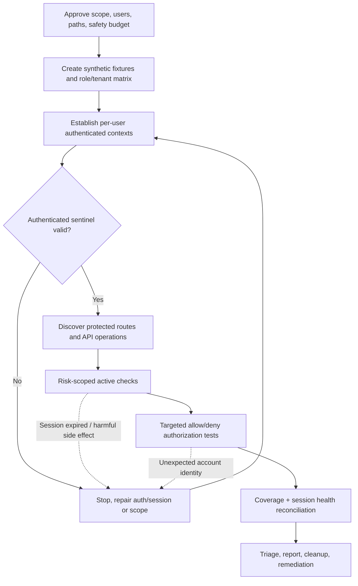
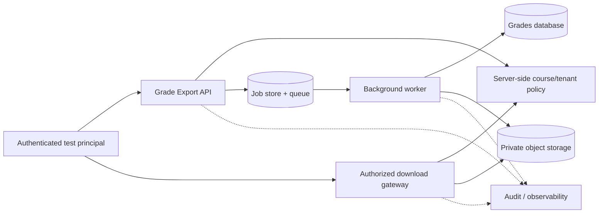

# Authenticated scan

## Mục tiêu học tập

Sau bài học, người học có thể:

- Giải thích **authenticated scan** trong dynamic application security testing (DAST), sự khác biệt giữa **quét không đăng nhập**, **quét khi có phiên xác thực** và **kiểm thử authorization giữa các vai trò/tài nguyên**.
- Lập phạm vi quét rõ ràng, chọn **tài khoản thử nghiệm theo vai trò và tenant**, thiết kế dữ liệu synthetic, giới hạn tần suất và biện pháp ngăn hành động phá hoại.
- Thiết kế cách đăng nhập phù hợp với **form login, cookie session, bearer/JWT, SSO/OIDC, SAML, MFA, API keys và mTLS** mà không vô hiệu hóa controls trên production.
- Kiểm tra **độ tươi của phiên, logout/expiry, CSRF, redirect, token refresh, anti-automation và trạng thái authenticated thực sự** trước, trong, sau scan.
- Xây dựng ma trận kiểm thử **vertical/horizontal authorization, BOLA/IDOR, multi-tenant isolation, object ownership, revoked permissions** và phân biệt rõ kết quả quét với bằng chứng kiểm thử negative.
- Diễn giải crawling/API coverage, scan limitations, false positives/negatives, DAST evidence provenance và các mức confidence của findings.
- Đề xuất ví dụ kiểm thử **Java/Spring Boot, Spring Security và MockMvc**, kết hợp authenticated DAST với integration tests và runtime control review.
- Đưa authenticated scan vào **Secure SDLC, CI/CD và security assurance liên tục** bằng acceptance criteria, Claim–Argument–Evidence (CAE), hồ sơ YAML, báo cáo và điều kiện tái kiểm.

## 1. Authenticated scan là gì?

**Authenticated scan** là hoạt động quét/kiểm thử động đối với ứng dụng hoặc API trong một hoặc nhiều **ngữ cảnh đã được xác thực hợp lệ**. Scanner thiết lập hoặc nhận một phiên/tài khoản thử nghiệm, gửi request tới ứng dụng đang chạy và quan sát response, hành vi, security headers, session handling, input validation cùng các điểm yếu có thể tiếp cận chỉ khi đã đăng nhập.

Ví dụ nền tảng học tập có các endpoint:

```text
GET  /public/courses
GET  /api/me
GET  /api/courses/{courseId}/grades
POST /api/courses/{courseId}/grades/exports
GET  /api/exports/{exportId}/download
POST /api/admin/users/{userId}/disable
```

Quét **không đăng nhập** có thể thấy route public và redirect/login responses, nhưng không đi được sâu vào trang bảng điểm, export, lịch sử học tập hoặc admin UI. Quét **có đăng nhập** giúp scanner khám phá đường đi và request thật của người dùng. Tuy nhiên, một tài khoản `teacher-a` đọc bảng điểm `course-42` thành công **không chứng minh** `teacher-b` hoặc người tenant khác bị chặn khi truy cập `course-42`.

Vì vậy, cần phân biệt ba mệnh đề:

1. **Authentication (AuthN):** ai đang gửi request và phiên/token có hợp lệ không?
2. **Authorization (AuthZ):** principal ấy được thực hiện **action** đó trên **resource/tenant** nào, trong điều kiện hiện tại?
3. **Authenticated DAST coverage:** scanner thực sự đã đi tới đâu và thử những gì với identity, state và dữ liệu cụ thể?

**Kết luận quan trọng:** một phiên quét có đăng nhập tốt mở rộng **khả năng quan sát**, nhưng **không thay thế** việc kiểm thử phân quyền theo đối tượng, tenant, vai trò và trạng thái nghiệp vụ bằng các test có đối chứng.

### 1.1. Vai trò trong Security Assurance

Phạm vi của service **SECURITY_SECURITY_ASSURANCE** là đánh giá **có bằng chứng** rằng hệ thống đáp ứng security objectives/requirements và controls từ thiết kế tới triển khai/vận hành. Authenticated scan là một nguồn evidence của **implementation/operating behavior**, cần kết nối:

```text
Threat / risk / security objective
  → Security requirement and control design
    → Authenticated scanner identity and test scope
      → Crawl/API requests + security tests
        → Evidence and coverage limitations
          → Finding / verification state
            → Remediation / re-test
              → Bounded assurance claim and ongoing monitoring
```

Một báo cáo scanner “No High findings” chỉ nói về **các yêu cầu, input, paths, state và rules scanner đã thử**, không phải chứng nhận toàn bộ hệ thống không có lỗ hổng.

### 1.2. Mục tiêu của authenticated scan

| Mục tiêu | Authenticated scan giúp được gì? | Cần bằng chứng bổ sung khi nào? |
| --- | --- | --- |
| **Access to protected routes** | Crawl trang/endpoint cần phiên và khám phá input/flows phía sau login. | Khi route dùng MFA/SSO/browsers hoặc WebSocket mà crawler chưa hỗ trợ. |
| **Session/authentication hygiene** | Quan sát login, logout, cookie, cache, token expiry và redirects. | Khi session rotation/logout toàn bộ devices hoặc IdP-side controls chưa được kiểm. |
| **Input/output handling** | DAST rules thử input trong request cần quyền. | Khi business logic/validation phức tạp, có side effects hoặc API unreachable. |
| **Role-dependent paths** | Quét với nhiều test principals để thấy routes khác nhau. | Khi phải chứng minh deny-by-resource hoặc privilege escalation bằng test cụ thể. |
| **Runtime misconfiguration** | Quan sát headers, cookies, CORS, error handling, TLS behavior trong môi trường thử. | Khi CDN/gateway/staging khác production; cần effective runtime config. |
| **Vulnerability discovery** | Tạo findings với request/response evidence và rule metadata. | Khi cần xác nhận exploitability, root cause và blast radius bằng manual review. |
| **Compliance/assurance evidence** | Test report, auth success metric, route coverage và findings. | Khi cần đối chiếu requirements/asset population và independent review. |

## 2. So sánh unauthenticated, authenticated và authorization testing

| Phép kiểm | Identity/context | Điều dễ phát hiện | Điều dễ bỏ sót |
| --- | --- | --- | --- |
| **Unauthenticated scan** | Anonymous, không có session. | Public attack surface, exposed endpoints, auth redirects, default config. | Routes chỉ xuất hiện sau login, lỗi input sâu trong workflow. |
| **Authenticated scan một account** | User có session hợp lệ ở một role/tenant. | Protected pages, inputs, session behavior của tài khoản đó. | BOLA, tenant isolation, privilege escalation nếu chỉ đi theo đúng quyền. |
| **Multi-context authenticated scan** | Nhiều test users/roles/tenants được tách biệt. | Route/feature theo vai trò, response khác nhau, nhiều điểm kiểm. | Logic phụ thuộc object ownership, trạng thái, thời điểm nếu không có negative cases. |
| **Targeted authorization tests** | Có allow/deny principal–resource–action matrix. | BOLA/IDOR, horizontal/vertical access, cross-tenant, revoked/state-dependent checks. | Những input/misconfiguration khác nếu chỉ có kiểm thử authz. |
| **SAST/SCA/design review** | Không yêu cầu request runtime. | Source patterns, dependency advisories, missing policy/control trong thiết kế. | Runtime config, hoạt động session, nhiều vấn đề stateful. |
| **Manual pentest có phạm vi** | Tester điều khiển workflows/assumptions có ủy quyền. | Multi-step business abuse, chaining, logic issues. | Không đảm bảo toàn bộ surface/time được bao phủ. |

**Kết hợp các phương pháp** thay vì xếp scanner là “bằng chứng tối cao”. Một đơn vị có thể dùng automated DAST để phát hiện regression phổ biến, integration tests để chứng minh controls và manual review để kiểm threat phức tạp.

### 2.1. Hai loại nhầm lẫn phổ biến

**Nhầm lẫn 1: Login 200 = scanner authenticated.** Response `200` có thể là trang login được render với status 200, redirect tới IdP hoặc trang lỗi giả lập. Cần kiểm **authenticated sentinel** có nội dung chỉ xuất hiện khi đúng user và role.

**Nhầm lẫn 2: Scanner tìm được resource = authorization tốt.** Scanner thường dùng tài khoản được phép nên đọc tài nguyên thành công là behavior bình thường. Để chứng minh phân quyền phải có **negative control** với user cùng role khác owner/tenant hoặc user không đủ privilege.

### 2.2. Mức độ nhận thức theo câu hỏi

| Câu hỏi | Bằng chứng được mong đợi |
| --- | --- |
| Scanner đã login? | Identity-bound auth verification, token/session freshness, authenticated-only marker. |
| Scanner đã crawl protected pages? | Route inventory, actual request/response với session hợp lệ, coverage comparison. |
| Scanner đã quét role Student và Teacher? | Hai ngữ cảnh tách biệt, trace principal/role, auth health check cho từng context. |
| Object authorization được kiểm? | Ma trận principal–resource–action–tenant và negative test results. |
| Production được bảo vệ? | Test/implementation evidence khớp version, effective production controls trong phạm vi được phép. |

## 3. Điều kiện an toàn và quyền thực hiện scan

Authenticated scan có thể tạo request **POST/PUT/PATCH/DELETE**, gửi file, kích hoạt notification, tạo job/báo cáo, xử lý thanh toán, khóa tài khoản hoặc làm thay đổi dữ liệu. DAST authenticated có thể nguy hiểm hơn unauthenticated scan nếu tài khoản scan có quyền rộng.

### 3.1. Authorization và scope phải được phê duyệt trước

Tối thiểu cần xác định:

- **Systems/hosts/API base paths** được phép và không được phép quét; tenant, environment, region.
- **Ngày/khung giờ** và hoạt động được phép: passive discovery, crawler, active testing, payload classes, rate limit.
- **Test principals** theo role/tenant, scopes và lý do từng account có quyền.
- **Routes có side effects:** admin operations, exports, billing, destructive actions, webhooks, bulk messages, external integrations.
- **Synthetic fixtures**, dữ liệu được phép thay đổi, reset/reconciliation plan và cleanup owner.
- **Rate/concurrency/timeout**, ngưỡng lỗi và điều kiện kill-switch để dừng scan.
- **Audit/observability:** ai theo dõi và ai xử lý sự cố/hệ thống suy giảm.
- **Secrets/session:** provisioning, secure transfer, TTL, token revoke, retention.
- **Incident escalation:** làm gì nếu scanner gây lỗi, nhận dữ liệu bất thường hoặc phát hiện khả năng rò rỉ thật.

Không chạy active authenticated scan bằng tài khoản production có quyền xem dữ liệu học viên thật nếu không có **đánh giá rủi ro, authorization rõ và guardrails tương ứng**. Ưu tiên môi trường tiền production có cấu hình tương đồng và dữ liệu **synthetic**, sau đó bổ sung runtime production checks an toàn, có scope.

### 3.2. Tài khoản test có quyền tối thiểu

Mỗi tài khoản dùng cho scan nên:

- Được **tạo và định danh riêng**, không mượn tài khoản người thật.
- Có password/token trong secret manager, TTL phù hợp và rotation/revocation.
- Có role/tenant/ownership rõ, không dùng admin để “quét được mọi thứ”.
- Có thể reset dữ liệu/transactions trước và sau scan.
- Có audit label/trace marker để phân biệt scanner traffic với người dùng.
- Không dùng token hoặc credential trong report, screenshots hay CI logs.

Với business logic nhạy cảm, một principal tối thiểu vẫn có thể tạo export/email/ghi database trong phạm vi của mình. **Least privilege chưa đủ; còn cần safe fixtures, endpoint allowlist và giới hạn side effects.**

### 3.3. Thứ tự scan theo rủi ro

Một cách tiếp cận:

1. **Inventory, design và risk:** xác định threat, roles, protected endpoints và dependencies.
2. **Passive authenticated discovery:** truy cập/navigation bằng browser/API client an toàn, không chủ động biến đổi dữ liệu.
3. **Baseline auth and coverage validation:** kiểm session còn hợp lệ, protected routes được phát hiện, không trôi sang account khác.
4. **Active testing có kiểm soát:** chỉ ở routes/fixtures được phê duyệt, loại trừ destructive operations.
5. **Targeted authorization tests:** thực hiện chính xác allow/deny scenarios cho resource/tenant.
6. **Triage, re-test, reporting:** chuẩn hóa finding, đối chiếu behavior, xử lý leaks và cleanup.

Quét active **không phải mặc định an toàn** chỉ vì hệ thống là staging; staging vẫn có thể kết nối vendor production, email thật, billing sandbox chung hoặc database replication.

## 4. Thiết kế test identity, role và tenant

### 4.1. Ma trận identity minh họa

Ví dụ nền tảng học tập có hai tổ chức **Tenant A** và **Tenant B**, các lớp `course-42` và `course-99`:

| Principal | Role | Tenant | Quan hệ được cấp quyền | Mục đích |
| --- | --- | --- | --- | --- |
| `student-a` | STUDENT | A | Đăng ký course 42; chỉ xem hồ sơ/kết quả của mình. | Student profile, self-service authorization. |
| `student-b` | STUDENT | A | Đăng ký course 42 nhưng khác learner ID. | Horizontal IDOR/BOLA kiểm dữ liệu người khác. |
| `teacher-a` | TEACHER | A | Được phân công course 42. | Positive control xem điểm/lập export. |
| `teacher-b` | TEACHER | A | Không được phân công course 42. | Same-role wrong-object negative control. |
| `teacher-c` | TEACHER | B | Được phân công course 99. | Cross-tenant negative control. |
| `support-a` | SUPPORT | A | Chỉ có quyền hỗ trợ trong ticket có scope/time nếu được duyệt. | Kiểm purpose-bound/temporary access. |
| `admin-a` | TENANT_ADMIN | A | Quản trị users trong tenant A. | Vertical privilege control trong tenant. |
| `anonymous` | NONE | N/A | Không có session. | Authenticated boundary và unauthenticated comparisons. |

Các principal này là **dữ liệu giả định cho bài học**, không phải tài khoản có thật.

### 4.2. Đừng tạo một tài khoản “siêu người dùng” làm cả coverage

Account admin có thể xem hầu hết routes, giúp crawler khám phá nhiều UI nhưng có thể:

- Không đại diện cho control đối với role phổ biến.
- Làm scanner ghi nhận “mọi route đều cho phép” mà không phát hiện privilege escalation.
- Tạo hoặc xóa dữ liệu ngoài ý muốn.
- Che BOLA bởi admin thực sự có quyền nhiều đối tượng.
- Có credential/secret rủi ro cao nếu lộ trong scanner/session artifacts.

Thiết kế tốt dùng **nhiều contexts có giới hạn**, lưu mapping auth state và test per role/tenant, thêm targeted negative tests trên resource fixture được thiết kế.

### 4.3. Authorization matrix cho từng action

| Action / Resource | teacher-a | teacher-b | teacher-c | student-a | anonymous |
| --- | --- | --- | --- | --- | --- |
| Xem grade của course 42 tenant A | ALLOW | DENY | DENY | Chỉ self-scope theo policy | DENY |
| Export grade course 42 tenant A | ALLOW | DENY | DENY | DENY | DENY |
| Xem grade course 99 tenant B | DENY | DENY | ALLOW | DENY | DENY |
| Download export của teacher-a | ALLOW | DENY | DENY | DENY | DENY |
| Vào admin endpoint tenant A | DENY | DENY | DENY | DENY | DENY |

Giá trị `ALLOW`/`DENY` cần xuất phát từ **security requirements và business policy đã phê duyệt**, không suy theo tên role. Ví dụ student đọc “grade course” có thể cần một route/DTO riêng theo learner, thay vì trả danh sách cả lớp.

### 4.4. Phân biệt horizontal và vertical authorization

- **Horizontal access control:** cùng cấp/role nhưng khác owner/resource, ví dụ `teacher-b` truy cập course của `teacher-a`.
- **Vertical access control:** role thường dùng chức năng quản trị, ví dụ student gọi user-disable API.
- **Tenant isolation:** một principal tenant A gọi resource thuộc tenant B dù có cùng role.
- **State/purpose-bound authorization:** quyền phụ thuộc phân công còn hiệu lực, ticket hỗ trợ, consent, approval hoặc thời điểm thực thi.

Authenticated crawl có thể **khám phá request** phục vụ những kiểm thử này; muốn kết luận đúng phải kiểm **server behavior** khi thay principal/resource/state trong các ca được ủy quyền.

## 5. Phân loại cơ chế xác thực cho scanner

### 5.1. Form login và cookie session

Một ứng dụng cổ điển nhận username/password ở form, sau đó đặt session cookie. Scanner cần:

- Truy cập login entry point được phê duyệt (có thể gồm CSRF token/hidden fields).
- Gửi credentials test qua TLS tới đúng host.
- Theo dõi redirect và **Set-Cookie** đúng domain/path/SameSite/Secure/HttpOnly theo policy.
- Giữ cookie jar tách biệt cho từng user context, không chia sẻ giữa các test principals.
- Có signal xác định login thành công **ngoài status 200**.
- Tái xác thực khi session hết hạn mà không lặp vô hạn hoặc gây account lockout.
- Xử lý logout, session renewal và account-switch đúng isolation.

Các cookie attributes là một phần **đánh giá session security**, không có nghĩa scanner được phép tắt Secure/HttpOnly hoặc bypass CSRF để “đăng nhập dễ hơn”.

### 5.2. API bearer token và JWT

Với API nhận header:

```http
GET /api/me HTTP/1.1
Host: learning-test.example
Authorization: Bearer <synthetic-test-access-token>
Accept: application/json
```

Scanner/API runner cần quản lý token **thật sự còn hiệu lực**, đúng issuer, audience, scopes, tenant và expiry. Nếu access token ngắn hạn, phải có cách cấp mới được phê duyệt trong môi trường kiểm thử. Không hardcode token vào repo, scan report, screenshot hoặc file HAR mở rộng.

**JWT là một định dạng token, không tự chứng minh ủy quyền**. Một token có role TEACHER không có nghĩa principal được xem mọi course. API vẫn cần kiểm action/resource/tenant tại server.

### 5.3. SSO và OpenID Connect

Ứng dụng hiện đại có thể dùng **OIDC Authorization Code + PKCE** qua IdP và callback redirects. Crawler chỉ gửi POST login trực tiếp thường không tái hiện được toàn bộ flow. Những lựa chọn có thể dùng theo chính sách:

- Browser-based authenticated context có automation ở **test IdP/tenant**.
- Test identities/clients được cấp quyền và quản lý qua identity team.
- Controlled pre-authenticated sessions hoặc test-only APIs **có giới hạn môi trường và không bỏ qua production controls**.
- API-level tests dùng token thực từ cơ chế cấp hợp lệ cho test client, tách user identity khỏi service identity.

Cần giữ các ràng buộc **state, nonce, redirect URI, issuer/audience/PKCE, session binding** theo flow, không tắt chúng để chạy scanner. Với login có MFA, ưu tiên **test MFA mechanism** được IdP hỗ trợ cho automation có ủy quyền, hoặc tách phép kiểm MFA ra khỏi authenticated DAST bằng một identity test harness được quản trị.

### 5.4. SAML, API key và mTLS

| Cơ chế | Khó khăn điển hình | Cách tổ chức |
| --- | --- | --- |
| **SAML SSO** | Redirect/POST binding, signed assertions, expiry, browser session. | Browser automation hợp lệ, test IdP, session health checks. |
| **API keys** | Key không nhất thiết đại diện người dùng; scopes/rotation và log leakage. | Chỉ test endpoints/service context đúng scope; không gọi đó là user-level authz. |
| **mTLS** | Client certificate và channel identity gắn workload. | Certificate test được phê duyệt, secret/key protection, scope theo workload. |
| **Signed requests** | Canonicalization/timestamp/replay semantics. | Dùng client verifier và test implementation đúng protocol, không tự tắt signature checks. |
| **Delegated OAuth** | Scope/resource consent, refresh/revocation, token audience. | Client registration cho test tenant, exact scopes, reauth/revoke controls. |

Một scanner chạy với **service account privileged credential** có thể đi vào các route mà người dùng bình thường không thấy, nhưng kết quả **không đại diện** cho quyền user-level.

## 6. Session health: chứng minh scanner vẫn được xác thực

### 6.1. Authenticated sentinel

Một **authenticated sentinel** là request hoặc thuộc tính đáp ứng chỉ xuất hiện khi đúng principal có phiên hợp lệ. Ví dụ:

```text
GET /api/me
Expected:
  status = 200
  userId = fixture identity of teacher-a
  tenantId = tenant A
  effective roles = [TEACHER]

Negative:
  anonymous context must not receive this identity
  teacher-b context must not report teacher-a identity
```

Scanner nên xác minh sentinel:

- **Trước scan:** đăng nhập thành công với đúng account.
- **Trong scan theo chu kỳ hoặc event:** phát hiện session expiry, logout hoặc redirect tới IdP.
- **Sau scan:** xác định cuối phiên không bị mất authentication.
- **Khi switch identity:** cookie/token/user context thực sự đổi, không reuse cookie từ user trước.

Sentinel **không nên hiển thị raw PII**; user ID synthetic và role/tenant trong môi trường test là đủ.

### 6.2. Những dấu hiệu mất session

| Dấu hiệu | Nguyên nhân có thể | Quyết định |
| --- | --- | --- |
| `302` tới login/IdP | Token/session hết hạn, cookie scope, SSO challenge. | Tạm dừng/reauth context, không tính routes sau đó là authenticated coverage. |
| `200` nhưng HTML là trang login | Login form được trả status 200. | Parse sentinel, không đánh dấu authenticated theo status. |
| `401` trên nhiều API | Access token hết hạn/sai audience/scope. | Xem auth mechanism và refresh, phân biệt scan finding. |
| `403` trên route hợp lệ | Không đủ quyền, CSRF thiếu, WAF hoặc policy. | Phân tích expected authz và request prerequisites. |
| Cookie/session thuộc user khác | Context isolation lỗi hoặc scanner dùng shared state. | Dừng scan, xóa context, điều tra integrity và kết quả trước đó. |
| Rate limit/MFA lockout | Scanner retry quá nhanh, login automation sai. | Dừng, thông báo owner và điều chỉnh theo policy. |
| Response giống nhau mọi route | Có thể redirect, SPA shell, soft-404 hoặc auth wall. | Kiểm body/content type/sentinel và route coverage. |

Một scanner gửi request sau khi session đã hết hạn có thể tạo **false negatives hàng loạt**, vì nó chỉ nhận login page thay vì chạy test trên protected endpoint.

### 6.3. Xác thực khác ủy quyền

Nếu `GET /api/me` trả đúng `teacher-a` thì biết scanner **đang dùng đúng identity ở endpoint sentinel**. Điều này **không chứng minh** mọi route khác đều yêu cầu đúng quyền. Cần test object-level authorization ở phía API/service, không chỉ ở UI.

## 7. CSRF, CORS, cookie và token trong authenticated scan

### 7.1. CSRF ảnh hưởng cách tái hiện request

Ứng dụng dùng session cookie và các thao tác thay đổi trạng thái thường cần cơ chế chống **Cross-Site Request Forgery (CSRF)**. Một scanner tạo `POST` không có CSRF token có thể nhận `403` **trước khi authorization/business logic được kiểm**.

Quy trình phù hợp:

1. Xác định app dùng session-cookie hay API token mechanism, route nào cần CSRF theo policy.
2. Thu thập token/nonce qua **luồng ứng dụng hợp lệ** của test principal.
3. Với request biến đổi dữ liệu, dùng token gắn với đúng session/context.
4. Trước khi triage `403`, phân biệt lỗi **CSRF prerequisite** và lỗi **authorization**.
5. Không tắt CSRF trên production chỉ để scanner báo nhiều routes được crawl.
6. Xác minh phần CSRF bằng test riêng với các expected accept/reject cases.

Ví dụ request tổng quát:

```http
POST /api/courses/42/grades/exports HTTP/1.1
Host: learning-test.example
Cookie: SESSION=<synthetic-session-value>
X-CSRF-TOKEN: <approved-test-session-csrf-token>
Content-Type: application/json

{"format":"CSV"}
```

Đây là **minh họa**; header, cookie và cơ chế nhận CSRF thực tế tùy framework/config. Không đưa session values thật vào báo cáo hoặc repo.

### 7.2. CORS không thay server-side authorization

**Cross-Origin Resource Sharing (CORS)** là chính sách trình duyệt đối với cross-origin requests. Scanner/API client không bị ràng buộc CORS giống browser nên có thể gửi request mà browser frontend bị chặn. Vì vậy:

- Việc **CORS policy chặn trình duyệt** không chứng minh resource được bảo vệ khỏi API client trực tiếp.
- CORS phản hồi rộng bất thường có thể là finding cần triage theo credentialed requests và data exposure.
- Không dùng CORS như access control đối với grades, exports hoặc admin endpoints.
- Cần authn/authz server-side phù hợp trên mọi request bất kể Origin.

### 7.3. Cookie scope và context isolation

Khi scanner quét nhiều tenant/subdomains, phải xét:

- Domain/path restrictions: cookie có gửi tới host/path được phép không?
- `Secure`/`HttpOnly`/`SameSite` phù hợp với security policy?
- Redirects và cross-site SSO có làm mất session hay tạo context mới không?
- Logout/reauth có rotate session ID theo expected flow?
- Có session fixation hoặc session mix-up giữa accounts trong test harness?

**Không hợp nhất cookie jars của các roles** để “tăng coverage”. Nếu account `teacher-a` gửi request với cookie của `admin-a` thì các phát hiện và coverage đã không còn gắn với identity đúng.

### 7.4. Token refresh và session expiry

Một đợt scan dài có thể vượt TTL của access token. Refresh flow được phép dùng **test-specific identity/secret** và phải:

- Phân biệt access token với refresh token, không copy refresh token vào artifacts.
- Kiểm issuer/audience/scopes/tenant và response khi refresh bị thu hồi.
- Log **event metadata** (refresh success/failure, time) chứ không log bearer bytes.
- Khi refresh thất bại, dừng hoặc chuyển `AUTHENTICATION_UNVERIFIED`; không tiếp tục tính coverage.
- Giữ scan contexts độc lập nếu nhiều users chạy song song.

### 7.5. Kiểm logout và revocation

Quét có đăng nhập cũng có thể giúp quan sát session management:

| Kịch bản | Expected security behavior | Lưu ý |
| --- | --- | --- |
| Logout từ app | Session phía app hết hiệu lực theo policy. | SSO session tại IdP có thể còn; cần phân biệt global logout. |
| Access token hết hạn | API từ chối token expired. | Không tự suy refresh token cũng hết hiệu lực. |
| User bị khóa hoặc quyền bị thu hồi | Protected action không được tiếp tục dựa vào stale privileges. | Authorization cache/token claims cần requirement rõ. |
| Token dùng sai audience | Resource server từ chối theo expected token validation. | Negative test phải dùng token được tạo hợp lệ cho môi trường test. |
| Session ở tenant A bị dùng trên tenant B | Không truy cập dữ liệu cross-tenant trái policy. | Identity không chỉ là một vai trò chung. |

Các trường hợp trên cần **test cases chuyên biệt**, không kỳ vọng một crawler tự động tìm đủ mọi trạng thái.

## 8. Khám phá surface và độ bao phủ có xác thực

### 8.1. Crawl protected UI

Với ứng dụng server-rendered, crawler có thể theo liên kết HTML và form. Với **single-page application (SPA)**, route/page có thể chỉ xuất hiện sau khi JavaScript chạy, user tương tác menu, load dynamic content hoặc thực hiện authenticated fetch. Do đó cần:

- Browser-aware crawl nếu công cụ hỗ trợ, với phiên **đã xác thực**.
- Navigation paths/seed URLs đã được review từ application owner.
- API requests đã được capture/sanitized từ user journeys.
- State management: course selection, feature flags, pagination, multi-step flows.
- Scope restrictions cho external domains và third-party redirects.
- Không giả định crawler đã đi qua mọi conditional branch vì homepage sau login tải thành công.

### 8.2. API-first authenticated scan

Đối với REST APIs, có thể kết hợp:

- **OpenAPI specification** và actual route inventory từ running service.
- Test users có scopes/roles phù hợp với từng operation.
- Authenticated request collections với examples chứa **synthetic IDs**, không phải production secrets.
- Contract/integration tests cho endpoints cần business state.
- Dynamic scanner gửi các input an toàn trên approved operations.

Lưu ý: OpenAPI spec có thể **thiếu hoặc lỗi thời**. Scanner import được toàn bộ spec vẫn không chứng minh mọi route thực tế đã được phát hiện. Cần đối chiếu với runtime routes, gateway/ingress, job APIs và versioned service catalog.

### 8.3. Những interface cần review riêng

| Loại interface | Tình huống gây thiếu coverage | Giải pháp |
| --- | --- | --- |
| REST API | Spec thiếu route/private version; crawler chưa tạo resource prerequisites. | Inventory reconciliation, fixtures, operation-specific tests. |
| GraphQL | Một endpoint nhận nhiều operations/fields; scanner chỉ nhìn URL `/graphql`. | GraphQL schema/operations, per-field authz và complexity tests trong scope. |
| WebSocket | Upgrade handshake authenticated nhưng message-level authorization khác. | Protocol-aware tests cho subscriptions/messages và revoked access. |
| gRPC | HTTP crawler không hiểu protobuf schemas/metadata. | gRPC-aware tools và explicit authorization tests. |
| File upload/download | Multipart/stream, signed URL hoặc object store bypass. | Test files synthetic, access/download negative tests, malware-safe fixtures. |
| Async jobs/queues | HTTP `202` thành công nhưng worker hoạt động sau đó. | Job state/worker/storage/effects verification. |
| OAuth/SSO callback | IdP và redirect routes ngoài scope scanner. | Review authentication protocol, safe test IdP và callback validation tests. |
| Admin/support console | Dynamic elevated access có TTL/ticket. | Controlled high-privilege test window với owner/guardrails. |

Không ép một công cụ DAST HTTP thông thường chứng minh những lớp nó **không thể quan sát**, đặc biệt queue, direct storage và internal service authorization.

### 8.4. Định nghĩa coverage có mẫu số

Có nhiều loại coverage khác nhau:

1. **Discovered route coverage:** số routes được scanner thấy / số routes được inventory.
2. **Authenticated route coverage:** số routes được truy cập với **valid test identity** / số routes cần auth đã xác định.
3. **Role/tenant coverage:** số principal–operation combinations được kiểm / số combinations trong policy matrix.
4. **Negative authorization coverage:** số deny scenarios có thực thi và verify / số scenarios threat-based đã xác định.
5. **Input surface coverage:** số parameters/forms/API operations được thử với rules / population hợp lệ.
6. **Runtime version coverage:** những builds/environments tương ứng với test report / release target.

Vì vậy, có thể có “95% URLs discovered” nhưng “20% cross-tenant negative cases verified”. Báo cáo phải giữ **các đơn vị đếm riêng**, không trộn thành một phần trăm “security tested”.

### 8.5. Công thức minh họa

\[
\text{Authenticated Route Coverage}
=\frac{\text{Số route được xác minh đã truy cập trong phiên hợp lệ}}
{\text{Tổng route cần xác thực trong inventory đã phê duyệt}}\times100\%
\]

\[
\text{Authorization Negative Coverage}
=\frac{\text{Số deny scenarios đã thực thi và xác minh kết quả}}
{\text{Số deny scenarios được xác định từ policy/threat model}}\times100\%
\]

Nếu thiếu inventory, phải ghi `INSUFFICIENT_EVIDENCE` về coverage denominator hoặc giới hạn kết luận theo population đã kiểm, không suy `100%` từ danh sách scanner tự khám phá.

## 9. Thiết kế scan plan từ security requirements và risk

### 9.1. Từ threat tới test

| Risk/threat | Requirement/control | DAST hoặc targeted test | Evidence cần |
| --- | --- | --- | --- |
| BOLA trên bảng điểm | Server-side permission theo course và tenant. | Same-role wrong-course, cross-tenant, anonymous negative. | Identity, fixture, route, denied result và no data leak. |
| Privilege escalation | Student không được gọi admin actions. | Student context trên admin operation an toàn/synthetic. | 403/404 policy, không có side effect. |
| Session expiry bypass | Expired/revoked token không được cấp quyền. | Access token expiry/revocation test. | Token metadata (không lưu raw token), request result, policy. |
| CSRF trên form state-changing | Cookie-auth request cần CSRF protection theo policy. | Missing/invalid CSRF negative ở test fixture. | Expected deny, valid positive control. |
| Insecure input handling | Protected API không thực thi input không an toàn và xử lý errors đúng. | Approved input tests, schema validation and safe payloads. | Sanitized requests, status, behavior và logs. |
| Sensitive data leakage | Error/log/export không tiết lộ PII/token ngoài policy. | Authenticated error-path scan + log-to-sink review. | Redacted response, trace/audit sink evidence. |
| Replay/duplicate export | Worker tạo đúng một kết quả hợp lệ theo job state. | Approved duplicate/retry test, reconciliation. | Job IDs synthetic, state transitions và cleanup. |
| Tenant-scoped file download | Người khác không tải được file dù biết `exportId`. | Cross-user/cross-tenant file download negative test. | Deny/no bytes delivered, storage access audit. |
| Missing rate limits | Sensitive operation không bị abuse vượt budget. | Controlled load/rate behavior trong giới hạn được duyệt. | Rate policy, response, counters, no service degradation. |

Không phải mọi scenario đều thích hợp với **automated active scanner**. Nếu test có thể gửi email thật, sửa điểm, xóa tài khoản hoặc tác động tài chính, hãy dùng **isolated fixtures và targeted integration tests** với điều kiện có người kiểm soát.

### 9.2. Risk-based prioritization

Trong môi trường học tập, những đường như **bảng điểm, hồ sơ định danh, chứng chỉ, export, tài khoản support/admin, secrets và tenant controls** thường cần attention cao theo sensitivity/business impact. Nhưng priority thực tế phải dựa vào threat model, asset classification, exposure và risk owner.

Nếu có ít thời gian, đừng chọn chỉ trang dashboard “nhiều click nhất”. Ưu tiên:

- Protected high-impact operations.
- User-controlled object references và tenant boundaries.
- Dữ liệu cá nhân, nội dung nhạy cảm, keys/tokens và exports.
- Các endpoint thay đổi quyền/trạng thái.
- Dòng async và direct storage/file access.
- Các security fixes/finding đã từng thất bại.

### 9.3. Coverage matrix gắn test identity

```text
Scope: learning-api build R, staging tenant fixtures
Account contexts:
  teacher-a @ tenant A (assigned course 42)
  teacher-b @ tenant A (not assigned course 42)
  teacher-c @ tenant B (assigned course 99)
  student-a @ tenant A
  anonymous

Routes and outcomes:
  GET /api/me                          auth sentinel per account
  GET /api/courses/42/grades           allow teacher-a; deny b,c,anonymous
  POST /api/courses/42/grades/exports  allow teacher-a; deny b,c,student
  GET /api/exports/{teacher-a-export}  allow teacher-a; deny b,c,student
  POST /api/admin/users/{id}/disable   deny all non-admin fixtures
```

IDs phải thuộc **synthetic test data được cấp quyền**, không đoán/tìm kiếm đối tượng của khách hàng thật để “đủ coverage”.

## 10. Quy trình authenticated scan từng bước

### Bước 1 – Xác nhận phạm vi và design artifacts

Nhận target hosts, API/routes, release/build, authentication architecture, user journeys, role/tenant matrix, data classification, scanner limits và approval. Rà soát third-party callbacks, notification, payment, file export và dữ liệu chia sẻ.

### Bước 2 – Chuẩn bị test environment và fixtures

Tạo identities/test tenant/resources bằng **cơ chế được phê duyệt**, bảo đảm data synthetic và khả năng reset. Ghi fixtures có phân công, ownership, privileges và expected allow/deny; tạo baseline snapshot nếu scan có thể ghi dữ liệu.

### Bước 3 – Thiết lập cách authentication

Cấu hình scanner dùng browser session, login flow, API bearer token hay client certificate tương ứng. Secrets được lấy từ secret manager hoặc injection bảo vệ, không đưa vào cấu hình nguồn có thể commit. Giới hạn authentication script không vô tình gọi các endpoints khác.

### Bước 4 – Kiểm auth context và negative sentinel

Với từng account, gọi `/api/me` hoặc probe đáng tin, kiểm đúng principal/role/tenant. Với anonymous context, kết quả không được giống user đã login. Dừng nếu session mix-up hoặc response là login page.

### Bước 5 – Discovery/crawling có kiểm soát

Import API contract đã kiểm, duyệt UI hợp lệ, ghi các routes được khám phá. Loại trừ external domains, logout, destructive/unapproved operations và paths có dữ liệu thực; bảo đảm scan không vượt test tenant.

### Bước 6 – Active testing theo risk budget

Chạy chỉ các check phù hợp scope và traffic budget. Theo dõi HTTP rates, queue depth, mailboxes và health, có stop conditions khi lỗi tăng. Nếu scanner tạo state, dùng synthetic resources, idempotency keys hoặc cơ chế reset được kiểm.

### Bước 7 – Targeted authorization testing

Chạy ma trận positive/negative bằng test runner hoặc manual checks trong scope; ghi expected và actual, không chỉ status code. Kiểm cross-tenant, same-role other object, revoked permissions, status/job lifecycle và direct download.

### Bước 8 – Đánh giá session và coverage

Thu authentication health events, route inventory diff, API operation coverage, test case population, exclusions/unknowns. **Không tính requests sau session expiry là authenticated coverage**.

### Bước 9 – Triage findings

Xác minh findings với code/config review hoặc safe reproduction; phân biệt auth failure, WAF, false positive, scanner limitation, vulnerability thật. Nếu phát hiện credential leak/PII exposure, thực hiện incident handling theo policy.

### Bước 10 – Cleanup, re-test và báo cáo

Xóa synthetic jobs/files, revoke test tokens, ghi thay đổi/tác động, lưu sanitized evidence và report. Sau remediation phải chạy lại tests đúng scope/version và giữ `INSUFFICIENT_EVIDENCE` nếu thiếu evidence runtime.



## 11. Tự động hóa scanner: thiết kế độc lập với công cụ

### 11.1. Khái niệm Context và User

Các công cụ như **OWASP ZAP**, Burp Suite hoặc bộ kiểm thử API có thể hỗ trợ các mô hình khác nhau: context/application scope, session handling, authentication method, user identities, spider/crawler, active scan và reporting.

**Không xem một file cấu hình bất kỳ là cấu hình chính thức chạy được trên mọi version công cụ**. Tên keys và tính năng (browser/SSO automation, token refresh, API import) có thể thay đổi. Cần dùng tài liệu phiên bản công cụ mà tổ chức đã chọn, và **kiểm chứng phiên quét bằng sentinel** thay vì tin cấu hình “login OK”.

### 11.2. Manifest lập kế hoạch (schema do team tự thiết kế)

Mẫu YAML sau là **scan plan dữ liệu**, không phải cú pháp cấu hình chính thức của OWASP ZAP hoặc CI pipeline:

```yaml
scan_plan_id: "AUTH-DAST-PLAN-004"
service: "SECURITY_SECURITY_ASSURANCE"
target:
  environment: "staging"
  release: "<actual-build-id>"
  allowed_hosts: ["learning-test.example"]
  allowed_path_prefixes: ["/api/", "/dashboard/"]
  excluded_operations:
    - "DELETE /api/admin/**"
    - "POST /api/billing/**"
  external_domains: "DENY_BY_DEFAULT"
accounts:
  - identity_ref: "<secret-manager-teacher-a>"
    expected_role: "TEACHER"
    expected_tenant: "A"
    approved_resource_refs: ["course-42"]
  - identity_ref: "<secret-manager-teacher-b>"
    expected_role: "TEACHER"
    expected_tenant: "A"
    denied_resource_refs: ["course-42"]
  - identity_ref: "<secret-manager-teacher-c>"
    expected_role: "TEACHER"
    expected_tenant: "B"
    denied_resource_refs: ["course-42"]
authentication:
  mechanism: "TEST_IDP_AUTHORIZED_FLOW"
  sentinel: "GET /api/me"
  verify_expected_user_tenant_role: true
  on_expired_session: "PAUSE_AND_REAUTH_OR_ABORT"
scan_safety:
  synthetic_data_only: true
  destructive_operations: "PROHIBITED"
  max_request_rate_ref: "<approved-budget>"
  max_concurrency_ref: "<approved-budget>"
  stop_on_service_degradation: true
  side_effect_cleanup_ref: "<verified-fixture-cleanup>"
verification:
  require_positive_controls: true
  require_cross_tenant_negative_cases: true
  require_same_role_wrong_resource_cases: true
  compare_discovered_routes_to_inventory: true
reports:
  evidence_storage_ref: "<restricted-artifact-store>"
  redact: ["access-token", "session-cookie", "raw-PII"]
  owner_role: "security-qa"
  status: "NOT_RUN"
```

Không commit file này nếu chứa **credentials thật**, và không tự giả định các settings `max_request_rate_ref` có tác dụng với scanner; phải được **chuyển thành enforcement cấu hình có kiểm và quan sát traffic thực tế**.

### 11.3. Pseudocode test harness

```text
for each approved identity context:
    acquire scoped test credential securely
    establish valid session using approved authentication flow
    assert GET /api/me shows expected principal, tenant and role
    crawl/import only approved routes and API operations
    periodically assert authenticated sentinel remains valid
    stop or re-auth if login/session state is not verified
    perform only risk-approved, non-destructive active checks
    save sanitized requests, coverage, scan/rule/build metadata

for each approved authorization scenario:
    restore synthetic fixture to known state
    authenticate independently as scenario principal
    assert positive and negative behavior according to policy
    assert no forbidden data or side effects
    save test evidence tied to identity, resource and build

stop scanning if identity mix-up, rate budget breach or unsafe side effect
revoke test credentials; reconcile created jobs/files; report limitations
```

Pseudocode này mô tả **yêu cầu an toàn và khả năng quan sát**, không chỉ định tool/API cụ thể và không tự tuyên bố script đã chạy.

### 11.4. Scan script phải tự được review

Automation nhận session và credentials là một **security-sensitive component**. Cần code review và hạn chế:

- Không gửi cookies/tokens sang proxy hoặc domain ngoài scope.
- Không ghi secrets vào scanner logs, HAR, screenshots hoặc CI console.
- Không dùng tài khoản admin thay mọi roles chỉ vì tiện.
- Không bypass MFA/OIDC security checks trong production.
- Có fail-safe khi chưa authenticated, khi target host thay đổi hoặc khi session bị mix-up.
- Có tagging/tracing, rate constraints, permission to stop và rollback/cleanup.
- Tránh script retry login vô hạn làm khóa account hoặc gây load lên IdP.

## 12. Kiểm thử authorization có đối chứng

### 12.1. Kiểm theo bộ ba principal–resource–action

Một authorization assertion tốt xác định rõ:

```text
Principal: teacher-b
Tenant: A
Action: VIEW_GRADES
Resource: course-42 (assigned to teacher-a, same tenant)
Expected: DENY + NO_GRADE_DATA
Observed: <actual-result>
Evidence: <test-run-id-and-response-sanitized>
```

Cần kiểm **policy hiệu lực tại thời điểm xử lý**, không chỉ JWT role. Với BOLA:

- Dùng **hai identity cùng role** nhưng khác quyền sở hữu.
- Dùng **hai tenant** độc lập.
- Kiểm object ID được server resolve về đúng tenant, không tin `tenantId` client.
- Kiểm API reads, exports, downloads, background jobs, alternate paths và caching nếu thuộc scope.
- Kiểm trạng thái revoked/expired assignment và policy-source unavailable.
- Nếu deny theo policy, response không được chứa grade/PII hoặc tạo job/file trái phép.

### 12.2. `403` không đủ chứng minh gì?

Một request nhận `403 Forbidden` có thể do:

- CSRF token thiếu/sai.
- Không có session hoặc session hết hạn.
- WAF/proxy chặn request.
- Route không phù hợp nhưng framework trả error khác dự kiến.
- Server-side object authorization thật sự từ chối.

Để chứng minh **đúng control**, phải có **positive control** cho cùng route/fixture với user được phép, authentication sentinel, policy/code path evidence và side-effect checks.

Một hệ thống luôn trả `403` cho tất cả users **không đạt functional acceptance**, ngay cả khi negative tests màu xanh.

### 12.3. Authorization status policy

Không phải mọi hệ thống đều trả `403` khi user sai quyền. Một số API chọn `404 Not Found` để không xác nhận resource tồn tại, hoặc `401` khi thiếu authentication. Test phải dựa trên **contract/policy đã phê duyệt**:

- Phân biệt `401` thiếu/invalid authn với `403` đủ authn nhưng deny.
- Nếu `404` được chọn nhằm tránh enumeration, kiểm không lộ existence qua body, timing hoặc metadata trong scope được đánh giá.
- Với asynchronous action, có thể `202` khi request được chấp nhận để xử lý, nhưng **không có nghĩa worker đã authorize/tạo file đúng**.
- Không chỉ kiểm HTTP status; kiểm no data/no side effects, audit record và protected object access.

### 12.4. Revocation và thời điểm kiểm

Ví dụ một giáo viên tạo export lúc có quyền, sau đó bị thu hồi phân công trước khi worker thực thi. Thiết kế phải quyết định:

- Job có snapshot quyền được duyệt hay cần **re-check** trước đọc dữ liệu?
- Download cần kiểm lại access tại thời điểm tải không?
- Các kết quả đã xuất có TTL, deletion/retention và audit phù hợp không?
- Khi policy store unavailable có fail-closed/hold hay fallback có thẩm quyền?
- Race giữa auth check và job commit được xử lý thế nào?

Đây là **bài toán thiết kế/thực thi stateful authorization**, không phải chỉ thêm một account cho generic DAST rồi scanner tự phát hiện.

## 13. Case study Java/Spring Boot: authenticated scan phát hiện BOLA

### 13.1. Bối cảnh

Trong nền tảng học tập `learning-platform`, một API Spring Boot trả bảng điểm của lớp. Dữ liệu thuộc hai tenants. Những giả định đã được duyệt trong security requirement:

- `teacher-a` thuộc tenant A và được phân công `course-42`.
- `teacher-b` thuộc tenant A nhưng **không được phân công** course 42.
- `teacher-c` thuộc tenant B, chỉ được phân công `course-99`.
- User không đủ quyền không được nhận grade data hoặc tạo export side effect.
- API xác định tenant/course từ **nguồn tin cậy**, không từ body hoặc header client tùy ý.

**Threat:** người có role TEACHER có thể biết hoặc suy đoán course ID của lớp khác và đọc dữ liệu người học. DAST với `teacher-a` dễ bỏ sót vì tài khoản này vốn được phép; cần test `teacher-b` và `teacher-c` với resource 42.

### 13.2. Anti-pattern: chỉ kiểm role

```java
@RestController
@RequestMapping("/api/courses")
class GradeController {
    private final GradeRepository repository;

    GradeController(GradeRepository repository) {
        this.repository = repository;
    }

    @GetMapping("/{courseId}/grades")
    @PreAuthorize("hasRole('TEACHER')")
    List<GradeView> findGrades(@PathVariable long courseId) {
        return repository.findViewsByCourseId(courseId);
    }
}
```

Nếu không có control bổ sung ở repository/data access layer, annotation này chỉ chứng minh **role**, không chứng minh **quyền trên resource**. Một authenticated scanner chỉ dùng `teacher-a` để crawl và test response `200` có thể báo “no issues” dù `teacher-b` nhận được dữ liệu course 42.

### 13.3. Thiết kế enforcement theo object/tenant

```java
@Configuration
@EnableMethodSecurity
class MethodSecurityConfiguration {}

@Service
class GradeService {
    private final GradeRepository repository;

    GradeService(GradeRepository repository) {
        this.repository = repository;
    }

    @PreAuthorize(
        "@courseAccess.canViewGrades(authentication, #courseId)"
    )
    @Transactional(readOnly = true)
    public List<GradeView> findGrades(long courseId) {
        return repository.findViewsByCourseId(courseId);
    }
}

@RestController
@RequestMapping("/api/courses")
class SecureGradeController {
    private final GradeService service;

    SecureGradeController(GradeService service) {
        this.service = service;
    }

    @GetMapping("/{courseId}/grades")
    List<GradeView> findGrades(@PathVariable long courseId) {
        return service.findGrades(courseId);
    }
}
```

`courseAccess` là **policy bean do ứng dụng tự xây**, không phải Spring Security mặc định có sẵn. Policy cần đọc principal từ authentication đã được server xác minh, resolve course/tenant từ dữ liệu tin cậy, kiểm trạng thái phân công, action và điều kiện revocation, rồi trả allow/deny theo failure policy. Không xem việc có `@PreAuthorize` là bằng chứng đầy đủ nếu self-invocation, direct repository read, alternate endpoint hoặc worker có thể bypass.

**Không triển khai đồng thời hai controller trên cùng route trong một ứng dụng thật**: đoạn đầu là anti-pattern đối chiếu, đoạn sau là hướng thiết kế đã sửa.

### 13.4. Integration tests với MockMvc

```java
@SpringBootTest
@AutoConfigureMockMvc
class GradeObjectAuthorizationIT {
    @Autowired
    MockMvc mockMvc;

    @Test
    @WithMockUser(username = "teacher-a", roles = "TEACHER")
    void assignedTeacherCanReadGrades() throws Exception {
        mockMvc.perform(get("/api/courses/42/grades"))
            .andExpect(status().isOk())
            .andExpect(jsonPath("$").isArray());
    }

    @Test
    @WithMockUser(username = "teacher-b", roles = "TEACHER")
    void sameRoleButWrongCourseIsDenied() throws Exception {
        mockMvc.perform(get("/api/courses/42/grades"))
            .andExpect(status().isForbidden());
    }

    @Test
    @WithMockUser(username = "teacher-c", roles = "TEACHER")
    void otherTenantIsDenied() throws Exception {
        mockMvc.perform(get("/api/courses/42/grades"))
            .andExpect(status().isForbidden());
    }

    @Test
    void anonymousPrincipalMustNotReadGrades() throws Exception {
        mockMvc.perform(get("/api/courses/42/grades"))
            .andExpect(status().isUnauthorized());
    }
}
```

Đoạn kiểm thử là **ví dụ giảng dạy**, cần imports, controller/service/policy bean, users/fixtures, Spring Security Test dependency và security filter chain đúng. Nếu app dùng form login, anonymous request có thể redirect `302` thay vì `401`; test phải khớp policy thực tế và kiểu authentication. Với negative case, nên assert **không có grade records, export job hoặc side effects**, không chỉ status code.

Đây không phải một authenticated DAST scan đầy đủ: MockMvc kiểm trong test application context với mocked principals, trong khi DAST cần quan sát HTTP behavior của một deployment có cấu hình session/IdP/API gateway phù hợp. **Hai nguồn evidence bổ sung cho nhau**, không thay thế.

### 13.5. Authenticated DAST test plan tương ứng

| Test ID | Session | Request | Expected | Evidence |
| --- | --- | --- | --- | --- |
| `AT-01` | `teacher-a` | `GET /api/me` | Principal/tenant A đúng; sentinel pass. | Session health observation. |
| `AT-02` | `teacher-a` | `GET /api/courses/42/grades` | `200` và DTO chỉ gồm dữ liệu được phép. | Positive control, sanitized response. |
| `AT-03` | `teacher-b` | Cùng resource `course-42` | Deny; không grade data. | Negative same-role wrong resource. |
| `AT-04` | `teacher-c` | `course-42` tenant A | Deny; không tiết lộ cross-tenant. | Tenant isolation. |
| `AT-05` | Anonymous | `course-42` | Auth required, không grade data. | Auth boundary. |
| `AT-06` | `teacher-a` sau revoked assignment | `course-42` | Deny theo policy hiệu lực. | State transition và negative case. |
| `AT-07` | `teacher-a` khi policy store unavailable | `course-42` | Không tự grant; failure behavior theo policy. | Controlled failure test. |
| `AT-08` | `teacher-b` | `GET /api/exports/{id}` | Không thể tải export của teacher-a. | Authorization downstream. |

**Không dùng ID tài nguyên/identity thật để kiểm ngoài phạm vi**. Các kịch bản cần được tạo bằng fixture, và những tests có side effects phải chạy ở sandbox hoặc setup được phê duyệt.

### 13.6. Vì sao authenticated scan vẫn có thể miss BOLA?

- Crawler chỉ theo liên kết UI **được phép**: teacher-b không thấy đường lớp 42 nên không bao giờ gửi request trực tiếp.
- Scanner chỉ thay payload/parameters mà **không đổi principal**.
- Data fixture không có người dùng cùng role khác course/tenant.
- Scanner giữ cookie của teacher-a khi tưởng đã chuyển sang teacher-b.
- Route trả `403` vì CSRF token cũ, không vì object authorization.
- Scanner đi vào login page do hết session, nhưng vẫn tính route đã kiểm.
- Admin context có quá nhiều quyền nên mọi object access đều hợp lệ.
- Worker/download policy có lỗ hổng, nhưng generic HTTP crawl không bao phủ.

Muốn giảm false negative phải **thiết kế threat-based identity-resource matrix và instrumentation để xác minh auth state/call path**, không chỉ tăng số URL hoặc thời gian crawl.

## 14. Luồng export, worker, signed URL và trạng thái bất đồng bộ

Một phiên authenticated scan với API có thể tạo export request thành công nhưng lỗ hổng thực ở **queue/worker/file download**.



### 14.1. Những ranh giới cần kiểm

| Boundary | Auth/authorization question | Test/Evidence |
| --- | --- | --- |
| User → export API | Có quyền tạo job trên course trong tenant? | Same-role wrong-object negative; deny không tạo job. |
| API → queue | Job scope có do server quyết định, có chống sửa/replay? | Contract and tampering/integrity tests với synthetic job. |
| Queue → worker | Worker có recheck state/authorization theo design, không tin message ngoài scope? | Revoked permissions, stale jobs, duplicate delivery. |
| Worker → database | Workload identity/IAM/queries có giới hạn dữ liệu? | Effective permissions, code/config và runtime checks. |
| Worker → object store | Object scope, TTL, key use và cleanup đúng không? | Test object fixture, orphan cleanup, least privilege. |
| User → download | Người tải đúng owner/tenant, link expiry/revocation hợp lệ? | Cross-user/cross-tenant download negative test. |
| Mọi component → logs | Có lộ PII/token/presigned URL? | Error-path và log-to-sink evidence. |

### 14.2. `202 Accepted` không phải evidence hoàn thành

Status `202` thường chỉ có nghĩa API **đã nhận request để xử lý bất đồng bộ**. Nó không chứng minh:

- Worker đã đọc đúng dữ liệu.
- Job không bị sửa/replay.
- File không bị lộ tới tenant khác.
- KMS/storage IAM có least privilege.
- Download authorization kiểm đúng người dùng.
- Đã xử lý retry, orphan files hoặc retention.

Do đó, authenticated scan chỉ kiểm request tạo job phải được **ghép với job lifecycle assertions và consumer/storage/download tests** nếu requirement bao gồm end-to-end export.

### 14.3. An toàn khi scan các thao tác xuất dữ liệu

Một scanner active nếu lặp POST export hàng trăm lần có thể tạo hàng trăm file hoặc email. Tổ chức nên:

- Dùng mock/sandbox vendor và synthetic fixtures.
- Giới hạn số job, concurrency, email targets và object storage prefixes.
- Tạm loại trừ POST export khỏi generic active scan, thay bằng **targeted controlled tests** nếu cần.
- Theo dõi queue depth, retry/backoff, storage, cost, data retention và cleanup.
- Dùng test owner chịu trách nhiệm reset/reconcile.
- Dừng ngay khi có side effect ngoài dự kiến.

**Việc một endpoint có authentication không khiến hành động scanner trở nên không có rủi ro.**

## 15. Thu thập evidence đúng cho authenticated scan

### 15.1. Các thành phần của evidence bundle

Một bằng chứng hữu ích cần:

| Thành phần | Nội dung cần giữ |
| --- | --- |
| **Target identity** | Service, hosts, environment, region, build/commit/image digest. |
| **Authorization** | Scope/phê duyệt quét, owner, khung thời gian, giới hạn traffic và operations. |
| **Test identities** | ID synthetic, role/tenant/owned resources, access scope; secret lưu riêng. |
| **Authentication** | Phương pháp, valid sentinel, session health và expiry/re-auth events. |
| **Crawler/API source** | Seed routes, OpenAPI revision, discovered routes, coverage inventory. |
| **Scanner** | Tool/version, rules/policy set, scan configuration reference, start/end time. |
| **Traffic and request evidence** | Sanitized HTTP method/path/status/headers/body excerpt, correlation IDs. |
| **Behavior verification** | Expected/observed, positive/negative tests, side effects, server audit. |
| **Findings** | Finding ID, category, confidence, reproducibility, affected scope và duplicates. |
| **Limitations** | Excluded routes, unknown roles, lost sessions, rate limits, WAF/IdP restrictions. |
| **Cleanup** | Synthetic jobs/files/notifications, revoked test secrets, environment restored. |
| **Review/decision** | Owner, reviewer, false-positive triage, remediation, re-test and sign-off. |

### 15.2. Không lưu secrets trong scan artifacts

Scanner có thể ghi:

- Cookies và Authorization headers.
- Redirect `Location` chứa sensitive query parameters nếu cấu hình sai.
- Request/response bodies có bảng điểm, email, identity record.
- Presigned URLs, webhook tokens, API keys, CSRF token.
- Screenshots, HAR và browser profiles.

Cần **redact/truncate sensitive fields**, giới hạn lưu trữ và truy cập, bảo vệ artifact logs và có TTL/retention. Việc che dữ liệu không được làm mất **evidence về nguyên nhân/risk**; thay raw giá trị bằng synthetic marker, data classification và correlation references.

Nếu một scan vô tình thu được credential hoặc dữ liệu ngoài scope, áp dụng **incident/secret handling** theo policy, không gửi tiếp trong báo cáo.

### 15.3. Giữ sự khác biệt giữa raw signal và validated finding

| Evidence | Hỗ trợ kết luận | Không tự hỗ trợ |
| --- | --- | --- |
| Scanner `HIGH` alert | Có dấu hiệu cần triage theo tool/rule. | Lỗ hổng chắc chắn khai thác được trên production. |
| Login automation báo success | Tool nghĩ authentication step thành công. | Session đúng user/tenant; cần sentinel. |
| Crawled routes list | Tool quan sát những routes đó. | Toàn bộ protected inventory đã được scan. |
| Request/response `403` | Một request bị từ chối tại một lớp. | Object authorization policy đang hoạt động đúng. |
| Negative BOLA test + positive control | Behavior allow/deny theo fixture/build được kiểm. | Mọi alternate route/worker và production giống hệt. |
| Runtime access-control config | Effective policy/identity trên environment/time được quan sát. | Mọi trước/sau thời điểm đều không drift. |
| Re-test xanh trên build R | Finding behavior được kiểm đã sửa trong scope. | Không có vulnerability khác hoặc regression mới. |

### 15.4. Mức độ xác minh

- `OBSERVED`: scanner ghi nhận tín hiệu, chưa validate.
- `SUSPECTED`: có khả năng vulnerability nhưng chưa xác định affected conditions/impact.
- `CONFIRMED_IN_SCOPE`: evidence đủ cho claim cụ thể tại build/env/fixture.
- `FALSE_POSITIVE`: chứng minh tín hiệu không tương ứng điểm yếu trong scope.
- `INSUFFICIENT_EVIDENCE`: chưa thể kết luận vì auth state, route/asset scope, data hoặc evidence thiếu.
- `NOT_APPLICABLE`: rule/test thực sự không áp dụng với scope, có rationale.
- `FIXED_PENDING_VERIFICATION`: đã thay đổi nhưng chưa re-test đúng phạm vi.
- `CLOSED_VERIFIED`: re-test + evidence/approval chứng minh finding đã xử lý trong phạm vi.

Tên trạng thái có thể khác từng tổ chức. Quan trọng là **không tự nâng `OBSERVED` thành confirmed hoặc `FIXED_PENDING_VERIFICATION` thành closed khi thiếu evidence**.

## 16. Triage và ưu tiên findings sau authenticated scan

### 16.1. Quy trình triage

1. **Deduplicate** những alerts cùng root cause/resource nhưng giữ các scope/tenant/version khác nhau.
2. Kiểm tool rule, payload class, auth context, scanner version và environment.
3. Xác minh sentinel và session validity **tại thời điểm request**.
4. Phân biệt WAF, CSRF, redirect, maintenance page, account lockout với vulnerability.
5. Reproduce bằng fixture an toàn và **positive/negative control** nếu liên quan authorization.
6. Đánh giá affected scope, exploit prerequisites, data classification, exposure và business impact.
7. Tách **potential vulnerability** khỏi dấu hiệu **incident đã xảy ra**.
8. Gán owner, remediation, verification criteria, due date theo risk policy, escalation nếu cần.
9. Nếu thiếu evidence, ghi gap và giới hạn claim; không xóa alert để làm đẹp dashboard.

### 16.2. Những tình huống thường là false positive

| Dấu hiệu | Có thể là gì? | Cần kiểm |
| --- | --- | --- |
| Scanner nghĩ user trái quyền đọc grade | Response thực tế là login page với `200`. | Auth sentinel, content/body semantics. |
| Scanner báo sensitive data leakage | Body chứa synthetic email fixture được phép theo policy. | Data category/role/recipient và context. |
| Scanner báo thiếu authz khi `403` | Test request không có CSRF token. | Re-run with valid session/CSRF positive control. |
| Scanner báo server error | App có deliberate test error hoặc protection rule trong sandbox. | Response source, behavior, logs và environment. |
| Scanner thấy CORS wildcard | API không dùng credentialed browser requests cho route đó. | Exact CORS policy, data and credential context. |
| Scanner thấy token trong storage | Test environment có token stub, không đại diện production. | Actual scope và khả năng attacker đọc token. |

Một tình huống có thể là **false positive theo claim của scanner**, nhưng vẫn chứa vấn đề khác cần xem (ví dụ login form trả `200` gây false coverage). Đừng dừng ở việc đóng alert; ghi evidence và điều chỉnh plan.

### 16.3. Khi nào cần incident response?

Authenticated scan có thể phát hiện dữ liệu thật thuộc user khác, token còn hiệu lực, log chứa secrets hoặc dấu hiệu hoạt động bất thường. Khi đó cần đánh giá xem **việc kiểm thử đã chạm dữ liệu ngoài scope hoặc có khả năng xảy ra security incident**:

- Dừng các thao tác có thể tăng tác động.
- Bảo vệ evidence, không sao chép dữ liệu thêm.
- Báo cho security/incident owner và data/privacy owner đúng thẩm quyền.
- Thu hồi/rotate credential nếu cần, đánh giá exposure và nghĩa vụ notification.
- Tiếp tục tracking vulnerability riêng với incident case nếu root cause phải sửa.

**Không khẳng định dữ liệu đã bị đánh cắp** chỉ vì một test cho thấy khả năng truy cập, cũng không che việc scanner vô tình xử lý dữ liệu thật.

### 16.4. Contextual risk chứ không chỉ scanner severity

Một DAST tool có thể chấm “Medium”, nhưng một BOLA trên bảng điểm nhiều trường có thể là priority cao vì data sensitivity và blast radius. Ngược lại, một header thiếu trên static public page có thể không có impact như tool severity ngụ ý. Cần xét:

- Asset/risk/security requirement và exposure.
- Role/prerequisites, exploitability và known exploitation evidence.
- Affected user/tenant population.
- Compensating controls **có verified evidence**.
- Impact tới confidentiality/integrity/availability/privacy.
- Remediation feasibility, release impact và risk authority.

Kết quả scanner là **đầu vào** quyết định, không tự là residual-risk approval.

## 17. Authenticated scan trong CI/CD và Secure SDLC

### 17.1. Mô hình nhiều tầng

| Gate | Bằng chứng / hoạt động | Không nên kỳ vọng |
| --- | --- | --- |
| **Design & requirements** | Threat model, protected routes/roles/tenants, authn/authz acceptance criteria. | DAST tự phát hiện policy còn chưa được mô tả. |
| **Unit/integration tests** | Spring Security tests, mock users/real policy fixtures, positive/negative cases. | Chứng minh production IdP/gateway config. |
| **Ephemeral/staging authenticated DAST** | Browser/API crawl, session validation, approved active rules, sanitized report. | Quét mọi business state/third-party component. |
| **Pre-release verification** | Targeted high-risk paths, resolved findings, auth context coverage, build linkage. | Scan xanh tự động đồng nghĩa release approved. |
| **Safe production runtime checks** | Version/config/identity/limited canary tests có quyền. | Quét destructive production bằng tài khoản thật. |
| **Continuous assurance** | Re-scan/change triggers, regression tests, runtime drift, finding lifecycle. | Một scan đầu tiên còn hiệu lực mãi mãi. |

### 17.2. Điều kiện admission của scan evidence

Trước khi dùng scan report để quyết định gate, có thể yêu cầu:

- Build/release/target environment được ghi và khớp candidate release.
- Scanner authentication sentinel **PASS trong phần lớn/đúng mọi giai đoạn được yêu cầu**, không có identity mix-up.
- Route/API coverage denominator có đối soát.
- Scanner config/rules/test personas và traffic budget được version-control.
- Findings critical/high theo policy đã triage; known blockers không được che.
- Security authorization regression tests và relevant negative cases đã chạy.
- Evidence được redacted nhưng có provenance.
- Exceptions/unknowns/side effects có owner, gate và decision authority.

**Không đặt gate “scanner produced zero alerts” như điều kiện duy nhất**: một scanner không đăng nhập được cũng có thể có zero findings.

### 17.3. Chuyển giao CI → reviewer

```text
Build R produced
  → Deploy to approved test environment E
  → Provision synthetic principals and tenant fixtures
  → Verify independent session contexts
  → Run scoped authenticated crawl + safe active DAST
  → Run explicit authz and business-state regression tests
  → Reconcile route coverage, session health and findings
  → Security reviewer checks evidence and limitations
  → Release/risk authority makes separate decision
```

CI có thể thực thi nhiều bước, nhưng **không tự thay thế approval authority** cho ngoại lệ rủi ro, dữ liệu/cross-border transfer hoặc release.

### 17.4. DAST fail policy và cảnh báo sai

Pipeline cần phân biệt:

- **Tool failure:** scanner không chạy, không lưu report hoặc API import lỗi.
- **Authentication failure:** token hết hạn, SSO unavailable, sentinel sai.
- **Coverage failure:** route/role/tenant population quan trọng bị bỏ sót.
- **Security finding:** vulnerability có evidence và status triage.
- **Environment failure:** service down hoặc API responses không đáng tin.
- **Test side effect:** scan tạo job/file/email ngoài expected sandbox.

Tất cả các trường hợp này **không nên được biến thành PASS**. Tùy policy và risk, có thể yêu cầu rerun, block stage, bổ sung manual verification hoặc ghi `INSUFFICIENT_EVIDENCE` với owner.

## 18. Quyết định về bằng chứng: design, implementation và operating

Authenticated scan có thể được dùng như bằng chứng hành vi của một deployment, nhưng cần đặt cạnh ba lớp assurance:

| Lớp | Claim | Evidence |
| --- | --- | --- |
| **Design effectiveness** | Authn/authz design sẽ bảo vệ data/objects/tenants khi triển khai đúng. | Architecture/DFD, threat model, policy model và review. |
| **Implementation effectiveness** | Code/CI build và endpoint behavior trong test environment thực hiện control đúng. | Code review, MockMvc/integration tests, authenticated DAST, route coverage. |
| **Operating effectiveness** | Security controls đang có hiệu lực trên environment/run window đã xét. | Effective IdP/session config, gateway/IAM/runtime logs, safe probes, monitoring. |

**Một file DAST report** dù đã authenticated thường **không bao phủ tất cả ba lớp**. Dùng claim đúng mức: “Các protected APIs được kiểm trên staging build R đáp ứng case X”, không tuyên bố “mọi production access control chắc chắn đạt”.

## 19. Claim – Argument – Evidence cho authenticated scan

**Claim – Argument – Evidence (CAE)** là cách phát biểu và kiểm tra một kết luận security assurance bằng chứng. Với authenticated scan, nên có **ít nhất ba claims riêng**: scanner thật sự được xác thực, phạm vi quét được bao phủ, và security requirement/finding đã được kiểm.

### 19.1. Claim A – Phiên scanner được xác thực đúng

**Claim A:** “Trong authenticated scan run `AS-004` trên staging build R, scanner đã thiết lập và duy trì những user contexts được phê duyệt với identity/role/tenant chính xác tại các thời điểm và requests thuộc accepted scan coverage.”

**Argument A:**

1. Mỗi test account/tenant có record, quyền và session jar/token riêng.
2. Login/token issuance qua flow hợp lệ với IdP/service target.
3. Authenticated sentinel trả principal, tenant, roles đúng theo fixture.
4. Refresh/re-auth events được quan sát; session hết hạn không bị đếm nhầm.
5. Không có dấu hiệu cookie/session mix-up hoặc target redirect ra host ngoài scope.

**Evidence A:** test identity matrix, approved auth config reference, sentinel runs trước/giữa/sau scan, event logs chỉ chứa metadata, scan session health report, timestamps và target build.

**Không được suy ra:** tất cả protected routes an toàn chỉ vì scanner login thành công.

### 19.2. Claim B – Độ bao phủ DAST được xác nhận

**Claim B:** “Các routes/API operations thuộc protected inventory P được khám phá và thử với đúng user contexts theo scan plan S, với exclusions/unknowns được khai báo rõ.”

**Argument B:**

1. Route inventory lấy từ service/API catalog và runtime/design, không chỉ URLs scanner tự tìm.
2. Scanner requests khớp route/path, environment và user identity đã xác nhận.
3. Những operations bỏ qua vì side effect/unsupported protocol có owner và verification plan riêng.
4. Thực tế scan có trace method/path/status và không chỉ request login pages.
5. Coverage numerator/denominator và observation window được tính có thể kiểm toán.

**Evidence B:** inventory version, scanner crawl/API reports, authenticated route mapping, tool/rule version, exclusions, reconciliation results và scan owner review.

**Không được suy ra:** một authenticated route đã được crawler “visited” nghĩa mọi negative security cases của route đã được test.

### 19.3. Claim C – Requirement object authorization đáp ứng trong scope

**Claim C:** “Đối với `GET /api/courses/42/grades` trên staging build R, các principal `teacher-a`, `teacher-b`, `teacher-c` và anonymous trong fixture đã được cho phép/từ chối theo security policy đã phê duyệt và không có grade data bị trả trái quyền trong các case kiểm.”

**Argument C:**

1. Requirement quy định principal–course–tenant permission rõ.
2. Fixture và identity state được xác nhận không bị mix-up.
3. Positive case `teacher-a` được phép, loại trừ deny-all/test setup lỗi.
4. Negative cases `teacher-b` và `teacher-c` bị deny, không có grade data hoặc side effects.
5. Spring policy/relevant code paths và runtime response được đối chiếu phù hợp scope.
6. Giới hạn về alternative endpoints, worker/downloader hoặc production được nêu rõ.

**Evidence C:** requirement ID/version, authorization matrix, test reports, sanitized HTTP traces, code/security review, authenticated sentinel logs, verified build/ref và reviewer sign-off.

**Không được suy ra:** API dùng cùng policy ở production nếu deployment/IAM/IdP có khác biệt; cũng không chứng minh job/export/download paths nếu chưa test.

### 19.4. Claim D – Finding đã được khắc phục

Một finding BOLA đã `CONFIRMED_IN_SCOPE` có thể có claim thứ tư sau khi fix:

**Claim D:** “Trong build R2 và đúng environment/scope được định nghĩa, behavior tạo ra `F-AUTHZ-17` không còn tái hiện; positive/negative tests đạt và fix đã được verifier xác nhận.”

**Argument:** fix thực hiện authorization theo object/tenant; test runners dùng đúng principals, fixtures, policy; deployment R2 khớp artifacts; related bypass paths thuộc scope đã được kiểm; exceptions/unknowns được giữ riêng.

**Evidence:** PR/code review, build/deploy ID, updated DAST report, MockMvc tests, targeted re-test, runtime evidence khi yêu cầu và closure decision.

**Không đánh dấu `CLOSED_VERIFIED` khi chỉ mới sửa source, chạy scan thất bại vì auth expired hoặc chưa triển khai version được kiểm**.

### 19.5. Ma trận kiểm chứng CAE

| Claim | Evidence mạnh | Evidence yếu | Trạng thái nếu thiếu |
| --- | --- | --- | --- |
| Session authenticated | Identity sentinel gắn test user/tenant xuyên scan. | Một lần POST login trả 200. | `INSUFFICIENT_EVIDENCE` |
| Protected routes covered | Versioned inventory vs valid authenticated requests. | Tool nói “spider finished”. | Coverage unknown/partial. |
| Authz requirement met | Positive/negative identity-resource matrix và actual behavior. | Scanner dùng một admin account, không thấy alerts. | `NOT_VERIFIED` |
| Finding fixed | Fix on deployed build, targeted re-test, reviewer. | Ticket Done/PR merged. | `FIXED_PENDING_VERIFICATION` |
| Production operating control | Effective runtime/IdP/IAM evidence và authorized probes. | Staging-only test report. | Production `INSUFFICIENT_EVIDENCE` |

## 20. Hồ sơ YAML cho authenticated scan và bằng chứng

Mẫu sau là **record nội bộ minh họa**, không phải schema chính thức của một scanner hay bằng chứng scan đã chạy. Các reference trong dấu ngoặc góc là placeholders; `NOT_RUN` và `INSUFFICIENT_EVIDENCE` được dùng có chủ đích.

```yaml
assessment_id: "DAST-AUTHENTICATED-004"
assessment_type: "AUTHENTICATED_DYNAMIC_TESTING"
module_service: "SECURITY_SECURITY_ASSURANCE"
title: "Authenticated scan of learning platform protected APIs"
target:
  service: "learning-api"
  environment: "staging"
  build_id: "<actual-build-id>"
  image_digest_ref: "<actual-deployed-artifact>"
  allowed_hosts: ["learning-test.example"]
  release_ref: "<candidate-release>"
  region_ref: "<verified-region>"
approval:
  authorized_scope_ref: "<approved-scan-scope>"
  approver_role: "authorized-test-owner"
  maintenance_window_ref: "<approved-time-window>"
  prohibited_operations:
    - "destructive-admin-operations"
    - "bulk-export-with-real-data"
  max_rate_and_concurrency_ref: "<approved-traffic-budget>"
  stop_conditions_ref: "<service-health-and-safety-criteria>"
identities:
  - id: "teacher-a"
    test_identity_secret_ref: "<restricted-test-identity-reference>"
    role: "TEACHER"
    tenant: "A"
    allowed_resource_ids: ["course-42"]
  - id: "teacher-b"
    test_identity_secret_ref: "<restricted-test-identity-reference>"
    role: "TEACHER"
    tenant: "A"
    denied_resource_ids: ["course-42"]
  - id: "teacher-c"
    test_identity_secret_ref: "<restricted-test-identity-reference>"
    role: "TEACHER"
    tenant: "B"
    denied_resource_ids: ["course-42"]
  - id: "anonymous"
    role: "NONE"
    tenant: null
authentication:
  mechanism: "APPROVED_TEST_IDP_FLOW"
  authenticated_sentinel_ref: "<GET-api-me-assertions>"
  cookie_token_secret_storage: "RESTRICTED"
  context_isolation_test_ref: "<pending-context-check>"
  login_verified_at: null
  session_health_result: "NOT_VERIFIED"
scan:
  scanner_name_version_ref: "<approved-tool-and-version>"
  scanner_policy_version_ref: "<ruleset-and-auth-config>"
  openapi_revision_ref: "<versioned-api-spec>"
  protected_route_inventory_ref: "<authoritative-scope-inventory>"
  scan_started_at: null
  scan_ended_at: null
  passive_scan_ref: null
  active_scan_ref: null
  traffic_safety_observation_ref: null
  request_response_sanitized_ref: null
coverage:
  eligible_protected_route_count: null
  authenticated_route_count: null
  role_tenant_matrix_ref: "<approved-authorization-matrix>"
  negative_scenarios_planned: null
  negative_scenarios_verified: null
  excluded_routes:
    - "destructive-routes-pending-controlled-review"
  coverage_state: "INSUFFICIENT_EVIDENCE"
verification:
  positive_case_ref: "<assigned-teacher-allow-test>"
  negative_case_refs:
    - "<same-role-wrong-course-test>"
    - "<cross-tenant-test>"
    - "<anonymous-test>"
    - "<revoked-assignment-test>"
  expected_policy_ref: "<approved-authorization-requirement>"
  actual_test_report_ref: null
  authorization_result: "NOT_VERIFIED"
findings: []
assurance:
  scanner_authenticated_claim: "INSUFFICIENT_EVIDENCE"
  route_coverage_claim: "INSUFFICIENT_EVIDENCE"
  authorization_requirement_claim: "NOT_VERIFIED"
  overall_decision: "NOT_ASSESSED"
  review_record_ref: null
ownership:
  application_owner_role: "learning-service-owner"
  security_qa_role: "security-qa"
  scanner_operator_role: "authorized-test-engineer"
  assurance_reviewer_role: "independent-security-reviewer"
  risk_owner_role: "authorized-risk-owner"
safety_and_retention:
  synthetic_data_only: true
  secret_redaction_policy_ref: "<approved-evidence-redaction>"
  evidence_storage_ref: "<restricted-artifacts-location>"
  cleanup_result_ref: "<pending-job-and-file-reconciliation>"
  test_credential_revocation_ref: "<pending-revocation>"
  retention_policy_ref: "<approved-retention>"
reassess_on:
  - "New routes, roles, tenants, data categories or object relationships"
  - "IdP, token, session, MFA or CSRF behavior change"
  - "New export worker, file download or third-party integration"
  - "Change to scanner version/rules or coverage inventory"
  - "Critical finding, incident or deployed build change"
```

### 20.1. Những trường không được tự điền PASS

- `session_health_result` chỉ đạt sau khi **sentinel kiểm đúng identity theo thời gian**.
- `authenticated_route_count` phải là số thực đã đối chiếu, không phải số URLs crawler thấy lúc hết session.
- `negative_scenarios_verified` phải có test results, không bằng số test cases viết trong Jira.
- `authorization_result` cần behavior evidence, không dựa vào `403` thiếu CSRF.
- `cleanup_result_ref` cần có chứng cứ job/file/notification đã xử lý an toàn nếu scan gây side effects.
- `overall_decision` có approval provenance, không tự thay bằng `PASS` trong code PR.

### 20.2. Mẫu finding riêng

```yaml
finding_id: "F-AUTHZ-EXAMPLE-017"
title: "Same-role course authorization bypass"
finding_type: "OBJECT_LEVEL_AUTHORIZATION"
requirement_id: "SR-GRADE-AUTHZ-01"
target_build: "<verified-staging-build>"
test_identity: "teacher-b"
test_resource: "course-42"
expected: "DENY_WITHOUT_GRADE_DATA"
observed: "<actual-observed-behavior>"
validation_state: "INSUFFICIENT_EVIDENCE"
evidence_ref: "<restricted-sanitary-test-artifact>"
affected_scope_ref: "<verified-scope>"
priority_rationale_ref: "<risk-and-asset-analysis>"
remediation_owner_role: "backend-service-owner"
verification_owner_role: "security-qa"
acceptance_criteria:
  - "Positive assigned-teacher case must pass"
  - "Same-role wrong-course and cross-tenant cases denied"
  - "Denied requests must not return grade data or create jobs"
  - "Retest must use actual fixed build and policy"
closure_state: "NOT_CLOSED"
exception_ref: null
```

Đây là một **record giả định chưa có observed behavior thực tế**, nên `INSUFFICIENT_EVIDENCE` là trạng thái đúng. Khi đã test thật và đủ evidence cho behavior, cập nhật status trong workflow có reviewer, không sửa kết quả bằng suy đoán.

## 21. Metrics, monitoring và tái đánh giá

### 21.1. Chỉ số đề xuất

| KPI/KRI | Câu hỏi | Diễn giải cẩn trọng |
| --- | --- | --- |
| **Authenticated scan completion rate** | Bao nhiêu runs hoàn thành trong scope được duyệt? | Tool exit 0 không đủ nếu login thất bại. |
| **Session validity coverage** | Tỷ lệ requests/probes có identity được xác minh? | Định nghĩa cách lấy mẫu/tần suất sentinel. |
| **Protected route coverage** | Bao nhiêu protected routes được truy cập với phiên hợp lệ? | Mẫu số từ authoritative route inventory. |
| **Role/tenant scenario coverage** | Bao nhiêu role–tenant combinations đã được kiểm? | Không đồng nghĩa negative authorization đã pass. |
| **Negative authorization verification rate** | Bao nhiêu deny scenarios có evidence thực? | Tách planned tests và executed tests. |
| **DAST findings confirmed/unknown/false positives** | Chất lượng tín hiệu/triage thế nào? | Không giảm unknown bằng cách đổi thành false positive. |
| **Time to triage/verified closure** | Độ trễ giữa phát hiện, sửa và re-test? | PR merged không phải verified closure. |
| **Scan-induced side effects/incidents** | Chương trình kiểm thử có an toàn không? | Zero reported incidents có thể do thiếu monitoring. |
| **High-risk paths excluded/untested** | Các đường có business impact cao còn thiếu ở đâu? | Không tính excluded routes vào coverage đã đạt. |
| **Authentication failures by cause** | SSO/MFA, token TTL, CSRF, scanner setup có ổn định? | Authentication failure không tự là vulnerability target. |
| **Regression re-open rate** | Findings có tái phát sau release không? | Đo theo finding/asset/root cause có history. |
| **Evidence completeness and freshness** | Có build, context, timestamp, inventory và reviewer? | Report có metadata nhưng test quality vẫn có thể yếu. |

### 21.2. Vì sao “100% scanned” dễ gây hiểu nhầm?

Giả sử một scan chạy thành công:

| Coverage category (dữ liệu giả định) | Hoàn tất | Mẫu số | Tỷ lệ |
| --- | ---: | ---: | ---: |
| Public + protected routes discovered | 68 | 80 | 85% |
| Protected routes visited with verified session | 42 | 60 | 70% |
| Role–operation combinations visited | 32 | 64 | 50% |
| Negative authorization scenarios verified | 12 | 40 | 30% |
| High-risk async/download paths assessed | 2 | 8 | 25% |

Đây là **số liệu minh họa**, không đại diện cho một hệ thống thật. Nếu chỉ xem scanner báo “scan complete = 100%” thì không biết 28/40 negative scenarios chưa được kiểm, hoặc một phần lớn worker/download chưa có evidence.

### 21.3. Triggers tái chạy hoặc review lại

| Thay đổi | Vì sao ảnh hưởng? | Action |
| --- | --- | --- |
| Thêm role, tenant hoặc object relationship | Authorization matrix và fixture population đổi. | Cập nhật policy scenarios và targeted tests. |
| Thay IdP, SSO, MFA, token TTL, audience/issuer | Auth flow/sentinel có thể không còn đúng. | Revalidate scanner sessions và authn controls. |
| Session cookie/CSRF framework change | Requests có thể bị chặn sai hoặc tạo bypass. | Scan prerequisites và CSRF/negative tests. |
| New API/GraphQL/WebSocket/gRPC operation | URL/operation population tăng. | Inventory + protocol-aware tests. |
| Thêm export worker/object storage/vendor | New boundaries và side effects. | Review end-to-end authorization/data protection. |
| Scanner/rule version upgrade | Detection behavior/coverage có thể thay. | Rerun representative controls, review false positive changes. |
| New sensitive data category hoặc privacy purpose | Tăng impact và requirements. | Data owner/privacy/security review và test fixtures. |
| Rollback/deployment drift | Test report có thể không còn khớp build. | Reconcile build/env, re-test affected controls. |
| Incident hoặc critical finding | Threat assumptions/risk basis thay. | Reassess priorities, test additional abuse paths, coordinate incident. |

### 21.4. Không chạy “liên tục” mà thiếu kiểm soát

Continuous assurance có thể dùng cadence theo release, risk và critical changes; không nhất thiết gửi active fuzzing vào production cả ngày. Các lựa chọn:

- CI trên test environment có state reset và synthetic data.
- Nightly/weekly authenticated safe scans theo risk/traffic budget.
- Targeted regression scan khi sửa authn/authz/input validation.
- Manual high-risk review trước launch của sensitive feature.
- Production passive monitoring hoặc low-impact approved probes khi cần.

Tất cả các modes cần **owner, evidence freshness, response handling và stop conditions**.

## 22. Sai lầm thường gặp với authenticated scan

| Sai lầm | Hậu quả | Cách xử lý |
| --- | --- | --- |
| “HTTP 200 ở login nghĩa scanner authenticated.” | Crawler chỉ xem login page nhưng báo coverage. | Identity sentinel và content checks. |
| “Có session thì authz đúng.” | BOLA/cross-tenant không được thử. | Principal–resource–action negative matrix. |
| Dùng một admin account để quét mọi trang. | Che privilege bugs, tăng blast radius và side effects. | Multi-role/tenant least-privileged test accounts. |
| Trộn cookie/token giữa accounts. | Test không còn biết principal nào, kết quả sai. | Context isolation, sentinel mỗi account. |
| Không xử lý token expiry giữa scan. | Requests về login/401 gây false negatives. | Auth health monitoring, reauth/abort. |
| Tắt CSRF hoặc MFA trên production để scan dễ. | Thay threat model và giảm bảo vệ thật. | Approved test identity mechanism, separate auth tests. |
| `403` tự động xem là authorization pass. | CSRF/WAF/route/setup có thể là nguyên nhân. | Positive control, policy-path evidence, no side effects. |
| Quét chỉ theo UI links. | Direct APIs, hidden routes, worker/download bị thiếu. | API/asset inventory reconciliation, targeted tests. |
| OpenAPI import đủ nghĩa mọi endpoint đã scan. | Spec có thể thiếu hoặc không khớp runtime. | Cross-check routes/gateway/build. |
| Active scan cả POST/DELETE ở production. | Xóa dữ liệu, tạo job/email, gây availability issues. | Scope approvals, safe operations, rate limits, synthetic fixtures. |
| Ghi bearer token/cookie trong HAR hoặc report. | Credential leakage qua artifacts. | Redaction, restricted storage, revoke khi cần. |
| Scanner “no alerts” = no vulnerabilities. | Miss business logic và unsupported protocols. | Coverage, manual/targeted tests, explicit limitations. |
| Dùng fixture không có resource sai quyền. | Không có negative cases để tìm BOLA. | Deliberate same-role other-owner and cross-tenant fixtures. |
| Test admin route có `403` do route không tồn tại. | False PASS của vertical authorization. | Positive admin case kiểm route hợp lệ trong environment test. |
| Không kiểm queue/worker/download sau `202`. | Đường cấp quyền trễ và file leakage bị bỏ qua. | End-to-end job/storage tests. |
| Gắn severity của tool trực tiếp thành business priority. | Thiếu exposure/impact và context. | Risk-based triage theo dữ liệu/tài sản. |
| Đóng finding sau sửa code, chưa deploy/re-test. | Đánh dấu cải thiện không được kiểm chứng. | `FIXED_PENDING_VERIFICATION` đến khi retest pass. |
| Không thu dọn synthetic jobs/files/tokens. | Tồn dữ liệu thử, chi phí và rủi ro credentials. | Post-scan cleanup, reconciliation, revoke. |
| Chỉ đếm số URLs crawler tìm thấy. | Mẫu số thiếu routes và role combinations. | Distinct coverage metrics, reconcile inventory. |
| Báo mọi test pass không nêu phiên bản/môi trường. | Không thể liên hệ kết quả với release đang chạy. | Build/digest/env/session evidence. |

## 23. Bài tập tình huống: authenticated scan API đa tenant

**Bối cảnh:** nền tảng học tập `learning-platform` sử dụng Spring Boot, Spring Security, PostgreSQL, Redis cache, Kubernetes và IdP qua OIDC. Tính năng mới cho phép giáo viên xem và xuất bảng điểm dưới dạng CSV. Đội QA sử dụng một DAST scanner qua proxy/browser và dự kiến trình kết quả “authenticated scan completed”.

Thông tin nhận được:

1. Scanner đăng nhập bằng một tài khoản `admin-test`, vì account này nhìn thấy nhiều menu nhất.
2. Cấu hình login trả `200` và scanner ghi “authenticated”, nhưng một số requests sau 25 phút là HTML login page.
3. Authenticated route report có 45 URLs, trong khi API inventory ghi 70 protected operations; 12 operations thuộc export/worker/download.
4. Tài khoản admin có quyền với mọi course; team chưa tạo identity `teacher-a`/`teacher-b` cùng role khác phân công.
5. API `GET /api/courses/42/grades` chỉ dùng `hasRole('TEACHER')`, chưa rõ có object-level policy ở service/repository không.
6. Đội kiểm thử gửi POST tạo export bằng scanner active và tạo 80 file trong bucket thử; không có cleanup runbook.
7. Staging kết nối cùng một email provider với production, scanner đã gửi 25 notification tới địa chỉ giả lập nhưng domain không được allowlist.
8. Một POST route trả `403`; team tuyên bố authorization được bảo vệ, nhưng request thiếu CSRF token.
9. Account `teacher-c` ở tenant B có thể đọc một resource synthetic course 42 tenant A trong test API client, trong khi test khác của UI lại không hiển thị link tới course 42.
10. Worker nhận export job từ queue và đọc grade bằng service account có quyền rộng; scanner chưa kiểm quyền lúc worker xử lý hoặc download.
11. Một token của account scan bị lưu nguyên trong log của scanner gửi tới observability SaaS ngoài assessment scope.
12. Quét active không chặn redirect ra external domains; IdP login có bước MFA khó tự động hóa.
13. Báo cáo nhận xét “No Critical findings” dù 30% requests sau token expiry không còn authenticated.
14. CI build R2 đã sửa một lỗi authorization, nhưng staging DAST report được thu trên build R1.
15. Có user permission bị thu hồi trước worker chạy; behavior khi worker đọc dữ liệu chưa được mô tả trong security requirement.

### 23.1. Nhiệm vụ thực hành

1. Phân biệt **authenticated session validity**, **route discovery**, **security test coverage** và **authorization verification**. Những khẳng định nào hiện không có đủ bằng chứng?
2. Xác định các **blockers về an toàn kiểm thử**: tài khoản admin, external domain, notification, export side effects, token logs và cleanup.
3. Thiết kế ma trận **tối thiểu năm test principals** (anonymous, students, teacher-a, teacher-b, teacher-c, admin) với tenant/course fixtures synthetic.
4. Viết **risk-based scan scope**: allowed hosts/paths, excluded/destructive operations, time/rate budget, stop conditions và safe data.
5. Thiết kế authentication sentinel `GET /api/me` và thời điểm kiểm trước/trong/sau scan. Xử lý login page `200` và token expiry ra sao?
6. Đề xuất cách tổ chức **OIDC/MFA test identities** mà không tắt các bảo vệ trên production hoặc lưu client secrets trong repo.
7. Chỉ ra vì sao UI không hiển thị link tới course 42 **không chứng minh** API server ngăn cross-tenant access.
8. Viết **positive/negative authorization tests** cho teacher-a/teacher-b/teacher-c và kiểm no data/no side effects.
9. Với `403` do thiếu CSRF, cần làm gì để xác định control đã chặn là CSRF hay object authorization?
10. Đề xuất kiểm thử **export API → queue → worker → file download** và behavior khi phân công bị thu hồi.
11. Từ số 45 discovered vs 70 protected operations, giải thích vì sao không thể báo 100% coverage. Tính tỷ lệ discovered theo đúng mẫu số đã cho.
12. Liệt kê **evidence references** cho session health, API inventory, scan tool/rule version, build R, security cases và reviewer approval.
13. Xử lý token leaked to logs: ai cần được thông báo, credential revocation và evidence protection nào áp dụng?
14. Xác định những findings **CONFIRMED_IN_SCOPE**, những signals chưa validated và những phần `INSUFFICIENT_EVIDENCE`.
15. Viết hai CAE claims riêng: scanner thực sự authenticated và object authorization đã đáp ứng; nêu tại sao evidence hiện tại chưa đủ cho claim nào.
16. Đề xuất CI/release gates để report từ R1 không được dùng làm bằng chứng vô điều kiện cho R2.
17. Thiết kế quy trình cleanup cho 80 files, 25 notification artifacts và browser/session credentials.
18. Nêu re-review triggers khi thay OIDC/MFA, thêm role, đổi worker/job contract hoặc mở region mới.

### 23.2. Gợi ý tự đối chiếu

- Dùng admin account giúp khám phá UI nhưng **che BOLA** và tăng khả năng gây side effects; cần các least-privileged test contexts riêng.
- `200` login page không phải evidence authenticated; 30% requests sau expiry phải **loại khỏi numerator authenticated coverage** hoặc được quét lại đúng session.
- 45/70 protected operations là tối đa **khoảng 64,3% discovery theo số được cung cấp**, chưa chắc đều đã được truy cập bằng session hợp lệ.
- `403` do CSRF thiếu không chứng minh authorization theo course/tenant.
- Một cross-tenant negative test nhận dữ liệu synthetic khi đúng session/fixture có thể là finding **đã xác nhận trong scope test**, cần review code/config và ảnh hưởng thực tế.
- UI hiding là defense UX, không thay server-side authorization; request trực tiếp phải bị từ chối theo policy.
- Worker có IAM rộng và chưa có revocation semantics là **design/verification gaps** cần tracking riêng; không suy rằng dữ liệu production đã bị lộ nếu chưa có evidence.
- Token bị ghi vào SaaS ngoài scope là **credential handling/security event**; cần xử lý theo quy trình bảo mật, không phân phối token qua báo cáo.
- 80 file và 25 notification thể hiện **scan đã gây side effects**; phải dừng/điều chỉnh controls và xác minh cleanup.
- Báo cáo DAST của build R1 không tự chứng minh behavior của R2; cần link build/release và targeted re-test.
- Một việc chưa kiểm chứng phải ghi `INSUFFICIENT_EVIDENCE`, không chuyển thành PASS chỉ vì scanner completed.

### 23.3. Checklist tự đánh giá scan report

- Có **approval, target scope, release/build, environment, tenant và timeframe** rõ?
- Có **test principals/roles/owners** theo đúng risk và không dùng credential người thật?
- Có **session health/sentinel** trước–giữa–sau, không mix-up?
- Có tách **routes discovered, authenticated coverage, role matrix và negative tests**?
- Có phân biệt **401, 403, 404, redirect và login page 200** đúng policy?
- Có giữ CSRF/session controls, không vô hiệu hóa security trên production?
- Có route/interface exclusions và owner của phần chưa kiểm?
- Có evidence về **cross-tenant/resource authorization**, không chỉ UI links?
- Có kiểm side effects qua API, queue, worker, storage, email hoặc vendor?
- Có kiểm tool/rules, fixture, request/response provenance mà không lộ secrets?
- Có findings/unknowns và kết quả triage đúng scope?
- Có cleanup/revoke test credential và monitoring ảnh hưởng của scan?
- Có CAE/decision/re-test/monitoring triggers và release gate phù hợp?

## Tổng kết

**Authenticated scan** cho phép DAST đi sâu vào các route, form, API và state được bảo vệ sau đăng nhập, nhưng giá trị assurance phụ thuộc vào việc scanner **thực sự duy trì đúng identity**, quét **đúng phạm vi được phép**, kiểm được **đủ surface** và có các **negative authorization tests** tương ứng với threat/security requirements. Việc login thành công, quét được nhiều URL, nhận `403` hoặc không có cảnh báo nghiêm trọng **không tự chứng minh** kiểm soát phân quyền hiệu quả.

Trong **security assurance**, cần nối **risk và security objective → requirement và identity/resource matrix → safe authenticated test plan → session sentinel, crawling, active checks có giới hạn → positive/negative tests và evidence → triage, remediation, verified closure và continuous reassessment**. Kết luận chỉ có ý nghĩa khi kèm **principal/role/tenant, asset/build/environment, tool/rule/test method, coverage population, timestamps, kết quả thực, giới hạn và reviewer**. Nếu session mất hiệu lực hoặc phần thiết yếu chưa được quét, ghi `INSUFFICIENT_EVIDENCE` thay vì tự tạo PASS; nếu phát hiện lỗ hổng, khắc phục và re-test đúng version. Đó là cách biến authenticated scan từ một hoạt động tự động hóa thành nguồn bằng chứng đáng tin cho chương trình bảo mật liên tục.


