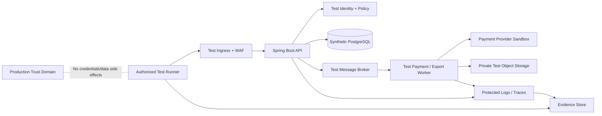
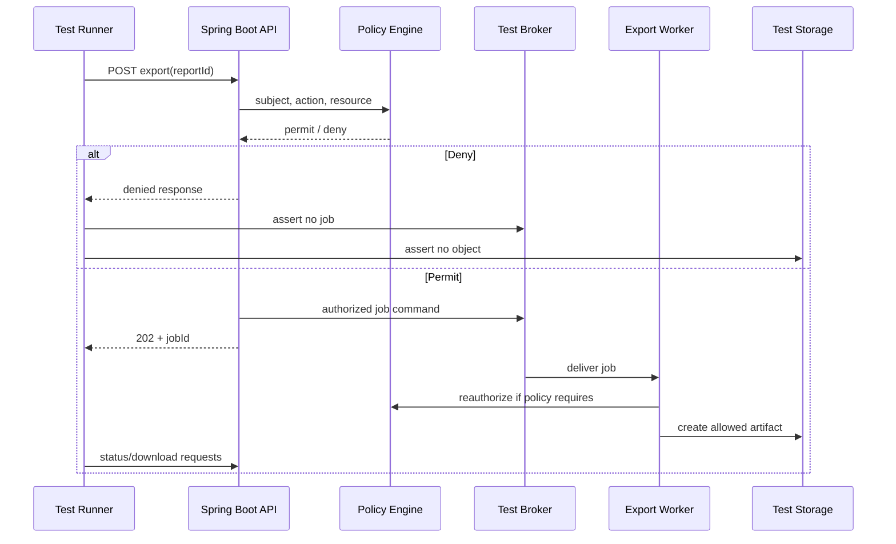
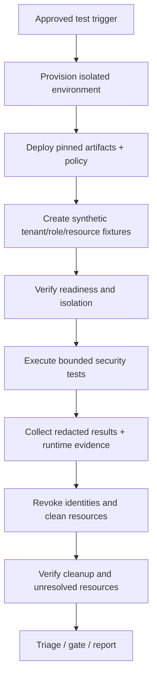

# Test environment: Thiết kế môi trường kiểm thử động an toàn, đại diện và có bằng chứng

## 1. Mục tiêu học tập

Sau bài học, người học có thể:

1. Giải thích **test environment (môi trường kiểm thử)** trong **dynamic security testing** là gì và tại sao nó ảnh hưởng trực tiếp đến độ tin cậy của kết quả security assurance.
2. Phân biệt môi trường **development, ephemeral test, integration, staging, pre-production, production-like, production** và các mô hình sandbox dành cho kiểm thử có kiểm soát.
3. Cân bằng **độ tương đồng với production (fidelity)**, **khả năng cô lập (isolation)**, **tính lặp lại (repeatability)** và **an toàn vận hành**.
4. Xác định tài sản, actors, mạng, authentication/authorization, dữ liệu, dependencies, runtime configuration và các trust boundaries của môi trường kiểm thử.
5. Thiết kế **test identities, roles, tenants, sessions, synthetic data, secret management** và các tình huống âm tính không làm lộ dữ liệu thật.
6. Phân biệt **mocks, stubs, service virtualization, provider sandbox** với việc kiểm tra tương tác và cấu hình thực tế.
7. Thiết lập giới hạn scope, permission, resource consumption, external side effects và rollback/cleanup cho DAST, API security testing, fuzzing và exploratory testing.
8. Đánh giá **configuration drift, feature flags, gateway/WAF, TLS, service mesh, IAM, queues và object storage** có thể làm kết quả kiểm thử sai lệch thế nào.
9. Thiết kế kịch bản kiểm thử tenant isolation, session/permission revocation, async jobs, webhook, retry, failure/timeout và business state mà không ảnh hưởng production.
10. Lập **risk–requirement–control–test–evidence matrix**, ghi provenance của kết quả và phân biệt “đã test trong staging” với “đã xác minh trên runtime production”.
11. Áp dụng vào ứng dụng **Java/Spring Boot trên Kubernetes** với PostgreSQL, broker, Identity Provider, storage và third-party payment sandbox.
12. Xây dựng checklist, metric, tiêu chí readiness, exit gate và cơ chế đánh giá lại môi trường khi hệ thống thay đổi.

Bài thuộc chương **Dynamic testing** của module **SECURITY_SECURITY_ASSURANCE**. Mục tiêu của module là học cách **đánh giá có bằng chứng** hệ thống đáp ứng mục tiêu bảo mật: từ rủi ro, yêu cầu và controls đến kiểm thử, audit, xử lý finding và assurance liên tục trong phát triển/vận hành. Do đó, một câu hỏi quan trọng là:

> **Kết quả kiểm thử động có thực sự phản ánh đúng ứng dụng, cấu hình, identity, data flows và trust boundaries cần đánh giá, trong khi không gây ra tác động trái phép hoặc rủi ro không chấp nhận được?**

## 2. Test environment là gì?

**Test environment** là tập hợp các tài nguyên, phiên bản phần mềm, cấu hình, dữ liệu, danh tính, kết nối và điều kiện vận hành được chuẩn bị để thực hiện và quan sát các phép kiểm thử.

Trong kiểm thử bảo mật động, đối tượng được đánh giá thường là **ứng dụng hoặc dịch vụ đang chạy**, tiếp nhận requests/events và tạo responses, state transitions hoặc side effects. Môi trường kiểm thử cung cấp điều kiện để quan sát các hành vi đó một cách có kiểm soát.

Một môi trường không chỉ là một URL kiểu `https://staging.example.invalid`. Nó còn bao gồm:

- Source revision, build artifact digest và runtime/container/JDK versions.
- Ingress, API gateway, WAF, reverse proxy, certificates và DNS.
- Authentication provider, token issuers, OAuth/OIDC clients, session policy.
- Authorization policy, IAM bindings, roles, tenant/resource ownership.
- Database schema, fixtures, object storage, message broker và job consumers.
- External services hoặc simulators: email, SMS, identity verification, payment, notifications.
- Test accounts, secrets, test certificates và privilege boundaries.
- CPU/memory/network, quotas, timeouts, retries và concurrency limits.
- Configuration, feature flags, cache, scheduler và background tasks.
- Scanner/test runner, approved scope, credentials, source addresses và logging.
- Monitoring, evidence collection, result retention và reset mechanisms.

### 2.1. Mục đích của môi trường không chỉ là “chạy được test”

Một môi trường hữu ích phải cho phép kiểm chứng các **security objectives** với điều kiện rõ. Ví dụ, nếu kiểm tra *cross-tenant authorization*, phải có ít nhất hai tenant độc lập, tài nguyên thuộc tenant khác và token hợp lệ; một endpoint chạy lên nhưng không có tenant B sẽ không chứng minh được kiểm soát đó.

Tương tự, nếu một API upload có rủi ro SSRF, test phải đi qua HTTP client và network policy phù hợp. Chỉ mock toàn bộ outbound HTTP trả `200` có thể kiểm tra logic xử lý response nhưng **không kiểm chứng được egress restriction**.

### 2.2. Không đồng nhất test environment với production

Một staging giống production không nhất thiết có cùng exposure, tải, IAM, feature flags hoặc dữ liệu. Production còn có yêu cầu về consent, authorization, hoạt động khách hàng và an toàn vận hành. Các bài thử phá hoại phải thực hiện trên môi trường được phép và cô lập; không tự đưa active scan nguy hiểm lên production chỉ vì staging thiếu độ tương đồng.

## 3. Dynamic testing và vị trí của Test environment

**Dynamic testing** phân tích hành vi của hệ thống khi thực thi. Các hình thức có thể gồm:

- DAST (Dynamic Application Security Testing) qua HTTP/API.
- API security integration/negative tests.
- Authenticated/unauthenticated security testing.
- Session, access control và business logic tests.
- Fuzzing trên parser, API, protocol hoặc message consumer trong scope được phép.
- Fault injection/chaos testing có kiểm soát.
- Penetration testing được ủy quyền.
- Infrastructure/application runtime verification.
- Manual exploratory security testing.
- Performance/resource-abuse tests trong ngân sách riêng.

### 3.1. So sánh với static analysis

| Khía cạnh | Static analysis/SAST | Dynamic testing |
| --- | --- | --- |
| Đối tượng chính | Source, bytecode hoặc biểu diễn tĩnh | Hệ thống/component đang chạy |
| Cần môi trường vận hành? | Không cần app hoạt động đầy đủ, nhưng tool có thể cần build | Thường cần runtime/test dependencies |
| Có quan sát response/side effect thực? | Không trực tiếp | Có, trong môi trường được thử |
| Mạnh về | Code patterns, data flows và early warnings | Runtime behavior, state, policy enforcement |
| Phụ thuộc test input | Quy tắc và code models | Rất lớn: actors, data, requests, states |
| Giới hạn | Runtime/business/config không quan sát đầy đủ | Path coverage, auth, state, fidelity, risk |
| Evidence điển hình | Finding theo commit/rule | Request/response, resource state, build/config và telemetry |

Một scan SAST pass và một DAST pass vẫn chỉ hỗ trợ các claims nằm trong **scope và assumptions tương ứng**, không phải kết luận “hệ thống hoàn toàn an toàn”.

### 3.2. Cùng tên testcase nhưng khác môi trường có thể cho kết luận khác

Một testcase `POST /transfers/{id}/approve` có thể pass trên staging nếu user không có role approver, nhưng production cho quyền rộng hơn qua IAM mapping. Test result đó không chứng minh production đúng. Phải đối chiếu actor, policy version và permissions.

## 4. Những thuộc tính của môi trường kiểm thử đáng tin cậy

| Thuộc tính | Câu hỏi bảo đảm | Nếu thiếu |
| --- | --- | --- |
| **Fidelity** | Có đủ giống các khía cạnh security-relevant của production? | False confidence vì khác config |
| **Isolation** | Có tránh ảnh hưởng production, người dùng và các tests khác? | Data leak, outage, side effect thật |
| **Control** | Có quản lý được versions, permissions, time, fixtures, topology? | Kết quả khó diễn giải |
| **Repeatability** | Có dựng lại điều kiện, chạy lại và đối chiếu không? | Findings không reproducible |
| **Observability** | Có thấy decision, enforcement, state changes và failures? | Chỉ thấy HTTP status |
| **Safety** | Có hạn chế destructive tests, egress, resource cost? | Tác động không mong muốn |
| **Coverage** | Có đủ paths, roles, tenants, states và integrations? | Missed vulnerabilities |
| **Traceability** | Test gắn với requirement, build, config, evidence? | Không dùng được cho assurance |
| **Freshness** | Có phản ánh thay đổi source/infra/policy hiện tại? | Evidence stale |
| **Governance** | Có owner, approval, scope, retention, exceptions? | Không rõ ai chịu trách nhiệm |

### 4.1. Căng thẳng cốt lõi: Fidelity versus safety

Muốn staging giống production, có thể phải tái tạo service mesh, WAF, IAM, TLS và broker. Nhưng sao chép production credentials hay PII để “giống” thường tạo rủi ro không cần thiết.

Thiết kế tốt là **parity về hành vi và các controls liên quan**, không sao chép dữ liệu/secrets thật. Ví dụ:

- Cùng kiểu OIDC claim và token validation policy, **khác issuer/client/secret** khi cần tách trust domain.
- Cùng cấu trúc tenant/role/resource, **khác chủ thể và dữ liệu tổng hợp**.
- Cùng phương thức ký callback, **khác sandbox keys/endpoints**.
- Cùng ingress/WAF rule class cần kiểm tra, **khác hostname và whitelist cho scanner**.
- Cùng image đã build để phát hành khi có thể, **khác cấu hình endpoint và secret của environment**.

### 4.2. Security-relevant parity quan trọng hơn giao diện giống nhau

Một UI đẹp và seed data thực tế chưa chứng minh có parity. Với assurance, nên ưu tiên những điều liên quan claim: xác thực và ủy quyền, encryption, network path, versions, data state, retry/failure và eventing.

## 5. Phân loại môi trường theo mục tiêu

| Loại | Mục tiêu | Điểm mạnh | Hạn chế đáng chú ý |
| --- | --- | --- | --- |
| Developer local | Lặp nhanh logic và smoke tests | Feedback sớm | Config cá nhân, ít parity |
| Ephemeral PR/branch | Test thay đổi cô lập theo commit | Repeatability, cleanup | Mock/external dependencies khác prod |
| Shared integration | Kiểm tra tương tác giữa components | Bao phủ flows đa service | Tranh chấp data và trạng thái |
| Security sandbox | Thử active scans/fuzz/failure an toàn | Có thể cho input đối kháng | Có thể không giống prod về HA |
| Staging/pre-production | End-to-end, release candidate | Gần topology và policy production | Không hoàn toàn tương đồng tải/data |
| Dedicated performance lab | Load/stress/resource abuse có ngân sách | Đo capacity/failure bounds | Khác tenant/traffic production |
| Provider sandbox | Test payment/email/SMS/webhook | Giảm external side effects | Vendor simulator không giống real provider |
| Production smoke/read-only checks | Kiểm tra các thuộc tính runtime được phép | Cho biết deployed reality | Hạn chế nghiêm trọng về an toàn và scope |

Không có environment “tốt nhất” cho mọi test. Chọn dựa trên **risk, test objective, isolation, dữ liệu, khả năng tái tạo và giới hạn của provider**.

### 5.1. Không bắt staging gánh mọi loại test

Fuzzing gây crash, kiểm thử quota lớn hoặc destructive file deletion có thể ảnh hưởng các nhóm khác dùng shared staging. Nên chạy trong security sandbox/isolated workload có quotas, reset và boundaries riêng.

### 5.2. Production testing chỉ khi được ủy quyền rõ

Một số checks nhẹ, an toàn hoặc read-only có thể cần production evidence; vẫn cần owner phê duyệt scope, time window, accounts, traffic budget, contact/stop conditions và bảo vệ dữ liệu. Không nhầm “có tài khoản hợp lệ” với “được phép kiểm thử xâm nhập toàn bộ production”.

## 6. Định nghĩa Scope của Test environment

Trước khi chạy scanner hoặc test suite, phải biết **cái gì được phép và không được phép**.

### 6.1. Scope record tối thiểu

- Business service và environment owner.
- Hostnames, API base URLs, ports, protocols.
- Environments, namespaces, clusters và regions trong scope.
- Build/source revision, container/image digest.
- API operations, gRPC methods, GraphQL operations, async topics.
- Authorized identities và roles, tenant IDs dành cho test.
- Data categories và fixture names; dữ liệu cấm dùng.
- Allowed test types: passive, active, authenticated, destructive, fuzz, load, fault injection.
- Target services và third-party sandbox được phê duyệt.
- Requests per second/concurrency, time windows và stop conditions.
- Network source addresses và egress rules cho test runner.
- Evidence handling, redaction, retention và report recipients.
- Escalation contacts, incident procedure và cleanup owner.

### 6.2. In scope không tự có nghĩa mọi hành động đều được phép

Một test account có quyền cập nhật dữ liệu sandbox không cho phép tự do delete database, flood service hoặc truy cập third-party production. Phải tách **scope authorization** của phép thử khỏi **application authorization** đang được đánh giá.

### 6.3. Thay đổi phạm vi cần cập nhật approval

Nếu test runner chuyển sang vùng mạng khác, scope mở thêm domain, scanner cần bypass rate-limit hoặc tích hợp provider mới, yêu cầu xem lại risk và approval thay vì lặng lẽ thay config.

## 7. Asset inventory, test surface và trust boundaries

Cần inventory đủ các entry points:

- Web UI, mobile backend và public APIs.
- Internal APIs, admin/control plane, health/debug endpoints.
- OIDC login/callback/token endpoints và session refresh.
- GraphQL resolvers, gRPC services, WebSocket topics.
- File upload/download, export/report generation.
- Search, pagination, aggregation và bulk operations.
- Broker consumers, scheduled jobs, DLQ/replay và async worker.
- Webhooks/callbacks từ payment/email/SaaS providers.
- Object storage, database, cache và search index.
- WAF/CDN/gateway, ingress controller, service mesh và sidecars.
- CI/test runner, vault/secrets store, evidence/logging system.

### 7.1. Sơ đồ ranh giới ví dụ



Dòng nét đứt thể hiện **quy tắc phải được thực thi**, không phải một kết nối dữ liệu cho phép. Mọi gateway, internal address, broker topic, object bucket và identity account cần được kiểm soát để không có đường đi ngoài scope.

### 7.2. Test paths không chỉ là HTTP paths

Nếu kiểm tra quyền export, một request HTTP tạo job, worker đọc database rồi viết object. Test phải quan sát cả **enqueued job, stored object, download ticket và audit**. Chỉ kiểm tra HTTP 403 có thể bỏ sót side effect xảy ra trước khi deny.

## 8. Mô hình đe dọa đối với môi trường kiểm thử

Môi trường kiểm thử cũng là mục tiêu bảo mật, không chỉ là nơi tìm lỗi ở sản phẩm.

| Scenario | Tác động | Control cần xem |
| --- | --- | --- |
| Scanner bị compromise | Truy cập dữ liệu/secret của môi trường | Runner isolation, least privilege |
| Test secret bị dùng trong production | Vượt trust boundary | Separate issuer/account/keys và policy |
| Database snapshot chứa PII | Lộ dữ liệu khách hàng | Synthetic/minimized data, redaction, access control |
| Fuzzer gây DoS shared staging | Gián đoạn đội khác | Dedicated sandbox, quotas, stop conditions |
| Test webhook gọi provider thật | Payment/email/SMS side effects | Sandbox credentials/endpoints, egress restrictions |
| Cross-tenant fixture sai | BOLA test false pass/false fail | Trusted resource ownership assertions |
| Shared object bucket | Data crossover giữa test sessions | Environment-specific storage IAM/namespace |
| Test job ghi audit hoặc log PII | Secondary disclosure | Privacy-safe evidence handling |
| Mutable image/tag hoặc config drift | Test build khác release | Digest/manifest traceability |
| Overly permissive WAF bypass | Test không đại diện production | Per-scope bypass + separate parity checks |
| Reused privileged test account | Privilege creep/false assurance | Role matrix, expiry, rotation |
| Reset không hoàn chỉnh | Test phụ thuộc dữ liệu trước đó | Idempotent seed/cleanup và isolation |
| CI pipeline log tokens | Credential exposure | Secret masking + no-secret logging |
| Test runner egress vào internal network | SSRF/lateral movement | Network egress and policy verification |

### 8.1. Phân biệt hai nhóm rủi ro

**Risk A:** môi trường khác production → kết quả kiểm thử không phản ánh security behavior thật.

**Risk B:** môi trường có quyền quá cao/dữ liệu thật → kiểm thử tạo security incident hoặc side effect không được phép.

Thiết kế tốt cần đánh giá cả hai. Không bỏ nhóm B để tăng fidelity và không bỏ nhóm A chỉ vì sandbox đã an toàn.

## 9. Network segmentation và egress isolation

### 9.1. Kiến trúc mạng cần xác minh

- Test environment không định tuyến tùy ý vào production VPC/namespace/account.
- Outbound connections giới hạn tới test dependencies đã duyệt.
- Test runner chỉ truy cập endpoints in scope.
- Cloud metadata/private/link-local addresses được bảo vệ khi test SSRF.
- Ingress/WAF policies được ghi nhận và có parity assessment.
- DNS/resolver, proxy và redirect behavior phù hợp test objective.
- TLS được áp dụng đúng hops; certificate trust không bị vô hiệu hóa tùy tiện.
- Services nội bộ vẫn xác thực và phân quyền theo workload, không chỉ tin network.

### 9.2. Đặt allowlist theo mục tiêu

Một DAST scan có thể cần gọi API hoặc provider sandbox, nhưng không cần gọi arbitrary Internet domains. Egress allowlist có thể giúp hạn chế tác động; cần xét proxy, DNS, redirects và các đường cho phép nhưng bị lạm dụng.

### 9.3. Khi kiểm thử SSRF

Một environment **chặn mọi network**, nhưng production lại có quyền tới internal services, có thể cho kết quả “không khai thác được” thiếu giá trị. Ngược lại, bật quyền truy cập production để test sẽ gây nguy hiểm. Giải pháp là **mô phỏng mạng nhạy cảm bằng canary/simulator** bên trong sandbox, áp dụng cùng policy decision points, đồng thời xác minh cấu hình egress production bằng kiểm tra riêng.

### 9.4. Tương đồng WAF/CDN

DAST chạy sau một proxy có WAF tắt có thể kiểm tra lỗi backend nhưng không đánh giá WAF. DAST chạy qua WAF rất nghiêm có thể chỉ thấy block của WAF và không xác nhận backend đã sửa. Do đó có thể cần **hai nhánh test**: qua ingress giống production để đánh giá tổng thể và trong sandbox riêng để kiểm tra ứng dụng, mỗi kết luận ghi scope khác nhau.

## 10. Authentication và test identities

Để kiểm thử bảo mật động đúng, cần xác định actor nào có quyền gì.

### 10.1. Ma trận danh tính

| Actor | Scope và mục đích | Tình huống mẫu |
| --- | --- | --- |
| Anonymous | Không có credential | Public vs protected routes |
| User A | Tenant A, quyền xem | Read own reports |
| User B | Tenant B, role giống A | Cross-tenant access denied |
| Exporter A | Tenant A, export permission | Export allowed fields |
| Viewer-only A | Chỉ được view | Export/approve denied |
| Maker A | Tạo giao dịch | Không tự approve |
| Approver A | Duyệt giao dịch khác do mình không tạo | SoD và state checks |
| Expired/revoked user | Session/token hết hạn hoặc quyền bị thu hồi | Revocation & auth time |
| Service/workload | Authenticated machine client | Machine-to-machine scope |
| Admin test account | Quyền quản trị được giới hạn | IAM change, JIT/approval |
| Partner sandbox | Identity riêng của provider test | Webhook signature và replay |

### 10.2. Phân biệt authentication và authorization trong test setup

Để chứng minh BOLA, test phải có:

- Token hợp lệ của User B.
- Resource thực sự tồn tại và thuộc Tenant A.
- User B có function-level role đủ để tới **object authorization check**.
- Kết quả deny/no disclosure/no side effects.

Nếu dùng token sai audience hoặc resource không tồn tại, response 401/404 có thể không chứng minh resource authorization.

### 10.3. Token, session và MFA

Test environment phải hỗ trợ những trường hợp có ý nghĩa:

- Valid, expired, revoked, wrong-audience/issuer, tampered token (trong sandbox).
- MFA/session step-up requirements.
- Refresh token rotation và replay control.
- Authenticated cookies với CSRF/cross-origin policy.
- Service identity/mTLS và delegated scopes.
- Policy/cache TTL, entitlements change và revocation propagation.

Không tự bypass MFA bằng cách tắt toàn bộ security filter chain chỉ để scan “đăng nhập dễ hơn”; nếu dùng test authentication mode, phải ghi khác biệt, scope, risk và tests bù cho mode production.

### 10.4. Nguyên tắc test credentials

- Chỉ dùng account/identity thuộc test trust domain.
- Credential có scope/time hạn chế; không cấp production deployment/admin rights.
- Lưu trong secret manager của test, không hardcode vào repo/log/report.
- Rotation, revoke, cleanup tự động hoặc theo runbook.
- Test scanner xử lý login/session chỉ trong phạm vi được phê duyệt.
- Không dùng shared admin account cho mọi security negative test.
- Có audit ai cấp, ai sử dụng, expiration và kết quả.

## 11. Test data: synthetic, masked và privacy-by-design

Môi trường kiểm thử cần **dữ liệu đủ hiện thực về cấu trúc/ngữ nghĩa để kiểm tra security invariants**, nhưng không cần dữ liệu cá nhân thật.

### 11.1. Các lựa chọn

| Cách | Giá trị | Giới hạn |
| --- | --- | --- |
| Synthetic data | Không dùng record khách hàng thật; dễ tái tạo | Có thể thiếu edge cases |
| Deterministic fixtures | Reproducible và assertions rõ | Cần quản trị state |
| Masked/pseudonymized snapshots | Có thể giữ distribution/relationships | Vẫn có thể tái định danh, chịu chính sách |
| Generated adversarial cases | Xây tenant/role/state/format boundaries | Coverage phụ thuộc mô hình |
| Provider sandbox fixtures | Test payment/callback lifecycle | Có thể khác production provider behavior |
| Anonymized aggregate data | Tốt cho load/distribution nếu thật sự anonymized | Có thể thiếu row-level details |

### 11.2. Không nhầm pseudonymization với anonymization

Thay tên/email bằng mã giả chưa chắc đủ để loại bỏ khả năng nhận diện cá nhân nếu còn các thuộc tính liên kết khác hoặc khóa ánh xạ. Khi dữ liệu production được đưa vào test, cần đánh giá quyền sử dụng, purpose, minimization, masking chất lượng, access, retention và deletion. **Ưu tiên synthetic fixtures** cho các security tests như cross-tenant, injection và access control.

### 11.3. Bộ fixtures hữu ích cho security

Tạo tối thiểu:

- Hai tenant A và B, có users khác nhau nhưng role tương tự.
- Resource cùng loại thuộc hai tenant, ID khó suy đoán nhưng biết được bởi test harness.
- Roles view/export/approve/admin, cùng owner/creator/assignee relationships.
- Dữ liệu phân loại public/internal/confidential/PII-like synthetic.
- Session/token valid/expired/revoked, với signing keys riêng test environment.
- Transfer ở states DRAFT/PENDING/APPROVED/CANCELLED/COMPLETED.
- Export jobs QUEUED/PROCESSING/READY/FAILED/EXPIRED.
- Metadata cho reauthorization và worker replay tests.
- Canary sensitive endpoint giả trong mạng sandbox để kiểm tra egress.

### 11.4. Test data cũng phải có kiểm soát tính toàn vẹn

Nếu seed script vô tình gán Report A cho Tenant B, BOLA test có thể cho kết quả sai. Trước test, harness nên assert **resource tồn tại, owner/tenant/state và actor permissions** từ nguồn server-side đáng tin.

## 12. Tách secrets, keys và trust domains

Một môi trường đáng tin cậy không sao chép thẳng production secrets.

- Test OIDC client secrets, signing keys, JWT issuers và audiences riêng.
- Test database passwords, broker credentials, cloud IAM và KMS aliases riêng.
- Test certificates và trust stores phù hợp nhưng không dùng production private keys.
- Test SMTP/SMS/payment providers phải dùng sandbox credentials.
- CI runner chỉ được đọc những secrets cần cho job và trong thời hạn cần.
- Không dump environment, connection strings, keys hoặc tokens vào test reports.
- Disable hoặc mock side effects ở provider thật **bằng network/IAM policy**, không chỉ bằng flag dễ bị đổi.
- Đặt rotation/revocation và incident response cho test credentials.

### 12.1. Vẫn cần test key/crypto behavior

Nếu mục tiêu là kiểm tra rotation, mTLS hoặc JWT signature verification, test keys phải mô phỏng **cấu trúc vòng đời và lỗi** (invalid, expired, revoked, wrong audience/key) mà không lộ secrets thật.

### 12.2. Không dùng cùng cloud account production khi có lựa chọn an toàn hơn

Tách accounts/projects/subscriptions giúp thiết lập IAM và network barriers rõ. Nếu dùng chung tổ chức hoặc hạ tầng, phải chứng minh resource-level boundaries, egress và không có đường đổi role/routing sang production.

## 13. Configuration parity và configuration drift

Một testcase có kết quả trong staging chỉ có giá trị đối với cấu hình được thực thi ở đó.

### 13.1. Security-relevant configuration

- Spring Security filter chain, endpoint matchers và CORS/CSRF.
- OAuth issuer/audience, token validation, MFA/step-up policy.
- Authorization rule versions, PEP/PDP and attribute sources.
- API gateway/WAF, rate limits và routing.
- TLS termination, mTLS, certificates và proxy trust headers.
- Database isolation/RLS, connection pool/service credentials.
- Cache scope/TTL và permission revocation.
- Storage bucket policies, signed URLs, encryption settings.
- Broker ACL, topic subscriptions, async worker identities.
- Feature flags, debug modes, error verbosity, test-only endpoints.
- Logging/audit redaction, retention, alert rules.
- Network policies, outbound proxies và DNS behavior.
- Retry, timeout, circuit breaker, idempotency behavior.

### 13.2. Configuration parity không phải copy-paste cấu hình

Nhiều giá trị phải khác: URLs, account IDs, keys, synthetic tenants và cloud resources. Cần so sánh **security invariants**:

- Có yêu cầu authorization theo resource không?
- Token sai audience có bị reject không?
- Ký callback có được verify không?
- Export/download có bị ràng buộc actor/tenant/expiry không?
- Policy timeout có fail-safe không?
- Logs có tránh lộ credential không?

### 13.3. Drift classification

| Loại drift | Ví dụ | Hệ quả |
| --- | --- | --- |
| **Required difference** | Sandbox provider URL, test secrets | Được chấp nhận nếu được ghi |
| **Intentional mitigation** | Chặn external egress trong sandbox | Một số SSRF test không đại diện network production |
| **Unintended deviation** | Staging tắt authz check | Kết quả test thiếu giá trị |
| **Version drift** | Staging dùng artifact/JDK khác production | Chứng cứ không gắn đúng target |
| **Undocumented drift** | Một region bật feature flag khác | Coverage giả |
| **Temporary override** | Scanner bypass WAF/rate limits | Phải thu hồi và kiểm tra parity khác |

### 13.4. Cần diff và verification runtime

IaC manifests, Helm values hoặc config repository chỉ thể hiện **desired state**, không tự chứng minh runtime đã áp dụng. Nên đối chiếu active configuration, policy version, loaded feature flags và actual deployment readback.

## 14. Artifact identity, dependencies và runtime versions

Độ tương đồng phụ thuộc mã và thành phần thực tế:

- Source commit, branch/ref và reviewer approval.
- CI build run, container image digest, application version.
- JDK runtime distribution/build.
- Dependency BOM/lockfile và resolved runtime graph.
- Base image OS packages, TLS/native libraries.
- Database server/schema version và JDBC driver.
- Broker/worker version, sidecars, service mesh proxies.
- Scanner version, rule set, test suite revision.
- Gateway/WAF/runtime policies.

### 14.1. Test source không đồng nghĩa test artifact

Một test run trên commit SHA B nhưng deployment chạy image từ commit A không chứng minh B đã fix production. Test report nên gắn **tested artifact digest**; release cần xác minh active digest theo cùng scope.

### 14.2. Staging/prod cùng image, khác config

Đây thường là mô hình thuận lợi cho parity của code: promote đúng immutable artifact qua environments, cấu hình/secret riêng. Nhưng scanner không được suy ra security config giống nhau; cần kiểm tra cả configuration.

### 14.3. Tránh mutable tags

`image:latest` hoặc branch name có thể thay đổi giữa lúc test và deploy. Dùng digest hoặc cơ chế traceability chắc chắn, đồng thời bảo vệ artifact store và promotion rights.

## 15. Real dependencies, mocks, stubs và service virtualization

Một test environment không nhất thiết cần mọi provider thật, nhưng cần biết **khi nào mock đủ và khi nào cần integration thật**.

| Loại dependency | Điểm mạnh | Nguy cơ cho assurance |
| --- | --- | --- |
| In-memory fake | Nhanh, deterministic | Không phản ánh DB/policy/network constraints |
| Mock/stub | Kiểm soát response và fault cases | Không chứng minh authentication, TLS, real protocol |
| Service virtualization | Mô phỏng nhiều states/errors | Contract và signatures có thể khác provider |
| Testcontainers/ephemeral DB | Runtime DB gần thực tế | Host Docker privileges, version differences |
| Shared integration service | End-to-end hơn | State contention, data leakage |
| Provider sandbox | Kiểm tra vendor protocol/callback | Không phải production provider |
| Production-like managed service | Parity cao hơn trong phạm vi service | Cost, IAM/data boundaries |
| Read-only production verification | Grounded runtime state | Không phù hợp active/destructive tests |

### 15.1. Khi nào mock giúp ích?

- Unit-level validation và business state transitions.
- Provider timeout/duplicate/out-of-order callbacks.
- Failure injection mà provider sandbox khó tạo.
- Load tests không gây chi phí thật.
- Negative tests có predictable objects.

### 15.2. Khi nào mock là điểm mù?

- Xác minh TLS/mTLS, certificates và signature validation.
- IAM, cloud storage policy và service-to-service authorization.
- DB concurrency, isolation level và row-level security.
- Real provider API behavior, retries và request signing.
- Broker ACL, message ordering, queue retries và DLQ.
- Egress/proxy routing và SSRF restrictions.

Với các claim đó, cần **test ở boundary thực hoặc môi trường tương đương được kiểm chứng**, không suy từ một stub luôn trả thành công.

### 15.3. Đánh dấu từng phần được mô phỏng

Test plan nên ghi `component → real/sandbox/mock → equivalence assumptions → missing evidence`. Nếu test qua fake policy engine luôn trả `ALLOW`, testcase không chứng minh permission enforcement.

## 16. Database state, fixtures và khả năng reset

Bảo mật ứng dụng thường phụ thuộc **trạng thái trước/sau request**. Seed data và cleanup vì vậy là một phần của tính đúng đắn của test oracle.

### 16.1. Các trạng thái có ích

- Resource của tenant A/B và user có role tương tự.
- Accounts active, disabled, revoked, expired.
- Transfer DRAFT/PENDING_APPROVAL/APPROVED/CANCELLED/COMPLETED.
- Report có public/confidential fields, assignment và owner khác nhau.
- Export job QUEUED/PROCESSING/READY/FAILED/EXPIRED.
- Refresh token đang dùng, đã revoke, bị replay.
- Rate-limit counters, idempotency keys, duplicate callback records.
- Files đang upload, bị cách ly hoặc đã phát hành.
- Permissions thay đổi trong khi async job chưa chạy.

### 16.2. Deterministic fixtures

Có thể dùng per-run schemas, isolated tenant namespace, transaction setup/teardown, database snapshot/restore, seed scripts versioned hoặc disposable database. Test harness nên xác nhận **resource thật sự tồn tại và có owner/tenant/state chính xác** trước khi đưa ra security assertion.

### 16.3. Cleanup không chỉ là rollback database

HTTP request có thể enqueue job, tạo object, gửi webhook, ghi cache hoặc liên hệ provider. Database rollback không hoàn tác các side effects đó. Cleanup scope cần bao phủ queue, object storage, temp accounts, credentials, DNS/ingress và provider sandbox.

### 16.4. Tránh tranh chấp data trên shared staging

Hai scanners dùng cùng user/report có thể thay đổi state của nhau. Dùng fixtures, namespaces, correlation IDs riêng theo run; với stateful test cần isolation hoặc lịch điều phối rõ.

### 16.5. Guard destructive cleanup

Script reset không được phép chạy khi target là production. Không chỉ tin một environment variable dễ thay; kết hợp IAM/network boundary, allowlisted resource identifiers, runtime validation và approval phù hợp. Một câu lệnh xóa sai môi trường có thể nghiêm trọng hơn lỗ hổng đang thử.

## 17. Async jobs và xác minh side effects

Một response HTTP thường chỉ là bước đầu của một workflow nhiều services.



### 17.1. No-side-effect assertion

Với yêu cầu bị từ chối, kiểm tra không có unauthorized DB mutation, broker job, storage object, provider call, email/SMS hoặc task phụ thuộc. Chỉ assert `403` có thể bỏ sót trường hợp service trả deny **sau khi đã tạo job**.

### 17.2. Eventual consistency

Một job có thể hoàn tất sau vài giây; phải dùng observation window/bounded polling tương ứng kiến trúc. “Không tìm thấy object ngay lập tức” không đủ chứng minh nó sẽ không được tạo sau đó. Khi giới hạn thời gian test chưa bao phủ đầy đủ, cần ghi limitation.

### 17.3. Replay/retry

Dùng sandbox broker/provider và fake records để thử duplicate, out-of-order callbacks, worker crash và permission revocation. Không để staging có thể gọi production payment chỉ vì cùng schema message.

## 18. Observability: nhìn thấy quyết định và enforcement

Telemetry giúp giải thích **vì sao test pass/fail**, nhất là khi nhiều services tạo side effects.

| Loại dữ liệu | Ví dụ | Chú ý |
| --- | --- | --- |
| Trace/correlation | Request/test-run ID | Tránh cho client giả mạo logs khác |
| Authentication | Opaque subject ref, token validation result | Không log raw token |
| Authorization | Subject/action/resource/policy version/decision | Không đồng nghĩa đã enforce |
| DB | Mutation outcome, row count, tenant reference | Không ghi raw PII |
| Broker | Job created/consumed/retried | Correlate với API decision |
| Storage | Object created/deleted/download ticket | Resource scope và expiry |
| Provider | Sandbox call/callback status | Không phát hành giao dịch thật |
| Runtime | Build/image digest, config version, feature flag | Đúng mục tiêu đã test |
| Resource health | Latency, errors, CPU/memory/quota | Dừng khi vượt stop condition |
| Audit | Event integrity, timestamps, collector | Restrict report access |

### 18.1. Decision không đồng nghĩa enforcement

PDP có thể trả `DENY` nhưng worker đã thực hiện trước; cần đối chiếu policy decision với state thực ở database, queue, storage và provider sandbox.

### 18.2. Evidence không được thành nguồn lộ thông tin

Không lưu access tokens, signing keys, full HTTP bodies chứa PII hoặc customer records trong scanner artifacts. Dùng fake/opaque data, redaction, restricted storage, retention và integrity controls.

## 19. DAST scanners và test runner: bản thân công cụ cũng có rủi ro

DAST chủ động gửi requests và có thể tạo data, làm tăng tải, trigger locks hoặc gọi integrations. Trước scan phải xác định:

- Tool/version/image digest và nguồn đáng tin.
- Scope: hosts, operations, ports, redirects, robots/crawl và authentication.
- Passive vs active scan rules, payload classes và methods được phép.
- Request/concurrency/rate/cost budgets.
- Test accounts, tokens, roles/tenants và expiration.
- External sandbox target và outbound egress.
- Destructive operations cần approval riêng hoặc bị cấm.
- Test logs, findings và artifacts được đưa về kho nào.
- Contacts, stop conditions, rollback/cleanup.
- Ownership của quyết định chấp nhận rủi ro khi scan.

### 19.1. Passive và active không có nghĩa “an toàn tuyệt đối”

Passive analysis thường ít tác động hơn, nhưng vẫn có thể ghi dữ liệu nhạy cảm từ traffic. Active scan có thể làm thay state, tạo emails, jobs, alerts hoặc resource exhaustion. Đánh giá safety theo **hành vi API thật**, không chỉ nhãn trong giao diện tool.

### 19.2. Least privilege cho scanner

Runner có thể có session token và đường mạng nội bộ; nó cần isolation, minimum permissions, short-lived credentials, secret-free logs và blocked production egress. Scanner plugins/cấu hình cũng là supply-chain inputs cần quản trị.

### 19.3. Scan chưa complete khác scan không có finding

Một scanner mất session, timeout, bị WAF chặn, quét sai host hoặc thiếu API inventory có thể đưa ra report “0 findings”. Kết luận cần ghi **status, coverage và limitations**, không tự coi là pass.

## 20. Authenticated scanning và kiểm chứng session

### 20.1. Những nguyên nhân scan sai

- Login có CSRF token, nonce, state hoặc PKCE.
- Session hết hạn giữa scan.
- MFA/step-up trước action nhạy cảm.
- Refresh token rotation/revocation.
- Cookie domain/SameSite/Secure rules.
- JWT audience/issuer hoặc service mTLS khác môi trường.
- User bị rate-limited hoặc logout.
- Scanner thiếu role, chỉ gặp 401/403.
- Gateway trả HTML login cho client đang kỳ vọng JSON.

### 20.2. Authentication health checks

Trước và trong scan, xác minh scanner có truy cập được một protected canary endpoint **được phê duyệt**. Khi tỷ lệ 302/login HTML/401 tăng, phải đánh dấu authenticated coverage thất bại hoặc partial, không tiếp tục tính tất cả kết quả như authenticated scan.

### 20.3. Multi-actor tests riêng

Một scanner với admin token không chứng minh horizontal authorization. Cần users A/B cùng role nhưng khác tenant, viewer/exporter/approver, revoked sessions và workload principals. BOLA testcase phải **dùng token hợp lệ, resource ngoài tenant có thật**.

### 20.4. Đừng tắt security để scan dễ hơn

Một profile staging với `permitAll` hay toàn bộ MFA/authz bypass có thể giúp spider crawl nhưng không dùng được để xác nhận controls đó. Nếu có test-only auth mode, báo rõ chênh lệch và kiểm tra production-equivalent mode qua suite bổ sung.

## 21. Phân loại active testing theo mức tác động

| Kiểu test | Điều cần kiểm soát | Môi trường phù hợp |
| --- | --- | --- |
| Header/TLS read-only | Source hosts, rate, data logging | Approved staging; một số checks production có điều kiện |
| Resource authorization negatives | Identity/tenants/data fixtures | Dedicated staging/sandbox |
| Input bounds và parsing | Payload size, timeouts | Isolated test service |
| Stateful transfer/export | Reset và no real provider | Per-run sandbox |
| Fuzzing có thể crash | CPU, memory, network isolation | Disposable sandbox |
| GraphQL complexity/DoS | Query budget, concurrency | Dedicated capacity lab |
| Broker/PDP outage | Fault scope và recovery | Isolated multi-service environment |
| Data deletion/restore | Backup, owner, cleanup | Disposable environment |
| Webhook/payment | Signed sandbox credentials | Provider sandbox hoặc virtualized provider |
| Production smoke | Non-destructive, owner approval | Production với scope và stop conditions riêng |

### 21.1. Budgets và kill switch

Nêu rõ request rate, concurrency, maximum generated jobs, storage/provider cost và stop khi error/latency vượt ngưỡng hoặc phát hiện traffic ngoài scope. Dừng scanner **không dừng mọi async job**; cần verify queue, storage và credentials sau stop.

### 21.2. Không dùng production exploits để tạo evidence nếu có phương pháp an toàn

Với DoS, RCE hoặc destructive input, dùng isolated/synthetic test targets và safe security assertions. Production verification có thể dựa trên đúng active configuration, versions và approved low-impact checks cùng scope limitations.

## 22. Test theo các giao thức khác nhau

### 22.1. REST

Xác định methods, resources, schemas, status/errors, session/cookies, object authorization, input/output fields, idempotency, bulk operations và no-side-effect conditions.

### 22.2. GraphQL

Tập trung nested resolver/field-level authorization, query depth/complexity/aliases, mutations, introspection policy và subscriptions. Test root `health` không chứng minh `customer.email` resolver an toàn.

### 22.3. gRPC

Test mTLS peer identity, metadata validation, per-method/resource policies, stream lifetime và backpressure. Channel đã authenticated không tự cấp mọi quyền trên mọi RPC.

### 22.4. WebSocket/SSE

Test subscribe/publish theo topic/tenant, event filtering, expiry/revocation khi kết nối dài, buffer limits và reconnection semantics.

### 22.5. Webhooks

Dùng provider sandbox keys/identities để kiểm tra signature/timestamp/delivery-ID/replay, state matching, retries và ordering; **không để callback URL đích về production**.

## 23. Ephemeral test environments trong CI/CD

Môi trường ngắn hạn theo PR/commit có thể cho phép reset state và isolation tốt hơn shared staging, nhưng **không tự đảm bảo production parity**.



### 23.1. Threat boundaries của CI

PR code chưa tin cậy không được nhận production secrets, cloud admin permission hoặc signing/deploy keys. Environment provisioner và scanner runner có identities riêng; artifacts/logs phải có provenance và policy gates không bị PR tự sửa. Chạy DAST không có nghĩa build scripts được quyền mở Docker host socket.

### 23.2. Cleanup cả khi job thất bại

Teardown cần revoke test accounts/tokens, xóa namespace, database/schema, queues, object prefixes và DNS/ingress trong scope, đồng thời ghi các resources còn tồn tại. TTL là lớp bổ sung, không thay được cleanup verification.

### 23.3. Chấp nhận những khác biệt đã document

Một ephemeral PR environment có thể chỉ có 1 replica và mock provider; nó thích hợp test authz/state nhưng không chứng minh HA, real provider signatures hoặc full production WAF. Tách claim theo đúng mục tiêu.

## 24. Shared staging: tránh tác động chéo

Shared staging thường có sự tranh chấp:

- Hai team cùng sửa một report/tenant.
- Scan A chạm rate limit và làm scan B fail.
- Deployment giữa scan tạo mixed build versions.
- Fault injection làm gián đoạn tests khác.
- Account dùng chung bị logout hoặc đổi password.
- Provider sandbox quota bị sử dụng hết.
- Cleanup job của team này xóa data của team khác.

Cần per-run namespaces/accounts/fixtures, scheduling, rate quota, version freeze hoặc traceable deployment windows, correlation IDs và scoped cleanup. Destructive/fault tests nên ở môi trường tách biệt.

Nếu target đổi image hoặc policy giữa scan, phải đánh dấu **mixed target/version** và xem re-run, không tự coi report gắn với một artifact duy nhất.

## 25. Java/Spring Boot: cấu hình test profile minh họa

Giả định ứng dụng đa tenant dùng Spring Boot, PostgreSQL, OIDC, broker và payment provider sandbox.

```yaml
# application-security-test.yml
# Educational example: custom security/testing keys are not Spring defaults.
spring:
  datasource:
    url: "<TEST_DB_URL>"
    username: "<TEST_DB_USER>"
    password: "<TEST_DB_PASSWORD>"
  jpa:
    hibernate:
      ddl-auto: validate

security:
  environment-id: "security-test"
  require-object-authorization: true
  expected-issuer: "<TEST_OIDC_ISSUER>"
  expected-audience: "<TEST_API_AUDIENCE>"
  allow-auth-bypass: false

integrations:
  payment:
    base-url: "<TEST_PAYMENT_SANDBOX_URL>"
    credential-ref: "<TEST_PAYMENT_KEY_REFERENCE>"
  broker:
    namespace: "<TEST_BROKER_NAMESPACE>"
  storage:
    bucket: "<TEST_PRIVATE_EXPORT_BUCKET>"

testing:
  synthetic-data-only: true
  max-export-jobs-per-run: 5
  allow-production-egress: false
```

### 25.1. Mẫu YAML không tự thực thi các bảo vệ

Các keys như `security.require-object-authorization` và `testing.allow-production-egress` là **thuộc tính ứng dụng minh họa**, không có hiệu lực mặc định trong Spring Security, CNI hoặc cloud IAM. Phải có code/policy xử lý và **network/IAM enforcement thực**; không dựa vào tên biến để khẳng định an toàn.

### 25.2. Bootstrap safety guards và giới hạn

App có thể fail startup nếu môi trường security-test cấu hình provider URL không nằm trong approved sandbox host list hoặc chưa có test issuer/audience. Guard phải dùng canonical URL parsing/allowlist, **không dùng string substring**, và vẫn cần network egress deny, isolated IAM/accounts cùng config evidence. Tương tự, không dựa vào `spring.profiles.active` do người chạy job tự truyền làm barrier duy nhất.

### 25.3. Testcontainers và CI trust

Testcontainers hỗ trợ dựng DB/broker phiên bản phù hợp, nhưng untrusted PR test không nên được trao host Docker socket chỉ để thuận tiện. Có thể dùng isolated VM per job, safe daemon hoặc managed ephemeral environments theo threat model.

## 26. Kubernetes: policy và bằng chứng runtime

Manifest mẫu thể hiện isolation mục tiêu; **không đủ để triển khai toàn bộ hệ thống**.

```yaml
apiVersion: v1
kind: Namespace
metadata:
  name: security-test-transfer
  labels:
    environment: security-test
---
apiVersion: networking.k8s.io/v1
kind: NetworkPolicy
metadata:
  name: default-deny-egress
  namespace: security-test-transfer
spec:
  podSelector: {}
  policyTypes:
    - Egress
  egress: []
---
apiVersion: v1
kind: ResourceQuota
metadata:
  name: test-budget
  namespace: security-test-transfer
spec:
  hard:
    requests.cpu: "4"
    requests.memory: 8Gi
    limits.cpu: "8"
    limits.memory: 16Gi
    pods: "20"
```

### 26.1. Cần bổ sung

- CNI phải hỗ trợ/enforce NetworkPolicy; deny-all chặn DNS/IdP/provider sandbox nếu chưa allowlist đúng.
- Namespace không tự là host-level security boundary.
- Kubernetes RBAC, Pod Security, separate service account và node/IAM isolation.
- Ingress/TLS/gateway, runtime image digest, secrets, storage policies.
- Broker/database/provider sandbox permissions và cost quotas.
- Negative network/IAM tests **từ pod đang chạy**, không chỉ đọc manifest.
- Cleanup verification cho namespaces, PVCs, objects và external resources.

### 26.2. Những bằng chứng không được nhầm

Một `NetworkPolicy` trong Git chứng minh **design intent**, không chứng minh live CNI đã áp dụng. Một read-only `kubectl get` cho biết deployed object, nhưng deny probe và flow evidence mới kiểm tra thực thi network boundary.

## 27. Gherkin: yêu cầu môi trường có thể nghiệm thu

```gherkin
Feature: Security test environment readiness

  Scenario: Two independent tenant fixtures exist
    Given Alice is authenticated in tenant A
    And Bob is authenticated in tenant B
    And report R1 exists and belongs to tenant A
    When the harness checks trusted ownership and role preconditions
    Then the subjects and resource match the approved fixture model
    And no real production customer data is used

  Scenario: Cross-tenant denial is observable
    Given Bob holds a valid token with REPORT_VIEW
    And report R1 belongs to tenant A
    When Bob requests report R1
    Then authorization denies access
    And no protected fields or metadata are disclosed
    And no export job or download ticket is created

  Scenario: Production provider is unreachable from test
    Given the payment identity belongs to the test trust domain
    And the approved provider sandbox is available
    When the harness verifies the approved production-denied route
    Then network and IAM controls prevent production side effects
    And no real payment or notification is created

  Scenario: Failed test still cleans up
    Given a run created temporary users, files and jobs
    When the test runner terminates unexpectedly
    Then cleanup revokes its credentials
    And only resources owned by the run are removed
    And any remaining resources are reported for remediation
```

Gherkin là **đặc tả**, không phải evidence chạy test. Step definitions cần thật sự kiểm tra đúng identity, resource, service state, network policy và no-side-effect outcomes.

## 28. Test environment requirements có thể kiểm chứng

Cần viết yêu cầu về **điều kiện kiểm thử** bên cạnh yêu cầu bảo mật của ứng dụng. Nếu environment chưa đạt preconditions, testcase không đủ cơ sở đưa ra kết luận.

| Requirement ID | Yêu cầu | Phương pháp xác minh |
| --- | --- | --- |
| TENV-001 | Environment phải có owner, scope, expiry và mục đích đã được duyệt | Intake/approval record |
| TENV-002 | Tất cả targets/scanner source addresses phải nằm trong allowlist được phép | Runtime scope/egress test |
| TENV-003 | Test identities, keys và secrets phải tách khỏi production trust domain | IAM/issuer/key refs và denied access check |
| TENV-004 | Không có production PII trong fixtures ngoài ngoại lệ được phê duyệt và kiểm soát | Dataset provenance/privacy review |
| TENV-005 | Fixture ownership/role/state phải được assert trước security tests | Seed checksum + precondition assertions |
| TENV-006 | Protected API tests phải chạy qua authentication/authorization path đại diện | Authn/PEP config và negative tests |
| TENV-007 | Môi trường phải ghi nhận image/build và policy/config versions đang chạy | Runtime readback và config fingerprint |
| TENV-008 | Các khác biệt security-relevant với production phải được ghi kèm impact | Parity matrix với owners |
| TENV-009 | Scanner có rate/concurrency/cost budgets và stop conditions | Tool config, quota tests |
| TENV-010 | Destructive/fault tests phải bị hạn chế trong disposable scope đã phê duyệt | Network/IAM/sandbox isolation |
| TENV-011 | External integrations phải dùng sandbox hoặc simulator được kiểm soát | Provider call audit và deny-prod test |
| TENV-012 | Khi một request bị deny không được có unauthorized side effects | DB/queue/storage/provider assertions |
| TENV-013 | Evidence phải gắn test run, artifact, config, actor, tenant và thời điểm | Report provenance review |
| TENV-014 | Test credentials, files, jobs và resources phải được cleanup kể cả khi pipeline fail | Failure teardown test |
| TENV-015 | Scan thất bại/partial/lost authentication phải được phân biệt với pass | Scanner health/gate test |
| TENV-016 | Mọi mock quan trọng phải được đánh dấu và có test ở boundary thật khi claim yêu cầu | Dependency equivalence matrix |
| TENV-017 | Runtime logging phải ghi decision và enforcement nhưng không lưu credentials/PII không cần | Redacted trace review |
| TENV-018 | Tài khoản và authorization policy test phải phản ánh resource/tenant/SoD scenarios | Role-resource-state matrix |
| TENV-019 | Khi đổi topology/issuer/policy/build, evidence cũ phải được reassess | Change-trigger audit |
| TENV-020 | Production verification nếu có phải giới hạn các checks được ủy quyền, không gây tác động trái phép | ROE, budget và approval |

Đây là các **requirements mẫu**, không phải chính sách bắt buộc chung. Tổ chức phải điều chỉnh theo asset criticality, loại testing và threat model, sau đó gán owners và acceptance criteria đo được.

### 28.1. Phân biệt outcome với implementation

Yêu cầu “không có route tới production provider” mạnh hơn “cấu hình biến `PROVIDER_MODE=SANDBOX`”. Biến mode chỉ là một control implementation; cần test IAM/network và actual outbound destination để chứng minh outcome.

### 28.2. Exception không phải pass

Nếu một test cần dùng masked production snapshot do synthetic data không đủ, đây là **rủi ro dữ liệu riêng** cần justification, legal/privacy approval nếu áp dụng, technical safeguards, retention và deletion verification. Không coi exception là đã đạt quy tắc “synthetic-only”.

## 29. Risk–Control–Test–Evidence matrix

| Risk ID | Risk/scenario | Control | Verification | Evidence |
| --- | --- | --- | --- | --- |
| ENV-R01 | Scan nhầm production | Target allowlist + network boundary | Out-of-scope target denied | Egress logs, scanner config |
| ENV-R02 | Test account có production privilege | Test-only IAM, issuer/key isolation | Production role denied | Token/IAM test |
| ENV-R03 | Test DB chứa dữ liệu khách hàng | Synthetic fixtures, data governance | Dataset/privacy scan | Fixture provenance |
| ENV-R04 | Cross-tenant test false pass | Trusted resource/actor preconditions | Check two existing tenants | Seed/assertion report |
| ENV-R05 | Authenticated scan bị logout | Session health checks | Expired session detection | Scanner coverage and logs |
| ENV-R06 | Staging tắt object authz | Security policy parity | Cross-tenant negative case | Policy/PEP readback |
| ENV-R07 | WAF chặn mọi input trước app | Separate ingress/backend claim scopes | Verify hit at intended boundary | Gateway/app traces |
| ENV-R08 | Test dùng image cũ | Immutable digest promotion/readback | Compare tested and running digest | CI/deployment metadata |
| ENV-R09 | Feature flag khác prod | Versioned parity inventory | Compare effective flags | Runtime config snapshot |
| ENV-R10 | Fuzzer gây shared outage | Disposable runner, quotas | Resource-limit and stop test | Metrics, quota results |
| ENV-R11 | Webhook gọi provider thật | Egress deny + sandbox creds | Denied-prod path | Provider audit and flow logs |
| ENV-R12 | Mock che DB/worker flaw | Equivalence matrix and integrated testing | Real test DB/broker test | Contract/integration report |
| ENV-R13 | Async denied request vẫn tạo file | Side-effect observation | Denied export no job/object | Queue/storage traces |
| ENV-R14 | Test reports lộ token | Redaction and restricted store | Sentinel/log inspection | Access/log review |
| ENV-R15 | Shared staging data nhiễu | Per-run fixtures/namespaces | Concurrent run isolation | Seed and test-run evidence |
| ENV-R16 | Cleanup xóa nhầm resource | Scoped permissions and ownership | Faulted cleanup drill | Deletion/audit record |
| ENV-R17 | Cleanup không hết job | Drain/revoke and verify | Forced test failure | Resource inventory after run |
| ENV-R18 | SSRF test thiếu network parity | Sandbox canary + egress config checks | Allowed/denied destination cases | Egress policy/run logs |
| ENV-R19 | Wrong tenant/role matrix | Test identities with signed claims | Positive/negative setup checks | Authn/role fixture assertions |
| ENV-R20 | Scan error tính là 0 findings | Fail-safe gate and health | Tool timeout/malformed report | CI gate event |
| ENV-R21 | Evidence bị chỉnh hoặc sai revision | Digest/run ID and protected storage | Integrity/version comparison | Evidence provenance |
| ENV-R22 | Production khác TLS/mTLS | Boundary-specific parity tests | Cert/trust validation | Gateway/service config |
| ENV-R23 | Payment retry gây giao dịch thật | Sandbox provider and idempotency | Duplicate/timeout simulation | Provider sandbox records |
| ENV-R24 | Kiểm thử chưa bao phủ stale session | Revocation/TTL scenarios | User role change during session | Identity and deny trace |

### 29.1. Không suy từ control sang kết luận

Một NetworkPolicy được khai báo chưa chứng minh network bị chặn nếu CNI không enforce; một account ghi tên “sandbox” chưa chứng minh không có production rights; một DAST report “no issues” không xác nhận role matrix đúng.

### 29.2. Traceability hai chiều

Từ **risk → requirement → control → test → evidence** phải tìm được proof; ngược lại, từ một test report phải tìm được **risk/objective/target version** mà nó hỗ trợ. Khi thiếu link, đánh dấu coverage gap thay vì tự bổ sung claim.

## 30. Ma trận kiểm thử môi trường (40 cases)

Các test nên chạy trên **test systems đã được ủy quyền** với fake data và bounded resources. Không dùng production credentials, dữ liệu thật hoặc disruptive payloads để chứng minh isolation.

| Test ID | Tiền đề/hành động | Oracle/kết quả cần có |
| --- | --- | --- |
| TENV-T01 | Provision test env theo approved manifest | Đúng account/namespace/owner/TTL |
| TENV-T02 | Target ngoài scope trong scanner config | Bị scope validation/gate từ chối |
| TENV-T03 | Test identity xin production cloud role | Denied và có audit |
| TENV-T04 | Test pod gửi tới blocked prod-like canary | Egress deny được quan sát |
| TENV-T05 | Approved provider sandbox endpoint | Allowed; không production effect |
| TENV-T06 | Token sai issuer/audience của test API | Authentication reject |
| TENV-T07 | User A đọc resource A | Permit đúng fields |
| TENV-T08 | User B có token hợp lệ đọc resource A tồn tại | Deny, không disclosure |
| TENV-T09 | Viewer A cố export report A | Deny, không job/object |
| TENV-T10 | Maker tự approve giao dịch | Deny, state không đổi |
| TENV-T11 | User revoke permission trong session | Deny theo bound policy |
| TENV-T12 | Refresh token bị replay | Behavior theo token-rotation policy |
| TENV-T13 | Scanner session hết hạn giữa scan | Auth coverage ghi partial/failed |
| TENV-T14 | DAST nhận HTTP login page thay API JSON | Không tính endpoint scan success |
| TENV-T15 | Staging bật test-only auth bypass | Parity check chặn claim authz |
| TENV-T16 | API và worker không cùng image/build | Version drift được ghi |
| TENV-T17 | Different active policy version across pods | Detection + gate theo policy |
| TENV-T18 | Dataset thiếu tenant B | Fixture check fail trước BOLA test |
| TENV-T19 | Report owner/tenant bị thay ngoài seed | Test setup fail/reseed, không false pass |
| TENV-T20 | Cross-run concurrent update cùng resource | Không ảnh hưởng nhờ isolation hoặc ghi conflict |
| TENV-T21 | Denied request có delayed async job | Observation window phát hiện |
| TENV-T22 | Duplicate export message | Idempotency/authorization theo requirement |
| TENV-T23 | Provider sandbox timeout | Không tạo duplicate real transaction |
| TENV-T24 | Webhook callback thiếu/khác test signature | Rejected, state unchanged |
| TENV-T25 | WAF chặn request trước backend | Evidence nói rõ boundary được thử |
| TENV-T26 | Test SSRF sandbox canary trong private network | Destination/egress policy outcome đúng |
| TENV-T27 | Oversized request/resource-cost query | Bounded rejection, budget không vượt |
| TENV-T28 | Scanner rate vượt ngưỡng | Throttle/stop condition hoạt động |
| TENV-T29 | Fault injection làm PDP timeout | Safe-failure theo critical action |
| TENV-T30 | Broker unavailable khi export | Không publish unauthorized partial artifact |
| TENV-T31 | Test database snapshot có sensitive sentinel | Data governance guard phát hiện/không nhận |
| TENV-T32 | Logs chứa fake token sentinel | Redaction và access review phù hợp |
| TENV-T33 | Untrusted PR scan job xin secrets | CI permission boundary deny |
| TENV-T34 | Scanner tool crash trước completion | Report `failed/unknown`, không “zero findings” |
| TENV-T35 | Mock trả allow nhưng real PDP trả deny | Equivalence gap được phát hiện |
| TENV-T36 | Test report build digest khác deployed digest | Traceability gate fail |
| TENV-T37 | Hủy test job giữa lúc có queue jobs | Cleanup/drain/revoke có evidence |
| TENV-T38 | Cleanup của run A định xóa run B | Resource-scope guard deny |
| TENV-T39 | Scale/restore tạo old image | Drift detection và re-test trigger |
| TENV-T40 | Production smoke không có signed approval | Test không chạy; ROE gate enforce |

### 30.1. Test oracle phải gắn security requirement

- Đúng *preconditions*, đặc biệt token hợp lệ và resource khác tenant tồn tại.
- Đúng *boundary*: đi tới policy decision point cần kiểm thử.
- Đúng *decision*: permit/deny/challenge và thông tin tiết lộ.
- Đúng *enforcement*: state/queue/storage/provider phù hợp.
- Đúng *scope*: revision, environment, region, version/policy.
- Đúng *lifecycle*: cleanup sau pass, fail và cancel.
- Đúng *evidence*: có thời điểm, collector và integrity reference.

### 30.2. Một negative test thất bại có thể do setup

Nếu không khởi tạo resource ngoài tenant mà vẫn kỳ vọng 404, testcase có thể “pass” vì data absent, không phải authorization. Nếu scanner bị WAF chặn trước khi tới API, kết quả không thể chứng minh code phía sau sửa lỗi. Test harness nên fail fast khi preconditions không đạt.

### 30.3. Coverage theo axes, không chỉ số test

Với protected operations, xét actor × role × tenant × resource owner × action × state × API/worker path × environment/version. Không cần brute-force mọi tổ hợp; phải chọn theo risk, pairwise/domain cases và document omissions.

## 31. Case study: Test environment cho nền tảng chuyển tiền Java/Spring Boot

### 31.1. Kiến trúc giả định

Hệ thống gồm:

- Browser/mobile và employee portal.
- API Gateway/WAF và Spring Boot transfer/report services.
- OIDC identity provider, authorization policy service.
- PostgreSQL, Redis cache, Kafka-like broker.
- Payment/export workers.
- Object storage cho download.
- Payment provider và webhook callbacks.
- Kubernetes deployments tại nhiều regions.
- SIEM/log tracing, CI/CD và artifact registry.

Các assets có customer data, transfer integrity, privileged IAM và service availability.

### 31.2. Mục tiêu kiểm thử trọng tâm

- Tenant A không đọc dữ liệu tenant B.
- Viewer không xuất báo cáo chứa dữ liệu nhạy cảm.
- Maker không tự approve transfer.
- Trạng thái transfer không bị thực thi sai thứ tự.
- Retry execute không tạo nhiều logical payments.
- Worker không tin tenant do client tự khai.
- Webhook giả/replayed không được chấp nhận.
- Signed URL không bypass current policy ngoài semantics được phê duyệt.
- Policy/IdP outages không fail open ở payment/export.
- Audit và result evidence truy vết được.

### 31.3. Thiết lập hai trust domains

**Security-test environment**

- Kubernetes namespace/account/network riêng.
- Test OIDC issuer và signed test tokens.
- Postgres/broker riêng; object bucket private riêng.
- Synthetic tenants A/B, accounts, transfers và reports.
- Provider sandbox/simulator; không có production payment rights.
- Build artifact/policy version được pin và lưu trong manifest.
- DAST runner/QA agents với rate/cost quotas và owner.

**Production environment**

- Data và credentials thật, policies đang vận hành.
- Không nhận inbound test job từ sandbox và không cho test IAM quyền ghi.
- Runtime configuration/evidence được đối chiếu theo cách được phép, không sao chép bí mật vào test.

### 31.4. Test setup mẫu

| Test fixture | Thiết lập | Oracle |
| --- | --- | --- |
| Alice / Tenant A | REPORT_VIEW, no export | Xem A; deny export |
| Bob / Tenant B | REPORT_VIEW | Deny report A có thật |
| Eva / Tenant A | REPORT_EXPORT | Export fields trong purpose |
| Maker M | Created transfer T1 | Self-approve denied |
| Approver N | Different principal, approved role | Approve trong limit/state |
| Worker W | Scoped workload identity | Chỉ xử lý authorized job |
| Provider S | Test callback signing key | Valid callback accepted once |
| Export object O | Private storage scoped to A | Cross-user download denied |

### 31.5. Luồng review môi trường trước test

1. QA/AppSec xác nhận scope/ROE, target URLs và allowed actions.
2. Platform chứng minh test network/IAM không tới production.
3. Identity team xác nhận test issuer, client scopes và token lifetimes.
4. Data owner xác nhận chỉ có synthetic/approved data.
5. Release team ghi source/build/image digests và active policy versions.
6. Test harness assert tenant/resource ownership/state trước tests.
7. Scanner/test runner xác nhận authentication health và budgets.
8. Telemetry pipeline xác nhận correlation IDs và data redaction.
9. Owners phê duyệt run và stop conditions.
10. Sau test, cleanup và evidence integrity/retention được kiểm tra.

### 31.6. Phát hiện điển hình

**Finding ENV-F01:** staging chỉ kiểm tra role `REPORT_VIEW` và dùng `findById`, nhưng production dùng policy service riêng. BOLA negative test ở staging thất bại.

**Kết luận phù hợp:** staging có lỗi authorization hoặc không đồng nhất policy, cần sửa và kiểm tra lại. Nếu production code/policy khác, không tự tuyên bố production vulnerable hay safe nếu chưa có evidence; điều tra source/config divergence.

**Finding ENV-F02:** worker export job chạy bằng identity có access tới provider production dù API chỉ dùng sandbox URL.

**Kết luận:** test environment safety control không đạt. Không chạy active tests tiếp cho worker trước khi cô lập IAM/network. Sau fix phải thử denied production route bằng probe an toàn và kiểm tra không có side effects.

**Finding ENV-F03:** CI report “scan pass” nhưng authenticated scanner gặp 302 login sau 5 phút.

**Kết luận:** authenticated coverage partial/invalid; phải sửa session renewal/credentials, chạy lại các protected paths và cập nhật evidence, không ghi zero vulnerabilities.

### 31.7. Phân biệt hai quyết định

- **Environment readiness:** Có đủ an toàn và fidelity để chạy suite này không?
- **Application security result:** Với environment đã xác nhận, ứng dụng đạt yêu cầu nào trong scope?

Môi trường không ready → kết quả application tests có thể không hợp lệ. Environment ready cũng **không tự chứng minh ứng dụng an toàn**.

## 32. Failure modes, recovery và cleanup assurance

### 32.1. Các tình huống phải lên kế hoạch

| Failure | Nguy cơ | Recovery/assurance |
| --- | --- | --- |
| Provisioning một phần | Resource orphan, IAM rộng | Abort + reconcile inventory |
| Seed thất bại | False pass do thiếu dữ liệu | Fail precondition, không chạy suite |
| Auth provider timeout | Test chỉ thấy 401/503 | Mark invalid/inconclusive theo mục tiêu |
| Scanner crash | Không có kết luận | Report partial/failure, cleanup |
| Broker không ngừng sau scan | Delayed side effects | Drain/disable và verify |
| Provider sandbox bị ngắt | Payment test không đầy đủ | Scope limit + re-run |
| Config đổi giữa test | Evidence không gắn một version | Pause, record drift, re-test |
| Storage object còn sau teardown | Data leakage và chi phí | Quarantine/delete scoped resources |
| Audit pipeline lỗi | Mất traceability | Alert + evidence gap |
| Test credential chưa revoke | Tồn tại access không cần | Revoke/check expiry |
| Test runner vượt quota | Shared outage/DoS | Stop, rate limit, capacity isolation |
| Cleanup nhầm tenant khác | Integrity impact | Ownership allowlist + access controls |

### 32.2. Recovery không chỉ là “restart job”

Khi environment đã bị sửa trạng thái, cần dựng lại fixtures, kiểm tra pending messages, jobs, object store, credentials và nguồn build/config trước re-run. Không dùng report từ môi trường đã drift mà không ghi lại conditions.

### 32.3. Incident response

Nếu phát hiện test traffic đi vào production hoặc data thật xuất hiện trong test logs, ngừng thử, cô lập, preserve evidence an toàn và xử lý theo incident/privacy process. Không tự xoá vết rồi tuyên bố “đã cleanup”.

## 33. YAML: mẫu hồ sơ Test environment assurance

Đây là **manifest học tập**, không phải kết quả thực tế hoặc cấu hình tự động triển khai.

```yaml
test_environment_assurance:
  assessment_id: "DYN-ENV-DEMO-005"
  service: "transfer-platform"
  module: "SECURITY_SECURITY_ASSURANCE"
  owner: "<test-environment-owner>"
  security_reviewer: "<reviewer-ref>"
  risk_owner: "<risk-owner-ref>"

  scope:
    environment: "security-test"
    region: "<region>"
    account_ref: "<test-cloud-account>"
    namespace: "<test-namespace>"
    approved_targets:
      - "<test-api-host>"
      - "<test-webhook-host>"
    excluded_targets:
      - "<production-hosts>"
      - "<real-customer-data>"
    authorized_tests:
      - "authenticated-api-negative-tests"
      - "bounded-dast"
      - "sandbox-fault-injection"
    request_budget: "<approved-budget>"
    expires_at: "<UTC-expiry>"

  runtime:
    source_revision: "<git-commit>"
    build_digest: "<approved-image-digest>"
    active_image_digest: "<runtime-image-digest>"
    spring_profile: "security-test"
    gateway_policy: "<gateway-version>"
    authorization_policy: "<policy-version>"
    identity_issuer_ref: "<test-issuer>"
    database_schema_version: "<schema-version>"
    worker_image_digest: "<worker-digest>"

  parity:
    reviewed_against: "<production-baseline-ref>"
    intended_differences:
      - "Test-only credentials and issuer"
      - "Synthetic data, separate provider sandbox"
    unverified_differences:
      - "<unverified-HA-or-provider-path>"

  data_and_identity:
    fixture_version: "<fixture-sha>"
    tenant_ids: ["test-A", "test-B"]
    synthetic_only: true
    role_matrix_ref: "<approved-matrix>"
    credential_source: "<test-secret-manager>"
    cleanup_policy: "<cleanup-reference>"

  isolation:
    network_policy_version: "<network-policy-ref>"
    iam_policy_version: "<iam-ref>"
    denied_production_route_test: "pending"
    scanner_runner_identity: "<test-runner-id>"

  dependencies:
    database: "test-instance"
    broker: "test-instance"
    payment_provider: "sandbox"
    policy_engine: "real-test-instance"
    object_storage: "private-test-bucket"
    mocks:
      - component: "<mocked-component>"
        limitation: "<equivalence-limitation>"

  verification:
    - requirement_id: "TENV-003"
      test_id: "TENV-T03"
      status: "not_run"
      evidence: "<protected-reference>"
    - requirement_id: "TENV-012"
      test_id: "TENV-T09"
      status: "not_run"
      evidence: "<protected-reference>"
    - requirement_id: "TENV-014"
      test_id: "TENV-T37"
      status: "not_run"
      evidence: "<protected-reference>"

  test_run:
    run_id: "<ci-security-test-run>"
    scanner_version: "<scanner-version>"
    script_revision: "<test-revision>"
    started_at: "<UTC-time>"
    finished_at: "<UTC-time>"
    completion_status: "not_run"
    authentication_status: "not_verified"
    findings_report: "<evidence-reference>"

  evidence:
    collector: "<authorized-collector>"
    collected_at: "<UTC-time>"
    integrity_ref: "<evidence-digest>"
    retention_policy: "<retention-id>"
    sensitive_data_handling: "redacted"

  decision:
    environment_readiness: "not_assessed"
    application_test_validity: "not_assessed"
    residual_risk: "<assessment-pending>"
    exceptions: []
    gaps:
      - "<unverified-configuration-path>"
    reassess_triggers:
      - "Source, artifact or policy change"
      - "Identity/provider/network topology change"
      - "Production incident or new exposure"
```

### 33.1. Tại sao có nhiều trạng thái “not run”?

Manifest mẫu chưa có dữ liệu thực, nên không được ghi `pass`, không được tự bịa image digest hoặc tuyên bố isolation đạt. Sau run, chỉ update trạng thái với evidence, source và reviewer có thể kiểm tra.

### 33.2. Evidence store cũng là trust boundary

Reports có request paths, actor IDs, policies và đôi khi body excerpts. Cần access control, retention, redaction, integrity và audit. Không đưa raw tokens/customer data vào manifest.

## 34. Claim–Argument–Evidence cho môi trường thử nghiệm

### 34.1. Claim mẫu

> **CLAIM-TENV-001:** Môi trường kiểm thử security-test của transfer-platform đủ cô lập khỏi production, có actors/data/state phù hợp và quan sát được các security-relevant paths của report export, theo versions và phạm vi đã chỉ định.

### 34.2. Argument

1. Scope được phê duyệt, các endpoints ngoài scope bị chặn.
2. IAM/network credentials và endpoints được tách khỏi production.
3. Tenant A/B và resource ownership được xác minh bằng fixtures.
4. Authentication/authorization policies được áp dụng theo manifest.
5. Build/image/config versions được đọc từ runtime và đối chiếu.
6. Broker, worker, storage và payment sandbox đại diện cho paths cần test.
7. Scanner có rate budgets và không làm thay đổi systems ngoài phạm vi.
8. Logs/traces ghi decision và enforcement, có redaction.
9. Tests được chạy, failures và limitations được ghi.
10. Cleanup/revocation xác nhận sau run, kể cả lỗi/hủy.

### 34.3. Evidence

- Scope/ROE và approval.
- Test architecture diagram, assets và network/IAM policies.
- Negative network/secret/access tests.
- Test fixture ownership and seed version.
- Runtime artifact digest/policy/config readback.
- Authentication-health logs và test runner identity.
- Test results có DB/queue/storage/provider assertions.
- Protected traces và evidence hashes.
- Teardown/cleanup audit với tài nguyên còn lại.
- Report về known gaps, exceptions và re-review triggers.

### 34.4. Không tự suy rộng claim

Nếu chỉ có proof về namespace NetworkPolicy, chưa chứng minh cloud IAM hoặc external provider boundaries. Nếu chỉ test một region, không tự tuyên bố multi-region parity. Nếu chỉ dùng mock, không khẳng định real downstream policy đã được kiểm chứng.

## 35. Design effectiveness và operating effectiveness

### 35.1. Design effectiveness

Đánh giá **môi trường nếu được triển khai đúng có hỗ trợ kiểm thử an toàn và đáng tin không?**

- Scope/owners/permissions rõ.
- Trust boundaries được nhận diện.
- Network/IAM/data segregation có controls phù hợp.
- Fidelity theo từng security objective được phân tích.
- Test roles/fixtures/state đủ cho positive/negative cases.
- Mock limitations và integration paths được ghi.
- Telemetry/correlation/cleanup được thiết kế.
- Failure/stop/incident procedures và evidence handling rõ.

### 35.2. Operating effectiveness

Cần bằng chứng **các controls đã chạy đúng trong kỳ**:

- Runtime identities và IAM audit.
- Active network/CNI policy tests.
- Test data provenance, absence of production PII.
- Per-run credentials expiry/revocation.
- Image/config versions, feature flags và provider endpoints.
- Scanner actual execution/authenticated coverage.
- Positive/negative/failure test reports đúng versions.
- Correlated state/side-effect evidence.
- Cleanup completion/gaps.
- Policy drift và incident follow-up.

### 35.3. Kết luận assurance theo lớp

| Trạng thái | Có thể nói | Chưa được nói |
| --- | --- | --- |
| Designed | Môi trường có bản thiết kế và yêu cầu | Đã enforce isolation |
| Provisioned | Tài nguyên đã được tạo | Đã ready hoặc đúng parity |
| Ready in scope | Preconditions và safety checks đạt | Tất cả app vulnerabilities đã được tìm |
| Tested in scope | Test suite có execution/results | Production chắc chắn giống |
| Partial | Một số paths/cases chưa test | Full coverage |
| Invalid/Inconclusive | Setup/auth/tool/config làm result không có giá trị | Scan sạch |
| Failed | Một yêu cầu environment/app không đạt | Mọi controls khác cũng thất bại |
| Accepted exception | Gap có approval/scope/expiry | Control pass |

Một quality gate nên đòi cả **environment readiness** lẫn **application test evidence** theo risk.

## 36. Release gates và re-evaluation triggers

### 36.1. Gate trước scan

- Scope/permissions và data/secret/network isolation được xác minh.
- Target build/config/policy versions đúng.
- Test fixtures/identities ready và owner/tenant assertions đạt.
- Scanner auth health và rate budgets sẵn sàng.
- Provider sandbox, audit và cleanup mechanisms hoạt động.
- Critical mocks/differences được ghi.

### 36.2. Gate sau scan

- Tests completed theo expected cases, không lẫn skipped/failed/partial.
- Findings có owner/severity và triage.
- Negative tests assert enforcement và no side effects.
- Evidence có provenance, integrity, scope và retention.
- Cleanup và secret revoke hoàn tất.
- Residual gaps và exceptions rõ.
- Release artifacts/policies đối chiếu đúng build được test.

### 36.3. Khi nào phải đánh giá lại?

- New API/protocol/entry point hoặc data classification.
- Thay identity issuer, token lifetime, session/authorization rules.
- Đổi build digest/JDK/dependency/worker image.
- Thay gateway/WAF/network policy/ingress.
- Provider sandbox → production integration hoặc callback behavior đổi.
- Thay DB schema, tenant model, background worker.
- Migrate region/account/cluster, IaC hoặc secrets backend.
- Security finding/incident mới hoặc scanner/ruleset update.
- Staging mất parity hoặc test run có drift/cleanup failure.

Không lấy “lần trước staging đạt” để chứng minh thay đổi hôm nay đã được kiểm chứng.

## 37. Metrics cho chương trình Test environment

| Metric | Giá trị | Lưu ý |
| --- | --- | --- |
| Scope coverage theo service/entry point | Biết những paths có environment test | Inventory có thể thiếu shadow paths |
| Readiness success rate | Preconditions/safety controls đạt | Checklist tick không thay actual tests |
| Artifact/policy version match | Test đúng build/config | Multi-pod/region drift phải đo |
| Authenticated scan coverage | Protected paths thực sự được truy cập | Mất phiên xác thực gây false confidence |
| Tenant/role/state fixture coverage | Negative test preconditions đủ | Đếm users không bằng coverage |
| Production egress denial success | Isolation boundary hoạt động | Test đích đúng loại route |
| Real/sandbox/mock dependency ratio | Biết scope fidelity | Không tối ưu tỷ lệ mock bằng mọi giá |
| No-side-effect assertion coverage | Denied requests không đổi state | Observation window có giới hạn |
| Environment drift incidents | Detect config divergence | Không thấy incident không có nghĩa không drift |
| Test interference rate | Shared staging stability | Phải ghi run correlation |
| Cleanup success và orphan resources | Data/security lifecycle | TTL không thay kiểm chứng |
| Scanner failures/partials | Tool result validity | Không cộng vào pass |
| Sensitive data findings in reports | Evidence privacy | Detection có false negatives |
| Time to provision/restore | Repeatability | Tốc độ không thay security |
| Exceptions overdue | Residual environment risk | Accepted không là pass |
| Escaped security defects from env mismatch | Chất lượng assurance | Attribution không luôn đầy đủ |

### 37.1. Mẫu số của coverage

```text
Verified Test Environment Coverage =
  Required security-relevant paths with an
  approved, ready and evidence-backed environment
  -------------------------------------------------
  All inventoried paths requiring dynamic testing
```

Báo cáo cần phân biệt **not configured, not run, failed, partial, ready, verified** và ghi thời điểm/scope. “100% DAST run success” không chứng minh mọi đường nghiệp vụ đều được test.

### 37.2. Đừng chỉ tối ưu số lượng scans

Nhiều scans trên cùng anonymous endpoint không bù cho một BOLA test bị thiếu, không làm rõ business authorization hoặc provider sandbox drift. Chất lượng *preconditions, actor/action/resource coverage và evidence* có giá trị hơn số job chạy.

## 38. Vai trò và trách nhiệm

| Vai trò | Trách nhiệm |
| --- | --- |
| **Product/Service Owner** | Phạm vi business, critical flows, quyết định impact |
| **Security Architect/AppSec** | Threat model, risk-based test design, assurance claims |
| **QA/Test Engineering** | Fixtures, test oracles, automation và coverage |
| **Platform/Cloud Team** | Accounts, Kubernetes, network, IAM, runtime parity |
| **Identity/IAM Team** | Test users/tenants, token/session policies, credentials |
| **Data/Privacy Owner** | Synthetic data, masking, retention và allowed use |
| **Application Engineering** | API/worker state, security controls, observability |
| **SRE/Operations** | Budgets, monitoring, stop conditions, recovery |
| **Vendor/Integration Owner** | Sandbox endpoints, callback keys, API limitations |
| **Release Engineering** | Build digest, config/version traceability và gates |
| **SecOps/IR** | Test leakage/incident detection và response |
| **Risk Owner** | Exceptions và residual risk quyết định có thời hạn |
| **Independent Auditor/Assessor** | Review evidence, design/operating effectiveness |

Nên có một người **chủ sở hữu môi trường** rõ ràng và một người phụ trách **phê duyệt từng loại kiểm thử có tác động**, thay vì mặc định mọi developer có cluster access đều được phép chạy destructive scans.

## 39. Những sai lầm và ngộ nhận phổ biến

| Ngộ nhận | Rủi ro | Cách cải thiện |
| --- | --- | --- |
| “Staging có URL là đủ” | Thiếu identity/data/dependency parity | Inventory toàn bộ test environment |
| “Giống production phải copy dữ liệu thật” | Privacy và secret leakage | Synthetic data và risk-based fidelity |
| “Test account admin giúp bao phủ mọi quyền” | Bỏ sót horizontal authz | Multi-actor roles/tenants |
| “HTTP 403 chứng minh denied action” | Queue/object đã tạo trước deny | Assert no side effects |
| “Token sai để thử BOLA” | Test chỉ chạm authn | Valid token + real cross-tenant resource |
| “Mock luôn đủ như provider thật” | Không test TLS/IAM/retry semantics | Contract + sandbox/integration tests |
| “Tắt authentication cho scanner crawl” | Không đánh giá production controls | Authenticated scan đúng policy |
| “WAF chặn request nghĩa backend an toàn” | Chưa tới vulnerable path | Boundary-specific claims/tests |
| “Mạng sandbox chặn hết nên SSRF fixed” | Không giống production egress | Sandbox canary + policy parity |
| “NetworkPolicy có YAML là đã enforce” | CNI/active runtime drift | Live denied/allowed tests |
| “Test profile bật flag là không gọi production” | Flag có thể sai/override | Network/IAM denial |
| “Một image tag giống nhau là same build” | Mutable tag | Pinned digest/runtime readback |
| “Scan pass trên staging nghĩa production pass” | Version/config/data khác | Traceability + approved production checks |
| “Không có finding tức scanner làm việc đúng” | Mất session/scope/tool crash | Health, coverage và status |
| “Xóa DB là cleanup xong” | Jobs, files, tokens, provider calls còn | Full lifecycle cleanup |
| “Ephemeral pod là security isolation mạnh” | Host/cloud IAM và volumes vẫn shared | Threat-model VM/IAM/storage boundaries |
| “Fuzz nhiều là test đầy đủ” | Thiếu business states và controlled oracles | Risk-based coverage |
| “Rate limit scanner theo RPS là đủ” | Cost per request rất khác | CPU/DB/provider budget và stop |
| “Logs raw tokens giúp audit tốt hơn” | Secondary credential disclosure | Opaque IDs và redaction |
| “Test timeout nghĩa request không chạy” | Side effect có thể đã xảy ra | Reconciliation và idempotency tests |
| “Shared staging sạch khi job kết thúc” | Async residual state | Cleanup/teardown readback |
| “Production smoke không cần approval” | Có thể vượt scope | Rules of engagement |
| “Feature flag parity chỉ trong Git” | Runtime flags khác | Effective config snapshot |
| “Quality gate chỉ cần scan job exit 0” | Partial/auth failure vẫn pass | Validate status/results/preconditions |

## 40. Checklist Test environment readiness và assurance

### 40.1. Scope, safety, authorization

- [ ] Có environment owner, test scope, approval, duration và contacts?
- [ ] Hosts/operations/protocols, scanner source addresses và rate budgets rõ?
- [ ] Production targets và dữ liệu thật bị loại khỏi destructive/active scope?
- [ ] Không có production credentials, IAM hoặc unrestricted network route?
- [ ] External provider chỉ là sandbox/simulator được kiểm soát?
- [ ] Scanner/tool/plugins có nguồn, phiên bản và giới hạn quyền?
- [ ] Có stop conditions, recovery và incident response procedure?
- [ ] Destructive/fault tests chỉ chạy trong disposable target?

### 40.2. Fidelity và test fixtures

- [ ] Build/image/JDK/worker versions được pin và runtime readback?
- [ ] Effective authn/authz/gateway/WAF/TLS/config versions có parity matrix?
- [ ] Test users có roles, tenant boundaries, revoked/session conditions?
- [ ] Tài nguyên cross-tenant có thật và owner được verify server-side?
- [ ] Synthetic data đủ trạng thái, classifications và business flows?
- [ ] Không có masked data bị tái định danh hoặc PII ngoài scope?
- [ ] Mocks/stubs được ghi và có integration tests đúng claims?
- [ ] Queues, storage, DB và provider sandbox có owner và isolation?
- [ ] Tests không bị nhiễu bởi shared staging hay mid-run deployment?

### 40.3. Test operation và evidence

- [ ] Authentication health của scanner được xác nhận trong run?
- [ ] Có positive, negative, failure, concurrency và stateful tests?
- [ ] Denied tests assert no unauthorized DB/queue/object/provider effects?
- [ ] Có bounded polling cho async side effects và recorded limitations?
- [ ] Scan status phân biệt completed, partial, failed, skipped và invalid?
- [ ] Tool/version/config, test suite revision và target digest được ghi?
- [ ] Logs/traces có correlation nhưng không chứa secrets/PII không cần?
- [ ] Test report có provenance, integrity, timestamps và protected retention?
- [ ] Findings có risk, owner, remediation, retest và residual risk?

### 40.4. Teardown và continual review

- [ ] Test accounts/tokens được revoke hoặc expire đúng thời hạn?
- [ ] DB/queue/object/provider sandbox data được cleanup đúng run scope?
- [ ] Failed/cancelled runs vẫn có cleanup verification?
- [ ] Orphan resources, lingering credentials và exceptions được ghi?
- [ ] Đã review sự khác biệt staging/prod trước release?
- [ ] Có trigger re-review khi service, identity, data, build, network, provider thay đổi?
- [ ] Kết luận chỉ nói đúng paths, actors, regions, versions và time window?
- [ ] Design effectiveness và operating effectiveness được phân biệt?

Checklist chuẩn hóa câu hỏi, nhưng **không thay bản ghi readback, test và reviewer decisions**.

## 41. Bài tập vận dụng

**Bài 1 — Khái niệm.** Định nghĩa test environment cho dynamic security testing và phân biệt safety, fidelity, repeatability, observability.

**Bài 2 — Environment selection.** Chọn môi trường thích hợp cho authenticated DAST, parser fuzzing, payment retry, performance/DoS và production smoke; giải thích trade-offs.

**Bài 3 — Scope.** Viết rules of engagement cho scan REST API: targets, time, roles, traffic budget, stop conditions và prohibited actions.

**Bài 4 — Threat modeling.** Vẽ ranh giới giữa scanner runner, test IdP, API, worker, DB, sandbox provider, storage và production network.

**Bài 5 — Tenant fixtures.** Thiết lập users A/B có role giống nhau và resource thuộc A; viết precondition assertions cho BOLA test.

**Bài 6 — Invalid oracle.** Một test dùng expired token và report không tồn tại nhưng tuyên bố tenant isolation đạt. Chỉnh lại setup và evidence.

**Bài 7 — MFA/OIDC.** Scanner bị logout sau 5 phút và chỉ thấy 302; thiết kế authentication-health checks và scan-result status đúng.

**Bài 8 — Privacy.** Một nhóm muốn copy production DB vào staging. Đề xuất synthetic data, controlled masking nếu cần, approval, retention và cleanup.

**Bài 9 — Secrets.** Staging dùng production cloud account và key được sao chép. Lập trust-domain segregation, short-lived identities và negative tests.

**Bài 10 — Config drift.** Staging có `permitAll` cho export endpoint nhưng prod không. Viết parity finding, impact lên assurance và release conditions.

**Bài 11 — WAF.** DAST đi qua WAF luôn thấy 403. Thiết kế test để phân biệt WAF protection với application vulnerability và ghi limitations.

**Bài 12 — Network/SSRF.** Thiết kế private canary trong sandbox để kiểm tra URL fetch và đối chiếu production egress policy mà không truy cập metadata thật.

**Bài 13 — Provider sandbox.** Payment service dùng sandbox base URL nhưng worker credential còn production rights. Đưa ra controls có thể kiểm chứng và dừng test nếu cần.

**Bài 14 — Async export.** API trả 403 nhưng file xuất hiện 3 giây sau. Thiết kế correlation, observation window và cleanup.

**Bài 15 — Retry.** Provider sandbox timeout sau khi nhận execute. Viết test về UNKNOWN state, reconciliation, idempotency và duplicate callbacks.

**Bài 16 — Shared staging.** Hai scanners cùng dùng một tenant account làm kết quả không ổn định. Thiết kế per-run fixtures/isolation và scheduling.

**Bài 17 — Ephemeral CI.** Viết lifecycle từ provision → seed → test → evidence → cleanup, kể cả job cancellation; phân bổ IAM/network controls.

**Bài 18 — Kubernetes.** Có NetworkPolicy YAML nhưng CNI không enforce. Viết test và evidence để bác/khẳng định isolation.

**Bài 19 — Mock vs real.** Tạo equivalence matrix cho Postgres, broker, OIDC, payment provider và object storage; xác định claim nào cần integration thật.

**Bài 20 — Runtime parity.** CI test image digest A, staging running B và prod chạy C. Đề xuất traceability gates và cách diễn đạt kết luận.

**Bài 21 — Evidence manifest.** Điền một bản ghi minh họa TENV-001/TENV-003/TENV-012 với tool/version, actor/tenant, test run, results, limitations.

**Bài 22 — CAE.** Xây Claim–Argument–Evidence cho “test environment không thể tạo payment production”, có IAM, network, identity, provider audit và negative tests.

**Bài 23 — Test matrix.** Thiết kế 10 tests bao phủ role × tenant × resource × state và giải thích selection theo risk.

**Bài 24 — Failure injection.** PDP và broker mất kết nối trong export. Viết safe-failure assertions, sandbox prerequisites, incident stop và evidence.

**Bài 25 — Cleanup.** Test runner bị hủy giữa lúc queue có jobs, object storage có file và token chưa hết hạn. Lập runbook cleanup có readback.

**Bài 26 — Metrics.** Dashboard ghi “100% DAST scans passed” nhưng thiếu authenticated coverage và scan exceptions. Sửa population/denominator và status reporting.

**Bài 27 — Release decision.** Staging test pass nhưng region production có policy version khác. Viết kết luận partial, risk owner và actions trước release.

**Bài 28 — Audit.** Reviewer chỉ nhận screenshot “staging green”. Yêu cầu evidence về run, target digest, config, actors, side effects, cleanup và limitations.

**Bài 29 — External webhook.** Test provider gửi valid/replay/out-of-order callbacks. Đặt trust boundaries, state preconditions và identity/callback controls.

**Bài 30 — Tổng hợp.** Thiết kế môi trường động cho Java/Spring Boot multi-tenant có API, worker, DB, OIDC, Kubernetes và provider sandbox: risk matrix, parity, safety, fixtures, tests, evidence và residual risk.

## 42. Kết luận

**Test environment** trong **Dynamic testing** không chỉ là nơi triển khai ứng dụng để chạy scanner. Nó là **tập hợp có kiểm soát của runtime, network, identities, policies, data, dependencies, test actors, tools, side effects và telemetry**. Một môi trường phù hợp cần vừa **đại diện đúng security-relevant behavior** của mục tiêu, vừa **cô lập đủ để phép thử không làm lộ dữ liệu, sử dụng credentials thật hay gây tác động ngoài phạm vi cho phép**.

Chất lượng kết quả kiểm thử phụ thuộc mạnh vào **preconditions và scope**: token hợp lệ, roles/tenants thật trong sandbox, resource states, policy versions, build digests, mock boundaries, scanner authentication, rate budgets và quan sát DB/queue/storage/provider outcomes. Một DAST scan không có finding, một HTTP 403 hoặc một staging UI hoạt động bình thường **không tự chứng minh ứng dụng an toàn** nếu môi trường sai lệch hoặc không quan sát đúng control.

Trong **SECURITY_SECURITY_ASSURANCE**, test environment trở thành một phần của chuỗi bằng chứng **risk/security objective → test environment requirement → approved scope/isolation/fidelity → executable positive/negative/failure tests → runtime decision/enforcement evidence → findings, remediation, exceptions và residual risk**. Kết luận phải ghi rõ **actors, operations, environment, artifact/policy/config versions, thời điểm, dữ liệu thử, mock limitations và phần chưa kiểm chứng**. Khi topology, source, identities, rules hoặc providers thay đổi, cần đánh giá lại môi trường và evidence để duy trì security assurance liên tục trong phát triển và vận hành.
