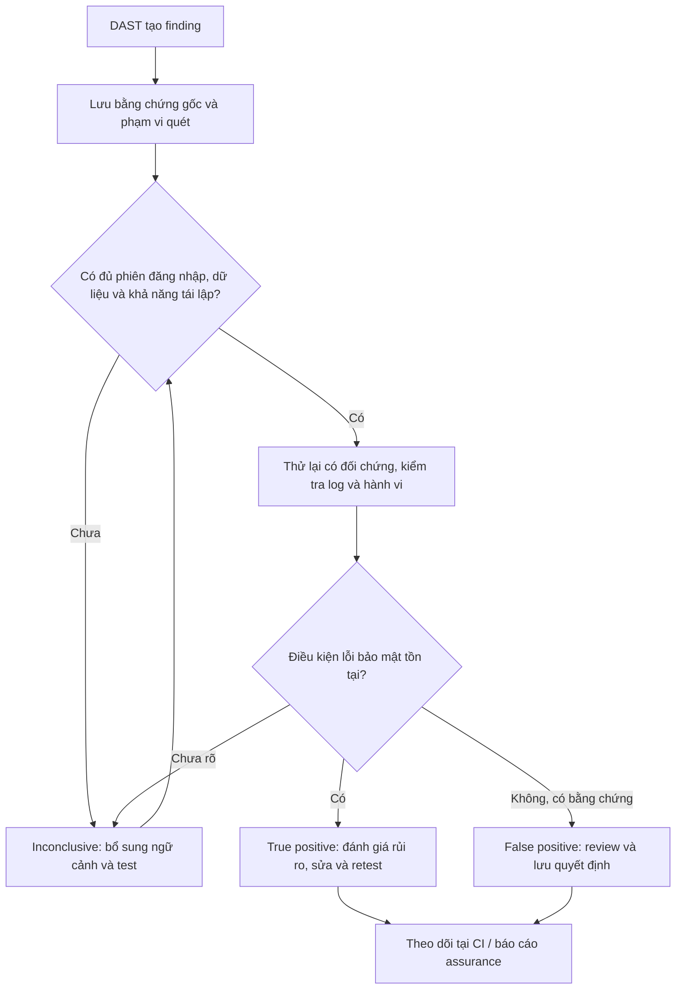

# Kết quả false positive trong Dynamic Testing

## 1. Vì sao phải hiểu đúng kết quả false positive?

**Dynamic Testing (kiểm thử động)** quan sát ứng dụng khi đang chạy: công cụ gửi yêu cầu đến endpoint, theo dõi phản hồi và hành vi thực tế để tìm dấu hiệu vi phạm yêu cầu bảo mật. Trong kiểm thử bảo mật ứng dụng web, cách làm này thường được gọi là **DAST (Dynamic Application Security Testing)**.

DAST hữu ích vì có thể kiểm tra ứng dụng đã triển khai, bao gồm định tuyến, xác thực, phân quyền, xử lý dữ liệu và một số cấu hình runtime. Tuy nhiên, công cụ chỉ nhìn thấy phần hành vi mà nó quan sát được và thường phải suy luận từ những tín hiệu gián tiếp. Vì vậy, **kết quả cảnh báo không tự động đồng nghĩa với một lỗ hổng đã được xác nhận**.

Một **false positive (dương tính giả)** là phát hiện được công cụ báo là có vấn đề bảo mật nhưng sau quá trình xác minh với bằng chứng phù hợp, điều kiện dẫn đến vấn đề đó **không tồn tại trong phạm vi đã kiểm thử**. Nếu phân loại sai, nhóm có thể mất thời gian khắc phục lỗi không có thật, giảm niềm tin vào công cụ hoặc bỏ qua một lỗ hổng thật vì tưởng đó là “nhiễu”.

Trong module **SECURITY_SECURITY_ASSURANCE**, mục tiêu là xây dựng đánh giá có bằng chứng rằng hệ thống đáp ứng các mục tiêu bảo mật: từ rủi ro, yêu cầu và security controls đến kiểm thử, audit và khắc phục phát hiện. Vì thế, kết luận false positive cần **tái lập được, có người chịu trách nhiệm và truy vết được**; không chỉ là thao tác bấm “Ignore” trên dashboard.

Sau bài học, người học có thể:

1. Phân biệt false positive với true positive, kết quả chưa kết luận, false negative và chấp nhận rủi ro.
2. Nhận diện các nguyên nhân thường gây cảnh báo sai trong DAST.
3. Thiết kế quy trình xác minh có đối chứng, hạn chế tác động tới hệ thống.
4. Lập hồ sơ bằng chứng và quyết định triage có thể phục vụ review/audit.
5. Đo và giảm nhiễu trong công cụ mà không tạo điểm mù cho security assurance.

## 2. Các khái niệm cần phân biệt

Giả sử công cụ DAST báo rằng một endpoint có thể bị reflected XSS. Có ít nhất bốn tình huống khác nhau: đầu vào thật sự tạo được hành vi thực thi script; đầu vào chỉ được hiển thị như văn bản đã mã hóa; thông tin chưa đủ để kiểm chứng; hoặc việc thử nghiệm bị chặn bởi lỗi đăng nhập/giới hạn môi trường. Chỉ tình huống thứ hai, sau khi đã xét ngữ cảnh đầu ra, mới có cơ sở để kết luận false positive cho phát hiện cụ thể.

| Phân loại | Ý nghĩa | Cách xử lý phù hợp |
|---|---|---|
| **True positive (TP)** | Vấn đề mà công cụ báo được xác minh là tồn tại | Đánh giá rủi ro, tạo ticket, khắc phục và kiểm thử lại |
| **False positive (FP)** | Công cụ báo có vấn đề nhưng xác minh chứng minh điều kiện cảnh báo không đúng | Lưu bằng chứng, ghi quyết định, cấu hình loại trừ có kiểm soát nếu cần |
| **Inconclusive / chưa kết luận** | Thiếu dữ liệu, thử nghiệm chưa đạt điều kiện hoặc kết quả mâu thuẫn | Thu thập thêm log, test bổ sung; không tự động đóng |
| **False negative (FN)** | Vấn đề thực tế tồn tại nhưng công cụ không báo | Bổ sung coverage, test case và điều chỉnh quy tắc |
| **Accepted risk / chấp nhận rủi ro** | Vấn đề là thật nhưng người có thẩm quyền chấp nhận rủi ro còn lại | Ghi phê duyệt, biện pháp bù trừ, thời hạn và điều kiện rà soát |
| **Not applicable / ngoài phạm vi** | Quy tắc hoặc test không áp dụng với đối tượng đã xác định | Nêu rõ chính sách, tài sản và lý do không áp dụng |

**Điểm mấu chốt:** false positive là kết luận về **tính đúng đắn của phát hiện**, còn accepted risk là quyết định về **cách đối xử với một rủi ro có thật**. Hai trạng thái này không thay thế cho nhau. Tương tự, “không khai thác thành công trong một lần thử” không đủ để kết luận false positive.

DAST cũng có thể báo **potential vulnerability** hoặc **needs review**. Đây là tín hiệu cần điều tra, không phải bản án bảo mật và cũng không phải bằng chứng chắc chắn của false positive.

### False positive khác “chưa khai thác được”

Ví dụ, công cụ nghi ngờ SQL injection nhưng lần thử lại gặp **HTTP 403** từ WAF. Điều đó chứng minh yêu cầu cụ thể đã bị chặn trên đường thử; chưa chứng minh câu truy vấn ứng dụng được parameterize hay mọi biến thể nguy hiểm đều bị chặn. Kết luận hợp lý thường là *cần xác minh thêm trong môi trường được phép hoặc bằng kiểm tra mã/log*, không phải tự động đánh dấu FP.

Tương tự, nếu CSP chặn một payload XSS thì có thể là kiểm soát giảm thiểu tác động, nhưng không thể từ đó suy ra dữ liệu được đưa vào DOM theo cách an toàn. Việc đánh giá vấn đề gốc, khả năng khai thác và rủi ro còn lại phải được ghi riêng.

## 3. Vì sao công cụ kiểm thử động sinh false positive?

DAST thường đưa ra kết luận từ phép so sánh **request → response** hoặc khác biệt hành vi runtime. Tín hiệu nhiễu có thể khiến bộ dò nhầm nguyên nhân:

| Nhóm nguyên nhân | Biểu hiện trong kết quả | Điều cần kiểm chứng |
|---|---|---|
| **Heuristic khớp mẫu quá rộng** | Input xuất hiện trong HTML nên công cụ gắn cờ XSS | Dữ liệu xuất hiện trong ngữ cảnh nào, đã encode đúng ngữ cảnh chưa, có đi vào executable sink không? |
| **Độ trễ và lỗi hạ tầng** | Request có payload mất nhiều thời gian hơn, bị nghi SQL injection dựa trên timing | Phân bố thời gian nhiều lần thử, tải hệ thống, cache, backend và log truy vấn |
| **Response động** | Nội dung, status hoặc kích thước thay đổi giữa các lần quét | Session, A/B testing, nonce, timestamp, quảng cáo, phân trang, dữ liệu bất định |
| **Authentication/session sai** | Công cụ không thực sự đăng nhập nhưng suy ra vấn đề phân quyền | Cookie, token, role, session hết hạn, trang lỗi đăng nhập và dữ liệu trả về |
| **Proxy, CDN, WAF, gateway** | Status code, redirect hoặc header không phản ánh trực tiếp ứng dụng | Thành phần nào tạo response; kiểm soát nào có hiệu lực ở đường truy cập thật |
| **Cấu hình và môi trường quét** | Cảnh báo trên staging không tương ứng production; hoặc quét nhầm cổng/host | Môi trường đích, build, ingress, TLS termination, feature flags, phiên bản cấu hình |
| **Crawler nhận diện sai endpoint** | Dò một URL tĩnh hoặc mock và suy ra lỗ hổng ở API thật | Route thực tế, phương thức HTTP, trạng thái nghiệp vụ, nội dung và quyền truy cập |
| **Định nghĩa quy tắc thiếu ngữ cảnh** | Cảnh báo thiếu header hoặc cookie flag dù cơ chế triển khai phức tạp | Chính sách áp dụng, điều kiện sử dụng, phạm vi của header/cookie và bảo vệ bổ trợ |

False positive không nhất thiết là lỗi phần mềm của scanner. Đôi khi nó phản ánh giới hạn quan sát, độ chính xác của rule, dữ liệu test không đủ hoặc sự khác biệt giữa môi trường và hành vi người dùng thật.

## 4. Chu trình triage phát hiện DAST

Triage là quá trình biến một tín hiệu máy quét thành kết luận kiểm chứng được và hành động phù hợp.



Lưu ý: sơ đồ minh họa các **kết luận kỹ thuật**. Một true positive có thể tiếp tục sang quyết định accepted risk có thẩm quyền, nhưng việc chấp nhận rủi ro không làm kết luận kỹ thuật đổi thành false positive.

### Bước 1 — Giữ nguyên thông tin gốc

Trước khi thử lại, lưu ít nhất:

- Finding ID, loại lỗ hổng, rule ID, mức độ/certainty do công cụ gán, thời điểm phát hiện.
- Tên và phiên bản scanner, cấu hình/policy liên quan, phạm vi crawl và phương thức quét.
- Môi trường, hostname, build/commit, đường truy cập (qua gateway hay trực tiếp), role của tài khoản test.
- HTTP method, URL/path/parameter, các request và response liên quan, thời gian phản hồi, redirect chain nếu có.
- Bằng chứng bổ sung: screenshot, trace, log ứng dụng, proxy log, correlation/request ID, ticket và liên kết job.

**Bảo vệ dữ liệu:** chỉ lưu những trường thật sự cần thiết; che token, cookie, mật khẩu, dữ liệu cá nhân, khóa API và dữ liệu khách hàng. Khi che thông tin, giữ lại cấu trúc request, tên header/parameter và phần dữ liệu cần để hiểu kết luận.

### Bước 2 — Xác định điều kiện tiên quyết

Hỏi: vấn đề mà rule mô tả **cần điều kiện gì để xảy ra**? Ví dụ:

- **XSS:** dữ liệu do tác nhân kiểm soát phải xuất hiện trong ngữ cảnh thực thi hoặc có đường tới DOM sink nguy hiểm.
- **SQL injection:** đầu vào phải ảnh hưởng cú pháp/cấu trúc truy vấn, không chỉ khiến hệ thống chậm hoặc phát sinh lỗi chung.
- **Broken access control:** người dùng không có quyền phải truy cập được dữ liệu/hành động thuộc đối tượng hoặc vai trò khác.
- **CSRF:** phải xét cơ chế xác thực tự động gửi theo request, kiểm soát chống giả mạo và tính nhạy cảm của thao tác.
- **Security header/configuration:** phải đối chiếu HTTP response ở đường truy cập thật với chính sách bảo mật áp dụng.

Nếu scanner thiếu điều kiện cần để test (ví dụ không có tài khoản hai vai trò hoặc không tạo được dữ liệu đúng trạng thái), kết quả thuộc nhóm **chưa kết luận**.

### Bước 3 — Tái lập trong môi trường được phép

Kiểm tra bằng tài khoản test và dữ liệu không nhạy cảm, đúng build và cấu hình đã sinh finding. Ưu tiên **staging cô lập** có tương đương cấu hình security với production. Với API có thể gây thay đổi dữ liệu, dùng tài nguyên thử nghiệm và hành động có thể hoàn tác; tránh lặp payload làm nghẽn dịch vụ.

Trước khi đánh giá khác biệt, xác nhận phiên đăng nhập còn hiệu lực, role đúng, trạng thái dữ liệu phù hợp, reverse proxy/WAF hoạt động theo dự kiến và request thực sự đi vào endpoint. Ghi lại cả test thành công lẫn test thất bại; không chỉ giữ lần thử hỗ trợ nhận định ban đầu.

### Bước 4 — So sánh với request đối chứng

Sử dụng cặp thử nghiệm cùng method, endpoint, người dùng và trạng thái dữ liệu:

1. **Baseline:** input hợp lệ, không mang tín hiệu của rule.
2. **Test case:** input dẫn đến finding, với điều kiện còn lại giữ tương đương.
3. **Negative control:** input vô hại khác để xem phản hồi có biến động tự nhiên không.
4. **Repeat:** lặp đủ lần để phát hiện hiệu ứng ngẫu nhiên, nếu cần và được phép.

Mục tiêu là chứng minh **sự khác biệt do điều kiện bảo mật** chứ không phải do cache, session, dữ liệu hoặc độ trễ mạng. Với rule dựa vào thời gian, các mẫu ít lần và không kiểm soát tải thường chưa đủ bằng chứng.

### Bước 5 — Đối chiếu hành vi ở tầng ứng dụng

Khi khả thi, phối hợp developer/SRE/AppSec xem log xử lý, lỗi backend, truy vấn đã parameterize, quyết định phân quyền, kết quả render DOM, cấu hình reverse proxy và hoạt động của security controls. Dynamic testing vẫn là phương pháp quan sát runtime; việc dùng thêm mã nguồn/log để giải thích kết quả **làm mạnh thêm bằng chứng** mà không biến nó thành một phép thử khác.

Phải phân biệt response đến từ ứng dụng hay từ WAF/CDN. Không dùng việc công cụ thất bại, lỗi 429, timeout hoặc redirect sang trang đăng nhập để kết luận ứng dụng không có vấn đề.

### Bước 6 — Ra quyết định và gắn người chịu trách nhiệm

Người đánh giá ghi kết luận **TP / FP / Inconclusive / Not applicable** cùng độ tin cậy và phạm vi có hiệu lực. Trường hợp rủi ro còn lại được chấp nhận phải đi theo luồng phê duyệt riêng. Các finding quan trọng cần người review độc lập theo chính sách của nhóm.

Không nên đóng finding nếu lý do chỉ là “không reproduce được”, “WAF đã chặn”, “test một lần không thấy lỗi” hoặc “đội phát triển nghĩ là an toàn”.

## 5. Ví dụ 1 — Cảnh báo reflected XSS do chuỗi được phản chiếu

**Tình huống:** công cụ gửi giá trị có ký tự giống HTML qua tham số tìm kiếm và thấy giá trị xuất hiện trong phản hồi. Nó báo `Potential reflected XSS`.

Yêu cầu thử nghiệm minh họa:

```http
GET /search?q=%3Cprobe-541%3E HTTP/1.1
Host: staging.example.test
Accept: text/html
```

Phần HTML ứng dụng trả về:

```html
<p>Kết quả tìm kiếm cho: &lt;probe-541&gt;</p>
```

Trong response này, dấu `<` và `>` từ input đã được chuyển thành entity HTML khi đưa vào **ngữ cảnh văn bản**. Bản thân việc chuỗi xuất hiện không chứng minh được script chạy. Nếu kiểm tra cho thấy giá trị chỉ được hiển thị như văn bản, không có đường đi khác tới DOM sink nguy hiểm, và quy tắc báo XSS chỉ dựa trên phép “reflection”, có cơ sở đánh giá **false positive đối với finding này trong phạm vi đã xác minh**.

**Cần làm trước khi xác nhận FP:**

- Kiểm tra **ngữ cảnh xuất hiện**: text node, thuộc tính HTML, JavaScript string, URL hay CSS có quy tắc encode khác nhau. Chỉ biết có HTML encoding trong một vị trí là chưa đủ cho mọi vị trí.
- Quan sát DOM cuối cùng sau khi JavaScript phía client xử lý dữ liệu. Payload có thể được đọc lại và đưa vào `innerHTML`, `document.write` hoặc sink khác; phản hồi HTML ban đầu có thể nhìn an toàn nhưng DOM runtime thì không.
- Kiểm tra các view liên quan, trạng thái người dùng và dữ liệu được lưu nếu finding liên quan stored XSS; kết luận chỉ áp dụng cho đường đi đã test.
- Lưu request/response đã được che dữ liệu, ảnh hoặc DOM snapshot, phiên bản build và lời giải thích tại sao điều kiện thực thi script không hình thành.

**Phản ví dụ:** nếu dữ liệu xuất hiện trong một script inline theo cách có thể chấm dứt chuỗi JavaScript hoặc chảy vào HTML parser không an toàn, việc “trông có vẻ đã mã hóa” chưa đủ kết luận. Cần xác minh chính xác ngữ cảnh và đường đi của dữ liệu.

## 6. Ví dụ 2 — Nghi SQL injection vì response chậm

**Tình huống:** một rule thời gian báo `Possible SQL injection` vì request kiểm thử mất khoảng 4 giây, trong khi lần baseline đầu tiên mất 200 ms. Lỗi suy luận thường gặp là mặc định mọi chênh lệch thời gian đều do đầu vào điều khiển câu SQL.

Các nguyên nhân khác có thể là cache miss, cold start, query hợp lệ vốn chậm với dữ liệu riêng, contention tại cơ sở dữ liệu, rate limit hoặc độ trễ của mạng và proxy.

Một chuỗi kiểm tra hợp lệ nên:

1. Dùng cùng tài khoản và cùng trạng thái dữ liệu cho baseline, test case và negative control.
2. Ghi nhiều mẫu thời gian, xen kẽ thứ tự thử để hạn chế ảnh hưởng thời gian và cache.
3. So sánh phân bố độ trễ thay vì một cặp số riêng lẻ.
4. Đối chiếu request ID với log truy vấn, timeout và tình trạng tài nguyên.
5. Khi đủ quyền và phạm vi, kiểm chứng đường đi dữ liệu có dùng truy vấn tham số hóa hay không.

**Kết luận minh họa:** nếu mọi nhóm input đều xuất hiện spike tương tự và log cho thấy chúng trùng với cache miss/đợt tăng tải, trong khi không tìm thấy ảnh hưởng đầu vào đến cấu trúc SQL ở đường đi bị báo, có cơ sở để bác bỏ **cảnh báo dựa trên timing cụ thể**. Không nên từ đó kết luận toàn bộ endpoint không thể có SQL injection; các biến thể hoặc tham số khác có thể chưa được kiểm chứng.

Ngược lại, nếu chỉ không tái lập được chênh lệch thời gian do môi trường kiểm thử không ổn định, trạng thái phù hợp là **inconclusive**.

## 7. Ví dụ 3 — Cảnh báo vượt quyền do hiểu sai HTTP 200

**Tình huống:** công cụ dùng tài khoản B gọi `GET /api/orders/816` với ID đơn hàng thuộc tài khoản A, nhận HTTP 200 và suy ra có lỗi phân quyền. Khi xem response, nội dung chỉ là:

```json
{
  "orders": []
}
```

Status 200 là tín hiệu chưa đủ để khẳng định dữ liệu đơn hàng của A đã bị lộ. Nhóm cần dùng ít nhất hai tài khoản test có dữ liệu khác nhau, xác nhận quyền và định danh của từng đơn hàng, sau đó so sánh response cho chủ sở hữu và người không có quyền.

Nếu tài khoản B chỉ nhận danh sách rỗng, không thấy bất kỳ trường nhạy cảm nào, không thực hiện được thao tác thuộc quyền A, và hành vi này được xác minh trên đúng endpoint/build, kết quả báo **unauthorized data disclosure** dựa duy nhất trên HTTP 200 có thể là FP. Tuy nhiên:

- Việc trả 200 thay vì 403/404 vẫn có thể là vấn đề về contract, khả năng quan sát hoặc nguyên tắc API; nên ghi nhận riêng nếu chính sách yêu cầu.
- Cần xác định response rỗng không phải do thiếu session, test data không tồn tại hay cache.
- Phải kiểm tra các biến thể thao tác liên quan (read/update/delete) theo phạm vi phép thử. Không áp dụng kết luận FP của một yêu cầu cho toàn bộ authorization model.

Đối với lỗi phân quyền, **nội dung và hiệu ứng của hành động** quan trọng hơn một status code đơn lẻ.

## 8. Bằng chứng nào đủ để kết luận false positive?

Một hồ sơ FP tốt cho phép reviewer khác hiểu điều kiện, thử lại hợp lý và nhận ra khi nào cần mở lại.

| Thành phần hồ sơ | Nội dung cần có |
|---|---|
| Định danh | Finding ID, rule, tên scanner, phiên bản và ngày chạy |
| Phạm vi | Service, endpoint, phương thức HTTP, tham số, môi trường, build/commit, role |
| Giả thuyết scanner | Vấn đề công cụ cho rằng tồn tại và dấu hiệu nó dựa vào |
| Cách xác minh | Baseline, test case, đối chứng, điều kiện tái lập và số lần thử nếu liên quan |
| Bằng chứng | Request/response đã che dữ liệu, DOM/log/trace hoặc tài liệu cấu hình cần thiết |
| Lập luận kỹ thuật | Vì sao điều kiện của vấn đề **không tồn tại** trong phạm vi test; các giả định và giới hạn |
| Quyết định | FP/TP/inconclusive, người đánh giá, người phê duyệt nếu chính sách yêu cầu |
| Theo dõi | Ticket, liên kết quét lại, phạm vi suppression, thời hạn review và điều kiện mở lại |

Ví dụ một bản ghi triage rút gọn:

```yaml
finding_id: DAST-DEMO-042
rule: potential-reflected-xss
status: false_positive
scope:
  environment: staging
  build: example-commit-abc123
  endpoint: "GET /search?q=..."
  role: anonymous
observed:
  - "Chuỗi thử xuất hiện dưới dạng text đã HTML-encode"
  - "Không thấy đường từ tham số q đến sink DOM thực thi trong luồng đã kiểm tra"
evidence:
  - "request-response-redacted"
  - "dom-verification"
decision:
  reason: "Không thỏa điều kiện thực thi XSS tại ngữ cảnh đã kiểm tra"
  reviewer: "AppSec reviewer"
  review_on_change: "Khi thay đổi template, frontend renderer hoặc ruleset"
```

Đây là **mẫu minh họa**, không phải kết quả quét một hệ thống thật. Bản ghi thực tế nên trỏ tới artifact/ticket có quyền truy cập phù hợp thay vì nhúng toàn bộ cookie, token hoặc dữ liệu người dùng.

### Mức độ chứng minh

Một kết luận FP cần được diễn đạt **có điều kiện và giới hạn phạm vi**, ví dụ: “Finding DAST-DEMO-042 là false positive trên build abc123, tuyến `GET /search`, tham số `q` trong ngữ cảnh HTML text đã xác minh; các trang hoặc sink khác chưa được kết luận.”

Cách ghi này có giá trị kiểm toán cao hơn “XSS không tồn tại” vì phản ánh trung thực năng lực quan sát của phép kiểm thử.

## 9. Quản lý false positive trong workflow và CI/CD

DAST thường được chạy theo lịch, trước phát hành hoặc trong pipeline. Nếu một cảnh báo FP liên tục xuất hiện mà không được quản lý, nhóm dễ bị “alert fatigue”. Ngược lại, tắt cả rule hoặc bỏ quét một nhóm URL có thể làm mất tín hiệu của lỗ hổng mới.

Nguyên tắc xử lý:

1. **Triage trước khi suppress:** không tạo suppression chỉ vì rule gây nhiều cảnh báo; phải có bằng chứng và người chịu trách nhiệm.
2. **Giới hạn phạm vi:** nếu công cụ hỗ trợ, gắn ngoại lệ với finding/rule + endpoint/parameter + môi trường hoặc fingerprint cụ thể; tránh tắt cả category.
3. **Gắn thời hạn hoặc điều kiện xem lại:** thay đổi code, route, quyền truy cập, template, scanner version/ruleset hay cấu hình reverse proxy có thể làm kết luận cũ không còn đúng.
4. **Lưu nguồn quyết định:** liên kết ticket, build và bằng chứng triage; phân biệt *dismissed as FP* với *risk accepted*.
5. **Giữ quality gate minh bạch:** job scanner lỗi, quét thiếu phạm vi hoặc không đăng nhập được phải có trạng thái riêng; không được biểu diễn như “0 findings”.

Một policy ví dụ: finding mới mức High trở lên không được tự động bỏ qua; nếu xác nhận TP, nhóm xử lý theo SLA hoặc quy trình chấp nhận rủi ro; nếu xác nhận FP, reviewer lưu bằng chứng và ngoại lệ hẹp. Quy định severity, SLA và người phê duyệt thuộc chính sách của tổ chức, không phải giá trị mặc định áp dụng cho mọi hệ thống.

### Những trường hợp nên mở lại FP

- Endpoint, parameter, frontend template hoặc luồng dữ liệu đã thay đổi.
- Phiên bản scanner hoặc rule mới có khả năng phân tích tốt hơn.
- Cấu hình WAF/CDN/CSP, authentication hoặc authorization thay đổi.
- Có bằng chứng mới từ pentest, incident, log, bug bounty hoặc test case độc lập.
- Môi trường production khác với giả định đã dùng khi triage.

Không nên để một quyết định FP trở thành “ngoại lệ vĩnh viễn” áp dụng bất chấp code và bối cảnh.

## 10. Đo chất lượng kết quả DAST

Đếm tổng số cảnh báo là chưa đủ. Hai lần quét có cùng số finding nhưng khác mức độ tin cậy, coverage hoặc trạng thái triage.

Với tập finding **đã được xác minh**, có thể dùng:

\[
\text{Tỷ lệ FP trong finding đã phân loại}
=\frac{FP}{TP+FP}\times100\%
\]

\[
\text{Precision của cảnh báo đã phân loại}
=\frac{TP}{TP+FP}
\]

Ví dụ minh họa: 40 finding đã phân loại, gồm 30 TP và 10 FP. Tỷ lệ FP trong tập này là 25%; precision là 75%. Nếu còn 20 finding *inconclusive*, không đưa chúng vào mẫu số rồi coi như đã phân loại; phải báo riêng số chưa kết luận.

Trong thống kê phân loại, **false positive rate (FPR)** có định nghĩa khác:

\[
\mathrm{FPR}=\frac{FP}{FP+TN}
\]

`TN` là số trường hợp không có lỗ hổng và không bị scanner báo. Với DAST thực tế, tổng số “trường hợp âm tính thật” thường khó xác định, nên không được gọi nhầm `FP/(TP+FP)` là FPR theo nghĩa thống kê. Hãy đặt tên KPI rõ ràng, ví dụ “tỷ lệ cảnh báo đã xác minh là FP”.

Các chỉ số nên đi kèm:

| Chỉ số | Mục đích | Lưu ý |
|---|---|---|
| Tỷ lệ TP/FP trong tập đã triage | Đánh giá độ hữu ích của cảnh báo | Có thiên lệch nếu chỉ triage finding mức High hoặc dễ kiểm tra |
| Số finding inconclusive | Thấy được thiếu hụt ngữ cảnh và dữ liệu | Không ép vào TP hoặc FP cho đủ dashboard |
| Thời gian triage trung vị | Đo tốc độ đưa ra quyết định | Tách theo mức độ ưu tiên và độ phức tạp |
| Số FP bị mở lại | Phát hiện kết luận lỗi thời hoặc suppression quá rộng | Theo dõi lý do mở lại |
| Coverage quét | Các endpoint, role, API flow và trạng thái nghiệp vụ được kiểm thử | Có ít finding do chưa quét đủ không phải chất lượng tốt |
| Tỷ lệ finding có bằng chứng | Kiểm tra tính truy vết của chương trình assurance | Chú ý quyền truy cập và việc che dữ liệu |

Một cải tiến thực tế là duy trì bộ **regression test** chứa các trường hợp TP/FP đã xác minh. Sau khi cập nhật tool hoặc ruleset, chạy trên môi trường được phép và so sánh xem độ chính xác tăng hay giảm.

## 11. Bài thực hành: xác minh một cảnh báo phản chiếu dữ liệu

**Bối cảnh:** DAST quét ứng dụng thử nghiệm và báo reflected XSS tại `GET /search?q=...` do thấy chuỗi từ tham số `q` trong response. Người học được cung cấp một finding gồm request, response, rule ID, thời điểm quét và tài khoản/môi trường tương ứng.

Nhiệm vụ:

1. Viết giả thuyết công cụ đang kiểm tra và điều kiện cần để XSS xảy ra.
2. Xác định input xuất hiện ở vị trí nào trong HTML và DOM sau khi JavaScript chạy.
3. So sánh phản hồi cho input bình thường, input chứa ký tự giống HTML và input đối chứng.
4. Kiểm tra route, session, build và dữ liệu đang dùng; lưu request/response đã che thông tin nhạy cảm.
5. Đưa ra một trong ba kết luận **TP, FP hoặc inconclusive**, kèm bằng chứng và phạm vi hiệu lực.
6. Viết đề xuất xử lý trên dashboard/pipeline: cần sửa, cần thêm test hay đủ cơ sở suppress hẹp; mô tả điều kiện phải review lại.

**Tiêu chí đạt:** lập luận gắn với điều kiện thực thi cụ thể; không dựa vào việc có/không có chuỗi phản chiếu một cách máy móc; kết luận có khả năng tái kiểm tra; không làm lộ secret trong artifact; và không để kết quả “chưa kết luận” bị biến thành “đã an toàn”.

### Tình huống tự kiểm tra

| Kết quả quan sát | Trạng thái hợp lý ban đầu | Vì sao? |
|---|---|---|
| Input chỉ được đưa vào text node dưới dạng entity HTML; DOM runtime không có đường đi nguy hiểm trong phạm vi test | Có thể xác nhận FP sau review | Thiếu điều kiện thực thi XSS tại đường đi đã xác minh |
| Request nghi injection bị WAF chặn, không có log phía ứng dụng | Inconclusive | Chỉ biết payload bị chặn; chưa xác minh đường đi dữ liệu ứng dụng |
| Người dùng B tải được nội dung đơn hàng thực của A | TP | Có bằng chứng vượt quyền và truy cập dữ liệu |
| Một request mất 5 giây, các lần tiếp theo 200 ms, tải hệ thống đang biến động | Inconclusive | Thiếu đối chứng để phân biệt nguyên nhân độ trễ |
| Finding đã được chứng minh là lỗ hổng, nhưng product owner chấp nhận triển khai sau phê duyệt | TP + accepted risk | Quyết định quản lý rủi ro không đổi bản chất phát hiện |

## 12. Sai lầm phổ biến và cách tránh

| Sai lầm | Hệ quả | Cách cải thiện |
|---|---|---|
| Coi cảnh báo nào khó khai thác cũng là FP | Đóng nhầm lỗ hổng thật | Tách đánh giá điều kiện lỗi khỏi xác suất và tác động khai thác |
| Bấm “Ignore” vì người khác đã nói là không sao | Mất bằng chứng và trách nhiệm giải trình | Bắt buộc ghi lý do, chứng cứ và reviewer |
| Kết luận từ một lần gửi request | Dễ bị cache, tải hệ thống, session tác động | Dùng đối chứng và lặp lại khi phù hợp |
| Không phân biệt WAF và logic ứng dụng | Suy ra sai về hiệu quả validation ở backend | Đối chiếu log, proxy và giả định kiểm soát bù trừ |
| Dùng cùng một tài khoản cho test phân quyền | Không tái lập được điều kiện vượt quyền | Chuẩn bị tài khoản, role và tài nguyên thử riêng |
| Loại trừ cả rule/category để giảm noise | Che lỗ hổng mới ở nơi khác | Suppression hẹp, có thời hạn, review khi bối cảnh đổi |
| Đưa token và dữ liệu thật vào ticket | Làm lộ thông tin qua hệ thống quản lý bằng chứng | Che dữ liệu, dùng account test và phân quyền artifact |
| Ghi mọi scan thất bại là “0 findings” | Đánh giá assurance sai lệch | Theo dõi lỗi chạy, coverage và chất lượng phiên quét |

## 13. Tổng kết

Trong **Dynamic Testing**, false positive là một **kết luận kỹ thuật phải được chứng minh** đối với finding và phạm vi cụ thể. Để đi từ cảnh báo đến quyết định đáng tin cậy, nhóm cần lưu đầu vào gốc, tái lập có đối chứng, kiểm tra điều kiện bảo mật, đối chiếu log/ngữ cảnh và ghi rõ người chịu trách nhiệm.

Một quy trình security assurance tốt không cố làm số cảnh báo bằng không bằng cách bỏ qua hoặc suppress tùy tiện. Nó giúp phân biệt lỗ hổng thật, cảnh báo sai và vấn đề chưa đủ bằng chứng; nhờ đó đội ngũ vừa giảm công sức xử lý nhiễu, vừa duy trì được khả năng phát hiện và khắc phục rủi ro trong phát triển và vận hành.
