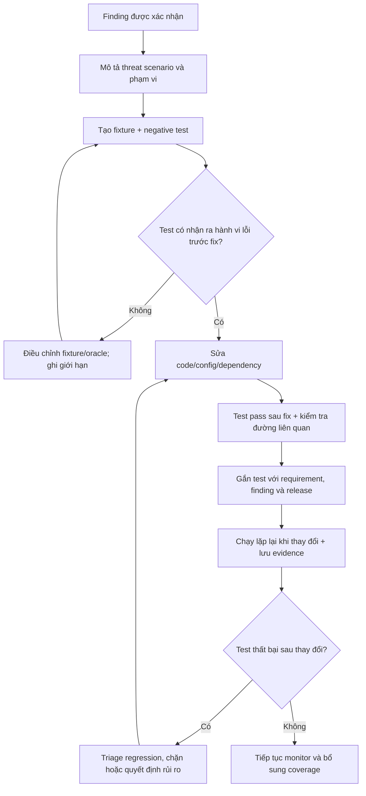
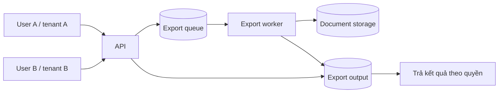
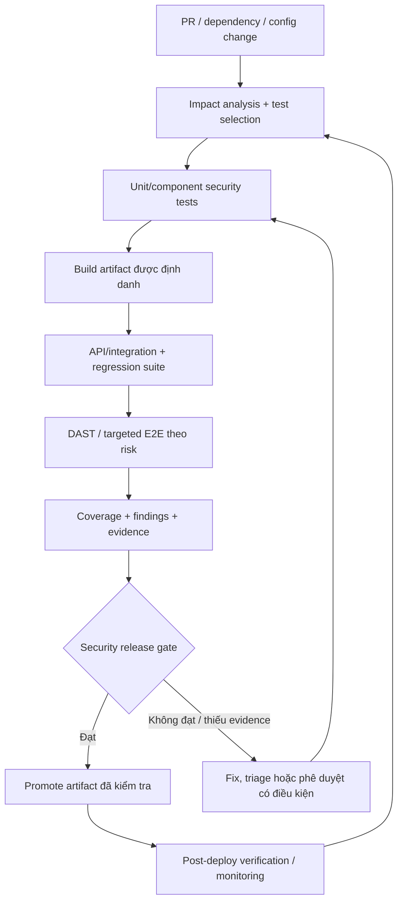

# Regression security test

Một dịch vụ SaaS cho phép người dùng xem, tải và xuất tài liệu theo tenant. Sau một lần kiểm thử bảo mật, nhóm phát hiện người dùng của tenant B có thể yêu cầu export một tài liệu thuộc tenant A. Developer bổ sung kiểm tra quyền trong API tạo job, triển khai bản sửa và đánh dấu finding là đã đóng. Vài tuần sau, nhóm tối ưu export worker để xử lý theo lô. Một nhánh xử lý mới sử dụng object ID từ queue mà không kiểm tra ngữ cảnh tenant; đường rò rỉ cũ xuất hiện trở lại mặc dù unit test của code tối ưu đều đạt.

Đây là lý do cần **regression security test**: không chỉ chứng minh một lỗ hổng đã được sửa tại một thời điểm, mà còn **kiểm tra lặp lại các thuộc tính bảo mật quan trọng sau những thay đổi có thể làm chúng mất hiệu lực**.

**Regression security test (kiểm thử hồi quy bảo mật)** là tập phép kiểm thử được thiết kế để phát hiện việc **một security control, yêu cầu hoặc hành vi an toàn từng được xác minh bị phá vỡ hoặc một lỗ hổng đã khắc phục tái xuất hiện** sau thay đổi code, dependency, cấu hình, hạ tầng, dữ liệu, quyền hoặc môi trường vận hành. Các phép thử có thể ở mức unit, component, API, integration hoặc end-to-end; trong chương **Dynamic testing**, trọng tâm là **quan sát hành vi hệ thống đang thực thi** và đối chiếu với tiêu chí bảo mật rõ ràng.

Trong module **SECURITY_SECURITY_ASSURANCE**, regression security test là mắt xích quan trọng của chương trình **security assurance liên tục**: chuyển rủi ro và phát hiện thành tiêu chí có thể thực thi, duy trì bằng chứng qua các release và nhận ra khi giả định hoặc control đã thay đổi. Kết luận đáng tin phải truy vết được **rủi ro → security requirement → test → phiên bản/cấu hình thực thi → kết quả → finding/remediation → quyết định phát hành**.

## 1. Phân biệt security regression test với những loại kiểm thử khác

Một regression test thông thường phát hiện chức năng từng hoạt động nay bị hỏng. **Security regression test** tập trung vào những hành vi *không được phép xảy ra* và những control bảo mật *phải tiếp tục có hiệu lực*.

| Loại kiểm thử | Câu hỏi chính | Ví dụ |
| --- | --- | --- |
| **Functional regression test** | Tính năng hợp lệ còn hoạt động sau thay đổi không? | User A vẫn tải được tài liệu A |
| **Security regression test** | Control và thuộc tính bảo mật từng yêu cầu còn đúng không? | User B không thể tải tài liệu A sau khi thêm cache |
| **Fix verification / security retest** | Bản sửa cho finding cụ thể có ngăn được hành vi đã phát hiện không? | Thử lại trường hợp export chéo tenant từng thất bại |
| **DAST scan** | Công cụ động phát hiện dấu hiệu lỗ hổng nào ở bề mặt được quét? | Kiểm tra endpoint, session, header và một số cách xử lý input |
| **SAST** | Có mẫu mã hoặc dòng dữ liệu đáng ngờ trong source không? | Phát hiện API gọi SQL nguy hiểm mà chưa parameterize |
| **Penetration testing** | Kẻ tấn công được mô phỏng có thể kết hợp những điểm yếu nào trong phạm vi? | Review và thử các workflow/chuỗi quyền có logic phức tạp |
| **Resilience/recovery test** | Hệ thống giữ tính sẵn sàng, toàn vẹn và khả năng phục hồi thế nào? | Worker restart không tạo hai lần export hoặc lộ trạng thái job |

Những phương pháp này bổ sung cho nhau. Một DAST scan tổng quát có thể không hiểu **tenant nào sở hữu đối tượng nào**; security regression test được thiết kế với dữ liệu hai tenant có thể kiểm tra chính xác ranh giới đó. Ngược lại, bộ regression của nhóm không tự phát hiện mọi mẫu lỗi mới mà công cụ DAST hoặc pentest có thể nhận diện.

### 1.1. Ba mục đích thường được gộp dưới tên “regression”

1. **Ngăn lỗi cũ tái diễn:** lưu test từ một finding từng xác nhận, ví dụ `FIND-AUTH-042`.
2. **Giữ bất biến bảo mật:** kiểm tra tính chất chung như “không đọc chéo tenant”, kể cả khi chưa từng có incident.
3. **Phát hiện tác động bảo mật của thay đổi:** khi cập nhật framework, policy, identity provider, cache hoặc worker, chạy những test liên quan để bảo đảm control vẫn đúng.

Cả ba đều quan trọng. Chỉ thêm một test cho lỗi đã từng xảy ra có thể bỏ qua những kiểm soát chủ động quan trọng; chỉ chạy test bất biến chung mà không giữ fixture tái hiện finding cũ có thể để lỗi quay lại trong một nhánh xử lý đặc biệt.

### 1.2. Test pass không có nghĩa hệ thống không có lỗ hổng

Kết quả **PASS** chỉ nói rằng hệ thống thỏa **những điều kiện được diễn đạt trong các test đã chạy**, với fixture, phiên bản và môi trường cụ thể. Test có thể thiếu đường truy cập qua worker, dữ liệu bất thường, role quản trị, phiên bị thu hồi hoặc cấu hình production. Vì vậy regression suite **không thay thế** threat modeling, static analysis, dependency scanning, design review hay pentest khi các phương pháp đó cần thiết.

## 2. Tại sao security regression khác functional regression?

Nhiều lỗi bảo mật xảy ra vì ứng dụng **vẫn hoạt động đúng chức năng nhưng hoạt động cho sai chủ thể, sai dữ liệu hoặc sai ngữ cảnh**.

Ví dụ:

- API `GET /documents/{id}` trả tài liệu thành công, nhưng với user không có quyền.
- Worker xử lý file hoàn tất, nhưng gửi nội dung sang vendor không được phê duyệt.
- Export thành công, nhưng URL tải xuất hiện trong log hoặc có hiệu lực quá lâu.
- Password reset gửi email đúng, nhưng token vẫn dùng được sau khi đổi mật khẩu.
- Search trả kết quả rất nhanh, nhưng cache key không phân biệt tenant.
- Hệ thống lưu giao dịch đúng, nhưng retry tạo bản ghi trùng hoặc thay đổi dữ liệu khi principal đã mất quyền.
- Một dependency update vẫn vượt qua test nghiệp vụ, nhưng vô hiệu hóa mặc định việc xác minh chứng chỉ TLS.
- API trả lỗi như mong đợi, nhưng response chứa stack trace hoặc thông tin khách hàng.

Security test cần kiểm chứng cả **điều được phép** (*positive behavior*) và **điều bị cấm** (*negative behavior*), kèm các quan sát phụ như response body, side effects, log, quyền truy cập và trạng thái sau xử lý.

### 2.1. “Security invariant” là gì?

**Security invariant** là thuộc tính bảo mật phải được duy trì trong những trạng thái hoặc luồng thuộc phạm vi. Ví dụ:

> Mọi thao tác đọc, tải, tìm kiếm và xuất tài liệu phải bảo đảm người yêu cầu có quyền đối với dữ liệu, bất kể thao tác đồng bộ hay bất đồng bộ.

Bất biến này quá rộng để kiểm chứng bằng một request. Cần chia thành những **testable properties**:

- User A đọc `doc-a` thành công (positive control).
- User B không đọc được `doc-a` (negative control).
- User B không lấy được URL tải `doc-a`, kể cả qua endpoint export.
- Worker không xử lý job giả mạo hoặc job đã mất điều kiện cấp quyền theo policy.
- Search/cache không trả dữ liệu từ tenant khác khi cùng query.
- Response từ chối không tiết lộ metadata cần bảo vệ.

Một bất biến có thể yêu cầu nhiều test và nhiều lớp kiểm chứng. **Một phép thử chỉ hỗ trợ phần claim tương ứng với đường đã được chạy.**

## 3. Bắt đầu từ rủi ro và security requirements

Không nên xây regression suite bằng cách sao chép ngẫu nhiên các payload hoặc test các status code dễ đo. Cần xuất phát từ **risk register**, **threat model**, **yêu cầu bảo mật**, **incident history**, **findings đã sửa** và **security architecture**.

### 3.1. Ma trận truy vết mẫu

| Risk/Threat | Security requirement | Security control | Regression test | Bằng chứng mong đợi |
| --- | --- | --- | --- | --- |
| `RISK-BOLA-01`: truy cập chéo tenant | `SR-AUTH-01`: đối tượng chỉ đọc bởi principal được phép | Authorization theo object/tenant tại service và worker | `T-AUTH-01..06` | Request/response, principal/fixture, kết quả |
| `RISK-SESSION-02`: token đã thu hồi vẫn dùng được | `SR-ID-03`: session revocation theo chính sách | Token/session validation | `T-ID-04` | Request sau thu hồi và audit |
| `RISK-LEAK-03`: dữ liệu nhạy cảm trong lỗi | `SR-LOG-02`: không lộ secret trong response/log | Safe exception handling, redaction | `T-LOG-02` | Error response/log được xử lý |
| `RISK-INJECT-04`: dữ liệu bị diễn giải như lệnh | `SR-INPUT-05`: tham số hóa và kiểm soát input | Safe DB access | `T-INPUT-03` | Negative test an toàn + code review |
| `RISK-PRIV-05`: xuất dữ liệu tới bên không được phép | `SR-DATA-07`: giới hạn bên nhận và mục đích | Egress/data minimization | `T-DATA-02` | Payload giả lập, cấu hình, log đối chiếu |
| `RISK-RETRY-06`: xử lý lặp gây sai dữ liệu | `SR-INT-08`: tính idempotent khi cần | Deduplication, transaction, authorization | `T-ASYNC-05` | Trạng thái job và bản ghi sau retry |

Bảng trên chỉ minh họa mã requirement/test và dữ liệu cần thu thập; không phải bằng chứng dự án đang đạt yêu cầu.

### 3.2. Ưu tiên test theo rủi ro

Một số yếu tố quyết định độ ưu tiên:

- Dữ liệu quan trọng và blast radius (một tài liệu hay toàn bộ tenant).
- Exposure (Internet-facing, internal, admin-only, batch).
- Khả năng khai thác và thông tin về incident trước đây.
- Mức thay đổi của code/config liên quan và tần suất regression.
- Tính dễ tái hiện, tính ổn định và chi phí thực thi.
- Khả năng phát hiện bằng phương pháp khác.
- Hậu quả nếu control thất bại mà test không báo.

Những rủi ro quan trọng nhưng khó tự động hóa không nên biến mất khỏi kế hoạch. Có thể dùng **manual security regression checklist**, review cấu hình hoặc kiểm thử định kỳ với owner và evidence rõ.

## 4. Vòng đời tạo regression test từ một finding

Một cách thực hành có giá trị là biến **mỗi lỗ hổng đã xác nhận** thành ít nhất một phép kiểm tra nhằm ngăn nguyên nhân đó xuất hiện lại khi khả thi.



### 4.1. Bước 1 — Ghi chính xác điều kiện gây lỗi

Một finding có ích không chỉ ghi “IDOR tại export”. Cần biết:

- Ai là chủ thể tấn công? Tài khoản với quyền gì?
- Tài nguyên nào bị ảnh hưởng và ai sở hữu nó?
- Endpoint/workflow/job nào được sử dụng?
- Điều kiện cần: feature flag, session, message, queue, cache hay cấu hình nào?
- Trên phiên bản nào lỗi xuất hiện?
- Hành vi thực tế là gì và yêu cầu nào bị vi phạm?
- Có đường liên quan nào có thể cùng nguyên nhân?

Đây là thông tin để xây **test fixture và security oracle**. Không cần lưu payload có khả năng gây hại trên môi trường thật khi một fixture vô hại có thể tái hiện thuộc tính bảo mật.

### 4.2. Bước 2 — Tạo test thất bại trước khi sửa khi an toàn

Nguyên tắc **red → green** rất hữu ích:

1. Trên môi trường test được cấp phép có phiên bản lỗi, test phải chỉ ra hành vi trái chính sách (*red*).
2. Áp bản sửa.
3. Chạy lại với cùng fixture và kiểm tra test đạt (*green*).
4. Thử thêm các biến thể hợp lý để tránh một bản sửa chỉ chặn trường hợp đơn lẻ.

Nếu không thể chạy lại phiên bản lỗi do nguy cơ hoặc chi phí, vẫn có thể ghi test cho yêu cầu và ghi rõ **chưa có bằng chứng red-before-fix**. Không khẳng định đã chứng minh test bắt được lỗi lịch sử khi chưa từng chạy nó trước fix.

### 4.3. Bước 3 — Mở rộng theo nguyên nhân gốc

Ví dụ lỗi export xảy ra vì worker tin trực tiếp vào `tenant_id` trong job. Không nên chỉ test một tài liệu và một endpoint. Cần rà soát:

- Đường tạo job đồng bộ và async;
- Query metadata và đường đọc object storage;
- Download/presigned URL;
- Search, cache, retry và dead-letter;
- Service account có quyền đọc ngoài phạm vi job;
- Hành vi khi người dùng bị thu hồi quyền;
- Đường admin, share link và chuyển quyền nếu có.

Tùy threat model, có thể chọn một **ma trận representative tests** thay vì tích Descartes mọi trường hợp, nhưng phải nêu rõ đường không được bao phủ.

### 4.4. Bước 4 — Liên kết test với finding và chủ sở hữu

Một test nên có **test ID ổn định**, requirement ID, finding ID khi có, scope, owner, risk tier và phương pháp chạy. Khi tên method đổi hoặc file test di chuyển, đừng làm mất liên kết tới finding cũ.

### 4.5. Bước 5 — Không đóng finding chỉ vì một test xanh

Test xanh ở branch nhưng production còn image cũ thì rủi ro chưa được xử lý tại production. Cần có **artifact identity**, bằng chứng triển khai và điều kiện closure được quy định trong vulnerability management.

## 5. Thiết kế test để tránh kết quả “xanh giả”

Một security regression test muốn đáng tin cần có:

1. **Precondition**: trạng thái trước test được xác minh.
2. **Act**: hành động hoặc request trong phạm vi cho phép.
3. **Oracle**: điều kiện pass/fail dựa trên security requirement.
4. **Postcondition/side effects**: xác minh dữ liệu, quyền, log, job hoặc trạng thái liên quan.
5. **Isolation/cleanup**: test không ảnh hưởng lẫn nhau.
6. **Identity/config binding**: chỉ rõ principal, role, tenant, artifact và môi trường.
7. **Negative + positive controls**: chứng minh request có thể đến đúng chức năng, nhưng bị từ chối khi thiếu quyền.

### 5.1. Positive control là điều kiện quan trọng

Giả sử user B nhận `404` khi hỏi `doc-a`. Điều đó chưa đủ chứng minh phân quyền đúng: có thể `doc-a` không tồn tại, route bị sai hoặc hệ thống chưa đăng nhập. Test nên xác nhận **user A đọc được chính `doc-a`** trước khi khẳng định user B bị từ chối theo security requirement.

### 5.2. Security oracle không nên chỉ nhìn HTTP status

Với request trái quyền, có thể cần kiểm tra:

- Status code phù hợp hợp đồng API (ví dụ `403` hoặc `404` theo policy);
- Response body không chứa nội dung, metadata hay link tải trái phép;
- Không có side effect tạo export job hoặc bản ghi nhạy cảm;
- URL tạm không được sinh ra cho principal trái quyền;
- Audit event có outcome từ chối và không ghi secret;
- Cache, message queue hoặc worker không xử lý dữ liệu vượt quyền;
- Không tiết lộ thông tin nhạy cảm qua header hoặc chi tiết lỗi.

Chỉ assert `status == 403` có thể bỏ sót body lộ dữ liệu. Mặt khác, assert `status == 404` cứng nhắc có thể phá test khi API chuyển sang `403` nhưng vẫn bảo đảm cùng yêu cầu; test phải có **contract rõ ràng**, không đặt kỳ vọng tùy ý.

### 5.3. Không viết assertion chỉ để làm test pass

Những anti-pattern thường thấy:

- Dùng `assertTrue(response != null)` để kết luận authorization an toàn.
- Dùng một ID không tồn tại làm fixture trái quyền.
- Dùng token hết hạn cho test cross-tenant, khiến request bị chặn tại authentication chứ chưa kiểm tra authorization.
- Mock bỏ qua hoàn toàn service đang chứa lỗi mà vẫn gọi đó là end-to-end test.
- “Fix” test bằng cách đổi kỳ vọng thành response lỗi đang xảy ra, không xem security requirement.
- Dùng `try/catch` nuốt mọi exception hoặc `assertDoesNotThrow` cho test vốn phải phát hiện dữ liệu trái quyền.

**Test phải kiểm chứng property quan trọng**, không chỉ phản ánh hành vi hiện tại của hệ thống.

## 6. Các cấp độ security regression test

| Cấp độ | Nơi chạy | Ví dụ | Kết luận hỗ trợ / giới hạn |
| --- | --- | --- | --- |
| **Unit test** | Một hàm/class với dependency được kiểm soát | Policy evaluator từ chối user sai tenant | Nhanh, nhưng không kiểm tra routing, identity provider hay DB thực |
| **Component test** | Một module với các adapter kiểm soát | Document service đọc theo principal | Kiểm tra logic module, còn mock và cấu hình |
| **API/integration test** | App, web stack và DB test đang hoạt động | User B không đọc được doc A qua HTTP | Kiểm tra request flow, nhưng có thể dùng auth mock |
| **Service-to-service test** | API, queue, worker, storage giả lập/thật ở test | Job giả mạo không kéo được file | Bao phủ async, còn phụ thuộc topology test |
| **End-to-end (E2E) security test** | Môi trường tích hợp có IdP, gateway và services | Đăng nhập A/B, xuất tài liệu, xác minh output | Gần hành vi triển khai, thường chậm và dễ phụ thuộc môi trường |
| **DAST retest** | App chạy qua điểm vào scanner/HTTP | Chạy lại request từng kích hoạt finding | Độc lập tương đối với source, có giới hạn khám phá |
| **Post-deploy verification** | Môi trường đích, trong phạm vi cho phép | Xác nhận control trên artifact đang triển khai | Cần kiểm soát tác động và dữ liệu |

Chiến lược tốt thường dùng **nhiều test nhanh ở tầng thấp** và **một số test động xuyên dịch vụ cho đường rủi ro cao**. Không bắt buộc mọi security property đều phải E2E; nhưng với ranh giới tin cậy, principal, worker và cấu hình production, test chỉ ở tầng unit có thể không cung cấp đủ assurance.

### 6.1. Khi nào nên đặt test ở tầng thấp?

Một hàm policy thuần, ví dụ `canRead(user, resource)`, có thể test hàng trăm tổ hợp quyền nhanh và ổn định. Tuy nhiên, phải có ít nhất một số phép thử ở tầng tích hợp để bảo đảm **tất cả endpoint/worker thực sự gọi đúng policy** với danh tính đã xác thực.

### 6.2. Khi nào phải test qua mạng/HTTP?

Khi rủi ro phụ thuộc authentication middleware, gateway, token audience, route, session/cookie, CSRF, cache hoặc proxy, test dynamic ở API/integration thường mang nhiều giá trị hơn mock đơn thuần. Nếu yêu cầu còn phụ thuộc mTLS/ingress/cloud IAM thì cần thêm kiểm chứng tại môi trường phù hợp.

## 7. Ví dụ Java/JUnit: test ngăn đọc tài liệu chéo tenant

Giả sử một API thử nghiệm có endpoint:

`GET /api/documents/{id}`

Nguyên tắc: tài khoản tenant A được đọc `doc-a`, tài khoản tenant B không được đọc `doc-a` và không được thấy dấu hiệu chứa dữ liệu nhạy cảm của A.

### 7.1. Chuẩn bị fixture

Nhóm chuẩn bị **trong môi trường test được phép**:

- User `user-a` với token A hợp lệ và tenant A;
- User `user-b` với token B hợp lệ và tenant B;
- Tài liệu `doc-a` thuộc tenant A có nội dung marker giả lập duy nhất;
- Chính sách xác định user B bị từ chối bằng `403` hoặc `404`;
- Endpoint đã khởi động và có thể truy cập từ test runner;
- Cleanup đảm bảo tài liệu test không ảnh hưởng người dùng khác.

Không dùng dữ liệu thật hoặc token production trong ví dụ.

### 7.2. Ví dụ test động bằng JUnit 5 và Java HTTP Client

Đây là đoạn Java **minh họa cấu trúc kiểm thử**, giả định fixture và tokens được cấp qua biến môi trường. Nó không phải ứng dụng hoàn chỉnh; nhóm cần triển khai provisioning/cleanup fixture trong test harness riêng.

```java
import org.junit.jupiter.api.BeforeAll;
import org.junit.jupiter.api.Test;

import java.net.URI;
import java.net.http.HttpClient;
import java.net.http.HttpRequest;
import java.net.http.HttpResponse;
import java.time.Duration;

import static org.junit.jupiter.api.Assertions.*;

class DocumentAuthorizationRegressionTest {
    private static final HttpClient CLIENT = HttpClient.newHttpClient();

    private static String baseUrl;
    private static String tokenA;
    private static String tokenB;
    private static String documentId;

    @BeforeAll
    static void setup() {
        baseUrl = System.getenv().getOrDefault(
            "TEST_BASE_URL", "http://127.0.0.1:8080"
        );

        URI target = URI.create(baseUrl);
        if (!"127.0.0.1".equals(target.getHost())
                && !"localhost".equals(target.getHost())) {
            throw new IllegalStateException(
                "Ví dụ này chỉ cho phép test trên localhost"
            );
        }

        tokenA = requiredEnv("TEST_TOKEN_TENANT_A");
        tokenB = requiredEnv("TEST_TOKEN_TENANT_B");
        documentId = requiredEnv("TEST_DOCUMENT_A_ID");
    }

    private static String requiredEnv(String name) {
        String value = System.getenv(name);
        if (value == null || value.isBlank()) {
            throw new IllegalStateException(
                "Missing test fixture: " + name
            );
        }
        return value;
    }

    private HttpResponse<String> read(String token) throws Exception {
        URI uri = URI.create(
            baseUrl + "/api/documents/" + documentId
        );

        HttpRequest request = HttpRequest.newBuilder(uri)
            .timeout(Duration.ofSeconds(10))
            .header("Authorization", "Bearer " + token)
            .GET()
            .build();

        return CLIENT.send(
            request,
            HttpResponse.BodyHandlers.ofString()
        );
    }

    @Test
    void ownerCanReadDocumentPositiveControl() throws Exception {
        HttpResponse<String> response = read(tokenA);

        // Điều này xác minh fixture tồn tại và đi đúng endpoint.
        assertEquals(200, response.statusCode());
        assertTrue(response.body().contains(documentId));
    }

    @Test
    void otherTenantCannotReadDocument() throws Exception {
        HttpResponse<String> response = read(tokenB);

        // Hợp đồng API cho phép 403 hoặc 404 khi từ chối.
        assertTrue(
            response.statusCode() == 403
                || response.statusCode() == 404
        );

        // Marker chỉ là dữ liệu giả lập trong fixture.
        assertFalse(response.body().contains("fixture-secret-A"));
        assertFalse(response.body().contains(documentId));
    }
}
```

**Giới hạn của ví dụ:** test có hai phương thức độc lập, không tự tạo dữ liệu hay token; test runner phải tạo và xác minh fixture trước đó. Điều kiện `response.body().contains(documentId)` phụ thuộc API contract: nếu API không trả ID trong body thì cần dùng một cách xác minh hợp lệ khác. Marker chỉ nên là **dữ liệu test giả**, không phải bí mật thật.

Trong dự án thực tế, thường nên tạo fixture qua setup API hoặc repository dành riêng cho test; có cleanup, data isolation và phương pháp xác thực token nhất quán với test environment. Kiểm tra quyền nên có cả thử nghiệm qua gateway/IdP thật ở một tầng khác nếu unit/integration harness đã mock xác thực.

### 7.3. Tại sao test này chưa đủ cho toàn hệ thống?

Test trên chỉ thực hiện **read metadata**. Nó chưa chứng minh download, search, presigned URL, export worker, cache, admin API hoặc job retry được bảo vệ. Cần truy vết risk/requirement sang các luồng liên quan và thêm test tương ứng; đừng dùng một test xanh để tuyên bố “tenant isolation fully verified”.

### 7.4. Test bổ sung cho phiên bị thu hồi

Một security requirement có thể yêu cầu token mất hiệu lực sau sự kiện thu hồi theo giới hạn thời gian xác định. Phép thử cần:

1. Dùng token hợp lệ truy cập tài nguyên hợp lệ.
2. Thực hiện sự kiện thu hồi trong test environment.
3. Đợi/thăm dò trong thời gian theo contract, không sleep tùy tiện.
4. Gửi lại request với token cũ.
5. Xác minh bị từ chối và không có dữ liệu/side effect trái chính sách.

Nếu hệ thống dùng JWT tự chứa với thời gian hết hạn và không có revocation tức thời, test phải phản ánh **security requirement đã được thiết kế**, không tự giả định mọi token phải bị vô hiệu ngay ở mọi kiến trúc.

## 8. Regression test cho export bất đồng bộ và queue

Nhiều lỗi bảo mật chỉ xuất hiện **sau** response HTTP đầu tiên. Ví dụ API trả `202 Accepted` để tạo job export, nhưng worker mới là nơi lấy dữ liệu và sinh kết quả.



### 8.1. Một test case đúng phải theo tới kết quả

**T-ASYNC-01 — Không xuất tài liệu tenant khác**

**Preconditions:**
- `doc-a` tồn tại và chỉ thuộc tenant A;
- `user-b` có quyền export các tài liệu thuộc tenant B;
- Hệ thống API/queue/worker/storage test đang hoạt động;
- Có cách quan sát trạng thái job và output được cấp phép.

**Steps:**
1. User B đề nghị export `doc-a`.
2. Quan sát response; nếu API từ chối ngay, xác minh không có job trái quyền được tạo.
3. Nếu API chấp nhận job do xử lý bất đồng bộ, theo dõi job tới trạng thái cuối trong **deadline có giới hạn**.
4. Xác minh job không tạo output chứa dữ liệu A; không có URL có thể tải dữ liệu A.
5. Kiểm tra audit outcome và những side effects còn lại.
6. Chạy positive control: user A export `doc-a` thành công theo hợp đồng.

**Expected outcome:** không có đường cho user B lấy nội dung hoặc kết quả export của A, bất kể service xử lý ở bước nào.

### 8.2. Không dùng sleep cố định cho async verification

Một test chờ đúng 2 giây rồi xem status rất dễ flake vì tốc độ queue thay đổi. Nên **poll có giới hạn thời gian**, dùng backoff hợp lý, kết thúc khi đạt điều kiện terminal hoặc timeout. Khi timeout, báo rõ job ID, trạng thái cuối và correlation ID đã redact; không in token hoặc nội dung dữ liệu nhạy cảm.

Để ổn định, nên đặt queue riêng hoặc namespace riêng cho test, fixture có ID duy nhất và cơ chế cleanup. Không retry vô hạn một trường hợp thất bại và cuối cùng ghi PASS mà không hiểu nguyên nhân.

### 8.3. Regression sau khi thay đổi worker authorization

Nếu bản sửa chuyển authorization từ API sang worker hoặc ngược lại, test phải xác minh control ở **vị trí thực thi mới**. Chỉ kiểm tra API layer có thể bỏ sót một đường nhận job nội bộ hoặc service account có quyền quá rộng.

## 9. Các nhóm security regression quan trọng khác

Tùy threat model, chương trình nên bao phủ các lớp rủi ro sau. Mỗi nhóm cần security oracle và phạm vi cụ thể.

### 9.1. Authentication và session

- Request không có credential bị từ chối đối với tài nguyên yêu cầu xác thực.
- Token hết hạn, sai issuer/audience hoặc bị thu hồi bị xử lý theo policy.
- User không thể dùng session của người khác.
- Logout, password change và reset tác động đúng session/token theo thiết kế.
- Cookie/session attributes phù hợp trên đường triển khai thực tế.

**Chú ý:** test với token không hợp lệ có thể xác nhận authentication, nhưng chưa xác nhận **authorization** đối với một user đã đăng nhập.

### 9.2. Authorization theo đối tượng và vai trò

- User thường không gọi được admin endpoint.
- Tenant B không truy cập được object tenant A qua read, write, download, export, search.
- Quyền chia sẻ và thu hồi quyền được thực thi ở các đường truy cập khác nhau.
- Worker/service account không có quyền vượt quá công việc được cấp.
- Response từ chối không tiết lộ metadata nhạy cảm.

Đây là nhóm regression đặc biệt quan trọng với SaaS đa tenant vì tính năng vẫn có thể “chạy tốt” dù dữ liệu được trả sai chủ thể.

### 9.3. Input handling và output encoding

- Dữ liệu đầu vào không làm thay đổi cấu trúc câu lệnh hoặc ngữ cảnh thực thi không được phép.
- Các trường được validate theo chính sách; trường lạ/không hợp lệ không gây lộ lỗi nội bộ.
- Nội dung do user kiểm soát được encode phù hợp với ngữ cảnh đầu ra.
- File, JSON và cấu trúc lồng nhau được xử lý trong giới hạn tài nguyên.

Nên dùng **test case an toàn, có phê duyệt** nhằm xác minh các thuộc tính cụ thể. Không cần thử một chuỗi khai thác nguy hiểm trên production nếu kiểm thử có thể chứng minh yêu cầu trong môi trường cô lập.

### 9.4. Logging, error handling và data protection

- Response lỗi không chứa stack trace, token hoặc dữ liệu khách hàng vượt nhu cầu.
- Log có correlation ID, action/outcome phù hợp nhưng không ghi secret.
- Dữ liệu được gửi tới downstream bên thứ ba theo mục đích và trường được phép.
- Dữ liệu trong cache, search index hoặc export artifact không vượt tenant.
- Backup/test data không bị đưa sang môi trường thiếu control.

### 9.5. Crypto, TLS và cấu hình

- Client/server không chấp nhận kết nối hoặc chứng chỉ sai khi policy yêu cầu xác thực điểm cuối.
- Các cấu hình mật mã, secret sourcing, key access không bị quay về chế độ kém an toàn sau nâng dependency.
- Endpoint production không bật debug mode hoặc insecure configuration.
- Session/cookie/header controls vẫn có hiệu lực sau thay ingress/proxy.

Không phải mọi test TLS hoặc cryptographic policy đều thuộc DAST web; có thể dùng configuration review, protocol tests hoặc kiểm chứng hạ tầng riêng.

### 9.6. Availability và abuse controls

- Rate limiting, quota, timeout, size limits hoạt động theo policy.
- Job retry không nhân bản thao tác nhạy cảm hoặc tăng quyền.
- Input lỗi không gây crash dây chuyền trên service được cô lập.
- Hành vi fail-safe khi IdP, policy service hoặc key service không khả dụng.

Các test gây tải phải có phạm vi và giới hạn; không tự chạy load/DoS test như một bước regression mặc định trên môi trường chia sẻ.

## 10. Khi nào cần chạy lại security regression suite?

Một thay đổi tưởng như không liên quan bảo mật vẫn có thể làm hỏng security invariant.

| Trigger | Ví dụ | Nhóm test nên ưu tiên |
| --- | --- | --- |
| **Code change** | Sửa controller, service, repository hoặc mapper | Authorization, input/output, negative tests |
| **Dependency update** | Framework web, parser, HTTP client | Session, input handling, TLS, error handling |
| **Identity/policy change** | JWT claims, role mapping, feature flag, IAM | Authn/authz, token lifecycle, worker permissions |
| **Architecture change** | Thêm queue, cache, index, export worker | Cross-tenant, async, leakage, replay |
| **Infrastructure change** | Ingress, TLS termination, service mesh, storage policy | Header/cookie/TLS, access path và IAM |
| **Data migration** | Thay schema hoặc ownership model | Tenant isolation, data integrity, retention |
| **Incident/finding closure** | Vá BOLA, SQL injection hoặc log leakage | Test tái hiện lỗi + kiểm tra đường cùng nguyên nhân |
| **Release/rollout** | Deploy image mới, thay runtime config | Critical smoke security regression và artifact checks |
| **New advisory/threat evidence** | Thay affected range hoặc xuất hiện exploit | Xem lại risk/test scope và control liên quan |

Nên dùng **change impact analysis** để chọn test nhanh trên PR, nhưng **không dựa hoàn toàn vào việc developer tự khai “không ảnh hưởng bảo mật”**. Một số test bất biến trọng yếu cần chạy thường xuyên ở protected branch/release dù change không trực tiếp động tới file liên quan.

## 11. Test suite theo tầng và nhịp thực thi

Một thiết kế thực dụng thường có:

1. **Fast security checks trên PR:** unit/component tests cho policy, scope, validation; nhanh và ổn định.
2. **API/integration regression trên protected branch:** test với DB, routing và authentication phù hợp.
3. **High-risk E2E trước release:** các luồng qua gateway, worker, storage, role/tenant; ít hơn nhưng có giá trị.
4. **DAST/scan định kỳ:** tìm những vấn đề chưa có regression test chủ đích.
5. **Post-deploy verification có giới hạn:** đảm bảo artifact/config đã phát hành thể hiện control ở môi trường đích.
6. **Manual review khi có điều kiện đặc biệt:** third-party, policy exception, thay kiến trúc hoặc finding khó tự động hóa.

### 11.1. Không bắt mọi test E2E chạy trên mỗi commit

Bộ E2E lớn có thể chậm và flaky. Chọn các negative tests rủi ro cao làm **release gate**, chạy test còn lại theo lịch hoặc theo trigger. Những test được chuyển ra khỏi PR gate phải có owner, cadence, policy và cơ chế xử lý nếu phát hiện regression.

### 11.2. Khi thay đổi rule hoặc scanner

Một DAST scanner cập nhật plugin có thể phát hiện finding mới trên code cũ. Security regression suite cần phân biệt **lỗ hổng mới do thay đổi** với **lỗ hổng cũ vừa được phát hiện bằng công cụ mới**. Cả hai đều cần triage, nhưng không nên gán sai nguồn gốc.

### 11.3. Quản lý test ở các nhánh release còn hỗ trợ

Một lỗi được vá ở nhánh main có thể vẫn tồn tại ở release LTS. Nếu có backport, regression test phải được chạy trên **bản release candidate tương ứng**, không dùng bằng chứng của main để kết luận LTS đã xử lý.

## 12. Test fixtures, isolation và reproducibility

Một security test không ổn định dễ bị bỏ qua. Cần thiết kế môi trường thử nghiệm để kiểm tra cùng một điều kiện với kết quả nhất quán.

### 12.1. Dữ liệu thử có quyền sở hữu xác định

Với ví dụ multi-tenant, tạo:

- Hai tenant độc lập;
- User thường cho mỗi tenant;
- User admin hoặc support có giới hạn được công bố khi cần;
- Một số object thuộc từng tenant với marker giả lập;
- Tài liệu được chia sẻ và không chia sẻ;
- Job export có trạng thái đã tạo, đang chạy, hoàn thành;
- Session còn hạn, hết hạn và bị thu hồi khi cần test;
- Phương án cleanup/dọn các object, queue và file xuất.

Không dùng tên tài liệu hoặc chuỗi ngẫu nhiên không xác minh được để làm oracle. Mỗi lần chạy nên có ID riêng hoặc namespace để tránh collision với test khác.

### 12.2. Kiểm soát clock và tính bất đồng bộ

Các test token/session expiry thường không ổn định nếu phụ thuộc trực tiếp vào thời gian thực. Có thể dùng **injectable clock** ở tầng unit/component; ở tầng E2E cần polling có timeout và giới hạn thời gian được chính sách chấp nhận. Nếu clock của các service khác nhau, phải kiểm tra điều kiện skew hoặc cấu hình để tránh kết luận sai.

### 12.3. Không che lỗi bằng retry không giới hạn

Retry có thể thích hợp cho **eventual consistency** và trạng thái chưa hoàn tất. Retry không nên biến một assertion bảo mật thất bại thành PASS do may mắn: nếu bất kỳ lần thử nào trả dữ liệu trái quyền, đó là tín hiệu nghiêm trọng cần giữ evidence. Nên phân biệt:

- Retry quan sát tới khi job **đạt terminal state**;
- Retry do lỗi hạ tầng tạm thời có logging và giới hạn;
- Retry sau **security assertion failure** — thường không được tự coi là thông thường.

### 12.4. Không đặt secret trong test artifacts

Credentials, cookie, bearer token và payload nhạy cảm phải được cấp qua cơ chế được phê duyệt, hạn quyền và thời hạn, và được redact trước khi lưu log/báo cáo. Test markers nên là dữ liệu giả. Khi cần điều tra thất bại, lưu correlation ID và chỉ dữ liệu tối thiểu phục vụ tái hiện.

### 12.5. Kiểm soát side effects

Test có thể tạo export file, gửi email, enqueue job hoặc tác động service vendor. Cần sandbox email, mock vendor khi phù hợp, quota, test storage riêng, rate limit và cleanup. Với test liên quan xóa dữ liệu, chỉ dùng tài nguyên giả lập được phép; không thực hiện trong production ngoài phạm vi phê duyệt.

## 13. Flaky security tests: rủi ro assurance bị đánh giá thấp

**Flaky test** là test thỉnh thoảng pass/fail mà không có thay đổi liên quan rõ ràng. Với security regression, việc quen bỏ qua “test xanh đỏ thất thường” có thể che một lỗ hổng thật.

| Nguyên nhân | Biểu hiện | Hướng khắc phục |
| --- | --- | --- |
| Test data dùng chung | Hai suite sửa cùng object | Isolation theo run ID, cleanup |
| Token/session hết hạn | Thỉnh thoảng nhận `401` | Chuẩn bị identity và mốc thời gian có kiểm soát |
| Async queue chậm | Timeout ở job vừa tạo | Poll bounded, test queue/worker readiness |
| Cache không sạch | Lúc thấy dữ liệu cũ, lúc mới | Fixture/cache namespace và invalidation |
| Race condition | Kết quả phụ thuộc thứ tự test | Độc lập trạng thái, test concurrency riêng |
| Scanner/crawler thiếu coverage | Test “pass” nhưng endpoint chưa tới | Verify coverage và session health |
| External dependency bất ổn | Vendor trả lỗi ngoài ý muốn | Contract mock ở tầng phù hợp; E2E vendor có phạm vi riêng |
| Không đồng bộ cấu hình | Test đánh artifact A nhưng request tới B | Pin target, environment và artifact identity |

### 13.1. Quarantine phải có thời hạn

Nếu một security test quan trọng gây nhiễu và được tạm chuyển khỏi gate, phải ghi:
- Lý do và mức rủi ro;
- Owner và hạn sửa;
- Test thay thế hoặc kiểm tra thủ công có evidence nếu cần;
- Điều kiện bật lại;
- Những release được phép phát hành trong khi coverage thiếu.

Không tắt vĩnh viễn test vì nó “làm chậm pipeline”. Đây là một **coverage exception** cần quản trị tương tự các ngoại lệ kiểm soát khác.

## 14. Triage khi regression test thất bại

Một security test FAIL có thể báo **lỗi bảo mật thật**, **fixture sai**, **môi trường chưa sẵn sàng** hoặc **oracle không còn phù hợp với requirement**. Triage cần làm rõ mà không xóa dấu vết.

### 14.1. Các bước điều tra

1. Xác định test ID, requirement và finding từng liên quan.
2. Kiểm tra run ID, commit, artifact digest, environment/config, principal/tenant.
3. Xác minh preconditions (object tồn tại, token hợp lệ, role đúng).
4. Phân tích response và side effect đã redact.
5. Xem đây là behavior trái policy hay lỗi của test harness.
6. Nếu nguy cơ khai thác có thể cao, thực hiện containment/escalation theo chính sách ngay trong khi điều tra.
7. Nếu là lỗi test, sửa fixture/oracle với review và chạy lại.
8. Nếu là regression bảo mật, tạo hoặc mở lại finding, phân loại priority và đánh giá phạm vi release.
9. Sau fix, retest và xác minh deployment; lưu lịch sử cả lần FAIL đầu.

### 14.2. Các trạng thái cần phân biệt

| Kết quả | Ý nghĩa | Quyết định minh họa |
| --- | --- | --- |
| `PASS` | Các assertion đã thực hiện và đạt trong scope | Hỗ trợ claim tương ứng |
| `FAIL_SECURITY` | Có hành vi trái security requirement được xác nhận | Block/escalate theo policy |
| `FAIL_ENVIRONMENT` | Môi trường/fixture không đáp ứng điều kiện test | Không suy luận application an toàn |
| `NOT_RUN` | Test bị skip, thiếu điều kiện hoặc không được lên lịch | Không có evidence pass |
| `INCONCLUSIVE` | Kết quả chưa đủ căn cứ | Needs review/bổ sung test |
| `APPROVED_EXCEPTION` | Có quyết định quản trị có phạm vi và hạn | Không biến finding thành PASS |
| `FLAKY_UNDER_INVESTIGATION` | Hành vi không ổn định, đang điều tra | Giữ bằng chứng, kiểm soát rủi ro và coverage |

Không nên cấu hình pipeline “không chạy test thì coi là không có lỗi”. Khi test bắt buộc bị skip, release gate cần xử lý theo chính sách **incomplete evidence**.

## 15. Regression testing sau khi sửa vulnerability dependency hoặc cấu hình

Không chỉ code thay đổi mới tạo regression. Một bản nâng framework, image nền, TLS proxy hoặc IAM policy có thể làm thay đổi hành vi bảo mật.

### 15.1. Dependency update

Giả sử một thư viện xử lý XML được nâng lên bản đã sửa. Regression suite nên bao gồm:

- Chức năng hợp lệ vẫn parse được dữ liệu đã hỗ trợ.
- Những input lỗi không khiến service lộ thông tin hoặc mất kiểm soát tài nguyên theo requirement.
- Dependency graph/SBOM xác nhận artifact không còn package/version bị ảnh hưởng.
- Các giới hạn kích thước, timeout và sandbox vẫn hoạt động.
- Các rule bảo mật liên quan tới workflow xử lý file không suy giảm.

Không nên cố tự tái tạo payload khai thác nguy hiểm trên production để “chứng minh hết CVE”. SCA và code/design review giúp xác nhận version/đường lỗi; test động trong môi trường được phép hỗ trợ về hành vi và khả năng vận hành.

### 15.2. Authentication/authorization framework update

Sau nâng phiên bản framework hoặc thay IdP:

- Token sai issuer/audience và hết hạn bị từ chối đúng.
- Role/scopes từ provider được ánh xạ đúng.
- Method/path protections, default deny và exception rules tiếp tục có hiệu lực.
- User thường không gọi admin routes.
- Worker và internal endpoints không bị mở ngoài ý muốn.
- Audit và session policy vẫn hoạt động.

### 15.3. Thay đổi infrastructure/IaC

Một ingress mới có thể thay header và cookie behavior; storage policy mới có thể mở quyền; cache mới có thể làm sai tenant isolation. Cần regression ở tầng phù hợp và kiểm chứng **runtime config**. Unit test application không xác nhận cloud IAM hoặc network policy production là đúng.

### 15.4. Security patch khẩn cấp

Với patch khẩn, nên chọn **bộ regression tối thiểu theo rủi ro** làm gate trước rollout, kiểm tra hành vi lỗi gốc và critical paths, rồi bổ sung các test ít khẩn hơn theo kế hoạch có owner/hạn. “Emergency” không phải lý do tự động bỏ mọi security check hoặc không lưu evidence.

## 16. Tích hợp security regression vào CI/CD và release gate

Cần bảo đảm kết quả test **gắn với đúng source, artifact và môi trường triển khai**, và những phép thử bắt buộc không bị bỏ qua bởi cờ hoặc cấu hình tùy ý.



### 16.1. Chọn test theo thay đổi, vẫn giữ những bất biến bắt buộc

Có thể dùng mapping:
- Endpoint authorization thay đổi → API/tenant tests.
- Export worker/queue thay đổi → async permissions, idempotency và output tests.
- IdP/role mapping thay đổi → authentication, role/permission tests.
- Storage/IAM thay đổi → authorization và truy cập object.
- Dependency/parser thay đổi → input/error/resource regression.
- Proxy/TLS thay đổi → cookie, session, header và transport checks.

Tuy nhiên, **test selection phải do cơ chế có review quyết định**, không nên dựa hoàn toàn vào một manifest do chính PR đang được đánh giá tự sửa để tắt test quan trọng.

### 16.2. Pseudocode policy cho CI

Đoạn YAML dưới đây mô tả **logic của một policy**, không phải cú pháp thực thi trực tiếp của một CI/CD product:

```yaml
security_regression_policy:
  id: "SEC-REGRESSION-PRODUCTION"
  version: "1.0"
  target:
    release: "<release-id>"
    source_commit: "<commit-sha>"
    artifact_digest: "sha256:<digest>"
    environment: "<approved-test-environment>"
  required_suites:
    - id: "security-authz-tenant"
      requirements: ["SR-AUTH-01"]
      on_not_run: "BLOCK"
    - id: "security-session"
      requirements: ["SR-ID-03"]
      on_not_run: "BLOCK"
    - id: "security-export-async"
      requirements: ["SR-AUTH-01", "SR-INT-08"]
      on_not_run: "NEEDS_REVIEW"
  evidence:
    require_test_run_ids: true
    require_fixture_and_environment: true
    require_artifact_identity: true
    require_uncovered_risks_documented: true
  decisions:
    confirmed_security_regression: "BLOCK"
    test_environment_unavailable: "NEEDS_REVIEW"
    approved_time_bound_exception: "CONDITIONAL"
    all_required_tests_passed: "PASS_FOR_THIS_CONTROL"
```

**Không** tự suy luận artifact an toàn nếu test không chạy. Những phép thử cần kiểm tra tại production có thể dùng cơ chế post-deploy verification được phê duyệt, nhưng cần tránh side effects và phải theo dõi nếu phát hiện regression sau triển khai.

### 16.3. Đảm bảo không triển khai artifact khác bản đã test

Một CI run kiểm tra image digest `sha256:A`; một hệ thống deploy tự lấy tag đã bị thay thành digest `sha256:B`. Evidence test của A không tự áp dụng cho B. Nên promote artifact bất biến, lưu digest và kiểm tra deployment record. Nếu môi trường test khác production ở config/auth/provider, phải ghi hạn chế và bổ sung validation phù hợp.

### 16.4. Release gate không thay thế remediation SLA

Khi regression FAIL và finding được xác nhận, cần gắn owner, risk priority và remediation SLA. Release có thể bị chặn ngay do security requirement bắt buộc, **ngay cả khi SLA xử lý finding chưa đến hạn**. Một ngoại lệ có hạn phải được risk owner phê duyệt theo chính sách, không tự sửa expected result để “đạt”.

## 17. Evidence-based security assurance từ regression tests

Security assurance không phải “có test suite” mà là **lập luận về các mục tiêu bảo mật được hỗ trợ bởi bằng chứng phù hợp**.

### 17.1. Claim – Argument – Evidence

**Claim minh họa `CLM-DYN-REG-01`:**

> Trong release và phạm vi đã đánh giá, các security invariants quan trọng về xác thực, phân quyền theo tenant và xử lý export đã được kiểm chứng lặp lại sau những thay đổi liên quan; các phép thử bắt buộc đạt, hoặc phần chưa đạt có quyết định rủi ro minh bạch theo chính sách.

Claim này **không** bao hàm mọi loại lỗ hổng hoặc mọi đường tương tác chưa được kiểm thử.

**Argument:**

1. Những risk scenarios/requirements quan trọng được ánh xạ tới test IDs.
2. Test fixtures có identity, object ownership và preconditions xác minh được.
3. Negative tests kiểm tra hành vi bị cấm; positive controls chứng minh đường hợp lệ hoạt động.
4. Test harness thực hiện trên artifact/config có định danh.
5. Failures, test skips, flaky/quarantine và môi trường không sẵn sàng không bị ghi thành PASS.
6. Findings được triage; bản sửa và triển khai có evidence đúng phạm vi.
7. Các đường ngoài test coverage được đánh giá bằng phương pháp khác hoặc ghi giới hạn.
8. Rule/test suite được quản trị và chạy lại khi requirement/architecture thay đổi.

**Evidence:** test definitions, mapping requirement–test, CI run, fixture metadata, request/response đã redact, release manifest, config/deployment, finding disposition, retest và quyết định release.

### 17.2. Chất lượng bằng chứng cần xem

| Tiêu chí | Điều cần chứng minh |
| --- | --- |
| **Relevant** | Test thực sự kiểm tra requirement được tuyên bố |
| **Traceable** | Có test ID, requirement, commit, artifact digest và run ID |
| **Reproducible** | Fixture, điều kiện, cách chạy và expected result đủ rõ |
| **Reliable** | Không bị false pass do thiếu precondition, token hết hạn hoặc môi trường sai |
| **Current** | Kết quả vẫn áp dụng với release/config/role/workflow hiện tại |
| **Complete enough** | Đủ những đường trọng yếu trong phạm vi claim; ghi rõ gaps |
| **Transparent** | Có cả FAIL, NOT_RUN, INCONCLUSIVE, ngoại lệ và rủi ro còn lại |
| **Protected** | Evidence không lộ token hoặc dữ liệu khách hàng; chống sửa trái phép |

### 17.3. Ma trận từ finding tới kiểm chứng hồi quy

| Finding | Root cause | Requirement | Regression tests | Điều kiện closure |
| --- | --- | --- | --- | --- |
| `FIND-BOLA-042` | Worker tin job tenant ID không đáng tin | `SR-AUTH-01` | `T-AUTH-03`, `T-ASYNC-01` | API và worker từ chối đường trái quyền; deployment đã xác minh |
| `FIND-LOG-014` | Exception handler ghi token | `SR-LOG-02` | `T-LOG-02` | Log/response test không chứa secret, vẫn có audit cần thiết |
| `FIND-SESSION-021` | Token tiếp tục hợp lệ ngoài policy sau thu hồi | `SR-ID-03` | `T-ID-04` | Revocation behavior đạt contract và môi trường |
| `FIND-INPUT-031` | Parser không giới hạn tài nguyên theo requirement | `SR-INPUT-05` | `T-INPUT-03` | Safe negative test, giới hạn và isolation đạt |

Không đặt trạng thái “verified fixed” trong ma trận khi bản sửa chỉ mới merge mà chưa có kết quả retest và deployment evidence tương ứng.

### 17.4. Mẫu hồ sơ regression assurance

```yaml
security_regression_assurance:
  claim_id: "CLM-DYN-REG-01"
  service: "document-api"
  release_id: "<release-id>"
  source_commit: "<commit>"
  artifact_digest: "sha256:<digest>"
  environment:
    name: "<approved-staging-or-target>"
    configuration_ref: "<config-version>"
  change_context:
    change_refs: ["<PR-or-config-change>"]
    risk_scenarios: ["RISK-BOLA-01"]
    security_requirements: ["SR-AUTH-01"]
    related_findings: ["FIND-BOLA-042"]
  test_plan:
    version: "<suite-version>"
    required_tests:
      - "T-AUTH-01"
      - "T-AUTH-03"
      - "T-ASYNC-01"
    exclusions: ["<uncovered-path-and-reason>"]
  fixture:
    run_namespace: "<isolated-fixture-id>"
    tenant_contexts: ["tenant-a", "tenant-b"]
    precondition_evidence: "<fixture-validation-ref>"
  execution:
    ci_run_id: "<run-id>"
    started_at: "<UTC-timestamp>"
    completed_at: "<UTC-timestamp>"
    results:
      passed: ["<test-ids>"]
      failed: ["<test-ids>"]
      not_run: ["<test-ids>"]
      inconclusive: ["<test-ids>"]
    logs_ref: "<redacted-test-report-ref>"
    environment_errors: ["<errors-if-any>"]
  remediation:
    fix_ref: "<PR-or-config>"
    retest_run_ref: "<test-run>"
    deployment_evidence: "<artifact-deployed-ref>"
  assurance_decision:
    status: "<pass|block|needs-review|conditional>"
    reviewer: "<authorized-reviewer>"
    decided_at: "<UTC-timestamp>"
    limitations: ["<coverage-or-method-limitations>"]
    residual_risk: "<description>"
    exception_ref: "<if-applicable>"
```

Hồ sơ này chỉ là **mẫu dữ liệu giảng dạy**, không phải schema chuẩn bắt buộc hay evidence thực tế. Những trường có placeholder phải lấy từ hệ thống CI/test/asset inventory đáng tin; không tự sinh timestamp và kết luận để tạo vẻ “đã kiểm chứng”.

## 18. Quản trị test suite, chủ sở hữu và thay đổi yêu cầu

Một regression suite có thể trở nên vô nghĩa nếu không có người duy trì hoặc nếu yêu cầu thay đổi mà test không được cập nhật.

| Vai trò | Trách nhiệm | Bằng chứng cần có |
| --- | --- | --- |
| **Security engineer / AppSec** | Xác định rủi ro, design oracle và tiêu chí kiểm chứng | Threat model, requirement–test mapping |
| **Developer / service owner** | Viết/sửa test, fix code, duy trì fixture | PR, test code, regression evidence |
| **QA / automation engineer** | Xây harness, giảm flakiness, xác minh coverage | CI test reports, fixture management |
| **Platform/DevOps** | Môi trường, identity, queue, artifact promotion và gate | Runtime config, deployment digest |
| **SRE/Operations** | Post-deploy verification, rollback, telemetry | Deployment, monitoring và incident records |
| **Risk owner** | Phê duyệt ngoại lệ/rủi ro còn lại theo thẩm quyền | Exception, risk acceptance |
| **Assurance/audit reviewer** | Kiểm tra claim, coverage, tính hợp lệ của evidence | Review record, gap findings |

### 18.1. Khi policy thay đổi, có được sửa test theo?

**Có thể**, nhưng phải review **lý do thay đổi security requirement** và tác động rủi ro. Nếu tổ chức chủ ý cho phép chia sẻ tài liệu liên tenant trong một workflow mới, test cũ cần được cập nhật theo quy tắc chia sẻ cụ thể, không chỉ đổi assertion để loại bỏ lỗi. Phải bổ sung test cho quyền mới, chủ thể được phép, thu hồi quyền và các đường không được phép.

### 18.2. Bảo vệ test và gate khỏi bị bypass

Nếu cùng một PR có thể sửa code, xóa security test, đặt `skipTests=true` và đổi CI policy mà không có review, security gate không đáng tin. Cần bảo vệ thư mục test và pipeline bằng review phù hợp, branch protection, quyền tối thiểu và audit trail. Không nhất thiết test nào cũng cần phê duyệt độc lập, nhưng những control quan trọng cần được quản trị theo rủi ro.

## 19. Metrics đánh giá hiệu lực security regression

Không nên đo chương trình bằng mỗi “số test pass”. Nên xem **coverage, kết quả thực và năng lực phát hiện tái diễn**.

| Metric | Câu hỏi | Lưu ý |
| --- | --- | --- |
| **Security requirement coverage** | Bao nhiêu requirement có test/verification phù hợp? | Có test chưa chứng minh test đủ mạnh |
| **High-risk path coverage** | Các endpoint/worker/trust boundary quan trọng được bao phủ? | Cần đo theo workflow/role/tenant |
| **Confirmed regression detections** | Bao nhiêu lần test phát hiện control bị phá vỡ? | Số cao có thể phản ánh test tốt hoặc chất lượng thay đổi kém |
| **Regression escape rate** | Sự cố production đáng lẽ test phải bắt nhưng không bắt | Cần postmortem và phân tích test gap |
| **Test reliability / flakiness** | Những test bắt buộc thất thường ra sao? | “Rerun until green” có thể che lỗi |
| **Skipped/quarantined security tests** | Có bao nhiêu control bị giảm coverage? | Theo dõi owner và hạn |
| **Time to triage regression** | Từ FAIL tới đánh giá rủi ro mất bao lâu? | Cần phân loại theo priority |
| **Time to verified remediation** | Từ finding tới bản sửa được xác minh ở phạm vi | Không dùng PR merge thay deployment |
| **Reintroduced finding rate** | Một lỗ hổng đã đóng có trở lại không? | Giữ liên kết finding cũ và mới |
| **Artifact/evidence matching rate** | Test có gắn đúng version/config đã deploy? | Quyết định release phụ thuộc tính khớp |
| **Suite duration** | Pipeline có đáp ứng nhu cầu phản hồi? | Không giảm test rủi ro cao chỉ để tối ưu thời gian |

### 19.1. Một con số tỷ lệ có thể gây hiểu nhầm

Ví dụ 99/100 test PASS nhưng test FAIL duy nhất là `T-AUTH-03` phát hiện truy cập chéo tenant. Không thể nói “99% đạt nên release an toàn”. Quyết định phải xét **mức rủi ro của requirement bị vi phạm**, không chỉ tỷ lệ pass chung.

### 19.2. Coverage không đồng nghĩa test count

100 test kiểm tra một endpoint công khai không thay thế một test chính xác cho export worker có khả năng làm lộ dữ liệu nhiều tenant. Khi báo cáo coverage, nên dùng **ma trận requirement → asset/flow → scenario → test** và chỉ ra gaps thay vì chỉ đếm số test methods.

## 20. Những sai lầm thường gặp

| Sai lầm | Hậu quả | Hướng cải thiện |
| --- | --- | --- |
| Chỉ thêm test cho happy path | Bỏ sót truy cập trái quyền | Positive + negative controls |
| Dùng object không tồn tại cho IDOR/BOLA test | `404` giả tạo cảm giác được bảo vệ | Fixture tồn tại, owner được truy cập hợp lệ |
| Test token hết hạn thay vì user sai tenant | Chỉ kiểm tra authentication | Dùng credential hợp lệ nhưng không có quyền |
| Assert một HTTP status duy nhất | Có thể bỏ lộ dữ liệu trong response/side effects | Kiểm tra body, output, audit và workflow |
| Chỉ test API tạo job async | Worker có thể xuất dữ liệu sau `202` | Theo dõi terminal state và output |
| Sửa code nhưng không thêm regression test | Lỗi có thể quay lại trong release sau | Biến finding thành test có ID và owner |
| Test xanh ở unit rồi tuyên bố production an toàn | Không kiểm tra gateway, queue, IAM và config | Bổ sung integration/E2E và deployment checks |
| Retry test đến khi xanh | Che lỗi security không ổn định | Phân biệt eventual consistency với FAIL thực |
| Bỏ test flaky vô thời hạn | Mất coverage mà không biết | Quarantine có review, owner và hạn |
| Coi NOT_RUN là PASS | Không có bằng chứng nhưng vẫn phát hành | Gate phân biệt thiếu dữ liệu |
| Dùng dữ liệu khách hàng hoặc token production làm fixture | Tạo rủi ro mới trong quá trình test | Test data cô lập, least privilege, redaction |
| Không gắn test với release/artifact | Bằng chứng test của A được dùng cho B | Commit/digest/config binding |
| Cập nhật expected result theo code mới mà không review | Chuẩn bảo mật vô tình bị hạ | Requirement/risk review trước sửa oracle |
| Chỉ đếm số test pass | Bỏ qua một thất bại rủi ro cao | Risk-weighted decision và gaps |
| Quên release cũ, worker hoặc region | Rủi ro còn tồn tại ngoài môi trường test | Asset/deployment inventory |
| Đóng finding ngay khi merge PR | Bản sửa chưa được kiểm chứng | Retest, rollout và closure evidence |
| DAST quét sạch nên xóa mọi negative tests | Business logic có thể chưa được scan | DAST bổ trợ, không thay test chuyên biệt |

## 21. Checklist thiết kế và vận hành regression security test

- [ ] Đã xác định security objective/risk/requirement cụ thể cho mỗi nhóm test.
- [ ] Findings đã xác nhận có test tái hiện khi khả thi và an toàn.
- [ ] Test có ID, owner, scope, trigger và yêu cầu được ánh xạ rõ.
- [ ] Đã định nghĩa precondition, act, expected result và postcondition.
- [ ] Có positive control để chứng minh fixture/đường request hợp lệ.
- [ ] Có negative test với principal hợp lệ nhưng không đủ quyền khi kiểm tra authorization.
- [ ] Oracle kiểm tra dữ liệu/side effect nhạy cảm, không chỉ status code.
- [ ] Các luồng sync/async, queue, cache, download, export được xét theo risk.
- [ ] Các token, role, tenant, object ownership và trạng thái session được xác minh.
- [ ] Test data được cô lập, có cleanup và không lộ secret/dữ liệu thật.
- [ ] Test không gây side effect ngoài phạm vi được cấp phép.
- [ ] Có kiểm chứng scanner/DAST test coverage và điểm hạn chế khi dùng kết quả quét.
- [ ] Tests bắt buộc không bị skip âm thầm hoặc hiểu nhầm failure thành PASS.
- [ ] Có quy trình giảm flaky, không retry assertion bảo mật tới khi xanh.
- [ ] Test suite và CI gate được bảo vệ khỏi chỉnh sửa/bypass trái phép.
- [ ] Test result gắn đúng commit, build, artifact digest, config và environment.
- [ ] Bản sửa được retest trên phiên bản mới và kiểm chứng deployment thuộc scope.
- [ ] Finding và exception có owner, deadline và bằng chứng closure.
- [ ] Regression suite được kích hoạt khi code/dependency/policy/architecture thay đổi.
- [ ] Những phần chưa được test có lý do, phương án bổ sung và người chịu trách nhiệm.
- [ ] Release decision nêu rõ requirement nào đạt, nào chưa và residual risk.
- [ ] Có review hậu incident để bổ sung test hoặc sửa oracle khi lỗi lọt production.

## 22. Tình huống thực hành

### Tình huống A: Test `404` giả

User B gọi API đọc `doc-a` và nhận `404`; test pass. Nhưng không có tài liệu `doc-a` trong database test. Có thể kết luận kiểm tra tenant isolation thành công?

**Không.** Test chưa chứng minh object tồn tại. Cần có positive control từ user A hoặc bước xác minh fixture, sau đó negative test bằng user B có token hợp lệ.

### Tình huống B: Bản sửa merge nhưng worker cũ vẫn chạy

Security regression test của API đã xanh ở commit mới. Export worker tại một region production chưa cập nhật image. Có thể đóng finding truy cập chéo tenant toàn hệ thống chưa?

**Chưa.** Cần xác minh các đường async và artifact đang chạy. Evidence của một commit/staging không tự chứng minh toàn bộ deployment đã xử lý.

### Tình huống C: Một test quyền bị flaky

Test thỉnh thoảng trả tài liệu tenant A cho user B, nhưng chạy lại lần hai thì pass. Team muốn tăng số lần retry đến khi xanh. Có hợp lý không?

**Không.** Một lần quan sát rò dữ liệu đã là tín hiệu cần điều tra. Cần giữ evidence, kiểm tra race condition, cache/session mix-up và môi trường; không dùng retry để che hành vi trái quyền.

### Tình huống D: Yêu cầu thay đổi

Sản phẩm thêm tính năng chia sẻ có phê duyệt giữa hai tenant. Test cũ yêu cầu mọi truy cập chéo tenant đều bị từ chối. Nên xóa test?

**Không chỉ xóa.** Cần định nghĩa policy chia sẻ mới: ai tạo/duyệt/thu hồi, tài liệu nào, thời hạn nào, quyền nào. Cập nhật test cho các luồng được phép và giữ negative tests cho chia sẻ không hợp lệ.

### Tình huống E: DAST báo zero findings

DAST scan staging trả 0 findings, nhưng test `T-ASYNC-01` chưa chạy do worker chưa khởi động. Có thể coi yêu cầu export authorization đạt không?

**Không.** DAST không tự bù cho missing workflow test. Ghi incomplete coverage và xử lý theo gate/ngoại lệ có thẩm quyền nếu cần.

### Tình huống F: Dependency đã vá CVE

Team nâng một parser và SCA không còn báo phiên bản bị ảnh hưởng; regression test xử lý file lỗi chưa chạy. Đã đủ bằng chứng kiểm tra mọi behavior không?

**Chưa.** SCA hỗ trợ xác nhận component version/advisory matching; security regression kiểm tra hành vi, giới hạn tài nguyên hoặc chức năng liên quan. Cần mức kiểm chứng phù hợp requirement và rủi ro.

### Tình huống G: Job export trả `202`

Test gửi yêu cầu export chéo tenant và API trả `202`; test chỉ kiểm tra response ban đầu và kết luận “không có lỗi”. Vì sao chưa đủ?

Job có thể xử lý trái quyền về sau. Cần kiểm tra trạng thái terminal, output, quyền tải và side effects; hoặc requirement phải quy định API từ chối ngay từ đầu và test theo contract đó.

### Tình huống H: Security test bị skip trong release khẩn

Một hotfix cần phát hành, CI không chạy bộ test phân quyền bắt buộc vì thiếu tài khoản test. Developer muốn đổi status sang PASS thủ công. Nên làm gì?

Phải ghi thiếu evidence; thực hiện cấp fixture/kiểm chứng thay thế theo quy trình được phê duyệt, đánh giá rủi ro, owner/hạn bổ sung hoặc chặn phát hành nếu control bắt buộc. Không biến NOT_RUN thành PASS.

### Tình huống I: Product owner đề nghị đóng finding khi PR merge

Một lỗi logging chứa token đã được sửa trong source nhưng test log chỉ chạy trên mock logger. Có đủ bằng chứng rằng token không còn vào log production?

**Chưa.** Mock có thể giúp test logic nhưng cần kiểm tra logging pipeline/config liên quan, test với dữ liệu giả lập và xác minh phiên bản được triển khai trong phạm vi.

### Tình huống J: 99% regression tests pass

Trong 200 test có 198 PASS, một `NOT_RUN` và một `FAIL_SECURITY` liên quan đến quyền admin. Có thể cho release theo ngưỡng 99% không?

**Không nên quyết định bằng tỷ lệ tổng.** Một test quyền quan trọng FAIL có thể buộc BLOCK; test NOT_RUN tạo khoảng trống. Quyết định theo security requirement, policy, mức rủi ro và bằng chứng.

## 23. Kết luận

**Regression security test** là cách biến những security requirements, security invariants và lỗ hổng đã xác nhận thành các phép kiểm tra lặp lại khi hệ thống thay đổi. Trong **Dynamic testing**, giá trị cốt lõi nằm ở việc **quan sát hành vi của ứng dụng đang chạy**, đặc biệt với xác thực, phân quyền, session, luồng bất đồng bộ, dữ liệu nhạy cảm và cấu hình.

Một bộ test đáng tin cần **fixture có chủ sở hữu rõ, positive/negative controls, security oracle chính xác, kiểm soát side effects, kết quả ổn định, môi trường phù hợp và khả năng truy vết tới commit/artifact/release**. Test thất bại, test không chạy và ngoại lệ phải được phân biệt; bản sửa chỉ được kết luận đạt trong phạm vi có verification và deployment evidence.

Trong **SECURITY_SECURITY_ASSURANCE**, regression security test không phải ô đánh dấu “đã kiểm thử”. Nó là **bằng chứng có thể tái lập** giúp tổ chức lập luận rằng các control đã kiểm chứng tiếp tục đáp ứng mục tiêu bảo mật qua những lần phát hành, đồng thời chỉ ra rõ nơi bằng chứng chưa đủ và rủi ro còn lại.

**Một security regression test có giá trị không chỉ vì nó xanh hôm nay, mà vì nó đủ chính xác để chuyển sang đỏ khi một thuộc tính bảo mật quan trọng bị phá vỡ — và đủ truy vết để giúp nhóm khắc phục đúng rủi ro trên đúng bản hệ thống đang chạy.**
