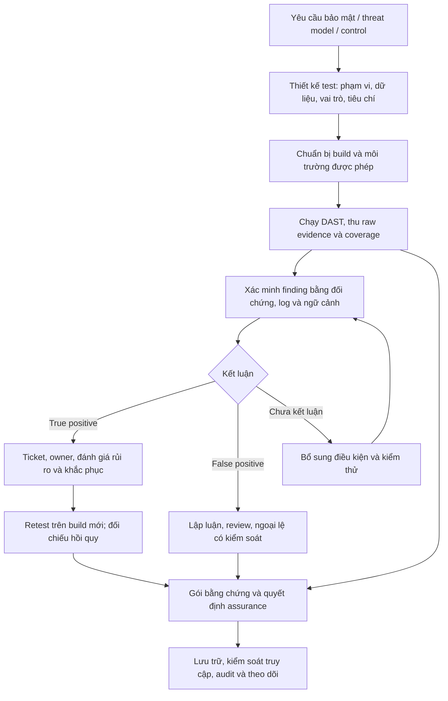

# Bằng chứng DAST trong Security Assurance

## 1. Vì sao kết quả DAST phải có bằng chứng?

**DAST (Dynamic Application Security Testing)** kiểm tra ứng dụng **khi đang chạy** bằng cách gửi yêu cầu, quan sát phản hồi, luồng phiên, hành vi trình duyệt và các trạng thái vận hành. Công cụ có thể phát hiện dấu hiệu của một số rủi ro như injection, XSS, lỗi cấu hình hoặc kiểm soát truy cập chưa đúng. Kết quả DAST thường xuất hiện dưới dạng một danh sách *findings* kèm mức độ nghiêm trọng và vị trí nghi vấn.

Trong module **SECURITY_SECURITY_ASSURANCE**, mục đích của kiểm thử không chỉ là tìm lỗi. Chương trình assurance phải đưa ra **kết luận có căn cứ** rằng các yêu cầu bảo mật và security controls đã được đánh giá; kết luận đó phục vụ review, audit, quyết định phát hành và theo dõi khắc phục trong suốt quá trình phát triển, vận hành.

Vì vậy, một dashboard báo “0 Critical” hay “scan completed” chỉ là thông tin khởi đầu. Người đánh giá cần biết **đã kiểm thử cái gì, trong điều kiện nào, bằng cách nào, quan sát được gì, kết luận dựa trên bằng chứng nào và phần nào chưa được kiểm thử**.

Sau bài học, người học có thể:

1. Phân biệt dữ liệu thô, bằng chứng, phát hiện, đánh giá rủi ro và kết luận assurance.
2. Thiết kế một gói bằng chứng DAST có nguồn gốc, phạm vi và khả năng tái lập rõ ràng.
3. Chứng minh một phát hiện bằng request/response, trạng thái xác thực, log và phép thử đối chứng phù hợp.
4. Liên kết finding với yêu cầu bảo mật, quyết định triage, hành động khắc phục và kết quả retest.
5. Bảo vệ tính toàn vẹn, tính bí mật và vòng đời lưu trữ bằng chứng.
6. Tích hợp việc thu thập và đánh giá bằng chứng vào CI/CD một cách có kiểm soát.

## 2. Bằng chứng DAST là gì, và nó chứng minh được đến đâu?

**Dữ liệu thu thập** có thể là bản ghi HTTP, ảnh màn hình, HAR, DOM snapshot, trace, log ứng dụng, báo cáo scanner hoặc kết quả kiểm thử thủ công. Dữ liệu trở thành **bằng chứng hữu ích** khi được gắn với một câu hỏi kiểm soát cụ thể, nguồn gốc đáng tin cậy, điều kiện thực hiện, cách diễn giải và giới hạn kết luận.

Ví dụ, ba câu sau không có giá trị tương đương:

- “Scanner báo lỗi truy cập trái phép tại `GET /api/orders/731`”: **tín hiệu phát hiện**.
- “Tài khoản thử B, vốn không sở hữu đơn 731, nhận được nội dung đơn 731 trong response; đã đối chiếu chủ sở hữu từ fixture và log”: **bằng chứng hỗ trợ finding**.
- “Tất cả API đều bảo vệ phân quyền đúng”: **kết luận quá rộng**, không thể rút ra từ một endpoint và một lần thử.

### Năm câu hỏi bằng chứng phải trả lời

| Câu hỏi | Nội dung cần xác định |
|---|---|
| **What?** | Yêu cầu hoặc control nào, endpoint/luồng nào, hành vi nào đang được kiểm tra? |
| **Where / when?** | Môi trường, host, build, commit, phiên bản cấu hình và thời điểm chạy |
| **How?** | Công cụ, phiên bản, profile, quyền đăng nhập, bộ dữ liệu, request, bước tái lập |
| **What happened?** | Response, trạng thái ứng dụng, log, screenshot, trace, kết quả đối chứng |
| **So what?** | Kết luận TP/FP/chưa kết luận, tác động, trách nhiệm, phương án xử lý và điều kiện kiểm thử lại |

Để một bằng chứng có sức thuyết phục, cần xét bốn đặc tính:

1. **Tính liên quan:** minh họa đúng yêu cầu/control và đường đi bị đánh giá.
2. **Tính xác thực:** xác định được ai/công cụ nào tạo bằng chứng, trong môi trường nào.
3. **Tính đầy đủ theo phạm vi:** có các điều kiện, đối chứng và kết quả cần thiết để diễn giải; không bỏ sót những lần thử bất lợi cho giả thuyết.
4. **Tính tái kiểm tra:** reviewer có thể hiểu và, nếu còn đủ điều kiện, tái lập phép thử hoặc xác nhận từ nguồn độc lập.

Không có phép quét nào chứng minh chắc chắn **không tồn tại lỗ hổng** trên toàn hệ thống. DAST chỉ đưa ra bằng chứng cho những thành phần, vai trò, trạng thái nghiệp vụ, đường truy cập và điều kiện đã kiểm thử. Kết luận “không ghi nhận finding trong phạm vi đã quét” cần đi kèm coverage và những giới hạn quan sát.

### Phân biệt dữ liệu, phát hiện và quyết định

| Đối tượng | Ví dụ | Vai trò |
|---|---|---|
| **Raw observation** | Request/response, timestamp, status, log ID | Giữ dữ liệu gốc để kiểm tra |
| **Finding** | Nghi vấn broken object level authorization | Đặt giả thuyết cần xác minh |
| **Corroborating evidence** | Tài khoản B đọc được dữ liệu của A; fixture chứng minh quan hệ sở hữu | Hỗ trợ hoặc bác bỏ giả thuyết |
| **Risk assessment** | Có thể lộ nội dung đơn hàng giữa khách hàng | Đánh giá khả năng khai thác và tác động |
| **Disposition** | True positive, false positive, inconclusive, accepted risk theo quy trình | Quyết định xử lý, có người chịu trách nhiệm |
| **Retest evidence** | Bản build sau sửa trả 403/404 hoặc phản hồi không tiết lộ dữ liệu, test hồi quy đạt | Xác nhận kết quả khắc phục trong phạm vi test |

Chấp nhận rủi ro là **quyết định quản trị** đối với rủi ro có thật; nó không biến một true positive thành false positive. Tương tự, “scanner không thấy lỗi” không chứng minh rằng một kiểm soát vận hành đúng nếu scanner chưa đi được tới luồng cần kiểm tra.

## 3. Vòng đời bằng chứng trong quy trình Security Assurance

Bằng chứng nên được thiết kế ngay từ lúc lập kế hoạch, rồi cập nhật theo phát hiện, quyết định và bản sửa.



Mỗi lần chuyển bước cần liên kết được **test run → artifact → finding → quyết định → commit sửa → retest run**. Nếu các liên kết bị mất, reviewer có thể nhìn thấy một ảnh screenshot nhưng không biết nó thuộc build nào hoặc có được tạo sau khi lỗi đã sửa hay chưa.

## 4. Chuẩn bị điều kiện để bằng chứng có giá trị

### 4.1. Xác định đối tượng và kỳ vọng bảo mật

Bắt đầu từ mục tiêu có thể kiểm chứng. Ví dụ:

> **SEC-AUTHZ-07:** người dùng chỉ được xem đơn hàng thuộc tài khoản của mình, trừ khi có quyền hỗ trợ đã được cấp rõ ràng.

Từ đó hình thành test case: tạo hai tài khoản độc lập A và B; bảo đảm đơn 731 thuộc A; A truy cập thành công, B không được nhận nội dung hoặc thao tác trên đơn đó. Đây là **security assertion** được thiết kế trước khi quét, không phải kết luận suy từ việc scanner nhìn thấy HTTP 200.

Ngoài các bài kiểm tra tự động, cần bổ sung test case nghiệp vụ thủ công hoặc điều khiển riêng khi scanner không hiểu quan hệ quyền, role hay trạng thái.

### 4.2. Chốt phạm vi và nguồn gốc phép quét

Một bản ghi run cần nêu:

- **Tài sản/phạm vi:** application, API và hostname được phép; danh sách endpoint/luồng quan trọng; đường dẫn được loại trừ và lý do.
- **Môi trường:** staging, pre-production hay production được ủy quyền; DNS, gateway/WAF, TLS termination và phiên bản cấu hình liên quan.
- **Phiên bản phần mềm:** build ID, commit, container image digest hoặc release, bản migration/schema nếu ảnh hưởng kết quả.
- **Công cụ:** sản phẩm, phiên bản, rule/profile, mức độ quét, cấu hình auth/crawl, thời gian bắt đầu và kết thúc.
- **Ngữ cảnh truy cập:** tài khoản/role thử nghiệm, cách xác nhận phiên đăng nhập hợp lệ, dữ liệu fixture, quyền và trạng thái ban đầu.
- **Điều kiện vận hành:** cửa sổ chạy, giới hạn tốc độ, thao tác được phép và đầu mối phụ trách xử lý sự cố.

Nếu chạy qua proxy hoặc WAF, phải biết lớp nào tạo response. Nếu quét trong staging, cần ghi các sai khác có thể tác động hành vi bảo mật so với production. Bằng chứng từ môi trường khác không tự động chứng minh production có cùng kết quả.

### 4.3. Ghi nhận cả những thứ scanner không nhìn thấy

Coverage không chỉ là số URL. Với nhiều ứng dụng, cần đánh giá theo:

| Chiều coverage | Ví dụ | Hậu quả nếu thiếu |
|---|---|---|
| Endpoint và method | `GET /orders/{id}`, `PATCH /orders/{id}` | Bỏ qua thao tác thay đổi dữ liệu |
| Vai trò và tenant | Guest, user A, user B, admin, tenant khác | Không kiểm tra được phân quyền |
| Trạng thái nghiệp vụ | Đơn nháp, đã thanh toán, đã hủy | Bỏ sót lỗi chỉ xuất hiện theo trạng thái |
| Đường truy cập | Web, mobile API, gateway, route nội bộ được phép | Không bao phủ biến thể xử lý |
| Dữ liệu đầu vào | Query, JSON body, header, file upload | Scanner không tới source/sink liên quan |
| Xác thực | Login, refresh, logout, session timeout | Kết quả từ phiên hết hạn bị hiểu sai |
| Tích hợp | Webhook, job bất đồng bộ, callback | Phản hồi HTTP không phản ánh toàn bộ hiệu ứng |

Mỗi phần thiếu cần có trạng thái **chưa được kiểm thử**, **không áp dụng** hoặc **bị chặn**, kèm lý do. “Không có finding” và “không chạy được test” là hai trạng thái hoàn toàn khác.

## 5. Thu thập bằng chứng thô đúng cách

### 5.1. Những artifact nên giữ

Không phải dự án nào cũng cần mọi định dạng. Chọn bộ tối thiểu đủ để xác minh:

| Artifact | Chức năng | Lưu ý |
|---|---|---|
| **Scanner report** (JSON, SARIF, HTML...) | Danh sách finding, rule, mức độ, nguồn gốc run | Giữ file máy đọc được nếu có; HTML chỉ để xem tiện |
| **HTTP request/response** | Chứng minh input, header, status, body và sự khác biệt | Che cookie/token và dữ liệu cá nhân; giữ thứ tự sự kiện |
| **HAR / proxy trace** | Thể hiện chuỗi request, redirect, timing | Có thể chứa thông tin rất nhạy cảm; lọc trước khi chia sẻ |
| **Screenshot/DOM snapshot** | Xác minh hành vi trình duyệt, XSS và UX bảo mật | Gắn URL, thời gian, trạng thái đăng nhập; ảnh riêng lẻ thường chưa đủ |
| **Backend/gateway/WAF logs** | Đối chiếu request ID, xác thực, quyết định phân quyền, lỗi | Đồng bộ thời gian; không suy luận từ log thiếu hoặc bị sampling |
| **Coverage/auth log** | Chứng minh scanner đã vào được luồng và role cần quét | Ghi rõ lỗi login, endpoint bị bỏ qua, timeout, rate limit |
| **Test fixture** | Chứng minh quan hệ sở hữu, phân quyền và trạng thái dữ liệu | Dùng ID giả lập, không mang dữ liệu khách hàng thật |
| **Triage/approval record** | Tại sao kết luận TP/FP/chưa kết luận, ai duyệt | Liên kết tài liệu và ticket, không chỉ thay status trên dashboard |
| **Retest report** | Xác minh behavior sau sửa trên build xác định | Đối chiếu cùng test case; ghi điều kiện thay đổi |

**Yêu cầu tối thiểu đối với mỗi finding:** rule/finding ID, tài sản và endpoint, mức độ/certainty của công cụ, run ID, cách tái lập, actual vs expected result, bằng chứng raw hoặc đã khử nhạy cảm, trạng thái triage và người phụ trách.

### 5.2. Gắn thời điểm và correlation ID

Nên dùng timestamp nhất quán như ISO 8601 có múi giờ rõ ràng, ví dụ `2026-11-28T03:15:30Z`. Ghi cả thời điểm run và thời điểm request nếu khác nhau; log server có thể dùng đồng hồ khác. Khi ứng dụng hỗ trợ, đưa một **request/correlation ID không chứa bí mật** vào test và lưu cùng log tương ứng.

Một ảnh chụp có HTTP 200 nhưng không có người dùng, build, endpoint hoặc body phù hợp **chưa đủ bằng chứng** cho lỗi vượt quyền. Một trace có đủ các thông tin này mạnh hơn nhiều.

### 5.3. Dữ liệu thô và dữ liệu được chia sẻ

Có thể có hai lớp hiện vật:

1. **Bản gốc giới hạn truy cập:** giữ tại kho bằng chứng có quyền hạn phù hợp khi chính sách cho phép; có thể chứa dữ liệu kỹ thuật cần bảo toàn để điều tra.
2. **Bản đã khử nhạy cảm để review:** che token, session cookie, mật khẩu, PII, access key và nội dung khách hàng; giữ dấu mốc, cấu trúc và dữ liệu liên quan đến nhận định.

Việc che phải có phương pháp nhất quán: nếu thay mọi ID bằng cùng một chuỗi, reviewer sẽ không phân biệt được tài khoản A và B; nếu giữ token thật trong HAR, bằng chứng tạo ra rủi ro mới. Dùng nhãn ổn định như `ACCOUNT_A`, `ACCOUNT_B` và `ORDER_731` để giữ được quan hệ cần chứng minh.

## 6. Ví dụ chi tiết: bằng chứng lỗi phân quyền ở API đơn hàng

### 6.1. Bối cảnh và tiêu chí

Giả sử nhóm đang kiểm thử API của một hệ thống đặt hàng trên **môi trường staging được phép**. Dữ liệu đã tạo trước bằng fixture:

| Đối tượng | Thuộc tính đã xác minh |
|---|---|
| Account A | Sở hữu đơn `ORDER_731` |
| Account B | Không sở hữu đơn `ORDER_731`; không có quyền admin/support |
| Endpoint | `GET /api/orders/731` |
| Control | `SEC-AUTHZ-07`: chỉ chủ sở hữu hoặc vai trò được cho phép xem đơn |
| Expected | A xem được; B không nhận dữ liệu riêng của đơn A |

**Bước 1 — Positive control:** dùng phiên A hợp lệ để chắc chắn route và fixture hoạt động.

```http
GET /api/orders/731 HTTP/1.1
Host: staging.example.test
Authorization: Bearer [TOKEN_ACCOUNT_A_REDACTED]
X-Request-ID: dast-run-028-a
Accept: application/json
```

Phản hồi minh họa:

```http
HTTP/1.1 200 OK
Content-Type: application/json
X-Request-ID: dast-run-028-a

{"id":731,"ownerAccount":"ACCOUNT_A","total":125000}
```

**Bước 2 — Negative control đối với phân quyền:** dùng phiên B hợp lệ, giữ nguyên order ID, endpoint và method; chỉ thay danh tính. Đây là thử nghiệm được phép trên **tài khoản và dữ liệu nhân tạo**.

```http
GET /api/orders/731 HTTP/1.1
Host: staging.example.test
Authorization: Bearer [TOKEN_ACCOUNT_B_REDACTED]
X-Request-ID: dast-run-028-b
Accept: application/json
```

Phản hồi minh họa chứa dữ liệu mà B không có quyền xem:

```http
HTTP/1.1 200 OK
Content-Type: application/json
X-Request-ID: dast-run-028-b

{"id":731,"ownerAccount":"ACCOUNT_A","total":125000}
```

**Bước 3 — Đối chiếu:** xác nhận phiên B chưa hết hạn; order 731 thực sự thuộc A; B không có quyền hỗ trợ; gateway/backend log ghi nhận request `dast-run-028-b`; response không phải dữ liệu cache bị gắn nhầm hoặc mock trả cố định. Khi các điều kiện này được xác minh, nhóm có cơ sở kết luận **true positive về unauthorized object access**, vì B đọc được nội dung đơn A.

**Vì sao phải có đối chứng?** HTTP 200 riêng lẻ có thể là trang đăng nhập, một phản hồi rỗng hoặc thông điệp lỗi. Muốn chứng minh lộ dữ liệu cần chỉ ra **danh tính không có quyền + tài nguyên thuộc người khác + dữ liệu bị trả về**.

### 6.2. Gói bằng chứng cho finding minh họa

Một bản ghi có thể được tổ chức như sau:

```yaml
finding_id: DAST-AUTHZ-028
control_id: SEC-AUTHZ-07
run_id: dast-run-028
asset: order-api
environment: staging
build: "commit-example-abc123"
scanner:
  name: "DAST tool used in project"
  version: "version-recorded-by-ci"
  policy_ref: "security-dast-policy-revision"
scenario:
  endpoint: "GET /api/orders/731"
  owner: ACCOUNT_A
  unauthorized_actor: ACCOUNT_B
expected: "ACCOUNT_B does not receive ORDER_731 data"
observed: "ACCOUNT_B receives ORDER_731 data (HTTP 200)"
evidence:
  - "requests/owner-a-redacted.http"
  - "requests/other-b-redacted.http"
  - "logs/correlation-028-redacted.txt"
  - "fixtures/order-731-ownership-redacted.json"
assessment:
  status: true_positive
  rationale: "Unauthorized actor receives another account's order data"
  reviewer: "AppSec reviewer"
  ticket: "SEC-EXAMPLE-107"
```

Các tên file và ID trên là **ví dụ hư cấu** để hướng dẫn tổ chức bằng chứng; không phải kết quả quét thực. Report từ một scanner đơn lẻ có thể không thu đủ bằng chứng về sở hữu dữ liệu, nên nhóm phải bổ sung fixture và log phù hợp.

### 6.3. Bằng chứng sau khắc phục

Giả sử developer bổ sung kiểm tra quyền ở service layer và tạo test hồi quy. Chạy lại **cùng trường hợp A/B** trên build mới:

- A vẫn nhận nội dung `ORDER_731`; test tránh kết quả “an toàn” giả do route hoặc dịch vụ ngừng hoạt động.
- B không nhận nội dung đơn A; theo contract của API có thể là `403 Forbidden` hoặc `404 Not Found`, hay hành vi khác được định nghĩa rõ nhưng không tiết lộ dữ liệu.
- Log xác nhận kiểm soát authorization đã thực thi; regression test ở CI thành công.
- Hồ sơ linking từ finding ban đầu tới PR/commit, build sau sửa, run retest và reviewer.

Ví dụ phản hồi từ B **sau sửa**:

```http
HTTP/1.1 403 Forbidden
Content-Type: application/json
X-Request-ID: dast-retest-043-b

{"error":"forbidden"}
```

**Kết luận hợp lệ:** “Lỗi tại `GET /api/orders/731` đã được xác nhận khắc phục trên build `commit-example-def456` theo test A/B và log liên quan.” Không suy rộng thành “toàn bộ hệ thống không có lỗi authorization” nếu mới thử một route.

## 7. Ví dụ khác: bằng chứng cấu hình và hành vi trình duyệt

Không phải finding DAST nào cũng được chứng minh bằng một response JSON.

### 7.1. Header bảo mật

Một scanner có thể cảnh báo thiếu `Content-Security-Policy` trên trang HTML. Để đánh giá, cần lưu **URL, method, status, response headers, đường truy cập, loại tài nguyên và chính sách áp dụng**. Header có thể được đặt ở reverse proxy hoặc chỉ áp dụng cho một số đường dẫn; đôi khi response là redirect, file tĩnh hoặc API JSON không có cùng yêu cầu.

Nếu điều kiện của security requirement là “mọi trang HTML người dùng truy cập phải có CSP”, bằng chứng phải xem xét các trang HTML thuộc phạm vi thực tế, bao gồm response cuối sau redirect. Không được kết luận kiểm soát đáp ứng chỉ vì một trang có header, cũng không nên báo lỗi một cách máy móc trên tài nguyên ngoài phạm vi chính sách.

### 7.2. Reflected XSS

Một giá trị xuất hiện trong HTML response **chưa đủ chứng minh XSS**. Cần ghi ngữ cảnh render (HTML text, HTML attribute, JavaScript, URL), các bước xử lý của frontend, DOM sau khi script chạy và có hay không đường đến executable sink. Một output đã mã hóa an toàn trong text node có thể khiến rule “input reflection” báo sai; ngược lại, HTML ban đầu an toàn chưa bảo đảm JS không đưa dữ liệu vào `innerHTML` ở bước sau.

Đối với kiểm thử trình duyệt, lưu screenshot cùng DOM snapshot hoặc trace khi khả thi; gắn nó với request và build. Một screenshot đơn lẻ thường không đủ để tái lập điều kiện.

### 7.3. Phép thử bất đồng bộ

Ở các luồng webhook, queue, email notification hoặc background job, chỉ có HTTP 202/200 ở bước khởi tạo chưa cho thấy thao tác được phép hay trái phép có thực sự xảy ra. Cần correlation ID xuyên qua hàng đợi, log xử lý và trạng thái nghiệp vụ cuối. Nêu rõ giới hạn nếu không có quyền quan sát hệ thống downstream.

## 8. Phân loại chất lượng bằng chứng và kết luận finding

Một kết quả DAST nên được phân loại theo **mức độ tin cậy của bằng chứng**, bên cạnh mức độ nghiêm trọng của lỗ hổng.

| Mức bằng chứng (gợi ý) | Dấu hiệu | Quyết định phù hợp |
|---|---|---|
| **Yếu** | Chỉ có tên rule, một status code hoặc screenshot thiếu ngữ cảnh | Giữ trạng thái nghi vấn, yêu cầu bổ sung dữ liệu |
| **Trung bình** | Có request/response và điều kiện quét nhưng chưa đủ đối chứng | Xác minh thêm; không đánh dấu chắc chắn TP/FP |
| **Mạnh** | Có test tái lập, đối chứng, fixture, log/DOM phù hợp, build và scope rõ | Có cơ sở cho kết luận kỹ thuật với phạm vi xác định |
| **Đã xác nhận sau sửa** | Có hồ sơ TP trước sửa, liên kết code fix và retest trên build mới | Có cơ sở xác nhận khắc phục trong phạm vi test |

Đây là thang gợi ý cho quy trình nội bộ, **không phải chuẩn chứng nhận hay điểm số của một công cụ cụ thể**. Một bằng chứng mạnh không tự làm finding nghiêm trọng hơn; confidence và severity phải được đánh giá tách biệt.

### Trạng thái triage cần giữ rõ

| Trạng thái | Điều kiện |
|---|---|
| **True positive** | Điều kiện lỗi được xác nhận bằng bằng chứng |
| **False positive** | Bằng chứng chứng minh logic cảnh báo không đúng trong phạm vi test |
| **Inconclusive** | Không đủ dữ liệu hoặc các phép thử mâu thuẫn |
| **Not applicable** | Test hoặc control không áp dụng theo phạm vi đã xác định |
| **Risk accepted** | Rủi ro thật đã được chấp nhận bởi người có thẩm quyền và có điều kiện |
| **Remediated / verified** | Đã sửa và có kết quả xác minh lại trên build xác định |

Nếu scanner không đăng nhập được, endpoint trả 429, kết nối timeout hoặc run bị hỏng, ghi là **scan incomplete / inconclusive** với nguyên nhân và scope bị ảnh hưởng. Không biến lỗi vận hành thành kết quả “0 finding”.

## 9. Gói bằng chứng (evidence package) có thể kiểm tra

Một gói bằng chứng chuẩn giúp reviewer/kiểm toán viên hiểu kết quả mà không cần phụ thuộc hoàn toàn vào dashboard của một nhà cung cấp.

### 9.1. Thành phần đề xuất

```text
dast-evidence/
  manifest.yml
  run-summary.md
  coverage.json
  scan-results.sarif
  findings/
    DAST-AUTHZ-028/
      triage.md
      owner-a-redacted.http
      other-b-redacted.http
      correlation-redacted.txt
      retest-redacted.http
  checksums.sha256
```

Cấu trúc minh họa; không phải scanner nào cũng có SARIF. Có thể thay bằng JSON/XML/HTML chính thức của công cụ, miễn giữ đủ thông tin nguồn gốc và khả năng truy vết. Nếu kết quả nhiều và chứa dữ liệu nhạy cảm, ưu tiên lưu artifact trong kho kiểm soát truy cập rồi liên kết đến vị trí đó.

### 9.2. Manifest ghi rõ nguồn gốc

```yaml
evidence_package_id: DAST-EV-EXAMPLE-2026-11-28-01
service: SECURITY_SECURITY_ASSURANCE
application: example-order-api
environment: staging
started_at: "2026-11-28T03:10:00Z"
ended_at: "2026-11-28T03:22:00Z"
target_build: "commit-example-abc123"
scanner:
  product: "example-dast-scanner"
  version: "example-version"
  config_revision: "policy-example-r6"
scope:
  hosts:
    - "staging.example.test"
  included_roles:
    - "ACCOUNT_A"
    - "ACCOUNT_B"
  excluded_routes:
    - path: "/admin/maintenance"
      reason: "Out of authorized test scope"
execution:
  status: completed_with_findings
  auth_checks: passed_for_test_accounts
  crawl_limitations:
    - "Asynchronous email workflow not covered"
artifacts:
  - path: "scan-results.sarif"
    sha256: "<digest calculated from stored artifact>"
  - path: "coverage.json"
    sha256: "<digest calculated from stored artifact>"
finding_refs:
  - "DAST-AUTHZ-028"
owner: "Security assurance team"
```

Các mốc thời gian, phiên bản, ID và giá trị trong manifest đều là **giả lập**. Trong triển khai thực tế, phải lấy từ run và build đã thực sự diễn ra, không tự điền theo mẫu cho đẹp hồ sơ.

### 9.3. Kiểm tra toàn vẹn

Đối với artifact đã lưu, có thể tính digest SHA-256 để phát hiện thay đổi:

```bash
# Ví dụ trên hệ thống có công cụ sha256sum; chạy từ thư mục gói bằng chứng
sha256sum scan-results.sarif coverage.json > checksums.sha256
sha256sum -c checksums.sha256
```

Digest chỉ cho phép kiểm tra **tính nhất quán giữa file và giá trị đối chiếu**. Nếu kẻ tấn công sửa được cả artifact lẫn file checksum, hash riêng lẻ không chứng minh nguồn gốc hay chống giả mạo. Để tăng giá trị audit, lưu manifest/hash trong hệ thống có kiểm soát sửa đổi, lịch sử truy cập hoặc cơ chế ký số theo chính sách. Không lưu mật khẩu hay khóa ký trong repo/ticket.

Một điểm cần kiểm soát: nếu tạo bản đã khử nhạy cảm **sau khi** tính hash bản gốc, checksum của bản gốc sẽ không bằng checksum bản đã che. Phải ghi rõ bản nào được hash và lưu dấu vết chuyển đổi, tránh diễn giải nhầm là file bị sửa trái phép.

## 10. Truy vết đến yêu cầu bảo mật và quyết định assurance

DAST có ích nhất khi finding được nối với yêu cầu/control và kết quả xử lý, thay vì tồn tại như một nhóm alert tách rời.

| Security requirement / control | Test case | Bằng chứng | Kết luận | Hành động |
|---|---|---|---|---|
| `SEC-AUTHZ-07`: chỉ chủ sở hữu xem đơn | A/B truy cập đơn 731 | Hai request, fixture, log | TP tại build abc123 | Fix và retest |
| `SEC-INPUT-03`: đầu vào không làm thay đổi cấu trúc SQL | So sánh input và quan sát query/response | Trace, timing có đối chứng, log được phép | Chưa kết luận nếu thiếu log và phép thử đáng tin cậy | Bổ sung kiểm tra |
| `SEC-WEB-05`: các trang HTML thuộc phạm vi phải có CSP | Kiểm tra response cuối của các route HTML | Response headers, coverage | Đạt/không đạt trên route đã thử | Sửa cấu hình hoặc ghi ngoại lệ hợp lệ |

**Chuỗi truy vết mẫu:**

`SEC-AUTHZ-07 → DAST-AUTHZ-028 → evidence run 028 → ticket SEC-EXAMPLE-107 → PR sửa lỗi → commit def456 → retest run 043 → reviewer approval.`

Gói bằng chứng giúp trả lời những câu hỏi quan trọng trong audit:

- Control nào được kiểm thử và trường hợp nào chưa có coverage?
- Kết quả được tạo trên build/môi trường nào, có tương ứng bản phát hành không?
- Phát hiện nghiêm trọng có được xác minh và xử lý theo policy không?
- False positive và accepted risk có được phân biệt và phê duyệt đúng không?
- Sau sửa có bằng chứng hồi quy và điều kiện nào có thể làm kết quả hết hiệu lực?

### Cấp độ kết luận

Một bài kiểm thử đơn lẻ có thể kết luận về **endpoint + vai trò + build + dữ liệu + điều kiện thử**. Một chương trình assurance có thể đưa ra nhận định rộng hơn khi tổng hợp DAST, SAST, SCA, threat modeling, kiểm thử thủ công, audit cấu hình, quản lý lỗ hổng và risk acceptance. Khi tổng hợp, phải giữ lại các khoảng trống coverage, tránh đồng nhất “đã chạy DAST” với “đã đáp ứng mọi mục tiêu bảo mật”.

## 11. Tự động hóa thu thập bằng chứng trong CI/CD

Tích hợp DAST vào pipeline giúp chuẩn hóa thời điểm quét và gắn kết quả với build. Tuy nhiên, pipeline cần chứng minh rằng scanner **đã thực sự chạy đúng phạm vi**, đã đăng nhập thành công nếu cần và không bỏ qua phần đáng kể của ứng dụng.

Luồng logic minh họa:

```text
1. Deploy đúng build lên môi trường được cấp quyền kiểm thử
2. Khởi tạo fixture và kiểm tra sức khỏe ứng dụng
3. Xác minh phiên test cho từng role; ghi rõ auth thành công/thất bại
4. Chạy scanner với policy, scope và giới hạn tốc độ được duyệt
5. Export report, request/response cần thiết, trạng thái run và coverage
6. Khử nhạy cảm artifact; tạo manifest và checksum
7. Phân biệt scan-failed, incomplete, findings-pending-review và completed
8. Áp dụng quality gate theo chính sách và trạng thái finding đã xác minh
9. Gắn package vào build/PR/release; lưu artifact theo chính sách
```

Đây là **pseudoworkflow**, không phải lệnh của một scanner cụ thể. Trong pipeline thực tế, cần xử lý exit code và artifact theo tài liệu của công cụ đang dùng. Job có thể thất bại do network hoặc authentication ngay cả khi không phát hiện lỗ hổng; phải báo đúng bản chất lỗi.

### Quality gate dựa trên bằng chứng

Ví dụ một tổ chức đặt rule “không phát hành với finding High/Critical mới chưa có quyết định hợp lệ”. Khi đó cần:

1. Xác minh scan hoàn tất với **coverage tối thiểu** được định nghĩa.
2. Đối chiếu finding mới, trùng và baseline; phân biệt lỗ hổng đã tồn tại với lỗ hổng phát sinh.
3. Chỉ xem một finding đã xử lý nếu có bản sửa và retest hoặc quyết định FP/risk acceptance có thẩm quyền.
4. Ghi rõ lý do fail/pending/pass và liên kết evidence package.

Không nên dùng “số alert bằng 0” làm điều kiện duy nhất. Một scanner mất quyền đăng nhập có thể có rất ít cảnh báo trong khi coverage giảm nghiêm trọng.

## 12. Bảo mật và quản trị vòng đời bằng chứng

Một báo cáo DAST có thể chứa đường dẫn nội bộ, token, cookie phiên, payload, dữ liệu người dùng và thông tin cấu trúc hạ tầng. Chính bằng chứng bảo mật cũng là tài sản cần bảo vệ.

**Nguyên tắc quản lý:**

- **Phân loại:** xác định loại dữ liệu được phép giữ, mức nhạy cảm, nơi lưu và mục đích sử dụng.
- **Tối thiểu hóa:** tạo tài khoản/fixture giả, che bí mật trước khi đưa vào PR, issue, wiki hoặc công cụ bên ngoài.
- **Quyền truy cập:** giới hạn theo vai trò; phân quyền riêng cho bản gốc và bản phục vụ review; lưu lịch sử truy cập khi cần.
- **Tính toàn vẹn:** hash, version, immutable retention hoặc log sửa đổi phù hợp; ghi ai tạo, ai review, ai phê duyệt.
- **Vòng đời:** thời gian lưu, điều kiện mở lại, xóa khi hết hạn và cách xử lý khi phải giữ phục vụ audit/sự cố.
- **Tính tái lập:** giữ cấu hình, run ID, build, fixture và đường dẫn kiểm thử; không phụ thuộc vào việc scanner còn giữ report trên dashboard hay không.

**Điểm cân bằng:** không cần đính kèm nguyên HAR có credential thật vào mỗi ticket. Nên trích xuất phần liên quan và lưu bản nguồn ở kho an toàn nếu được phép. Nếu không thể lưu dữ liệu gốc, ghi nhận việc khử dữ liệu đã làm mất khả năng kiểm tra nào để reviewer hiểu giới hạn chứng cứ.

## 13. Các chỉ số đánh giá chất lượng evidence

Để cải tiến chương trình, có thể đo các chỉ số sau trong một kỳ rõ ràng:

| Chỉ số | Cách hiểu | Rủi ro diễn giải |
|---|---|---|
| **Tỷ lệ run có manifest đầy đủ** | Run có scope, build, tool, auth status, timestamp, owner | Manifest đủ trường nhưng giá trị sai vẫn không đáng tin |
| **Tỷ lệ finding có bằng chứng tái lập** | Có request/response, điều kiện, đối chứng và kết luận tương ứng | Không phải loại finding nào cũng tái lập được 100% |
| **Tỷ lệ endpoint/role được kiểm thử** | So với inventory và scope đã thống nhất | Chỉ đếm URL mà bỏ qua role/state sẽ phóng đại coverage |
| **Thời gian triage trung vị** | Từ khi phát hiện tới khi có quyết định kỹ thuật | Phân tầng theo severity và độ phức tạp |
| **Tỷ lệ retest có liên kết tới bản sửa** | Finding đã fix có build, commit, test case và kết quả | Test thành công trên môi trường khác có thể chưa đủ |
| **Số finding inconclusive / scan incomplete** | Đo chỗ thiếu khả năng đánh giá | Không coi giảm số lượng này là thành công nếu chỉ đóng tùy tiện |
| **Tỷ lệ ngoại lệ được rà soát đúng hạn** | FP/risk acceptance còn phù hợp với code và policy | Phải ghi điều kiện thay đổi làm quyết định mất hiệu lực |

Ví dụ minh họa: trong 40 finding đã xác minh, có 32 finding lưu đủ request, đối chứng, build và đánh giá kỹ thuật; tỷ lệ đầy đủ theo tiêu chí đó là `32/40 = 80%`. Chỉ số này đánh giá **chất lượng hồ sơ**, không nói rằng 80% hệ thống đã an toàn.

## 14. Bài thực hành: tạo gói bằng chứng DAST

**Bối cảnh:** bạn tham gia Security Assurance cho ứng dụng thử nghiệm có API đơn hàng. Scanner nghi ngờ lỗi phân quyền ở `GET /api/orders/{id}` và vừa chạy trên build thử nghiệm.

**Yêu cầu thực hiện:**

1. Viết một security requirement và expected result cho bài kiểm tra truy cập đơn hàng.
2. Chuẩn bị hai tài khoản/fixture nhân tạo, xác minh tài nguyên thuộc tài khoản A.
3. Tạo positive control từ A và negative control từ B; ghi request/response, status, correlation ID và điều kiện phiên.
4. Gắn kết quả với build, môi trường, phạm vi, phiên bản scanner và chính sách quét.
5. Tạo finding record và một quyết định có lập luận: TP, FP hoặc inconclusive; nêu rõ bằng chứng thiếu nếu chưa đủ.
6. Giả định developer đã sửa lỗi: thiết kế retest xác minh cả A còn truy cập hợp lệ và B không đọc được dữ liệu.
7. Tổ chức manifest cùng các artifact đã che nhạy cảm; tính checksum và mô tả nơi lưu, ai có quyền review.
8. Viết kết luận assurance không vượt quá scope đã kiểm thử, liệt kê coverage chưa được kiểm tra.

**Sản phẩm cần nộp:** một manifest, một finding/triage record, hai request/response đã làm sạch, bằng chứng về ownership và role, một retest record (thực tế hoặc mô phỏng có ghi rõ), và bản nhận định ngắn.

**Tiêu chí đánh giá:**

- Có thể truy vết requirement → test case → run → finding → quyết định → retest.
- Có đối chứng hợp lệ; không dùng HTTP status một mình để suy ra lỗ hổng.
- Phân biệt TP/FP/inconclusive và accepted risk.
- Ghi cụ thể build, role, scope, timestamp, tool/ruleset và những gì chưa bao phủ.
- Không làm lộ token hoặc dữ liệu thật trong artifact chia sẻ.
- Kết luận có giới hạn, kiểm tra được và phù hợp với bằng chứng.

## 15. Sai lầm phổ biến

| Sai lầm | Vì sao gây vấn đề | Cách khắc phục |
|---|---|---|
| Đưa ảnh dashboard làm bằng chứng duy nhất | Không rõ input, điều kiện, build và phương pháp | Lưu run metadata và raw evidence liên quan |
| Ghi “pass” vì scanner không có alert | Có thể chưa đăng nhập, chưa crawl được hoặc đã bị chặn | Kiểm tra execution state và coverage độc lập |
| Tập trung vào số lượng URL | Không bao phủ role, trạng thái và luồng nghiệp vụ | Thiết kế ma trận endpoint × role × state |
| Kết luận từ HTTP 200/403 đơn lẻ | Status chưa chứng minh quyền hay dữ liệu bị lộ | Dùng đối chứng, body/effect, fixture và log |
| Quên commit/build của run | Không biết lỗi thuộc phiên bản nào | Gắn artifact với source revision và deployment |
| Sửa xong rồi xóa finding cũ | Mất dấu vết đã tồn tại lỗ hổng và hiệu quả khắc phục | Giữ before/after evidence, triage và liên kết retest |
| Coi false positive là rủi ro được chấp nhận | Trộn hai quyết định có bản chất khác nhau | Tách xác minh kỹ thuật khỏi phê duyệt rủi ro |
| Chia sẻ toàn bộ HAR chứa credential | Tạo nguy cơ lộ bí mật và dữ liệu người dùng | Khử nhạy cảm và lưu bản gốc trong phạm vi hạn chế |
| Tính hash nhưng lưu cùng nơi có thể sửa tùy ý | Không bảo đảm nguồn gốc nếu cả file và hash cùng bị thay | Dùng kho có lịch sử, kiểm soát sửa đổi/ký số phù hợp |
| Dùng bằng chứng staging để khẳng định mọi điều kiện production | Khác biệt auth, WAF, config hoặc dữ liệu có thể làm kết quả đổi | Ghi sai khác và xác minh bổ sung theo chính sách |

## 16. Tổng kết

**Bằng chứng DAST** là tập thông tin có nguồn gốc và ngữ cảnh đủ rõ để chứng minh hoặc bác bỏ một nhận định bảo mật **trong phạm vi đã kiểm thử**. Nó gồm dữ liệu quan sát, cấu hình và điều kiện quét, đối chứng, đánh giá kỹ thuật, quyết định triage, kết quả khắc phục và khả năng truy vết.

Trong một chương trình **Security Assurance** liên tục, giá trị lớn nhất của DAST nằm ở việc nối **mục tiêu bảo mật → phép thử thực tế → bằng chứng đáng tin → quyết định có trách nhiệm → hành động khắc phục → xác minh lại**. Bằng chứng phải giữ được tính toàn vẹn, được bảo vệ khỏi lộ dữ liệu và diễn đạt trung thực cả những phần **đã kiểm tra** lẫn **chưa được kiểm tra**.
