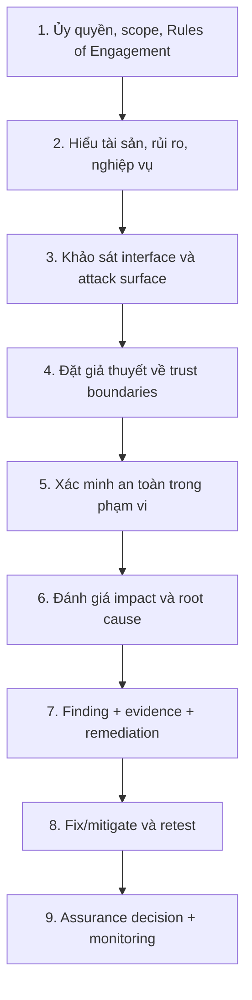
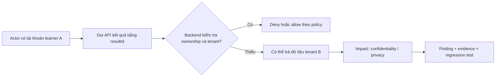
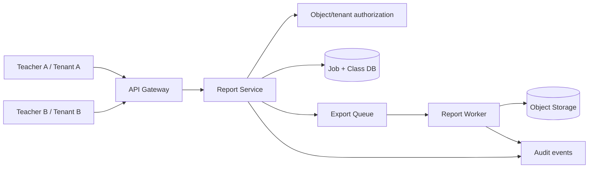

# Penetration test là gì? Kiểm thử xâm nhập trong chương trình Security Assurance

## 1. Một tình huống mở đầu

Một nền tảng học tập được phát triển bằng Java/Spring Boot đã triển khai các biện pháp bảo vệ quen thuộc: HTTPS, JWT, kiểm tra quyền theo vai trò, static analysis, quét lỗ hổng thư viện và kiểm thử API tự động. Trước khi phát hành chức năng xuất bảng điểm, nhóm muốn có thêm bằng chứng rằng người dùng không thể vượt qua các lớp bảo vệ để lấy dữ liệu của trường khác.

Một người kiểm thử được **ủy quyền** nhận hai tài khoản giảng viên thuộc hai tenant giả định và một tập dữ liệu thử nghiệm. Họ xác nhận một người dùng tenant A không thể xem báo cáo tenant B bằng đường API thông thường. Sau đó, họ kiểm tra luồng bất đồng bộ: API xuất báo cáo trả `403` nhưng job vẫn bị tạo trước thời điểm server kiểm tra quyền. Nếu worker tin vào nội dung job và tạo file, một thông báo “Forbidden” đẹp ở lớp HTTP không bảo đảm dữ liệu đã được bảo vệ.

Tình huống trên minh họa mục đích của **penetration testing (kiểm thử xâm nhập, thường gọi là pentest)**: không chỉ kiểm tra từng control riêng lẻ, mà còn **đánh giá cách một tác nhân có thể lợi dụng các điểm yếu hoặc phối hợp những điều kiện sai để vượt qua mục tiêu bảo mật** — trong giới hạn phạm vi được phép và biện pháp kiểm soát an toàn.

Điểm quan trọng là kết quả kiểm thử không chỉ có hai giá trị “hack được” hoặc “không hack được”. Một pentest có chất lượng phải cho biết:

- Tài sản, hành vi, quyền, đường vào và điều kiện nào đã được kiểm tra.
- Mục tiêu bảo mật nào được chứng minh hoặc chưa được chứng minh.
- Phát hiện nào có bằng chứng, mức ảnh hưởng và điều kiện có thể khai thác.
- Những phần không nằm trong scope hoặc chưa được kiểm tra.
- Nhóm kỹ thuật cần sửa gì, ai chịu trách nhiệm và retest thế nào.

Trong chương **Penetration testing** của module **SECURITY_SECURITY_ASSURANCE**, pentest được xem là một hoạt động **security assurance dựa trên bằng chứng**: nối risk assessment, security requirements và controls với kiểm chứng thực tế, audit, khắc phục findings và cải tiến liên tục trong phát triển cũng như vận hành.

### Mục tiêu học tập

Sau bài này, bạn có thể:

1. Định nghĩa penetration test, mục tiêu, phạm vi và sản phẩm đầu ra.
2. Phân biệt pentest với vulnerability scanning, SAST/DAST, security review, security audit và red teaming.
3. Giải thích các mô hình black-box, gray-box, white-box và những loại mục tiêu kiểm thử thường gặp.
4. Mô tả một quy trình pentest có ủy quyền, Rules of Engagement và các giới hạn an toàn.
5. Diễn giải cách hình thành threat scenario, kiểm chứng giả thuyết và ghi evidence mà không gây tác động không cần thiết.
6. Đọc một pentest finding, phân tích root cause, severity, exploitability, business impact và residual risk.
7. Thiết kế remediation, retest, assurance claims và theo dõi kết quả sau pentest.
8. Vận dụng kiến thức vào ví dụ ứng dụng Java/Spring Boot nhiều tenant.

## 2. Định nghĩa penetration testing

**Penetration testing** là hoạt động đánh giá bảo mật có kế hoạch và được ủy quyền, trong đó người kiểm thử **mô phỏng có kiểm soát những hành vi của tác nhân đe dọa** nhằm xác định xem một hệ thống, ứng dụng, mạng, quy trình hoặc sự kết hợp của chúng có thể bị lợi dụng để vi phạm mục tiêu bảo mật hay không.

Ba thành tố không thể thiếu:

1. **Authorized:** có chủ sở hữu/pháp nhân có thẩm quyền cho phép; mục tiêu, phạm vi và phương pháp được xác định trước.
2. **Goal-oriented:** thử nghiệm gắn với mục tiêu bảo mật và risk scenarios, không chỉ chạy công cụ để thu danh sách cảnh báo.
3. **Evidence-driven:** findings và kết luận dựa trên hành vi được quan sát, dữ liệu đã kiểm tra, phương pháp và giới hạn.

Một pentest có thể đánh giá **khả năng xâm nhập ban đầu**, **vượt kiểm soát**, **leo thang quyền**, **truy cập sai dữ liệu**, **di chuyển giữa vùng tin cậy** hoặc **tác động tới nghiệp vụ**. Không nhất thiết phải thực hiện các hành động nguy hiểm tới mức tối đa mới chứng minh được vấn đề. Trong nhiều trường hợp, một bằng chứng tối thiểu, không phá hoại đã đủ để xác nhận một điểm yếu.

### Những gì pentest không tự chứng minh

- Không chứng minh hệ thống **không tồn tại** lỗ hổng.
- Không đảm bảo mọi đường tấn công hoặc mọi actor đã được kiểm tra.
- Không thay thế thiết kế an toàn, quản lý bản vá, threat modeling hoặc giám sát.
- Không mặc nhiên kiểm tra khả năng vận hành/ứng phó sự cố như một red-team exercise.
- Không chứng minh mọi security control đã có hiệu lực chỉ vì tester không đạt mục tiêu tấn công.
- Không phải giấy phép tự do quét hoặc thử nghiệm ngoài phạm vi.

**Kết luận đúng phải giới hạn bởi scope, thời điểm, môi trường, phương pháp và bằng chứng thực tế.**

## 3. Vì sao tổ chức cần pentest?

Một hệ thống có thể chứa các lớp bảo vệ hợp lý nhưng vẫn tồn tại sai sót do cách chúng kết hợp với nhau.

| Vấn đề | Ví dụ | Pentest có thể giúp gì? |
|---|---|---|
| **Logic phân quyền** | Một người học đổi ID để xem kết quả của người khác | Kiểm tra quyền theo object, action, tenant |
| **Ranh giới tin cậy sai** | Gateway xác thực nhưng worker không kiểm tra nguồn message | Đánh giá đường bypass nhiều thành phần |
| **Sai cấu hình** | Một API quản trị được expose ở route ngoài dự kiến | Kiểm tra exposure và hiệu lực policy |
| **Chuỗi lỗi nhỏ** | ID leak + thiếu kiểm tra tenant + file link quá hạn | Chứng minh sự kết hợp có thể tạo tác động đáng kể |
| **Hành vi khi lỗi** | Auth service timeout và ứng dụng cho phép request | Kiểm tra fail-safe/fail-closed theo policy |
| **Tài nguyên không quản lý** | API phiên bản cũ còn hoạt động | Phát hiện shadow/deprecated attack surface |
| **Lỗi nghiệp vụ** | Nộp bài/đổi điểm qua các trạng thái trái quy tắc | Kiểm tra security invariants của workflow |
| **Giả định sai trong thiết kế** | “Service nội bộ không cần authorization” | Thẩm định giả định và trust boundaries |

Một lợi ích quan trọng là **kiểm tra các giả định**: security controls có thật, được cấu hình đúng và có hoạt động dưới điều kiện khác với “happy path” hay không.

### Pentest phục vụ security assurance như thế nào?

Một assurance claim ví dụ:

> “Một giảng viên chỉ có thể xuất báo cáo kết quả cho các lớp được phân công trong tenant được phép.”

Pentest có thể cung cấp bằng chứng bằng cách kiểm tra đường API, export job, worker và quyền tải file với các tài khoản/tài nguyên giả của nhiều tenant. Nếu phát hiện lỗi, finding sẽ nối về requirement/control và kế hoạch sửa. Khi sửa xong, một lần retest có thể cung cấp bằng chứng mới cho claim **trong phạm vi đã kiểm tra**.

Chính mối liên kết này giúp pentest là một hoạt động trong chương trình assurance, chứ không chỉ là “đánh giá hacker một lần mỗi năm”.

## 4. So sánh pentest với các hoạt động khác

| Hoạt động | Câu hỏi chính | Điểm mạnh | Giới hạn |
|---|---|---|---|
| **Vulnerability scanning** | Công cụ nhận diện điểm yếu, phiên bản hoặc cấu hình đáng ngờ nào? | Lặp lại nhanh, độ bao phủ diện rộng | False positives/negatives; thiếu ngữ cảnh nghiệp vụ |
| **SAST** | Source/bytecode có mẫu hoặc data flow đáng ngờ? | Phát hiện sớm trong SDLC | Không phản ánh hết cấu hình/hành vi runtime |
| **DAST** | Ứng dụng chạy phản hồi như thế nào trước các request kiểm thử? | Quan sát đường HTTP/runtime | Cần cấu hình auth và ngữ cảnh; khó biết ownership |
| **Security code/design review** | Yêu cầu, kiến trúc và code có đáp ứng controls? | Hiểu ngữ cảnh sâu | Không tự chứng minh runtime vận hành đúng |
| **Pentest** | Tác nhân trong scope có thể lợi dụng điểm yếu/chuỗi điểm yếu để đạt tác động? | Kiểm tra thực nghiệm, nhiều lớp, gắn risk | Giới hạn thời gian, quyền truy cập và độ bao phủ |
| **Security audit** | Tổ chức có evidence đáp ứng chuẩn, policy và controls đã công bố? | Truy vết, trách nhiệm, độc lập | Compliance không tự chứng minh không thể bị tấn công |
| **Red teaming** | Một đối thủ mô phỏng có đạt mục tiêu trong điều kiện chiến dịch và detection/response có hiệu quả? | Kiểm tra chuỗi tấn công và khả năng phòng thủ/ứng phó | Mục tiêu, phạm vi, thời gian và độ bí mật thường khác pentest |
| **Bug bounty** | Nhà nghiên cứu hợp lệ có tìm được vấn đề trong phạm vi chương trình? | Đa dạng góc nhìn, liên tục tùy chương trình | Không đảm bảo coverage theo yêu cầu kiểm toán |

### Ví dụ: một dependency có CVE

SCA phát hiện thư viện Java có advisory. Vulnerability assessment xác minh version, affectedness, exposure và độ ưu tiên. Pentest có thể kiểm tra có đường vào thực tế để lợi dụng vấn đề không, **nếu mục tiêu và phương pháp đó được cho phép và cần thiết**. Không phải CVE nào cũng cần dựng PoC khai thác trực tiếp; việc xác minh an toàn có thể dừng ở bằng chứng cấu hình, đường xử lý và tình trạng bản vá.

### Pentest và red team: khác ở mục tiêu kiểm chứng

Một pentest web/API thường có **scope cụ thể và báo cáo findings kỹ thuật để remediation**. Red team có thể mô phỏng chiến dịch chống một tổ chức, kiểm tra detection, escalation và response, đôi khi với thông tin hạn chế hơn cho đội phòng thủ. Tuy nhiên, tên gọi trong hợp đồng khác nhau giữa nhà cung cấp; cần đọc **objectives, constraints, deliverables và Rules of Engagement**, không chỉ nhãn dịch vụ.

## 5. Các loại penetration test

### 5.1. Theo mức thông tin được cung cấp

| Mô hình | Tester thường có gì? | Phù hợp khi | Giới hạn cần nhớ |
|---|---|---|---|
| **Black-box** | Ít thông tin nội bộ, chủ yếu interface được cho phép | Kiểm tra góc nhìn tác nhân ngoài | Dễ bỏ sót đường không khám phá được trong thời gian giới hạn |
| **Gray-box** | Một phần kiến trúc, tài khoản thử, vai trò, API spec hoặc dữ liệu test | Kiểm tra có mục tiêu, xác thực và phân quyền theo role/tenant | Không nhất thiết bao phủ hết code và cấu hình |
| **White-box** | Source, architecture, config, tài khoản, logs hoặc hướng dẫn vận hành cần thiết | Đánh giá sâu cơ chế, đường dữ liệu, trust boundaries | Thông tin đầy đủ vẫn không thay thế thử nghiệm thực tế |

Mức thông tin cung cấp không đồng nghĩa mức khó hoặc chất lượng. **Gray-box với nhiều test identities và data fixtures thường hữu ích hơn black-box đơn thuần** nếu mục tiêu là chứng minh tenant isolation của API.

### 5.2. Theo vị trí tác nhân

- **External:** bắt đầu từ những interface tổ chức cho phép nhìn thấy từ bên ngoài.
- **Internal:** mô phỏng một actor đã có quyền truy cập mạng hoặc tài khoản nội bộ theo scope.
- **Authenticated:** đánh giá hành vi khi actor có tài khoản/role cụ thể.
- **Unauthenticated:** kiểm tra boundary không có danh tính.
- **Assumed breach:** giả định một mức foothold đã được cung cấp, tập trung vào controls sau xâm nhập mà không cần thực hiện bước xâm nhập ban đầu.

Trong một bài pentest ứng dụng, cần phân biệt **actor không có quyền** và **actor đã được cấp quyền tối thiểu**, vì nhiều lỗ hổng ảnh hưởng dữ liệu phát sinh sau đăng nhập.

### 5.3. Theo loại mục tiêu

| Mục tiêu | Ví dụ phạm vi |
|---|---|
| **Web application** | Browser, sessions, cookies, CSRF, XSS, business logic |
| **API** | REST, GraphQL, gRPC, object/function/property authorization, webhook |
| **Mobile application + backend** | App storage, token handling, pinning theo policy, backend API |
| **Network/infrastructure** | Server/service exposure, segmentation, remote management, host controls |
| **Cloud configuration** | IAM, storage, network exposure, workload identity và cloud resources |
| **Container/Kubernetes** | Workload privileges, isolation, RBAC, image/deployment trust boundaries |
| **Identity and access** | Token/session, SSO integration, role transitions, privileged access |
| **Wireless/physical/human processes** | Chỉ khi được ủy quyền rõ; có ràng buộc khác về an toàn, quyền riêng tư |

“Pentest ứng dụng” không tự bao gồm toàn bộ network, cloud accounts hoặc nhà cung cấp thứ ba. Phạm vi phải được ghi bằng tài sản và đường truy cập cụ thể.

## 6. Các giới hạn pháp lý, đạo đức và an toàn

**Pentest bắt buộc có sự cho phép hợp lệ.** Chỉ sử dụng môi trường, tài khoản, tài nguyên và kỹ thuật trong scope đã được chủ thể có thẩm quyền xác nhận.

### 6.1. Rules of Engagement (RoE)

**Rules of Engagement** là những quy tắc xác định cách hoạt động kiểm thử diễn ra. Một RoE tốt nên ghi:

1. Tổ chức và người có thẩm quyền cấp phép kiểm thử.
2. Người phụ trách liên hệ, đường escalation và cơ chế xác nhận danh tính tester.
3. Mục tiêu, hệ thống, hostname, IP, application IDs, tenant và môi trường thuộc phạm vi.
4. Những hệ thống, dữ liệu, bên thứ ba, thời điểm **không thuộc phạm vi**.
5. Loại hoạt động được phép và bị cấm (ví dụ destructive testing, social engineering, physical access).
6. Mốc thời gian, tốc độ request, concurrency và giới hạn tài nguyên.
7. Tài khoản, test data, điều kiện lưu/chia sẻ credentials và cách dọn dẹp.
8. Cách xử lý nếu phát hiện thông tin thật hoặc dấu hiệu xâm nhập.
9. Điều kiện dừng khẩn, đầu mối trực vận hành và phương án phục hồi.
10. Cách thu thập, bảo vệ, chuyển giao và xóa dữ liệu kiểm thử.
11. Yêu cầu báo cáo, mức ưu tiên thông báo finding nghiêm trọng và thời hạn.

Không được hiểu việc được cấp một tài khoản API là được phép kiểm thử mọi tài sản kết nối với API. Scope phải rõ ràng với cả **hệ thống nguồn, downstream services, tài khoản, dữ liệu và phương pháp tác động**.

### 6.2. Điều không nên làm khi chưa có thỏa thuận đặc biệt

- Thử nghiệm gây từ chối dịch vụ hoặc tải lớn trên production.
- Thay đổi/xóa dữ liệu thật, điểm thi hoặc tài khoản người dùng.
- Tự ý trích xuất PII/secret hoặc sao chép dữ liệu nhạy cảm không cần thiết.
- Dò quét hệ thống bên thứ ba, nhà cung cấp, trường khác hoặc tenant thật ngoài scope.
- Lạm dụng credential, gửi phishing hoặc thử kỹ thuật nhân sự nếu không được phép riêng.
- Thực hiện persistence, cài công cụ giám sát hoặc đổi cấu hình bảo mật ngoài scope.
- Công khai findings hoặc evidence trước khi qua kênh disclosure và phê duyệt phù hợp.

### 6.3. Bằng chứng tối thiểu đủ chứng minh

Khi đã thấy một record của tenant B bị trả về sai quyền, **không cần tải cả kho dữ liệu** để chứng minh impact. Ưu tiên một record thử nghiệm, một ảnh chụp/response đã giảm nhạy cảm, log test và điều kiện tái hiện. Mức độ chứng minh phải cân bằng với nguy cơ gây hại cho hệ thống và dữ liệu.

### 6.4. Nếu thấy dấu hiệu sự cố thật

Nếu trong lúc kiểm thử xuất hiện thông tin về tấn công đang diễn ra, dữ liệu thật bị lộ hoặc hệ thống trở nên không ổn định, tester cần **dừng hoặc giới hạn hoạt động theo RoE**, bảo toàn bằng chứng tối thiểu và thông báo đầu mối được chỉ định. Không tự biến một bài pentest thành incident response hoặc điều tra mở rộng ngoài sự cho phép.

## 7. Chuẩn bị trước pentest: phạm vi, mục tiêu và tiêu chí thành công

Một pentest không nên bắt đầu bằng việc chọn công cụ. Nó nên bắt đầu bằng **những điều cần chứng minh**.

### 7.1. Ví dụ mục tiêu theo risk scenario

| Asset | Threat scenario | Pentest objective |
|---|---|---|
| Bảng điểm học viên | Truy cập dữ liệu tenant khác | Kiểm tra object-level access qua API, export, download |
| Chức năng thay điểm | Learner/teacher vượt quyền | Kiểm tra role/action/object permissions và business workflow |
| Tài khoản giáo viên | Lạm dụng token hoặc recovery flow | Kiểm tra auth/session theo phạm vi |
| Hệ thống xuất PDF | Worker tin message hoặc URL không tin cậy | Kiểm tra trust boundaries và an toàn side effects |
| Cloud object storage | File/link được chia sẻ trái chính sách | Kiểm tra quyền truy cập và thời hạn link |
| Cổng quản trị | API/debug route bị expose | Kiểm tra inventory, authentication, admin guard |

### 7.2. Scope không chỉ là danh sách URL

Một scope đầy đủ có thể ghi:

- Môi trường (`staging`, `pre-production` hoặc production nếu được cho phép).
- Danh sách APIs, versions, dịch vụ, host/ingress và network ranges.
- Tenant giả, users, roles, classes, objects, files, jobs.
- Hệ thống phụ thuộc được phép quan sát: database assertions, queue status, storage buckets test.
- Dữ liệu và thao tác bị cấm; các giới hạn request và tốc độ.
- Tính năng ngoài phạm vi, chẳng hạn thanh toán thật hoặc nhà cung cấp video.
- Bản code/build/digest và cấu hình thời điểm kiểm thử.

### 7.3. Test accounts và dữ liệu giả

Với nền tảng nhiều tenant, tối thiểu nên có:

- Tenant A, tenant B.
- Learner A1, Learner A2, Teacher A, Admin A, Learner B, Teacher B, Admin B.
- Lớp được phân công và lớp không được phân công cho Teacher A.
- Kết quả thi của từng người dùng; file export còn hạn/hết hạn.
- Job pending/completed/cancelled và trường hợp quyền đã thu hồi.
- Access tokens đúng/sai/hết hạn được tạo riêng cho test.

Một pentest chỉ có một tài khoản admin có thể bỏ sót nhiều lỗi BOLA/BFLA và không thể kết luận chính xác về cô lập tenant.

### 7.4. Scope acceptance criteria

Nên định nghĩa trước:

1. Những risk scenarios nào bắt buộc được kiểm tra.
2. Loại evidence nào đủ để kết luận pass/fail.
3. Có được kiểm tra side effects qua DB/queue/storage hay chỉ HTTP?
4. Khi nào phải thông báo ngay, dừng và chuyển incident response?
5. Coverage tối thiểu và giới hạn phải ghi trong báo cáo.
6. Khi nào pentest được coi là hoàn tất về mặt kỹ thuật, khác với khi findings đã được remediation.

## 8. Phương pháp pentest từ đầu đến cuối

Các phương pháp phổ biến như **NIST SP 800-115**, **OWASP Web Security Testing Guide (WSTG)** và **PTES** cung cấp các cách tổ chức công việc. Không nhất thiết mọi tổ chức dùng cùng tên giai đoạn, nhưng một chu trình kiểm thử có bằng chứng thường gồm:



### Giai đoạn 1 — Pre-engagement

Thỏa thuận quyền kiểm thử, mục tiêu, tài sản, test environment, dữ liệu, kỹ thuật bị cấm, người liên hệ, timeline và quy tắc lưu evidence. Nếu scope không rõ, chưa nên bắt đầu hoạt động tác động.

### Giai đoạn 2 — Context và threat modeling

Tìm hiểu kiến trúc, security controls, actor, use cases, loại dữ liệu và các trust boundaries. Với white/gray-box, có thể xem sơ đồ, code, config và API specs được cung cấp.

### Giai đoạn 3 — Discovery và enumeration trong phạm vi

Xác định endpoints, versions, authentication flows, parameter/object IDs, role surfaces, subservices và những interface chưa có owner. Discovery phải tuân theo danh sách tài sản và request limits đã duyệt.

### Giai đoạn 4 — Lập giả thuyết về điểm yếu

Từ quan sát và yêu cầu, đặt câu hỏi có thể kiểm chứng: “Nếu Teacher A cung cấp ID lớp B, API có kiểm tra tenant ở backend không?” hoặc “Một link export cũ còn được chấp nhận sau khi role bị thu hồi không?”.

### Giai đoạn 5 — Validation có kiểm soát

Dùng dữ liệu giả và tài khoản được cấp phép để xác nhận một giả thuyết. Kiểm tra response, trạng thái, logs và side effects phù hợp. Hạn chế hành vi nguy hiểm, không vượt ngoài scope chỉ vì phát hiện một đường tiếp cận mới.

### Giai đoạn 6 — Impact và root-cause assessment

Ghi rõ điều kiện khai thác, actor/privileges cần thiết, tài sản bị ảnh hưởng, mức tác động, các controls đã không hoạt động và nơi cần sửa. Không gán severity chỉ theo độ “ấn tượng” của demonstration.

### Giai đoạn 7 — Reporting

Viết findings cụ thể, bằng chứng đã giảm nhạy cảm, reproduction hợp lệ, mức ưu tiên, đề xuất sửa và những limitations của cuộc kiểm thử. Thông báo khẩn những findings nghiêm trọng theo RoE.

### Giai đoạn 8 — Remediation và retest

Service owner sửa code/config, bổ sung test và xây build mới. Tester/reviewer kiểm tra lại cùng điều kiện và các đường liên quan, không đóng finding chỉ vì có PR merged.

### Giai đoạn 9 — Assurance và monitoring

Liên kết findings, tests, build và release decision; đưa những trường hợp thất bại thành regression tests hoặc controls vận hành, theo dõi khi kiến trúc, quyền hay exposure thay đổi.

## 9. Từ threat model đến kịch bản kiểm thử

Một threat model cho biết **ai có thể tác động vào tài sản qua đường nào**. Pentest chuyển giả thuyết này thành các bước quan sát an toàn.

### 9.1. Nhận diện assets và actors

| Thành phần | Câu hỏi |
|---|---|
| Asset | Bảng điểm, hồ sơ, mã xác thực, file export có giá trị và mức nhạy cảm thế nào? |
| Actor | Anonymous, learner, teacher, tenant admin, service account, bên thứ ba có quyền gì? |
| Entry point | API, file upload, queue, webhook, dashboard admin, cloud storage? |
| Trust boundary | Nơi nào phải chuyển từ dữ liệu không tin cậy sang quyết định quyền? |
| Control | Authn, object-level authz, input validation, sandbox, IAM, encryption? |
| Failure path | Khi policy engine timeout, queue redelivery hoặc storage lỗi, quyền có giữ? |
| Target outcome | Truy cập trái phép, sửa dữ liệu, tạo job/file ngoài quyền, lộ token, DoS? |

### 9.2. Kịch bản đường tấn công hợp lý



Sơ đồ là **giả thuyết**, chưa khẳng định hệ thống có lỗi. Tester cần quan sát hành vi thực tế và bảo đảm dữ liệu `resultId` của tenant B là fixture được phép.

### 9.3. Chaining trong giới hạn an toàn

Một vấn đề riêng lẻ có thể chỉ lộ ID không nhạy cảm. Khi kết hợp với thiếu kiểm tra object-level authorization, ID đó có thể trở thành đường đọc dữ liệu người khác. Pentest có thể **giải thích và xác minh một phần chuỗi** để cho thấy tác động, nhưng không cần thực hiện toàn bộ hành vi xâm nhập sâu hoặc thu thập hàng loạt dữ liệu nếu evidence tối thiểu đã đủ.

Chaining không được là lý do vượt ranh giới RoE; nếu một bước mới đòi hỏi truy cập ngoài scope, cần xin điều chỉnh phạm vi qua người có thẩm quyền trước.

## 10. Các nhóm lỗ hổng thường gặp trong pentest ứng dụng và API

| Nhóm | Ví dụ ở nền tảng học tập | Điều cần chứng minh |
|---|---|---|
| **Authentication** | Token sai issuer/audience vẫn được chấp nhận | Có/không có bypass, đường xác minh token thật |
| **Object authorization (BOLA/IDOR)** | Learner A đọc kết quả Learner B | Dữ liệu và ownership/tenant scope |
| **Function authorization (BFLA)** | Learner gọi API đổi điểm/admin | Role/action policy có hiệu lực |
| **Property authorization (BOPLA)** | Caller gửi `finalGrade` khi chỉ được sửa profile | Server không cho sửa field ngoài quyền |
| **Session/recovery** | Token khôi phục dùng lại hoặc không hết hạn đúng | Security lifecycle và replay behavior |
| **Input handling** | Parser/query/template xử lý input không tin cậy | Có lỗi gây tác động không mong muốn và phạm vi an toàn |
| **SSRF** | Dịch vụ import URL truy cập đích mạng ngoài policy | Egress/allowlist/redirect controls có được thực thi |
| **Business logic** | Nộp bài sau khi khóa, đăng ký vượt quota | Invariants qua trạng thái và điều kiện đồng thời |
| **Resource consumption** | Export hàng loạt không giới hạn | Quota, size, concurrency, timeout trong ngưỡng cho phép |
| **Misconfiguration** | Debug endpoints, CORS/CSRF/TLS không đúng | Security policy ở runtime có đúng không |
| **Data exposure** | File export link lộ, log ghi token/PII | Tài sản bị lộ qua những đường nào |
| **Supply chain/runtime** | Component lỗi, cấu hình đặc quyền sai | Affectedness và điều kiện khai thác trong scope |
| **Segmentation/IAM** | Workload vượt quyền vào tài nguyên tenant khác | Quyền giữa service, network, storage có đúng |

Đây là danh sách định hướng, không phải bộ test bắt buộc áp dụng nguyên xi. Pentest phải dựa trên kiến trúc và security requirements của hệ thống.

### Tại sao kiểm tra chỉ phản hồi HTTP là chưa đủ?

Một API có thể trả `403 Forbidden` sau khi đã gửi một message cho worker hoặc tạo một file. Nếu side effect xuất hiện trước khi kiểm tra quyền, người dùng vẫn có thể gây tác động trái phép. Vì vậy kiểm thử phải quan sát **response + trạng thái DB/queue/cache/storage + audit** trong phạm vi được phép.

## 11. Mức độ khai thác và bằng chứng đủ dùng

Pentest có thể dùng các mức xác minh khác nhau để giảm rủi ro vận hành.

| Mức | Nội dung | Ví dụ evidence |
|---|---|---|
| **Potential weakness** | Có đường hoặc pattern đáng ngờ, chưa xác nhận tác động | Source/config, response pattern, giả thuyết |
| **Validated condition** | Đã chứng minh điều kiện thiếu control hoặc phản hồi sai | Negative request với fixture, policy mismatch |
| **Controlled impact** | Đã xác nhận vi phạm một security invariant bằng dữ liệu giả | Tenant A nhận record giả tenant B hoặc job bị tạo trái quyền |
| **Extended chain** | Nhiều điều kiện phối hợp, nếu RoE cho phép và cần thiết | Chuỗi sự kiện trong môi trường test được kiểm soát |
| **Full compromise simulation** | Mức hành vi có thể gây rủi ro cao, chỉ dùng khi scope/ủy quyền riêng cho phép | Controlled exercise theo RoE và kế hoạch khôi phục |

**Không phải cứ khai thác đến mức sâu nhất mới là pentest tốt.** Một kết quả rõ root cause, điều kiện khai thác, impact và fix path thường giá trị hơn việc thu thập dữ liệu thật hoặc làm gián đoạn dịch vụ để “chứng minh mức độ nghiêm trọng”.

### Bằng chứng phải mô tả đúng điều đã xác nhận

Ví dụ tester gọi một endpoint và nhận `404`. Điều đó chỉ chứng minh request hiện tại trả `404`, **không chứng minh** authorization trên mọi endpoint hoặc không có side effect. Cần bổ sung assertions và giới hạn kết luận.

Ngược lại, nếu một test với tài khoản tenant A nhận được record giả thuộc tenant B, có thể xác nhận lỗi isolation trong scope thử nghiệm mà không cần tìm toàn bộ dữ liệu tenant B.

## 12. Vai trò của con người và công cụ

Các công cụ hỗ trợ discovery, gửi request, phân tích phản hồi, kiểm tra cấu hình, so sánh phiên bản và lưu trace. Nhưng pentest không thể được định nghĩa bằng một lệnh scan.

| Nhiệm vụ | Công cụ/cách làm có thể hỗ trợ | Phần con người phải đánh giá |
|---|---|---|
| API inventory | OpenAPI, router listing, gateway config, runtime telemetry | Scope completeness, hidden/old versions |
| Request/response analysis | HTTP client, intercepting proxy, test harness | Expected authorization/business behavior |
| Vulnerability signals | SAST/DAST/SCA/security scanners | False positive, affectedness, impact |
| Auth/tenant testing | Fixture-driven scripts, JUnit/MockMvc, REST Assured | Role/tenant/object ownership, policy |
| Cloud/host review | Config/inventory tools, read-only access | Trust assumptions, controls, shared responsibility |
| Evidence collection | CI logs, safe screenshots, test assertions | Data minimization, integrity, conclusion |
| Reporting | Template, risk scoring guidance | Severity, business priority, remediation feasibility |

Một công cụ tự động có thể báo một tham số “có khả năng bị injection” nhưng cần chuyên gia đánh giá liệu biểu hiện đó thực sự gây vi phạm requirement hay chỉ là phản hồi hợp lệ. Ngược lại, người kiểm thử có thể xác nhận lỗi authorization mà tool tự động không nhận ra vì tool không biết quan hệ tenant.

### Chọn mức tự động hóa

Các kiểm tra lặp lại và ít tác động có thể tự động hóa trong CI/CD. Những kiểm thử nghiệp vụ phức tạp, kiểm tra chuỗi trust boundaries hoặc phát hiện tác động không mong muốn thường cần người phân tích và thiết kế test cụ thể. **Tự động hóa làm tăng khả năng lặp lại, không tự động tăng chất lượng lập luận bảo mật.**

## 13. Ghi kết quả: finding không chỉ là một dòng cảnh báo

Một finding pentest có thể ảnh hưởng quyết định phát hành, SLA khắc phục, chấp nhận rủi ro và audit sau này. Do đó cần đủ rõ để service owner có thể sửa và một reviewer khác có thể kiểm chứng.

### 13.1. Các thành phần của một finding

| Thành phần | Nội dung |
|---|---|
| **ID và tên** | Định danh ổn định, mô tả vấn đề có thể hiểu |
| **Scope** | Service, môi trường, endpoint/host, version/build |
| **Security requirement** | Điều kiện bảo mật đáng ra phải được thực thi |
| **Description/root cause** | Cơ chế nào bị lỗi, trust boundary nào bị vượt |
| **Preconditions** | Actor, quyền, token, dữ liệu, cấu hình cần có |
| **Observed behavior** | Điều tester thực tế quan sát qua test được cho phép |
| **Expected behavior** | Quy định theo policy/contract |
| **Impact** | Confidentiality, integrity, availability, privacy, business |
| **Evidence** | Request/response đã redacted, state assertions, logs, timestamp |
| **Severity/priority** | Theo phương pháp đánh giá có căn cứ và bối cảnh |
| **Remediation** | Hướng sửa root cause, không chỉ che biểu hiện |
| **Owner/status** | Người chịu trách nhiệm và tiến độ |
| **Retest criteria** | Điều kiện cần chứng minh để đóng finding |
| **Limitations** | Phần chưa kiểm tra, môi trường và giả định |

### 13.2. Một câu kết luận yếu và một câu kết luận tốt

**Yếu:** “Có lỗ hổng nguy hiểm; sửa phân quyền càng sớm càng tốt.”

**Tốt hơn:** “Trong bản staging `R`, tài khoản Teacher A của tenant A có thể tạo export job cho class B thuộc tenant B. API trả `403` nhưng queue và DB vẫn có job được tạo. Điều này vi phạm yêu cầu không tạo side effect trước khi xác minh object-level authorization. Cần di chuyển enforcement tới trước publish, kiểm tra lại worker và thêm negative test xác minh DB/queue/storage.”

Kết luận tốt có **đối tượng, môi trường, điều kiện, hành vi, impact và đường sửa/kiểm tra**, không cần tiết lộ dữ liệu học viên thật.

## 14. Đánh giá mức nghiêm trọng và mức ưu tiên

**Severity** của một điểm yếu và **priority** sửa trong một tổ chức không hoàn toàn giống nhau. Cần xem:

- **Impact:** dữ liệu gì, tính bí mật/toàn vẹn/sẵn sàng bị ảnh hưởng ra sao?
- **Exploitability:** actor cần quyền nào, có đường thực thi rõ không, preconditions khó đến mức nào?
- **Exposure:** Internet-facing, authenticated, internal, workload-only hay cần chain?
- **Blast radius:** một record, một lớp, toàn tenant hay nhiều tenant?
- **Compensating controls:** có thật, được kiểm chứng và có thể bypass không?
- **Threat signals:** có bằng chứng khai thác, threat intelligence hoặc incident liên quan không?
- **Business context:** kỳ thi, dữ liệu cá nhân, nghĩa vụ pháp lý/hợp đồng, thời gian tiếp xúc rủi ro.
- **Uncertainty:** những điểm gì chưa được chứng minh?

### Sử dụng CVSS và những tín hiệu khác

CVSS có thể mô tả mức nghiêm trọng kỹ thuật khi áp dụng phù hợp cho vulnerability; cần ghi **phiên bản/vector và giả định**. EPSS hoặc danh mục CISA KEV có thể bổ sung tín hiệu với các CVE, nhưng chúng không thay thế risk assessment theo tài sản và không phải lỗ hổng nghiệp vụ nào cũng có CVE.

**Không nên tính điểm bằng công thức tùy tiện rồi coi là xác suất chính xác.** Với một lỗ hổng nhiều tenant trong ứng dụng riêng, một bảng tiêu chí minh bạch có thể hữu ích hơn việc ép số liệu từ mô hình không phù hợp.

### Mô hình ưu tiên minh họa

| Tình huống | Nhận định | Hướng hành động |
|---|---|---|
| Learner xem được dữ liệu cá nhân của tenant khác | Confidentiality/privacy impact rõ, có thể cần tài khoản cơ bản | Ưu tiên cao, containment nếu cần và sửa nhanh |
| Cấu hình debug chỉ xuất hiện ở test environment cô lập | Có risk nhưng scope và exposure hạn chế | Xác minh không có trên production, sửa policy để không tái xuất hiện |
| Runtime có CVE nhưng package chỉ dùng trong build test | Không mặc nhiên ảnh hưởng runtime production | Quản trị risk CI/supply chain riêng, ghi evidence |
| API admin thiếu rate limit nhưng chỉ có một số thao tác nhạy cảm | Cần phân tích abuse/authorization và khả năng ảnh hưởng | Đánh giá impact, test giới hạn an toàn, lập kế hoạch |
| Phát hiện có dấu hiệu khai thác đang diễn ra | Có thể vượt phạm vi pentest thông thường | Chuyển incident response và escalation theo RoE |

Ưu tiên và SLA phụ thuộc chính sách tổ chức và thẩm quyền risk owner. Không nên tuyên bố mọi finding cùng nhãn đều có một thời hạn bắt buộc trên toàn bộ tổ chức.

## 15. Sản phẩm đầu ra của một cuộc pentest

Một pentest hoàn thành về mặt kỹ thuật thường tạo nhiều sản phẩm, không chỉ danh sách CVE:

1. **Statement of scope / Rules of Engagement:** tài sản, mục tiêu, quyền và điều kiện kiểm thử.
2. **Methodology và test log:** nhóm kiểm tra, thời điểm, môi trường, phạm vi và ranh giới.
3. **Executive summary:** mục tiêu, mức bảo đảm có thể đưa ra, findings quan trọng và rủi ro nghiệp vụ.
4. **Technical findings:** reproduction trong phạm vi, root cause, evidence, severity và remediation.
5. **Coverage/limitations:** những gì chưa test, môi trường khác biệt, giả định và constraints.
6. **Evidence attachments:** logs/screenshots/test results đã giảm nhạy cảm, có quản lý truy cập.
7. **Remediation plan:** owner, action, priority, thời hạn, biện pháp tạm.
8. **Retest report:** kết quả xác minh khắc phục, những findings còn mở và residual risk.
9. **Assurance mapping:** risk → control → test → evidence → decision, gắn với bản release.

Một báo cáo có 0 findings vẫn phải có **scope, phương pháp và limitations**. Nó không được dùng làm lời hứa rằng hệ thống không có lỗ hổng.

## 16. Ví dụ xuyên suốt: pentest API xuất bảng điểm đa tenant

### 16.1. Kiến trúc giả định

Một nền tảng học tập Java/Spring Boot phục vụ các trường khác nhau trên cùng hạ tầng. Có các thành phần:

- **Gateway:** định tuyến HTTPS, kiểm soát token và một số giới hạn request.
- **Identity service:** xác thực, cấp JWT và quản lý quyền.
- **Result service:** đọc và cập nhật điểm thi.
- **Report service:** nhận yêu cầu xuất bảng điểm.
- **Queue/worker:** xử lý export bất đồng bộ.
- **PostgreSQL:** lưu dữ liệu học viên, lớp, tenant và job.
- **Object storage:** lưu file xuất với chính sách ACL/TTL.

Hệ thống phân biệt `learner`, `teacher` và `tenant_admin`. Tester được cấp các tài khoản **giả** thuộc tenant A/B và được phép kiểm tra một môi trường staging có dữ liệu mô phỏng.



**Security objective:** người dùng chỉ được tạo/tải báo cáo thuộc lớp và tenant nằm trong phạm vi quyền được cấp. Từ chối một request không được phép phải ngăn **mọi side effect trái quyền**, kể cả queue message hoặc file tạo sau đó.

### 16.2. Tập dữ liệu kiểm thử

| Fixture | Tenant | Quyền/quan hệ |
|---|---|---|
| `teacher-A` | A | Được phân công lớp `class-A1`, không được phân công `class-A2` |
| `teacher-B` | B | Được phân công lớp `class-B1` |
| `learner-A` | A | Chỉ được xem kết quả của chính mình |
| `tenant-admin-A` | A | Có quyền quản trị trong tenant A theo policy |
| `result-A1` | A | Thuộc học viên/lớp A |
| `result-B1` | B | Thuộc học viên/lớp B |
| `export-job-A1` | A | Job hợp lệ của Teacher A |

Mỗi ID, token và dữ liệu đều do test fixture tạo, **không lấy từ hệ thống của người dùng thật**.

### 16.3. Ma trận thử nghiệm dựa trên quyền

| Test ID | Chủ thể và hành động | Kết quả kỳ vọng |
|---|---|---|
| PT-01 | Teacher A yêu cầu export `class-A1` | Chấp nhận job theo contract, audit đầy đủ |
| PT-02 | Teacher A yêu cầu export `class-B1` | Từ chối, không job/message/file trái quyền |
| PT-03 | Teacher A yêu cầu export `class-A2` chưa được phân công | Từ chối theo policy |
| PT-04 | Learner A gọi chức năng export của teacher | Từ chối ở function-level authorization |
| PT-05 | Teacher A gửi `tenantId=B` trong request body | Server không tin tenant do client khai báo |
| PT-06 | Token hết hạn/sai audience/sai chữ ký | Từ chối tại authentication boundary |
| PT-07 | Teacher A yêu cầu download file tenant B | Không tiết lộ file hoặc metadata ngoài quyền |
| PT-08 | Quyền Teacher A bị thu hồi sau khi tạo job | Job và download xử lý theo revocation policy |
| PT-09 | Client retry yêu cầu export sau timeout | Không tạo nhiều side effects trái idempotency contract |
| PT-10 | Storage upload thất bại | Không báo completed sai; cleanup/reconciliation theo policy |

Tập test này cho thấy một pentest không cần chọn payload phá hoại: **thay đổi identity, ownership, trạng thái và luồng gọi** đã có thể kiểm chứng các ranh giới bảo mật quan trọng.

### 16.4. Request minh họa

```http
POST /api/reports/export HTTP/1.1
Host: api.test.example.org
Authorization: Bearer <authorized-teacher-A-test-token>
Content-Type: application/json

{
  "classId": "class-B1"
}
```

Request trên chỉ mang tính minh họa đối với **môi trường giả định được cho phép**. Kết quả hợp lệ phụ thuộc API contract của dự án. Có nơi trả `403`, nơi khác chọn `404` để tránh lộ sự tồn tại tài nguyên.

### 16.5. Vì sao chỉ đọc response là không đủ?

Giả sử quan sát:

```text
Observed HTTP response:
  403 Forbidden
  {"code":"ACCESS_DENIED"}

Observed internal state:
  export_jobs:    +1 job for class-B1
  export_queue:   +1 message for class-B1
  object_storage: no file yet
```

Mặc dù response đúng về mã trạng thái, việc tạo job đã vượt qua security invariant. Nếu worker tiếp tục xử lý, có thể dẫn tới lộ dữ liệu. Tester chỉ cần **chứng minh job giả đã được tạo trong môi trường kiểm thử** và dừng/đối soát theo RoE, không cần lấy bảng điểm thật.

### 16.6. Phân tích root cause

Một chuỗi xử lý có thể mắc lỗi:

```text
1. API đọc classId từ request.
2. API tạo job và publish vào queue.
3. API gọi authorization service.
4. Nếu không có quyền, API trả 403.
5. Worker nhận message có job đã được ghi.
```

Root cause không đơn thuần là “HTTP trả sai” mà là **thứ tự enforcement và side effects không an toàn**. Giải pháp cần xét lại transaction boundary, object-level authorization và xác minh ở worker.

### 16.7. Kế hoạch sửa

1. Xác định identity/tenant từ nguồn tin cậy phía server.
2. Kiểm tra quyền trên `classId` trước mọi thao tác tạo job hoặc ghi dữ liệu.
3. Kiểm tra lại nguồn và trạng thái quyền trong worker theo chính sách.
4. Sử dụng idempotency hoặc cơ chế đảm bảo tính nhất quán khi retry.
5. Đảm bảo quyền tải file, TTL, ACL và cleanup khi partial failure.
6. Bổ sung negative integration tests kiểm tra response **và** DB/queue/storage.
7. Đánh giá những job/file trước đó có thể đã được tạo sai, nếu phạm vi thực tế yêu cầu điều tra.

**Sửa một controller chưa chắc giải quyết mọi đường bypass.** Nếu admin API, queue consumer hoặc batch export dùng đường service khác, remediation cần bao phủ các nơi cùng áp dụng business rule.

## 17. Ví dụ kiểm chứng bằng Spring Boot và JUnit

Mục tiêu ở đây là **minh họa cách chuyển finding thành security regression test**, không phải hướng dẫn tấn công. Các tên service, helper và fixture hoàn toàn giả định.

### 17.1. Positive test để xác nhận test harness

```java
@SpringBootTest
@AutoConfigureMockMvc
class ExportAuthorizationIT {

    @Autowired MockMvc mockMvc;
    @Autowired ExportFixtures fixtures;
    @Autowired TestTokenIssuer tokens;

    @Test
    void teacherCanExportAssignedClass() throws Exception {
        var teacherA = fixtures.teacher("tenant-A");
        var assignedClass = fixtures.assignedClassFor(teacherA);
        String accessToken = tokens.validAccessToken(teacherA);

        mockMvc.perform(post("/api/reports/export")
                .header("Authorization", "Bearer " + accessToken)
                .contentType(MediaType.APPLICATION_JSON)
                .content("{\"classId\":\"" + assignedClass.id() + "\"}"))
            .andExpect(status().isAccepted());

        assertThat(fixtures.jobsFor(assignedClass.id()))
            .hasSize(1);
    }
}
```

Nếu một test chỉ xác nhận trường hợp bị từ chối nhưng không xác nhận rằng người có quyền vẫn thực hiện được, có thể tồn tại lỗi policy **deny-all** làm test negative pass giả. Vì vậy cần có positive tests tương ứng và dữ liệu fixture xác định đúng ownership.

### 17.2. Negative test với tenant khác

```java
@Test
void teacherCannotExportForeignTenantClass() throws Exception {
    var teacherA = fixtures.teacher("tenant-A");
    var classB = fixtures.classInTenant("tenant-B");
    String accessToken = tokens.validAccessToken(teacherA);

    mockMvc.perform(post("/api/reports/export")
            .header("Authorization", "Bearer " + accessToken)
            .contentType(MediaType.APPLICATION_JSON)
            .content("{\"classId\":\"" + classB.id() + "\"}"))
        .andExpect(status().isForbidden());

    assertThat(fixtures.jobsFor(classB.id()))
        .isEmpty();
    assertThat(fixtures.queueMessagesFor(classB.id()))
        .isEmpty();
    assertThat(fixtures.exportFilesFor(classB.id()))
        .isEmpty();
}
```

Các helper `ExportFixtures` và `TestTokenIssuer` trong ví dụ không phải API có sẵn của Spring; chúng đại diện cho bộ test fixture do dự án xây dựng. Trong bài test thực tế:

- Cần xác nhận dữ liệu/queue/storage đã reset trước test.
- Nếu có xử lý async, phải đợi trạng thái theo cơ chế ổn định và timeout xác định.
- Không mock chính policy cần kiểm chứng rồi coi kết quả là bằng chứng endpoint thật.
- Các tests qua `MockMvc` có thể không đi qua gateway, ingress hoặc network policy; ghi rõ giới hạn.
- Một số helpers security test giả lập principal, **không xác minh chữ ký JWT thực**. Nếu claim liên quan JWT validation, cần integration test qua verifier được cấu hình thật.

### 17.3. Từ pentest finding thành test lâu dài

Một tester có thể phát hiện BOLA bằng cách quan sát thủ công. Sau khắc phục, engineering nên đưa **security invariant** tương ứng vào regression suite, giúp phát hiện lỗi quay trở lại ở lần release sau. Test phải gắn với finding ID, requirement và build mà nó đã chạy.

Không nên chỉ “đóng finding” trong công cụ pentest rồi mất dấu vết. Mục tiêu là **giảm xác suất tái diễn bằng controls và kiểm thử liên tục**.

## 18. Hồ sơ Rules of Engagement minh họa

Mẫu YAML sau giúp thấy RoE cần cụ thể ở cấp kỹ thuật và vận hành. Đây **không phải văn bản pháp lý hoặc giấy ủy quyền thực**, chỉ là ví dụ học tập.

```yaml
engagement_id: "PT-DEMO-2026-01"
objective: "Kiểm chứng cô lập tenant và quyền export bảng điểm"
authorization:
  sponsor: "authorized-system-owner"
  approval_reference: "<valid-written-authorization>"
  testers:
    - "approved-security-assessor"
scope:
  environments:
    - "staging-isolated"
  services:
    - "result-service"
    - "report-service"
    - "export-worker"
  api_base_urls:
    - "https://api.test.example.org"
  test_tenants:
    - "tenant-A"
    - "tenant-B"
out_of_scope:
  - "Production databases and real student records"
  - "Third-party payment/video providers"
  - "Denial-of-service and destructive testing"
  - "Social engineering and physical access"
rules:
  use_test_accounts_only: true
  use_synthetic_data_only: true
  no_mass_data_export: true
  no_persistence: true
  request_rate: "bounded by approved test plan"
  emergency_stop: "Contact on-call owner and halt unsafe actions"
evidence:
  redact_tokens_and_pii: true
  storage: "approved-restricted-assessment-repository"
  retention: "<approved-retention-policy>"
communications:
  primary_contact: "authorized-engagement-contact"
  critical_finding_path: "immediate-escalation-per-RoE"
deliverables:
  - "Scope and methodology"
  - "Findings with proof and remediation"
  - "Coverage and limitations"
  - "Retest results"
```

Trong một dự án thật, cần thỏa thuận cách giới hạn số request, ứng xử với các hệ thống phụ thuộc và dừng khẩn. Không dùng placeholder trên làm bằng chứng đã có sự cho phép.

## 19. Hồ sơ finding pentest minh họa

```yaml
finding_id: "PT-F-001"
title: "Tạo export job cho lớp ngoài tenant trước khi kiểm tra quyền"
engagement_id: "PT-DEMO-2026-01"
scope:
  service: "report-service"
  environment: "staging-isolated"
  release_id: "<verified-release>"
  image_digest: "sha256:<verified-artifact-digest>"
  endpoint: "POST /api/reports/export"
security_requirement: "REQ-EXPORT-TENANT-01"
category: "Broken Object Level Authorization"
preconditions:
  - "Có tài khoản teacher hợp lệ trong tenant A"
  - "Biết classId giả định thuộc tenant B trong fixture"
expected:
  decision: "DENY"
  no_job_created: true
  no_message_published: true
observed:
  http_status: 403
  unauthorized_job_created: true
  message_published: true
impact:
  confidentiality: "Nguy cơ xuất dữ liệu kết quả ngoài tenant"
  integrity: "Job trái quyền được tạo trong hệ thống"
severity:
  proposed: "HIGH"
  rationale: "Dữ liệu nhạy cảm và control bị vượt qua; cần xác nhận theo risk policy"
evidence:
  - "redacted-http-response://<test-evidence-id>"
  - "isolated-job-state://<assertion-id>"
  - "queue-event://<test-run-id>"
root_cause: "Publish job trước khi enforce object authorization"
recommendations:
  - "Kiểm tra quyền theo identity/tenant/object trước side effects"
  - "Bảo vệ worker, queue và quyền download"
  - "Thêm negative regression tests"
owner: "report-service-owner"
status: "CONFIRMED_IN_TEST_ENVIRONMENT"
retest_criteria:
  - "Request cross-tenant bị từ chối theo policy"
  - "Không tạo job/message/file ngoài quyền"
  - "Các đường API, worker và download cùng enforcement"
limitations:
  - "Chưa kiểm tra production runtime"
  - "Chỉ dùng dữ liệu giả trong môi trường test"
```

Một finding có giá trị khi người khác có thể liên hệ chính xác **hành vi, bằng chứng, root cause và tiêu chí sửa**. Không nên lưu token thật, khóa, hồ sơ học viên hoặc toàn bộ response nhạy cảm trong báo cáo.

## 20. Sửa lỗi, mitigation và retest

### 20.1. Phân biệt các trạng thái

| Trạng thái | Ý nghĩa |
|---|---|
| **NEW/CANDIDATE** | Có dấu hiệu cần xác minh |
| **CONFIRMED** | Có bằng chứng vi phạm security property |
| **FIX_PLANNED** | Đã chọn biện pháp sửa nhưng chưa triển khai |
| **FIX_IMPLEMENTED** | Source/config đã sửa, chưa chứng minh runtime/release đích |
| **MITIGATED** | Control tạm giảm exposure/impact nhưng nguyên nhân có thể còn |
| **RETEST_PENDING** | Đang chờ kiểm chứng trên build/môi trường phù hợp |
| **FIXED_VERIFIED** | Bằng chứng retest đáp ứng điều kiện trong phạm vi |
| **RISK_ACCEPTED** | Residual risk được chấp nhận có điều kiện đúng thẩm quyền |
| **CLOSED_WITH_LIMITATIONS** | Đã kết thúc xử lý theo scope, còn giới hạn phải ghi |

Không có quy ước tên trạng thái chung bắt buộc; quan trọng là **không đánh đồng merged PR với fixed verified**.

### 20.2. Retest nên kiểm tra những gì?

1. **Reproduce trước đó:** điều kiện gây finding còn tồn tại không?
2. **Root cause:** code/config được sửa đúng chỗ, không chỉ thay response.
3. **Same scenario:** case ban đầu phải bị chặn hoặc cho phép theo policy mới.
4. **Adjacent scenarios:** những entry points hoặc roles khác dùng cùng logic có được kiểm tra?
5. **Side effects:** database, queue, cache, file, audit và trạng thái bất đồng bộ.
6. **Functional regression:** chủ thể hợp lệ vẫn thực hiện được hành động.
7. **Artifact linkage:** test chạy trên build, image digest và môi trường liên quan.
8. **Residual risk:** nếu chỉ mitigation, điều kiện nào vẫn chưa giải quyết?

### 20.3. Rollback có thể tái đưa lỗ hổng

Một bản vá được triển khai nhưng gây lỗi nghiệp vụ có thể bị rollback về image cũ. Khi đó finding có thể **tái xuất hiện** dù trước đó đã retest pass. Vì vậy cần versioned evidence, release inventory, kiểm soát rollback và trigger mở lại finding khi artifact dễ tổn thương được đưa trở lại.

### 20.4. Khi chưa thể sửa ngay

Một exception có thể nêu:

- Đối tượng/tài sản và đường tấn công còn rủi ro.
- Biện pháp giới hạn quyền, exposure hoặc tắt tính năng.
- Phương pháp kiểm chứng compensating controls.
- Risk owner, approver đúng thẩm quyền, thời hạn và điều kiện review lại.
- Kế hoạch sửa gốc và giám sát trong thời gian chờ.

**“Risk accepted” không có nghĩa “hệ thống an toàn”**, cũng không thay thế evidence về hiệu lực controls bù đắp.

## 21. Ánh xạ pentest với assurance case

**Assurance case** trình bày một chuỗi **claim – argument – evidence** để giải thích vì sao hệ thống được tin là đáp ứng một mục tiêu bảo mật nhất định.

### 21.1. Claim không nên quá rộng

**Quá rộng:** “Nền tảng không thể bị xâm nhập.”

**Có thể kiểm chứng:** “Trong release R, các đường đọc, sửa, xuất và tải kết quả thi thuộc scope kiểm thử không cho tài khoản tenant A truy cập dữ liệu tenant B trái policy.”

Claim thứ hai xác định **scope, điều kiện và hành vi**, có thể gắn với test matrix, results và coverage gaps.

### 21.2. Assurance case dạng cây

```text
GOAL: Các API kết quả thi được phân quyền theo tenant trong release R
 |
 +-- CLAIM A: Identity/authentication được xác minh ở boundary phù hợp
 |     +-- EVIDENCE: Token validity/issuer/audience tests
 |
 +-- CLAIM B: Object-level authorization được enforce cho read/update
 |     +-- EVIDENCE: Role x tenant x object negative tests
 |
 +-- CLAIM C: Export/download không có side effects trái quyền
 |     +-- EVIDENCE: HTTP + DB + queue + storage assertions
 |
 +-- CLAIM D: Các API versions và đường worker được đánh giá
 |     +-- EVIDENCE: API inventory, scope matrix, worker tests
 |
 +-- CLAIM E: Findings đã được quản trị và kiểm chứng lại
       +-- EVIDENCE: Report, fix commits, retest, risk decisions

 ASSUMPTIONS:
   - Cấu hình staging đại diện cho controls trong scope release
   - Test identities/fixtures phản ánh chính sách tenant

 LIMITATIONS:
   - Không thực hiện kiểm thử phá hoại trên production
   - Dịch vụ bên thứ ba không thuộc phạm vi
```

**Pentest evidence là một phần của assurance case, không tự tạo ra kết luận bảo đảm tuyệt đối.** Nếu một giả định hoặc phần chưa kiểm quan trọng, cần làm test bổ sung hoặc thu hẹp claim.

### 21.3. Ma trận risk → control → test → evidence

| Risk ID | Security control | Pentest scenario | Evidence | Quyết định |
|---|---|---|---|---|
| R-01: truy cập kết quả tenant khác | Object-level authz theo tenant | User A đọc result B | Negative response + dữ liệu không lộ | Pass/finding |
| R-02: export trái quyền | Authz trước side effects, worker validation | Teacher A export class B | Job/queue/storage assertions | Pass/finding |
| R-03: token không hợp lệ | Token verifier, issuer/audience/expiry | Token test sai | HTTP + auth filter evidence | Pass/finding |
| R-04: file export lộ | ACL, short-lived download, authz | Link hết hạn/caller sai tenant | Download tests, access logs | Pass/finding |
| R-05: retry tạo job trùng | Idempotency + transaction design | Gửi lại cùng request test | Job count/state transition | Pass/finding |
| R-06: service phụ thuộc timeout | Fail-safe auth policy | Inject timeout được phép | Deny/no side effects | Pass/finding |

Các tiêu chí phải được định nghĩa trước khi chạy test để tránh việc sửa expected behavior sau khi nhìn thấy kết quả.

## 22. Đánh giá coverage và giới hạn của pentest

### 22.1. Coverage có nhiều chiều

| Chiều kiểm tra | Câu hỏi |
|---|---|
| **Assets** | Có những service, host, cloud resources hoặc dữ liệu nào thuộc scope? |
| **Endpoints/methods** | Bao nhiêu paths, API versions, RPCs và actions đã kiểm tra? |
| **Identity** | Anonymous, learner, teacher, tenant admin, service account? |
| **Object ownership** | Same user, same tenant khác user, cross tenant, unassigned class? |
| **Workflow state** | Draft, submitted, approved, expired, revoked, cancelled? |
| **Protocol** | REST, GraphQL, gRPC, WebSocket, webhook, queue? |
| **Trust boundaries** | Gateway, service, worker, storage, external API? |
| **Error/failure modes** | Timeout, retry, invalid input, unavailable policy engine? |
| **Security controls** | Authn/authz, input validation, rate limit, logging, isolation? |
| **Environments** | Staging, pre-production, production differences? |
| **Temporal scope** | Một điểm thời gian, trước/sau thay đổi release, role revocation? |

### 22.2. Những giới hạn thường gặp

- Thời lượng pentest có hạn, không thể thử tất cả trạng thái.
- Tester chỉ có tài khoản hoặc dữ liệu giới hạn.
- API documentation có thể thiếu endpoint.
- Production khác staging về network, IAM, cache, dữ liệu và feature flags.
- Scanner/công cụ có false positives và false negatives.
- Có thể không được phép thử DoS, social engineering, physical access hoặc cloud services ngoài scope.
- Các thay đổi source/config sau ngày kiểm thử có thể làm mất hiệu lực kết luận.
- Dịch vụ do bên thứ ba quản lý có thể có ranh giới kiểm thử khác.

**“Không tìm được đường khai thác” khác “không tồn tại đường khai thác”.** Khi báo cáo, nên dùng câu như “Không quan sát thấy vi phạm trong các test cases đã thực hiện” thay vì “Hệ thống an toàn tuyệt đối”.

### 22.3. Cách sử dụng kết quả “không có findings”

Đội ngũ vẫn có thể học được:

1. Những objectives nào được kiểm chứng và đạt.
2. Những controls nào có evidence đủ mạnh.
3. Những đường/actor/điều kiện nào chưa được thử.
4. Những test cases nào đáng tự động hóa.
5. Những thiết kế cần review độc lập hoặc cần bổ sung telemetry.

Một báo cáo “no findings” có giá trị khi methodology, scope và limitations minh bạch.

## 23. Pentest trong SDLC: trước, trong và sau phát hành

Pentest thường là một **đợt đánh giá theo phạm vi**, nhưng assurance cần diễn ra liên tục. Có thể kết hợp pentest với các điểm kiểm chứng trong SDLC.

| Giai đoạn | Hoạt động | Bằng chứng |
|---|---|---|
| **Threat modeling / design** | Xác định mục tiêu, assets, attack paths và requirements | DFD, risk register, security design decisions |
| **Phát triển** | Code review, SAST, API negative tests, unit/integration tests | PR, test reports, review records |
| **Pre-release** | Pentest có phạm vi, xác minh các trust boundaries quan trọng | RoE, report, findings, coverage |
| **Release gate** | Kiểm tra findings đã xử lý và risk decisions được phê duyệt | Retest, approval, exception records |
| **Deployment** | Đối chiếu artifact digest và security configuration thực tế | Deployment inventory, smoke tests |
| **Vận hành** | Monitoring, vulnerability management, threat intelligence | Alerts, patch/incident records |
| **Change-driven review** | Pentest hoặc targeted retest khi thay đổi risk đáng kể | Change record, delta test results |

### Khi nào nên lên kế hoạch pentest?

- Trước release lớn hoặc lần đầu đưa hệ thống nhạy cảm vào production.
- Sau khi thêm chức năng thanh toán, quản trị, export/import dữ liệu hoặc tích hợp identity mới.
- Khi kiến trúc thay đổi trust boundary: tách service, thêm queue, public API hoặc multi-tenant.
- Khi chuyển hạ tầng cloud/Kubernetes, thay IAM, network hoặc API gateway.
- Sau finding nghiêm trọng hoặc sự cố để kiểm chứng root cause và phạm vi tương tự.
- Theo chu kỳ được xác định bởi risk appetite, chính sách nội bộ hoặc nghĩa vụ kiểm tra.

Tần suất không nên được chọn chỉ bằng thói quen “một năm một lần”. Cần xét **mức độ thay đổi, độ nhạy cảm dữ liệu, exposure, findings history và khả năng kiểm chứng khác**. Pentest định kỳ vẫn có thể không đủ nếu hệ thống thay đổi hàng ngày và không có regression controls.

### Tự động hóa những điều học được

Sau một pentest, hãy chuyển các findings có thể kiểm tra tự động thành:

- Negative API integration tests.
- Authorization matrix tests.
- CI policy checks.
- Container/runtime/Infrastructure-as-Code scans.
- Monitoring rules và audit events.
- Review checklists cho business workflows.

Đó là cách biến một bài kiểm thử giới hạn về thời gian thành **cải tiến bền vững của chương trình assurance**.

## 24. Người tham gia và trách nhiệm

| Vai trò | Trách nhiệm |
|---|---|
| **System/service owner** | Xác định tài sản và mục tiêu kiểm thử, đảm bảo quyết định xử lý |
| **Business/data owner** | Giải thích dữ liệu nhạy cảm, nghiệp vụ và impact |
| **Pentest lead/tester** | Thực hiện trong scope, bảo vệ dữ liệu, ghi evidence và findings có căn cứ |
| **Engineering team** | Hỗ trợ context, sửa nguyên nhân, bổ sung tests và tái triển khai |
| **AppSec/security architect** | Kết nối risk scenarios, security requirements và verification |
| **SRE/Operations** | Giám sát tác động, quản lý test environment, hỗ trợ dừng/khôi phục |
| **SOC/Incident Response** | Tiếp nhận escalation nếu phát hiện dấu hiệu sự cố hoặc compromise thực |
| **Risk owner** | Quyết định chấp nhận residual risk trong thẩm quyền |
| **Release/change approver** | Xác nhận conditions trước phát hành, ngoại lệ và retest |
| **Audit/assurance reviewer** | Đánh giá chất lượng bằng chứng, scope, tính độc lập và truy vết |

**Người phát hiện vấn đề không tự động là người có thẩm quyền chấp nhận rủi ro.** Phân định ownership và phê duyệt giúp tránh tình trạng finding được đóng chỉ vì đội kỹ thuật chưa thể sửa.

### Nội bộ hay bên ngoài?

Pentest có thể do đội nội bộ hoặc nhà cung cấp độc lập thực hiện. Sự độc lập phù hợp có thể tăng khả năng phản biện, nhưng không thay thế năng lực hiểu domain và dữ liệu thử nghiệm. Khi chọn đơn vị, cần xem phạm vi chuyên môn, cách quản lý bằng chứng nhạy cảm, phương pháp, tiêu chí báo cáo, kiểm soát chất lượng và khả năng retest.

## 25. Các chỉ số đánh giá hiệu quả

| Chỉ số | Ý nghĩa | Cảnh báo khi diễn giải |
|---|---|---|
| **Risk-based scope coverage** | Tỷ lệ assets/flows trọng yếu có pentest theo kế hoạch | Có coverage không chứng minh test sâu |
| **Critical scenario coverage** | Những threat scenarios quan trọng được kiểm chứng? | Cần xem test identity/data và expected behavior |
| **Confirmed findings by root cause** | Nhóm lỗi thiết kế/triển khai lặp lại | Số finding ít có thể vì thiếu coverage |
| **Time to triage** | Từ nhận finding đến owner, quyết định và priority | Triage nhanh không thay thế căn cứ |
| **Time to verified remediation** | Từ finding đến fix thực sự được retest | PR merge hoặc ticket closed chưa đủ |
| **Retest pass/fail rate** | Remediation có giải quyết nguyên nhân? | Chỉ test path ban đầu có thể bỏ sót biến thể |
| **Finding recurrence** | Lỗi cùng nhóm có tái xuất hiện sau release? | Cần mapping root causes và regression |
| **Residual risk/exception age** | Ngoại lệ có quá hạn hoặc thiếu controls? | Acceptance không thay thế fix |
| **Evidence traceability** | Có thể nối report đến release, code và tests? | Link tồn tại không đủ nếu evidence không liên quan |
| **Coverage gaps** | Những phần không thể test hoặc chưa có owner | Không giấu `not tested` dưới `pass` |
| **Security regression adoption** | Tỷ lệ findings được chuyển thành tests/controls bền vững | Tự động hóa phải kiểm tra đúng invariant |
| **Change-triggered reassessment** | Những thay đổi trust boundaries có được review/test lại? | Cần inventory thay đổi đầy đủ |

Đừng dùng **“số lỗ hổng tìm được” như thước đo duy nhất cho năng lực pentester**. Một bài đánh giá sâu có thể không tìm được issue nhưng vẫn chứng minh nhiều controls; một bài scan diện rộng có thể tạo hàng trăm cảnh báo kém giá trị.

## 26. Những hiểu lầm và sai lầm thường gặp

| Hiểu lầm | Vì sao sai? | Cách tiếp cận tốt hơn |
|---|---|---|
| “Đã scan nên đã pentest” | Scanner không tự kiểm tra được đầy đủ nghiệp vụ/chuỗi điểm yếu | Đánh giá giả thuyết, controls và impact với người có năng lực |
| “Không có finding nên không có lỗ hổng” | Pentest có scope và giới hạn | Báo cáo coverage, constraints và confidence |
| “Pentest phải hack sâu nhất có thể” | Có thể gây hại hoặc vượt quyền | Minimal proof, RoE, stop conditions |
| “Có tài khoản là được thử mọi thứ” | Authorization bị giới hạn theo tài sản và phương pháp | Văn bản cho phép, in/out of scope rõ |
| “Một lần pentest bảo đảm mãi mãi” | Code, config, users, threats thay đổi | Retest và continuous verification |
| “Một `403` chứng minh không có lỗ hổng” | Side effects có thể xảy ra trước khi từ chối | Kiểm tra DB/queue/storage/audit |
| “Có JWT nên đủ an toàn” | Authn không thay object/action/property authz | Test roles, object ownership và tenant |
| “Cứ CVSS cao nhất là sửa trước” | Thiếu impact, exposure và risk context | Triage có bằng chứng và policy |
| “Sửa code xong là đóng finding” | Production có thể vẫn chạy artifact lỗi | Retest đúng build/digest/môi trường |
| “Retest chỉ cần chạy lại payload cũ” | Root cause có thể còn ở đường khác | Adjacent paths và security invariants |
| “Báo cáo càng nhiều dữ liệu thật càng thuyết phục” | Tạo nguy cơ rò rỉ và vi phạm phạm vi | Dữ liệu giả, minimal proof, redaction |
| “Pentest thay thế quản lý bảo mật hàng ngày” | Không theo dõi được thay đổi liên tục | SAST, DAST, monitoring, patch, incident response |
| “Kết quả staging chứng minh production y hệt” | Runtime/IAM/network/feature flags có thể khác | Artifact-linked evidence, post-deploy checks |
| “Mọi pentest đều phải là red team” | Objectives và RoE khác nhau | Chọn phương pháp theo risk và câu hỏi cần trả lời |

## 27. Checklist triển khai một pentest có giá trị assurance

### A. Chuẩn bị và ủy quyền

- [ ] Có written authorization từ chủ thể có thẩm quyền?
- [ ] Có mục tiêu bảo mật, tài sản, risk scenarios và thành công mong đợi?
- [ ] Scope và out-of-scope được mô tả đủ chi tiết?
- [ ] Có Rules of Engagement, thời gian và giới hạn request/tác động?
- [ ] Có người liên hệ, escalation và emergency stop?
- [ ] Test accounts/data giả, quyền truy cập và cơ chế reset đã chuẩn bị?
- [ ] Có quy tắc bảo vệ evidence/secret/PII, retention và kênh chuyển giao?

### B. Phương pháp và thực hiện

- [ ] Có inventory API, roles, tenants, endpoints, versions và trust boundaries?
- [ ] Có đánh giá cả authenticated/unauthenticated contexts theo scope?
- [ ] Có kiểm tra object/function/property-level authorization khi phù hợp?
- [ ] Có kiểm tra business flows, error paths, retry và async side effects?
- [ ] Tất cả hoạt động tác động đều nằm trong phạm vi được cấp phép?
- [ ] Có log phương pháp, thời điểm, môi trường và phiên bản artifact?
- [ ] Không vượt quá giới hạn ảnh hưởng để “chứng minh” vấn đề?
- [ ] Khi thấy dấu hiệu incident, có thực hiện escalation theo RoE?

### C. Reporting và findings

- [ ] Báo cáo executive summary và phạm vi đủ rõ?
- [ ] Finding có root cause, preconditions, expected/actual, impact, evidence?
- [ ] Evidence đã giảm nhạy cảm và có thể truy xuất theo quyền?
- [ ] Có phân biệt confirmed, potential, untested và not applicable?
- [ ] Severity/priority có rationale phù hợp risk của tổ chức?
- [ ] Coverage, assumptions và limitations được ghi minh bạch?
- [ ] Findings có owner, remediation và retest acceptance criteria?

### D. Sau pentest

- [ ] Service owner đã đánh giá findings và giao người xử lý?
- [ ] Có plan cho mitigation/exception khi chưa thể sửa?
- [ ] Có retest trên build và môi trường phù hợp trước khi đóng?
- [ ] Kiểm tra cả chức năng hợp lệ và side effects trái quyền sau sửa?
- [ ] Các lỗi lặp lại đã được chuyển thành regression tests/controls?
- [ ] Evidence nối được risk → requirement → control → pentest → fix → release?
- [ ] Có trigger xem xét lại khi code/architecture/exposure/policy thay đổi?

Checklist hữu ích để không bỏ sót quy trình; tuy nhiên **hoàn thành checklist không tự chứng minh system security**. Chất lượng nằm ở phạm vi phù hợp, kiểm chứng đúng threat scenarios và bằng chứng có thể phản biện.

## 28. Bài tập thực hành: thiết kế một pentest an toàn

Nền tảng học tập đa tenant có các API:

```text
GET    /api/results/{resultId}
PATCH  /api/results/{resultId}
POST   /api/classes/{classId}/exports
GET    /api/exports/{jobId}/download
POST   /api/documents/import-url
```

Hệ thống dùng JWT, PostgreSQL, queue, worker và object storage. Gateway xác thực token. Tenant A và tenant B chia sẻ cụm ứng dụng nhưng dữ liệu phải được cô lập. Người dùng có thể là learner, teacher hoặc tenant admin.

Bạn là tester trong một **môi trường staging cô lập** có permission rõ ràng và dữ liệu giả.

### Nhiệm vụ

1. Viết một mục tiêu pentest tập trung vào confidentiality/integrity cho kết quả thi.
2. Lập danh sách in-scope và out-of-scope, ít nhất năm quy tắc RoE quan trọng.
3. Vẽ data flow từ browser → gateway → API → database/queue/worker/storage.
4. Chuẩn bị một ma trận ít nhất hai tenant, ba vai trò và hai loại object ownership.
5. Viết năm test cases cho BOLA/BFLA, gồm kết quả HTTP và side effects kỳ vọng.
6. Nêu một thử nghiệm an toàn cho URL import nhằm xác minh egress/allowlist mà không dùng đích thật ngoài scope.
7. Thiết kế một test cho export retry và một test cho quyền bị thu hồi sau khi job đã tạo.
8. Nêu bằng chứng tối thiểu đủ để xác nhận một finding về export trái tenant.
9. Soạn một finding gồm root cause, preconditions, severity rationale và remediation.
10. Viết retest criteria và một assurance claim cho phiên bản đã sửa.
11. Nêu ít nhất ba limitations nếu chỉ kiểm thử staging với một gateway/worker instance.
12. Đề xuất những tests nên trở thành automated regression tests.

### Gợi ý tự đánh giá

Một kế hoạch tốt cần phân biệt **xác thực danh tính** với **quyền trên đối tượng và chức năng**. Cần kiểm chứng API có thật sự từ chối request trái tenant **trước** khi tạo job hoặc file. Đề xuất “trả `403`” là chưa đủ; hãy xác minh DB/queue/storage. Mọi thao tác phải nằm trong scope, dùng dữ liệu giả và có cơ chế dừng/khôi phục.

## 29. Câu hỏi tự ôn tập

1. Penetration testing là gì? Ba đặc điểm cốt lõi của một cuộc pentest có giá trị là gì?
2. Pentest khác vulnerability scan và DAST ở điểm nào?
3. Vì sao một pentest không tìm thấy finding không chứng minh hệ thống không có lỗ hổng?
4. Phân biệt black-box, gray-box và white-box. Khi nào gray-box hữu ích cho multi-tenant authorization?
5. Rules of Engagement cần nêu những nội dung gì và vì sao quan trọng?
6. Thế nào là bằng chứng tối thiểu đủ dùng khi kiểm tra dữ liệu nhạy cảm?
7. Vì sao một tester không được tự mở rộng scope sang hệ thống đối tác vừa phát hiện?
8. Các giai đoạn cơ bản của một cuộc pentest gồm những gì?
9. Threat model hỗ trợ chọn test cases ra sao?
10. Authentication và object-level authorization khác nhau thế nào?
11. Vì sao API trả `403` có thể vẫn có lỗi bảo mật nghiêm trọng?
12. Bằng chứng nào giúp xác nhận một export job trái tenant đã được tạo?
13. Một finding nên có những trường thông tin nào để engineering có thể sửa và reviewer retest?
14. Vì sao severity và remediation priority không nhất thiết giống nhau?
15. Root cause, compensating control và risk acceptance khác nhau thế nào?
16. Cần kiểm tra gì trước khi đóng finding sau khi đã merge bản sửa?
17. Retest chỉ thử lại request ban đầu có đủ không? Vì sao?
18. Pentest report nên ghi những limitations nào?
19. Khi nào kết quả pentest cần kích hoạt incident response?
20. Làm sao chuyển một pentest finding thành evidence cho security assurance liên tục?

## 30. Ghi nhớ

- **Penetration test là một hoạt động kiểm thử bảo mật được ủy quyền, có mục tiêu và có bằng chứng**, mô phỏng có kiểm soát cách tác nhân có thể lợi dụng điểm yếu để vi phạm security objectives.
- **Pentest không đồng nghĩa quét lỗ hổng**: công cụ hỗ trợ nhưng ngữ cảnh nghiệp vụ, trust boundaries, kiểm chứng tác động và khả năng lập luận vẫn quan trọng.
- **Black-box, gray-box và white-box** khác nhau về mức thông tin được cung cấp; mức phù hợp phụ thuộc mục tiêu, không có một lựa chọn luôn tốt nhất.
- **Rules of Engagement** xác định phạm vi, kỹ thuật được phép, giới hạn tải, bảo vệ dữ liệu, escalation và điều kiện dừng. Không có quyền hợp lệ thì không được thử nghiệm.
- Một pentest tốt kiểm tra **assets → actors → threat scenarios → controls → observable behavior → impact**; tránh khai thác vượt mức cần thiết.
- **Response code không đủ chứng minh bảo mật** khi có DB, queue, worker, cache hoặc storage side effects; các trường hợp đa tenant đòi hỏi kiểm tra object/action/property permissions.
- **Findings phải có root cause, preconditions, evidence, severity rationale, remediation và retest criteria**; hạn chế tối đa dữ liệu thật trong bằng chứng.
- **No findings không đồng nghĩa no vulnerabilities**. Kết luận phải gắn scope, thời điểm, phương pháp, build và limitations.
- **Security assurance liên tục** kết nối pentest với yêu cầu bảo mật, fix, regression tests, release decision, audit, vulnerability management và monitoring khi hệ thống thay đổi.

### Tài liệu tham khảo định hướng

- **NIST SP 800-115 — Technical Guide to Information Security Testing and Assessment:** phương pháp lên kế hoạch, thực hiện và đánh giá kiểm thử an ninh.
- **OWASP Web Security Testing Guide (WSTG):** hướng dẫn kiểm thử ứng dụng web theo các nhóm rủi ro và controls.
- **OWASP API Security Top 10 (2023):** tham khảo các nhóm rủi ro API như BOLA, authentication, BOPLA, BFLA và business flows.
- **OWASP Application Security Verification Standard (ASVS):** biến security requirements thành acceptance criteria và test cases.
- **Penetration Testing Execution Standard (PTES):** phương pháp tham khảo về giai đoạn pre-engagement, đánh giá kỹ thuật và reporting.
- **NIST SP 800-218 — Secure Software Development Framework (SSDF):** tổ chức hoạt động kiểm chứng và quản lý vấn đề trong SDLC.
- **MITRE CWE:** phân loại root causes/weaknesses để mô tả findings rõ ràng.
- **FIRST CVSS:** tham khảo đánh giá technical severity theo phiên bản và vector phù hợp, không thay business risk.

Những nguồn trên phục vụ phương pháp và thuật ngữ; khi áp dụng cần đối chiếu phiên bản tài liệu, yêu cầu tổ chức và mức ủy quyền thực tế. **Giá trị lớn nhất của penetration testing không chỉ là tìm thấy một điểm yếu, mà là chứng minh rủi ro trong phạm vi an toàn và chuyển bằng chứng đó thành hành động khắc phục có thể kiểm chứng.**
