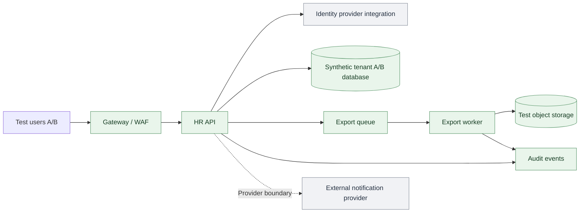
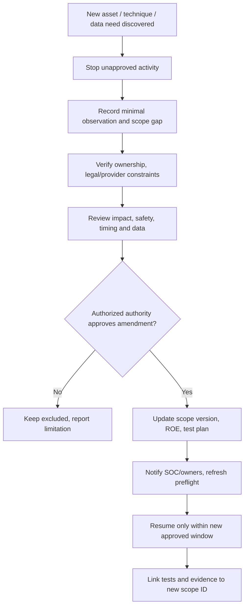

# Phạm vi pentest: xác định ranh giới được phép kiểm thử và bằng chứng bảo mật

## 1. Vì sao phạm vi là quyết định quan trọng nhất trước pentest?

Một nền tảng HR SaaS có cổng nhân viên, API payroll, worker xuất báo cáo, identity provider, hệ thống lưu trữ và nhiều tenant. Nhóm kiểm thử được yêu cầu “pentest ứng dụng HR”. Trong quá trình chuẩn bị, tester phát hiện API có thể gọi tới một dịch vụ bên thứ ba, trang đăng nhập dùng identity provider chung cho nhiều sản phẩm và một hostname phụ trỏ tới môi trường thử nghiệm của đối tác.

Nếu chỉ hiểu “pentest ứng dụng HR” là được kiểm thử mọi địa chỉ có liên quan, nhóm có thể vô tình truy cập dữ liệu ngoài thẩm quyền, gây gián đoạn dịch vụ của bên thứ ba hoặc thử nghiệm trên tenant thật không được cấp phép. Ngược lại, nếu phạm vi chỉ ghi “kiểm thử trang chủ”, team có thể bỏ qua các API, worker và đường truy cập quan trọng nhất đối với mục tiêu bảo mật.

**Phạm vi pentest (penetration testing scope)** là tập hợp **tài sản, môi trường, đối tượng, chức năng, tài khoản, ranh giới tin cậy, phương pháp, giới hạn và điều kiện được phép** trong một hoạt động kiểm thử xâm nhập có ủy quyền. Phạm vi phải được diễn đạt đủ cụ thể để tester biết **được làm gì, ở đâu, bằng quyền nào, khi nào và khi nào phải dừng**; đồng thời giúp chủ hệ thống và người đánh giá biết **điều gì đã kiểm chứng, điều gì chưa**.

Trong chương **Penetration testing** của module **SECURITY_SECURITY_ASSURANCE**, việc xác định scope không đơn thuần là giấy phép thực hiện bài test. Đây là **bước thiết kế assurance có bằng chứng**, nối phân tích rủi ro, security requirements và controls với kịch bản kiểm thử, kết quả quan sát, audit, remediation và retest. Một báo cáo pentest chỉ có thể hỗ trợ kết luận bảo mật **trong phạm vi, thời điểm, mức độ truy cập và kỹ thuật đã được phê duyệt**.

### Mục tiêu học tập

Sau bài học này, bạn có thể:

1. Phân biệt scope, Rules of Engagement (ROE), Statement of Work (SOW), authorization và test plan.
2. Xác định tài sản in-scope/out-of-scope bằng định danh chính xác, ownership và môi trường.
3. Thiết kế phạm vi theo **ứng dụng, API, network, cloud, identity, tenant, dữ liệu và thời gian**.
4. Phân loại phương pháp black-box/gray-box/white-box, authenticated/unauthenticated, mức độ xâm nhập và giới hạn.
5. Xử lý tình huống shared infrastructure, SaaS, managed cloud và tài nguyên bên thứ ba.
6. Thiết lập kiểm soát dữ liệu, an toàn dịch vụ, stop conditions, escalation và change control.
7. Lập scope matrix, ROE, kế hoạch test có risk-to-control traceability và evidence manifest.
8. Viết kết luận trung thực: **đã kiểm gì, chưa kiểm gì, mức độ chắc chắn và residual risk**.

> **Nguyên tắc bắt buộc:** pentest chỉ được thực hiện trên tài sản, tài khoản và kỹ thuật mà chủ thể có thẩm quyền đã **cho phép rõ ràng**. Việc một địa chỉ trả lời request, có DNS liên quan hay xuất hiện trong tài liệu không tự tạo quyền kiểm thử. Các kịch bản và biểu mẫu trong bài đều là giả định phục vụ học tập.

## 2. Phân biệt Scope, Authorization, ROE, SOW và Test Plan

| Khái niệm | Câu hỏi chính | Ví dụ thông tin | Không nên hiểu nhầm |
| --- | --- | --- | --- |
| **Authorization** | Ai có thẩm quyền cho phép hoạt động nào, trong phạm vi nào? | Phê duyệt bởi chủ tài sản/đại diện được ủy quyền, thời hạn hiệu lực. | Một email chung chung không mặc nhiên cho mọi kỹ thuật. |
| **Scope** | Những tài sản/flows/identities và giới hạn nào được kiểm? | Hostnames, API paths, tenants, environments, exclusions. | Một tên sản phẩm không đủ là danh mục tài sản. |
| **Rules of Engagement (ROE)** | Tester được thực hiện như thế nào và phải dừng/escalate khi nào? | Thời gian, rate limits, safe methods, contacts, incident triggers. | Có scope không có nghĩa mọi phương pháp đều được dùng. |
| **Statement of Work (SOW)** | Hợp đồng/deliverables/trách nhiệm nào được cam kết? | Công việc, nỗ lực, báo cáo, lịch và acceptance. | SOW thương mại không thay quyền với tài sản bên thứ ba. |
| **Test Plan** | Kiểm thử những kịch bản nào, theo phương pháp và evidence gì? | Authentication, BOLA, session, API, cloud control gaps. | Danh sách kiểm thử không được mở rộng scope tự động. |
| **Asset Inventory** | Những hệ thống thực tồn tại và do ai sở hữu? | CMDB, DNS/cloud resource, repo, build, tenant. | Inventory rộng hơn scope; không phải mọi asset đều được phép test. |
| **Security Requirement** | Hệ thống cần bảo đảm điều gì? | Tenant A không đọc dữ liệu B, admin phải MFA. | Có requirement không đồng nghĩa test cho mọi resource. |
| **Finding** | Bằng chứng quan sát được cho một weakness cụ thể? | Asset, route, test principal, expected/actual, time. | Finding ngoài scope không được tự ý xác minh sâu. |

### 2.1. Một phạm vi có giá trị khi gắn với quyền thật

Tài liệu có thể ghi `*.example.test`, nhưng nếu một hostname khớp wildcard đang được thuê bởi đối tác thì tester vẫn cần **đối chiếu ownership và được phép test chính hệ thống đó**. Ngược lại, chỉ phê duyệt domain `hr.example.test` chưa chắc bao gồm mọi IP CDN, identity provider, email gateway hay cơ sở hạ tầng của bên thứ ba mà domain phụ thuộc.

### 2.2. Quyền kiểm thử không tự suy ra từ quyền đăng nhập

Một tài khoản khách hàng được đăng nhập ứng dụng không có nghĩa chủ tài khoản được phép chạy automated fuzzing, brute-force, tải dữ liệu tenant khác hoặc thử disruption. Phạm vi ủy quyền cho pentest là một quyết định riêng, cần thể hiện **mục tiêu, phương pháp và ràng buộc**.

### 2.3. Thứ tự phụ thuộc

**Có thẩm quyền và ủy quyền → xác định scope → ROE → test plan → preflight → execution → evidence/report → remediation/retest.** Nếu phát hiện cần đổi phạm vi giữa chừng, dừng phần chưa được cấp phép và xử lý theo quy trình thay đổi, không mở rộng bằng giả định.

## 3. Scope phải bắt đầu từ mục tiêu bảo mật và rủi ro

Một danh sách IP chưa trả lời được **vì sao** cần kiểm thử. Scope hiệu quả gắn với business risks, critical assets và security controls cần chứng minh.

### 3.1. Ví dụ risk-to-objective

| Risk scenario | Security objective | Đối tượng nên đưa vào scope khi được phép | Test evidence dự kiến |
| --- | --- | --- | --- |
| Người dùng tenant A đọc payroll tenant B. | Isolation và authorization theo ownership. | Payroll API, export flow, test tenants A/B, roles. | Positive/negative access checks với dữ liệu giả. |
| Tài khoản admin bị chiếm quyền. | Strong authentication, session protection, least privilege. | IdP integration và admin features thuộc quyền test. | MFA/session/privilege control tests trong ROE. |
| Dữ liệu được xuất và chia sẻ sai quyền. | Access-controlled export, logging, short-lived links. | Worker flow, object access path, download API. | Authorized export/download tests và audit records. |
| Service token có quyền quá rộng. | Workload identity và segmentation. | API/service identity policies được phép review. | Effective grants/config và test an toàn. |
| Dữ liệu nhạy cảm lọt qua log. | Data minimization và audit confidentiality. | App error paths, collector interface trong quyền. | Synthetic marker tests, evidence của data flow. |
| Một thành phần public có lỗ hổng cấu hình. | Hardened configuration và attack surface control. | Public app/gateway configs, endpoints đã phê duyệt. | Controlled config checks, finding/negative retest. |

Từ threat model, mỗi mục tiêu được chuyển thành **scope item + test permission + expected evidence**, không nhất thiết mọi yếu điểm phải được thử bằng kỹ thuật phá khai thác. Đối với controls không thể xác minh trực tiếp trong pentest, ghi **complementary assessment** như code review, configuration audit, SAST hoặc IAM review.

### 3.2. Scope theo rủi ro khác scope theo tiện lợi

Chọn mục tiêu chỉ vì scanner truy cập được có thể bỏ sót hệ thống mang dữ liệu quan trọng. Chọn scope cần cân nhắc:

- Asset/data criticality và những security objectives cần assurance.
- Exposed entry points, trust boundaries và authentication flows.
- Changes mới, prior findings, incidents và threat intelligence hợp lệ.
- Các control nào có thể kiểm chứng an toàn trong thời gian cho phép.
- Những tài sản người phê duyệt thực sự có thẩm quyền cho phép kiểm.
- Độ sẵn sàng của test identities, data fixtures, rollback/backup và monitoring.

## 4. Tám chiều của phạm vi pentest

Không thể mô tả phạm vi phức tạp chỉ bằng một cột “URL”.

| Chiều | Cần ghi rõ | Ví dụ |
| --- | --- | --- |
| **1. Asset/technical** | Hostnames, IP/CIDR, application, API, cloud resource, build/version. | `hr-api.lab.example`, API v2, image digest. |
| **2. Environment** | Production, staging, test, regional deployment, network zone. | Staging riêng với synthetic payroll data. |
| **3. Functional/data flow** | Login, payroll query, export, worker, object download, admin console. | Export request → worker → storage → download. |
| **4. Identity/role/tenant** | Test accounts, roles, permissions, tenant data separation. | Employee-A, Admin-A, Employee-B. |
| **5. Method/depth** | Manual/automated, black/gray/white-box, authenticated, rate caps. | Authenticated gray-box web/API testing. |
| **6. Time/window** | Start/end, timezone, maintenance window, out-of-hours restrictions. | Approved weekday staging window. |
| **7. Data/evidence** | Synthetic vs live data, permitted read/write, collection/retention. | Only synthetic tenant records; redacted report. |
| **8. Safety/authorization** | Prohibited actions, contacts, stop/kill switch, third parties. | No DoS, destructive changes, credential spraying. |

### 4.1. Giao điểm giữa các chiều mới là quyền cụ thể

Một tester được phép chạy authenticated API checks trên `staging` với test user tenant A không có nghĩa được làm tương tự trên `production`, với tài khoản admin thật, trong cùng ngày. Authorization cần gắn đúng **asset × environment × method × identity × time × data**.

### 4.2. “In-scope” không đồng nghĩa “unrestricted”

Một host nằm trong danh sách cho phép vẫn có thể chỉ được kiểm tra cấu hình và authorization không phá hoại, không được brute force hoặc tạo tải cao. ROE cần ghi rõ **permitted techniques/impact limits** theo loại tài sản.

## 5. Inventory: xác định đúng tài sản và chủ sở hữu

### 5.1. Dạng định danh

| Asset type | Identifier nên ghi | Rủi ro nếu định danh mơ hồ |
| --- | --- | --- |
| Web | FQDN, scheme/port, application/site ID, environment. | Nhầm với CDN/vhost/tenant khác. |
| API | Base URL, version, route groups, auth requirements, environment. | Bỏ qua direct endpoints/alternate ports hoặc quét sang API khác. |
| Network | IP/CIDR, segmentation zone, owner, permitted ports/protocols. | Quét tràn mạng shared hoặc management plane. |
| Cloud | Account/subscription/project, region, resource IDs, service endpoints. | Nhầm account/tenant và dịch vụ managed. |
| Container/K8s | Cluster/context/namespace/workload, image digest. | Test vào namespace/cluster ngoài scope. |
| Identity | IdP tenant, app registration, realm, test principal IDs. | Gây khóa account thật hoặc ảnh hưởng SSO chung. |
| Data store | DB instance/schema, synthetic dataset, access method. | Động tới production PII hoặc replication. |
| Mobile | Bundle/package ID, build signature/version, backend env. | App test trỏ backend production ngoài phép. |
| Third-party | Provider, contract, exact owned integration boundary. | Xem integration access là quyền pentest vendor. |

### 5.2. Wildcards và dải địa chỉ

Biểu thức như `*.example.test`, `10.10.0.0/16` có thể bao gồm hàng trăm tài sản, hệ thống mới hoặc dịch vụ được nhà cung cấp quản lý. Nên dùng **allowlist chính xác**, owner và điều kiện cấp phép; nếu phải dùng pattern, nêu tiêu chí loại trừ, quy trình inventory snapshot và quy tắc phát hiện asset mới trước khi chạm tới nó.

Một hostname có thể đổi IP theo CDN/load balancing; một IP có thể host nhiều tên miền. Người lập scope cần xác nhận danh tính tài sản dựa trên **ownership, deployment và endpoint**, không chỉ DNS lookup một lần rồi mở rộng theo IP.

### 5.3. Tính động của hệ thống

Cloud resources, ephemeral containers, serverless functions và auto-scaling có thể đổi IP/version trong cửa sổ pentest. Scope nên hỗ trợ **resource selectors được phê duyệt** như account+region+tag+owner, nhưng selector phải được xác minh để không chọn nhầm hệ thống mới ngoài phép. Ghi snapshot inventory, thời điểm và cơ chế xử lý scope drift.

### 5.4. Tài sản ngoài quyền

Nếu asset phụ thuộc vào managed identity provider hoặc payment processor, có thể kiểm thử **cách ứng dụng của mình xử lý response/claims ở boundary được phép** mà không pentest chính nền tảng vendor. Khi có một phát hiện liên quan vendor, bảo toàn thông tin tối thiểu, liên hệ chủ sở hữu và chỉ tiếp tục nếu được chấp thuận rõ.

## 6. Phạm vi Web, API, Mobile và giao diện quản trị

### 6.1. Web không chỉ có trang chủ

Một scope web có thể gồm:

- Entry points public/private, session management và SSO callback trong quyền.
- Admin/support UI với test roles phù hợp.
- API được frontend gọi, WebSocket/gRPC khi có.
- Upload/download, search, export, report và background job endpoints.
- Static resources, CDN configurations thuộc quyền, cache semantics.
- Những domain phụ dùng để chuyển hướng hoặc xử lý reset tài khoản.

Không tự mở rộng sang **dịch vụ thực của IdP, CDN, CAPTCHA provider hoặc email platform** chỉ vì browser chuyển hướng qua chúng.

### 6.2. API cần scope rõ theo route groups

Viết “API `/v1/*`” có thể chưa đủ vì một route có phương thức GET an toàn, còn POST/DELETE tạo side effects. Nên ghi **methods, route families, auth contexts, data fixtures và operation limits**. Cho phép kiểm authorization trên GET không mặc nhiên cho phép reset password, payment reversal hay mass deletion.

### 6.3. Mobile/desktop

Ứng dụng mobile có local storage, deep links, embedded WebView, TLS handling, IPC và backend calls. Nếu in-scope chỉ là mobile client build staging, test trực tiếp production backend vẫn ngoài phép. Cần xác định **build signature, test devices, app IDs, test accounts, backend URLs và data safety**.

### 6.4. Management/debug endpoints

Management endpoints có thể là tài sản rủi ro cao nhưng rất nhạy cảm. Scope cần nêu read-only validation, quyền, khả năng gây restart/config changes và stop conditions. Không xem “có thể truy cập được” là quyền thử cấu hình phá hoại.

## 7. Identity, roles và multi-tenancy trong phạm vi pentest

Một pentest bảo mật có thể yêu cầu nhiều test identities để kiểm tra phân tách quyền. Đặc biệt với SaaS, **hai tài khoản cùng tenant không đủ chứng minh tenant isolation**.

### 7.1. Matrix principal–tenant–resource

| Test identity | Tenant | Vai trò | Hành vi kỳ vọng |
| --- | --- | --- | --- |
| `user-a` | A | Employee | Đọc/sửa resource cá nhân thuộc A trong quyền. |
| `manager-a` | A | Manager | Chỉ thao tác những hồ sơ được giao trong A. |
| `admin-a` | A | Tenant admin | Quản lý tenant A, không đọc resource tenant B. |
| `user-b` | B | Employee | Truy cập dữ liệu thử của B, không tự thấy A. |
| `support-limited` | Theo ticket được duyệt | Support | Có quyền giới hạn theo case, thời gian và audit. |
| `svc-export-test` | Test environment | Workload identity | Tạo export trong phạm vi job/data được phép. |

Đây là **test principals giả**. Cần có đầu mối cung cấp/quản lý credentials, rõ những tài khoản được phép tạo trạng thái, reset mật khẩu, test MFA, lockout, revoke và xóa sau test.

### 7.2. Các tình huống liên quan quyền

- User cùng role, khác tenant.
- User khác role, cùng tenant.
- Admin tenant A với resource tenant B.
- Bị thu hồi role/token và kiểm tra effective revocation.
- Session hết hạn, thay password/MFA trong account test.
- Service-to-service call với workload identity test.
- Multi-step export hoặc background job nơi actor delegation có thể bị mất.

**Không lấy dữ liệu tenant thật làm mồi để chứng minh BOLA.** Thiết kế fixtures A/B, negative expected results và giới hạn số record. Nếu test vô tình trả dữ liệu người thật, dừng và xử lý theo ROE/incident process thay vì tải thêm để “đo phạm vi”.

### 7.3. Black-box, gray-box, white-box liên quan account cấp thế nào?

- **Black-box:** tester có ít thông tin trước test; vẫn cần authorization, boundary và contacts.
- **Gray-box:** có test accounts, architecture/baseline một phần; thuận lợi để kiểm authorization và internal flows.
- **White-box:** có source/design/config trong phạm vi; giúp trace controls nhưng không đồng nghĩa được phép thao tác production.

Các thuật ngữ này mô tả **mức thông tin cung cấp**, không phải mức quyền hoạt động. Một white-box assessment vẫn có thể cấm active exploitation.

## 8. Trust boundaries và các luồng dữ liệu phải được biểu diễn

Một sơ đồ pentest scope tốt không chỉ liệt kê endpoints mà còn chỉ ra **ranh giới trách nhiệm và nơi dữ liệu/identity đổi ngữ cảnh**.



**Đọc sơ đồ:** API/gateway/queue/worker/storage chỉ trở thành *in-scope* khi có danh mục và phê duyệt cụ thể; đường nối tới IdP và external notification provider biểu thị **integration boundary**, không tự biến nền tảng của nhà cung cấp thành mục tiêu. Trong bài tập minh họa, dùng môi trường thử, tài khoản thử, record và object giả.

### 8.1. Đánh dấu boundaries trong data-flow diagram

1. Public Internet → edge/gateway.
2. Edge → application API và service authorization context.
3. API → database hoặc object store thuộc tenant.
4. API → async queue → worker, nơi actor/tenant context có thể bị mất.
5. Application → IdP/third-party provider với quyền riêng.
6. Service → logging/monitoring, nơi dữ liệu có thể được nhân bản.
7. Dev/staging → production shared services, nếu có.

Mỗi boundary cần chỉ rõ **ai sở hữu, có phép gì, có dữ liệu loại nào, kiểm gì được và không được chạm gì**.

### 8.2. Exploit chain đi qua boundary ngoài scope

Nếu một test tìm thấy dấu hiệu rằng API có thể liên lạc tới metadata service, không mặc nhiên được phép gửi truy vấn tới mọi tài nguyên liên quan để chứng minh khả năng khai thác. Dừng tại **điểm quan sát an toàn đã phê duyệt**, ghi finding/giả định/impact và đề xuất bổ sung scope hoặc phương pháp xác minh thay thế như configuration review. Đây là cách giữ tính pháp lý, bảo vệ hệ thống và vẫn có evidence assurance.

### 8.3. Ghi exclusion mà không làm mất threat model

Một external system nằm ngoài scope vẫn có thể là **dependency/risk assumption**; report nên ghi “không kiểm trực tiếp provider, chỉ kiểm integration handling ở application boundary”. Việc không test một dependency không có nghĩa dependency an toàn.

## 9. Chiều sâu kiểm thử và kỹ thuật được phép

Từ “pentest” có thể được hiểu khác nhau: automated scanning, manual validation, authenticated tests, active exploitation, red-team simulation, social engineering hoặc destructive stress tests. Scope phải phân loại rõ **allowed vs restricted vs prohibited**.

### 9.1. Mức độ kiểm thử minh họa

| Mức độ | Loại hoạt động | Điều kiện |
| --- | --- | --- |
| **Passive/review** | Đọc tài liệu, cấu hình được cung cấp, source review, kiểm threat model. | Được phép truy cập tài liệu, bảo vệ bí mật. |
| **Low-impact active** | HTTP/API requests an toàn, kiểm role permissions với synthetic records. | Rõ endpoints/methods, rate, accounts và data handling. |
| **Controlled vulnerability validation** | Tái hiện hành vi yếu trong staging hoặc phạm vi được phê duyệt với impact giới hạn. | Test plan, rollback, monitoring, stop triggers. |
| **Sensitive operations** | Test account lockout, privilege changes, export lớn, internal scan. | Phê duyệt riêng, safety plan, owner/on-call. |
| **High-impact/destructive** | Stress/DoS, data deletion, large-scale credential attacks, persistence, malware simulation. | Mặc định không được phép; chỉ xét trong engagement chuyên biệt và điều kiện kiểm soát rất nghiêm ngặt. |

Không coi các mức trong bảng là chuẩn bắt buộc. Tổ chức phải định nghĩa thuật ngữ và ROE phù hợp luật/hợp đồng/threat model.

### 9.2. Bốn điều kiện trước một phép thử chủ động

**Asset nằm trong scope? Method được phép? Data/identity hợp lệ? Time và safety controls đang hiệu lực?** Nếu một điều kiện không có câu trả lời rõ, không thực hiện phép thử đó.

### 9.3. Thăm dò có thể gây tác động ngoài dự kiến

Ngay cả một request GET tưởng an toàn cũng có thể kích hoạt caching, audit events, webhook hoặc expensive queries. Automated scanners có thể gửi hàng nghìn requests, dẫn tới rate-limit, queue backlog hoặc alert. Vì vậy cần **request budget, concurrency cap, test account/correlation, monitoring và kill switch**, không phân loại “GET = vô hại” mặc định.

### 9.4. Không yêu cầu exploit thành công mới có finding

Một config lộ quyền rộng hoặc thiếu kiểm tra authorization đã được xác nhận có thể đủ để tạo finding trong giới hạn test. Có thể dùng **logic analysis, safe input markers, read-only proofs và independent verification** thay vì payload làm mất dữ liệu hay xâm nhập sâu. Report nêu evidence và giới hạn, không khẳng định hậu quả chưa được chứng minh.

## 10. In-scope, Out-of-scope và Conditionally in-scope

### 10.1. Ba trạng thái phải rõ

| Trạng thái | Ý nghĩa | Hành động của tester |
| --- | --- | --- |
| **In-scope** | Tài sản và methods được ủy quyền theo ROE hiệu lực. | Chỉ thực hiện trong giới hạn method/data/time. |
| **Out-of-scope** | Không có phép kiểm hoặc bị loại trừ chủ động. | Không thực hiện active tests; ghi boundary/assumption khi liên quan. |
| **Conditional / pending approval** | Có thể cần test nhưng phụ thuộc consent, window, environment hoặc preflight. | Chưa được phép cho đến khi điều kiện và phê duyệt có hiệu lực. |

Không đánh đồng **discovered asset** với **in-scope asset**. Khi scanner hoặc kiến trúc mới lộ một hostname, cần phân loại và xác nhận ownership trước khi chủ động tương tác.

### 10.2. Exclusions cần có lý do

| Exclusion | Lý do minh họa | Cách xử lý trong assurance |
| --- | --- | --- |
| Production payroll data | Không được phép tác động dữ liệu thật. | Synthetic staging data, config review, limitations rõ. |
| External SSO provider | Tổ chức không sở hữu dịch vụ. | Test ứng dụng xử lý token/claims qua permitted integration boundary. |
| Payment processor | Hợp đồng không cấp phép pentest trực tiếp. | Provider test sandbox và contract/API verification phù hợp. |
| DoS/stress testing | Rủi ro gián đoạn dịch vụ vượt phạm vi. | Performance/resilience assessment riêng, tránh giả định đã kiểm availability. |
| Employee social engineering | Chưa có consent và chương trình riêng. | Không thử phishing, vishing hoặc lấy credential thật. |
| Physical premises | Không thuộc scope kỹ thuật số. | Ghi N/A cho engagement này, không suy physical security đã được chứng minh. |
| Production admin destructive actions | Có thể mất dữ liệu/cấu hình. | Read-only design/IAM review hoặc diễn tập staging. |

### 10.3. Out-of-scope không đồng nghĩa Not affected

Nếu external SSO platform không được phép kiểm, report ghi **Not tested: out of scope**. Không kết luận provider “secure”, “no vulnerabilities” hoặc “not affected” khi chưa có evidence thích hợp.

## 11. Cloud, managed services và shared infrastructure

### 11.1. Owner và người vận hành có thể khác nhau

Cloud account do công ty quản lý nhưng compute, control plane, identity platform hoặc managed database có thể chịu ràng buộc của provider. Scope phải chỉ rõ **resource nào tổ chức có quyền kiểm, hoạt động nào provider cho phép hoặc yêu cầu thông báo, phần nào do bên thứ ba quản lý**.

### 11.2. Bảng trách nhiệm minh họa

| Layer | Thông thường tester có thể kiểm khi được ủy quyền | Không tự suy quyền |
| --- | --- | --- |
| Application thuộc tổ chức | Web/API logic, authentication/authorization của app. | Provider control plane hoặc tenant người khác. |
| Cloud workload được sở hữu | Config, service permissions, networking trong account được phép. | Physical host/hypervisor, hạ tầng chung. |
| Managed database | DB access/config trong capability và permission được cấp. | Exploit DB engine hoặc DoS vào shared service. |
| Identity provider integration | Token validation, app claims mapping, session handling. | Tấn công trực tiếp IdP tenant chung/provider. |
| CDN/WAF | App routing/policy thuộc quyền, read-only verification. | Tấn công infrastructure edge của nhà cung cấp. |
| CI/CD and secrets | Repository/pipeline configs được phê duyệt. | Extract production credentials hoặc cross-org runner abuse. |

### 11.3. Multi-cloud và multi-account

Định danh scope nên gồm cloud account/subscription/project, region, owner và network zone. Cùng một hostname có thể route tới account khác khi triển khai blue-green; cần giới hạn tài sản qua **ownership và environment**, không chỉ FQDN.

### 11.4. Yêu cầu nhà cung cấp không nên đoán

Các chính sách pentest của nhà cung cấp có thể thay đổi theo sản phẩm và thời gian. Engagement owner phải kiểm chứng quy định hiện hành và điều khoản dịch vụ/contract. Bài học không coi mọi cloud pentest đều cần xin phép trước hoặc luôn được phép, mà yêu cầu **ghi căn cứ hợp lệ cho đúng dịch vụ và phương pháp**.

## 12. Dữ liệu, riêng tư và test artifacts

Pentest có thể đụng tới dữ liệu nhạy cảm, kể cả khi không có ý định. Scope phải xác định **data categories, synthetic fixture, access method, evidence handling và cách phản ứng khi tiếp xúc dữ liệu thật**.

### 12.1. Data classification và permitted operations

| Data class | Ví dụ | Phạm vi được khuyến nghị cho case học tập |
| --- | --- | --- |
| **Synthetic/public** | Test user, fake email, fictitious payroll record. | Dùng làm fixtures chính cho active testing. |
| **Internal/confidential** | Source, architecture, internal endpoints, policy. | Chỉ dùng khi được cấp quyền; lưu report hạn chế. |
| **Restricted/PII** | Lương, định danh cá nhân, dữ liệu khách hàng. | Tránh thu thập; áp dụng minimization và xử lý sự cố nếu thấy thật. |
| **Credentials/secrets** | Session token, API key, private key. | Không đưa vào báo cáo/logs/ticket; dùng tài khoản test và cơ chế che. |
| **Production business transactions** | Thanh toán, phê duyệt, chỉnh sửa hồ sơ. | Mặc định không thao tác trái ROE; dùng sandbox và business owner approval. |

### 12.2. Tối thiểu hóa bằng chứng

Đối với lỗi cross-tenant, bằng chứng có thể là **request với test identity A, resource ID giả của B, HTTP status, response fields đã redacted và trace/audit reference**. Không cần tải một loạt hồ sơ thật để chứng minh control thất bại.

### 12.3. Lưu giữ và truyền giao

Cần thống nhất:

- Công cụ/chỗ lưu bằng chứng có được cấp quyền không?
- Báo cáo có chứa exploit paths hoặc dữ liệu nhạy cảm cần phân loại không?
- Ai được xem raw notes, screenshots, packet captures hoặc test session logs?
- Cần mã hóa, retention, deletion hoặc legal hold theo quy định nào?
- Có phải gửi dữ liệu ra khỏi quốc gia, tenant hoặc cloud account không?
- Khi có data exposure, ai quyết định breach/incident handling?

**Không mặc định mọi packet capture đều an toàn**; TLS metadata, token, request payload và địa chỉ nội bộ có thể nằm trong đó.

### 12.4. Hậu kiểm tài khoản thử

Sau engagement, cần **revoke test users/tokens, xóa synthetic objects nếu an toàn và được duyệt, trả lại settings, gỡ các rule/logging debug tạm, xác minh không còn access mở rộng**, nhưng giữ evidence cần thiết theo retention policy. Cleanup cũng cần được ghi nhận, không xóa forensic evidence nếu đang xử lý incident.

## 13. Production, staging và độ tương đương môi trường

### 13.1. Khi chọn staging

Staging thường cho phép kiểm tra có chiều sâu hơn và ít ảnh hưởng khách hàng, đặc biệt với data mutation, account tests hoặc controlled replay. Nhưng staging có thể khác production:

- Auth/SSO, session policy, WAF hoặc network segmentation khác.
- Khác feature flags, build/digest, patches và cloud IAM.
- Dữ liệu thử không phản ánh scale, multi-tenancy hoặc migrations.
- Bỏ qua third-party integrations hoặc dùng sandbox mocks.
- Observability/audit pipelines không hoàn toàn tương đương.

Do đó kết luận **“staging test pass”** chỉ áp dụng cho build, controls và scope đã thử; nếu cần assurance về production, phải đánh giá **configuration parity hoặc một bộ tests ít tác động được phê duyệt**.

### 13.2. Khi kiểm production

Production có thể là nơi duy nhất có hiệu lực thật của CDN, WAF, identity, IAM và dữ liệu phân tán. Nhưng mỗi action cần ROE rõ về test window, quotas, monitoring, rollback, data controls và emergency contacts. **Không lấy việc kiểm trực tiếp production làm mặc định tốt hơn**; lựa chọn theo risk, nhu cầu bảo mật và quyền.

### 13.3. Mức độ kết luận theo environment

| Bằng chứng | Kết luận hỗ trợ | Chưa được tự kết luận |
| --- | --- | --- |
| Staging API test đạt | Hành vi API ở build/test config đó phù hợp expected. | Production policies/runtime cũng giống hoàn toàn. |
| Production config review | Cấu hình đang thấy ở thời điểm audit. | Exploit path đã được thử hoặc controls không có bypass. |
| Production low-impact negative tests | Một số permission/flow đúng trong scope. | Mọi chức năng/tenant/region đều được bao phủ. |
| Source white-box analysis | Code path/logic được hiểu trong version đã xem. | Deployed artifact và integrations đúng như code. |

### 13.4. Chia scope khi có khác biệt không thể triệt tiêu

Có thể lập hai workstreams: **active exploit-safe tests trên staging** và **read-only/config/authz spot checks trên production**, cùng matrix so sánh build/config và exclusions. Báo cáo phải giữ kết luận theo từng workstream, không cộng gộp thành “production fully pentested”.

## 14. Test window, tải, rate limit và giám sát

### 14.1. Timebox có ý nghĩa vận hành

Mỗi lịch test cần start/end với timezone, asset/cohort, lịch bảo trì/backup và quy trình mở rộng thời gian. Nếu giờ hết hạn, tester **dừng active interactions** trừ khi có phê duyệt cập nhật; việc test dang dở không tạo quyền tiếp tục vô hạn.

### 14.2. Các giới hạn tác động

| Control | Ví dụ tham số cần được phê duyệt |
| --- | --- |
| Request rate | Max requests/second, concurrency, burst và per-account budget. |
| Payload/data size | Max upload, response size, objects created/exported. |
| Auth attempts | Allowed accounts, attempts/cooldown/lockout safety; không credential spraying. |
| State changes | Permitted write operations, test-only resources, rollback/cleanup. |
| Network scope | Ports/protocols/hosts/region, no uncontrolled lateral movement. |
| Availability | No destructive load/DoS, explicit stop/error/latency thresholds. |
| Observability | On-call monitors CPU, DB, queue, SLI, security alerts và business metrics. |
| Communications | Named secure channel, acknowledgment và incident bridge. |

Không tự đưa một con số request/second chung cho tất cả hệ thống. Rate an toàn phụ thuộc capacity, business windows, shared dependencies và telemetry; quá thấp có thể không kiểm được, quá cao gây disruption. Scope cần **giới hạn định lượng hoặc nguyên tắc cụ thể có thể thực thi**, owner ký duyệt.

### 14.3. Kill switch và stop conditions

Phải dừng/tạm dừng và liên hệ đúng người khi:

- Xuất hiện unexpected customer data hoặc secret thật.
- Có dấu hiệu disruption, error rate vượt ngưỡng, transaction inconsistency.
- Tester vô tình vào out-of-scope asset/tenant hoặc môi trường khác.
- Phát hiện evidence active compromise/incident cần bảo toàn.
- Monitoring hoặc người giám sát được yêu cầu không còn sẵn sàng.
- Một test tạo unexpected side effect, mở quyền hoặc làm thay đổi config.
- Authorization window hết hạn hoặc engagement bị chủ hệ thống thu hồi.

**Không tiếp tục để “xác minh lần nữa” nếu việc đó có thể làm tăng hậu quả**. Ghi state tối thiểu, bảo toàn chứng cứ trong phạm vi an toàn, báo on-call và chờ quyết định.

### 14.4. Phối hợp SOC/NOC

ROE nên quy định tester có được allowlist IP không, kênh test traffic có cần marker/correlation không, có cần SOC quan sát thật hay blind test đã duyệt, và cách phân biệt test với incident. Không tắt toàn bộ detection hoặc audit chỉ để scanner chạy êm; nếu cần điều chỉnh controls để thử, phải có approval và kế hoạch phục hồi.

## 15. Authorization, pháp lý, hợp đồng và bên thứ ba

### 15.1. Authorization phải đến từ đúng chủ thể

Một phạm vi kỹ thuật chỉ hợp lệ khi **người cấp phép có thẩm quyền với tài sản, môi trường và hoạt động được thực hiện**. Trong tổ chức lớn, người thuê dịch vụ pentest có thể không có quyền cấp phép cho cloud account khác, hạ tầng khách hàng, vendor, công ty con hoặc tenant riêng.

Trước hoạt động chủ động, hồ sơ cần đủ:

1. Tên pháp nhân/tổ chức, người cấp phép, vai trò và cơ sở thẩm quyền.
2. Đơn vị tester/vendor, người thực hiện và nghĩa vụ bảo mật.
3. Phạm vi tài sản và môi trường có thể xác minh.
4. Phương pháp, độ sâu, tài khoản và kiểu dữ liệu cho phép.
5. Thời hạn bắt đầu/kết thúc, timezone, window và thông báo.
6. Exclusions, giới hạn tải, dừng khẩn và đầu mối incident.
7. Quy tắc bằng chứng, truyền giao, retention, confidentiality.
8. Quản lý thay đổi, chấp thuận mở rộng và quyền thu hồi.

**Không giả định một chữ ký ROE thay thế mọi hợp đồng/quy định.** Engagement owner và legal/compliance khi thích hợp phải xác nhận các nghĩa vụ thực tế. Phân loại của tài liệu học tập không phải tư vấn pháp lý.

### 15.2. Scope với hệ thống của khách hàng

Một nhà cung cấp SaaS có thể sở hữu application nhưng dữ liệu/tenant do khách hàng quản lý. Kiểm tra tenant giả thuộc quyền công ty khác với truy cập tenant khách hàng thật. Nếu hợp đồng cần consent của khách hàng hoặc chỉ cho phép phương pháp cụ thể, scope phải ghi điều kiện và evidence consent, không tự suy “chủ ứng dụng được pentest mọi dữ liệu”.

### 15.3. Bug bounty và pentest hợp đồng

Một chương trình bug bounty/public disclosure policy có thể cấp một loại quyền với assets và hành vi giới hạn; nó không tự mở rộng thành quyền kiểm thử sâu như một pentest hợp đồng. Không dùng “có bug bounty” để hợp pháp hóa việc chạy credential attacks, DoS, xâm nhập third-party hoặc thu thập PII ngoài policy.

### 15.4. Quyền của provider

Nếu pentest liên quan cloud, CDN, SMS/email, IdP, payment processor hoặc nhà cung cấp managed services, xác nhận **điều khoản và chính sách testing còn hiệu lực cho dịch vụ cụ thể**. Nếu provider chỉ cho phép cấu hình ở tenant của tổ chức, không thử vào shared backend/platform. Khi chưa có approval, ghi **Blocked pending third-party authorization**, không tự bỏ qua bằng cách đổi hostname.

## 16. Preflight: kiểm tra khả năng và an toàn trước ngày test

Một ROE có đủ nội dung nhưng tester chưa có account, test data hoặc giám sát thì engagement có thể thất bại hoặc gây rủi ro. Preflight giúp biến scope từ giấy tờ thành **khả năng thực hiện an toàn**.

### 16.1. Checklist preflight

| ID | Điều kiện | Evidence/owner | Khi chưa đạt |
| --- | --- | --- | --- |
| **PF-01** | Có authorization hiệu lực, đúng asset/method/window. | Approved scope/ROE + owner. | Chưa active test. |
| **PF-02** | Asset inventory và ownership đã reconciled. | Scope matrix, host/API list, cloud IDs. | Làm rõ tài sản Unknown. |
| **PF-03** | Third-party consent/provider rules đã xác minh. | Contract/policy references. | Loại trừ hoặc xin approval. |
| **PF-04** | Test identities đủ role/tenant, không chứa quyền ngoài cần thiết. | Secure account inventory và access approval. | Cấp test accounts qua kênh phù hợp. |
| **PF-05** | Dữ liệu giả và reset/cleanup plan sẵn. | Fixture manifest, owners. | Không dùng dữ liệu thật thay thế. |
| **PF-06** | Build/config/environment được xác định. | Version/digest, route/IAM snapshots. | Giới hạn claim và xử lý drift. |
| **PF-07** | Time window và request budgets được chấp thuận. | ROE active window/rate controls. | Không bắt đầu scan. |
| **PF-08** | SOC/NOC/on-call biết kế hoạch, có stop contacts. | Notification/acknowledgments. | Dời window nếu monitoring bắt buộc. |
| **PF-09** | Backup/rollback và impact-handling plan phù hợp. | Tested recovery readiness theo mức độ test. | Không thực hiện test có thay đổi phá hủy. |
| **PF-10** | Tools được phê duyệt, không gửi dữ liệu ra external SaaS tùy tiện. | Tool inventory, data-flow review. | Thay tool hoặc điều chỉnh data handling. |
| **PF-11** | Evidence repository/transport được phân quyền. | Storage policy/access review. | Không thu/thả artifacts nhạy cảm tự do. |
| **PF-12** | Incident escalation và kill-switch được diễn tập tối thiểu. | Contact drill, response times. | Chặn high-risk tests. |

### 16.2. Preflight pass chưa có nghĩa findings pass

PF-01–PF-12 chỉ xác nhận **điều kiện để tiến hành**, không chứng minh ứng dụng đáp ứng controls. Sau khi test phải có actual observations, test coverage, findings và limitations.

### 16.3. Test start acknowledgment

Ngay trước khi bắt đầu, lead tester xác nhận scope version, danh sách authorized assets, test identities, window, current operating health và contact availability. Nếu triển khai mới khiến asset hoặc endpoints đổi, cần kiểm tra drift theo quy trình; không dựa trên scope được ký từ nhiều tuần trước mà bỏ thay đổi thực tế.

## 17. Rules of Engagement (ROE): cấu trúc và mức chi tiết

ROE nên được thiết kế để **người kiểm thử có thể ra quyết định đúng ngay tại thời điểm gặp ranh giới**, chứ không chỉ là văn bản chung.

### 17.1. Tối thiểu phải chứa

| Mục ROE | Câu hỏi điều hành | Ví dụ |
| --- | --- | --- |
| Identity & authorization | Ai ký, áp dụng cho nhóm/testers nào? | Chủ sản phẩm và asset owners đã xác nhận. |
| Scope version | Đây là bộ scope nào và ngày hiệu lực? | `PT-SCOPE-HR-002-v1`. |
| Assets/environment | Host, API, account, cloud ID nào? | Exact staging endpoints/tenants. |
| Methods | Kỹ thuật nào được phép/chỉ được đọc/cấm? | Authenticated low-impact API tests. |
| Tools/traffic | Scanner nào, limits nào? | Approved scan tools, concurrency budget theo policy. |
| Data | Tài khoản/fixture và dữ liệu thực được xử lý thế nào? | Synthetic only, stop on real PII. |
| Safety | Khi nào dừng và ai ra quyết định resume? | Error budget/sensitive data/ownership triggers. |
| Time | Giờ, timezone, maintenance exclusions. | Window đã duyệt cụ thể. |
| Contacts | Lead tester, system owner, on-call, security/SOC. | Kênh bảo mật và backup contact. |
| Communication | Báo cáo khẩn, updates, severity escalation. | Incident channel và confirmation. |
| Evidence | Capture, classification, encryption, retention, deletion. | Protected evidence store. |
| Change control | Mở rộng assets/techniques cần ai phê duyệt? | Scope amendment có version. |
| Closure | Cleanup, report, retest, acceptance. | Signed completion và evidence handoff. |

### 17.2. Phải có negative rules rõ

Các câu như “không gây ảnh hưởng sản xuất” quá chung chung nếu tester không biết hành động nào có thể làm ảnh hưởng. ROE nên ghi **những kỹ thuật cấm cụ thể** như destructive data operations, denial-of-service/stress tests, mass login attempts, phishing/social engineering, lateral movement, persistence, production credential extraction, malware upload và thay cấu hình quản trị, trừ khi có engagement riêng và phê duyệt đúng scope.

### 17.3. Trạng thái Unknown thì dừng phần liên quan

Ví dụ một hostname đổi sang IP ngoài allowlist hoặc tester được redirect tới IdP chung, ROE cần chỉ cách **dừng active test trên boundary mới, ghi thông tin an toàn và hỏi owner**, không chọn giải pháp tự mở rộng wildcard.

## 18. Mẫu YAML cho Pentest Scope & ROE

Mẫu dưới đây chỉ để tổ chức tư duy/evidence, **không phải văn bản pháp lý có hiệu lực hoặc cấu hình cho phép scan**. Các tên domain, identity, thời gian, roles và refs đều giả định.

```yaml
engagement_id: "PT-HR-2026-002"
module: "SECURITY_SECURITY_ASSURANCE"
chapter: "Penetration testing"
topic: "Phạm vi pentest"
scope_version: "1.0"
authorization:
  status: "pending_formal_approval"
  approving_authority_role: "HR SaaS asset owner"
  approval_ref: null
  provider_permission_ref: "REVIEW_REQUIRED"
  applicable_contract_ref: "SOW-HR-PT-02"
  validity:
    start: "2026-12-02T09:00:00+07:00"
    end: "2026-12-04T17:00:00+07:00"
test_team:
  lead_role: "Authorized penetration test lead"
  members_ref: "PT-TEAM-ACCESS-02"
business_context:
  critical_assets: ["payroll-api", "export-worker"]
  security_objectives:
    - "Enforce tenant isolation"
    - "Protect payroll export access"
    - "Validate session and privilege boundaries"
assets:
  in_scope:
    - id: "PT-ASSET-01"
      type: "web_api"
      locator: "https://hr-api.lab.example.test"
      environment: "staging"
      owner_role: "HR API owner"
      methods: ["authenticated_safe_requests", "negative_authz_tests"]
      max_impact: "synthetic_data_only"
    - id: "PT-ASSET-02"
      type: "worker_flow"
      locator: "approved-export-workflow"
      environment: "staging"
      owner_role: "Export worker owner"
      methods: ["approved_job_flow_validation"]
      max_impact: "synthetic_exports_only"
  conditionally_in_scope:
    - id: "PT-COND-01"
      target: "production_read_only_config_review"
      requires: ["asset_owner_amendment", "separate_test_window"]
      state: "not_authorized_yet"
  out_of_scope:
    - "External identity provider infrastructure"
    - "Third-party notification provider"
    - "All real customer tenants"
    - "Production databases and personal data"
identities:
  credential_storage_ref: "approved-secret-vault:test-identities"
  test_principals:
    - {id: "user-a", tenant: "test-A", role: "employee"}
    - {id: "admin-a", tenant: "test-A", role: "tenant_admin"}
    - {id: "user-b", tenant: "test-B", role: "employee"}
methods:
  approach: "gray_box_authenticated_web_api"
  approved:
    - "Manual input and access-control checks on fixtures"
    - "Low-impact automated discovery within allowlist"
    - "Read-only application configuration review"
  prohibited:
    - "Denial-of-service and load/stress tests"
    - "Credential spraying, phishing and social engineering"
    - "Destructive data changes or broad exports"
    - "Active testing of unlisted targets or external providers"
    - "Persistence, lateral movement and malware deployment"
limits:
  rate_limit_ref: "PT-TRAFFIC-BUDGET-02"
  maintenance_exclusion_ref: "CAL-HR-BUSINESS-CRITICAL"
  stop_condition_ref: "ROE-STOP-HR-02"
  max_test_data: "synthetic_fixtures_only"
governance:
  incident_contact_ref: "SEC-ONCALL-HR"
  system_owner_contact_ref: "OPS-ONCALL-HR"
  escalation_channel_ref: "approved-secure-channel"
  scope_change_process_ref: "PT-CHANGE-CONTROL"
  resume_authority_role: "Incident or engagement owner"
evidence:
  classification: "restricted"
  storage_ref: "protected-evidence-store:PT-HR-2026-002"
  retention_policy_ref: "SEC-EVIDENCE-RETENTION"
  reporting_format: "findings_and_coverage_matrix"
closure:
  cleanup_required: true
  security_retest_scope_ref: "PT-RETEST-AMENDMENT-02"
  report_acceptance_role: "Security assurance reviewer"
```

**Điểm bắt buộc:** `authorization.status: pending_formal_approval` và `approval_ref: null` có nghĩa **chưa được thực hiện pentest**. Một file YAML tự viết không cấp quyền; chỉ hồ sơ/approval thực từ đúng người có thẩm quyền mới cho phép hoạt động. Địa chỉ `example.test` và các references là minh họa, không được coi là mục tiêu thực.

### 18.1. Vì sao dùng scope ID riêng?

Khi domain/version/environment thay đổi, mỗi scope item có ID giúp link với **test, finding, evidence, remediation và approval**. Một report có thể nói test `PT-T07` bao phủ `PT-ASSET-01` trong `scope_version 1.0`, thay vì chỉ “đã kiểm API”.

### 18.2. Policy fields không thay evidence hiệu lực

Giá trị `provider_permission_ref` phải trỏ tới bằng chứng kiểm tra điều khoản/approval tương ứng; `rate_limit_ref` phải có giá trị định lượng do owner duyệt; `max_test_data` phải được triển khai bằng fixtures thực. Nếu chỉ đặt chuỗi text mà không có quy trình và kiểm tra, scope chưa sẵn sàng.

## 19. Scope matrix: mỗi dòng phải kiểm soát được

Một bảng scope dùng trong preflight/test execution có thể như sau:

| Scope ID | Asset & environment | Identity/method | Allowed/Excluded | Rủi ro chính | Owner |
| --- | --- | --- | --- | --- | --- |
| **PT-S01** | Staging HR API v2 | User A/B, safe authz API tests | In; no destructive operations | Tenant isolation | API owner |
| **PT-S02** | Staging export flow | Worker test identity, synthetic job | In; no real export destinations | Export/access correctness | Worker owner |
| **PT-S03** | Staging admin portal | Admin-A, session/role tests | In; no bulk privilege changes | Privilege boundaries | Product owner |
| **PT-S04** | Production API gateway | Read-only config snapshot | Conditional, not active | WAF/auth routing | Platform owner |
| **PT-S05** | External IdP | None | Out | Authentication dependency | Provider |
| **PT-S06** | Customer tenant production records | None | Out | Privacy and trust | Data owner |
| **PT-S07** | Shared object store | Test-prefix-only flow if approved | Conditional | Data segregation | Storage owner |
| **PT-S08** | Monitoring/audit pipeline | Read-only test event visibility | In by separate approval | Evidence integrity | Security owner |

### 19.1. Rủi ro của “một dòng in-scope” quá rộng

Ghi “all internal APIs” có thể tạo mơ hồ về quản trị, data, methods và ownership. Tách thành **API groups, identities, environment, data fixtures và test limits** để có thể audit. Khi scope bị thu hẹp, test coverage phải giảm tương ứng; không dùng kết quả đã kiểm một nhóm để kết luận cho nhóm còn lại.

### 19.2. Test entry point và ownership phải theo nhau

Nếu một direct object-storage URL được gửi từ worker, cần biết **URL đó thuộc ai, có nằm trong scope không, provider policy cho phép gì**. Cho phép test workflow export không nhất thiết cho phép chủ động test toàn bộ object storage service.

## 20. Quy trình change control khi phạm vi thay đổi

Scope không bất biến, nhưng **không được thay chỉ bằng lời trao đổi miệng thiếu audit**, đặc biệt khi mở sang production, third-party, destructive methods hoặc tài khoản có quyền cao.

### 20.1. Những trigger cần amendment

- Discovery một hostname/IP/resource mới hoặc quyền sở hữu chưa rõ.
- Cần test thêm tenant, role, môi trường hoặc region.
- Cần chuyển từ staging sang production.
- Đổi phương pháp từ low-impact validation sang high-impact operation.
- Muốn thử cloud control plane, managed provider hoặc hệ thống đối tác.
- Time window hết hạn hoặc test kéo dài thêm ngày.
- Tools/traffic limit hay data classification thay đổi.
- Phát hiện một weakness có thể kéo sang out-of-scope asset.
- Một security incident khiến owner thu hồi hoặc tạm ngưng quyền.

### 20.2. Quy trình có bằng chứng



### 20.3. Lịch sử phiên bản scope

| Revision | Thay đổi | Trạng thái |
| --- | --- | --- |
| **v1.0** | Chỉ staging HR API, admin portal và synthetic tenants. | Được phê duyệt trong ví dụ nếu có chữ ký thật. |
| **v1.1 proposed** | Thêm review read-only production gateway config. | Pending owner/provider policy check. |
| **v1.1 approved** | Chỉ scope config snapshot, không active production scan. | Có amendment và window hiệu lực. |
| **v1.2 proposed** | Mở sang external IdP infrastructure. | Không được thực hiện nếu chưa có provider approval. |

Kết quả test phải gắn version và time. Nếu report không phân biệt v1.0/v1.1, reviewer có thể hiểu nhầm rằng mọi assets đã được test trong cùng điều kiện.

## 21. Phân công vai trò và RACI của pentest scope

**R = Responsible (thực hiện), A = Accountable (chịu trách nhiệm cuối cùng), C = Consulted, I = Informed.** Một ma trận minh họa với một A cho mỗi hoạt động:

| Hoạt động | Business/asset owner (PO) | Security assurance (SEC) | Pentest lead (PT) | Engineering (ENG) | Operations/SOC (OPS) | Privacy/Legal (PRIV) | QA/Assessor (QA) |
| --- | :---: | :---: | :---: | :---: | :---: | :---: | :---: |
| Xác định business objectives/risk | **A/R** | R | C | C | C | C | C |
| Inventory và phân định ownership | **A** | C | C | R | R | C | C |
| Thiết kế scope/method/test objectives | C | **A** | **R** | R | C | C | C |
| Xác nhận data/tenant/privacy restrictions | C | R | C | C | C | **A/R** | C |
| Thẩm quyền phê duyệt tài sản/methods | **A** | R | C | C | C | C | I |
| ROE safety và stop conditions | C | R | **A/R** | C | R | C | C |
| Tạo test identities/synthetic fixtures | C | C | C | **A/R** | R | C | R |
| Giám sát live tests và incident escalation | I | R | R | C | **A/R** | C | C |
| Thực hiện test theo scope | I | C | **A/R** | C | C | I | R |
| Đánh giá amendment/scope creep | **A** | R | R | C | C | C | I |
| Findings severity và evidence QA | C | **A** | R | C | C | C | **R** |
| Quyết định residual risk/exception | **A** | R | C | C | C | C | C |
| Cleanup/test-account revocation | C | C | R | R | **A** | C | R |
| Đánh giá assurance report và gaps | C | **A** | R | C | C | C | R |

### 21.1. Authorization authority khác test lead

Pentest lead có quyền điều phối bài test trong scope, nhưng **không tự là chủ sở hữu của mọi asset**. Nếu cần quyền test một tenant hoặc cloud account khác, lead phải yêu cầu người có thẩm quyền xác nhận; không tự ký phê duyệt mở rộng cho chính mình.

### 21.2. Emergency stop/resume authority

Người vận hành dịch vụ hoặc incident lead được giao quyền dừng khẩn khi có dấu hiệu disruption, exposure hoặc permission mismatch. ROE cần ghi ai có thể **dừng ngay** và ai được **cho phép tiếp tục** sau đánh giá, thay vì yêu cầu tìm người ký ban đầu trong mọi sự cố.

### 21.3. Đánh giá độc lập

Người triển khai và người đánh giá cùng tham gia có thể hợp lệ, nhưng quyết định về risk acceptance, closure của findings nghiêm trọng và scope change nên được review độc lập theo chính sách. **Reviewer phải có quyền ghi Unknown/Not tested** thay vì chịu áp lực biến tất cả thành Pass.

## 22. Từ scope tới test objectives và coverage matrix

Một bản scope được ký nhưng không có mapping sang tests có thể dẫn tới hai lỗi: tester tập trung vào endpoints dễ thấy mà bỏ luồng rủi ro cao, và báo cáo tuyên bố “đã kiểm toàn bộ ứng dụng” dù chỉ thực hiện một số request. Scope matrix phải nối **risk → security objective → target/identity/method → expected observation → evidence**.

### 22.1. Bảng ví dụ risk-to-test

| Objective ID | Requirement/assurance claim | Scope item | Test identity | Phương pháp an toàn | Evidence |
| --- | --- | --- | --- | --- | --- |
| **OBJ-01** | Tenant A không đọc payroll B. | PT-S01 | User-A, User-B | Negative object access với synthetic data. | Request/response đã redact, authz logs. |
| **OBJ-02** | Nhân viên không có quyền admin. | PT-S03 | Employee-A, Admin-A | Role boundary tests. | Expected/actual, principal/role snapshot. |
| **OBJ-03** | Export chỉ dành cho actor được phép. | PT-S02 | Export test identity | Controlled job/export/download workflow. | Job IDs, object metadata, audit event. |
| **OBJ-04** | Session hết hạn/thu hồi không còn quyền. | PT-S01/PT-S03 | Test user sessions | Token/session lifecycle theo ROE. | Event timing, denial results, policy refs. |
| **OBJ-05** | Dữ liệu giả không lộ qua logging. | PT-S08 | Test marker principal | Safe error-path/marker checks. | Protected log snippets và collector query. |
| **OBJ-06** | Gateway cấu hình theo yêu cầu. | PT-S04 pending | No active identity | Read-only config verification nếu được duyệt. | Approved snapshot; không tự gọi exploit. |
| **OBJ-07** | External IdP không nằm trong active test. | PT-S05 | None | Review integration claim handling tại app boundary. | Source/config findings, exclusion note. |

### 22.2. Coverage có nhiều trạng thái

| Coverage status | Ý nghĩa |
| --- | --- |
| **Planned** | Được đề xuất trong test plan, chưa có kết quả. |
| **Authorized/ready** | Đã cấp phép và đủ preflight conditions. |
| **Executed** | Có logs/evidence phương pháp được chạy trong scope. |
| **Pass in scope** | Expected security condition được quan sát đạt trong tình huống đã thử. |
| **Fail/finding** | Có evidence lệch expectation trong scope. |
| **Partial** | Chỉ kiểm một phần flows/roles/tenants hoặc test bị giới hạn. |
| **Blocked** | Không có quyền/credential/tool/window cần thiết. |
| **Not tested/out of scope** | Bị loại trừ hoặc không thuộc engagement. |
| **Unknown/unverified** | Thiếu bằng chứng để kết luận, dù test từng được dự kiến. |

**Không dùng “N/A” để che test blocked.** Nếu một mục tiêu bảo mật quan trọng không thể kiểm vì thiếu quyền, báo cáo rõ **gap, owner và cách thu evidence khác**, thay vì coi đạt.

### 22.3. Cách xác định test completeness

Mẫu số phải là **security objectives và entry points thuộc scope có thể kiểm**, không phải số request scanner đã gửi. Một test nhiều lần trên cùng API không nâng coverage của các API chưa kiểm. Với multi-tenant, phân tích cross-role/cross-tenant coverage theo matrix được duyệt, không tuyên bố đã bao phủ mọi tổ hợp khi chỉ thử A/B.

## 23. Test matrix kiểm chứng chính phạm vi pentest

Bên cạnh vulnerability tests, cần kiểm tra **scope controls** để chắc chắn hoạt động không vượt phép, không mất bằng chứng và không che lấp những exclusions. Các test sau dành cho môi trường mô phỏng/engagement được ủy quyền; không yêu cầu truy cập trái phép.

| Test ID | Kịch bản | Kết quả mong đợi | Evidence |
| --- | --- | --- | --- |
| **PT-SC-T01** | Tester bắt đầu khi authorization còn pending. | Preflight chặn active work. | Scope status, notification, no-test decision. |
| **PT-SC-T02** | Một FQDN được thêm sau khi ký scope. | Phân loại Unknown/Pending; không auto scan. | Inventory diff, amendment request. |
| **PT-SC-T03** | Hostname trong scope đổi route sang asset ngoài quyền. | Dừng phần liên quan; xác minh ownership. | DNS/route observation, owner response. |
| **PT-SC-T04** | Tester cố dùng role admin thật không có trong ROE. | Từ chối, dùng test principal được cấp phép. | Account matrix và test plan decision. |
| **PT-SC-T05** | User tenant A truy cập test record B theo negative case. | Test chỉ dùng fixture; thu response an toàn. | Actor IDs giả, expected/actual, trace refs. |
| **PT-SC-T06** | Một response vô tình chứa PII thật. | Stop, minimize handling, incident/escalation theo ROE. | Minimal event note, case ref, access audit. |
| **PT-SC-T07** | Production endpoint hiện ra từ redirect staging. | Không chuyển active test sang production. | Flow observation, out-of-scope note. |
| **PT-SC-T08** | Scan job vượt request budget. | Throttle/stop và thông báo; không cố tăng tải. | Approved cap, telemetry và action. |
| **PT-SC-T09** | On-call monitoring mất kết nối trong test bắt buộc giám sát. | Pause cho tới khi safety condition được khôi phục. | Monitoring status và resume approval. |
| **PT-SC-T10** | Test window đã hết hạn. | Không tiếp tục active scans; yêu cầu amendment. | Timestamp, scope validity, approval history. |
| **PT-SC-T11** | Test cần gọi trực tiếp IdP vendor. | Xác định out-of-scope; không active test provider. | Provider boundary và alternative review. |
| **PT-SC-T12** | Cloud account khác có IP gần với in-scope CIDR. | Không coi adjacent address là permission. | Cloud account/owner verification. |
| **PT-SC-T13** | API GET có side effect bất ngờ. | Pause, bảo toàn dữ liệu, đánh giá impact và cleanup. | Observations, stop record, owner response. |
| **PT-SC-T14** | Một technique mới cần tạo dữ liệu hoặc đổi policy. | Separate scope amendment và method approval. | Change request/decision. |
| **PT-SC-T15** | Thử nghiệm tìm dấu privilege escalation nhưng cần thực hiện admin action thật. | Dừng ở safe evidence, thay bằng staging fixture/config review. | Finding limitations và follow-up scope. |
| **PT-SC-T16** | Report đánh dấu provider ngoài scope “No vulnerabilities”. | Reviewer yêu cầu sửa thành Not tested/out of scope. | Coverage correction history. |
| **PT-SC-T17** | Test đã pass ở staging, production build khác. | Không chuyển kết luận tự động; ghi parity gap. | Build/config/version diff. |
| **PT-SC-T18** | Tester dùng synthetic markers trong error path. | Không làm rò secret thật; evidence lưu có phân quyền. | Marker policy, report review. |
| **PT-SC-T19** | Một worker job chạm external notification sandbox. | Kiểm tra sandbox permission/side effects; không gửi tới user thật. | Mock/provider test refs. |
| **PT-SC-T20** | Account test có quyền cao hơn mô tả. | Thu hẹp quyền hoặc cập nhật approval trước khi test. | Effective role/grant check. |
| **PT-SC-T21** | Tester thấy nghi vấn active compromise. | Kích hoạt incident path; không tự đi sâu điều tra ngoài scope. | Minimal indicators, escalation record. |
| **PT-SC-T22** | Scanner chạy nhưng thiếu log/source version. | Evidence marked partial/unknown; bổ sung provenance. | Tool/config/build validation. |
| **PT-SC-T23** | Report chứa ảnh lộ dữ liệu hoặc token. | Redact, bảo vệ artifact, xử lý exposure phù hợp. | Evidence QA, restricted artifact record. |
| **PT-SC-T24** | Test kết thúc còn account/token và synthetic object. | Cleanup có kiểm soát; giữ evidence theo retention. | Access revoke, fixture inventory, owner signoff. |
| **PT-SC-T25** | Một negative role test fail. | Mở finding đúng asset/scope, không thay expected result. | Request, authorization context, reviewer. |
| **PT-SC-T26** | Finding đã sửa nhưng retest cần endpoint mới ngoài scope. | Xin retest amendment trước khi kiểm endpoint mới. | Fix scope, new approval. |
| **PT-SC-T27** | Tester dùng tool gửi report đến SaaS ngoài vùng được duyệt. | Chặn data transfer, đánh giá incident/privacy. | Tool data flow, policy enforcement. |
| **PT-SC-T28** | Cùng một scope được nhiều testers chạy song song. | Aggregate request budget, account collisions và cleanup được kiểm soát. | Schedule, runner traffic metrics, assignment. |
| **PT-SC-T29** | Host in-scope chứa nhiều virtual hosts của bên khác. | Chỉ route/host được duyệt, không scan mọi vhost. | Ownership/hostname matrix. |
| **PT-SC-T30** | Engagement đã có amendment v1.1. | Test/evidence gắn đúng scope revision và window. | Version history, evidence manifest. |

### 23.1. Test acceptance không chỉ xét tool return code

Một lệnh thực hiện scan không báo lỗi không chứng minh **phạm vi an toàn** nếu request được gửi sang host ngoài phép, dữ liệu bị upload sang tool vendor, hoặc test account vô tình có quyền admin production. Scope assurance cần thêm **effective target, identity, traffic, data và response observation**.

### 23.2. Khi test bị chặn

Ghi blocker, affected requirement, responsible owner, alternate evidence hoặc ngày xin phép mới. Một engagement có thể hoàn tất đúng hợp đồng với một số mục chưa test, nhưng **kết luận assurance phải nêu những thiếu sót đó**.

## 24. Evidence package: chứng minh pentest ở đúng scope

Kết quả pentest chỉ có giá trị khi reviewer xác định được **ai được phép, kiểm tài sản nào, bằng kỹ thuật gì và ghi được điều gì**. Để có thể tái kiểm tra, cần evidence không chỉ của lỗ hổng mà còn của **ranh giới test**.

### 24.1. Chuỗi traceability

**Business risk → security requirement/control → authorized scope/ROE → test objective/method → test identity/environment → observation/evidence → finding → remediation/retest → residual risk → authorized decision.**

### 24.2. Các lớp bằng chứng

| Layer | Bằng chứng | Chứng minh được | Không được tự kết luận |
| --- | --- | --- | --- |
| **Authorization** | Approval/scope version, owner và methods. | Hoạt động được cấp phép theo điều kiện xác định. | Phần ngoài scope cũng hợp lệ. |
| **Inventory** | Asset/tenant/environment/owner list. | Targets có thể nhận diện. | Mọi asset trong inventory đã được test. |
| **Preparation** | Test identities, fixtures, tool limits, monitoring readiness. | Test có điều kiện thực hiện phù hợp. | Vulnerabilities/controls đã pass. |
| **Execution** | Timelines, source IPs/runner IDs, trace IDs, tool versions, activity logs. | Test thực sự chạy khi nào, trên target nào. | Mọi phương pháp đều không có tác dụng phụ. |
| **Observation** | Redacted request/response, safe proof, config snapshot. | Hành vi được quan sát trong scope. | Hậu quả vượt những gì đã quan sát. |
| **Coverage** | Planned/executed/not-tested/partial matrix. | Các security objectives đã được kiểm đến đâu. | 100% bảo mật từ một tập kịch bản giới hạn. |
| **Finding** | Root cause hypothesis, asset, impact, reproducibility assumptions. | Có dấu hiệu/weakness với evidence. | Incident hoặc exfiltration đã diễn ra ngoài test. |
| **Remediation** | Fix PR/config, deployment và negative retest. | Control/fix có hiệu lực trong scope được thử. | Mọi tenant/region/build ngoài scope đều an toàn. |
| **Closure** | Cleanup, signed report, limitations, residual risk. | Engagement kết thúc với trạng thái được ghi nhận. | Mọi rủi ro đã được loại bỏ. |

### 24.3. Bằng chứng được yêu cầu cho một test instance

Một entry nên có: `test_id`, `scope_item_id`, `scope_version`, authorization ref, environment, approved methods, test identity **tham chiếu** (không lưu password), asset build/config, timestamp/timezone, expected/actual, trace IDs, data classification, evidence storage ref, test operator, verifier và limitations. Khi test không được chạy, ghi **reason + status Not tested/Blocked**, không tạo artifact giả.

### 24.4. Evidence integrity và confidentiality

Sử dụng protected evidence store, permission theo need-to-know, access audit, retention, version/hash khi phù hợp và quy trình chain of custody cho trường hợp cần điều tra. Digest của một file log chỉ hỗ trợ kiểm integrity **của chính file đó**, không chứng minh scanner đã test mọi endpoint hoặc không thiếu activity. Thu thập đủ nhưng tối thiểu, tránh raw tokens/PII.

### 24.5. Manifest YAML minh họa

```yaml
manifest_id: "EVM-PT-HR-002"
engagement_ref: "PT-HR-2026-002"
scope_version: "1.0"
authorization_ref: "APPROVAL-REFERENCE-REQUIRED"
environment: "staging"
test_window_ref: "WINDOW-PT-HR-02"
methods_ref: "ROE-PT-HR-02"
assets:
  - id: "PT-S01"
    build_ref: "HR-API-STAGING-BUILD-42"
    environment: "staging"
    result_coverage: "partial"
  - id: "PT-S02"
    build_ref: "HR-WORKER-STAGING-BUILD-42"
    environment: "staging"
    result_coverage: "executed"
tests:
  - test_id: "PT-SC-T05"
    scope_id: "PT-S01"
    identity_ref: "user-a / user-b test principal"
    expected: "User A cannot read synthetic resource in B"
    actual: "Sample denial verified within test fixture"
    status: "pass_in_scope"
    evidence_ref: "protected-evidence-store:PT-TEST-005"
  - test_id: "PT-SC-T17"
    scope_id: "PT-S01"
    expected: "Parity with production documented"
    actual: "Production deployment differs in gateway policy"
    status: "partial"
    limitation: "Production authorization behavior not tested"
    evidence_ref: "protected-evidence-store:PT-TEST-017"
exclusions:
  - target: "external_identity_provider"
    status: "not_tested_out_of_scope"
  - target: "real_customer_payroll_records"
    status: "not_tested_out_of_scope"
review:
  tester_role: "Authorized pentest lead"
  verifier_role: "Security assurance reviewer"
  risk_owner_role: "HR product owner"
  report_ref: "PT-HR-REPORT-02"
evidence_protection:
  classification: "restricted"
  retention_policy_ref: "SEC-EVIDENCE-RETENTION"
  access_policy_ref: "IAM-PT-EVIDENCE"
```

**Lưu ý:** mọi ID, build reference, kết quả và approval reference ở đây là **giả định**. Không dùng YAML này làm chứng cứ engagement thật hoặc tự suy ra đã được cấp quyền.

## 25. Findings: mức độ nghiêm trọng và phạm vi ảnh hưởng

Một finding pentest thường được quan sát trên **một đường khai thác cụ thể, một identity, một environment và một build**. Reviewer phải phân biệt **technical severity** với **business risk, exploit likelihood, impacted assets và confidence**.

### 25.1. Finding schema nên chứa

| Trường | Nội dung |
| --- | --- |
| Finding ID/type | Định danh, CWE/CVE khi phù hợp, weakness description. |
| Scope reference | Asset, scope version, environment, tenant, test identity. |
| Authorization/ROE ref | Điều kiện kiểm thử được phép và limits. |
| Expected/observed | Bảo mật kỳ vọng vs hành vi quan sát an toàn. |
| Impact | C/I/A, blast radius và business consequence theo evidence. |
| Severity/context | Technical severity/rubric, exploitability, data sensitivity, confidence. |
| Evidence | Trace, redacted request/response, source/config khi có. |
| Limitation | Chưa kiểm toàn bộ users/tenants/paths, chưa xác nhận exploit chain. |
| Owner/action | Root cause analysis, remediation, due date và controls. |
| Retest | Scope và điều kiện xác minh lại, reviewer. |
| Decision | Open/mitigated/accepted/fixed/retest pending, residual risk. |

### 25.2. Một phát hiện ngoài scope

Nếu tester tình cờ thấy dấu hiệu bất thường ở asset không được cấp phép, **không chủ động khai thác hoặc thu thập thêm dữ liệu**. Ghi observation tối thiểu, thông báo đầu mối đã thống nhất và đề xuất mở scope cho chủ sở hữu xác minh. Report nên có trạng thái **Observation outside approved test scope—unverified**, không tự nâng thành confirmed finding nếu thiếu evidence.

### 25.3. Severity và priority không giống nhau

Một điểm yếu application có thể được đánh giá High về kỹ thuật, nhưng priority phụ thuộc exposure, user role, dữ liệu và exploitation signals. Nếu chỉ test staging thì không suy production đã bị compromise; tuy nhiên risk owner có thể ưu tiên xử lý nhanh dựa trên architecture parity và business criticality. Giữ **facts, assumptions và decision authority** riêng.

### 25.4. Retest có thể cần scope mới

Sau fix, endpoint/path/auth flow có thể đổi. Nếu retest đụng asset mới, môi trường khác, dữ liệu nhạy cảm hoặc phương pháp mạnh hơn, cần approval phù hợp. Không mặc định rằng “retest của finding cũ” cấp quyền vô hạn cho mọi thay đổi mới.

## 26. Báo cáo pentest phải mô tả phạm vi thực thi, không chỉ phạm vi dự kiến

### 26.1. Ba lớp scope trong báo cáo

| Lớp | Ví dụ | Cách sử dụng |
| --- | --- | --- |
| **Agreed scope** | Những assets/techniques trong ROE/SOW được duyệt. | Mốc cam kết và trách nhiệm. |
| **Executed scope** | Những tests thực sự chạy, dùng identity/environment/build nào. | Căn cứ cho coverage và kết luận. |
| **Unverified/untested scope** | Những mục bị chặn, hết thời gian, thiếu account hoặc loại trừ. | Gaps và residual uncertainty cần action. |

Một report thiếu executed scope có thể gây hiểu lầm rằng mọi thứ trong agreed scope đều đã được kiểm kỹ. Chênh lệch giữa hai tập là **thông tin assurance quan trọng**, không nên để ở phụ lục khó tìm.

### 26.2. Mẫu executive summary chính xác

> Hoạt động pentest trong phiên bản phạm vi v1.0 được ủy quyền cho staging payroll API và export workflow với test identities thuộc hai tenant giả. Các kịch bản về authentication, object authorization, session lifecycle và export access đã được thực hiện theo ROE trong khoảng thời gian được phê duyệt. Chúng tôi xác nhận một vấn đề phân tách quyền trên luồng export thử nghiệm, đã ghi finding và giao chủ hệ thống xử lý. Không có active testing trên identity provider, dữ liệu production hay tài khoản khách hàng thật. Kết quả không chứng minh rằng mọi sản phẩm, tenant, region hoặc môi trường production không có lỗ hổng; cần kiểm tra parity và retest sau remediation.

Phần này nói rõ scope, kết quả và giới hạn, không dùng câu “ứng dụng đã an toàn” hoặc “không có rủi ro” từ một đợt kiểm thử giới hạn.

### 26.3. Nội dung tối thiểu của báo cáo

1. Engagement IDs, authorization refs, version/signed ROE và test windows.
2. In-scope, out-of-scope, conditional assets cùng owner.
3. Business/security objectives và phương pháp kiểm thử.
4. Tài khoản/roles/test tenants và giới hạn dữ liệu.
5. Effective environment/build/config, tools và test depth.
6. Coverage summary theo test objectives/asset/entry points.
7. Findings với evidence redacted, impact, severity/confidence.
8. Các phát hiện bị giới hạn bởi scope và những vấn đề chưa xác minh.
9. Operational incidents, stop triggers, interruptions hoặc amendments.
10. Các đề xuất mitigation/remediation, owners và retest criteria.
11. Residual risk, limitations và authorized decision.
12. Cleanup, evidence provenance, storage/retention và report acceptance.

### 26.4. Bảng executive coverage

| Lĩnh vực | Test scope | Kết quả mẫu | Điều không được suy ra |
| --- | --- | --- | --- |
| Authentication | App login/session handling with test users. | Pass trong sample workflows. | IdP provider infrastructure đã được kiểm. |
| Authorization | API A/B synthetic record access. | 1 finding về export; phần khác pass trong scope. | Tất cả tenant/roles/paths đã được kiểm. |
| Data protection | Synthetic export and log markers. | Partial; production data excluded. | Không có leak dữ liệu thật trong hệ thống. |
| Cloud config | Read-only staging service policies. | Review hoàn thành theo scope. | Cloud platform/provider không có weakness. |
| Availability | Low-impact checks only. | DoS/resilience Not tested. | Hệ thống chịu được tải tấn công. |
| Third parties | Integration behavior at app boundary. | Provider active test excluded. | Mọi vendor đều bảo mật. |

### 26.5. Dùng từ “No findings” có điều kiện

“No findings in this engagement” nghĩa là **không có finding được ghi nhận bởi phương pháp và scope đã thực hiện**. Nó không tương đương **“No vulnerabilities exist”**. Một báo cáo có zero findings nhưng thiếu test accounts, thiếu routes hoặc scanner fail vẫn phải nói rõ đó là **coverage gap**.

## 27. Exclusions, unknowns và residual risk

Một phạm vi luôn có giới hạn do chi phí, thời gian, quyền và mức độ rủi ro của kỹ thuật kiểm thử. Vấn đề không phải che chúng đi mà là **quản lý như một phần của kết luận assurance**.

### 27.1. Các nhóm giới hạn

| Loại giới hạn | Ví dụ | Ảnh hưởng |
| --- | --- | --- |
| **Asset exclusion** | Production IdP/provider ngoài phép. | Không có direct assurance cho provider. |
| **Method exclusion** | Không test DoS/destructive operations. | Không xác minh resilience dưới tải gây hại. |
| **Access limitation** | Chỉ có low-privilege test users. | Chưa kiểm admin/workload identity paths. |
| **Data limitation** | Chỉ dùng synthetic records. | Khác biệt data size/classification có thể chưa hiện rõ. |
| **Environment mismatch** | Staging khác production gateway. | Kết quả khó khái quát production. |
| **Time limitation** | Test bị dừng trước khi đủ API coverage. | Một số objectives chưa kiểm. |
| **Tool limitation** | Scanner không hỗ trợ gRPC hoặc rule đặc thù. | Cần manual assessment hay tool khác. |
| **Detection limitation** | Không có audit access tới một provider. | Không chứng minh monitoring/incident response toàn bộ. |

### 27.2. Sổ theo dõi gaps

Mỗi gap nên có **scope item, security objective, lý do chưa kiểm, mức tác động, owner, next verification approach và deadline/trigger**. Nếu gap là high-impact, risk owner cân nhắc biện pháp tạm hoặc mở engagement bổ sung; không được kết luận “N/A” chỉ để làm đẹp dashboard.

### 27.3. Current residual vs target residual risk

**Current residual risk** dựa trên controls đang có và evidence đã kiểm. **Target residual risk** là rủi ro dự kiến sau remediation hoặc mở rộng kiểm thử. Nếu một finding đã có PR fix nhưng chưa deploy/retest, không giảm current residual risk chỉ vì code review đã hoàn tất.

### 27.4. Không đo rủi ro theo số findings đơn giản

Một pentest ít findings có thể do hệ thống kiểm soát tốt, **hoặc do scope quá hẹp, tests không hiệu quả, thiếu accounts hoặc evidence bị thiếu**. Cần kết hợp coverage, testing depth, confidence, findings severity, business impact và chất lượng bằng chứng.

## 28. Khi pentest phát hiện incident hoặc dữ liệu ngoài quyền

Một engagement có thể bất ngờ nhìn thấy thông tin cho thấy hệ thống đang bị tấn công hoặc dữ liệu không thuộc scope. **Nhiệm vụ kiểm thử không tự mở rộng thành điều tra incident toàn hệ thống.**

### 28.1. Quy trình xử lý an toàn

1. **Dừng hành động có thể tăng hậu quả**; không thử tải thêm dữ liệu hoặc truy sâu.
2. Ghi minimal observation: thời gian, asset đã phê duyệt, test context và dấu hiệu cần báo.
3. Thông báo secure on-call/incident contact theo ROE.
4. Bảo toàn evidence trong phạm vi cho phép, tránh chỉnh sửa/xóa trạng thái.
5. Chủ hệ thống/incident lead xác định có sự cố cần điều tra hay không và ai có quyền làm tiếp.
6. Nếu scope cần thay đổi để xác minh thêm, thực hiện amendment/authorization riêng.
7. Ghi outcome và limitations trong pentest report, không thổi phồng thành confirmed exploitation nếu chưa có căn cứ.

### 28.2. Pentest traffic và incident traffic

Hệ thống SIEM có thể báo cảnh báo vì test hợp lệ. Nếu test là “coordinated”, liên kết source IP, accounts, time window và marker để SOC đối chiếu. Với một bài blind detection test đã được phê duyệt, có thể cố ý không thông báo chi tiết trước nhưng vẫn phải có **emergency safety oversight** và quyền dừng; không tạo tình trạng SOC không thể ứng phó khi có sự cố thật.

### 28.3. Không tắt logging để làm test trơn tru

Nếu scanner gây nhiều alerts, giải pháp không phải xóa evidence hoặc tắt toàn bộ detection. Cần thông báo, scope tuning, test budget và phương pháp giám sát phù hợp. Một pentest đồng thời có thể cung cấp bằng chứng **detection/response efficacy**, nhưng chỉ khi mục tiêu này được định nghĩa rõ trong scope.

## 29. Những tình huống ranh giới đặc biệt

### 29.1. Shared hosting và virtual hosts

Một IP chạy nhiều domains của nhiều khách hàng. Kiểm thử một hostname không cho phép network sweep hoặc active testing tất cả virtual hosts. Cần xác minh Host header, SNI, domain ownership và resource isolation, tránh quét tràn neighbor tenants.

### 29.2. DNS rebinding, redirects và dynamic endpoints

Một endpoint trong scope có thể redirect sang hệ thống chưa phê duyệt hoặc đổi IP/CDN. Công cụ phải có **allowlist theo target identity**, xử lý redirects ngoài scope bằng cách dừng/skip, và logs. Không bật chế độ “follow every redirect” không kiểm soát.

### 29.3. API gateway và internal direct endpoints

Một tổ chức có thể cấp phép test public API qua gateway nhưng không cho phép chạm internal service mesh trực tiếp. Nếu phát hiện direct path, ghi **scope amendment request**. Ngược lại, nếu muốn chứng minh gateway bypass, scope phải phê duyệt rõ cả internal endpoint và phương pháp.

### 29.4. Server-side request flows

Test một tính năng nhập URL có thể khiến server gọi tới endpoint bên thứ ba hoặc metadata infrastructure. Dùng **controlled endpoints/test fixtures thuộc quyền** để kiểm hành vi phù hợp với ROE; không tự điều khiển server quét tài nguyên nội bộ hay external providers ngoài scope.

### 29.5. CI/CD và artifact registries

Nếu engagement có supply-chain elements, phân định **quyền đọc cấu hình, test pipeline trong repo sandbox và quyền thực thi trên runners**. Không coi quyền xem repository là quyền lấy signing keys, chạy trên privileged deploy runner hoặc chỉnh production artifacts.

### 29.6. Multi-region/CDN và data residency

Traffic có thể route qua nhiều region với policies khác nhau; scope cần ghi regions, account owners, data transfer constraints và expected user impact. Test pass tại một region không chứng minh policy tương đương ở tất cả regions.

### 29.7. Retest và newly discovered assets

Fix có thể chuyển endpoint sang service mới. Tester cần xác định service mới có trong approved retest scope hay không. Nếu không, xin phép trước; vẫn có thể xác minh phần đã được ủy quyền và báo **coverage limitation** với phần mới.

### 29.8. Mô hình white-box với dữ liệu nhạy cảm

Source code, architecture docs, keys metadata, cloud IAM hoặc threat reports không phải public data. Engagement nên dùng least privilege và kênh evidence được phê duyệt; không đưa repository nội bộ lên public analysis service mà không có data-sharing approval.

## 30. Anti-patterns trong xác định phạm vi pentest

| Anti-pattern | Hậu quả | Cách cải thiện |
| --- | --- | --- |
| Scope chỉ ghi “pentest ứng dụng X”. | Không rõ assets, methods, roles hoặc môi trường. | Scope matrix định danh endpoints/flows/identities. |
| Liệt kê FQDN nhưng không xác minh ownership. | Có thể đụng provider/shared host. | Asset owner và trust boundary confirmation. |
| Dùng wildcard domain/CIDR không giới hạn. | Quét nhầm hệ thống mới, khách hàng khác. | Allowlist cụ thể, snapshot, drift/change process. |
| Coi quyền login là quyền pentest mọi chức năng. | Test vượt thẩm quyền, side effects. | Written method-specific authorization. |
| Coi scope ký cho staging áp dụng production. | Có thể lộ dữ liệu/gây outage. | Environment-specific permissions và windows. |
| Test tenant thật để chứng minh cross-tenant bug. | Lộ PII hoặc phá hợp đồng/riêng tư. | Synthetic tenant A/B và stop on real data. |
| Phát hiện hostname mới rồi tự scan. | Scope creep không có consent. | Pending classification + owner approval. |
| Theo redirect sang IdP/vendor và test luôn. | Xâm phạm bên thứ ba. | Boundary-aware redirects và provider permission. |
| Chỉ ghi allowed hosts, không ghi methods. | Tester có thể dùng intrusive technique. | ROE permitted/prohibited actions, impact limits. |
| “Không làm ảnh hưởng” nhưng không định nghĩa thresholds. | Không có cách dừng kịp thời. | Request budget, monitoring và stop conditions. |
| Không có emergency contact ngoài giờ. | Không ai chịu trách nhiệm disruption. | Named primary/backup channels, acknowledged preflight. |
| Cho scanner chạy không kiểm soát tải. | Mất dịch vụ/lockout/queue backlog. | Concurrency, rate caps, canary và stop mechanisms. |
| Test account có quyền rộng hoặc dùng credential thật. | Bị lộ, gây thao tác ngoài phạm vi. | Least-privilege test identities và lifecycle. |
| Test production data khi staging không đủ. | Lộ dữ liệu thật và side effects. | Phân tích parity, xin approval rõ, data minimization. |
| Gửi screenshot/raw report vào kênh công khai. | Tiết lộ endpoints, secrets, vulnerabilities. | Protected evidence store, redaction. |
| Không ghi scope revision khi đổi asset. | Không thể audit quyền tại thời điểm test. | Versioned amendment và link tests. |
| Tuyên bố “No vulnerabilities” khi có exclusions. | Assurance conclusion sai. | Executed coverage, Not tested/Unknown. |
| Dùng số request làm mẫu số test coverage. | Gửi nhiều request nhưng không kiểm objectives chính. | Risk-to-test matrix, roles/flows coverage. |
| Nhầm pentest với SAST hoặc audit config. | Tuyên bố không đúng phương pháp và giới hạn. | Phân biệt test evidence và complementary controls. |
| Kết luận production an toàn từ staging-only test. | Bỏ qua IAM/WAF/config drift. | Document parity gap và additional authorized checks. |
| Tự khai severity bằng số điểm không có method. | Khó giải trình và ưu tiên sai. | Technical rubric, context, evidence, reviewer. |
| Một finding ngoài scope được khai thác tiếp. | Vượt quyền và tăng exposure. | Stop, minimal note, authorized escalation. |
| Không cleanup tài khoản/objects. | Test access tồn tại sau engagement. | Revocation/cleanup evidence và owner signoff. |
| Đóng finding khi developer merge PR. | Fix chưa deploy/retest. | Scope-matched verification và residual risk review. |
| Người thực thi tự chấp nhận mọi ngoại lệ. | Thiếu separation of duties. | Risk owner approval và audit trail. |

### 30.1. Ba câu dễ dẫn tới kết luận sai

**“Đã kiểm mọi hostname của công ty.”** Có thể sai vì CDN/shared hosting, cloud drift, subdomains mới và third-party dependencies. Phải định nghĩa một **inventory snapshot với ownership** và ghi scope/time.

**“Không tìm thấy lỗi privilege escalation.”** Nếu không có admin/test roles hoặc phương pháp kiểm không đủ, kết luận đúng là **“không ghi nhận trong những role scenarios đã thử; các roles khác chưa kiểm”**.

**“Test hoàn tất đúng lịch.”** Đúng lịch chưa đủ: dữ liệu không được mất, có thể còn test blockers, unverified findings, quyền test tồn dư hoặc report thiếu evidence. Cần **closure checklist và assurance review**.

## 31. Metrics đánh giá chất lượng phạm vi pentest

| KPI/KRI | Định nghĩa có mẫu số | Giới hạn |
| --- | --- | --- |
| **Scope inventory coverage** | Critical assets có owner và scope decision / tổng critical assets trong inventory. | Inventory có thể thiếu assets mới. |
| **Authorization completeness** | In-scope items có approval đúng asset/method/time / tổng planned items. | Approval text không chứng minh effective safety controls. |
| **Objective coverage** | Security objectives được executed + evidence / tổng objectives đã duyệt. | Một test không chứng minh mọi biến thể. |
| **Identity coverage** | Role/tenant combinations được test / combinations approved và relevant. | Không suy ra mọi account thuộc role đều giống nhau. |
| **Method coverage** | Allowed methods có execution evidence / allowed methods planned. | Method đã chạy không bảo đảm finding accuracy. |
| **Production/staging parity gaps** | Critical controls khác nhau chưa có alternate evidence. | Gap count có thể thay theo release. |
| **Third-party boundary readiness** | Dependencies có owner/provider status rõ / tổng dependencies trong DFD. | “Out of scope” không chứng minh an toàn. |
| **Preflight success rate** | Engagements đạt PF gate trước active test / tổng engagements. | Cần audit đặc biệt các trường hợp bypass. |
| **Scope change latency** | Từ gap discovery tới approved amendment/closure. | Đừng coi việc phê duyệt nhanh hơn luôn tốt hơn. |
| **Unauthorized activity count** | Out-of-scope actions/ROE breaches được phát hiện theo scope/time. | Zero detected không chắc zero occurred nếu không có logs. |
| **Operational interruption** | Unplanned disruption/stop triggers do test, theo impact. | Không che incidents trong tỷ lệ “tests completed”. |
| **Not-tested risk aging** | Critical objectives bị blocked/out of scope chưa có plan, theo tuổi. | Exclusion hợp pháp vẫn có residual uncertainty. |
| **Evidence completeness** | Executed tests có expected/actual/scope/provenance / tổng executed tests. | Số artifact nhiều không đồng nghĩa evidence tốt. |
| **Finding-to-control traceability** | Confirmed findings map requirement/control/asset/owner / tổng confirmed. | Mapping không thay proof. |
| **Cleanup completeness** | Test principals/objects được revoke/clean theo plan / tổng phải cleanup. | Không xóa evidence đang được hold. |
| **Retest closure evidence** | Findings có scoped retest và reviewer / tổng báo Fixed. | Fix có thể chưa deploy mọi region/tenant. |
| **Report limitation clarity** | Scope exclusions và Unknown có owner/decision / tổng gaps. | Một báo cáo đẹp không bảo đảm an toàn. |

### 31.1. Không tối ưu theo “nhiều lỗ hổng” hoặc “ít lỗ hổng”

Nhiều findings có thể là chất lượng test tốt hoặc hệ thống yếu; ít findings có thể là controls tốt hoặc scope hẹp. Dùng metrics **coverage, authorization, safety, evidence quality và remediation outcomes** để đánh giá chương trình thay vì đếm CVEs/bugs đơn lẻ.

### 31.2. Xu hướng theo thời gian cần chuẩn hóa scope

So sánh năm nay và năm trước chỉ hợp lý khi biết số ứng dụng/tenants/roles, method depth, tool capability, môi trường và thời gian tương ứng. Một kỳ kiểm sâu hơn có thể tìm nhiều findings hơn mà không chứng minh security posture đã xấu đi.

## 32. Case study: định nghĩa pentest scope cho HR SaaS đa tenant

### 32.1. Bối cảnh và đề nghị ban đầu

Một công ty cung cấp HR SaaS có ba ứng dụng: cổng nhân viên, payroll API và support portal. Kiến trúc sử dụng API gateway, managed database, identity provider, queue/worker tạo báo cáo, object storage, email gateway và audit pipeline. Công ty thuê một đối tác kiểm thử “ứng dụng HR trước khi phát hành”.

Đề nghị ban đầu chỉ ghi: **“Pentest toàn hệ thống trên `hr.example.test` trong ba ngày.”** Đây chưa phải scope có thể thực thi an toàn vì:

- Một số hostname là alias tới môi trường staging, số khác chuyển tiếp production.
- Support portal có chức năng xem dữ liệu nhiều tenant nhưng team chưa cấp tài khoản support test.
- Email gateway và identity provider do bên thứ ba vận hành.
- Export job có thể gửi link tới email thật nếu dùng fixture sai.
- Managed object storage chứa cả dữ liệu giả và dữ liệu khách hàng.
- SSO callback của một app khác dùng cùng IdP realm.
- Không có định nghĩa max request rate hoặc stop/incident contact ngoài giờ.
- Không rõ người ký có quyền cho kiểm cloud account của công ty con hay không.

Security assurance reviewer phải yêu cầu **phạm vi theo rủi ro và quyền thực tế** trước khi cho phép active pentest.

### 32.2. Mục tiêu bảo mật được duyệt để thiết kế scope

| Objective | Threat/risk | Vì sao quan trọng |
| --- | --- | --- |
| **HR-OBJ-01** | Tenant A đọc/sửa payroll tenant B. | Phá confidentiality/integrity nhiều khách hàng. |
| **HR-OBJ-02** | Employee gọi API chỉ dành cho admin. | Privilege bypass và unauthorized business action. |
| **HR-OBJ-03** | Session đã revoke còn truy cập được. | Account compromise sau khi thu hồi quyền. |
| **HR-OBJ-04** | Export link không gắn phạm vi truy cập hợp lệ. | Lộ file dữ liệu nhân sự hoặc link sharing sai. |
| **HR-OBJ-05** | Worker nhầm tenant khi xử lý async job. | Cross-tenant data exposure ở background flow. |
| **HR-OBJ-06** | Error path ghi token hoặc dữ liệu payroll. | Bí mật bị sao chép vào log/sink có quyền đọc rộng. |
| **HR-OBJ-07** | Support access không theo ticket/expiry. | Truy vấn dữ liệu khách hàng vượt mục đích. |
| **HR-OBJ-08** | API gateway route sai tới direct backend. | Bypass protections hoặc sai environment/tenant. |

Mỗi objective cần mapping test; với các parts ngoài scope, reviewer bổ sung config/design review hoặc yêu cầu scope amendment.

### 32.3. Scope được đề xuất

**In-scope sau khi được phê duyệt:** staging HR API v2, admin portal test, export flow với test prefix, test accounts A/B và logs cho synthetic events. Phương pháp: authenticated low-impact requests, negative authorization checks trên fixture, session lifecycle tests, read-only config review.

**Out-of-scope:** mọi real customer tenants, external IdP infrastructure, provider email system, production database, mass export, destructive operations, denial-of-service và social engineering.

**Pending amendment:** production gateway read-only parity check, shared object-store policy review và một support JIT access flow. Chưa có phê duyệt thì **không chủ động test**.

### 32.4. Identity và fixture plan

Đội engineering tạo hai tenants thử A/B, mỗi tenant có các record employee/payroll giả, kèm role employee, manager, tenant admin và một support account được cấp theo ticket thử. Dữ liệu có marker dễ phân biệt (không chứa tên/email thật). Export destinations dùng test object prefixes và mail sink/sandbox do tổ chức kiểm soát.

Tester phải kiểm tra fixture ownership trước khi chạy negative tests. Nếu API trả về một record ngoài tập fixture, dừng, không chuyển sang quét hàng loạt để xác định có bao nhiêu record bị ảnh hưởng.

### 32.5. Tình huống phát hiện một endpoint mới

Trong giờ thứ hai, tester thấy workflow xuất dữ liệu gọi `https://download-other.example.test/file/...`. Domain này không có trong danh mục in-scope; có thể là signed-download service của một provider hoặc application do bộ phận khác quản lý.

**Xử lý đúng:** không tự gửi requests để kiểm provider; ghi request origin/correlation đã redacted, thông báo lead, đối chiếu ownership và xin amendment. Trong khi đó có thể tiếp tục tests trên các API/flows đã được phê duyệt nếu không gây ảnh hưởng tới endpoint chưa rõ.

**Xử lý sai:** coi domain mới là tài sản của tổ chức chỉ vì được trả về từ payroll API, hoặc tự quét tất cả subdomains để tìm lỗ hổng.

### 32.6. Tình huống phát hiện BOLA qua dữ liệu giả

User A gọi một request trong scope tới resource thử của tenant B và được trả về trường dữ liệu giả không thuộc A. Kết quả này có thể là **finding xác nhận trong staging đối với một negative authorization test**:

- Lưu role/identity refs, fake tenant/resource IDs, request context và response đã redacted.
- Ghi expected deny và actual response, build/config/environment/time.
- Phân loại impact/confidence dựa trên data classification và architecture, không suy production compromise.
- Báo security/owner theo kênh đã định.
- Không mở rộng tự ý sang production hoặc tenant thật để “chứng minh mức độ”.
- Sau fix, retest đúng scope; nếu đổi endpoint/identity/method thì xin amendment.

### 32.7. Tình huống request load gây sự cố

Một automated discovery tool được cấu hình quá rộng, tạo queue backlog ngoài ngưỡng. Đây là **safety incident liên quan engagement** dù requests chỉ vào in-scope host. Lead cần dừng tool, báo on-call, bảo toàn telemetry và không tự tăng concurrency hay chạy tiếp. Scope lesson nhấn mạnh: **đúng asset không đủ, phải đúng phương pháp và impact limit**.

### 32.8. Báo cáo cuối case study

| Objective | Executed scope | Kết quả minh họa | Giới hạn |
| --- | --- | --- | --- |
| HR-OBJ-01 | Test A/B record API staging. | Fail: một endpoint có BOLA. | Production và các tenant khác chưa test. |
| HR-OBJ-02 | Employee vs admin test routes. | Pass trong những role/routes đã thử. | Support JIT path chưa có approval. |
| HR-OBJ-03 | Test sessions staging. | Partial, chưa kiểm hết session revoke paths. | IdP platform excluded. |
| HR-OBJ-04 | Export test prefix/fixture. | Pass/Partial theo đường API được phép. | External download service đang Pending. |
| HR-OBJ-05 | Worker job with synthetic data. | Pass trong một build/worker version. | Chưa đánh giá mọi queue failure modes. |
| HR-OBJ-06 | Error path test marker. | Pass trên captured application logs. | Provider/APM full sink chưa kiểm. |
| HR-OBJ-07 | Support test account chưa được cấp. | Blocked/Not tested. | Không thể kết luận support access an toàn. |
| HR-OBJ-08 | Staging gateway config review. | Partial. | Production gateway pending amendment. |

**Kết luận minh họa:** “Đã xác nhận một vấn đề authorization trong phạm vi API staging dùng dữ liệu giả và một số controls khác hoạt động đúng trong những flows đã kiểm. Các mục support, external download và production parity chưa được xác minh theo ROE. Không có bằng chứng kết luận các hệ thống bị loại trừ không có lỗ hổng; cần remediation, retest và quyết định về mở rộng kiểm chứng.”

### 32.9. Kết quả của một chương trình assurance

Engagement có thể được xem là **thực hiện đúng ủy quyền và an toàn** dù không đạt mọi objective do blocker; tuy nhiên những gaps phải có owner/action và không được làm biến mất residual risk. Một pentest report tốt là **bản ghi rủi ro và bằng chứng**, không phải chứng chỉ “100% safe”.

## 33. Bài tập thực hành: thiết kế phạm vi pentest cho dịch vụ thanh toán

**Bối cảnh:** một hệ thống thanh toán nhiều tenant có mobile app, public API, admin console, beneficiary service, job queue, fraud engine, managed database, KMS, object storage, external payment processor, SSO, CI/CD và các regions. Production xử lý giao dịch thật, staging chứa dữ liệu giả nhưng share một phần monitoring hạ tầng.

Người quản lý đề xuất: “Kiểm thử mọi thứ liên quan tới payments trong một tuần. Nếu phát hiện lỗi, cứ chứng minh đến cùng rồi báo.” Một security assurance lead cần chuyển yêu cầu này thành phạm vi hợp lệ, đủ rõ và có thể kiểm chứng.

### 33.1. Dữ kiện cần giải quyết

- Mobile app staging đôi khi dùng API URL production khi một feature flag được bật.
- Một direct download endpoint dẫn tới object store do nhà cung cấp vận hành.
- Hai tenants thử có dữ liệu giao dịch giả, nhưng role matrix chưa có support user.
- Một quyền cloud service account được dùng chung giữa staging và production.
- Payment provider có sandbox API; hợp đồng không nêu quyền pentest production provider.
- Admin console có chức năng revoke beneficiary và chuyển tiền.
- CI/CD runners nằm trong mạng nội bộ có quyền deploy nhưng không nằm trong yêu cầu ban đầu.
- SOC không trực đêm cuối tuần; owner chưa cung cấp kill-switch contact.
- Database production sao lưu định kỳ; team chưa xác minh restore readiness.
- Tester muốn chạy automated scanning với concurrency chưa chốt.

### 33.2. Nhiệm vụ

1. **Risk objectives:** lập ít nhất 10 scenarios liên quan tenant separation, beneficiary permissions, payments, secrets, data integrity, session và logging.
2. **Asset inventory:** định danh applications, API groups, clouds/accounts, regions, identities và external providers; chỉ ra ownership Unknown.
3. **Scope matrix:** phân loại mỗi item In/Out/Pending, environment, identity, method, data fixture và authority.
4. **Trust boundary diagram:** đánh dấu mobile→gateway→API→DB/worker→provider và logging/control plane.
5. **Authorization model:** xác định người ký cấp phép cho app, cloud, providers và tenants; chứng minh vì sao quyền login không đủ.
6. **ROE:** định nghĩa allowed methods, prohibited methods, rate/time window, channels, stop/incident triggers và cleanup.
7. **Test data:** thiết kế hai test tenants, beneficiary/giao dịch giả, safe provider sandbox và marker evidence.
8. **Production vs staging:** xác định những controls staging không đại diện và phương án parity review được phép.
9. **Third-party permission:** chỉ ra provider endpoints không được active test và những integration behaviors có thể kiểm tại boundary của app.
10. **Special methods:** cân nhắc các high-impact operations như payment initiation hoặc account revoke và điều kiện phải loại trừ/chấp thuận riêng.
11. **Preflight:** dùng PF-01–PF-12, chọn các blocker khiến chưa được bắt đầu.
12. **Test objectives:** mapping risk→control→scope→test→expected evidence, tối thiểu 12 objectives.
13. **Scope assurance:** chọn ít nhất 18 trong PT-SC-T01–T30 để kiểm gates, identities, time, redirect, data và report limitations.
14. **Change control:** giả định phát hiện một gateway management endpoint ngoài scope; lập amendment và flow dừng/resume.
15. **Evidence manifest:** ghi authorization refs, asset/build/scope revisions, tests, expected/actual, evidence store và reviewer.
16. **Coverage report:** làm rõ agreed vs executed vs unverified, không tuyên bố “mọi thứ an toàn”.
17. **Retest:** tìm một finding đã sửa nhưng backend chuyển sang service mới; mô tả khi nào phải xin quyền tiếp.
18. **Governance:** RACI cho chủ tài sản, security, tester, operations, privacy/legal và risk decision authority.
19. **Metrics:** xây dashboard cover assets/objectives, authorization, blocked tests, safety incidents, data cleanup và finding retest.
20. **Executive conclusion:** tóm tắt trong 200–300 từ điều đã kiểm, findings, exclusions, residual risks và next actions.

### 33.3. Hồ sơ đầu ra

Một gói thực hành có thể gồm **phê duyệt giả định có trạng thái rõ, scope matrix, DFD, ROE, test identity/fixture plan, PF checklist, risk-to-test matrix, test/evidence manifest, report coverage, findings, cleanup và RACI**. Không cần tác động đến hệ thống thật để hoàn thành bài tập. Nếu đề bài thiếu thông tin authorization quan trọng, kết quả đúng là **Pending approval và nêu câu hỏi cần giải quyết**, không tự điền “Approved” để tiếp tục.

### 33.4. Thang tự đánh giá

| Mức | Đặc điểm |
| --- | --- |
| **Chưa đạt** | “Pentest toàn hệ thống” không có boundaries, data safety hoặc authority. |
| **Cơ bản** | Có assets và exclusions nhưng thiếu methods/identities/stop controls. |
| **Khá** | Scope/ROE/fixtures/approval rõ; test plan nối với objectives. |
| **Tốt** | Có traceability và effective preflight, xử lý third party/change control, evidence và honest limitations. |
| **Xuất sắc trong phạm vi bài tập** | Reviewer khác có thể tái hiện logic quyết định, biết khi nào phải dừng, ai cho phép mở rộng và kết luận assurance có bằng chứng/giới hạn rõ. |

## 34. Câu hỏi tự kiểm tra

**1. “Phạm vi pentest” nghĩa là gì?**  
Là ranh giới tài sản, môi trường, roles, data, phương pháp, thời gian và điều kiện được phép khi thực hiện kiểm thử xâm nhập có ủy quyền.

**2. Scope và ROE khác nhau thế nào?**  
Scope xác định **cái gì** trong/ngoài phạm vi; ROE hướng dẫn **kiểm như thế nào**, giới hạn, liên lạc và điều kiện dừng.

**3. Có tên miền trong inventory thì đã được pentest chưa?**  
Chưa. Cần authorization đúng owner/method/window và actual test evidence.

**4. Wildcard domain có thể gây rủi ro gì?**  
Bao gồm tài sản mới, shared hosting, provider hoặc hệ thống không được cấp quyền. Cần allowlist/ownership và quản lý drift.

**5. Đăng nhập được vào SaaS có cho phép kiểm mọi tenant không?**  
Không. Login privilege khác authorization cho pentest; test tenants và roles phải được cấp riêng.

**6. Vì sao cần test accounts của ít nhất hai tenants trong một số bài test SaaS?**  
Để thực hiện negative cross-tenant access checks bằng synthetic data mà không truy cập khách hàng thật.

**7. White-box có nghĩa được phép sửa production config không?**  
Không. Nó chỉ mô tả mức thông tin được cung cấp; hành động phụ thuộc ROE và authorization riêng.

**8. External IdP xuất hiện trong login redirect có tự in-scope không?**  
Không. Cần ownership/provider consent; có thể test integration handling tại app boundary trong quyền.

**9. Tại sao không chỉ ghi “không gây gián đoạn”?**  
Vì không có ngưỡng/rate và stop condition cụ thể. Cần traffic budget, monitoring và emergency contacts.

**10. Được phép test API GET có đồng nghĩa an toàn không?**  
Không. GET có thể gây expensive work hoặc side effects; vẫn cần quan sát và limits.

**11. Cần làm gì khi một response trả dữ liệu thật ngoài fixture?**  
Dừng phần liên quan, xử lý tối thiểu, bảo toàn evidence có giới hạn và báo theo ROE/incident channel.

**12. Có được tiếp tục quét hostname mới tìm thấy trong test không?**  
Không nếu hostname chưa được cấp phép. Xác minh ownership và xin amendment trước.

**13. Test ở staging pass có chứng minh production an toàn không?**  
Không. Cần xét build/config parity, WAF, IAM, data, integrations và scope khác.

**14. Có thể kết luận availability được bảo đảm nếu DoS bị loại khỏi scope không?**  
Không. Ghi Not tested/out of scope và đề xuất resilience testing phù hợp.

**15. Vì sao test objective nên gắn với security requirement?**  
Để scope có mục đích rủi ro rõ, không chỉ gửi nhiều requests; giúp trace findings và assurance.

**16. Đếm số requests có đủ đo pentest coverage không?**  
Không. Cần assets, entry points, roles, objectives, methods và evidence.

**17. Khi nào cần change control?**  
Khi thêm asset, role/tenant, phương pháp, environment, dữ liệu, thời gian, provider hoặc điều kiện an toàn.

**18. Vì sao phải lưu scope version với finding?**  
Để chứng minh test được thực hiện theo authorization nào, lúc nào và đúng giới hạn nào.

**19. Nếu tester thấy dấu hiệu incident thật, nên làm gì?**  
Dừng hành động có thể gây hại, ghi thông tin tối thiểu, thông báo incident contact, không tự mở rộng điều tra.

**20. “No findings” có nghĩa “No vulnerabilities” không?**  
Không. Chỉ là không phát hiện finding theo scope/method/time đã thực hiện; có thể còn false negatives hoặc untested assets.

**21. Out-of-scope có đồng nghĩa Not affected không?**  
Không. Out-of-scope nghĩa chưa được kiểm trong engagement, không chứng minh hệ thống miễn nhiễm.

**22. Sau pentest, cleanup gồm gì?**  
Thu hồi test accounts/tokens, dọn synthetic resources, khôi phục config nếu được phép, xác minh không có quyền tồn dư và giữ evidence theo policy.

**23. Nếu finding đã sửa nhưng endpoint đổi, retest được phép tự động không?**  
Chỉ nếu endpoint/method mới nằm trong approved retest scope; nếu không phải xin amendment.

**24. Tại sao cần phân biệt agreed scope và executed scope?**  
Vì đã thỏa thuận kiểm không có nghĩa đã thực sự kiểm; gaps phải được nêu trong báo cáo và risk review.

**25. Một báo cáo có thể bị hạn chế mà vẫn có giá trị không?**  
Có. Nếu minh bạch exclusions/uncertainty, có bằng chứng đúng scope và kế hoạch follow-up, nó hỗ trợ quyết định có trách nhiệm.

**26. Ai quyết định mở rộng scope sang production?**  
Chủ thể có thẩm quyền với production asset và các bên cần duyệt theo policy, không mặc nhiên là pentest lead.

**27. Phải làm gì khi tester hoàn thành sớm nhưng chưa hết window?**  
Không tự lấy thời gian dư để test asset/technique ngoài scope; dùng thời gian để kiểm evidence, cleanup và report trong quyền.

**28. Phạm vi pentest đóng góp gì cho security assurance?**  
Nó ràng buộc claims vào authorization, test coverage, security objectives và evidence, giúp phát hiện/khắc phục có trách nhiệm và không tuyên bố vượt giới hạn.

## 35. Tổng kết

**Phạm vi pentest là hợp đồng kỹ thuật–quản trị về những gì được phép kiểm và những điều có thể kết luận**, chứ không chỉ là danh sách IP. Nó phải làm rõ **authorization, ownership, assets/environments, entry points, identities/roles/tenants, methods, test data, time window, third-party boundaries, ROE safety, stop triggers và change control**.

Một pentest có thể có chất lượng chuyên môn cao nhưng **không tạo ra assurance đáng tin** nếu đánh sai scope, không có quyền, làm rò dữ liệu hoặc che các mục chưa kiểm. Ngược lại, ngay cả khi có những giới hạn cần thiết, một engagement vẫn hữu ích khi mỗi objective có scope/test/evidence rõ, findings có owner, gaps và residual risk được trình bày trung thực.

Trong **SECURITY_SECURITY_ASSURANCE**, chuỗi hoạt động là **business risk → security requirements/controls → authorized scope & ROE → preflight/safe execution → risk-based test coverage → findings and evidence → remediation/retest → residual risk/decision → continuous assurance**. Đây là cách tổ chức pentest có thể kiểm tra lại, bảo vệ hệ thống và các bên liên quan, đồng thời tạo bằng chứng thiết thực để cải thiện bảo mật trong phát triển lẫn vận hành.
