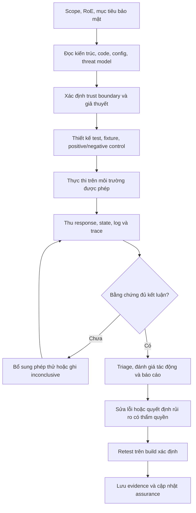

# White-box Penetration Testing: kiểm thử xâm nhập khi có thông tin nội bộ

## 1. Tổng quan và mục tiêu

**White-box penetration testing** (kiểm thử xâm nhập hộp trắng) là phương pháp kiểm thử mà người thực hiện được cung cấp thông tin nội bộ phù hợp với phạm vi được ủy quyền: mã nguồn, thiết kế kiến trúc, cấu hình, luồng dữ liệu, quy tắc phân quyền, tài khoản thử nghiệm và đôi khi cả log hoặc môi trường kiểm thử có khả năng quan sát phía máy chủ.

Thông tin nội bộ được dùng để hình thành **giả thuyết về cách một kiểm soát bảo mật có thể bị vượt qua**, xác định nơi kiểm thử và kiểm chứng giả thuyết bằng hành vi thực tế. Đọc thấy một đoạn mã đáng ngờ chưa đủ để kết luận có lỗ hổng khai thác được: người kiểm thử còn phải đối chiếu phiên bản triển khai, các kiểm soát ở lớp khác, điều kiện thực thi và bằng chứng quan sát.

Trong chương **Penetration testing** của module **SECURITY_SECURITY_ASSURANCE**, cách tiếp cận này hỗ trợ mục tiêu đánh giá có bằng chứng rằng hệ thống đáp ứng các mục tiêu bảo mật, từ phân tích rủi ro, yêu cầu và security controls đến kiểm thử, audit, khắc phục và xác minh lại. Kết quả phải có thể truy vết từ **yêu cầu → phép thử → bằng chứng → kết luận → biện pháp khắc phục → retest**.

Sau bài học, người học có thể:

1. Giải thích white-box khác gray-box và black-box ở mức thông tin và các giới hạn kết luận.
2. Xác định scope, rules of engagement (RoE) và điều kiện chuẩn bị trước khi kiểm thử.
3. Dùng code, kiến trúc, threat model và cấu hình để thiết kế phép thử có mục tiêu.
4. Xác minh một vấn đề phân quyền bằng các tài khoản, dữ liệu và phép thử đối chứng.
5. Ghi phát hiện có nguồn gốc, tác động, bằng chứng tái lập và bước retest.
6. Biết khi nào kết quả là true positive, false positive hoặc chưa đủ dữ liệu.

## 2. So sánh black-box, gray-box và white-box

Ba cách tiếp cận chủ yếu khác nhau ở **độ sâu thông tin được phép sử dụng**, không phải một cách luôn tốt hơn hai cách còn lại.

| Tiêu chí | Black-box | Gray-box | White-box |
|---|---|---|---|
| Thông tin tester biết | Ít hoặc không có thông tin nội bộ | Một phần, chẳng hạn tài khoản test hoặc API spec | Mã nguồn, thiết kế, cấu hình, luồng nghiệp vụ và log theo scope |
| Cách tiếp cận | Khám phá từ giao diện/điểm vào được phép | Kết hợp truy cập thử với một phần hiểu biết hệ thống | Xây giả thuyết từ nội bộ rồi xác minh bằng chạy thử |
| Điểm mạnh | Quan sát rõ bề mặt tiếp xúc từ bên ngoài | Hiệu quả cho phân quyền theo role và API | Khám phá đường đi ẩn, nhánh đặc biệt, nguyên nhân và kiểm soát |
| Giới hạn | Có thể không tìm được chức năng sâu | Thiếu code hoặc điều kiện triển khai | Dễ thiên lệch do tin vào thiết kế; code có thể khác bản chạy |
| Ví dụ | Kiểm tra endpoint công khai | Người dùng A thử truy cập dữ liệu B | Đọc service/repository, tìm nhánh thiếu authorization rồi thử A/B |

**White-box không đồng nghĩa với SAST.** SAST phân tích mã mà không cần ứng dụng chạy. Pentest hộp trắng có thể dùng SAST và code review để định hướng, nhưng vẫn phải kiểm tra điều kiện khai thác hoặc hành vi kiểm soát trên hệ thống được phép. Ngược lại, kết quả từ một bài pentest staging không tự động chứng minh trạng thái production nếu hai môi trường khác biệt.

## 3. Những thông tin và quyền truy cập cần thiết

Chủ hệ thống nên cấp **đủ điều kiện để kiểm chứng**, thay vì mặc định trao toàn bộ quyền admin hoặc bí mật sản xuất.

| Nguồn thông tin | Mục đích | Điểm cần lưu ý |
|---|---|---|
| Mã nguồn và dependency | Lần theo entry point, source, sink và control | Chốt commit, nhánh và phạm vi repo |
| Architecture diagram / data flow diagram | Hiểu thành phần và trust boundary | Đối chiếu với hệ thống triển khai thực tế |
| Threat model, risk register và security requirements | Xác định tài sản, rủi ro và expected behavior | Làm rõ yêu cầu mơ hồ trước khi test |
| API specification / route inventory | Xây coverage endpoint, method và trạng thái | Tài liệu có thể thiếu route mới |
| Tài khoản theo role và tenant | Tạo positive/negative control cho quyền | Dùng tài khoản thử với dữ liệu giả |
| Cấu hình bảo mật và deployment | Kiểm tra policy, middleware, gateway, WAF, TLS | Không phát tán secret, token, private key |
| Log, trace và metrics có giới hạn | Đối chiếu nhánh thực thi và nguyên nhân response | Bảo vệ PII; dùng correlation ID |
| Staging/lab được phép | Kiểm tra runtime và tình huống nghiệp vụ | Ghi khác biệt so với production |

Ví dụ, khi đánh giá lỗi phân quyền theo đối tượng, bộ thông tin hữu ích có thể chỉ gồm code, role A/B, fixture thuộc sở hữu rõ ràng, bản build và log theo request ID. Có tài khoản admin thật nhưng không có dữ liệu đối chứng thường **không** làm kết quả đáng tin hơn.

### Phân biệt white-box và insider threat

Một tester biết thiết kế nội bộ **không nhất thiết** có quyền hệ thống của nhân viên. Trong mô hình rủi ro, nên xác định rõ người tấn công giả định có khả năng biết gì, có tài khoản gì và điểm vào nào. Nếu đánh giá một actor bên ngoài, không được mặc định actor đó có credential nội bộ chỉ vì tester được cấp credential để hiểu luồng kiểm soát.

## 4. Phạm vi, ủy quyền và rules of engagement

Mọi hoạt động phải thuộc phạm vi đã được chủ hệ thống ủy quyền. Có quyền đọc mã nguồn không đồng nghĩa với quyền kiểm thử bất kỳ host, tài khoản, tenant hay dịch vụ tích hợp nào.

Một bản **RoE** nên có:

1. **Tài sản trong scope:** service, host, API, repository, môi trường, bản build và tenant.
2. **Mục đích kiểm tra:** security requirements, threat scenarios, dữ liệu và luồng ưu tiên.
3. **Hành vi được phép:** mức quét tự động, account switching, kiểm tra input và quyền, dữ liệu thử, log.
4. **Hành vi bị giới hạn:** phá hoại dữ liệu, tạo tải gây gián đoạn, truy cập thông tin khách hàng thật, thử với đối tác thứ ba, di chuyển ra ngoài scope.
5. **Điều kiện an toàn:** cửa sổ chạy, giới hạn lưu lượng, cách khôi phục trạng thái, tiêu chí dừng.
6. **Đầu mối xử lý:** chủ hệ thống, AppSec, người vận hành, kênh báo cáo phát hiện nghiêm trọng.
7. **Bảo quản kết quả:** nơi lưu artifact, quyền truy cập, yêu cầu che dữ liệu và thời hạn lưu.
8. **Tiêu chí bàn giao:** báo cáo, bằng chứng, người phê duyệt, retest và giới hạn kết luận.

Ưu tiên **môi trường staging cô lập** có cấu hình bảo mật tương đương phần cần kiểm tra, tài khoản/fixture giả lập và hành động có thể hoàn tác. Khi buộc phải quan sát sản xuất, phạm vi, tính năng được phép và mức tác động phải được xác định riêng.

Không dùng mã nguồn hoặc cấu hình đọc được để tự suy diễn quyền sử dụng token sản xuất. Mọi credential hỗ trợ kiểm thử nên theo nguyên tắc đặc quyền tối thiểu, có thời hạn và audit được.

## 5. Quy trình white-box: từ giả thuyết đến bằng chứng

Một quy trình có cấu trúc giúp tránh biến white-box thành hoạt động đọc code rời rạc hoặc chạy scanner thiếu định hướng.



### Bước 1: chọn kiểm soát và tài sản cần bảo vệ

Khởi đầu từ rủi ro có ý nghĩa với dịch vụ. Ví dụ “khách hàng không được xem đơn hàng của khách hàng khác” cụ thể hơn mục tiêu chung “kiểm soát truy cập an toàn”. Chuyển mục tiêu đó thành **security assertion** có thể kiểm tra: “User B không nhận được nội dung đơn hàng thuộc User A khi gọi bất kỳ route đọc đơn được liệt kê trong scope”.

Thực hiện ánh xạ:

| Rủi ro | Security control / expected behavior | Phép thử đề xuất |
|---|---|---|
| Lộ dữ liệu giữa tenant | Mỗi truy vấn dữ liệu phải giới hạn theo quyền và tenant | Người dùng tenant B truy cập object của A |
| Truy vấn SQL bị thay đổi bởi input | Giá trị input được bind bằng tham số | Lần theo input đến DB sink; thử trên fixture và log phù hợp |
| Truy cập chức năng quản trị sai quyền | Chức năng nhạy cảm kiểm tra role phía server | User thường gọi API admin được liệt kê |
| Thao tác sai trạng thái nghiệp vụ | Domain invariant được thực thi tại service | Thử chuyển trạng thái trên dữ liệu test |
| Thông tin nhạy cảm trong log | Secret và PII không bị log trái policy | Quan sát log với dữ liệu thử và trường nhạy cảm |

### Bước 2: đọc luồng xử lý trong code

Theo từng luồng quan trọng, lần từ **entry point** qua các lớp kiểm soát tới **side effect**:

```text
HTTP route / message consumer
    ↓
Input do client/đối tác cung cấp
    ↓
Authentication context và tenant/role
    ↓
Authorization / validation / domain policy
    ↓
Service → repository → database / external service
    ↓
Response, event, file hoặc trạng thái giao dịch
```

Đánh dấu các điểm:

- **Source:** input từ query/path/body/header, claim/token, message, tên file và URL.
- **Trust boundary:** chuyển từ input người dùng đến thao tác nhạy cảm, giữa tenant hoặc giữa service với service.
- **Control:** authentication, authorization, validation, parameterization, output encoding, giới hạn tài nguyên và kiểm tra transaction.
- **Sink/side effect:** truy vấn DB, sửa trạng thái, truy cập file, outbound request, gửi notification hoặc ghi log.
- **Nhánh khác biệt:** fallback, error handler, asynchronous flow, endpoint cũ, feature flag, trường hợp thiếu dữ liệu.

Một đoạn `findById(id)` không gắn owner có thể gây nghi vấn về BOLA/IDOR, nhưng phải tiếp tục tìm xem policy đã được thực thi ở middleware, controller, service, repository hoặc database chưa. Sau đó thiết kế phép thử để **xác minh hành vi thật**, thay vì gắn nhãn lỗi ngay từ một dòng mã.

### Bước 3: thiết kế ma trận actor × resource × operation × state

| Actor | Resource | Operation | Expected |
|---|---|---|---|
| User A | Đơn A sở hữu | Read | Được phép |
| User B | Đơn A sở hữu | Read | Không nhận dữ liệu |
| User B | Đơn A sở hữu | Update | Không có side effect |
| Guest | Đơn A sở hữu | Read | Bị từ chối |
| Support hợp lệ | Đơn A sở hữu | Read | Theo policy và có audit |
| User A | Đơn đã khóa | Update | Bị chặn bởi trạng thái |

Thông tin nội bộ giúp chọn đúng tổ hợp có rủi ro. Nhưng bằng chứng chỉ có giá trị khi tester kiểm tra role, phiên đăng nhập, ownership, dữ liệu thử và trạng thái trước/sau, tránh nhầm response do mock hoặc session hết hạn.

### Bước 4: chạy, quan sát và đối chiếu

Chạy phép thử ở mức được phép, ghi **expected vs actual**, không chỉ status HTTP. Khi có thể, gắn correlation ID không chứa bí mật vào request và đối chiếu với log xử lý. Với hệ thống bất đồng bộ, cần theo dõi trạng thái cuối của worker/queue; HTTP 202 chỉ cho biết request được chấp nhận để xử lý, chưa chứng minh tác vụ đã diễn ra.

### Bước 5: triage và xác minh sau sửa

Phân loại rõ **true positive, false positive, inconclusive**. Nếu có rủi ro thật được chấp nhận, phải ghi quyết định phê duyệt riêng. Sau khi sửa, retest trên build mới và kiểm tra cả đường thành công hợp lệ để tránh sửa lỗi bằng cách làm hỏng chức năng.

## 6. Những nhóm kiểm thử thường ưu tiên

| Nhóm | Mã nguồn/ngữ cảnh giúp gì? | Bằng chứng cần xem |
|---|---|---|
| Authentication và session | Tìm nơi tạo, kiểm tra, refresh, hủy token | Token sai/hết hạn bị từ chối, session xử lý đúng |
| Authorization / BOLA / IDOR | Xác định object ID, owner, tenant, chỗ kiểm tra quyền | User không có quyền không đọc/sửa được object |
| Injection | Lần theo input đến query/template/command sink | Kiểm chứng parameterization, input và behavior có đối chứng |
| XSS / output encoding | Theo dữ liệu đến HTML/JS/DOM sink | Ngữ cảnh render, DOM runtime và điều kiện thực thi |
| SSRF / outbound request | Xác định URL đầu vào, allowlist, proxy policy | Canaries và endpoint chỉ trong hạ tầng thử nghiệm được phép |
| File upload và path | Xem canonicalization, lưu trữ, quyền truy cập | File thử được cô lập, không có truy cập sai phạm vi |
| Business logic | Xác định trạng thái, invariants, idempotency | Thử hành vi trên dữ liệu giả, xác minh trạng thái cuối |
| Config và secrets | Xem security headers, policy, quyền service account | Đối chiếu bản cấu hình thật ở đường truy cập được phép |
| Async tasks | Truy theo queue, callback và retry | Correlation ID, log và trạng thái xử lý cuối |

Công cụ có thể hỗ trợ đọc mã, tìm pattern và thu trace, nhưng kết luận pentest vẫn cần lập luận kỹ thuật gắn với bối cảnh và bằng chứng. Một scanner trả “0 findings” khi không vào được authenticated flow không thể chứng minh kiểm soát đã đạt.

## 7. Ví dụ Java/Spring: kiểm tra BOLA có hiểu biết về mã nguồn

### 7.1. Bối cảnh và giả thuyết

Trong môi trường staging đã được cho phép, có hai tài khoản:

- `ACCOUNT_A` sở hữu đơn `ORDER_731`.
- `ACCOUNT_B` không sở hữu đơn đó và không có quyền support/admin.
- Security requirement `SEC-AUTHZ-07`: người dùng thường chỉ được đọc đơn hàng của mình.
- API cần kiểm tra: `GET /api/orders/{id}`.

Tester được cung cấp đoạn code giản lược:

```java
@RestController
@RequestMapping("/api/orders")
class OrderController {
    private final OrderRepository orderRepository;

    OrderController(OrderRepository orderRepository) {
        this.orderRepository = orderRepository;
    }

    @GetMapping("/{id}")
    OrderDto get(@PathVariable Long id) {
        Order order = orderRepository.findById(id)
            .orElseThrow(() ->
                new ResponseStatusException(HttpStatus.NOT_FOUND));
        return OrderDto.from(order);
    }
}
```

Đây là **mã minh họa lược bỏ import và cấu hình**. Hàm tìm theo ID mà snippet không cho thấy kiểm tra owner. Giả thuyết: nếu các lớp khác không áp dụng policy, B có thể đọc object của A. Tester cần kiểm tra cả security filter, method-level authorization, service policy và query logic trước khi chọn phép thử.

### 7.2. Positive control: chủ sở hữu truy cập

```http
GET /api/orders/731 HTTP/1.1
Host: staging.example.test
Authorization: Bearer [ACCOUNT_A_TOKEN_REDACTED]
X-Request-ID: wb-authz-a-01
```

Response minh họa:

```http
HTTP/1.1 200 OK
Content-Type: application/json
X-Request-ID: wb-authz-a-01

{"id":731,"owner":"ACCOUNT_A","total":125000}
```

Kết quả giúp xác nhận route, session và fixture A đang hoạt động; nếu A cũng không truy cập được, việc B bị từ chối chưa chứng minh được authorization theo owner.

### 7.3. Negative control: tài khoản khác truy cập

Giữ nguyên resource ID, route và method; thay bằng token hợp lệ của B:

```http
GET /api/orders/731 HTTP/1.1
Host: staging.example.test
Authorization: Bearer [ACCOUNT_B_TOKEN_REDACTED]
X-Request-ID: wb-authz-b-01
```

Giả sử response:

```http
HTTP/1.1 200 OK
Content-Type: application/json
X-Request-ID: wb-authz-b-01

{"id":731,"owner":"ACCOUNT_A","total":125000}
```

Nếu xác minh được B là người dùng không có quyền, đơn thuộc A, response là dữ liệu thực từ endpoint và không có policy ngoại lệ hợp lệ, đây là **true positive cho lỗi đọc object ngoài quyền**. Kiểm tra thêm log với request ID để xác định service thực sự xử lý request, tránh nhầm response được cache hoặc mock cứng.

**Không kết luận từ HTTP 200 một mình:** body có thể rỗng, chứa thông báo lỗi hoặc trang đăng nhập. Cũng không kết luận an toàn chỉ vì HTTP 403 nếu response phát sinh từ WAF, endpoint sai hoặc phiên đã hết hạn.

### 7.4. Truy nguyên nhân và hướng khắc phục

Trong ví dụ, giả sử xác nhận không có authorization tại các lớp khác. Điểm nguyên nhân có thể là truy vấn chỉ theo ID, thiếu ràng buộc với principal/owner. Một cách sửa:

```java
interface OrderRepository extends JpaRepository<Order, Long> {
    Optional<Order> findByIdAndOwnerId(Long id, Long ownerId);
}

@Service
class OrderService {
    private final OrderRepository orders;

    OrderService(OrderRepository orders) {
        this.orders = orders;
    }

    OrderDto getForOwner(Long orderId, Long authenticatedOwnerId) {
        Order order = orders.findByIdAndOwnerId(
                orderId, authenticatedOwnerId)
            .orElseThrow(() ->
                new ResponseStatusException(HttpStatus.NOT_FOUND));
        return OrderDto.from(order);
    }
}
```

Tham số `authenticatedOwnerId` **phải được ánh xạ từ principal đã xác thực ở phía server**, không được tin vào ID do client truyền trong path, query hoặc body. Với hệ thống multi-tenant, có vai trò support hoặc delegated access, policy cần đánh giá cả tenant, operation và điều kiện nghiệp vụ. Có thể trả 403 hay 404 tùy API contract miễn không tiết lộ dữ liệu ngoài quyền.

### 7.5. Retest sau sửa

| Test | Kỳ vọng sau sửa | Mục đích |
|---|---|---|
| A đọc ORDER_731 | Thành công, đúng dữ liệu A | Không phá chức năng hợp lệ |
| B đọc ORDER_731 | Bị từ chối, không lộ nội dung | Xác nhận kiểm soát theo owner |
| Guest đọc ORDER_731 | Bị từ chối | Kiểm soát xác thực |
| B cập nhật đơn A, nếu route thuộc scope | Không có thay đổi trạng thái | Kiểm tra side effect |
| A đọc đơn khác của mình | Thành công đúng policy | Phát hiện regression |

Gắn finding ban đầu với ticket/PR, commit sửa, build retest, request/response mới và log. Chỉ kết luận “đã khắc phục ở các route, role, điều kiện đã thử trên build X”, tránh suy rộng cho mọi API authorization.

## 8. Ví dụ ngắn: nhận diện SQL injection từ source đến runtime

Một ưu thế của white-box là tester biết input đi qua đâu trước khi đến thao tác nhạy cảm. Giả sử đọc code Java:

```java
String sql = "SELECT id FROM users WHERE email = '" + email + "'";
return jdbcTemplate.queryForList(sql, Long.class);
```

Nếu `email` đi từ HTTP request, cách nối chuỗi tạo giả thuyết **SQL injection**. Tester cần kiểm tra có validation, query wrapper hoặc điều kiện build nào ảnh hưởng đến đường thực thi; sau đó kiểm tra ứng dụng bằng dữ liệu thử vô hại, đối chứng phù hợp và log/query trace khi được phép. Không cần dùng thao tác xóa hoặc thay đổi dữ liệu sản xuất để xác minh.

Một hướng sửa là parameterized query:

```java
return jdbcTemplate.queryForList(
    "SELECT id FROM users WHERE email = ?",
    Long.class,
    email
);
```

Tham số hóa tách **giá trị** khỏi **cú pháp truy vấn**. Với SQL động liên quan tên bảng, tên cột hoặc `ORDER BY`, tham số bind giá trị không giải quyết việc chọn identifier; cần allowlist do server quản lý. Sau khi sửa, chạy lại test trên build mới và xác minh luồng hợp lệ vẫn trả kết quả đúng.

**Điều cần học:** source code giúp phát hiện nguyên nhân tiềm năng và đề xuất sửa đúng chỗ; kết quả runtime, build, đối chứng và log giúp khẳng định liệu lỗ hổng tồn tại và bản sửa đã có tác dụng chưa.

## 9. Phân loại phát hiện và đánh giá rủi ro

White-box làm lộ ra nhiều nhánh code có vẻ nguy hiểm hơn cách thử từ giao diện. Không nên tự động biến mọi đoạn code đáng ngờ thành finding đã xác nhận.

| Phân loại | Khi áp dụng | Cần làm tiếp |
|---|---|---|
| **True positive** | Điều kiện lỗ hổng được kiểm chứng | Đánh giá tác động, ghi ticket, khắc phục và retest |
| **False positive** | Bằng chứng cho thấy giả thuyết cảnh báo không đúng trong scope | Lưu lý do, review, loại trừ hẹp nếu cần |
| **Inconclusive** | Thiếu phiên test, log, điều kiện tái lập hoặc kết quả mâu thuẫn | Bổ sung kiểm thử; không ép thành TP hay FP |
| **Not applicable** | Control/test không áp dụng cho tài sản/build đã xác định | Ghi chính sách và phạm vi |
| **Accepted risk** | Rủi ro có thật được người có thẩm quyền chấp thuận theo quy trình | Giữ kết luận kỹ thuật, lưu biện pháp bù trừ và thời hạn review |
| **Verified fixed** | Có bản sửa và kiểm thử lại đạt trên build cụ thể | Lưu evidence before/after và regression coverage |

**Severity khác confidence:** một phát hiện có thể có tác động tiềm tàng lớn nhưng bằng chứng còn yếu. Ngược lại, một vấn đề nhỏ có thể được xác minh chắc chắn. Mức ưu tiên khắc phục phụ thuộc mức độ ảnh hưởng đến dữ liệu/hoạt động, khả năng khai thác trong threat model, quyền cần có, blast radius và các kiểm soát giảm thiểu.

Các giả định cần nói rõ. Ví dụ, nếu user B phải có một vai trò phụ đặc biệt mới gặp được lỗi, điều kiện đó ảnh hưởng cách đánh giá rủi ro. Việc chỉ thấy một method authorization tồn tại trong code không đủ để tuyên bố bảo vệ đã được thực thi trên mọi route.

### Những trường hợp phải giữ trạng thái chưa kết luận

- Chỉ đọc source mà chưa xác định code đó có nằm trong build hiện hành.
- Endpoint yêu cầu trạng thái nghiệp vụ chưa tạo được trong dữ liệu thử.
- Request bị WAF hoặc rate limit chặn nên chưa đi tới backend cần đánh giá.
- Không có hai tài khoản/tenant độc lập để kiểm tra truy cập theo đối tượng.
- Scanner không đăng nhập thành công, crawl lỗi, log không đủ hoặc response có nội dung bất định.
- Một lần thử thất bại nhưng các tín hiệu code, config và runtime chưa được giải thích thống nhất.

Không nên kết luận “hệ thống an toàn” từ kết quả bất thành của cuộc thử nghiệm. Hãy ghi điều kiện thiếu, scope chưa được kiểm tra và bước cần làm để có bằng chứng.

## 10. Viết báo cáo white-box pentest có thể kiểm tra lại

Báo cáo phải có giá trị đối với developer, product owner, AppSec và auditor. Người chưa tham gia test vẫn phải hiểu **lỗi nằm ở đâu, vì sao là vấn đề, cách tái lập và điều gì chứng minh bản sửa hiệu quả**.

### 10.1. Thông tin tối thiểu cho mỗi finding

| Trường | Câu hỏi cần trả lời |
|---|---|
| ID, tiêu đề và loại lỗ hổng | Phát hiện nào, thuộc security control nào? |
| Tài sản, scope và build | Service, endpoint, môi trường, phiên bản code/config nào? |
| Giả thuyết và code context | File, hàm, luồng dữ liệu, trust boundary có liên quan |
| Preconditions | Tài khoản, role, fixture ownership, feature flag, trạng thái |
| Bước kiểm thử | Request/response, dữ liệu test, positive và negative control |
| Expected vs actual | Đâu là hành vi chính sách yêu cầu và điều gì đã xảy ra? |
| Bằng chứng độc lập | Log, correlation ID, trace, screenshot/DOM khi có ích |
| Tác động và giới hạn | Tài sản bị ảnh hưởng, quyền cần có, điều chưa xác minh |
| Phân loại và quyết định | TP/FP/inconclusive, severity, owner, reviewer, phê duyệt ngoại lệ |
| Remediation và retest | Ticket/PR/commit, build mới, kết quả trước/sau |

### 10.2. Ví dụ bản ghi phát hiện

```yaml
finding_id: PT-WB-AUTHZ-005
title: "Tài khoản khác đọc được đơn hàng ngoài quyền"
test_type: white-box-penetration-testing
control: SEC-AUTHZ-07
scope:
  service: order-api
  environment: staging
  build: commit-example-abc123
  endpoint: "GET /api/orders/731"
  requester: ACCOUNT_B
  resource_owner: ACCOUNT_A
code_context:
  file: src/main/java/example/OrderController.java
  method: get
  observation: "Repository lookup bằng ID chưa giới hạn theo owner"
expected: "B không nhận nội dung đơn 731"
observed: "B nhận nội dung đơn thuộc A từ API"
evidence:
  - redacted/owner-request-response.http
  - redacted/other-user-request-response.http
  - redacted/order-ownership-fixture.json
  - redacted/correlation-logs.txt
triage:
  classification: true_positive
  severity: "đánh giá theo chính sách tổ chức"
  reviewer: "AppSec reviewer"
tracking:
  ticket: SEC-EXAMPLE-205
  retest_build: pending
```

Mẫu trên hoàn toàn **hư cấu**. Giá trị report thực tế phải xuất phát từ cuộc kiểm thử, không điền sẵn status TP, mức severity hoặc log để hoàn chỉnh hình thức.

### 10.3. Truy vết bằng chứng

Một chuỗi truy vết mẫu:

```text
Risk: lộ dữ liệu giữa khách hàng
  → Requirement: SEC-AUTHZ-07
  → Test case: ACCOUNT_A / ACCOUNT_B truy cập ORDER_731
  → White-box hypothesis: truy vấn thiếu điều kiện owner
  → Observation: request, response, fixture, logs
  → Finding: PT-WB-AUTHZ-005
  → Fix ticket / PR / commit
  → Retest: build mới, A được phép và B bị từ chối
  → Assurance decision: resolved trong phạm vi được test
```

Bằng chứng chỉ nên được chia sẻ sau khi che session cookie, access token, secret, PII và dữ liệu nhạy cảm. Có thể lưu bản gốc tại kho có quyền hạn phù hợp theo chính sách, và cung cấp bản đã khử nhạy cảm cho reviewer. Khi che ID, phải giữ quan hệ actor/resource bằng nhãn nhất quán như `ACCOUNT_A`, `ACCOUNT_B` và `ORDER_731`.

Một screenshot hoặc cảnh báo scanner đơn lẻ ít giá trị hơn tập bằng chứng có request, vai trò, build, trạng thái dữ liệu và actual result. Nếu dùng checksum/hash, lưu giá trị tham chiếu tại nơi được bảo vệ khỏi sửa đổi để phát hiện thay đổi artifact; hash tự thân không chứng minh ai đã tạo bằng chứng.

## 11. Từ white-box pentest sang kiểm soát trong CI/CD

Kết quả pentest nên được chuyển thành bài học và regression test để ngăn lỗi tái phát. Có thể thực hiện theo chuỗi:

1. **Tạo finding:** có risk/control ID, code context và testcase tái lập.
2. **Giao ownership:** xác định người sửa, người đánh giá security và chính sách ưu tiên.
3. **Sửa nguyên nhân:** trong ví dụ BOLA, đặt authorization ở server/service/query và bảo đảm policy bao phủ mọi đường.
4. **Tạo test tự động:** positive/negative control cho các role và trạng thái đã xác định.
5. **Chạy trong CI:** build, test, SAST, dependency checks và những job dynamic phù hợp với tài nguyên.
6. **Retest độc lập:** xác minh testcase ban đầu trên build mới; kiểm tra hiệu ứng và trường hợp hoạt động bình thường.
7. **Theo dõi giới hạn:** ghi những route/role chưa bao phủ, ngoại lệ hợp lệ và thời điểm rà soát lại.

Ví dụ một kiểm tra phân quyền tự động ở mức tích hợp có thể dựng hai principal test, fixture một đơn thuộc A, sau đó assert rằng B không nhận dữ liệu A. Framework và cách tạo principal tùy dự án; điều quan trọng là **server xác định quyền từ danh tính được xác thực** và test so sánh hành vi của nhiều actor.

White-box pentest không thay thế code review, SAST, SCA, DAST hoặc kiểm tra cấu hình. Các hoạt động này kiểm tra những lớp và tình huống khác nhau; nhóm assurance nên kết hợp chúng quanh cùng yêu cầu và rủi ro.

## 12. Đo chất lượng chương trình kiểm thử

Đếm số lỗ hổng được tìm ra là chưa đủ để đánh giá chất lượng. Nên theo dõi cả **độ bao phủ, tính đáng tin của bằng chứng và mức độ khắc phục**.

| Chỉ số | Cách đo | Lưu ý |
|---|---|---|
| Coverage theo control | Số security requirements ưu tiên đã có test và evidence / tổng số trong scope | Nêu scope và control chưa test |
| Coverage theo role/tenant/state | Các tổ hợp được chạy / các tổ hợp rủi ro đã thống nhất | Không chỉ đếm URL |
| Findings có bằng chứng | Tỷ lệ finding có code context, điều kiện, request/response, triage | Không biến alert thô thành finding đã xác nhận |
| Thời gian đến retest thành công | Từ xác nhận TP tới khi test lại pass | Tách severity và các lý do bị chặn |
| Tỷ lệ reopen | Finding đã đóng nhưng phát hiện lại do sửa thiếu | Phân biệt code regress với khác biệt môi trường |
| Ngoại lệ có trách nhiệm | FP và accepted risk có owner, lý do, thời hạn review | Tránh suppression không giới hạn |
| Kết quả không xác minh được | Số inconclusive do thiếu fixture, session, log, môi trường | Không ép thành TP hoặc FP cho đẹp dashboard |

Ví dụ, nhóm báo “12/15 yêu cầu bảo mật quan trọng đã có bằng chứng kiểm thử trên staging build X, còn ba yêu cầu chưa xác minh vì thiếu role hoặc luồng bất đồng bộ” giúp reviewer hiểu **phần còn thiếu** rõ hơn con số “đã chạy 500 request”.

## 13. Cách phối hợp với Security Assurance và audit

Một white-box pentest chất lượng cao trả lời được các câu hỏi:

- Security requirement nào được kiểm thử? Kết quả quan sát có tương thích với expected behavior không?
- Giả thuyết đến từ phần nào của code/kiến trúc; đã xác minh rằng code đó nằm trên bản deploy chưa?
- Có thông tin đủ để người khác tái lập test, gồm actor, quyền, fixture và trạng thái?
- Có rủi ro nào đang được chấp nhận? Ai phê duyệt và trong điều kiện/thời hạn nào?
- Bản sửa nào đã được triển khai và retest trên build nào?
- Những phần chưa test là gì, và chúng ảnh hưởng kết luận tổng thể ra sao?

Kết luận của một test đơn lẻ chỉ áp dụng cho **tài sản + endpoint/flow + actor + build + môi trường + trạng thái** đã xác minh. Để đưa ra quyết định assurance ở phạm vi hệ thống, phải tổng hợp nhiều test, kiểm soát và hoạt động khác như threat modeling, SAST, SCA, DAST, kiểm thử thủ công, audit cấu hình và quản lý rủi ro.

**Ví dụ cách diễn đạt đúng:** “Vấn đề truy cập đơn hàng ngoài quyền đã được khắc phục trên staging build def456 tại endpoint và vai trò đã kiểm tra; vẫn cần kiểm thử các thao tác cập nhật/xóa và tenant khác trước khi kết luận về toàn bộ phân quyền đơn hàng.”

### Khi nào nên làm white-box pentest?

Ưu tiên tại các thời điểm có thay đổi hoặc rủi ro đáng kể: thiết kế hệ thống mới, thay đổi trust boundary, thêm role/tenant, tích hợp đối tác, thay đổi xác thực/phân quyền, triển khai xử lý dữ liệu nhạy cảm, sau incident, trước mốc phát hành quan trọng hoặc sau finding nghiêm trọng. Lịch pentest định kỳ nên được xác định bởi risk-based policy; khi có bản sửa, retest cần theo đúng phạm vi phát hiện và phần liên quan.

## 14. Bài thực hành

**Bối cảnh:** bạn thuộc nhóm AppSec kiểm thử dịch vụ Java/Spring ở staging. Bạn được cấp source code, tài khoản A/B có role thường, fixture đơn hàng, bản build và quyền xem log đã che dữ liệu.

### Nhiệm vụ

1. Viết security requirement về phân quyền đối với đơn hàng và xác định tài sản, threat actor, trust boundary.
2. Đọc đường đi controller → service → repository; tìm điểm code có thể thiếu authorization.
3. Thiết kế giả thuyết, positive control, negative control và các điều kiện cần.
4. Xác minh tài khoản, ownership và build; thực hiện test với dữ liệu giả lập trong RoE.
5. Ghi HTTP response, body, correlation ID, code context, expected/actual và scope.
6. Phân loại finding là TP, FP hoặc inconclusive; viết lý do gắn với bằng chứng.
7. Đề xuất bản sửa ở server, kiểm tra không tin owner ID từ client.
8. Thiết kế retest gồm trường hợp A được phép, B bị từ chối và không có side effect.
9. Tạo traceability từ requirement đến ticket, PR/commit và retest.

### Worksheet nộp bài

```markdown
Security requirement / control:
Asset / threat model:
Authorized scope / RoE:
Source commit / deployed build:
Actor roles / resource ownership:
Entry point and trust boundary:
Source code observation:
Hypothesis and preconditions:
Expected behavior:
Positive control:
Negative control:
Observed behavior and evidence references:
Classification and rationale:
Risk severity assumptions:
Remediation proposal:
Retest criteria:
Untested routes / states / roles:
Reviewer:
```

**Tiêu chí hoàn thành:** lập luận phân biệt giả thuyết từ source code với kết luận sau kiểm thử; có đối chứng đúng role và ownership; bảo vệ dữ liệu/credential; chứng minh actual khác expected bằng bằng chứng có thể kiểm tra; đặt điều kiện retest và không suy rộng kết quả vượt scope.

## 15. Sai lầm thường gặp

| Sai lầm | Hệ quả | Cách tránh |
|---|---|---|
| Có code rồi tự cho phép quét mọi host | Sai ủy quyền và có thể gây sự cố | Chốt RoE theo tài sản, thời gian và hành vi |
| Đọc code rồi coi đó là pentest đã hoàn tất | Chưa xác minh runtime, exploitability và build | Chạy test an toàn có đối chứng khi được phép |
| Tin tuyệt đối vào thiết kế hoặc annotation | Bỏ sót cấu hình, route và chính sách chạy thật | Đối chiếu code với phiên bản deploy và trace |
| Chỉ test một tài khoản | Không đánh giá được quyền ngang giữa người dùng | Dùng ít nhất A/B và fixture ownership |
| Coi HTTP 200 là BOLA | Body có thể rỗng hoặc là trang lỗi | Xem body, principal, ownership và side effect |
| Coi HTTP 403 là hoàn toàn an toàn | Có thể WAF chặn hoặc request chưa tới route | Kiểm tra điều kiện và log nếu được phép |
| Bỏ qua route bất đồng bộ | HTTP success không nói được side effect cuối | Kiểm tra queue/event và trạng thái nghiệp vụ |
| Thử dữ liệu thật hoặc payload gây gián đoạn | Rủi ro mất dữ liệu và gián đoạn | Dùng lab/staging, fixture giả, giới hạn tải |
| Ghi credential thật vào ticket | Làm lộ bí mật và dữ liệu | Redact và lưu bằng chứng có phân quyền |
| Sửa code mà không retest | Không biết lỗi đã đóng và có regression không | Test lại trên build mới với positive/negative control |
| Công bố “không có lỗ hổng” khi thiếu coverage | Sai lệch quyết định assurance | Nêu rõ phạm vi đã test và phần chưa kiểm tra |

## 16. Tổng kết

**White-box penetration testing** dùng kiến thức về mã nguồn, kiến trúc, cấu hình, quyền và dữ liệu để tạo giả thuyết bảo mật có chủ đích, rồi **xác minh bằng hành vi thực tế** trong phạm vi được cấp phép. Ưu thế chính là tìm đúng đường đi rủi ro, hiểu vì sao kiểm soát thất bại và đề xuất khắc phục ở nguyên nhân.

Trong **Security Assurance**, giá trị của white-box nằm ở chuỗi **rủi ro → yêu cầu/control → giả thuyết → testcase → bằng chứng → quyết định → khắc phục → retest**. Mỗi kết luận phải gắn với actor, dữ liệu, build, môi trường và điều kiện đã kiểm tra, đồng thời công bố phần chưa xác minh. Nhờ đó kiểm thử hộp trắng trở thành nguồn bằng chứng đáng tin cho phát triển và vận hành an toàn liên tục.
