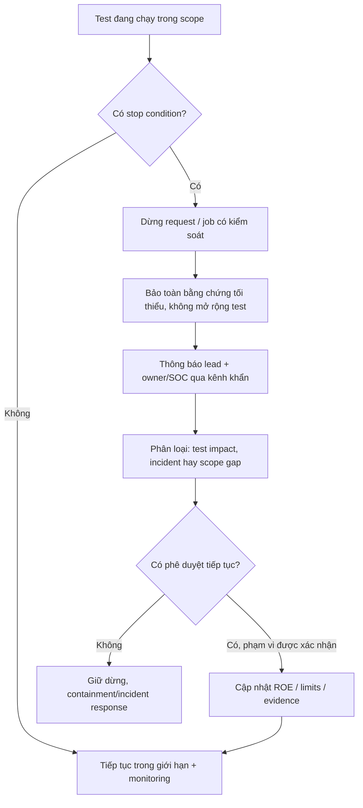
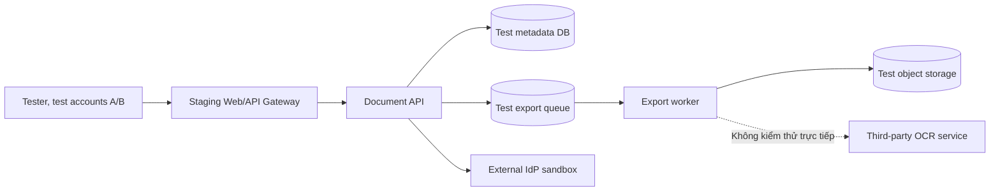
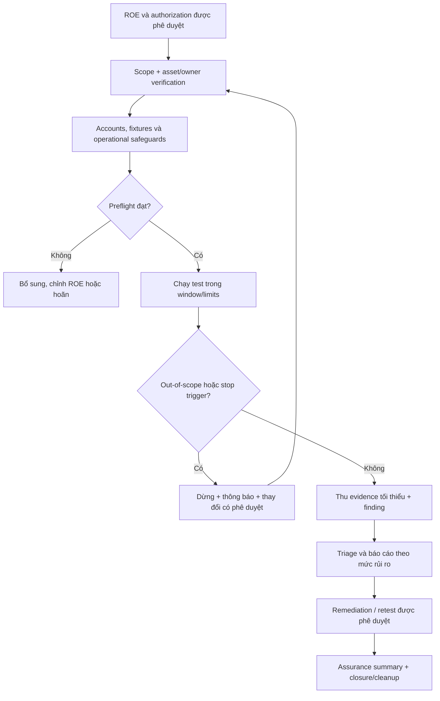
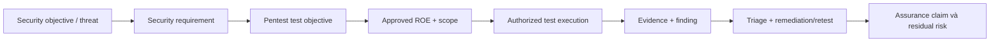

# Rules of engagement

Một doanh nghiệp vận hành dịch vụ SaaS quản lý tài liệu cho nhiều khách hàng, gồm API, worker xử lý export, object storage và hệ thống danh tính. Doanh nghiệp thuê một nhóm kiểm thử xâm nhập (*penetration testing*) để đánh giá khả năng truy cập trái quyền giữa các tenant. Nhóm kiểm thử nhận địa chỉ `app.example.test` và một tài khoản thử nghiệm, rồi phát hiện luồng xuất tài liệu có liên kết tới một dịch vụ lưu trữ bên ngoài. Nếu chỉ làm theo trực giác “đã được thuê thì cứ thử”, nhóm có thể vượt sang hạ tầng của nhà cung cấp chưa được phép kiểm thử, gửi lượng request ảnh hưởng khách hàng khác hoặc vô tình thu thập dữ liệu thật.

Trong tình huống đó, câu hỏi đầu tiên không phải “công cụ nào quét nhanh nhất?”, mà là: **Ai đã cho phép kiểm thử? Được tác động lên tài sản nào, trong khoảng thời gian nào, bằng kỹ thuật gì, với giới hạn nào? Nếu phát hiện dữ liệu thật hoặc gây ảnh hưởng dịch vụ thì phải làm gì?**

Những câu hỏi này được trả lời bằng **Rules of engagement (ROE)** — *bộ quy tắc tham gia và vận hành cho một cuộc kiểm thử bảo mật được ủy quyền*. ROE là sự thống nhất có thể kiểm chứng giữa bên sở hữu tài sản, bên tổ chức kiểm thử, đội kiểm thử, đội vận hành và các bên liên quan về **mục tiêu, phạm vi, quyền hạn, giới hạn tác động, thời gian, liên lạc, xử lý sự cố, dữ liệu và bằng chứng**.

Trong module **SECURITY_SECURITY_ASSURANCE**, ROE không chỉ là tài liệu hành chính. Nó là một **control bảo đảm tính hợp lệ và độ tin cậy của hoạt động đánh giá bảo mật**: phép kiểm thử phải được thực hiện trong phạm vi có quyền, có giới hạn rủi ro, có bằng chứng tái dựng được và có quy trình khắc phục phát hiện. Một kết quả pentest có giá trị cho security assurance khi người đánh giá giải thích được **cái gì đã kiểm tra, tại sao có quyền kiểm tra, bằng cách nào, kết quả ra sao và những gì chưa được phép hoặc chưa được kiểm chứng**.

## 1. ROE là gì và vì sao không thể thiếu?

ROE là bộ quy tắc đã thống nhất **trước khi** nhóm kiểm thử bắt đầu tương tác có tác động với hệ thống. ROE xác định các giới hạn an toàn và quyền quyết định để cả bên kiểm thử lẫn bên sở hữu tài sản không hiểu nhầm “đánh giá bảo mật” thành “được phép làm mọi thứ”.

Một ROE tốt trả lời tối thiểu:

1. Ai là **bên có thẩm quyền** cấp phép và ai là người được kiểm thử?
2. Những **tài sản, địa chỉ, API, ứng dụng, môi trường và tài khoản** nào thuộc phạm vi?
3. Những tài sản, bên thứ ba, dữ liệu hoặc kỹ thuật nào **không được đụng tới**?
4. Những **loại hoạt động** nào được phép: quan sát, khám phá, kiểm tra có kiểm soát, xác minh tác động?
5. Có những **giới hạn tải, mức độ can thiệp, thời gian và cửa sổ bảo trì** nào?
6. Sử dụng **test accounts, fixtures, token và dữ liệu thử** như thế nào?
7. Ai nhận cảnh báo, báo cáo tiến độ và thông tin phát hiện nghiêm trọng?
8. Khi có sự cố, dữ liệu nhạy cảm xuất hiện hoặc phạm vi mơ hồ, ai được quyền **dừng**?
9. Dữ liệu, request/response, ảnh chụp và log được **thu thập, bảo vệ, lưu giữ và xóa** thế nào?
10. Một finding được báo cáo, triage, khắc phục và **retest** ra sao?

ROE phải **cụ thể và thực thi được**. Câu “kiểm thử có đạo đức và tránh ảnh hưởng hệ thống” là định hướng tốt nhưng chưa đủ để xử lý khi scanner gây spike request, phát hiện một subdomain mới hoặc gặp tài liệu chứa thông tin khách hàng.

### 1.1. ROE bảo vệ cả hai bên và chính hệ thống

Đối với chủ sở hữu tài sản, ROE giảm rủi ro gián đoạn, lộ dữ liệu và tác động ngoài ý muốn. Đối với đội pentest, nó làm rõ phạm vi quyền hạn, cách báo cáo và kênh xin quyết định khi gặp trường hợp bất ngờ. Đối với security assurance, nó khiến bằng chứng **có bối cảnh và giới hạn kiểm tra được**.

ROE không thể bảo đảm một lần kiểm thử không gây lỗi hay sự cố. Nhưng nó buộc tổ chức phải **nhận diện trước, quản trị và phản ứng** đối với những nguy cơ có thể dự báo.

### 1.2. Những nguyên tắc nền tảng

- **Authorization first:** có quyền rõ ràng trước khi kiểm thử.
- **Scope is explicit:** chỉ kiểm thử tài sản và hành vi được cho phép.
- **Least impact:** xác minh đủ căn cứ với mức tác động thấp nhất phù hợp mục tiêu.
- **No silent expansion:** phát hiện tài sản hoặc đường tấn công mới không tự mở rộng quyền.
- **Stop and escalate:** dừng khi gặp rủi ro, sự cố hoặc giới hạn chưa rõ.
- **Data minimization:** không thu thập thêm dữ liệu nhạy cảm chỉ để chứng minh tác động.
- **Traceability:** giữ bằng chứng về quyết định, phương pháp, phạm vi và kết quả.
- **Accountability:** xác định người có thẩm quyền phê duyệt, thay đổi và chấp nhận rủi ro.

## 2. Phân biệt ROE với SOW, phạm vi và thư ủy quyền

Nhiều hợp đồng pentest có tài liệu liên quan nhưng không phải tài liệu nào cũng thay thế nhau.

| Tài liệu | Trả lời câu hỏi | Vai trò |
| --- | --- | --- |
| **Statement of Work (SOW)** | Công việc, đầu ra, thời hạn, nguồn lực, trách nhiệm và điều khoản thương mại là gì? | Quản lý cung cấp dịch vụ |
| **Written authorization / permission to test** | Bên nào có quyền cho phép, cho phép ai thực hiện loại kiểm thử nào trên tài sản nào? | Căn cứ ủy quyền rõ ràng |
| **Scope inventory** | Tài sản/đường dẫn/môi trường nào trong và ngoài phạm vi? | Giới hạn đối tượng kiểm thử |
| **Rules of engagement (ROE)** | Được tương tác như thế nào, giới hạn và xử lý tình huống ra sao? | Hướng dẫn vận hành và kiểm soát rủi ro |
| **Test plan / methodology** | Kiểm tra những risk scenarios và loại control nào, dùng kỹ thuật ở mức nào? | Chuyển mục tiêu thành công việc cụ thể |
| **NDA / data handling agreement** | Thông tin và dữ liệu thu được được bảo vệ, sử dụng và lưu giữ ra sao? | Quản trị bảo mật thông tin |
| **Finding report** | Phát hiện nào có căn cứ, tác động ra sao, sửa và kiểm chứng thế nào? | Kết quả đánh giá |
| **Assurance case** | Kết quả test hỗ trợ claim bảo mật nào, trong giới hạn nào? | Tập hợp lập luận và bằng chứng |

Các thông tin có thể được gộp trong một bộ tài liệu, nhưng **không được thiếu ý nghĩa của từng thành phần**. Một SOW nói “penetration test web application” chưa chắc cho phép thử hạ tầng cloud, brute force tài khoản, gửi phishing hoặc quét hệ thống của nhà cung cấp.

**Thẩm quyền cấp phép cần được xác minh**, không chỉ dựa vào việc một người có email công ty. Người liên hệ dự án không nhất thiết có quyền cho phép kiểm thử tất cả IP, tài sản liên doanh hoặc dịch vụ của vendor. Phạm vi liên quan luật, điều khoản hợp đồng hay cloud provider phải được kiểm tra theo bối cảnh thực tế; ROE không thay thế tư vấn pháp lý.

### 2.1. Không tự động suy quyền từ tên miền

Một tên miền có thể phân giải đến CDN, WAF, load balancer, SaaS managed service hoặc hạ tầng dùng chung với khách hàng khác. Quyền sở hữu domain không nhất thiết đồng nghĩa có quyền kiểm thử từng thành phần bên dưới.

Ví dụ:

- `app.example.test` được tổ chức vận hành, nhưng email login chuyển sang identity provider bên ngoài;
- một DNS record trỏ đến CDN thuộc nhà cung cấp;
- trang ứng dụng tải widget hoặc gửi webhook tới một dịch vụ thứ ba;
- các địa chỉ IP phía sau một dịch vụ đám mây có thể thay đổi;
- ứng dụng multi-tenant dùng cùng host nhưng dữ liệu các khách hàng khác là ngoài phạm vi.

Cách xử lý an toàn là **làm rõ quyền và giới hạn riêng cho từng lớp**, không mở rộng tự động khi gặp redirect hoặc liên kết mới.

## 3. ROE bắt đầu bằng mục tiêu và threat model

ROE không nên chỉ là danh sách URL và giờ quét. Nó cần liên hệ **mục tiêu đánh giá bảo mật** với mức độ tác động được cho phép.

### 3.1. Ví dụ mục tiêu

Giả sử dự án muốn kiểm tra các mục tiêu:

- `OBJ-AUTH-01`: người dùng chỉ truy cập dữ liệu được cấp quyền;
- `OBJ-DATA-02`: dữ liệu nhạy cảm không bị lộ qua API, log và output export;
- `OBJ-SESSION-03`: session/token được xử lý đúng theo chính sách;
- `OBJ-AVAIL-04`: kiểm tra bảo mật không làm gián đoạn dịch vụ trọng yếu;
- `OBJ-ASSURE-05`: findings và remediation có evidence gắn phiên bản và môi trường.

Từ đó, ROE có thể cho phép test các request trái quyền trên **hai test tenants** với dữ liệu giả, nhưng không cho phép đọc nội dung tài liệu của khách hàng khác hoặc stress test làm cạn tài nguyên.

### 3.2. Xác định loại kiểm thử

| Kiểu đánh giá | Mức thông tin tester có | ROE cần làm rõ |
| --- | --- | --- |
| **Black-box** | Ít hoặc không có thông tin nội bộ ngoài phạm vi | Nguồn khám phá hợp lệ, limits, cách xác minh asset |
| **Gray-box** | Có tài khoản, một phần kiến trúc/API spec/test fixtures | Quyền của từng identity, dữ liệu chỉ được dùng trong test |
| **White-box** | Có source, kiến trúc hoặc quyền quan sát sâu | Quyền truy cập code/secrets, tách test với review, bảo vệ thông tin |
| **Assumed-breach exercise** | Giả lập một vị trí xâm nhập/identity trong phạm vi | Điểm bắt đầu, ranh giới lateral movement, dữ liệu giả lập và stop conditions |
| **Red-team style exercise** | Kiểm tra nhiều bước và khả năng detection/response | Mức độ stealth được phê duyệt, deconfliction, mục tiêu và giới hạn rõ |

Cùng là pentest nhưng **mức độ được phép thử và kỳ vọng bằng chứng khác nhau**. Không nên tự chuyển một bài web API pentest thành red-team exercise chỉ vì người kiểm thử phát hiện một đường tấn công khác.

## 4. Ủy quyền bằng văn bản: điều kiện tiên quyết

Trước khi bắt đầu hoạt động có tác động, đội kiểm thử cần xác nhận văn bản phê duyệt có hiệu lực, đúng phạm vi và được cấp bởi người có thẩm quyền.

### 4.1. Những thông tin nên có

1. Tên tổ chức sở hữu hoặc đại diện hợp pháp cho tài sản.
2. Danh tính nhóm hoặc pháp nhân thực hiện kiểm thử; thành viên và vai trò.
3. Mục đích được phê duyệt, loại test và mức tác động.
4. Danh mục tài sản trong phạm vi hoặc tham chiếu tới phụ lục có version.
5. Thời điểm bắt đầu/kết thúc, timezone và điều kiện gia hạn.
6. Những hành động được phép, hạn chế và hoạt động bị cấm.
7. Đầu mối liên hệ, emergency stop và kênh thông báo.
8. Quy tắc dữ liệu, bằng chứng, bảo mật và lưu giữ.
9. Cách sửa đổi phạm vi, xử lý ngoại lệ và phê duyệt lại.
10. Ngày phê duyệt, người phê duyệt và cách xác minh hiệu lực.

**Không có ủy quyền rõ ràng thì không tiến hành test có tác động**. Điều này cũng áp dụng khi “người quen trong team đã đồng ý qua chat” nhưng không có quyền quyết định đối với hệ thống/đối tác liên quan.

### 4.2. Có được bắt đầu chỉ với email?

Một email có thể là một phần của hồ sơ phê duyệt nếu quy trình tổ chức xác định nó hợp lệ và người gửi có thẩm quyền. Nhưng không nên tự suy đoán rằng mọi email đều cấp quyền đầy đủ. Nếu giới hạn chưa rõ, **hoãn hoạt động đó và xin xác nhận đúng kênh**; không thử trước rồi hợp thức hóa sau.

### 4.3. Quyền đối với tài sản của bên thứ ba

Hạ tầng CDN, identity provider, cổng thanh toán, vendor API, cloud managed service hoặc tenant do khách hàng khác sở hữu có thể cần **chấp thuận riêng** hoặc kiểm thử theo điều khoản dịch vụ phù hợp. ROE nên xác định:

- Bên nào chịu trách nhiệm từng thành phần;
- Có văn bản cho phép tester tương tác trực tiếp hay không;
- Những bài test chỉ được làm trên **integration boundary** do tổ chức kiểm soát;
- Những phần phải thay bằng mock/sandbox;
- Quy trình liên hệ hoặc mở rộng quyền khi phát hiện rủi ro liên quan bên thứ ba.

## 5. Xác định scope bằng định danh có thể kiểm chứng

Một scope tốt không chỉ là “toàn bộ hệ thống XYZ”. Cần phân biệt **in-scope**, **out-of-scope**, **conditionally in-scope** và **unknown**.

### 5.1. Bảng kiểm kê scope minh họa

| Asset ID | Đối tượng | Environment | Quyền kiểm thử | Giới hạn |
| --- | --- | --- | --- | --- |
| `PT-API-01` | `https://staging.example.test/api/*` | Staging | API authentication/authorization tests | Chỉ test identities và fixtures |
| `PT-WEB-02` | `https://staging.example.test/app/*` | Staging | Web application workflow tests | Không stress test |
| `PT-WORKER-03` | Export worker gián tiếp qua API test | Staging | Quan sát job và output do test tạo | Không truy cập hệ điều hành worker |
| `PT-IDP-04` | Sandbox identity tenant của dự án | Sandbox | Chỉ test login/role theo fixture | Không kiểm thử nền tảng IdP của vendor |
| `PT-STORE-05` | Test bucket của dự án | Staging | Chỉ object do test tạo | Không liệt kê toàn bộ object |
| `PT-PROD-06` | Production SaaS | Production | Ngoài phạm vi active test | Chỉ quan sát khi được phép bằng văn bản |
| `PT-VENDOR-07` | Third-party OCR API | External | Ngoài phạm vi | Dùng mock hoặc sandbox có ủy quyền |

Các địa chỉ, ID và hệ thống trên là **giả định dành cho giảng dạy**, không trỏ đến mục tiêu kiểm thử thực tế. Mỗi bản ghi cần owner và ngày xác minh nếu dùng trong dự án.

### 5.2. Scope theo DNS, IP, URL và API khác nhau

- **Domain**: tên miền cho phép không tự bao gồm mọi subdomain.
- **Hostname**: có thể trỏ đến nhiều IP hoặc môi trường theo thời gian.
- **IP range**: có thể gồm máy dùng chung hoặc service bên ngoài cần xem owner.
- **URL path**: có thể giới hạn các API cụ thể, dù cùng hostname.
- **HTTP method**: `GET`, `POST`, `DELETE` có mức side effects khác nhau.
- **API operation**: GraphQL có nhiều operation tại cùng một URL.
- **Cloud account/project**: bao gồm nhiều resource cần danh mục và quyền tương ứng.
- **Kubernetes namespace**: không mặc định cho phép kiểm thử cả cluster.
- **Tenant**: cùng service nhưng tài khoản/dữ liệu khách hàng khác có thể ngoài scope.

**Điều quan trọng:** DNS hoặc kiến trúc triển khai có thể thay đổi giữa lúc ký ROE và lúc test. Cần cơ chế **scope verification** gần thời điểm thực hiện và cách xử lý nếu target chuyển sang asset không còn phù hợp.

### 5.3. Unknown không đồng nghĩa in-scope

Nếu crawler khám phá một `admin.example.test` mới, tester có thể ghi nhận tên/URL ở mức metadata theo phạm vi được phép, nhưng không tự active-scan nó nếu chưa xác minh quyền. Tương tự, một redirect đến identity provider không cấp quyền kiểm thử endpoint đó.

## 6. Những hoạt động được phép, hạn chế và bị cấm

Một ROE nên có **ma trận kỹ thuật** theo mức tác động, thay vì chỉ ghi “pentest toàn diện”.

| Hoạt động | Trạng thái minh họa | Điều kiện/giới hạn |
| --- | --- | --- |
| Xem HTTP response và cấu hình header | Được phép trên target đã duyệt | Không vượt host/path/time window |
| Kiểm tra đăng nhập bằng test accounts | Được phép | Credential được cấp, tránh lockout |
| Kiểm tra quyền truy cập chéo test tenant | Được phép có điều kiện | Chỉ test objects có chủ sở hữu rõ |
| Thu thập API inventory từ OpenAPI được cấp | Được phép | Không tự mở rộng sang third-party endpoints |
| Active scanning mức giới hạn | Được phép có điều kiện | Có rate limit, loại trừ side-effect endpoints |
| Kiểm tra luồng export bất đồng bộ | Được phép có điều kiện | Queue/storage sandbox và cleanup |
| Brute-force mật khẩu hoặc credential stuffing | Không được phép theo ROE ví dụ | Muốn thử cần ủy quyền riêng và kiểm soát lockout |
| DoS, stress, resource exhaustion | Không được phép | Chỉ thực hiện nếu có kế hoạch/ủy quyền riêng |
| Social engineering, phishing nhân viên | Không được phép | Không thuộc web/API pentest |
| Truy cập/chỉnh sửa dữ liệu khách hàng thật | Không được phép | Dừng và báo nếu vô tình gặp |
| Lateral movement sang host hoặc cloud account khác | Không được phép | Cần phạm vi và thẩm quyền bổ sung |
| Persistence, tạo tài khoản quản trị, đặt backdoor | Không được phép | Không cần để chứng minh mục tiêu |
| Tải toàn bộ database hoặc exfiltrate dữ liệu thật | Không được phép | Dùng dữ liệu giả và bằng chứng tối thiểu |
| Kiểm thử thiết bị/vendor ngoài scope | Không được phép | Cần sự chấp thuận tương ứng |
| Cài agent hoặc thay cấu hình production | Không được phép theo ROE ví dụ | Chỉ có thể làm trong engagement khác được duyệt |

Bảng chỉ minh họa một ROE **thận trọng**, không phải quy định chung cho mọi hợp đồng. Một bài diễn tập có thể cho phép hoạt động khác, nhưng phải có scope, risk controls, phương án ứng cứu và phê duyệt phù hợp trước khi làm.

### 6.1. Tại sao “không phá hoại dữ liệu” cần định nghĩa chi tiết?

Các hành động tưởng như đơn giản có thể tạo side effects:

- Một request `POST` có thể gửi email thật;
- một endpoint `GET` viết log lớn hoặc kích hoạt xử lý tốn tài nguyên;
- một job export tạo file chia sẻ có TTL dài;
- một test account lockout có thể tác động hệ thống danh tính;
- request retry có thể tạo nhiều bản ghi;
- các API quản trị có thể thay ACL hoặc quyền truy cập;
- một scanner chạy đồng thời nhiều luồng có thể quá tải queue.

Do đó, ROE nên phân loại **endpoint/state-changing operations** và quy định cách test an toàn, không chỉ hạn chế các HTTP method được xem là “nguy hiểm”.

## 7. Lập time window, rate limits và operational safeguards

Một engagement cần **thời gian bắt đầu/kết thúc rõ ràng**, timezone và giới hạn hoạt động trong từng giai đoạn.

### 7.1. Ví dụ lịch theo UTC

| Giai đoạn | Khung giờ minh họa | Được phép |
| --- | --- | --- |
| Chuẩn bị | Ngày 1, 08:00–10:00 UTC | Kiểm tra tài khoản, thông tin scope, xác nhận contact |
| Discovery nhẹ | Ngày 1, 10:00–12:00 UTC | Chỉ target và kỹ thuật được duyệt |
| Authenticated workflow tests | Ngày 1, 13:00–16:00 UTC | Test accounts và fixtures |
| Active checks giới hạn | Ngày 2, 08:00–11:00 UTC | Chỉ sau health check và SOC acknowledgment |
| Retest được duyệt | Trong window bổ sung có phê duyệt | Chỉ finding và tài sản xác định |

Số giờ trên là **ví dụ**. Một dự án thực cần ngày tháng chính xác, timezone, ngày nghỉ và blackout periods. Nếu window kết thúc khi tester đang thực hiện test, phải dừng hoặc gia hạn theo quy trình; không tự coi “gần xong” là đủ quyền để tiếp tục.

### 7.2. Định nghĩa rate limit như một control

Thay vì “quét vừa phải”, ROE nên ghi những giới hạn có thể đo, ví dụ:

- Mức request trung bình và mức burst tối đa;
- số luồng/concurrency;
- giới hạn kích thước request/payload/file;
- timeout và retry policy;
- giới hạn số lần đăng nhập thất bại trước khi dừng;
- giới hạn số job/bản ghi có side effects;
- thời gian chờ giữa các nhóm phép thử;
- điều kiện giảm tải hoặc tạm ngưng khi chỉ số sức khỏe thay đổi.

**Không có một con số an toàn dùng cho mọi hệ thống.** Giới hạn phải dựa trên kiến trúc, khả năng chịu tải đã được chủ hệ thống xác nhận và loại test. Một “5 request/giây” có thể an toàn cho endpoint đọc nhẹ nhưng quá cao cho endpoint tạo export job nặng.

### 7.3. Các điều kiện cần monitoring

Tùy dịch vụ có thể theo dõi latency, error rate, request queue, CPU/memory, worker backlog, database connections, service health, account lockout và các security alerts. Cần người có quyền quan sát và hành động khi monitor vượt tiêu chí dừng.

## 8. Test account, identity, secret và test data

**Quyền dùng tài khoản** phải tương thích với phạm vi kiểm thử; cấp một token admin không có nghĩa tester được tùy ý truy cập mọi dữ liệu.

### 8.1. Những nguyên tắc cấp account

- Tài khoản thử nghiệm có tên/owner và quyền riêng cho engagement.
- Ưu tiên least privilege và chỉ thêm role cần cho test case.
- Có test identities cho nhiều role hoặc tenant nếu cần kiểm tra authorization.
- Có ngày hết hạn, quy trình thu hồi và luân chuyển credential.
- Không đặt token/password trong ticket công khai, script commit hoặc report.
- Nếu dùng service account, xác định quyền backend và data scope.
- Tránh dùng tài khoản cá nhân hoặc quyền production vượt nhu cầu.

### 8.2. Hai tenant để test phân quyền

Dữ liệu mẫu:

- `tenant-a-test`, `user-a`, `doc-a` do A sở hữu;
- `tenant-b-test`, `user-b`, `doc-b` do B sở hữu;
- marker dữ liệu giả như `fixture-document-a` để đối chiếu;
- cleanup và log riêng cho engagement.

Nếu test BOLA/IDOR mà `doc-a` không tồn tại, response `404` từ user B **không chứng minh authorization đúng**. Cần positive control: user A được phép đọc `doc-a`, user B bị từ chối đúng theo policy, không có metadata hoặc output rò rỉ.

### 8.3. Không tự tạo tenant hay dữ liệu mới ngoài thỏa thuận

Ngay cả dữ liệu “giả” cũng có thể sinh chi phí lưu trữ, job, email hoặc webhook. ROE phải xác định ai cấp test data, ai được tạo thêm và ai chịu trách nhiệm cleanup. Nếu thiếu fixture cần thiết, báo và bổ sung phạm vi; không mượn dữ liệu khách hàng thật vì tiện.

## 9. Liên lạc, deconfliction và phối hợp SOC

Khi pentest tạo request bất thường, SOC, WAF hoặc IDS có thể phát cảnh báo. ROE phải cho biết **đội phòng thủ có được thông báo trước không**, ai được biết chi tiết và cách phân biệt test với sự cố thật.

### 9.1. Các mô hình thông báo

| Mô hình | Cách vận hành | Điều cần lưu ý |
| --- | --- | --- |
| **Fully announced** | SOC/operations biết thời gian và đặc điểm nguồn test | Tối ưu an toàn phối hợp, ít đo năng lực phát hiện bất ngờ |
| **Partially announced** | Một đầu mối deconfliction biết; một phần đội phòng thủ không biết chi tiết | Phải có kênh dừng khẩn và kiểm soát false escalation |
| **Blind exercise** | Mức độ thông báo giới hạn theo mục tiêu diễn tập được phê duyệt | Rủi ro vận hành cao hơn, cần điều phối và phê duyệt đặc biệt |

Không nên tự làm bài kiểm thử “stealth” chỉ vì muốn đánh giá SOC. Với mục tiêu của một **web/API penetration test** thông thường, phối hợp minh bạch thường giúp giảm rủi ro ngoài ý muốn.

### 9.2. Thông tin liên lạc tối thiểu

- Người liên hệ chính của bên sở hữu tài sản;
- người chịu trách nhiệm an toàn vận hành/on-call;
- đầu mối SOC/incident response;
- team lead của bên kiểm thử;
- risk owner và người có quyền phê duyệt thay đổi scope;
- kênh liên hệ chính/dự phòng;
- mức độ ưu tiên và thời gian phản hồi kỳ vọng;
- yêu cầu bảo vệ thông tin trao đổi.

### 9.3. Dùng thông tin nguồn test có kiểm soát

Một số ROE ghi IP máy kiểm thử hoặc user agent nhận diện để hỗ trợ deconfliction, nhưng không nên **whitelist vô hạn** mọi traffic hoặc tắt toàn bộ security monitoring. Nếu có exception cho WAF/IDS, cần ghi thời hạn, đối tượng, tác động lên test validity và cơ chế khôi phục sau engagement.

### 9.4. Test traffic và incident thật có thể diễn ra cùng lúc

Nếu SOC phát hiện dấu hiệu xâm nhập chưa chắc liên quan tester, không tự kết luận “chắc là pentest”. Cần kiểm tra nguồn, timestamps và chỉ báo theo quy trình incident response. Mọi thông tin test có thể trùng thời điểm với hoạt động độc hại thật.

## 10. Stop conditions và emergency kill switch

ROE phải quy định **những trường hợp dừng ngay** và **ai có quyền yêu cầu dừng**, kể cả khi team đang giữa một phép thử.

### 10.1. Các trigger dừng phổ biến

- Dịch vụ có dấu hiệu giảm khả dụng, tăng lỗi bất thường hoặc phản hồi chậm vượt mức đã phê duyệt.
- Test khiến account/identity bị khóa, queue tăng không kiểm soát hoặc tiêu thụ tài nguyên quá mức.
- Request có thể tác động dữ liệu thật hoặc bên thứ ba ngoài scope.
- Tester vô tình thấy thông tin cá nhân, secret, dữ liệu tài chính hoặc dữ liệu khách hàng không thuộc fixture.
- Có dấu hiệu incident, compromise hoặc hành vi đáng ngờ không phân biệt được với test.
- Scanner tự chuyển hướng đến một host/IP hoặc môi trường chưa xác minh.
- Test tool có lỗi tạo request ngoài limit hoặc chạy không đúng cấu hình.
- Chủ hệ thống, SOC/on-call hoặc emergency approver yêu cầu tạm ngưng.
- Window kết thúc hoặc authorization bị rút lại.

### 10.2. Quy trình dừng khẩn



Không nên xem “pause scan trong dashboard” là đủ nếu test đã tạo job bất đồng bộ tiếp tục chạy, hoặc một công cụ vẫn còn session/worker gửi request. Cần xác nhận **quá trình dừng thực sự có hiệu lực**, kể cả tác vụ nền do test tạo trong phạm vi kiểm soát.

### 10.3. Ai có quyền gọi STOP?

ROE nên cho phép ít nhất team lead kiểm thử và người chịu trách nhiệm vận hành/on-call dừng một hoạt động khi có rủi ro. Không bắt họ phải chờ một hội đồng nhiều cấp trong lúc hệ thống đang lỗi. Việc **khởi động lại** sau stop thường cần người được ủy quyền xác nhận nguyên nhân và điều kiện an toàn.

## 11. Xử lý khi vô tình thấy dữ liệu nhạy cảm

Trong pentest, đôi khi chỉ một request hợp lệ trong scope cũng trả dữ liệu không được phép. Đây có thể là finding quan trọng, nhưng **không phải lý do để tiếp tục thu thập dữ liệu thật nhằm “chứng minh mức độ nghiêm trọng”**.

### 11.1. Nguyên tắc tối thiểu hóa

1. Dừng việc duyệt hoặc lấy thêm dữ liệu không thuộc fixture.
2. Ghi thời điểm, request ID, endpoint và ngữ cảnh tối thiểu đã được phép.
3. Không mở thêm record, không tải hàng loạt object, không thử trên tenant khác.
4. Bảo vệ evidence đã xuất hiện ngẫu nhiên, hạn chế copy và phân quyền truy cập.
5. Thông báo theo kênh finding khẩn hoặc incident đã thống nhất.
6. Theo hướng dẫn data owner, quyết định cách redact, bảo quản hoặc xóa dữ liệu thu được.
7. Nếu cần thêm kiểm chứng, thiết kế lại bằng test accounts và dữ liệu giả được phép.

### 11.2. Evidence không cần chứa toàn bộ dữ liệu thật

Có thể chứng minh một lỗi authorization bằng:
- Request/response metadata;
- status và một trường giả lập từ test fixture;
- correlation ID/timestamp;
- thông tin principal/role đã redact;
- xác nhận của data owner trong phạm vi phù hợp.

Khi cần lưu trữ dữ liệu nhạy cảm thật cho điều tra được phê duyệt, ROE cần quy định **mã hóa, quyền truy cập, chain of custody, retention và deletion**. Không tự chia sẻ ảnh chụp dữ liệu khách hàng qua kênh chat phổ thông hoặc file không quản lý.

## 12. Bảo mật và quản trị bằng chứng pentest

ROE nên quy định bằng chứng được thu thập theo nguyên tắc **đủ để kiểm tra lại nhưng không thu quá mức**.

### 12.1. Các thuộc tính của evidence

| Thuộc tính | Ý nghĩa trong pentest |
| --- | --- |
| **Authorized** | Được thu bằng phương pháp và trên tài sản trong phạm vi cho phép |
| **Relevant** | Hỗ trợ trực tiếp một finding, requirement hoặc assurance claim |
| **Traceable** | Có thời gian, target, test ID, phiên bản, identity và method |
| **Minimized** | Không chứa dữ liệu/secret không cần thiết |
| **Protected** | Lưu an toàn, hạn quyền truy cập và truyền tải |
| **Integrity-preserved** | Có biện pháp bảo vệ chống thay đổi không được phép, hash khi phù hợp |
| **Reproducible where safe** | Có bước hoặc điều kiện tái kiểm tra được mà không tạo rủi ro mới |
| **Retained/deleted by policy** | Có retention, bàn giao và tiêu hủy đúng thỏa thuận |

### 12.2. Những loại evidence thường gặp

- ROE/ủy quyền và các phiên bản phê duyệt;
- scope inventory và target snapshots;
- test plan, test IDs, authorized techniques;
- nguồn và phiên bản tool, cấu hình scan;
- request/response đã redact, timestamp và correlation ID;
- log an toàn từ ứng dụng, proxy hoặc SOC;
- test accounts/fixtures metadata mà không lộ credentials;
- finding register, triage, mức ảnh hưởng và ưu tiên;
- các sự kiện dừng, đổi phạm vi, exception và approval;
- báo cáo final/retest, remediation verification;
- artifact digest/config version nếu target là ứng dụng có phiên bản.

### 12.3. Chain of custody có áp dụng không?

Không phải mọi pentest đều cần thủ tục pháp chứng chi tiết như điều tra tội phạm. Tuy nhiên, nếu bằng chứng có thể dùng cho incident response, audit hoặc tranh chấp, cần biết **ai tạo, ai truy cập, có thay đổi gì và bản gốc ở đâu**. ROE có thể yêu cầu hash file, lưu nhật ký tiếp nhận/chuyển giao và kho lưu trữ có audit.

### 12.4. Quy trình kết thúc engagement

Khi hoàn tất, phải:
- thu hồi hoặc vô hiệu hóa test accounts, token và temporary access;
- dừng scanner, agents và jobs do test tạo;
- xóa hoặc bàn giao fixture/output theo kế hoạch;
- thu hồi exception tạm trên WAF/network;
- xác nhận lưu/bàn giao và xóa evidence theo retention;
- ghi trạng thái những finding chưa retest và giới hạn của báo cáo;
- xác nhận không còn quyền tạm thời được mở chỉ để kiểm thử.

## 13. Tương tác với SOC, incident response và responsible disclosure

ROE cần phân biệt **phát hiện pentest thông thường** với **dấu hiệu sự cố đang diễn ra**.

### 13.1. Khi gặp finding nghiêm trọng

Ví dụ, một API test với hai tenant đã cấp phép cho thấy người dùng B nhận dữ liệu giả thuộc A. Nếu mức tác động có thể cao, tester không nên chờ đến báo cáo cuối tuần. Hãy:

1. Dừng mở rộng kiểm chứng vượt fixture.
2. Ghi evidence tối thiểu và xác minh tránh nhầm test data.
3. Thông báo người phụ trách khẩn theo ROE.
4. Cung cấp điều kiện và tác động đã quan sát, không phóng đại thành xâm nhập thật.
5. Đề xuất containment hoặc investigation khi phù hợp, để owner quyết định.
6. Giữ quyền retest riêng sau khi bản sửa sẵn sàng và có phạm vi phê duyệt.

### 13.2. Nếu có dấu hiệu compromise thật

Nếu tìm thấy hoạt động lạ trong log, dữ liệu ngoài fixture hoặc tài khoản bất thường, **không tự đóng vai incident responder hoặc điều tra sâu ngoài scope**. Kích hoạt kênh SOC/IR, bảo toàn thông tin tối thiểu; đội chịu trách nhiệm sự cố quyết định bước tiếp theo.

### 13.3. Quy tắc công bố lỗ hổng

ROE nên quy định **ai được nhận báo cáo, thời điểm công bố, phạm vi chia sẻ và xử lý tài liệu công khai**. Bên kiểm thử không tự công bố chi tiết khai thác hoặc dữ liệu cho người ngoài khi chưa được phép. Nếu có nghĩa vụ thông báo cơ quan quản lý/khách hàng, chủ sở hữu và bộ phận có thẩm quyền cần điều phối theo quy định áp dụng.

## 14. Scope creep, discovery bất ngờ và thay đổi ROE

Trong quá trình pentest, tester thường phát hiện những đường khác: subdomain mới, API cũ, endpoint cloud hoặc trang quản trị. Phát hiện là **thông tin mới để xin đánh giá**, không phải giấy phép tự mở rộng scope.

### 14.1. Quy trình change request

1. Ghi asset/đường kiểm thử mới, lý do và liên hệ tới mục tiêu ban đầu.
2. Kiểm tra owner, nhà cung cấp, môi trường, dữ liệu và quyền hạn.
3. Đánh giá rủi ro khi bổ sung vào engagement.
4. Đề xuất kỹ thuật, thời gian, limits và phương án dừng.
5. Xin phê duyệt của đúng người có thẩm quyền, bổ sung third-party consent khi cần.
6. Cập nhật ROE/scope thành phiên bản mới có hiệu lực từ thời điểm rõ.
7. Thông báo những người cần biết (SOC/on-call/test team).
8. Chỉ tiếp tục sau khi thay đổi được xác nhận.

### 14.2. Thay đổi nhỏ cũng cần kiểm soát

Một thay đổi “chỉ thêm URL tương tự” có thể chuyển sang production hoặc vendor. Cần xem **định danh tài sản và risk boundary**, không chỉ độ dài danh sách bổ sung.

### 14.3. Quy tắc mặc định khi tài sản chưa rõ

**Pause → verify owner → request approval → update scope → resume**, không suy diễn “cùng domain, cùng ứng dụng là được phép”.

## 15. Ví dụ xuyên suốt: ROE cho SaaS đa tenant

Giả sử mục tiêu engagement là đánh giá **authorization và data protection** của `document-api` ở staging, đặc biệt API đọc, tải, search và export bất đồng bộ.

### 15.1. Kiến trúc và ranh giới kiểm thử



Trong ROE ví dụ:

- Chỉ tương tác trực tiếp với gateway/API staging và identity sandbox được cấp.
- Worker, DB, storage được **quan sát gián tiếp** qua workflow test và logs do owner cung cấp.
- Không kiểm thử host/OS của worker, database engine hoặc IdP vendor.
- Không gọi trực tiếp third-party OCR; dùng mock/sandbox theo phê duyệt.
- Tất cả đối tượng là test data và hai test tenants riêng.
- Production, tenant khách hàng và dịch vụ ngoài scope bị loại trừ.

### 15.2. Những test scenario được duyệt

| Test ID | Hành động | Điều kiện an toàn | Outcome mong đợi |
| --- | --- | --- | --- |
| `PT-AUTH-01` | User A đọc `doc-a` | Object thuộc tenant A được tạo trước | Thành công theo quyền |
| `PT-AUTH-02` | User B đọc `doc-a` | Token B hợp lệ, object có thật | Không tiết lộ metadata/nội dung |
| `PT-DOWN-03` | User B thử lấy download của `doc-a` | Dùng fixture A, không tải dữ liệu thật | Bị từ chối hoặc không sinh URL có quyền |
| `PT-EXP-04` | User B yêu cầu export `doc-a` | Queue/staging có cleanup | Không có output trái quyền |
| `PT-EXP-05` | User B truy cập job output do A tạo | Job ID/test data cấp riêng | Không lấy output tenant A |
| `PT-SEARCH-06` | Search query giống nhau ở A và B | Dữ liệu khác tenant tách biệt | Không có kết quả/cache nhiễm chéo |
| `PT-ID-07` | Kiểm tra session bị thu hồi | Sandbox IdP, test accounts | Hành vi theo contract revocation |
| `PT-ERROR-08` | Input không hợp lệ ở API test | Payload vô hại, rate limit | Không lộ lỗi nội bộ hoặc secret |

Một pentest có thể khám phá thêm vấn đề ngoài danh sách nhưng **không có quyền tự thực hiện kỹ thuật tác động lớn hoặc ngoài scope**. Test ID gắn với mục tiêu và kết quả để làm bằng chứng.

### 15.3. Positive và negative controls

Nếu user B nhận `404` khi hỏi `doc-a`, phải chắc rằng tài liệu thực sự tồn tại và user A đọc được nó. Nếu không, kết luận authorization sai lệch. Tương tự, khi API trả `202 Accepted` cho export, phải theo dõi job tới kết quả trong thời gian được phép hoặc ghi rõ phép thử chưa bao phủ outcome bất đồng bộ.

### 15.4. Những đường có thể gây nhầm phạm vi

- Export trả URL ký sẵn dẫn tới cloud object storage: kiểm tra URL với **test object và giới hạn đã duyệt**, không liệt kê bucket.
- OAuth redirect tới vendor IdP: chỉ thực hiện workflow sandbox được cấp, không thử bảo mật nền tảng IdP.
- Một subdomain ghi “admin”: xin mở rộng scope trước khi active test.
- Một job gửi dữ liệu tới OCR bên thứ ba: không gửi payload thử đến vendor nếu chưa được chấp thuận.
- Log chứa tên khách hàng thật: dừng thu thập, báo và xử lý bằng chứng theo policy.

## 16. Mẫu Rules of engagement có cấu trúc

Mẫu YAML sau là **ví dụ ghi nhận nội dung ROE**, không phải văn bản pháp lý hoàn chỉnh, không phải schema tiêu chuẩn và **không cấp quyền thực tế** cho bất kỳ hoạt động nào. Mọi placeholder phải được bên có thẩm quyền điền và phê duyệt trước khi tiến hành.

```yaml
penetration_testing_roe:
  engagement_id: "PT-<engagement-id>"
  version: "1.0"
  status: "<draft|approved|expired|revoked>"

  objectives:
    - "Verify cross-tenant authorization in document workflows"
    - "Review observable data-protection controls"

  authorization:
    asset_owner: "<authorized-organization>"
    authorized_signatory: "<name-or-role>"
    authorized_test_provider: "<tester-organization>"
    approved_at: "<UTC-timestamp>"
    authorization_reference: "<signed-document-ref>"
    third_party_permissions: []

  schedule:
    starts_at: "<UTC-timestamp>"
    ends_at: "<UTC-timestamp>"
    timezone: "UTC"
    blackout_windows: ["<restricted-window>"]

  scope:
    in_scope:
      - asset_id: "PT-API-01"
        environment: "staging"
        target: "https://staging.example.test/api/"
        permitted_methods: ["GET", "POST"]
        data_boundary: "test-tenant-a-and-b-only"
    conditionally_allowed:
      - asset_id: "PT-WORKER-03"
        access: "via-approved-API-workflow-only"
        direct_host_testing: false
    out_of_scope:
      - "production"
      - "customer-tenants"
      - "third-party-OCR"
      - "vendor-identity-platform"

  access:
    test_identities: ["test-user-a", "test-user-b"]
    credentials_source: "<approved-secret-manager>"
    least_privilege: true
    revoke_at_end: true

  permitted_activities:
    - "authenticated-functional-security-checks"
    - "bounded-active-API-tests"
    - "passive-response-observation"
    - "approved-async-export-workflow"
  prohibited_activities:
    - "denial-of-service-or-stress-testing"
    - "password-spraying-or-credential-stuffing"
    - "social-engineering-or-phishing"
    - "access-to-real-customer-data"
    - "third-party-direct-testing"
    - "persistence-or-lateral-movement"
    - "bulk-data-extraction"

  safeguards:
    request_rate_limit: "<approved-limit>"
    concurrency_limit: "<approved-limit>"
    max_test_objects: "<approved-count>"
    test_data_namespace: "<isolated-fixture-ref>"
    stop_conditions_ref: "<stop-runbook>"
    operational_health_check: "<monitoring-ref>"
    on_scope_ambiguity: "PAUSE_AND_REQUEST_APPROVAL"

  contacts:
    test_lead: "<secure-contact>"
    service_owner: "<secure-contact>"
    operations_on_call: "<secure-contact>"
    security_incident_contact: "<secure-contact>"
    emergency_stop_channel: "<approved-channel>"

  evidence_handling:
    redact_tokens_and_personal_data: true
    authorized_repository: "<protected-evidence-location>"
    access_policy: "<role-based-access-ref>"
    retention: "<approved-retention-period>"
    deletion_or_transfer: "<approved-process>"

  reporting:
    critical_finding_notification: "<approved-process>"
    status_updates: "<approved-cadence>"
    final_report_deadline: "<contractual-milestone>"
    retest_requirements: "<approved-scope>"

  change_control:
    out_of_scope_discovery: "PAUSE"
    change_approver: "<authorized-signatory>"
    version_and_approval_required: true

  sign_off:
    test_provider_representative: "<signatory>"
    asset_owner_representative: "<signatory>"
    roe_effective_at: "<UTC-timestamp>"
```

Mẫu được cố ý thiết kế **fail safely** ở mức quy trình: `status=draft`, chưa có sign-off hoặc asset không khớp scope thì không được suy ra quyền kiểm thử. ROE cần là tài liệu được duyệt và người thực thi phải hiểu quy tắc; một YAML hiện diện trong repository tự nó không tạo thẩm quyền.

## 17. Readiness checklist trước ngày pentest

Một cuộc họp **kickoff/preflight** nên xác minh không chỉ hợp đồng mà cả điều kiện thực tế:

1. Đã có văn bản ủy quyền hợp lệ và đúng người ký?
2. Danh sách testers, IP nguồn, access credentials có đúng không?
3. Host/API cloud asset/tenant đã được chủ hệ thống xác nhận?
4. Có redirect, CDN, IdP, third-party nào khiến scope mơ hồ?
5. Time windows, timezone, blackout periods rõ ràng?
6. Các kỹ thuật được phép, limits và prohibited actions đã thống nhất?
7. Test accounts dùng được, có positive controls và fixture đúng owner?
8. Các endpoint tạo dữ liệu/side effects có sandbox/cleanup không?
9. SOC/on-call biết mức thông báo phù hợp?
10. Emergency stop contact có người nhận thực sự không?
11. Monitoring/health metrics và rule dừng có sẵn?
12. Kho evidence, cách redact, encryption/access/retention được định nghĩa?
13. Các finding nghiêm trọng sẽ được báo theo đường nào?
14. Phạm vi retest và thời gian dự kiến có trong quyền không?
15. Có ai chịu trách nhiệm cập nhật ROE khi phát sinh asset mới?

Nếu một điều kiện trọng yếu chưa đạt, nên **hoãn phần test chịu ảnh hưởng** thay vì giả định “có thể xử lý sau”.

## 18. Thực thi ROE trong test workflow



Workflow nên có một cơ chế **tự kiểm tra scope** ở mức tool/config khi khả thi, nhưng công cụ không thay thế phán đoán và ủy quyền của con người.

### 18.1. Kiểm tra tự động có thể hỗ trợ những gì?

Ví dụ logic policy ở mức giả mã:

```text
Before sending a test request:
    require ROE.status == APPROVED
    require current time within approved window
    require target identity matches explicitly approved scope
    require method/action permitted for this asset
    require test identity has approved role/data boundary
    require request respects rate/concurrency/size limits

    if target redirects to unapproved host:
        STOP and request scope review

    if monitoring reports stop condition:
        STOP new traffic; notify owners; preserve minimal evidence

    if evidence contains real customer data:
        STOP access; protect minimal record; follow incident/data protocol

    otherwise:
        execute bounded authorized test; record context and outcome
```

Đây chỉ là **mô hình logic**, không phải phần mềm được kiểm chứng hoặc cho phép một scanner kiểm thử mọi host có tên tương tự. Cách đối chiếu scope thực tế phải xét DNS, redirects, proxies, HTTP host header, IP ownership và khả năng thay đổi môi trường; một kiểm tra regex URL đơn giản có thể không đủ.

## 19. Ghi finding trong phạm vi ROE

Một finding phải làm rõ **tài sản/đường test**, trạng thái ủy quyền, mô tả hành vi quan sát, ảnh hưởng và giới hạn. Không chỉ nói “tool báo Critical”.

### 19.1. Một record hữu ích

| Trường | Mục đích |
| --- | --- |
| Finding ID, test ID | Định danh và liên kết kịch bản |
| ROE version, authorization ref | Chứng minh phương pháp nằm trong quyền |
| Asset ID, environment, release/config | Xác định đối tượng được kiểm tra |
| Time window và timestamp | Đối chiếu giới hạn thời gian |
| Identity/role/tenant đã redact | Giải thích ngữ cảnh quyền |
| Preconditions và dữ liệu fixture | Giúp xác minh kết quả |
| Observed behavior | Bằng chứng điều đã xảy ra |
| Expected security requirement | Điều bị vi phạm |
| Impact/risk analysis | Tại sao finding quan trọng |
| Minimal evidence references | Log/response/correlation ID được bảo vệ |
| Limitations | Chưa test gì, không được phép làm gì |
| Remediation recommendation | Hướng sửa được đánh giá phù hợp |
| Owner, due date, retest status | Theo dõi xử lý và đóng finding |

### 19.2. Độ nghiêm trọng của finding khác mức độ cho phép khai thác

Một finding được đánh giá rủi ro cao **không** tự cấp quyền làm bước kiểm chứng tác động lớn hơn. Tester có thể chứng minh điều kiện lỗ hổng bằng request trên dữ liệu giả và lập luận kỹ thuật về impact; nếu cần thêm bằng chứng, phải xin đổi ROE.

### 19.3. False positive và incomplete coverage

- **False positive**: bằng chứng cho thấy cảnh báo không áp dụng trong phạm vi.
- **Confirmed**: điều kiện vi phạm được xác minh theo phương pháp phù hợp.
- **Inconclusive/unknown**: thiếu dữ liệu, điều kiện hoặc quyền để kết luận.
- **Not tested/out-of-scope**: không có quyền hoặc không nằm trong kế hoạch.

**Không** ghi một phần out-of-scope là “pass” chỉ vì không tìm thấy issue. Báo cáo phải phân biệt **không có finding** với **không kiểm tra**.

## 20. Reporting cadence, thời hạn và kết thúc dự án

ROE nên xác định **khi nào phải báo ngay**, báo định kỳ ra sao và nội dung bàn giao cuối.

### 20.1. Phân luồng báo cáo

| Loại thông tin | Kênh | Cách xử lý |
| --- | --- | --- |
| Rủi ro đang diễn ra hoặc nghi xâm nhập | Kênh khẩn SOC/IR | Dừng phù hợp, escalation ngay |
| Finding nghiêm trọng được xác nhận | Kênh ưu tiên cho owner/security | Báo ngữ cảnh, impact, containment cần cân nhắc |
| Finding thông thường | Finding tracker/báo cáo an toàn | Triage, owner, remediation plan |
| Scope gap hoặc tài sản mới | Change request tới người phê duyệt | Không kiểm thử tiếp trước khi duyệt |
| Test progress/coverage | Status update theo thỏa thuận | Ghi phần đã/đang/chưa kiểm tra |
| Kết quả final | Báo cáo bảo mật có phân quyền | Findings, evidence, scope, limitations và đề xuất |
| Retest | Phụ lục kết quả hoặc báo cáo kiểm chứng | Gắn đúng fix/version/environment |

### 20.2. Kết quả bàn giao cuối

Báo cáo final nên có:

- Mục tiêu và thời hạn engagement;
- phiên bản ROE/scope có hiệu lực;
- phương pháp và kỹ thuật đã dùng;
- độ bao phủ theo asset, tenant, role và workflow;
- findings theo rủi ro, chứng cứ và nguyên nhân;
- những hành động đã được dừng hoặc thay đổi vì an toàn;
- những phần không được kiểm tra hoặc ngoài scope;
- remediation recommendations và owner;
- kết quả retest nếu đã được phê duyệt và thực hiện;
- residual risk, giả định và đề xuất assurance.

Không cần xuất mọi raw request hoặc dữ liệu nhạy cảm vào báo cáo phổ thông. Evidence chi tiết có thể nằm trong kho an toàn với quyền truy cập phù hợp.

## 21. Retest cần được ghi trong ROE

Sau khi sửa, owner thường muốn tester xác nhận finding đã được xử lý. Tuy nhiên, **ủy quyền ban đầu có thể đã hết hạn** hoặc asset đã đổi.

### 21.1. Điều kiện retest

- ROE hoặc phụ lục retest còn hiệu lực và ghi rõ kỹ thuật/phạm vi;
- finding ID, test case, điều kiện và phiên bản artifact mới;
- không dùng dữ liệu thật ngoài quyền;
- có time window và contact;
- retest chỉ các đường liên quan hoặc phần mở rộng đã duyệt;
- có evidence bản sửa, test run và deployment trong phạm vi;
- nếu phát hiện một vấn đề mới ngoài scope, phải xử lý như change request.

### 21.2. Đã sửa ở staging chưa có nghĩa production an toàn

Nếu retest chạy trên image digest A ở staging, nhưng production dùng image B hoặc config khác, kết luận phải ghi giới hạn. Cần đối chiếu artifact/config, quá trình promote và deployment evidence. Với các vấn đề authorization, phải kiểm tra cả service/worker/tenant ảnh hưởng.

### 21.3. Khi finding chưa thể vá

Một risk acceptance có thời hạn có thể được lập bởi người có thẩm quyền, nhưng pentester không tự thay đổi trạng thái thành “fixed”. Báo cáo nên phân biệt **confirmed**, **mitigated**, **verified fixed**, **accepted risk** và **not retested**.

## 22. ROE và security assurance: Claim – Argument – Evidence

ROE có quan hệ hai chiều với assurance:

1. **Tạo độ tin cậy cho quá trình kiểm thử:** hoạt động có quyền, có giới hạn an toàn, được ghi nhận.
2. **Giới hạn phạm vi kết luận:** những gì bị loại trừ, không được thử hoặc không có bằng chứng phải được công bố.

### 22.1. Claim minh họa

> **CLM-PT-ROE-01:** Trong engagement và khoảng thời gian được xác định, hoạt động penetration testing đối với các tài sản thuộc phạm vi đã được thực hiện theo ROE được phê duyệt, với giới hạn an toàn, quy trình ghi bằng chứng và xử lý phát hiện; kết quả được sử dụng để đánh giá những security requirements nằm trong phạm vi kiểm chứng.

**Claim này không có nghĩa** rằng tất cả tài sản của tổ chức đã được kiểm thử hoặc hệ thống không có lỗ hổng. Một pentest hợp lệ về ROE vẫn có thể có giới hạn kỹ thuật, false negatives hoặc findings chưa khắc phục.

### 22.2. Argument

- Có ủy quyền bằng văn bản từ người có thẩm quyền.
- Danh mục scope được xác minh và những tài sản của bên thứ ba được phân loại.
- Kiểu test, giới hạn request, tài khoản và time window đã được định nghĩa.
- Đội kiểm thử tuân thủ stop conditions, bảo vệ dữ liệu và kênh deconfliction.
- Test logs/finding records liên kết với scope, method và phiên bản ROE.
- Findings có phân tích và evidence, không gộp untested scope thành pass.
- Retest/remediation được xác nhận theo artifact/môi trường phù hợp.
- Các sai lệch, ngoại lệ và residual risks có lịch sử quyết định.

### 22.3. Evidence matrix

| Evidence ID | Hiện vật | Hỗ trợ kết luận | Giới hạn |
| --- | --- | --- | --- |
| `EV-PT-01` | Văn bản authorization và sign-off | Người kiểm thử có quyền trong phạm vi | Không tự chứng minh test tuân thủ |
| `EV-PT-02` | ROE version, scope asset inventory | Giới hạn và điều kiện đã được định nghĩa | Inventory có thể lỗi thời |
| `EV-PT-03` | Preflight, test account và monitoring readiness | Điều kiện an toàn được chuẩn bị | Không loại bỏ hoàn toàn sự cố |
| `EV-PT-04` | Test execution log, timestamp, rate summaries | Hoạt động và phạm vi đã thực hiện | Có thể không ghi mọi hành vi nếu công cụ lỗi |
| `EV-PT-05` | Stop/escalation/change approvals | Sai lệch được xử lý có thẩm quyền | Phải kiểm tra thứ tự thời gian |
| `EV-PT-06` | Findings và request/response đã redact | Những hành vi được quan sát | Không đại diện mọi đường có thể khai thác |
| `EV-PT-07` | Triage và risk assessment | Phát hiện được đánh giá theo bối cảnh | Có thể còn unknown hoặc assumptions |
| `EV-PT-08` | Fix/change, retest, deployment evidence | Những bản sửa được xác minh trong phạm vi | Không thay thế kiểm tra các asset ngoài scope |
| `EV-PT-09` | Final report, exclusions, data deletion/closure | Có bàn giao và ghi giới hạn | Cần kiểm tra thực tế closure tasks |

### 22.4. Traceability từ ROE đến assurance decision



Một reviewer không nên kết luận “control an toàn” chỉ bằng cách thấy ROE đã ký. ROE là **bằng chứng về quản trị và phạm vi kiểm thử**, còn kết quả thực thi và test case mới hỗ trợ các claim hành vi cụ thể.

## 23. Vai trò và trách nhiệm trong ROE

| Vai trò | Trách nhiệm |
| --- | --- |
| **Executive sponsor / asset owner** | Cho phép mục tiêu và phạm vi phù hợp quyền sở hữu |
| **Engagement manager** | Quản lý SOW, lịch, stakeholder và thay đổi chính thức |
| **Pentest team lead** | Bảo đảm tester hiểu ROE, áp giới hạn và stop khi cần |
| **Individual tester** | Thực hiện đúng kỹ thuật/scope, ghi evidence và báo vượt phạm vi |
| **Service owner / engineering** | Cung cấp kiến trúc, fixture, thông tin tài sản và remediation |
| **SRE / operations on-call** | Theo dõi health, hỗ trợ dừng và khôi phục an toàn |
| **SOC / incident response** | Deconfliction, tiếp nhận cảnh báo và xử lý incident thật |
| **Legal/privacy/compliance stakeholder** | Đánh giá điều khoản, nghĩa vụ dữ liệu và chấp thuận khi cần |
| **Risk owner** | Quyết định về rủi ro còn lại, ngoại lệ theo thẩm quyền |
| **Assurance/audit reviewer** | Kiểm tra tính nhất quán giữa ROE, execution evidence và claims |

Một nhóm nhỏ có thể gộp vai trò nhưng vẫn cần rõ **ai được phê duyệt thay đổi** và **ai được dừng hoạt động**. Khi pentester là bên thứ ba, trách nhiệm của tester và chủ tài sản không được suy ra một chiều: hai bên phải thống nhất quy trình thông báo, dữ liệu và rủi ro.

## 24. Metrics và hậu kiểm chất lượng ROE

Một ROE tốt cần được đánh giá sau engagement, không chỉ lưu vào kho tài liệu.

| Chỉ số | Câu hỏi | Lưu ý |
| --- | --- | --- |
| **Scope verification coverage** | Bao nhiêu asset trong plan có owner/quyền được xác minh? | Không tính asset chưa rõ là đã được phép |
| **Authorized execution coverage** | Những test objectives đã được thực thi trong giới hạn? | Có phép thử được phép nhưng chưa chạy |
| **ROE exception count** | Có bao nhiêu lần cần đổi scope/time/method? | Số lớn có thể do inventory hoặc planning thiếu |
| **Stop-trigger events** | Có những lần dừng theo quy tắc nào? | Dừng đúng lúc là hành vi tốt, không chỉ là thất bại |
| **Operational incident impact** | Kiểm thử có gây gián đoạn/dữ liệu bị ảnh hưởng không? | Cần phân biệt trùng thời điểm với nguyên nhân |
| **Evidence completeness** | Findings có đủ scope, test context, redaction và owner? | Đủ trường không đồng nghĩa evidence chính xác |
| **Time to critical notification** | Từ finding nghiêm trọng đến thông báo đúng người | Tính từ mốc theo ROE, không đo tùy tiện |
| **Out-of-scope discovery** | Có bao nhiêu tài sản mới chưa có quyền? | Đây là gap trong inventory, không tự là lỗi tester |
| **Closure completion** | Đã thu hồi token, xóa fixture và thu hồi exceptions? | Có thể còn quyền tạm nếu không hậu kiểm |
| **Retest traceability** | Các findings retest có gắn đúng release/environment? | Retest ở staging không luôn áp cho production |

Không nên dùng “không có sự cố trong pentest” làm bằng chứng duy nhất rằng ROE đủ chặt; một cuộc kiểm thử có thể không gặp tình huống nguy hiểm nhưng vẫn thiếu kênh dừng hoặc không xác minh quyền tài sản.

### 24.1. Post-engagement review

Sau engagement, các bên nên hỏi:

1. Tài sản ngoài scope có xuất hiện bất ngờ không?
2. Time window, rate limits và test data có thực tế không?
3. SOC và tester có liên lạc thông suốt?
4. Các trigger stop có rõ và dễ thi hành?
5. Evidence có đủ để triage mà không lộ dữ liệu?
6. Kênh thông báo critical findings có đáp ứng?
7. Test fixtures đã được cleanup và quyền tạm đã thu hồi?
8. Những rủi ro chưa được thử do scope cần đưa vào kế hoạch assurance nào?
9. Có cần cập nhật ROE template, asset inventory hoặc threat model?

## 25. Anti-patterns thường gặp

| Anti-pattern | Vì sao sai | Cách cải thiện |
| --- | --- | --- |
| “Đã có hợp đồng nên cứ thử mọi subdomain” | SOW có thể không bao phủ owner/third party | Scope rõ, xác minh quyền từng asset |
| Không ghi thời gian/timezone | Không biết có được phép tiếp tục hay không | Window và ngày chính xác, UTC |
| “Không được gây hại” không có limits | Không biết bao nhiêu request/job là chấp nhận | Ràng buộc định lượng theo endpoint/risk |
| Dùng production customer data làm fixture | Có thể gây lộ hoặc thay dữ liệu thật | Test tenants và dữ liệu giả |
| Dùng admin account để test mọi role | Không đánh giá quyền user thường đúng | Accounts/role matrix |
| Khám phá redirect rồi quét vendor | Vượt thẩm quyền của bên cấp phép | Dừng và xin third-party approval |
| Bỏ SOC để “tăng thực tế” không có phê duyệt | Có thể kích hoạt phản ứng sự cố không kiểm soát | Deconfliction model rõ |
| Tắt WAF/IDS vô thời hạn cho IP tester | Mở khoảng trống control | Exception có hạn và khôi phục |
| Không có stop contact ngoài giờ | Không thể dừng/khắc phục kịp thời | Kênh khẩn có người trực |
| Tăng tải khi hệ thống đã chậm | Có nguy cơ availability incident | Monitoring và trigger dừng |
| Tải toàn bộ dữ liệu để chứng minh lỗ hổng | Vượt data minimization và có thể vượt scope | Evidence tối thiểu/fixture |
| Đưa raw token vào report | Tạo lỗ hổng mới qua bằng chứng | Redact, secret handling, access control |
| Báo scanner “0 findings” là “không có lỗ hổng” | Có thể chưa test auth, workflow hoặc out-of-scope | Coverage, limitations và bổ trợ |
| Không version ROE sau khi thêm asset | Không thể xác nhận quyền tại thời điểm test | Change record và sign-off |
| Retest sau khi hết hạn ủy quyền | Có thể vượt thời gian cho phép | Gia hạn được duyệt |
| Chỉ review kỹ thuật, bỏ closure | Test access/fixtures/exceptions tồn tại sau dự án | Checklist thu hồi và deletion |
| Dùng pentest làm quyền điều tra incident ngoài scope | Vai trò và dữ liệu thay đổi | Bàn giao SOC/IR, mở scope mới nếu cần |

## 26. Checklist Rules of engagement

- [ ] Có mục tiêu pentest, risk/threat scenarios và yêu cầu bảo mật rõ.
- [ ] Có authorization bằng văn bản, người ký có thẩm quyền và tình trạng hiệu lực.
- [ ] Đã tách SOW, scope, ROE, test plan và trách nhiệm bằng chứng.
- [ ] Có danh mục in-scope/out-of-scope/conditional/unknown với owner.
- [ ] Phân biệt DNS, IP, path, API operation, cloud account, tenant và third-party.
- [ ] Có quyền và giới hạn cụ thể với CDN, IdP, vendor, managed service nếu liên quan.
- [ ] Đã thống nhất loại test (black/gray/white-box) và mức thông tin cung cấp.
- [ ] Danh sách kỹ thuật được phép, cấm, hoặc cần phê duyệt bổ sung có thể thực thi.
- [ ] Những hoạt động có side effects được phân loại và có test data/cleanup.
- [ ] Có time window cụ thể, timezone và blackout periods.
- [ ] Có rate/concurrency/size limits phù hợp với từng hệ thống.
- [ ] Có tài khoản thử nghiệm đúng role/tenant và nguồn cấp secret an toàn.
- [ ] Đã xác nhận positive/negative controls cho các phép thử phân quyền.
- [ ] Có health monitoring, stop conditions và quyền dừng khẩn.
- [ ] Có test lead, service owner, SOC/on-call, IR contact và kênh dự phòng.
- [ ] Mô hình deconfliction/notification được phê duyệt.
- [ ] Không tự mở rộng scope khi phát hiện subdomain, redirect hoặc asset mới.
- [ ] Dữ liệu nhạy cảm được tối thiểu hóa, redact, bảo vệ và lưu đúng retention.
- [ ] Có quy trình báo findings nghiêm trọng và sự cố thật.
- [ ] Tất cả thay đổi scope, window, techniques hoặc exceptions đều có sign-off.
- [ ] Evidence có test ID, ROE version, asset ID, timestamp, scope và kết quả.
- [ ] Báo cáo final có coverage, exclusions, limitations và residual risks.
- [ ] Retest có quyền còn hiệu lực, scope và asset/release rõ.
- [ ] Có quy trình thu hồi test accounts, tokens, agents, fixtures và ngoại lệ tạm.
- [ ] Assurance claim không bao gồm những hệ thống hoặc controls chưa được kiểm tra.

## 27. Tình huống vận dụng

### Tình huống A: Phát hiện subdomain mới

Tester được phép kiểm thử `app.example.test` và tìm thấy liên kết tới `admin.example.test`. Có thể quét ngay vì cùng domain gốc không?

**Không tự động.** Cần xác minh tài sản, owner, environment và sự cho phép trong ROE. Nếu chưa nằm trong phạm vi, ghi scope discovery và yêu cầu phê duyệt bổ sung.

### Tình huống B: OAuth chuyển sang vendor IdP

Workflow login redirect tới identity provider bên ngoài. Pentester muốn đánh giá trực tiếp độ an toàn của host vendor. ROE chỉ cho phép application API.

**Không được mở rộng sang vendor.** Có thể kiểm tra hành vi tích hợp trong phạm vi do chủ ứng dụng kiểm soát với tài khoản sandbox được cấp, nhưng kiểm thử nền tảng IdP cần quyền tương ứng.

### Tình huống C: Scanner gây CPU tăng mạnh

Trong active testing, latency và CPU vượt ngưỡng đã thống nhất; tester đang giữa một loạt request. Có nên chờ hết loạt để “đủ bằng chứng” không?

**Không.** Kích hoạt stop procedure, ngừng request/job có kiểm soát, thông báo operations và giữ evidence tối thiểu. Chỉ tiếp tục nếu có xác nhận điều kiện an toàn và phê duyệt phù hợp.

### Tình huống D: API trả dữ liệu của khách hàng thật

Tester gửi request đến endpoint được phép và response vô tình chứa dữ liệu ngoài fixture. Có nên truy cập thêm 10 record để chứng minh quy mô lỗ hổng không?

**Không.** Dừng việc thu thập thêm, bảo vệ thông tin đã gặp, báo khẩn theo ROE và dùng test data giả để xác minh thêm khi được duyệt.

### Tình huống E: Scan sạch nhưng nhiều workflow chưa test

Báo cáo DAST có “0 findings” nhưng tài khoản test không đăng nhập được, export worker và admin API chưa kiểm tra. Kết luận “ứng dụng an toàn” có hợp lệ không?

**Không.** Cần ghi những vùng chưa kiểm tra là unknown/not tested, bổ sung kiểm thử hoặc công khai giới hạn trong assurance case.

### Tình huống F: Tester đã hết time window

Engagement được cấp phép đến 18:00 UTC; lúc 17:58 tester phát hiện dấu hiệu BOLA và muốn test thêm tới 19:00. Có thể tự gia hạn vì đang xử lý finding nghiêm trọng?

**Không.** Tester có thể báo phát hiện và evidence đã có ngay theo kênh khẩn, nhưng không tiếp tục test tác động sau window nếu không có phê duyệt gia hạn hợp lệ.

### Tình huống G: Bên thuê yêu cầu tấn công tài khoản nhân viên

SOW ghi “web application pentest”. Trong cuộc họp, một quản lý đề nghị thêm phishing để “kiểm tra thực tế” nhưng chưa có quyền từ owner dữ liệu và bộ phận liên quan.

**Chưa đủ căn cứ.** Social engineering là kỹ thuật/phạm vi khác, cần risk assessment, consent và ROE bổ sung thích hợp; không thực hiện chỉ dựa trên một yêu cầu miệng.

### Tình huống H: SOC tưởng pentest là tấn công thật

Đội SOC mở incident do traffic test; ROE mô tả mô hình partially announced. Có nên tự tắt monitoring để tránh báo động không?

**Không.** Thực hiện deconfliction qua contact đã duyệt và ghi thời điểm/test identity. Không tắt control trái phép; nếu có incident khác trùng thời điểm, cần để SOC điều tra độc lập.

### Tình huống I: Một finding được vá ở staging

Tester retest thành công trên staging, nhưng production chạy artifact khác và ROE không cho phép active test production. Có thể kết luận production đã khắc phục chưa?

**Không trực tiếp.** Chỉ kết luận retest staging đạt. Để xác minh production cần evidence về artifact/config/deployment hoặc một bước kiểm tra phù hợp được phê duyệt.

### Tình huống J: Data retention không có trong ROE

Một nhóm pentest giữ raw HTTP report có token test và metadata khách hàng vô thời hạn vì “có thể cần đối chiếu sau”. Có vấn đề gì?

**Có.** Thiếu retention, minimization và access control làm phát sinh rủi ro mới. Cần tuân theo quy định dữ liệu/điều khoản đã duyệt, bảo vệ hoặc xóa dữ liệu không cần và cập nhật mẫu ROE cho những lần sau.

### Tình huống K: Scope bị thay đổi bởi DNS

Hostname staging đang thử nghiệm được điều chỉnh DNS trỏ sang môi trường shared production trong giờ kiểm thử. Tester vẫn tiếp tục vì URL không đổi. Quyết định có an toàn không?

**Không.** Scope phải xét tài sản đích thực, không chỉ hostname. Khi target identity thay đổi hoặc mơ hồ, dừng, đối chiếu owner/môi trường và yêu cầu phê duyệt lại trước khi gửi request tiếp.

### Tình huống L: Thấy dấu hiệu kẻ tấn công khác

Tester thấy một tài khoản lạ và log đáng ngờ trong hệ thống test. Có nên tự mở rộng điều tra sang cloud account khác để tìm persistence?

**Không khi chưa có quyền.** Báo SOC/IR, bảo toàn evidence tối thiểu, dừng các phép thử có thể làm nhiễu điều tra. Incident response do nhóm có thẩm quyền thực hiện; mọi mở rộng pentest cần quyết định riêng.

## 28. Kết luận

**Rules of engagement** là nền tảng quản trị cho một cuộc penetration testing có trách nhiệm: xác định **ủy quyền hợp lệ, mục tiêu, tài sản và kỹ thuật được phép, thời gian, giới hạn vận hành, bảo vệ dữ liệu, điều kiện dừng, liên lạc, báo cáo và xử lý thay đổi**. ROE phải được duyệt trước khi kiểm thử, thực thi trong suốt hoạt động và dùng làm căn cứ khi bàn giao findings, retest và closure.

Trong **SECURITY_SECURITY_ASSURANCE**, ROE giúp kết nối **kiểm thử có quyền và có kiểm soát** với **bằng chứng có thể đánh giá**. Người đọc báo cáo cần phân biệt điều gì được phép kiểm tra, điều gì đã quan sát được, điều gì chưa thử, finding nào đã được xử lý và claim bảo mật nào thực sự được evidence hỗ trợ.

**Một cuộc pentest thành công không phải là cuộc thử được nhiều kỹ thuật nhất, mà là cuộc thử đúng mục tiêu và đúng thẩm quyền, thu được bằng chứng đáng tin mà vẫn bảo vệ hệ thống, dữ liệu và những người bị ảnh hưởng.**
