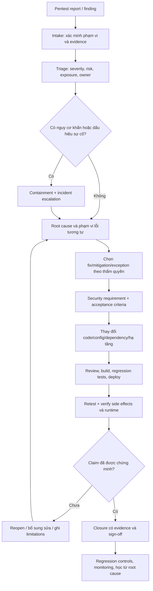
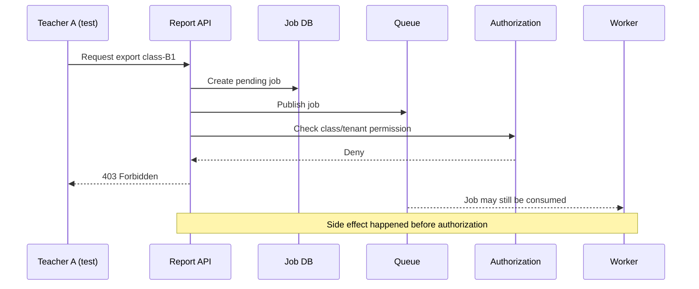

# Remediation sau pentest: từ phát hiện điểm yếu đến xác minh khắc phục và quản lý rủi ro còn lại

## 1. Một báo cáo pentest chưa phải là kết quả cuối cùng

Đội an ninh đã hoàn thành kiểm thử xâm nhập cho một nền tảng học tập viết bằng Java/Spring Boot. Báo cáo chứa tám findings: hai lỗi phân quyền API, một cấu hình CORS cần xem xét, một đường xử lý file không giới hạn, một phiên bản thư viện bị ảnh hưởng và ba vấn đề cấu hình vận hành. Nhóm kỹ thuật đóng các ticket sau khi merge pull request, rồi tuyên bố “đã xử lý toàn bộ”.

Nhưng khi kiểm tra lại, production vẫn chạy image cũ. Ngoài ra, một API đã được sửa ở controller nhưng worker bất đồng bộ vẫn tạo file báo cáo trái tenant. Có nghĩa **việc ghi nhận đã sửa code không chứng minh rủi ro đã được loại bỏ khỏi hệ thống thực sự đang chạy**.

**Remediation sau pentest** là quá trình có quản trị nhằm **xác minh, ưu tiên, xử lý nguyên nhân gây ra các điểm yếu đã được phát hiện, kiểm chứng hiệu lực của thay đổi và quản lý residual risk**. Quy trình này bắt đầu khi tiếp nhận findings, nhưng chỉ được coi là đạt mục tiêu khi có bằng chứng phù hợp rằng security requirements được đáp ứng trong phạm vi tài sản và phiên bản đã xác định.

Trong chương **Penetration testing** thuộc module **SECURITY_SECURITY_ASSURANCE**, remediation là mắt xích kết nối **threat scenario → yêu cầu bảo mật → security control → pentest finding → sửa lỗi → kiểm thử lại → bằng chứng → quyết định rủi ro → monitoring**. Mục tiêu không phải đóng ticket nhanh nhất, mà là **chứng minh hệ thống đã giảm rủi ro đúng cách và không tái đưa lỗi vào các lần phát hành sau**.

### Mục tiêu học tập

Sau bài này, bạn có thể:

1. Phân biệt remediation, mitigation, containment, workaround, compensating control, retest và risk acceptance.
2. Xây dựng quy trình tiếp nhận, xác minh, phân loại và ưu tiên findings từ pentest.
3. Tìm root cause và xác định phạm vi các đường lỗi tương tự thay vì chỉ sửa biểu hiện.
4. Thiết kế phương án khắc phục có acceptance criteria, owner, bằng chứng và thời hạn.
5. Kiểm tra bản sửa trên code, artifact, môi trường triển khai và hành vi runtime.
6. Đọc kết quả retest, xử lý trường hợp partially fixed, not reproducible hoặc regression.
7. Lập hồ sơ assurance và quyết định quản lý residual risk có khả năng kiểm toán.
8. Áp dụng vào ví dụ đa tenant với API Java/Spring Boot, queue, worker và object storage.

## 2. Thuật ngữ: sửa lỗi không đồng nghĩa giảm thiểu rủi ro

| Thuật ngữ | Ý nghĩa | Ví dụ |
|---|---|---|
| **Finding** | Vấn đề được ghi nhận với điều kiện, evidence, tác động và phạm vi | API xuất dữ liệu tenant B dưới token tenant A |
| **Root cause** | Nguyên nhân nền tảng tạo ra điểm yếu | Service kiểm tra quyền sau khi publish job |
| **Remediation** | Loại bỏ hoặc sửa nguyên nhân để đáp ứng yêu cầu bảo mật | Enforce object authorization trước side effects và tại worker |
| **Mitigation** | Giảm khả năng khai thác hoặc ảnh hưởng trong khi rủi ro vẫn có thể tồn tại | Tạm tắt export hoặc giới hạn quyền truy cập |
| **Containment** | Giới hạn ngay phạm vi lan rộng/tác động khi có nguy cơ hoặc sự cố | Chặn endpoint ngoài phạm vi, thu hồi token bị lộ |
| **Workaround** | Cách vận hành thay thế để tránh điều kiện lỗi mà chưa nhất thiết sửa gốc | Chuyển export sang quy trình phê duyệt thủ công |
| **Compensating control** | Control thay thế hoặc bổ sung nhằm đạt mức bảo vệ cần thiết | Kiểm tra quyền tại worker trong thời gian sửa API |
| **Verification** | Kiểm tra điều kiện sửa đã được đáp ứng | Test không có job/file trái quyền, scan đúng image digest |
| **Retest** | Đánh giá lại finding/đường tấn công sau thay đổi | Tester chạy lại case cũ và các biến thể liên quan |
| **Regression testing** | Bảo đảm thay đổi không làm hỏng chức năng hoặc security controls khác | Teacher đúng quyền vẫn xuất được báo cáo |
| **Residual risk** | Rủi ro còn tồn tại sau khi đã áp dụng biện pháp xử lý | Worker legacy chưa nâng cấp ở một môi trường |
| **Risk acceptance** | Quyết định có thẩm quyền chấp nhận residual risk theo điều kiện | Ngoại lệ có thời hạn và giám sát |

### Ba câu thường bị đánh đồng

1. **“Đã sửa code”**: mới nói rằng một thay đổi đã được thực hiện.
2. **“Đã deploy bản sửa”**: nói rằng có bản phần mềm mới được triển khai ở một số nơi.
3. **“Finding được xác minh đã khắc phục”**: yêu cầu chứng minh **đúng nguyên nhân, đúng phiên bản, đúng scope và hành vi bảo mật đạt**.

Chỉ câu thứ ba đủ mạnh để phục vụ một assurance claim về hiệu lực khắc phục — và vẫn phải nêu **phạm vi, thời điểm và giới hạn**.

### Một control tạm có thể hữu ích nhưng không phải “fixed”

Nếu một endpoint import file gặp lỗ hổng parser, việc tắt API tại gateway có thể giảm exposure đáng kể. Tuy nhiên nếu worker vẫn xử lý file từ queue khác, mitigation có thể chưa bao phủ toàn bộ đường khai thác. Ngay cả khi control tạm bao phủ đủ, package lỗi vẫn còn; trạng thái phù hợp có thể là `MITIGATED_PENDING_FIX` thay vì `FIXED_VERIFIED`.

## 3. Những đầu vào cần có từ báo cáo pentest

Không nên tạo ticket chỉ với tiêu đề “Critical vulnerability” và một ảnh chụp. Mỗi finding cần đủ dữ liệu để người xử lý hiểu **điều nào đã được chứng minh, điều nào còn là giả định**.

| Trường | Nội dung cần có | Vì sao cần |
|---|---|---|
| **Finding ID** | Mã ổn định xuyên report, ticket và retest | Tránh mất liên kết khi đổi công cụ |
| **Tài sản và owner** | Service, đội phụ trách, môi trường, tenant scope | Giao trách nhiệm đúng nơi |
| **Phiên bản/phạm vi** | Commit, release, image digest, route/config | Không sửa nhầm bản khác |
| **Security requirement** | Điều kiện bảo mật phải có | Chuyển lời khuyên thành acceptance criteria |
| **Threat scenario** | Actor, điểm vào, đường đi, mục tiêu | Hiểu vì sao lỗi có rủi ro |
| **Preconditions** | Vai trò, quyền, cấu hình, dữ liệu | Đánh giá khả năng khai thác thực tế |
| **Expected/observed** | Kỳ vọng so với hành vi được quan sát | Định nghĩa lỗi có thể kiểm chứng |
| **Evidence** | Logs/test data/response đã giảm nhạy cảm | Hỗ trợ tái hiện và đánh giá độc lập |
| **Impact** | Bí mật, toàn vẹn, sẵn sàng, riêng tư, nghiệp vụ | Phân loại ưu tiên |
| **Methodology/limitations** | Cách kiểm thử, những phần chưa thử | Không suy luận quá phạm vi |
| **Remediation guidance** | Đề xuất sửa gốc hoặc controls | Điểm bắt đầu kỹ thuật |
| **Retest criteria** | Điều kiện cần đạt trước khi đóng | Tránh chấp nhận sửa bằng cảm tính |

### Xác định chất lượng finding trước khi giao sửa

Reviewer nên kiểm tra:

- Có bằng chứng xác nhận rủi ro hay mới là nhận định nghi ngờ?
- Có thể tái hiện bằng fixture mà không cần dữ liệu thật?
- Tác động được mô tả đúng mức hay phóng đại từ một HTTP response?
- Đã tách finding chính với những vấn đề độc lập khác chưa?
- Đường tấn công có nằm trong scope được cấp phép không?
- Cấu hình ứng dụng ở thời điểm pentest có còn tương ứng với release hiện hành không?

Nếu thiếu evidence, mở trạng thái **Needs investigation** với owner và thời hạn. Không tự động hạ severity hoặc đóng finding vì tester chưa cung cấp đủ log.

## 4. Quy trình remediation từ đầu đến cuối

Một quy trình có thể kiểm toán:



### Bước 1 — Tiếp nhận và bảo vệ bằng chứng

Lưu báo cáo vào kho có phân quyền, xác định reviewer và owner. Redact token, PII và các nội dung nhạy cảm; không sao chép payload, secret hoặc kết quả truy cập trái quyền vào ticket công khai.

### Bước 2 — Xác minh finding

Đối chiếu phạm vi và policy. Xác nhận trường hợp thật sự vi phạm yêu cầu, không nhầm test harness hoặc dữ liệu fixture. Nếu nghi vấn vẫn chưa rõ, ghi câu hỏi kỹ thuật cần điều tra.

### Bước 3 — Triage theo rủi ro

Đánh giá exploitability, exposure, tác động nghiệp vụ, tín hiệu khai thác, controls và độ bất định. Giao owner, mục tiêu xử lý, mức ưu tiên, SLA theo policy tổ chức.

### Bước 4 — Giảm rủi ro khẩn khi cần

Nếu lỗi nghiêm trọng đang reachable, xem xét tắt tính năng, giới hạn quyền, ngăn đường truy cập hoặc các biện pháp khác **được thử và phê duyệt**. Không chờ bản sửa cuối cùng nếu nguy cơ cần containment ngay.

### Bước 5 — Tìm root cause và blast radius

Xác định nguyên nhân ở design, code, config, IAM, pipeline, kiến trúc hay quy trình. Dò các entry points, services, tenants, versions khác có thể dùng cùng pattern.

### Bước 6 — Thiết kế bản sửa

Viết security requirement rõ và testable. Chọn sửa tại trust boundary đúng, bổ sung defense in depth khi cần, đánh giá tương thích/chuyển đổi dữ liệu và các phụ thuộc.

### Bước 7 — Thực hiện thay đổi có kiểm soát

Code review, security review, tạo artifact mới đáng tin, quét/test và triển khai phù hợp. Không chỉnh production thủ công rồi mất khả năng truy vết.

### Bước 8 — Retest và xác minh triển khai

Chạy lại kịch bản ban đầu, kiểm tra biến thể và side effects, đối chiếu build/đường API/runtime trong scope. Phân biệt tester retest với engineering regression tests.

### Bước 9 — Đóng có bằng chứng và theo dõi

Đóng finding chỉ theo acceptance criteria; lưu status, reviewer, sign-off, residual risk và triggers. Sau đó chuyển invariant quan trọng thành regression test, phát hiện drift và cải tiến quy trình.

## 5. Triage: chọn việc cần sửa trước

Mức nghiêm trọng của một finding trong báo cáo không tự động là thời hạn duy nhất cần dùng. **Risk-based prioritization** phải xét thực tế triển khai.

| Yếu tố | Câu hỏi đánh giá |
|---|---|
| **Severity kỹ thuật** | Điểm yếu cho phép ảnh hưởng confidentiality/integrity/availability thế nào? |
| **Exploitability** | Cần quyền gì, điều kiện gì, có dễ kích hoạt trong deployment thật không? |
| **Exposure** | Internet-facing, authenticated, internal, service-to-service? |
| **Threat evidence** | Có dấu hiệu khai thác, exploit công khai hoặc threat intelligence liên quan? |
| **Business impact** | Dữ liệu điểm thi, thông tin cá nhân, khả năng tổ chức kỳ thi bị ảnh hưởng? |
| **Blast radius** | Một user, một tenant, nhiều tenant hay toàn cluster? |
| **Control effectiveness** | WAF, authorization, segmentation, rate limit hoặc sandbox đã được kiểm chứng? |
| **Asset criticality** | Dịch vụ production, ứng dụng quản trị, test/CI, hệ thống đặc quyền? |
| **Uncertainty** | Còn chưa biết phần nào, và nếu giả định sai thì hậu quả gì? |
| **Remediation lead time** | Có patch phù hợp, test/rollout nhanh, phải thay kiến trúc hay không? |

### Bốn tình huống khác nhau

| Finding | Nhận định rủi ro | Cách ưu tiên hợp lý |
|---|---|---|
| Learner A đọc được kết quả tenant B | Có đường vi phạm dữ liệu nhạy cảm, không đòi quyền admin | Ưu tiên cao, containment nếu có dấu hiệu exposure đáng kể |
| CVE nghiêm trọng ở package chỉ nằm trong tool build | Có thể không ảnh hưởng runtime, nhưng CI/supply chain vẫn có rủi ro | Xác minh scope và ưu tiên risk của CI riêng |
| Endpoint debug lộ ở staging cô lập | Exposure production có thể thấp, nhưng cần ngăn promote sai | Sửa config, test policy và verify không lộ ở production |
| Lỗi thiếu rate limit ở API export trong kỳ thi | Có thể gây quota abuse/DoS, ảnh hưởng availability | Ưu tiên theo business window, kiểm tra an toàn không tạo tải phá hoại |

### CVSS, EPSS, KEV có giúp gì?

- **CVSS:** dùng để diễn giải mức nghiêm trọng kỹ thuật theo phiên bản và vector phù hợp; không đồng nghĩa xác suất bị tấn công.
- **EPSS:** cung cấp ước lượng mô hình về khả năng CVE bị khai thác trong 30 ngày tới; không phải xác suất riêng cho instance của tổ chức.
- **CISA KEV:** tín hiệu CVE đã có bằng chứng khai thác ngoài thực tế theo tiêu chí danh mục; không chứng minh asset cụ thể đã bị xâm nhập.

Không phải finding nghiệp vụ nào cũng có CVE. Đặc biệt với **BOLA, mass assignment, sai quyền tenant hoặc logic thi trực tuyến**, cần dùng chứng cứ kỹ thuật và tác động nghiệp vụ trực tiếp, không chờ một mã CVE.

### SLA là ràng buộc quản trị, không phải nhãn severity

Tổ chức cần định nghĩa thời hạn triage, containment, remediation và retest dựa trên risk appetite, nghĩa vụ và nguồn lực. Không tự gán mọi “Critical” một thời hạn cố định nếu chưa có policy. Nếu vượt SLA, phải escalation hoặc có quyết định residual risk có thẩm quyền; không chuyển status thành “accepted” chỉ để loại khỏi dashboard.

## 6. Xác định root cause: sửa nguyên nhân, không chỉ dấu hiệu

Một pentest report thường mô tả biểu hiện bên ngoài. Engineering phải tìm **nguyên nhân nào trong thiết kế hoặc triển khai khiến biểu hiện đó có thể xảy ra**.

### 6.1. Phân biệt symptom và root cause

| Quan sát từ pentest | Symptom | Root cause có thể |
|---|---|---|
| API trả dữ liệu của user khác | Vi phạm privacy ở response | Thiếu object-level authorization ở service/query |
| API trả `403` nhưng tạo job | Side effect trước khi từ chối | Thứ tự kiểm tra quyền sai; transaction boundary sai |
| CORS mở rộng ở API nhạy cảm | Header cho phép origin ngoài policy | Cấu hình dùng chung sai theo data classification |
| Token hết hạn vẫn được nhận | Authentication validation sai | Verifier thiếu exp/issuer/audience policy hoặc cache sai |
| Worker xử lý message ngoài tenant | Internal trust boundary bị bỏ qua | Consumer tin message mà không xác minh nguồn/identity |
| Scanner vẫn báo package cũ sau patch | Runtime chưa được vá | Build/redeploy sai hoặc image cũ vẫn tồn tại |
| File export còn tải được sau thu hồi quyền | Download policy không phản ánh lifecycle | Signed URL TTL/ACL hoặc access check thiếu |

Một biểu hiện có thể có **nhiều nguyên nhân**. Không nên kết luận root cause chỉ từ tên endpoint hay một dòng log; cần review code, config, call chain, runtime và test theo phạm vi.

### 6.2. Chuỗi “5 Whys” chỉ là gợi ý

Ví dụ:

1. Vì sao tenant A có thể tạo export cho tenant B? Vì API ghi job trước khi kiểm tra class ownership.
2. Vì sao job vẫn chạy sau khi API trả lỗi? Vì worker chỉ đọc queue message, không thực hiện kiểm tra permission.
3. Vì sao worker tin toàn bộ message? Vì thiết kế coi queue là trusted boundary, chưa mô tả yêu cầu xác thực job nguồn.
4. Vì sao thiết kế không được kiểm tra? Vì threat model không xét đường bất đồng bộ.
5. Vì sao test không phát hiện? Vì integration tests chỉ kiểm tra HTTP status, không quan sát queue/storage.

Điều tra có thể dẫn tới **nhiều thay đổi**: điều chỉnh kiến trúc, kiểm tra quyền và logic worker, test suite, threat model, review checklist và hướng dẫn thiết kế.

### 6.3. Systemic remediation

Nếu tìm thấy một BOLA trong `/api/results/{id}`, hãy kiểm tra:

- Endpoint đọc, sửa, xóa, export và batch có dùng cùng query/service không?
- API v1/v2 hoặc GraphQL resolver có bypass không?
- Worker, scheduled job, cache hay download link có cùng lỗi không?
- Các service khác có sử dụng cùng “findById” không có tenant scope?
- Authorization có được enforce bằng policy nhất quán hay do từng developer tự nhớ?

Đừng mở rộng pentest ra ngoài scope được cấp phép; **engineering remediation review** có thể mở rộng phạm vi sửa trong nội bộ theo quyền phù hợp. Nếu cần tester đánh giá thêm tài sản mới, phải cập nhật ủy quyền/engagement theo quy trình.

## 7. Thiết kế phương án sửa bằng security requirements

Một remediation plan không nên chỉ ghi “fix authentication”, “sanitize input” hoặc “enable security”. Cần mô tả **điều kiện nào phải đúng sau khi sửa**.

### Ví dụ requirement có thể kiểm tra

> **REQ-EXPORT-001:** Với mọi yêu cầu tạo báo cáo lớp, backend xác minh identity, tenant và quyền trên class bằng dữ liệu server đáng tin **trước mọi side effect**. Nếu không đủ quyền, không có job, queue message, file hoặc audit record sai nội dung nghiệp vụ được tạo.

Một tiêu chí như vậy hỗ trợ:

- **Implementation:** nơi phải đặt policy.
- **Review:** những đường bypass cần xét.
- **Testing:** expected/actual cụ thể.
- **Assurance:** bằng chứng được nối đúng claim.

### Kết hợp các lớp bảo vệ

| Lớp | Control được đề xuất | Vai trò |
|---|---|---|
| API gateway | Token validation, request limits và routing phù hợp | Bảo vệ boundary ngoài; không đủ cho object authz |
| Application service | Xác thực identity và enforce role/tenant/object permissions | Control nghiệp vụ chính |
| Domain/query layer | Tenant scoping, row-level policy khi phù hợp | Hạn chế đường truy vấn bypass |
| Message publisher | Chỉ publish sau authorization/transaction state phù hợp | Ngăn side effects trước phép |
| Worker | Xác minh job hợp lệ, tenant scope và nguồn có quyền | Defense in depth cho queue boundary |
| Storage/download | ACL, TTL, ownership và download authorization | Ngăn dữ liệu lộ sau khi file được tạo |
| Audit/monitoring | Ghi quyết định deny, bất thường và trạng thái job | Detection/traceability, không tự chặn |

**Defense in depth không được thay cho sửa control chính.** Ví dụ thêm rate limit không sửa được BOLA; nó chỉ giảm một số hình thức abuse.

## 8. Chọn hình thức xử lý: fix, giảm thiểu, thay thế hoặc ngoại lệ

| Phương án | Khi nào phù hợp | Điều cần kiểm chứng |
|---|---|---|
| **Code remediation** | Lỗi nằm trong logic/cấu trúc ứng dụng | Negative tests, code review, integration behavior |
| **Configuration remediation** | Sai CORS, access policy, TLS, debug exposure | Config thực tế, environment checks, regression |
| **Dependency/runtime patch** | Component có advisory và patch phù hợp | Artifact inventory, version/digest, runtime verification |
| **Architecture change** | Sai trust boundary hoặc policy phân tán | DFD, threat model, integration/security tests |
| **Permission reduction** | Giảm tác động của account/workload bị chiếm | IAM, effective permissions, negative tests |
| **Feature disable** | Cần containment nhanh hoặc tính năng không cần thiết | Route thực sự bị tắt, cả các đường nội bộ |
| **Network restriction** | Có thể giảm đường truy cập | Ingress/egress hiệu lực, không có bypass ngoài scope |
| **WAF/monitoring rule** | Cần giảm một số mẫu tấn công hoặc tăng phát hiện | Test rule phù hợp, false positives, đường bypass |
| **Retirement/replacement** | Hệ thống cũ không còn hỗ trợ hoặc quá khó sửa | Workload/route cũ không còn hoạt động |
| **Risk acceptance** | Risk còn lại được quyết định chấp nhận đúng thẩm quyền | Approval, scope, expiry, compensating controls |

### Tránh các “fix” phản tác dụng

- Chặn một request pattern thay vì kiểm tra quyền đúng; biến thể khác có thể vượt qua.
- Chuyển từ `403` sang `404` nhưng vẫn để worker tạo job.
- Tắt log bảo mật để “hết lộ thông tin”, đồng thời mất khả năng điều tra sự cố.
- Tắt TLS certificate validation để sửa lỗi tương thích sau update.
- Áp dụng escape/validation một lớp nhưng bỏ qua đường dữ liệu khác.
- Thêm secret vào cấu hình tĩnh hoặc source để giảm độ phức tạp deploy.
- Suppress scanner mà không có chứng cứ affectedness hoặc bản backport.

Một bản sửa tốt phải **khắc phục điều kiện lỗ hổng mà không làm suy yếu những controls khác**.

## 9. Remediation của lỗi authorization: nguyên tắc cốt lõi

Trong ứng dụng có nhiều role, lớp và tenant, **authentication (ai là người gọi)** khác với **authorization (người đó được làm gì với đối tượng nào)**.

### 9.1. Các lỗi thường cần sửa

- Kiểm tra “đã đăng nhập” nhưng không kiểm tra object ownership.
- Tin `tenantId` hoặc `role` do client gửi.
- Kiểm tra role ở controller nhưng service/worker vẫn được gọi từ đường khác.
- Thực hiện side effect rồi mới kiểm tra quyền.
- Hạn chế quyền ở UI nhưng backend vẫn cho gọi chức năng.
- Cache theo ID không kèm tenant và quyền phù hợp.
- Bulk operation chỉ kiểm tra phần tử đầu tiên.
- API phiên bản cũ không được cập nhật cùng policy.

### 9.2. Kiểm tra quyền ở đâu?

Một thiết kế tốt thường đặt authorization ở **ranh giới nghiệp vụ server-side có thể dùng lại**, không dựa duy nhất vào annotation controller hay API gateway. Khi cần, bổ sung policy ở persistence layer và downstream services.

Nếu backend có nhiều entry points (REST, GraphQL, scheduled jobs, queue consumers), yêu cầu phải được áp dụng nhất quán qua tất cả các đường vào có thể thực hiện hành động nhạy cảm.

### 9.3. Tránh tin dữ liệu từ client

Các trường `userId`, `tenantId` hoặc `permissions` trong request không được trở thành nguồn xác thực quyền nếu không được kiểm tra với identity và policy phía server. Ngay cả khi client UI không cho sửa chúng, request từ API client có thể chứa giá trị tùy ý.

### 9.4. Xác minh sau sửa

Test cả:

- Chủ thể hợp lệ với tài nguyên hợp lệ (**positive**).
- Cùng role nhưng khác lớp/đối tượng (**negative intra-tenant**).
- Tenant khác (**negative cross-tenant**).
- Role không đủ quyền (**negative BFLA**).
- Field không được phép sửa (**negative BOPLA/mass assignment**).
- Export, download, cache, queue và worker (**alternate paths**).
- Quyền bị thu hồi giữa các trạng thái (**lifecycle tests**).

Một test chỉ trả `403` không đủ nếu đã có job/file trái quyền. Đối với thao tác bất đồng bộ, kiểm tra cả hậu quả cuối.

## 10. Remediation cho finding về dependency, cấu hình và hạ tầng

Không phải findings nào cũng nằm trong code ứng dụng.

### 10.1. Dependency và runtime

Ví dụ pentest phát hiện runtime Java hoặc thư viện xử lý tài liệu có advisory. Cần:

1. Xác minh package, vendor, phiên bản, build và affected conditions.
2. Xác định dependency có thực sự ở artifact/runtime đích.
3. Chọn bản được sửa hoặc phương án thay thế từ nguồn đáng tin.
4. Xem tương thích và thay đổi cấu hình liên quan.
5. Build lại artifact, test và scan ở đúng lớp cần vá.
6. Deploy theo image/package digest đã duyệt.
7. Xác minh các instance đang chạy đúng bản, không chỉ manifest source.
8. Kiểm tra vẫn có quy tắc ngăn bản lỗi quay lại.

Nếu vendor backport patch nhưng version string trông cũ, cần evidence từ vendor/distribution và cơ chế scanner đối chiếu, không tự giả định “scanner luôn sai”.

### 10.2. Network/IAM/cloud configuration

Khi pentest phát hiện service account có quyền quá rộng hoặc storage public sai:

- Xác định tài nguyên và danh tính thực sự bị ảnh hưởng.
- Hạ quyền theo least privilege, kiểm tra không phá các chức năng hợp lệ.
- Kiểm tra các network paths, IAM policy inheritance và access từ workload khác.
- Đối chiếu IaC/GitOps với cấu hình thực đang chạy.
- Lưu test từ chối truy cập sai quyền, không chỉ ảnh chụp cấu hình “đã sửa”.
- Xem các môi trường, account, region và resources tạo theo template tương tự.

### 10.3. Secret hoặc token đã bị lộ

Nếu bằng chứng cho thấy credential đã bị lộ, **chỉ xóa giá trị khỏi source không đủ**. Cần xem xét thu hồi/rotation credential, đánh giá nơi credential được sao chép, rà soát phạm vi quyền và hoạt động liên quan, cập nhật cách lưu/chia sẻ secrets và xác minh các key cũ không còn tác dụng theo policy.

Nếu có dấu hiệu compromise hoặc dữ liệu thật bị truy cập trái phép, remediation phải phối hợp **incident response**, không chờ đến kỳ phát hành kế tiếp.

## 11. Tình huống Java/Spring Boot: export xuyên tenant

### 11.1. Bối cảnh hệ thống

Giả sử hệ thống gồm:

- `result-api` cung cấp điểm học viên.
- `report-service` tạo export job qua HTTP.
- `export-worker` tiêu thụ message và tạo file.
- PostgreSQL lưu mapping tenant/lớp và job state.
- Object storage giữ file báo cáo; download API kiểm soát quyền.
- Identity service cấp access token cho learner, teacher và tenant admin.

Yêu cầu nghiệp vụ: **Teacher chỉ được xuất bảng điểm của lớp đã được phân công trong tenant của mình**. Hành động bị từ chối phải không tạo job/file trái phép.

### 11.2. Phát hiện minh họa

Pentest có phép sử dụng dữ liệu giả cho hai tenant A và B. Tester gửi yêu cầu của Teacher A cho class B. Server trả `403`, nhưng DB và queue vẫn xuất hiện job cho class B.

```http
POST /api/reports/export HTTP/1.1
Host: api.test.example.org
Authorization: Bearer <teacher-A-test-token>
Content-Type: application/json

{
  "classId": "class-B1"
}
```

Tên miền và token ở đây chỉ là **giả định**, không đại diện cho hệ thống thật. Cần giới hạn kiểm tra vào môi trường staging và tài khoản thử nghiệm đã được cho phép.

### 11.3. Luồng lỗi có thể xảy ra



Đây là sơ đồ giả định về **root cause**. Trong dự án thật, phải đối chiếu code, DB state, event log và transaction behavior; không kết luận chỉ vì nhìn thấy `403`.

### 11.4. Bản sửa ở tầng service

Một hướng triển khai có thể gồm kiểm tra quyền trước side effect:

```java
@Service
public class ExportApplicationService {
    private final ClassAuthorization classAuthorization;
    private final ExportJobRepository jobRepository;
    private final OutboxRepository outboxRepository;

    @Transactional
    public UUID requestExport(
            AuthenticatedActor actor,
            UUID classId,
            String idempotencyKey) {

        // Phải kiểm tra tenant + assignment + quyền export tại backend.
        ClassAccess permitted = classAuthorization.requireExportPermission(
            actor, classId
        );

        // Việc chống duplicate và binding idempotency key với
        // actor/tenant/payload phải do repository/service bảo đảm.
        ExportJob job = jobRepository.createAuthorized(
            actor.userId(),
            permitted.tenantId(),
            classId,
            idempotencyKey
        );

        // Transactional outbox: lưu sự kiện cùng transaction DB.
        // Publisher riêng phát sau commit; consumer phải idempotent.
        outboxRepository.append(
            ExportRequested.from(job)
        );

        return job.id();
    }
}
```

Đây là **mã mô tả design intent**, không phải một implementation đầy đủ có thể chạy ngay. `AuthenticatedActor`, `ClassAuthorization`, `OutboxRepository`, `ExportJobRepository` và `ExportRequested` là kiểu/helper giả định; việc tồn tại method tên `requireExportPermission` **không tự chứng minh** logic kiểm tra quyền đúng.

### 11.5. Những điều bản sửa phải xử lý tiếp

Một check trước khi tạo job là cần thiết nhưng có thể chưa đủ:

| Rủi ro | Hướng xem xét |
|---|---|
| **Time-of-check/time-of-use (TOCTOU)** | Quyền có thể bị thu hồi giữa check và worker xử lý; xác định policy lúc execution/download |
| **Transaction & messaging** | DB commit và queue publish phải nhất quán, ví dụ outbox pattern khi phù hợp |
| **Duplicate requests** | Idempotency theo identity/tenant/action/payload; chống tạo nhiều job |
| **Forged queue message** | Worker xác thực nguồn, job state và quyền/tenant thay vì tin raw payload |
| **Download bypass** | File link/ACL/TTL và download authorization phù hợp |
| **Cross-tenant cache** | Cache key và scope không gây lẫn dữ liệu |
| **Bulk export** | Mỗi class/object được kiểm tra quyền, không chỉ phần tử đầu |
| **Audit** | Ghi actor, quyết định, correlation/job ID mà không lộ token/PII |

### 11.6. Một lớp defense in depth ở worker

Worker có thể xác minh `jobId` được tạo bởi backend đáng tin, job còn trạng thái hợp lệ và object thuộc tenant đã ghi nhận. Nếu thiết kế yêu cầu quyền còn hiệu lực đến thời điểm thực thi, worker cần kiểm tra lại hoặc dùng authority snapshot được phê duyệt rõ; cách chọn phải dựa trên yêu cầu nghiệp vụ và threat model.

Không nên đơn thuần tin `tenantId` từ queue message nếu các producer khác có thể gửi message vào queue. Nên có message identity, quyền publish, schema validation và idempotency xử lý lại.

### 11.7. Kiểm chứng kết quả mong đợi

| Trường hợp | Expected HTTP | Expected side effect |
|---|---|---|
| Teacher A export class A được phân công | `202 Accepted` theo contract | Một job hợp lệ; audit đúng |
| Teacher A export class B tenant B | `403` hoặc `404` theo contract | Không job/queue/file ngoài quyền |
| Teacher A export class A chưa được phân công | Deny | Không side effect ngoài quyền |
| Learner gọi endpoint export teacher | Deny | Không job |
| Token hết hạn hoặc sai audience | Authentication deny | Không job |
| Quyền bị thu hồi khi worker chưa chạy | Theo revocation policy | Không xuất/trả file trái policy |
| Request retry sau timeout | Response theo idempotency contract | Không tạo job trái quy tắc |
| Worker gặp lỗi storage | Lỗi có kiểm soát | Không để job completed sai hoặc file công khai |

## 12. Viết regression tests cho bản sửa

### 12.1. Negative integration test

Ví dụ Spring Boot `MockMvc`. Các fixture và helper là mã giả minh họa cho cách kiểm tra hành vi; không được coi là test chạy được nếu chưa có codebase tương ứng.

```java
@SpringBootTest
@AutoConfigureMockMvc
class ExportAuthorizationSecurityIT {

    @Autowired MockMvc mvc;
    @Autowired TestFixtures fixtures;
    @Autowired SignedTestTokenIssuer tokens;

    @Test
    void foreignTenantExportMustNotCreateSideEffects() throws Exception {
        var teacherA = fixtures.teacher("tenant-A");
        var classB = fixtures.classInTenant("tenant-B");
        String jwt = tokens.validAccessToken(teacherA);

        mvc.perform(post("/api/reports/export")
                .header("Authorization", "Bearer " + jwt)
                .contentType(MediaType.APPLICATION_JSON)
                .content("{\"classId\":\"" + classB.id() + "\"}"))
            .andExpect(status().isForbidden());

        assertThat(fixtures.jobsFor(classB.id())).isEmpty();
        assertThat(fixtures.publishedMessagesFor(classB.id())).isEmpty();
        assertThat(fixtures.exportFilesFor(classB.id())).isEmpty();
    }
}
```

Nếu sản phẩm chủ động dùng `404` để không tiết lộ tài nguyên, đổi expected status theo contract. Assertion chính là **không làm lộ hoặc tạo bất kỳ dữ liệu trái quyền nào**.

### 12.2. Positive test tránh sửa thành deny-all

```java
@Test
void assignedTeacherCanStillCreateOneExport() throws Exception {
    var teacherA = fixtures.teacher("tenant-A");
    var classA = fixtures.assignedClassFor(teacherA);
    String jwt = tokens.validAccessToken(teacherA);

    mvc.perform(post("/api/reports/export")
            .header("Authorization", "Bearer " + jwt)
            .contentType(MediaType.APPLICATION_JSON)
            .content("{\"classId\":\"" + classA.id() + "\"}"))
        .andExpect(status().isAccepted());

    assertThat(fixtures.jobsFor(classA.id())).hasSize(1);
}
```

Nếu chỉ kiểm tra các request bị từ chối, một bản sửa “từ chối tất cả” có thể làm test xanh trong khi phá chức năng hợp lệ. Vì vậy remediation cần cả **positive functional regression** và **negative security regression**.

### 12.3. Test authentication thật và giả lập

`SignedTestTokenIssuer` là test helper giả định để phát token test. Nếu test sử dụng principal giả hoặc `with(jwt())`, điều đó hữu ích khi kiểm tra policy nhưng **có thể không thực thi JWT signature verification thực tế**. Với findings về token validation, cần tầng integration sử dụng verifier cấu hình thật, token sai issuer/audience/chữ ký/hạn và endpoints qua đường cần xác minh.

### 12.4. Test async ổn định

Với queue/worker:

- Reset job DB, queue và storage fixtures giữa các tests.
- Dùng test consumer/outbox hoặc quan sát trạng thái có timeout, tránh `Thread.sleep` không kiểm soát.
- Ghi correlation ID để nối API request tới job/event/file.
- Xác minh một job bị từ chối không được publish hoặc nếu đã có event cũ thì worker không xử lý trái policy.
- Kiểm tra idempotency và những trạng thái partial failure.

**Test chạy qua `MockMvc` có thể không đi qua ingress/gateway hoặc workload IAM**. Nếu claim liên quan boundary đó, cần thêm test ở staging với cấu hình gần production và ghi rõ giới hạn.

## 13. Kiểm thử lại (retest): nghĩa là gì?

**Retest** là hoạt động xác minh rằng một finding đã được giải quyết sau thay đổi bằng cách kiểm tra lại điều kiện phát hiện trước đó và những đường liên quan. Nó có thể do tester ban đầu hoặc người có năng lực độc lập thực hiện theo quy trình tổ chức.

### Khác biệt giữa verify fix và pentest lại toàn bộ

| Hình thức | Mục tiêu | Khi dùng |
|---|---|---|
| **Developer verification** | Kiểm tra code/config mới đạt acceptance criteria | Mỗi PR/fix |
| **Security regression tests** | Ngăn lỗ hổng tái diễn ở CI/CD | Duy trì lâu dài |
| **Targeted pentest retest** | Xác nhận finding ban đầu không còn khai thác được theo scope | Trước đóng finding quan trọng |
| **Adjacent-path review** | Tìm biến thể cùng root cause ở đường khác | Khi vấn đề có tính hệ thống |
| **Full reassessment** | Kiểm tra rộng hơn sau đổi lớn/kiến trúc/risk cao | Khi targeted retest không đủ |
| **Production verification** | Bản sửa đang chạy đúng và policy có hiệu lực | Sau triển khai theo mức an toàn được phép |

Không nên viết “passed pentest” nếu chỉ có unit test do developer chạy. Ngược lại, không cần luôn tổ chức lại toàn bộ pentest nếu một finding có tiêu chí retest rõ và phạm vi đủ.

### 13.1. Retest acceptance criteria

Trước khi sửa cần quy định:

1. Kịch bản gốc không còn vi phạm security requirement.
2. Những đường cùng root cause đã được kiểm tra phù hợp.
3. Side effects và dữ liệu có trạng thái đúng.
4. Users đủ quyền vẫn thực hiện được nghiệp vụ.
5. Không tạo lỗ hổng mới qua config/rollback/alternate endpoints.
6. Test thực hiện trên build, môi trường và phiên bản được nhận diện.
7. Có evidence expected/actual và reviewer/sign-off.

### 13.2. Retest không thành công

Nếu tester thấy API chính đã sửa nhưng API v1 vẫn cho phép export chéo tenant, không nên đóng finding là fully fixed. Có thể ghi:

- **Partially fixed:** một đường đã sửa, đường khác còn lỗi.
- **Failed retest:** điều kiện gốc vẫn còn hoặc tác động tương đương.
- **Needs investigation:** test không kết luận do môi trường, dữ liệu hoặc quyền chưa rõ.

Ghi rõ **phạm vi nào đã pass, phạm vi nào vẫn fail**; tạo bản sửa tiếp hoặc điều chỉnh kế hoạch phù hợp.

### 13.3. “Not reproducible” không phải “safe”

Nếu tester không tái hiện được vì token fixture hết hạn, service bị tắt hoặc test data không còn, kết luận hợp lý là **retest inconclusive** chứ không tự động `FIXED_VERIFIED`. Cần tái tạo điều kiện hợp lệ, xem log hoặc xác minh bằng phương pháp độc lập.

## 14. Từ code đến production: chuỗi bằng chứng sửa lỗi

Một finding có thể được sửa trong source nhưng vẫn tồn tại ở phiên bản đang chạy. Do đó cần liên kết:

**Finding → security requirement → fix commit → reviewed PR → CI tests → build artifact digest → deployment → runtime verification → retest → closure.**

### 14.1. Các cấp độ xác minh

| Cấp độ | Câu hỏi | Evidence |
|---|---|---|
| **Source** | Đã đổi code/config ở đúng chỗ? | PR diff, review, commit |
| **Build** | Artifact được tạo từ đúng source và dependencies? | CI run, build/provenance, SBOM, digest |
| **Pre-release test** | Security invariants và chức năng liên quan đạt? | Automated tests, test data, report |
| **Deployment** | Đúng artifact được đưa vào môi trường? | Image ID/digest, release record, rollout status |
| **Runtime behavior** | Control có hiệu lực ở môi trường đích? | Safe post-deploy tests, config validation |
| **Independent retest** | Tester xác nhận fix theo scope? | Retest report, expected/observed, limitations |
| **Ongoing monitoring** | Lỗi có tái xuất hiện hoặc bị rollback? | Alerts, deployment drift, finding lifecycle |

### 14.2. Không chỉ nhìn tag hoặc pipeline xanh

Container tag là nhãn có thể thay đổi. Cần đối chiếu digest khi quyết định artifact nào đã test và artifact nào chạy. Nếu hệ thống triển khai nhiều region/tenant/worker, phải xác minh toàn bộ các đối tượng thuộc phạm vi finding.

Ví dụ, nâng dependency trong `pom.xml` không chứng minh runtime image đã thay. Với lỗ hổng cấu hình Kubernetes, sửa manifest trong source không chứng minh chính sách đã được áp dụng ở cluster. Với IAM, sửa Terraform code không chứng minh quyền hiệu lực hiện tại đã đúng.

### 14.3. Reopen khi rollback

Nếu bản mới đã được retest đạt nhưng production rollback về bản cũ có lỗi, finding phải được đánh giá mở lại theo policy. Cần có versioned finding/evidence và cơ chế phát hiện artifact/config cũ quay trở lại.

## 15. Quản trị findings: trạng thái, owner và luồng phê duyệt

| Trạng thái gợi ý | Diễn giải |
|---|---|
| **RECEIVED** | Đã nhận finding, chưa xác minh |
| **TRIAGED** | Đã đánh giá bằng chứng/risk/owner |
| **CONFIRMED** | Đã xác minh vi phạm yêu cầu trong scope |
| **FIX_PLANNED** | Có remediation approach và thời hạn |
| **MITIGATED** | Có controls tạm, còn residual risk |
| **FIX_IMPLEMENTED** | Đã thay source/config, chưa chứng minh triển khai |
| **DEPLOYED_PENDING_RETEST** | Đã deploy nhưng chưa có retest đủ |
| **PARTIALLY_FIXED** | Một phần đường lỗi đã sửa, phần khác còn tồn tại |
| **RETEST_INCONCLUSIVE** | Không đủ dữ kiện để xác định fixed hay not fixed |
| **FAILED_RETEST** | Lỗi còn tái hiện hoặc có biến thể cùng nguyên nhân |
| **FIXED_VERIFIED** | Đã đạt acceptance criteria trong phạm vi đã ghi |
| **RISK_ACCEPTED** | Residual risk có phê duyệt và điều kiện hiệu lực |
| **CLOSED** | Hoàn tất quy trình theo policy, có bằng chứng và sign-off |
| **REOPENED** | Vấn đề tái xuất hiện hoặc giả định/controls mất hiệu lực |

Đây là tên trạng thái **minh họa**, không phải trạng thái được mọi tracker hỗ trợ. Chương trình có thể dùng ít trạng thái hơn nhưng phải giữ đúng ngữ nghĩa, đặc biệt giữa **implemented, deployed, verified, accepted**.

### Tách trách nhiệm

- **Engineering/service owner:** sửa code, config, test và triển khai.
- **Security/AppSec:** triage, đề xuất criteria, review rủi ro và evidence.
- **Pentest assessor:** xác minh finding và retest theo scope/ủy quyền.
- **Platform/DevOps/SRE:** quản lý hạ tầng, artifact/deploy, monitoring.
- **Risk owner:** phê duyệt residual risk trong thẩm quyền.
- **Release/change approver:** quyết định phát hành theo policy và evidence.
- **Audit/assurance reviewer:** xem tính đầy đủ, integrity và khả năng truy vết.

Người phát hiện lỗ hổng không tự động có quyền chấp nhận residual risk. Người triển khai bản sửa cũng không nên là nguồn bằng chứng duy nhất cho kết luận rủi ro cao nếu tổ chức yêu cầu mức độc lập.

## 16. Risk acceptance và exception khi chưa sửa được

Một tổ chức có thể gặp finding chưa thể sửa ngay vì thiếu patch, không tương thích với hệ thống legacy hoặc cần thay đổi kiến trúc lớn. Quyết định đúng không phải “đổi nhãn thành Safe”, mà là **đánh giá residual risk và áp dụng quy trình ngoại lệ có thẩm quyền**.

### 16.1. Những câu hỏi bắt buộc

1. Finding còn ảnh hưởng asset, release và environments nào?
2. Có thể giới hạn exposure bằng cách nào ngay lúc này?
3. Những controls bù đắp có thực sự đạt hiệu lực hay chỉ được ghi trong tài liệu?
4. Nếu control tạm thất bại, tác động xấu nhất hợp lý là gì?
5. Risk owner nào có thẩm quyền quyết định; có cần thông báo business/data owner không?
6. Ngoại lệ có thời hạn và điều kiện thu hồi rõ không?
7. Có milestone sửa gốc, ngân sách hoặc lộ trình thay thế thành phần?
8. Khi xuất hiện exploit mới, advisory/KEV mới hoặc tăng exposure, có trigger review lại?

### 16.2. Ví dụ ngoại lệ có điều kiện

```yaml
exception_id: "PT-EX-DEMO-01"
finding_id: "PT-F-DEMO-07"
service: "legacy-import-worker"
scope:
  environment: "restricted-staging"
  artifact_digest: "sha256:<verified-artifact-digest>"
  functionality: "Import file từ nguồn đối tác đã định"
reason: "Dependency legacy chưa tương thích với bản nâng cấp"
residual_risk:
  scenario: "Parser xử lý dữ liệu bên ngoài theo cấu hình cũ"
  impact: "Confidentiality/availability theo risk review"
  uncertainty: "Plugin động chưa được kiểm thử đầy đủ"
compensating_controls:
  - "Giới hạn ingress và egress theo allowlist"
  - "Giảm quyền của worker"
  - "Giới hạn file size và nguồn tải"
verification:
  - "Network policy negative tests"
  - "Worker sandbox/config checks"
  - "Monitoring alerts test"
owner: "service-risk-owner"
approved_by: "<authorized-risk-approver>"
expires_at: "<approved-expiry-date>"
remediation_target: "<approved-migration-milestone>"
reassessment_triggers:
  - "Có patch hoặc bản thay thế được hỗ trợ"
  - "Thay đổi exposure hoặc trust boundaries"
  - "Tín hiệu khai thác thực tế hoặc finding mới"
status: "CONDITIONAL_ACCEPTANCE"
```

Ví dụ này dùng dữ liệu giả, không phải một ngoại lệ được phê duyệt. **Phạm vi và biện pháp bù đắp phải là thông tin được kiểm chứng**, không thể tự tuyên bố các rủi ro đều được chấp nhận.

### 16.3. Không dùng suppression thay cho quyết định rủi ro

Ẩn hoặc suppress finding trong scanner/ticket không phải remediation. Nếu có false positive thực sự, cần bằng chứng bác bỏ. Nếu lỗ hổng vẫn tồn tại nhưng được chấp nhận tạm thời, cần giữ trạng thái risk và approval. Dashboard có thể có bộ lọc riêng cho accepted findings nhưng không nên xóa lịch sử hoặc làm sai báo cáo “đã vá”.

## 17. Kết nối với incident response khi pentest phát hiện ảnh hưởng thật

Pentest được ủy quyền không đồng nghĩa tổ chức chỉ đang đối diện với rủi ro lý thuyết. Đôi khi evidence cho thấy có thể đã xảy ra truy cập trái phép, lộ token, mất integrity hoặc sử dụng đường tấn công trong thực tế.

### 17.1. Trigger escalation

- Phát hiện dữ liệu thật của người dùng ngoài scope trong response.
- Log cho thấy token hoặc credential bị dùng đáng ngờ.
- Có dấu hiệu tài khoản/worker đã bị chiếm quyền.
- Một bản export/file không được phép đã được tạo hoặc tải ở production.
- Hệ thống mất ổn định hoặc bị gián đoạn trong lúc kiểm tra.
- Finding ảnh hưởng hệ thống trọng yếu với khả năng khai thác đang tăng nhanh.

### 17.2. Cách phối hợp

1. Tuân theo RoE: dừng hoặc giới hạn phép thử có rủi ro.
2. Thông báo ngay cho đầu mối được chỉ định, Security Operations/Incident Response nếu phù hợp.
3. Bảo vệ bằng chứng tối thiểu, có kiểm soát truy cập và thời điểm.
4. Đánh giá containment theo thẩm quyền: giảm exposure, thu hồi credential, tạm dừng chức năng.
5. Điều tra phạm vi ảnh hưởng thông qua quy trình incident response riêng, không tự mở rộng pentest ngoài scope.
6. Sau khi ổn định, triển khai remediation root cause và xác minh cùng các controls phát hiện.
7. Cập nhật lessons learned, test coverage, playbook và evidence liên quan.

Nếu có quy định về thông báo sự cố hoặc bảo vệ dữ liệu, cần để chủ thể có trách nhiệm đánh giá nghĩa vụ pháp lý/hợp đồng theo khu vực và loại dữ liệu thực tế. Không tự suy ra rằng mọi pentest finding đều bắt buộc thông báo vi phạm dữ liệu.

## 18. Tạo hồ sơ remediation có thể truy vết

Một hồ sơ nên kết nối quyết định nghiệp vụ với thay đổi kỹ thuật, không chỉ tập hợp đường link rời rạc.

### 18.1. Mẫu remediation record

```yaml
remediation_id: "REM-PT-DEMO-001"
source:
  pentest_engagement: "PT-DEMO-2026-Q4"
  finding_id: "PT-F-DEMO-001"
  assessor_report: "restricted-report://<report-reference>"
service:
  name: "report-service"
  owner: "report-service-team"
  data_classification: "student-records"
affected_scope:
  environments: ["staging", "production-under-review"]
  api: "POST /api/reports/export"
  artifact_digest_before: "sha256:<before-digest>"
risk:
  root_cause: "Export job được ghi trước object authorization"
  scenario: "Teacher tenant A tạo job cho class tenant B"
  priority: "HIGH (minh họa)"
  decision_owner: "authorized-risk-owner"
security_requirement:
  id: "REQ-EXPORT-001"
  invariant: "Không tạo job/message/file nếu thiếu quyền trên class/tenant"
remediation:
  approach: "Sửa ordering và enforcement tại service/worker"
  change_reference: "pr://<reviewed-change>"
  code_review: "review://<review-id>"
  build_id: "<ci-run-id>"
  artifact_digest_after: "sha256:<new-digest>"
verification:
  tests:
    - "negative-cross-tenant-export"
    - "positive-assigned-class-export"
    - "worker-job-authorization"
    - "download-authorization"
  artifact_scan: "ci://<artifact-scan>"
  deployment: "change://<release-record>"
  runtime_check: "evidence://<deployed-digest-and-config>"
retest:
  assessor: "<authorized-retester>"
  scope: "staging with fake tenant A/B"
  result: "PENDING"
  report: "<retest-report>"
limitations:
  - "Production object storage policy sẽ được xác minh riêng"
residual_risk:
  status: "PENDING_DECISION"
closure:
  status: "OPEN"
  approver: "<authorized-closure-reviewer>"
```

Các URL, digest, ID và trạng thái chỉ minh họa cấu trúc. Không được điền `PASS` hay `FIXED_VERIFIED` trước khi kiểm tra thực tế.

### 18.2. Bằng chứng cần có thuộc tính gì?

| Thuộc tính | Câu hỏi cần trả lời |
|---|---|
| **Relevance** | Evidence trực tiếp hỗ trợ claim sửa lỗi nào? |
| **Correctness** | Phương pháp/expected result có phản ánh policy đúng không? |
| **Completeness** | Đã xét các entry points, identities, environments và side effects trong scope? |
| **Freshness** | Evidence gắn đúng commit, build, config và thời điểm hiện hành? |
| **Provenance** | Ai/công cụ nào tạo evidence, dựa trên dữ liệu nào? |
| **Integrity** | Report/log có khả năng phát hiện chỉnh sửa và lưu audit trail? |
| **Repeatability** | Có thể tái hiện test với fixtures và điều kiện đã ghi? |
| **Independence** | Mức phản biện có phù hợp rủi ro và chính sách tổ chức? |
| **Availability/retention** | Auditor/reviewer có thể truy cập bằng quyền phù hợp khi cần? |
| **Honest uncertainty** | Có ghi rõ nơi chưa kiểm tra, giả định và kết quả không xác định? |

Ví dụ một screenshot cho thấy `403 Forbidden` không đủ để chứng minh không có side effect. Ngược lại, một bộ report có request/response, job count, queue inspection, storage assertions và artifact digest phù hợp có thể hỗ trợ claim mạnh hơn.

## 19. Mẫu kế hoạch retest: từ finding đến acceptance criteria

Kế hoạch retest cần được phê duyệt/điều phối trước khi chạy, đặc biệt nếu có tác động tới môi trường dùng chung.

```yaml
retest_plan_id: "PT-RETEST-DEMO-001"
finding: "PT-F-DEMO-001"
objective: "Xác minh object authorization trước mọi export side effect"
authorization:
  reference: "<approved-retest-authorization>"
scope:
  service: "report-service"
  environment: "isolated-staging"
  artifact_digest: "sha256:<candidate-digest>"
  identities:
    - "teacher-A"
    - "learner-A"
    - "tenant-admin-A"
  resources:
    - "class-A-assigned"
    - "class-A-unassigned"
    - "class-B-foreign"
cases:
  - id: "RT-01"
    action: "Teacher A export assigned class A"
    expected: "Allowed, exactly one authorized job"
  - id: "RT-02"
    action: "Teacher A export foreign tenant class B"
    expected: "Denied, zero job/message/file"
  - id: "RT-03"
    action: "Learner A call teacher export operation"
    expected: "Denied, zero job/message/file"
  - id: "RT-04"
    action: "Teacher A with revoked role, pending job"
    expected: "Behavior conforms to approved revocation policy"
  - id: "RT-05"
    action: "Repeat request after simulated retry"
    expected: "No duplicate unauthorized side effects"
  - id: "RT-06"
    action: "Use old API version and worker entry point"
    expected: "No authorization bypass in reviewed scope"
evidence:
  - "Redacted HTTP assertions"
  - "DB/queue/storage state comparisons"
  - "CI run, source commit, runtime config"
stop_conditions:
  - "Unexpected impact on non-test data"
  - "Service stability below approved limit"
results:
  status: "NOT_RUN"
  reviewer: "<authorized-reviewer>"
```

Mẫu này chỉ minh họa quy trình **kiểm chứng phòng thủ trong môi trường được phép**, không phải hướng dẫn tự ý thử trên tài sản người khác.

### Retest matrix nên phân biệt bốn kết quả

| Test | Kết quả có thể | Ý nghĩa |
|---|---|---|
| RT-01 positive | Pass | Không sửa thành deny-all |
| RT-02/03 negative | Pass | Những đường trái quyền đã thử bị ngăn |
| RT-04 lifecycle | Fail | Quyền bị thu hồi chưa được áp dụng đúng policy |
| RT-05 retry | Inconclusive | Không tái hiện được điều kiện timeout trong lần thử |
| RT-06 alternate path | Not run | Chưa có evidence cho API cũ/worker |

Trong tình huống này, **không thể kết luận finding đã fully fixed trên toàn bộ scope**, dù một số tests pass. Nên ghi rõ phạm vi đạt/chưa đạt, bổ sung evidence và quyết định giải quyết phần còn lại.

## 20. CI/CD: ngăn sửa xong lại tái phát

Remediation nên biến những điểm yếu đã phát hiện thành **controls tồn tại lâu dài**.

### 20.1. Các lớp kiểm chứng theo giai đoạn

| Giai đoạn | Hành động | Evidence |
|---|---|---|
| **Thiết kế** | Cập nhật threat model, requirement, architecture decision | DFD/ADR, risk scenarios |
| **PR/code review** | Review root-cause fix, data flow, alternate paths | Code diff, reviewer approval |
| **CI** | Unit/security integration tests, SAST/SCA, config checks | Test run, issue links |
| **Release candidate** | Kiểm tra trên artifact được build, regression và retest scope | Image digest, test report, SBOM/provenance nếu dùng |
| **Pre-release gate** | Đánh giá findings còn mở, exceptions và owner sign-off | Release risk record |
| **Deployment** | Đối chiếu runtime artifact/config được triển khai | Revision/digest, rollout evidence |
| **Post-release** | Smoke tests an toàn, monitoring và drift detection | Alerts, runtime inventory |
| **Change-driven review** | Retest khi actor/tenant/route/trust boundary đổi | New test evidence, changelog |

### 20.2. Pipeline minh họa

```yaml
# Mã mô tả quy trình, không phải CI YAML có thể thực thi nguyên văn.
pipeline: pentest-remediation-verification
source:
  finding: "PT-F-DEMO-001"
  fix_commit: "<reviewed-commit>"
stages:
  - check_root_cause_fix_and_security_review
  - build_immutable_artifact
  - run_unit_and_positive_functional_tests
  - run_cross_tenant_negative_tests
  - verify_queue_storage_and_audit_side_effects
  - run_sast_sca_and_config_checks
  - deploy_candidate_digest_to_isolated_staging
  - run_targeted_retest_scenarios
  - link_evidence_to_finding_and_release
  - evaluate_policy_for_release_and_exceptions
gate:
  critical_security_invariants: "MUST_PASS"
  test_errors_or_skips: "NOT_EQUIVALENT_TO_PASS"
  confirmed_high_risk_findings: "BLOCK_OR_APPROVED_EXCEPTION"
evidence:
  - "reviewed-commit-and-digest"
  - "test-matrix-and-actual-results"
  - "redacted-retest-report"
  - "risk-and-release-decision"
```

### 20.3. Tránh những cái bẫy của automation

- Không tính `SKIPPED` hoặc `ERROR` là `PASS`.
- Không dùng một principal quá đặc quyền cho toàn bộ test suite.
- Không mock chính authorization policy trong bài test dùng để chứng minh policy.
- Không dùng một image tag mutable mà không đối chiếu digest.
- Không cho phép script bỏ qua exit code của security tests.
- Không chỉ chạy negative tests mà bỏ positive tests.
- Không tự động đóng finding chỉ vì pipeline xanh; vẫn cần đánh giá scope, evidence và retest policy.

## 21. Remediation ở nhiều lớp và quản lý thay đổi

Một finding có thể yêu cầu thay đổi từ nhiều đội và ảnh hưởng khả năng phục vụ. Vì vậy remediation cũng là bài toán **change management**.

### 21.1. Những yếu tố cần lập kế hoạch

- Phạm vi dịch vụ, tenant, region và hệ thống phụ thuộc.
- Thời điểm ảnh hưởng nhỏ nhất tới lớp học/kỳ thi.
- Tương thích API, database schema, queue message và file format.
- Cấu hình TLS, authentication, IAM và observability sau thay đổi.
- Chiến lược rolling/canary/blue-green, capacity và health checks.
- Kế hoạch migration dữ liệu và reconciliation nếu trước đó có dữ liệu sai.
- Tiêu chí dừng, rollback hoặc roll-forward.
- Người có thẩm quyền chấp thuận, truyền thông và phản ứng khi sự cố.

### 21.2. Rollback có thể tái mở lỗ hổng

Nếu một bản vá security gây regression và phải rollback, nên xem:

1. Bản cũ có còn exploitable không và exposure hiện tại thế nào?
2. Có thể roll forward bằng bản sửa khác hoặc cách ly tính năng không?
3. Rollback trong thời gian bao lâu, có controls bù đắp không?
4. Ai phê duyệt residual risk khi bản lỗi quay lại?
5. Monitoring và inventory có phát hiện artifact cũ xuất hiện không?
6. Finding và risk record có được reopen/điều chỉnh trạng thái?

**Rollback không phải một thao tác trung tính về bảo mật**. Một phương án khôi phục availability có thể tăng confidentiality/integrity risk, nên cần quyết định theo mức ảnh hưởng tổng thể.

### 21.3. Thay đổi phối hợp

Ví dụ fix BOLA ở API có thể cần:

| Nhóm | Thay đổi |
|---|---|
| Backend | Authorization ở service, request validation, transaction |
| Worker | Job identity, tenant scope, revocation/permission policy |
| Database | Constraints, tenant scoping, migration nếu cần |
| API gateway | Token/audience/routing policy nhất quán |
| Object storage | Bucket/object ACL, lifecycle/TTL, signed-link policy |
| QA/Security | Positive/negative/async tests, targeted retest |
| SRE/Platform | Deploy order, rollout, monitoring, rollback constraints |
| Risk/Business | Đánh giá dữ liệu đã bị ảnh hưởng, nghiệm thu thay đổi |

Một thay đổi backend nhỏ có thể chưa giải quyết toàn bộ issue nếu các nhóm còn lại chưa hoàn tất các controls phụ thuộc.

## 22. Assurance case: chứng minh remediation đạt mục tiêu

Mục tiêu của security assurance không phải “đã sửa tất cả findings” theo một câu chung chung, mà là **claim cụ thể có chứng cứ**.

### 22.1. Từ finding đến claim

```text
GOAL: Release R ngăn export bảng điểm xuyên tenant trong scope đã kiểm
 |
 +-- CLAIM A: Root cause đã được sửa ở service và worker
 |     +-- EVIDENCE: Reviewed code, design review, policy implementation
 |
 +-- CLAIM B: Security invariant đạt trong tests có dữ liệu nhiều tenant
 |     +-- EVIDENCE: Positive/negative test matrix, DB/queue/storage checks
 |
 +-- CLAIM C: Các entry points và lỗi liên quan được bao phủ
 |     +-- EVIDENCE: API inventory, old-version tests, download/worker tests
 |
 +-- CLAIM D: Artifact đã test là artifact được deploy trong scope
 |     +-- EVIDENCE: Commit, build provenance, image digest, runtime state
 |
 +-- CLAIM E: Retest và risk decision hợp lệ
 |     +-- EVIDENCE: Assessor retest, finding status, approvals
 |
 +-- ASSUMPTIONS: Test identities/fixtures thể hiện đúng policy phân quyền
 +-- LIMITATIONS: Chưa kiểm tra workflow bên thứ ba ngoài phạm vi cho phép
```

### 22.2. Ma trận claim – control – evidence

| Claim | Security control | Evidence sau remediation | Kết luận |
|---|---|---|---|
| CLM-01: Chỉ actor đủ quyền tạo job | Object-level authorization ở service | Negative role/tenant tests + code review | Pass/fail/inconclusive |
| CLM-02: Không side effect ngoài quyền | Transaction/outbox/worker validation | DB/queue/storage assertions | Pass/fail/inconclusive |
| CLM-03: Download đúng quyền | ACL, TTL, signed-link policy | Cross-tenant download tests | Pass/fail/inconclusive |
| CLM-04: Không suy giảm chức năng hợp lệ | Positive regression tests | Allowed flow tests | Pass/fail/inconclusive |
| CLM-05: Mọi bản release trong scope đã sửa | Artifact digest + deployment controls | Image inventory, runtime validation | Pass/fail/inconclusive |
| CLM-06: Lỗi sẽ được phát hiện nếu tái diễn | CI regression + monitoring | Test gate configuration, observed alerts | Pass/fail/inconclusive |

**Giới hạn của claim phải khớp giới hạn của evidence**. Ví dụ việc chạy test trên staging không tự chứng minh production configuration giống hoàn toàn; cần bổ sung runtime checks hoặc nêu rõ giả định.

### 22.3. Tính độc lập của bằng chứng

Với findings ảnh hưởng dữ liệu nhạy cảm, tổ chức có thể yêu cầu AppSec hoặc assessor độc lập retest, không chỉ chấp nhận “developer says fixed”. Mức độc lập cần cân xứng với risk, độ phức tạp và nghĩa vụ kiểm toán. Tuy nhiên, một reviewer độc lập không thay thế việc tái lập các conditions và hiểu nghiệp vụ.

## 23. Chất lượng và bảo vệ bằng chứng remediation

Một hồ sơ technical evidence thường chứa token, endpoint, response và dữ liệu dễ nhạy cảm. Cần quản lý:

- **Data minimization:** chỉ giữ những giá trị cần để chứng minh finding và fix; ưu tiên dữ liệu giả.
- **Redaction:** loại token, cookies, API keys, PII và các thông tin ngoài nhu cầu review.
- **Access control:** chỉ người có trách nhiệm được xem logs/reports chi tiết.
- **Integrity:** lưu ID, timestamp, tool version, lịch sử chỉnh sửa, artifact digest/hashes khi phù hợp.
- **Retention:** giữ trong thời gian theo policy; có quy trình xóa đúng hạn.
- **Traceability:** liên kết finding, fix commit, CI run, test case và release.
- **Scope limitation:** ghi môi trường, dữ liệu test, version, đường được kiểm và phần chưa kiểm.
- **Incident evidence separation:** dữ liệu phục vụ điều tra sự cố có thể có quy định bảo vệ/retention khác.

### Ví dụ evidence yếu và mạnh

| Evidence yếu | Vì sao yếu? | Evidence mạnh hơn |
|---|---|---|
| “Fixed in commit abc” | Không chứng minh đã deploy | PR/review + build/digest + deployed runtime |
| “HTTP returned 403” | Side effects có thể xảy ra | HTTP + DB/queue/file assertions |
| “Scanner no longer complains” | Rule/coverage/advisory có thể đổi | Artifact inventory + affectedness + test/report |
| “We disabled the feature” | Không biết tất cả đường còn active | Gateway/worker config + negative reachability tests |
| “Re-test passed” | Không rõ trường hợp nào, bản nào | Retest matrix, environment, assessor, expected/actual |
| “Risk accepted verbally” | Không audit hoặc hết hạn được | Risk record với owner, approval, scope, expiry |

## 24. Khi finding cần được tách, gộp hoặc mở rộng

Pentest có thể báo nhiều biểu hiện của một root cause, hoặc một finding thực tế chứa nhiều nguyên nhân khác nhau.

### 24.1. Gộp findings cùng nguyên nhân

Nếu năm endpoint đều thiếu object authorization do cùng một thư viện service sai, có thể quản lý dưới một remediation workstream để sửa policy chung. Nhưng cần giữ traceability tới **mỗi affected endpoint và test**; không gộp để che số lỗi hoặc bỏ qua retest.

### 24.2. Tách finding có nhiều vấn đề

Một finding “export data leakage” có thể gồm:

- API không kiểm tra class/tenant.
- Worker tin message giả.
- Object storage cho download công khai quá hạn.

Ba nguyên nhân cần ba owners hoặc ba acceptance criteria khác nhau. Có thể tách thành subtasks/findings để làm rõ trách nhiệm và verify từng control.

### 24.3. Phát hiện vấn đề tương tự ngoài scope pentest

Engineering có thể chủ động rà soát các service tương tự, đặc biệt khi root cause xuất phát từ một library/pattern dùng chung. Nhưng nếu cần một assessor kiểm thử các tài sản nằm ngoài pentest RoE cũ, phạm vi và ủy quyền phải được cập nhật. Không xem finding mới từ scope khác là đã được pentest chỉ vì cách sửa tương tự.

### 24.4. Tránh duplicate closure

Khi nhiều team cùng sửa một vấn đề, cần một source of truth cho status/decision hoặc mapping nhất quán giữa các trackers. Không để finding bị “fixed” trong hệ thống pentest nhưng “open” không có owner trong vulnerability register, hay ngược lại.

## 25. Metrics: đo việc giảm rủi ro chứ không chỉ đóng ticket

| Chỉ số | Điều đo | Hạn chế cần tránh |
|---|---|---|
| **Time to acknowledge** | Từ báo cáo tới owner xác nhận | Nhanh không có nghĩa triage chính xác |
| **Time to triage** | Từ finding tới priority/impact/owner rõ | Hạ severity để tăng tốc là sai |
| **Time to mitigate** | Từ phát hiện tới control tạm đã verify | Mitigated không đồng nghĩa fixed |
| **Time to remediate** | Từ finding tới bản sửa được triển khai | Deployed chưa phải retested |
| **Time to verified closure** | Từ finding tới bằng chứng đạt và sign-off | Nên đo riêng với code merge |
| **Reopen/failed retest rate** | Bản sửa thiếu hoặc regression | Cần phân tích root cause, không đổ lỗi tester |
| **Recurrence by weakness class** | BOLA/SSRF/logging... có tái diễn không? | Phụ thuộc coverage và classification |
| **Systemic fix coverage** | Các đường khác cùng root cause đã được review? | Không dùng thay cho test scope cụ thể |
| **Residual risk backlog/age** | Finding được chấp nhận, còn mở, quá hạn | Ngoại lệ không nên tồn tại vô hạn |
| **Patch/release drift** | Artifact lỗi có quay lại production? | Cần đối chiếu actual runtime |
| **Regression adoption** | Findings quan trọng chuyển thành automated tests | Test tồn tại nhưng skip không hữu ích |
| **Evidence completeness** | Tỷ lệ closure có retest/artifact/decision | Hồ sơ nhiều trường vẫn có thể sai nội dung |
| **Business-risk exposure window** | Khoảng thời gian tài sản còn chịu risk đã xác định | Phải phân biệt detection time và onset time |

### Mẫu dashboard theo công việc

| Finding | Owner | Risk | Action | Verification | Status |
|---|---|---|---|---|---|
| PT-01 — Cross-tenant export | Report team | High (demo) | Service + worker authz | Negative + async tests | Retest pending |
| PT-02 — Outdated parser | Platform team | Under review | Patch/replace | Artifact + runtime scan | Fix planned |
| PT-03 — Debug exposure | SRE | Medium (demo) | Close ingress route | Runtime route check | Fixed verified |
| PT-04 — Legacy CORS | Web team | Under review | Review API scopes | Origin/credential tests | Needs investigation |

Đây là bảng giả định; không dùng các mức priority làm mặc định cho hệ thống thực. Một dashboard tốt phải cho phép xem **risk, owner, hạn, scope, evidence và thời điểm retest** chứ không chỉ tổng số “Open/Closed”.

### Cẩn trọng với áp lực KPI

Nếu chỉ thưởng “đóng nhiều ticket”, nhóm dễ suppress cảnh báo, đánh dấu false positive thiếu lý do hoặc đóng trước deploy. Chỉ số nên khuyến khích **xác minh hiệu lực sửa, giảm độ tuổi rủi ro cao và phòng tái diễn**.

## 26. Những sai lầm thường gặp sau pentest

| Sai lầm | Hậu quả | Cách khắc phục |
|---|---|---|
| Coi pentest report là điểm kết thúc | Findings không có owner/plan | Có workflow từ intake tới verified closure |
| Đóng ticket sau khi merge PR | Artifact đích chưa chắc đã cập nhật | Link build/digest/deployment/retest |
| Chỉ sửa một endpoint mẫu | Các entry points dùng cùng pattern vẫn lỗi | Root-cause và systemic review |
| Thay status trả về mà không ngăn side effect | Vẫn có rủi ro dữ liệu/worker | Test cả DB, queue, file, audit |
| Dùng WAF làm giải pháp duy nhất cho BOLA | Không có object-level authorization | Sửa control nghiệp vụ gốc |
| Suppress scanner rồi coi là fixed | Rủi ro vẫn có thể tồn tại | Evidence affectedness hoặc risk acceptance |
| Re-test chỉ case ban đầu | Biến thể tương tự có thể bypass | Positive/negative + adjacent paths |
| Không test quyền hợp lệ sau sửa | Fix có thể thành deny-all | Regression chức năng và bảo mật |
| Không ghi version/config của test | Khó tái hiện, production có thể khác | Artifact/release traceability |
| “Not reproducible” nghĩa là fixed | Test có thể lỗi dữ liệu/điều kiện | Trạng thái inconclusive, điều tra tiếp |
| Chấp nhận risk không owner/hạn | Ngoại lệ thành tồn đọng vô thời hạn | Approval, expiry và reassessment triggers |
| Không phối hợp incident response | Bỏ sót dấu hiệu dữ liệu thật đã lộ | Có escalation/containment theo quy trình |
| Rollback image lỗi không cập nhật finding | Rủi ro tái xuất hiện nhưng dashboard vẫn xanh | Reopen và runtime drift detection |
| Xóa report cũ sau retest pass | Mất lịch sử, không audit được | Lưu before/after evidence phù hợp |
| Tự động hóa test không phản ánh policy | Test pass nhưng invariant vẫn sai | Mapping risk → requirement → test |
| Đánh giá risk bằng CVSS duy nhất | Ưu tiên không theo tài sản thực | Exploitability, exposure, impact và uncertainty |

## 27. Checklist remediation sau pentest

### A. Intake và triage

- [ ] Mỗi finding có ID, tài sản, owner, version và evidence?
- [ ] Expected/actual, security requirement và impact rõ ràng?
- [ ] Đã phân biệt confirmed, candidate, false positive hoặc unknown bằng căn cứ?
- [ ] Có mức rủi ro và priority theo phương pháp của tổ chức?
- [ ] Có SLA, escalation và điều kiện containment khi cần?
- [ ] Evidence được lưu an toàn, giảm nhạy cảm và có traceability?

### B. Root cause và thiết kế bản sửa

- [ ] Đã xác định root cause chứ không chỉ response symptom?
- [ ] Đã rà soát entry points, service/worker/tenant khác dùng cùng logic?
- [ ] Security invariant và acceptance criteria có thể kiểm tra?
- [ ] Có đánh giá thiết kế fix với team nghiệp vụ, platform và AppSec?
- [ ] Bản sửa không làm suy yếu authn/authz, TLS, logging, data integrity?
- [ ] Có kế hoạch migration, rollout và rollback/roll forward phù hợp?

### C. Thực thi và kiểm chứng

- [ ] Code/config/dependency thay đổi được review?
- [ ] Có test hợp lệ (positive) và test trái quyền (negative)?
- [ ] Có kiểm tra state/side effects ở DB/queue/cache/storage nếu liên quan?
- [ ] CI, source commit, build ID, artifact digest và environment được liên kết?
- [ ] Deployment thực sự dùng bản đã sửa trong mọi scope?
- [ ] Targeted retest có dữ liệu/identity phù hợp, không vượt quyền kiểm thử?
- [ ] Failed/inconclusive/skip được phân biệt với pass?
- [ ] Adjacent paths và API versions liên quan đã được đánh giá?

### D. Closure và liên tục

- [ ] Finding được đóng theo tiêu chí và có người phê duyệt?
- [ ] Residual risk/exception có owner, hạn, controls và trigger?
- [ ] Findings nghiêm trọng được chuyển thành regression tests/guardrails?
- [ ] Có monitoring phát hiện rollback, config drift, lỗ hổng tái diễn?
- [ ] Có đánh giá lại design/threat model và lessons learned?
- [ ] Risk register, pentest report và ticket trạng thái nhất quán?
- [ ] Báo cáo cuối nói rõ phạm vi, limitations và thời điểm đánh giá?

Checklist không thay thế chuyên môn kỹ thuật. **Một closure đúng là kết luận có điều kiện, dựa trên bằng chứng về hiệu lực khắc phục và rủi ro còn lại trong phạm vi được xác định.**

## 28. Bài tập tình huống

Một kỳ pentest có phép của nền tảng học tập phát hiện ba vấn đề trên staging:

1. **PT-A:** Teacher tenant A gửi `classId` của tenant B tới API export và nhận `403`, nhưng queue xuất hiện job trái quyền.
2. **PT-B:** API import file dùng một package parser trong image đã có advisory, nhưng chưa xác minh có thuộc dải phiên bản/cấu hình bị ảnh hưởng.
3. **PT-C:** Endpoint admin `/api/v1/admin/reports` không còn được UI sử dụng nhưng gateway vẫn expose với một policy cũ.

Nhóm phát triển merge PR sửa PT-A ở controller, thêm rule tạm cho PT-C, và suppress cảnh báo PT-B vì “không có PoC”. Chưa có artifact mới được triển khai; đội sản phẩm đề nghị đóng cả ba ticket để kịp release.

### Yêu cầu thực hành

1. Phân biệt finding nào đã được confirmed và finding nào cần thêm evidence.
2. Xác định root cause có khả năng và các đường xử lý khác cần review cho PT-A.
3. Viết một acceptance criterion cho PT-A ở service, worker và storage.
4. Đề xuất bộ test positive/negative và side-effect assertions cho PT-A.
5. Nêu vì sao PR merge không đủ để đóng PT-A.
6. Với PT-B, cần xác minh package/version, runtime affectedness và exploitability thế nào trước khi quyết định?
7. Giải thích vì sao suppress PT-B không phải remediation hoặc risk acceptance.
8. Với PT-C, làm sao biết rule tạm đã chặn route thực sự và không bị bypass bởi đường nội bộ?
9. Lập bảng `finding → owner → priority → fix/mitigation → evidence → retest → status` cho ba vấn đề.
10. Khi nào cần containment/exception có thẩm quyền trước release?
11. Giả sử production vẫn chạy image cũ, hãy xác định trạng thái đúng của từng finding.
12. Viết assurance claim có giới hạn cho release mới sau khi đã retest và triển khai thực tế.

### Gợi ý tự đánh giá

Không đánh dấu cả ba “fixed” chỉ vì pipeline hoặc PR xanh. PT-A cần kiểm chứng object authorization **trước side effects** và worker/queue/storage; PT-B cần xác định affectedness theo advisory và artifact; PT-C cần xác minh policy ở runtime và kiểm tra đường bypass. Những phần còn chưa biết phải có owner và thời hạn, không tự chuyển thành safe.

## 29. Câu hỏi tự ôn tập

1. Remediation sau pentest bắt đầu và kết thúc ở đâu trong một chương trình assurance?
2. Phân biệt remediation, mitigation, containment và risk acceptance.
3. Vì sao một finding cần có expected/actual và root cause?
4. Những đầu vào nào giúp triage priority theo rủi ro thay vì chỉ severity?
5. Vì sao một CVSS cao không nhất thiết là finding cần xử lý trước mọi vấn đề khác?
6. Làm sao nhận diện một nguyên nhân có tính hệ thống thay vì chỉ lỗi ở một endpoint?
7. Một requirement tốt cho lỗi BOLA nên thể hiện security invariant ra sao?
8. Vì sao trả `403` vẫn có thể chưa giải quyết lỗi export trái tenant?
9. Transactional outbox có thể giúp nhất quán DB/queue, nhưng vì sao nó không thay authorization?
10. Khi worker dùng queue, những trust boundaries nào cần review?
11. Vì sao bản sửa cần cả positive và negative tests?
12. Khi nào `MockMvc` không đủ làm bằng chứng về JWT verifier thực tế?
13. Retest khác regression test và full pentest reassessment như thế nào?
14. “Not reproducible” có cho phép đóng finding là `FIXED_VERIFIED` không?
15. Mối liên hệ giữa commit, build, image digest, deployment và retest là gì?
16. Cần kiểm tra những điều gì khi rollback có thể tái đưa lỗ hổng?
17. Risk acceptance phải được ghi thế nào để có thể audit?
18. Nếu pentest cho thấy dữ liệu thật đã bị lộ, hoạt động xử lý cần phối hợp với quy trình nào?
19. Một closure record có những thuộc tính evidence nào để đáng tin?
20. Chỉ số nào giúp đánh giá hiệu quả remediation mà không khuyến khích đóng ticket hình thức?
21. Những thay đổi nào nên kích hoạt retest hoặc threat-model review lại?
22. Làm thế nào chuyển một pentest finding thành control và regression test bền vững?

## 30. Ghi nhớ

- **Remediation sau pentest** là quá trình **từ finding tới thay đổi đã được xác minh và quản lý residual risk**, không kết thúc ở PR merge, deploy hoặc đóng ticket.
- Chọn ưu tiên dựa trên **exploitability, exposure, impact, threat signals, asset criticality, controls và uncertainty**, không dựa duy nhất vào nhãn severity.
- **Root cause** và **systemic review** giúp giải quyết đúng nguyên nhân và các đường lỗi tương tự, thay vì sửa một biểu hiện.
- **Mitigated** và **fixed verified** khác nhau; ngoại lệ phải có **risk owner, scope, thẩm quyền, expiry và compensating controls** được kiểm chứng.
- Remediation cho các hệ thống nhiều tenant phải kiểm tra **authorization theo identity/role/tenant/object** ở mọi trust boundaries, kể cả queue, worker và file storage.
- **Retest** cần xác nhận kịch bản gốc, đường liên quan, side effects, positive behavior, đúng artifact và môi trường.
- Bằng chứng phải nối được **risk → requirement → finding → fix → test → build/deploy → retest → closure**, với limitations rõ ràng.
- Một báo cáo “fixed” chỉ có giá trị trong **phạm vi và thời điểm** đã được kiểm chứng; rollback và thay đổi cấu hình có thể làm lỗi tái xuất hiện.
- Chương trình **SECURITY_SECURITY_ASSURANCE** trưởng thành chuyển những bài học pentest thành **security controls, regression tests, monitoring và quản trị rủi ro liên tục**.

### Tài liệu tham khảo định hướng

- **NIST SP 800-115 — Technical Guide to Information Security Testing and Assessment:** lập kế hoạch, thực hiện và báo cáo security testing.
- **OWASP Web Security Testing Guide (WSTG):** phương pháp kiểm thử web và kiểm chứng lỗ hổng.
- **OWASP API Security Top 10 (2023):** các nhóm rủi ro API, gồm BOLA, BFLA, BOPLA và business flows.
- **OWASP Application Security Verification Standard (ASVS):** yêu cầu để thiết kế acceptance criteria và security regression tests.
- **NIST SP 800-218 — Secure Software Development Framework (SSDF):** security verification, quản lý và remediation vulnerabilities trong SDLC.
- **NIST SP 800-53 — Security and Privacy Controls for Information Systems and Organizations:** controls liên quan đến vulnerability management, change management, audit và access control.
- **NIST SP 800-40 Rev. 4 — Guide to Enterprise Patch Management Planning:** tham khảo chương trình patch theo rủi ro.
- **MITRE CWE:** phân loại root causes/weaknesses để theo dõi lỗi tương tự.
- **FIRST CVSS:** diễn giải technical severity theo phiên bản/vector phù hợp.
- **OWASP Cheat Sheet Series:** tham khảo phòng ngừa lỗi authorization, SSRF, secrets, logging và các security controls ứng dụng.

Khi triển khai thực tế, cần kiểm tra phiên bản tài liệu, yêu cầu tổ chức, phạm vi được ủy quyền và tình trạng release hiện hành. **Một finding sau pentest chỉ nên được tuyên bố đã khắc phục khi bằng chứng cho thấy security requirement đạt trong phạm vi xác minh, và rủi ro còn lại được xử lý đúng thẩm quyền.**
