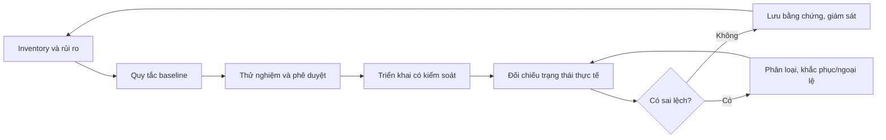

# Configuration baseline: Đường chuẩn cấu hình để bảo đảm an toàn hệ thống

## 1. Configuration baseline là gì?

**Configuration baseline** (đường chuẩn cấu hình) là tập hợp các giá trị, trạng thái và quy tắc cấu hình **đã được xác định phạm vi, kiểm tra, phê duyệt và quản lý phiên bản** cho một loại tài sản hoặc một hệ thống tại một thời điểm. Baseline là mốc tham chiếu để triển khai cấu hình nhất quán, kiểm soát thay đổi và phát hiện sai lệch (*configuration drift*).

Trong **configuration assurance**, câu hỏi cốt lõi không chỉ là “máy chủ có cấu hình an toàn không?” mà là:

1. Cấu hình nào được tổ chức chấp thuận, áp dụng cho tài sản nào, trong môi trường nào?
2. Vì sao các giá trị đó đáp ứng yêu cầu bảo mật và rủi ro đã xác định?
3. Có bằng chứng đáng tin cậy rằng cấu hình đang chạy phù hợp với baseline đã phê duyệt không?
4. Khi có thay đổi hoặc sai lệch, ai phát hiện, ai xử lý, và kết quả được ghi nhận như thế nào?

Ví dụ: một dịch vụ xử lý thanh toán chạy trên Kubernetes được yêu cầu không tự động gắn token của ServiceAccount, chạy với người dùng không phải root và chặn leo thang đặc quyền. Các yêu cầu trên chỉ trở thành một baseline hữu ích khi được chuyển thành **quy tắc có thể kiểm tra**, gắn với nhóm workload cụ thể, có phiên bản và có người chịu trách nhiệm.

Baseline có thể bao gồm cả yêu cầu vận hành như cấu hình logging, timeout, số bản sao hoặc giới hạn tài nguyên. Đối với *security assurance*, ta tập trung vào những giá trị ảnh hưởng đến bảo mật, nhưng vẫn đánh giá tác động của chúng đến tính sẵn sàng và khả năng vận hành.

### Phân biệt những khái niệm dễ nhầm

| Khái niệm | Vai trò | Ví dụ |
| --- | --- | --- |
| **Security objective** | Mục tiêu bảo vệ cần đạt | Workload không được leo thang đặc quyền |
| **Hardening guideline/standard** | Khuyến nghị hoặc quy tắc chuẩn hóa để giảm bề mặt tấn công | Hướng dẫn hardening của nhà cung cấp, CIS Benchmark phù hợp phiên bản |
| **Configuration baseline** | Bộ giá trị cụ thể đã phê duyệt cho phạm vi xác định | Với workload production: `allowPrivilegeEscalation: false` |
| **Desired state** | Cấu hình dự kiến từ mã khai báo hoặc hệ thống quản lý | Manifest Kubernetes được lưu trong Git |
| **Actual state** | Cấu hình thực tế quan sát từ hệ thống đang chạy | Giá trị đọc được từ Deployment, Pod và admission/audit logs |
| **Evidence** | Dữ liệu có nguồn gốc, thời gian và cách kiểm chứng rõ ràng | Kết quả kiểm tra kèm phiên bản baseline, định danh tài sản, thời điểm và bằng chứng gốc |

**Baseline không đồng nghĩa với ảnh máy chủ (golden image), tập lệnh hardening hay một checklist đã tích dấu.** Những thứ đó có thể là phương tiện triển khai hoặc kiểm tra baseline. Baseline phải trả lời được “giá trị chuẩn nào đang có hiệu lực?” và “ai đã chấp thuận?”.

## 2. Phạm vi và thành phần của một baseline

Một hệ thống thường có nhiều lớp cấu hình; mỗi lớp có nguồn cấu hình và phương pháp xác minh khác nhau:

| Lớp | Ví dụ nội dung baseline | Nguồn quan sát phù hợp |
| --- | --- | --- |
| Hệ điều hành, máy ảo | SSH, firewall, quyền tệp, đồng bộ thời gian, dịch vụ được phép | Bản cấu hình thực tế, công cụ quản lý máy chủ, lệnh kiểm tra chỉ đọc |
| Container/Kubernetes | Security context, image digest, quyền ServiceAccount, network policy | Manifest, admission policy, API server, trạng thái Pod |
| Cloud và mạng | IAM, public exposure, encryption, network ACL, audit logging | API cấu hình của cloud, IaC state/plan, log thay đổi |
| Cơ sở dữ liệu/ứng dụng | TLS, tài khoản đặc quyền, audit log, secret reference | API quản trị, truy vấn cấu hình được phép, runtime diagnostics |
| Công cụ triển khai | Quyền sửa pipeline, kiểm tra IaC, phê duyệt release | Repository, CI/CD logs, cấu hình runner và quyền truy cập |

Không có một baseline duy nhất phù hợp mọi môi trường. Chẳng hạn, cổng mở cho dịch vụ public production có thể không được phép trên cơ sở dữ liệu nội bộ. Vì vậy **mỗi baseline phải định danh rõ đối tượng áp dụng**: loại tài sản, phiên bản công nghệ, môi trường, khu vực mạng, độ quan trọng và các trường hợp loại trừ được phê duyệt.

Một hồ sơ baseline tối thiểu nên có:

- **Định danh và phiên bản:** mã baseline, trạng thái `draft/approved/retired`, phiên bản, thời điểm có hiệu lực.
- **Phạm vi và chủ sở hữu:** nhóm tài sản áp dụng, môi trường, chủ hệ thống, chủ kiểm soát và người phê duyệt.
- **Quy tắc có thể kiểm tra:** ID, cấu hình/điều kiện cần đạt, giá trị mong đợi, mức độ quan trọng, điều kiện áp dụng.
- **Lý do bảo mật:** yêu cầu hoặc rủi ro mà quy tắc xử lý; tham chiếu tài liệu hardening và phiên bản nguồn.
- **Phương pháp xác minh:** kiểm tra trước khi triển khai, lúc admission, trên runtime hoặc kết hợp; cách xác định PASS/FAIL/UNKNOWN.
- **Quản lý thay đổi:** repository/revision, lịch sử phê duyệt, quy trình rollback, các ngoại lệ có thời hạn.

Các giá trị bí mật như mật khẩu, private key và token **không được đưa trực tiếp vào baseline hoặc bằng chứng kiểm tra**. Baseline chỉ nên mô tả yêu cầu đối với cách tham chiếu, phân quyền, mã hóa và luân chuyển bí mật.

## 3. Từ mục tiêu bảo mật tới cấu hình có thể chứng minh

Một baseline mạnh có chuỗi truy vết:

`Rủi ro → Yêu cầu bảo mật → Quy tắc cấu hình → Cách kiểm tra → Bằng chứng → Quyết định`

Ví dụ cho nhóm dịch vụ Kubernetes:

| ID | Rủi ro/yêu cầu | Quy tắc baseline | Cách xác minh |
| --- | --- | --- | --- |
| K8S-01 | Workload không cần truy cập Kubernetes API phải tránh nhận token mặc định | `automountServiceAccountToken: false` | Kiểm tra PodSpec của workload và Pod được tạo |
| K8S-02 | Hạn chế tiến trình chạy với đặc quyền root | `runAsNonRoot: true`, xem cả cấu hình ghi đè ở container | Kiểm tra cấu hình hiệu lực và thử triển khai |
| K8S-03 | Giảm khả năng thực thi syscall nguy hiểm | `seccompProfile.type: RuntimeDefault` | Kiểm tra PodSpec và chính sách áp dụng |
| K8S-04 | Không cho container nâng quyền | `allowPrivilegeEscalation: false` cho mọi container thuộc phạm vi | Kiểm tra tất cả container và trường hợp ngoại lệ |

**Lưu ý:** giá trị cụ thể ở bảng là **ví dụ có điều kiện** cho nhóm workload phù hợp, không phải chính sách áp dụng mặc nhiên cho mọi cluster. Workload cần truy cập Kubernetes API phải được đánh giá quyền và cơ chế nhận token riêng; ứng dụng cần quyền ghi hoặc đặc quyền đặc biệt phải được thiết kế hoặc chấp thuận ngoại lệ trước khi áp dụng.

### Ví dụ một hồ sơ baseline dạng YAML

Đây là **định dạng minh họa để lưu quy tắc kiểm soát**, không phải một Kubernetes manifest hoặc tài nguyên có thể dùng trực tiếp với `kubectl apply`.

```yaml
baseline:
  id: K8S-WORKLOAD-PROD
  version: "1.2.0"
  state: approved
  scope:
    environment: production
    kind: Deployment
    selector: "security-tier=critical"
  owner: Platform Security
  approvedBy: Security and Operations
  sourceRevision: "<git-commit-sha>"

checks:
  - id: K8S-01
    path: spec.template.spec.automountServiceAccountToken
    operator: equals
    expected: false
    severity: high

  - id: K8S-02
    path: spec.template.spec.securityContext.runAsNonRoot
    operator: equals
    expected: true
    severity: high

  - id: K8S-03
    path: spec.template.spec.securityContext.seccompProfile.type
    operator: equals
    expected: RuntimeDefault
    severity: medium

  - id: K8S-04
    path: spec.template.spec.containers[*].securityContext.allowPrivilegeEscalation
    operator: allEqual
    expected: false
    severity: high
```

Trong một hệ thống kiểm tra thực tế, cần định nghĩa rõ cách xử lý trường không tồn tại, container bổ sung như init container và ephemeral container, cấu hình kế thừa/ghi đè, phiên bản Kubernetes, cũng như cơ chế đánh giá các điều kiện phụ thuộc. Chẳng hạn, `runAsNonRoot: true` tại mức Pod **có thể bị giá trị tại mức container ghi đè**. Chỉ kiểm tra một JSON path mà bỏ qua ngữ nghĩa hiệu lực có thể tạo ra kết quả PASS sai.

Với từng quy tắc, nên mô tả rõ:

1. **Applicability:** đối tượng nào phải tuân thủ; các ngoại lệ có điều kiện.
2. **Assertion:** điều kiện máy có thể kiểm tra; với tập nhiều container phải xét tất cả phần tử liên quan.
3. **Evaluation:** PASS nếu thỏa, FAIL nếu vi phạm, UNKNOWN nếu không thể quan sát hoặc thiếu quyền/dữ liệu.
4. **Remediation:** thay đổi nào là phù hợp và ai có quyền thực hiện.

## 4. Quy trình xây dựng và phê duyệt configuration baseline

### Bước 1. Lập danh mục tài sản và xác định phạm vi

Xác định phiên bản nền tảng, chủ sở hữu, vai trò nghiệp vụ, môi trường, độ nhạy dữ liệu, điểm kết nối mạng và các phụ thuộc. Không thể kết luận một hệ thống “tuân thủ baseline” nếu chưa xác định **mẫu số**: có bao nhiêu tài sản đáng lẽ phải được kiểm tra.

### Bước 2. Chọn nguồn chuẩn và phân tích rủi ro

Tham khảo hướng dẫn hardening của nhà cung cấp, CIS Benchmarks tương ứng phiên bản, yêu cầu kiến trúc và chính sách nội bộ. Chuyển các gợi ý thành yêu cầu phù hợp với hệ thống. Mọi điều chỉnh đối với khuyến nghị gốc phải ghi rõ lý do, tác động và người quyết định.

Ví dụ, vô hiệu hóa chức năng không cần thiết giúp giảm bề mặt tấn công; nhưng tắt một dịch vụ đang phục vụ backup hoặc monitoring có thể làm hỏng vận hành. Baseline phải được kiểm thử trên workload đại diện trước khi phê duyệt.

### Bước 3. Cụ thể hóa thành quy tắc và bài kiểm tra

Với mỗi mục tiêu, chỉ rõ giá trị mong đợi, cách đọc cấu hình, cách xác định kết quả, mức độ ưu tiên và hướng khắc phục. Ưu tiên quy tắc có thể kiểm tra tự động, nhưng ghi nhận cả những kiểm soát cần bằng chứng thủ công. Thiết kế kiểm tra để phân biệt **không đạt** và **chưa đủ dữ liệu**.

### Bước 4. Kiểm thử và phê duyệt phiên bản

Thử trên môi trường đại diện, đánh giá tác động bảo mật, độ ổn định, hiệu năng và khả năng rollback. Ghi nhận sự chấp thuận của cả chủ kiểm soát bảo mật và chủ vận hành theo quy trình của tổ chức. Đánh dấu phiên bản đã duyệt, bảo vệ nhánh lưu baseline và lưu thông tin về bản phát hành.

### Bước 5. Phổ biến và triển khai có kiểm soát

Áp dụng qua image, công cụ quản lý cấu hình, Infrastructure as Code, policy-as-code hoặc pipeline. Với thay đổi rộng, triển khai theo nhóm nhỏ/canary trước; đối chiếu kết quả thực tế với baseline, theo dõi lỗi và khả năng phục hồi.

### Bước 6. Theo dõi sai lệch và cập nhật

Đánh giá định kỳ, sau triển khai, sau thay đổi cấu hình và sau sự cố. Khi phiên bản nền tảng, yêu cầu kiểm soát hoặc bối cảnh rủi ro thay đổi, tạo phiên bản baseline mới qua quy trình đánh giá/phê duyệt. Phiên bản cũ cần giữ lại đủ lâu để truy vết các đợt triển khai và kết quả audit đã xảy ra.



## 5. Cách đánh giá tuân thủ baseline và thu thập bằng chứng

Đánh giá ở **nhiều thời điểm** giúp phát hiện các lớp sai lệch khác nhau:

| Thời điểm | Kiểm tra gì? | Giới hạn cần biết |
| --- | --- | --- |
| Trong pull request/CI | Manifest, IaC, image build, policy-as-code trước khi merge | Mã nguồn đúng chưa bảo đảm runtime đã được triển khai đúng |
| Trước hoặc khi triển khai | Policy admission, cấu hình deploy được gửi đến nền tảng | Có thể bỏ sót thay đổi trực tiếp sau khi deploy hoặc cấu hình động |
| Khi hệ thống đang chạy | Cấu hình hiệu lực qua API/runtime, log thay đổi, inventory | Chỉ có giá trị với tài sản thực sự được thu thập và trong khoảng thời gian xác định |
| Định kỳ/đột xuất | Phát hiện drift, thay đổi ngoài quy trình, ngoại lệ hết hạn | Chụp ảnh thời điểm không thể chứng minh tuân thủ liên tục giữa hai lần quét |

**Configuration drift** là sai khác giữa trạng thái thực tế và mốc tham chiếu được áp dụng. Drift có thể xuất phát từ thay đổi thủ công, bản cập nhật, cơ chế tự động hóa, cấu hình mặc định đổi theo phiên bản, hoặc do hệ thống chưa nhận phiên bản baseline mới. Một sai khác chưa đủ để khẳng định có tấn công; cần phân loại nguyên nhân và ảnh hưởng.

Mỗi kết quả kiểm tra nên ghi:

- Định danh duy nhất của tài sản và môi trường; phiên bản phần mềm/nền tảng liên quan.
- Mã quy tắc, **phiên bản baseline đang có hiệu lực**, giá trị mong đợi và giá trị quan sát.
- Thời điểm thu thập (kèm múi giờ), nguồn dữ liệu, phiên bản công cụ/quy tắc đánh giá.
- Kết quả `PASS`, `FAIL`, `UNKNOWN` hoặc `EXCEPTION` đã được chấp thuận; lý do và ID phát hiện.
- Liên kết hoặc hash tới bằng chứng gốc, lịch sử xử lý và thời điểm tái kiểm tra.

Ví dụ bản ghi minh họa khi phát hiện sai lệch:

```json
{
  "assetId": "cluster-prod-a/payments/payment-api",
  "baselineId": "K8S-WORKLOAD-PROD",
  "baselineVersion": "1.2.0",
  "ruleId": "K8S-02",
  "observedAt": "2026-11-28T03:00:00Z",
  "expected": true,
  "actual": false,
  "result": "FAIL",
  "evidenceRef": "audit://findings/CFG-1042"
}
```

Đây là **dữ liệu tình huống giả định**, không phải kết quả quét thật. Trong thực tế, bằng chứng phải được bảo vệ khỏi chỉnh sửa trái phép, giới hạn người xem và lưu theo thời hạn của tổ chức. Không thu thập secret dưới dạng rõ chỉ để chứng minh rằng secret tồn tại.

Một công cụ có thể báo `PASS` cho các tài sản nó nhìn thấy nhưng lại bỏ sót những tài sản chưa được gắn nhãn, chưa được inventory hoặc bị lỗi quyền truy cập. Vì vậy, báo cáo assurance cần trình bày đồng thời **độ bao phủ** và **kết quả của các tài sản đã kiểm tra**.

### Ví dụ tiêu chí chấp nhận của một đợt đánh giá

- 100% tài sản production thuộc phạm vi được nhận diện và phân loại là **đã kiểm tra** hoặc **chưa thể kiểm tra**; không tự động coi nhóm bị bỏ sót là PASS.
- Các quy tắc bắt buộc không có FAIL chưa xử lý. Ngoại lệ được ghi nhận riêng, kèm chấp thuận rủi ro và hạn hết hiệu lực.
- Bằng chứng đủ mới theo chu kỳ đã thống nhất với mức rủi ro của hệ thống. Ví dụ, tổ chức có thể yêu cầu kiểm tra ngay sau deploy và kiểm tra lại hàng ngày cho một nhóm tài sản quan trọng; đây là **ví dụ về chính sách nội bộ**, không phải ngưỡng bắt buộc chung.
- Phát hiện đã sửa phải được **retest** trên trạng thái thực tế và liên kết với bản ghi khắc phục.

## 6. Quản lý thay đổi, ngoại lệ và sai lệch

Baseline phải có kỷ luật quản lý thay đổi, vì “cấu hình chuẩn” chỉ có ý nghĩa khi không ai tự ý thay mốc chuẩn để hợp thức hóa một cấu hình đang sai.

### Thay đổi được phê duyệt

Khi cần sửa baseline, tạo yêu cầu thay đổi có lý do nghiệp vụ, rủi ro, phạm vi ảnh hưởng, đánh giá tác động, kế hoạch kiểm thử và rollback. Sau phê duyệt, phát hành baseline phiên bản mới, cập nhật cơ chế kiểm tra và theo dõi quá trình chuyển đổi của các tài sản đang áp dụng phiên bản cũ. Khi so sánh drift, luôn đối chiếu với **phiên bản áp dụng cho tài sản tại thời điểm kiểm tra**.

### Ngoại lệ có kiểm soát

Có hệ thống chưa thể đáp ứng một quy tắc vì tương thích hoặc nhu cầu kỹ thuật. Ngoại lệ phải có tối thiểu: quy tắc được miễn, tài sản/phạm vi, lý do, đánh giá rủi ro còn lại, kiểm soát bù trừ nếu có, người phê duyệt, hạn hết hiệu lực và kế hoạch xử lý. **Ngoại lệ không làm quy tắc trở thành PASS**; báo cáo cần giữ trạng thái riêng để người đánh giá thấy mức rủi ro tồn tại.

### Xử lý drift

1. **Phát hiện:** xác nhận sai lệch giữa actual state và baseline có hiệu lực.
2. **Phân loại:** tìm nguồn thay đổi, mức độ nghiêm trọng, tài sản bị ảnh hưởng và thay đổi có được phê duyệt hay không.
3. **Ứng phó:** chặn rollout khi vi phạm gate, hoàn nguyên về cấu hình đúng, sửa qua pipeline hoặc áp dụng ngoại lệ được phê duyệt theo mức rủi ro.
4. **Xác minh:** kiểm tra lại runtime, xác nhận cấu hình hiệu lực và theo dõi tác động vận hành.
5. **Lưu dấu vết:** liên kết cảnh báo, change request, người xử lý, bằng chứng trước/sau và nguyên nhân gốc.

Không nên “chấp thuận” một drift chỉ bằng cách sửa desired state cho khớp với cấu hình thực tế. Đó là một yêu cầu thay đổi baseline và phải đi qua đánh giá bảo mật.

## 7. Tình huống thực tế: sai lệch trong môi trường production

Đội vận hành quản lý dịch vụ `payment-api` bằng GitOps. Baseline `K8S-WORKLOAD-PROD@1.2.0` yêu cầu `runAsNonRoot: true`. Trong một lần xử lý lỗi khẩn cấp, một thay đổi khiến container có cấu hình hiệu lực `runAsNonRoot: false`.

**Diễn biến và quyết định assurance:**

1. Bộ kiểm tra runtime phát hiện `K8S-02 = FAIL`, ghi rõ cluster, namespace, workload, thời điểm, baseline áp dụng và giá trị quan sát. Một khác biệt trong Git chỉ là tín hiệu bổ sung; kết quả từ runtime là bằng chứng của trạng thái thực tế tại thời điểm kiểm tra.
2. Nhóm phụ trách xác định đây là cấu hình vượt ngoài phạm vi được phê duyệt, đánh giá khả năng tiến trình chạy với đặc quyền không phù hợp và xác định những Pod đang bị ảnh hưởng.
3. Nếu không có ngoại lệ khẩn cấp hợp lệ, nhóm khắc phục qua cấu hình được quản lý, triển khai lại có kiểm soát và xác minh cả Deployment lẫn Pod mới. Nếu thay đổi là cần thiết, phải có phê duyệt rủi ro, thời hạn và kiểm soát bù trừ.
4. Bộ đánh giá chạy lại quy tắc, cập nhật kết quả theo thời điểm mới và giữ bản ghi FAIL trước đó. Việc một lần kiểm tra sau đạt PASS không xóa lịch sử khoảng thời gian đã vi phạm.

Đây là điểm khác biệt giữa **kiểm tra cấu hình đơn lẻ** và **configuration assurance**: tổ chức không chỉ phát hiện giá trị sai, mà còn có thể chứng minh phạm vi ảnh hưởng, quyết định xử lý, người chịu trách nhiệm và kết quả khắc phục.

## 8. Đo lường hiệu quả assurance

Một số chỉ số giúp nhìn đúng tình hình, nhưng cần công bố cách tính:

| Chỉ số | Ý nghĩa | Lưu ý |
| --- | --- | --- |
| **Coverage** | Số tài sản trong phạm vi có bằng chứng kiểm tra hợp lệ / tổng tài sản phải kiểm tra | Tài sản chưa thấy hoặc scan lỗi vẫn nằm ở mẫu số |
| **Compliance rate** | Số cặp tài sản–quy tắc áp dụng có PASS / tổng số cặp đã đánh giá hợp lệ | Báo riêng FAIL, UNKNOWN và EXCEPTION; không gộp ngoại lệ vào PASS |
| **Drift rate** | Số tài sản có ít nhất một sai lệch / tổng tài sản được quan sát | Chỉ số phụ thuộc tần suất và độ bao phủ quét |
| **Time to remediate** | Thời gian từ phát hiện đến xác minh đã khắc phục | Phân nhóm theo mức độ nghiêm trọng |
| **Exception aging** | Số lượng và tuổi của ngoại lệ đang có hiệu lực hoặc quá hạn | Kiểm soát nguy cơ ngoại lệ kéo dài vô thời hạn |

Với tài sản không xác định được phiên bản baseline, không truy xuất được runtime hoặc thiếu bằng chứng, trạng thái đúng là **UNKNOWN / chưa đánh giá được**, thay vì kết luận tuân thủ. Nên ưu tiên cải thiện inventory, quyền thu thập và tính chính xác của rule evaluator trước khi dùng tỷ lệ PASS làm thước đo thành công.

## 9. Những sai lầm thường gặp

- **Sao chép benchmark nguyên trạng:** áp dụng mọi thiết lập mà không đánh giá phiên bản, chức năng và mức rủi ro; gây gián đoạn hoặc tạo ngoại lệ không kiểm soát.
- **Có file cấu hình nhưng không có baseline được phê duyệt:** không xác định được ai cho phép thay đổi hoặc phiên bản nào đúng.
- **Chỉ kiểm tra mã nguồn/IaC:** bỏ sót thay đổi qua console, API, runtime hoặc chính sách được ghi đè.
- **Báo PASS khi kiểm tra thất bại:** nhầm thiếu dữ liệu, thiếu quyền hay tài sản ngoài phạm vi với tuân thủ.
- **Quét được nhưng không theo dõi khắc phục:** không có owner, SLA, retest hoặc lịch sử đóng phát hiện.
- **Ngoại lệ vô thời hạn:** biến một kiểm soát quan trọng thành khuyến nghị không có hiệu lực.
- **Lưu bằng chứng quá nhiều dữ liệu nhạy cảm:** snapshot cấu hình lộ token, chứng chỉ, khóa hoặc dữ liệu khách hàng.

## 10. Tự kiểm tra kiến thức

1. Một repository IaC đã vượt qua policy check, nhưng cấu hình cloud thực tế bị chỉnh bằng console. Những nguồn bằng chứng nào cần bổ sung để đánh giá assurance?
2. Một tài sản không có quyền truy xuất cấu hình runtime. Nên ghi kết quả PASS, FAIL hay UNKNOWN? Việc này ảnh hưởng ra sao đến coverage?
3. Một nhóm muốn vô hiệu hóa tạm thời quy tắc hardening vì sự cố vận hành. Hồ sơ ngoại lệ cần những gì và khi nào phải kiểm tra lại?
4. Vì sao phải lưu phiên bản baseline cùng thời điểm quan sát khi phát hiện drift?

**Gợi ý:** Một câu trả lời tốt phải chỉ ra được phạm vi tài sản, mốc cấu hình được phê duyệt, bằng chứng thực tế, cách phân loại sai lệch và quyền quyết định xử lý.

## 11. Tài liệu tham khảo để tra cứu sâu

- **NIST SP 800-128** – *Guide for Security-Focused Configuration Management of Information Systems*: tư duy quản lý cấu hình gắn với mục tiêu bảo mật.
- **NIST SP 800-53**, họ kiểm soát **CM** – đặc biệt CM-2 (Baseline Configuration), CM-3 (Configuration Change Control), CM-6 (Configuration Settings): đối chiếu giữa baseline, thay đổi và thiết lập cấu hình.
- **CIS Benchmarks** và hướng dẫn hardening chính thức của nhà cung cấp: nguồn tham khảo các thiết lập, cần chọn đúng phiên bản sản phẩm và điều chỉnh theo bối cảnh.
- **Kubernetes Documentation**, các chủ đề *Security Context*, *Pod Security Standards* và *Admission Controllers*: tham khảo ngữ nghĩa cấu hình và cách thực thi policy cho workload.

Configuration baseline tạo ra **mốc so sánh có thể kiểm chứng** cho hoạt động security assurance liên tục. Giá trị của nó nằm ở mối liên kết đầy đủ giữa yêu cầu bảo mật, trạng thái được duyệt, trạng thái quan sát, bằng chứng và trách nhiệm xử lý khi hai trạng thái khác nhau.
