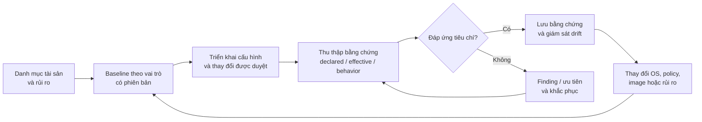

# Cấu hình hệ điều hành trong Security Assurance

## 1. Vì sao cấu hình hệ điều hành cần được bảo đảm?

Hệ điều hành (Operating System, OS) kiểm soát tài khoản, tiến trình, tệp, thiết bị, mạng và nhật ký hoạt động của một máy. Một ứng dụng có thể được viết an toàn nhưng vẫn bị đặt vào rủi ro nếu máy chủ cho phép đăng nhập quản trị qua kênh không phù hợp, mở cổng không cần thiết, thiếu bản vá hoặc không ghi nhận các sự kiện quan trọng.

Trong **Configuration assurance** của chương trình **SECURITY_SECURITY_ASSURANCE**, mục tiêu không dừng ở việc “đã harden máy”. Ta phải **cung cấp bằng chứng có thể kiểm tra** rằng cấu hình hệ điều hành trên từng nhóm tài sản đáp ứng mục tiêu bảo mật, yêu cầu và các security control đã phê duyệt; phát hiện sai lệch; đánh giá rủi ro; khắc phục và xác minh lại trong suốt quá trình phát triển, vận hành.

Ba khái niệm cần phân biệt:

- **Secure configuration (cấu hình an toàn):** tập lựa chọn về tài khoản, quyền, dịch vụ, giao thức, nhật ký, bảo vệ dữ liệu... phù hợp với chức năng và rủi ro của máy.
- **Hardening (gia cố):** các thao tác đưa hệ điều hành về cấu hình đã định, chẳng hạn tắt dịch vụ thừa hoặc yêu cầu xác thực mạnh hơn.
- **Configuration assurance (bảo đảm cấu hình):** xác định điều gì *phải đúng*, thu thập bằng chứng điều gì *đang đúng*, kết luận mức tuân thủ và duy trì trạng thái đó theo thời gian.

Ví dụ, việc đặt `PermitRootLogin no` trong một tệp cấu hình SSH chưa đủ chứng minh rằng đăng nhập root từ xa đã bị vô hiệu hóa. Cần xét cấu hình SSH **có hiệu lực** (có thể chịu tác động của `Include` hoặc `Match`), kiểm tra dịch vụ đang dùng cấu hình đó và, với kiểm soát quan trọng, thử nghiệm hành vi đăng nhập trong phạm vi được phép.

### Kết quả học tập

Sau bài này, người học có thể:

1. Xây dựng baseline cấu hình theo vai trò và mức độ rủi ro của hệ điều hành Linux/Windows.
2. Kiểm tra cấu hình đã khai báo, cấu hình có hiệu lực và hành vi thực tế của một security control.
3. Gắn kết quả kiểm tra với bằng chứng, phiên bản baseline, tài sản và người chịu trách nhiệm.
4. Thiết kế quy trình thay đổi, phát hiện configuration drift và xử lý ngoại lệ có thời hạn.

## 2. Xác định phạm vi trước khi đặt baseline

Một baseline áp dụng cho mọi máy thường gây sai lệch: máy bastion, máy cơ sở dữ liệu, máy trạm người dùng và domain controller không có cùng dịch vụ, luồng mạng hay yêu cầu quản trị. Cần lập danh mục tài sản trước khi kiểm thử.

| Thông tin cần có | Ví dụ | Ảnh hưởng đến đánh giá |
|---|---|---|
| Định danh và chủ sở hữu | `asset_id`, nhóm vận hành, môi trường | Ai chịu trách nhiệm xử lý phát hiện |
| Nền tảng và vòng đời | Linux distribution/Windows edition, bản phát hành, kiến trúc CPU | Control nào được hỗ trợ; hệ điều hành còn được bảo trì không |
| Vai trò máy | Bastion, web server, database, workstation | Cổng, tài khoản, dịch vụ và ngoại lệ nào hợp lệ |
| Mức độ nhạy cảm | Dữ liệu cá nhân, bí mật, production hay lab | Mức ưu tiên kiểm soát và thời gian khắc phục |
| Nguồn quản lý cấu hình | Golden image, Ansible, Group Policy, MDM, cloud-init | Nơi phải sửa để thay đổi bền vững |
| Ràng buộc dịch vụ | Phụ thuộc ứng dụng, cửa sổ bảo trì, khả năng truy cập khẩn cấp | Cách thử nghiệm và kế hoạch rollback |

**Phạm vi trách nhiệm** phải rõ. Đối với máy ảo tự quản lý, nhóm vận hành thường chịu trách nhiệm OS, tài khoản, cấu hình dịch vụ và agent. Với dịch vụ quản lý (managed service), một số lớp OS do nhà cung cấp kiểm soát: chỉ kiểm thử các thiết lập và bằng chứng mà khách hàng có quyền quản lý. Với container, phân biệt cấu hình **host/kernel**, container runtime và image/container; kiểm tra cấu hình bên trong container không thay thế đánh giá host.

Baseline nên được **phiên bản hóa**, có người phê duyệt và ánh xạ về yêu cầu/rủi ro: ví dụ `baseline/linux-bastion/v3`, `baseline/windows-member-server/v2`. Có thể dùng các tài liệu như CIS Benchmarks, hướng dẫn nhà cung cấp và tiêu chuẩn nội bộ làm điểm khởi đầu, nhưng phải chọn phiên bản phù hợp và điều chỉnh theo chức năng hệ thống. Một khuyến nghị bảo mật không tự động trở thành yêu cầu bắt buộc cho mọi máy.

## 3. Các miền cấu hình phải đánh giá

Một bảng điều khiển “compliant/non-compliant” chỉ có ý nghĩa khi mỗi mục có tiêu chí đạt và nguồn chứng cứ cụ thể.

| Miền kiểm soát | Mục tiêu/tiêu chí kiểm tra mẫu | Bằng chứng phù hợp |
|---|---|---|
| **Vòng đời và bản vá** | OS còn được hỗ trợ; bản vá cần thiết được triển khai theo mức rủi ro và cửa sổ bảo trì | Phiên bản/build, inventory bản vá, lịch sử triển khai, trạng thái lỗ hổng |
| **Danh tính và xác thực** | Tài khoản dùng đúng mục đích, chính sách đăng nhập từ xa phù hợp, tài khoản không sử dụng bị vô hiệu hóa | Cấu hình xác thực có hiệu lực, danh sách tài khoản, log đăng nhập, kết quả kiểm thử |
| **Đặc quyền** | Quyền quản trị chỉ cấp cho nhóm/định danh đã phê duyệt; tài khoản dịch vụ tối thiểu quyền | Thành viên nhóm admin/sudo, chính sách phân quyền, bản ghi rà soát quyền |
| **Dịch vụ và cổng** | Chỉ những dịch vụ/cổng cần cho vai trò máy mới được kích hoạt và có đường truy cập hợp lệ | Danh sách tiến trình, cổng lắng nghe, firewall OS và kiểm thử mạng |
| **Bảo vệ mạng** | Luồng vào/ra phù hợp với kiến trúc, chính sách host firewall đang hoạt động | Quy tắc thực tế, trạng thái profile, kết quả thử kết nối từ vùng mạng cụ thể |
| **Bảo vệ kernel/tiến trình** | Các cơ chế giảm thiểu khai thác và mandatory access control thích hợp được bật | Trạng thái SELinux/AppArmor, cấu hình exploit protection, agent được hỗ trợ |
| **Dữ liệu và hệ thống tệp** | Mã hóa khi lưu trữ nếu bắt buộc; quyền truy cập tệp nhạy cảm được giới hạn | Trạng thái mã hóa, chính sách cấp khóa, ACL/permission và phép thử truy cập |
| **Ghi log và giám sát** | Sự kiện xác thực, tăng quyền, thay đổi quan trọng được ghi và chuyển về nơi giám sát | Chính sách audit, log thực tế, thời gian nhận tại SIEM, cảnh báo thử nghiệm |
| **Bảo vệ điểm cuối** | Công cụ bảo vệ được yêu cầu hoạt động, cập nhật và báo trạng thái về hệ thống quản lý | Trạng thái EDR/antimalware, agent heartbeat, chính sách quản lý |
| **Khôi phục và tính sẵn sàng** | Có backup/khôi phục phù hợp, thời gian được đồng bộ, thay đổi có rollback | Bản ghi backup, kết quả thử restore, trạng thái đồng bộ thời gian |

Để tránh kiểm tra hình thức, mỗi dòng trong baseline nên có tối thiểu: `control_id`, mục tiêu, đối tượng áp dụng, giá trị kỳ vọng, phương pháp đo, nguồn bằng chứng, mức ưu tiên, chủ sở hữu và chu kỳ đánh giá.

### Kiểm tra ở ba lớp

1. **Khai báo (declared):** file cấu hình, registry, template, GPO, chính sách IaC nói gì?
2. **Hiệu lực (effective):** dịch vụ/OS thực tế sử dụng giá trị nào sau khi xét kế thừa, override, chính sách ưu tiên và trạng thái runtime?
3. **Hành vi (behavioral):** control thực sự chặn hoặc ghi nhận tình huống đã định? Ví dụ luồng truy cập trái phép bị từ chối và ghi log hay không?

Không phải mọi control đều cần kiểm thử hành vi trên production. Hãy ưu tiên theo rủi ro, dùng môi trường thử hoặc canary khi phép kiểm tra có thể ảnh hưởng dịch vụ. Kết quả chỉ đọc cấu hình nên được ghi rõ là “configuration check”, tránh diễn giải thành bằng chứng toàn diện về hiệu quả kiểm soát.

## 4. Linux: xác minh cấu hình hệ điều hành

Các lệnh dưới đây là **ví dụ kiểm tra chỉ đọc** trên máy Linux dùng systemd/OpenSSH. Tính khả dụng tùy distribution, vai trò máy và gói đã cài. Chạy với tài khoản được ủy quyền; lệnh yêu cầu `sudo` cần quyền phù hợp.

```bash
# Bản phát hành, kernel và các dịch vụ/cổng mạng
cat /etc/os-release
uname -r
systemctl list-unit-files --type=service --state=enabled
sudo ss -lntup

# Chính sách SSH sau khi OpenSSH xử lý cấu hình và các Match
sudo sshd -T -C user=root,host=bastion.example.internal,addr=192.0.2.10 \
  | grep -E '^(permitrootlogin|passwordauthentication|pubkeyauthentication) '

# Ví dụ cho host dùng nftables: cấu hình firewall đang được nạp
sudo nft list ruleset

# Trạng thái auditd, nếu máy dùng auditd
systemctl is-enabled auditd
systemctl is-active auditd

# Kiểm tra Mandatory Access Control nếu nền tảng có hỗ trợ
getenforce      # SELinux
sudo aa-status  # AppArmor
```

**Diễn giải cẩn thận:**

- `systemctl list-unit-files` chỉ cho biết unit được bật khởi động, không chứng minh tiến trình đang chạy hoặc cổng đang lắng nghe. Đối chiếu `systemctl is-active`, `ss` và inventory dịch vụ.
- `sshd -T -C ...` cho biết thiết lập OpenSSH sau khi tính đến điều kiện `Match` cho ngữ cảnh kiểm tra đã chọn. Cần dùng ngữ cảnh người dùng/nguồn kết nối phù hợp; kết quả này chưa tự chứng minh đường mạng đã chặn hoặc xác thực đã hoạt động đúng.
- `nft list ruleset` hữu ích khi nftables là cơ chế sử dụng; các host quản lý firewall bằng UFW, firewalld hay công cụ khác cần thu thập thêm trạng thái tương ứng và kiểm tra chính sách thực sự được nạp.
- SELinux và AppArmor không tồn tại đồng thời trên mọi bản Linux. Một lệnh không có sẵn là tín hiệu cần xác định công nghệ áp dụng, không tự động là lỗi cấu hình.
- Đối với `sudo`, PAM, các tệp trong `/etc/ssh/sshd_config.d/`, các chính sách từ identity provider và image/cloud-init, phải kiểm tra nguồn tạo cấu hình và thứ tự ưu tiên. Không chỉ đọc một tệp rồi kết luận.

**Ví dụ tiêu chí kiểm soát:** OS-SSH-01 yêu cầu máy bastion cấm đăng nhập trực tiếp bằng tài khoản root qua SSH. Giá trị kỳ vọng là `permitrootlogin no`, đo bằng `sshd -T` với ngữ cảnh phù hợp, sau đó xác nhận bằng phép thử kết nối được phê duyệt. Nếu kết quả là `prohibit-password`, root vẫn có thể đăng nhập bằng phương thức khác nên **không đạt** tiêu chí “cấm hoàn toàn”. Chính sách tài khoản khẩn cấp phải được giải quyết bằng cơ chế riêng có kiểm soát.

### Những cấu hình Linux thường cần xem xét sâu hơn

- **Xác thực và phân quyền:** quyền nhóm `sudo`, giới hạn tài khoản dịch vụ, quản trị khóa SSH, cấu hình PAM, thời hạn và thu hồi tài khoản.
- **Kernel và hệ thống tệp:** chính sách `sysctl` phù hợp vai trò, quyền trên tệp nhạy cảm, mount options, SELinux/AppArmor, Secure Boot nếu được yêu cầu và hỗ trợ.
- **Dịch vụ nền:** daemon không phục vụ nhiệm vụ máy, cơ chế sandbox của systemd khi phù hợp, bảo vệ secret trong môi trường chạy.
- **Theo dõi và kiểm toán:** quy tắc audit, journal/syslog, chuyển log, đồng bộ thời gian, nhận biết mất log hoặc thiếu dung lượng.
- **Bản vá:** trạng thái package và kernel đang chạy; lưu ý cài một bản kernel mới không chứng minh máy đã khởi động vào bản đó.

Không tự động áp một giá trị `sysctl`, mount option hay quy tắc firewall cho toàn bộ fleet: một thay đổi có thể phá yêu cầu định tuyến, container runtime, hệ thống tệp hoặc kết nối vận hành.

## 5. Windows: kiểm tra chính sách có hiệu lực

Với Windows Server và Windows workstation, cấu hình có thể đến từ Local Security Policy, Group Policy, MDM, registry, security baseline, công cụ quản lý endpoint và phần mềm bên thứ ba. Đọc riêng local setting có thể không phản ánh giá trị mà hệ điều hành thực thi.

Các lệnh PowerShell/công cụ tích hợp sau dùng để **quan sát**, không tự chỉnh chính sách:

```powershell
# Phiên bản hệ điều hành và build
Get-ComputerInfo -Property WindowsProductName,WindowsVersion,OsBuildNumber

# Hồ sơ firewall và hành động mặc định theo chính sách đang áp dụng
Get-NetFirewallProfile -PolicyStore ActiveStore |
  Select-Object Name, Enabled, DefaultInboundAction, DefaultOutboundAction

# Cổng TCP đang lắng nghe
Get-NetTCPConnection -State Listen |
  Select-Object LocalAddress, LocalPort, OwningProcess

# Thành viên nhóm Administrators tích hợp (SID tránh lệ thuộc tên ngôn ngữ)
Get-LocalGroupMember -SID 'S-1-5-32-544'

# Chính sách audit thực tế; kết quả phụ thuộc ngôn ngữ hệ điều hành
auditpol /get /category:*

# Thông tin áp dụng Group Policy ở phạm vi máy
gpresult /scope computer /r

# Chỉ dùng khi Microsoft Defender Antivirus hiện diện
Get-MpComputerStatus |
  Select-Object AMServiceEnabled, AntivirusEnabled, RealTimeProtectionEnabled
```

**Ý nghĩa bằng chứng:**

- Profile firewall “Enabled” chưa chứng minh từng luồng mạng được chặn; cần xét rule hiệu lực, ngoại lệ và kiểm thử từ phân đoạn mạng tương ứng.
- Danh sách local administrator phải được đối chiếu danh tính nhóm miền, nhóm được cho phép và quyền quản trị tạm thời. Tên nhóm thành viên chưa đủ để kết luận ai có thể sử dụng quyền.
- `gpresult` giúp biết GPO nào áp dụng, nhưng cần kiểm tra riêng giá trị hiệu lực của control, chẳng hạn audit policy hoặc host firewall; Group Policy có thể bị thay đổi bởi các tầng quản lý khác tùy tính năng.
- Nếu môi trường dùng EDR khác Microsoft Defender, phải kiểm chứng **agent đang triển khai** bằng cơ chế quản lý của sản phẩm đó. Không suy ra thiếu bảo vệ chỉ vì cmdlet Defender không trả về dữ liệu.
- Các cấu hình BitLocker, Credential Guard, AppLocker/WDAC, RDP, WinRM, SMB, TLS và cập nhật Windows cần được đánh giá theo phiên bản, edition, phần cứng và vai trò máy; không phải chức năng nào cũng sẵn có cho mọi đối tượng.

Một máy được thiết lập firewall đúng hôm nay vẫn có thể bị thay đổi bởi GPO hoặc tác vụ quản trị ở lần đồng bộ kế tiếp. Vì vậy nguồn cấu hình phải được quản lý tập trung, kiểm tra cả policy đang áp dụng và quan sát lại sau các sự kiện thay đổi.

## 6. Quy trình Configuration Assurance từ thiết kế đến vận hành



**Bước 1 — Chọn mục tiêu và phạm vi.** Ví dụ, “chỉ cổng quản trị được phê duyệt mới truy cập máy chủ từ mạng quản trị”. Ràng buộc control với tài sản, luồng mạng, threat/risk tương ứng và người phê duyệt.

**Bước 2 — Định nghĩa baseline đo được.** Viết điều kiện theo dạng quan sát được: “đối với `linux-bastion`, SSH root trực tiếp bị vô hiệu hóa”, thay vì chỉ “SSH phải an toàn”. Nêu rõ control bắt buộc, điều kiện không áp dụng và ngoại lệ hợp lệ.

**Bước 3 — Triển khai và quản lý thay đổi.** Dùng image chuẩn, Ansible, GPO/MDM hoặc công cụ tương đương. Với control ảnh hưởng khả năng đăng nhập hay đường mạng, cần thử trên canary, kiểm tra cú pháp/chính sách và giữ phương án truy cập, phục hồi đã kiểm chứng.

**Bước 4 — Đánh giá và thu thập chứng cứ.** Scanner tự động xác minh nhiều máy; người vận hành kiểm tra mẫu những control rủi ro cao. So sánh trạng thái thực tế với baseline **đúng phiên bản, đúng nhóm tài sản**. Đặt kết quả `PASS`, `FAIL`, `NOT_APPLICABLE` hoặc `INCONCLUSIVE` cùng lý do; không ép lỗi truy cập scanner thành `PASS`.

**Bước 5 — Xử lý phát hiện.** Mỗi sai lệch có mức rủi ro, người xử lý, hạn, điều kiện kiểm tra lại và liên kết tới ticket thay đổi. Với trường hợp không thể tuân thủ, sử dụng ngoại lệ đã phê duyệt có lý do, biện pháp bù trừ và ngày hết hạn.

**Bước 6 — Theo dõi liên tục.** Đánh giá lại sau khi tạo máy, thay image, vá hệ điều hành, đổi policy, thay nhóm admin hoặc theo lịch. Configuration drift là sự khác biệt giữa trạng thái kỳ vọng và trạng thái thực tế tại một thời điểm; drift có thể đến từ thao tác tay, GPO/MDM, tác vụ khởi động hoặc ứng dụng.

## 7. Thiết kế bằng chứng có thể truy vết

Một ảnh chụp màn hình không gắn với tài sản và thời điểm rất khó tái kiểm tra. Mỗi kết quả nên chứa các trường sau:

| Nhóm dữ liệu | Trường tiêu biểu |
|---|---|
| Định danh | `asset_id`, môi trường, vai trò, OS/version, hostname hoặc cloud resource ID |
| Control | `control_id`, phiên bản baseline, mức độ ưu tiên, giá trị kỳ vọng |
| Thu thập | Scanner/phiên bản, phương pháp/lệnh, thời điểm UTC, người hoặc service identity thực thi |
| Kết quả | Giá trị quan sát, trạng thái, lỗi kiểm tra, phạm vi mẫu, tham chiếu bằng chứng thô |
| Truy vết | Finding/ticket, người sở hữu, quyết định ngoại lệ, lần kiểm tra lại, lịch sử thay đổi |

Ví dụ bản ghi **minh họa**, chưa phải kết quả đo từ hệ thống thực:

```yaml
asset_id: vm-bastion-01
os_family: linux
asset_role: bastion
control_id: OS-SSH-01
baseline_version: linux-bastion-v3
expected: "permitrootlogin no"
observed: "permitrootlogin prohibit-password"
check_method: "sshd -T -C user=root,host=bastion.example.internal,addr=192.0.2.10"
checked_at_utc: "2026-11-28T03:00:00Z"
result: FAIL
finding_id: SEC-204
owner: platform-ops
evidence_ref: "evidence/SEC-204/ssh-effective-config.txt"
```

Cần lưu đủ đầu ra để người khác kiểm tra lại kết luận, đồng thời giới hạn truy cập vào evidence. Log, policy, tên tài khoản hoặc danh sách cổng có thể tiết lộ thông tin nhạy cảm; cần che secret/token, lưu theo phân quyền, chính sách retention và bảo vệ tính toàn vẹn (chẳng hạn hash hoặc cơ chế lưu trữ có audit trail). Một dòng `PASS` trong dashboard không thay thế bản ghi gốc và logic đánh giá.

**Những câu hỏi khi review bằng chứng:** Máy được đo có đúng máy trong inventory không? Thời điểm đo trước hay sau lần thay đổi cuối? Phương pháp có đặc quyền đầy đủ và hỗ trợ OS đó không? Scanner có đọc chính sách hiệu lực không? Một kiểm tra thất bại do thiếu quyền truy cập có đang bị bỏ qua không?

## 8. Kiểm soát drift và tự động hóa

Tự động hóa có thể thực hiện ở hai thời điểm bổ trợ nhau:

- **Trước triển khai:** kiểm tra golden image, template, policy hoặc pipeline để giảm khả năng cấu hình sai được đưa vào môi trường; chặn bản build nếu control bắt buộc không đạt.
- **Sau triển khai:** kiểm tra host thực tế định kỳ và khi có sự kiện thay đổi; đo độ lệch giữa desired state và effective state; theo dõi đến khi khắc phục xong.

Ví dụ quy tắc đánh giá ở mức ý tưởng:

```text
Áp dụng OS-SSH-01 khi:
  asset.role == "bastion" AND asset.os_family == "linux"

PASS khi:
  scan.error == null
  AND scan.ssh.effective.permitrootlogin == "no"

FAIL khi:
  thu thập thành công nhưng giá trị khác "no"

INCONCLUSIVE khi:
  không đọc được cấu hình hiệu lực hoặc không biết OS/role

NOT_APPLICABLE khi:
  asset ngoài phạm vi control và lý do được ghi nhận
```

Không nên tự động “sửa mọi drift” mà không đánh giá tác động: reset firewall có thể ngắt quản trị, thay đổi PAM/SSH có thể khóa tài khoản, thay đổi audit có thể ảnh hưởng dung lượng hoặc hiệu năng. Với thay đổi rủi ro cao, ưu tiên canary, cửa sổ bảo trì, kiểm tra kết nối khẩn cấp, rollback và quan sát sau triển khai.

Một số **chỉ số assurance** có ích là:

- **Độ phủ đánh giá:** số tài sản trong phạm vi đã kiểm tra thành công / tổng tài sản trong phạm vi.
- **Tỷ lệ đạt:** số kiểm soát áp dụng và kiểm tra thành công có trạng thái `PASS` / tổng số kiểm soát áp dụng và kiểm tra thành công. Công bố riêng `INCONCLUSIVE` và ngoại lệ, không giấu chúng khỏi mẫu số tổng quan.
- **Tuổi bằng chứng:** thời gian từ lần đo gần nhất; bằng chứng cũ phải được gắn cờ.
- **Thời gian xử lý finding:** từ lúc phát hiện đến lúc xác minh lại đạt; có thể phân nhóm theo mức độ nghiêm trọng.
- **Tỷ lệ drift tái diễn:** control hoặc tài sản sai lệch trở lại sau khi đã khắc phục.

Một hệ thống có 100% số lần kiểm tra đạt nhưng mới quét 20% máy chủ không đủ cơ sở để kết luận toàn bộ fleet tuân thủ.

## 9. Tình huống thực hành: xác minh SSH trên máy bastion

**Bối cảnh:** một máy Linux bastion phục vụ quản trị từ mạng nội bộ. Nhóm đã phê duyệt yêu cầu OS-SSH-01: không đăng nhập trực tiếp bằng root qua SSH; quản trị viên sử dụng tài khoản định danh và nâng quyền theo chính sách. Hệ thống cần giữ kênh khôi phục qua console được kiểm soát.

**Quan sát:** scanner đọc cấu hình có hiệu lực cho ngữ cảnh nguồn kết nối quản trị và nhận `permitrootlogin prohibit-password`. Một tệp cấu hình chung có thể chứa `PermitRootLogin no` nhưng bị override ở phần khác. Theo tiêu chí đã định, trạng thái là `FAIL` vì khóa công khai vẫn có thể cho phép root đăng nhập.

**Xử lý:** ghi lại đầu ra, phiên bản OS/OpenSSH, cấu hình hiệu lực, thời điểm và control ID; tạo finding với chủ sở hữu. Nhóm vận hành tìm nguồn ghi đè trong các tệp include, `Match` hoặc công cụ triển khai; sửa **nguồn quản lý cấu hình** theo quy trình thay đổi. Trước khi reload SSH, kiểm tra cú pháp (chẳng hạn `sshd -t`), thử trên canary và bảo đảm một đường quản trị/rollback đã được xác thực.

**Xác minh lại:** đo lại `sshd -T -C ...` với cùng ngữ cảnh; đối với control quan trọng, kiểm thử từ mạng được phép để xác nhận root trực tiếp bị từ chối trong khi tài khoản quản trị hợp lệ vẫn đăng nhập được. Lưu bằng chứng trước/sau, ticket, người phê duyệt và kết quả hành vi. Chỉ đóng finding khi tiêu chí đạt và hệ thống hoạt động bình thường.

Nếu ứng dụng phụ thuộc vào một phương thức đăng nhập đặc biệt, nhóm không được mặc định “PASS” vì có lý do kinh doanh: cần đánh giá rủi ro, tìm phương án thay thế hoặc phê duyệt **ngoại lệ có thời hạn, phạm vi cụ thể và kiểm soát bù trừ**.

## 10. Những sai lầm làm suy yếu kết luận assurance

| Sai lầm | Hậu quả | Cách xử lý |
|---|---|---|
| Chỉ so file cấu hình gốc | Bỏ qua override từ `Include`, `Match`, GPO, MDM hoặc runtime | Thu thập cấu hình hiệu lực và kiểm tra hành vi nếu cần |
| Áp một baseline cho mọi vai trò | False positive, phá tính sẵn sàng hoặc bỏ sót rủi ro riêng | Phân nhóm theo OS, chức năng, môi trường và mức rủi ro |
| Coi không quét được là đạt | Che khuất vùng thiếu quan sát | Ghi `INCONCLUSIVE`, điều tra quyền và khả năng kết nối của scanner |
| Kiểm tra một lần sau khi cài máy | Không phát hiện drift, bản vá hoặc chính sách mới | Quét theo sự kiện và chu kỳ; theo dõi tuổi bằng chứng |
| Chỉ đếm tỉ lệ đạt | Tỷ lệ cao vẫn có thể che finding nghiêm trọng hoặc phạm vi quét thấp | Báo riêng độ phủ, mức rủi ro, ngoại lệ, finding quá hạn |
| Tự động sửa cấu hình nhạy cảm ngay trên production | Nguy cơ mất kết nối, dừng dịch vụ | Canary, kiểm tra trước, triển khai theo đợt và rollback |
| Đóng finding khi đã sửa file | Không biết thay đổi có tác dụng hay không | Đọc lại cấu hình hiệu lực và xác minh hành vi |

## 11. Tiêu chí hoàn thành một lượt đánh giá

Một lượt assurance được xem là đủ hồ sơ khi có baseline đã phê duyệt, danh sách tài sản và control áp dụng, kết quả đo kèm thời điểm/phương pháp, bằng chứng truy vết được, các finding có chủ sở hữu, ngoại lệ rõ ràng và bằng chứng kiểm tra lại sau khắc phục. Báo cáo cuối phải cho thấy cả **điều đã được chứng minh** và **giới hạn của phép kiểm tra**.

**Câu hỏi tự kiểm tra:**

1. Vì sao giá trị trong một file SSH hoặc registry chưa đủ để khẳng định control đang hoạt động?
2. Máy Linux có firewall đang chạy nhưng vẫn mở cổng quản trị cho mọi mạng. Bạn cần bằng chứng bổ sung gì để đánh giá?
3. Một công cụ quét không truy cập được 30 máy trong 200 máy, còn 170 máy đều `PASS`. Có thể kết luận tỷ lệ tuân thủ của toàn bộ 200 máy là 100% không? Vì sao?
4. Khi GPO thay đổi chính sách firewall sau khi đội vận hành harden cục bộ, bạn sẽ sửa nguồn nào và xác minh lại ở những lớp nào?

Cấu hình hệ điều hành chỉ trở thành một **kết luận security assurance đáng tin cậy** khi có mục tiêu đo được, kiểm tra trạng thái hiệu lực, bằng chứng gắn với đúng tài sản và thời điểm, quy trình xử lý sai lệch và khả năng theo dõi liên tục.
