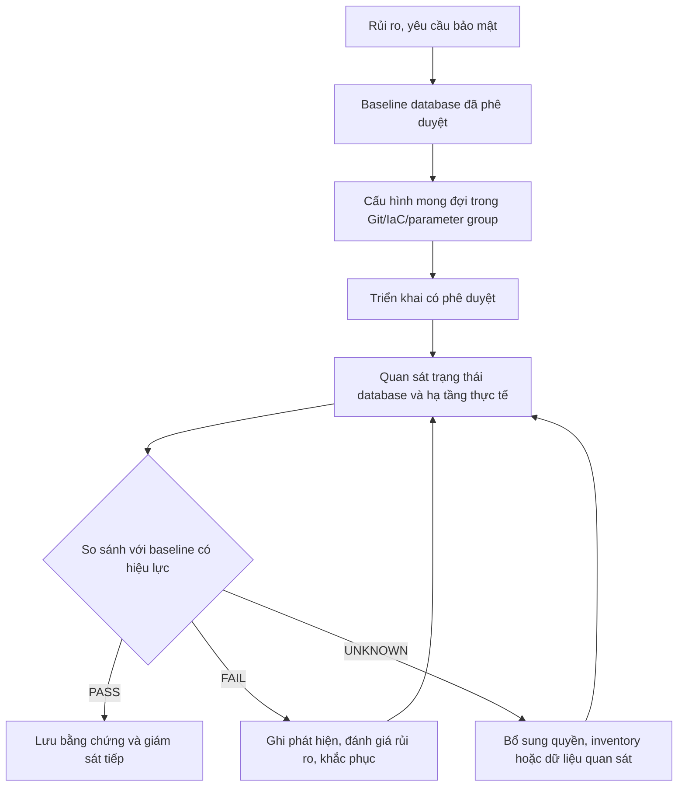

# Cấu hình database trong Configuration Assurance

## 1. Vì sao cấu hình database là một đối tượng security assurance?

Database thường lưu thông tin tài khoản, giao dịch, dữ liệu cá nhân, cấu hình nghiệp vụ và dữ liệu làm bằng chứng vận hành. Một hệ quản trị cơ sở dữ liệu (DBMS) có thể chạy ổn định nhưng vẫn tồn tại cấu hình làm lộ dữ liệu hoặc cho phép thay đổi trái phép: cổng quản trị mở rộng, tài khoản ứng dụng có quyền quá cao, kết nối không xác minh chứng chỉ, backup không được bảo vệ hay log không đủ để điều tra.

Trong module **SECURITY_SECURITY_ASSURANCE**, mục đích của **configuration assurance** là **tạo được bằng chứng đáng tin cậy rằng cấu hình database thực tế đáp ứng yêu cầu bảo mật đã phê duyệt**, đồng thời phát hiện, đánh giá và khắc phục sai lệch khi hệ thống thay đổi. Kiểm tra một tham số rồi báo “an toàn” là chưa đủ; cần biết tham số đó áp dụng cho instance nào, tại thời điểm nào, theo phiên bản baseline nào và có bị cơ chế khác ghi đè hay không.

Ba mục tiêu bảo mật quen thuộc tạo ra các yêu cầu khác nhau:

| Mục tiêu | Rủi ro do cấu hình sai | Bằng chứng cần tìm |
| --- | --- | --- |
| **Confidentiality** – bí mật | Người ngoài truy cập database qua public network; tài khoản đọc được bảng nhạy cảm | Đường mạng thực tế, TLS, quyền truy cập, cấu hình mã hóa và kiểm soát backup |
| **Integrity** – toàn vẹn | Tài khoản ứng dụng sửa schema, thay bảng giao dịch hoặc tắt audit | Quyền DDL/DML, phân tách vai trò, log thay đổi, phê duyệt cấu hình |
| **Availability** – sẵn sàng | Cạn kết nối, mất backup, replica không thể phục hồi, thao tác quản trị làm ngừng dịch vụ | Cấu hình pool/timeout, backup, kết quả restore, replication/HA và cảnh báo |

**Cấu hình an toàn không đồng nghĩa với ứng dụng an toàn.** SQL injection, lỗi kiểm soát truy cập nghiệp vụ hoặc dữ liệu đầu vào độc hại vẫn cần được đánh giá ở các lớp khác. Cấu hình database có thể giảm tác động của những lỗi đó, nhưng không thay thế secure coding, kiểm thử ứng dụng và quản lý lỗ hổng.

## 2. Xác định phạm vi trước khi đánh giá

Hệ thống có thể chứa nhiều database engine, instance, cluster, schema, tài khoản, replica và bản sao lưu. Để tránh kiểm tra thiếu, hãy lập danh mục tài sản với ít nhất:

- **Định danh tài sản:** instance/cluster ID, database name, môi trường, chủ sở hữu, nhãn dữ liệu và mức độ quan trọng.
- **Công nghệ:** PostgreSQL, MySQL, Microsoft SQL Server hoặc dịch vụ managed database; phiên bản engine, hệ điều hành và mô hình triển khai.
- **Đường truy cập:** địa chỉ/endpoint, network segment, cổng lắng nghe, các application client, hệ thống quản trị và đường replication/backup.
- **Nhận dạng và quyền:** tài khoản ứng dụng, tài khoản con người, vai trò quản trị, tài khoản máy và phương thức xác thực.
- **Dữ liệu và bản sao:** dữ liệu chính, replica, snapshot, backup, bản xuất dữ liệu, lưu trữ log và hệ thống phân tích dùng dữ liệu sao chép.
- **Nguồn cấu hình:** file, command-line, parameter group, API cloud, Infrastructure as Code (IaC), startup flag hoặc cấu hình runtime.

Phân biệt **self-managed DBMS** và **managed database service**. Với self-managed, tổ chức thường kiểm soát cấu hình DBMS, hệ điều hành, firewall và backup. Với managed database, nhà cung cấp kiểm soát một phần nền tảng; tổ chức vẫn chịu trách nhiệm với các thiết lập có thể thay đổi như network exposure, vai trò, parameter group, mã hóa, log và retention. Không thể xác minh một thiết lập bị nhà cung cấp quản lý bằng cách giả định nó luôn đúng; cần dùng tài liệu trách nhiệm chia sẻ, API và bằng chứng dịch vụ phù hợp.

### Mô hình đe dọa tối thiểu

Hãy đặt câu hỏi theo từng đường tấn công:

1. **Từ mạng:** ai có thể kết nối đến port DBMS? Có đường từ Internet, laptop quản trị, CI runner hoặc môi trường staging sang production không?
2. **Từ danh tính:** nếu lộ mật khẩu ứng dụng, tài khoản đó được đọc/sửa/xóa những gì? Có thể tạo user hoặc chạy lệnh nguy hiểm không?
3. **Từ kênh truyền:** client có buộc dùng TLS và kiểm tra đúng máy chủ không? Replication, ETL, backup có đi qua kênh bảo vệ không?
4. **Từ dữ liệu lưu trữ:** disk, snapshot, backup, export và log có cùng mức bảo vệ với database chính không?
5. **Từ vận hành:** ai có quyền đổi cấu hình, vô hiệu hóa audit, khôi phục snapshot và cấp quyền khẩn cấp?

Các câu trả lời giúp chọn kiểm soát theo rủi ro thay vì sao chép một checklist cho mọi database.

## 3. Những nhóm cấu hình cần đưa vào security baseline

**Configuration baseline** là bộ quy tắc và giá trị được phê duyệt cho một phạm vi tài sản. Bảng sau mô tả các nhóm kiểm soát phổ biến; mức cấu hình cụ thể phải theo DBMS, phiên bản, dữ liệu và yêu cầu nghiệp vụ.

| Nhóm kiểm soát | Yêu cầu điển hình | Dạng bằng chứng |
| --- | --- | --- |
| Network exposure | Chỉ các subnet/identity được phép mới truy cập endpoint DB; tránh public access không cần thiết | Security group/firewall, route, DB listener, kiểm thử reachability |
| Transport security | Bắt buộc TLS phù hợp và xác thực chứng chỉ máy chủ từ client | Server TLS policy, client config, kết quả kết nối, chứng chỉ |
| Authentication | Định danh riêng, secret được quản lý, cơ chế xác thực được hỗ trợ và hạn chế cơ chế yếu | User/role list, auth method, secret reference, log đăng nhập |
| Authorization | Quyền tối thiểu; tách owner, app runtime, migration, DBA, audit | Grants, role membership, ownership và thử nghiệm truy cập |
| Data at rest | Mã hóa disk/tablespace/snapshot/backup theo phương án được phê duyệt | Storage/KMS config, key policy, backup inventory |
| Audit & logging | Ghi nhận sự kiện quan trọng và bảo vệ khả năng truy vết | DB logs/audit config, log pipeline, kiểm tra sự kiện mẫu |
| Availability controls | Giới hạn tài nguyên/kết nối, timeout phù hợp, backup và phục hồi khả thi | DB parameters, monitoring, lịch backup, báo cáo restore |
| Hardening | Tắt chức năng không dùng, quản lý extension/plugin, giới hạn quyền chạy tác vụ | Inventory cấu hình, danh sách extension, thay đổi được duyệt |
| Change management | Cấu hình có phiên bản, thay đổi được đánh giá, có rollback | Git/CI approvals, ticket thay đổi, audit trail |

### 3.1. Network exposure và phân vùng

DBMS nên có **bề mặt truy cập nhỏ nhất** tương thích với luồng dữ liệu thực tế. Ví dụ, database production chỉ nhận lưu lượng từ application subnet và hệ thống quản trị đã được phép; quản trị từ Internet đi trực tiếp vào port database là một thiết kế phải được xem xét chặt chẽ.

Kiểm tra toàn bộ đường đi: địa chỉ lắng nghe của DBMS, firewall trên host, security group, route, public IP, load balancer/proxy, VPN/zero trust access, peering và quy tắc giữa các mạng. Một security group hạn chế nhưng database được cấp thêm endpoint public qua dịch vụ khác vẫn có thể tạo lối truy cập ngoài dự kiến.

**Không nên dùng riêng `listen_addresses` hoặc bind address để kết luận mạng đã an toàn**; phải xác minh các lớp network control và reachability thực tế từ nguồn được phép và nguồn không được phép.

### 3.2. TLS và xác thực điểm cuối

TLS bảo vệ dữ liệu khi truyền giữa ứng dụng, database proxy, DBMS và các thành phần trung gian. Cần phân biệt:

- **Server hỗ trợ TLS:** có thể vẫn cho phép client kết nối không mã hóa nếu policy chưa bắt buộc.
- **Kết nối đang dùng TLS:** cho thấy phiên kết nối được mã hóa, nhưng chưa chắc client đã xác minh đúng hostname/chứng chỉ.
- **Client xác minh server:** cần trust chain và hostname phù hợp, chẳng hạn cơ chế tương đương PostgreSQL `sslmode=verify-full`.
- **Client authentication:** có thể dùng password, certificate hoặc token/identity của hệ thống; không tự động có khi bật TLS.

Định nghĩa rõ phiên bản TLS tối thiểu, loại certificate, nơi lưu private key, lịch hết hạn/luân chuyển, hệ thống giám sát certificate và hành vi khi xác minh thất bại. Những kết nối nội bộ như replication, backup và ETL cũng nằm trong phạm vi.

### 3.3. Authentication và quản lý secret

Tách tài khoản ứng dụng, công cụ migration, người vận hành và công cụ monitoring. Ưu tiên identity ngắn hạn hoặc phương thức quản lý secret được nền tảng hỗ trợ; nếu dùng password thì thực thi chính sách tạo, lưu trữ, luân chuyển và thu hồi.

Không lưu password trong repository, tài liệu kiểm toán, connection string xuất ra log hoặc bản chụp cấu hình. Cấu hình chỉ nên chứa **tham chiếu đến secret**, chính sách truy cập và cách ứng dụng nhận giá trị khi chạy. Khi đổi auth method, xem xét tương thích driver và khả năng kết nối lại để tránh gián đoạn.

### 3.4. Least privilege và phân tách trách nhiệm

Ứng dụng chạy nghiệp vụ thường chỉ cần quyền trên một số bảng, view hoặc stored procedure; không cần superuser, quyền tạo user, quyền chỉnh cấu hình hoặc toàn bộ DDL. Tài khoản migration có thể cần DDL trong thời gian triển khai nhưng nên tách khỏi tài khoản runtime. Tài khoản audit chỉ cần quyền xem thông tin phục vụ kiểm tra.

Kiểm tra **quyền hiệu lực**, không chỉ quyền gán trực tiếp: membership, role inheritance, ownership, default privileges, quyền ở mức database/schema/table/column và quyền được cấp bởi các role khác. Với database đa thuê (multi-tenant), row-level security hoặc kiểm soát theo tenant cần được đánh giá cùng identity của ứng dụng.

Những chức năng nhạy cảm như chạy lệnh hệ điều hành, import/export file, extension không đáng tin cậy hoặc truy cập tài nguyên ngoài database phải được giới hạn theo mô hình của từng DBMS.

### 3.5. Encryption at rest, bản sao và backup

Mã hóa dữ liệu lưu trữ có thể nằm ở tầng disk, volume, dịch vụ cloud hoặc ở ứng dụng, tùy DBMS và mô hình triển khai. Chỉ bật TLS không có nghĩa là dữ liệu trên disk được mã hóa. Chỉ mã hóa storage của primary cũng chưa chứng minh **snapshot, replica, backup và bản export** được bảo vệ.

Baseline cần mô tả cơ chế mã hóa, phạm vi bảo vệ, quyền quản lý khóa, lịch xoay vòng và cách phục hồi khi khóa không khả dụng. Bằng chứng gồm cấu hình mã hóa thực tế ở đúng tầng, key policy, danh sách backup và kết quả restore trên môi trường thử nghiệm có kiểm soát.

### 3.6. Audit, logging và giám sát

Đặt yêu cầu theo sự kiện cần điều tra: đăng nhập thất bại/thành công khi phù hợp, thay đổi user/role/grant, thay đổi schema, truy cập đặc quyền, sửa tham số quan trọng, thất bại replication và thao tác backup/restore. Tùy DBMS, một phần nằm trong DB logs, audit extension, hệ điều hành, cloud control plane và CI/CD.

Tránh bật ghi toàn bộ SQL statement/parameter một cách máy móc: log có thể chứa secret, token hoặc dữ liệu cá nhân và tạo chi phí/độ trễ lớn. Thiết kế log tối thiểu đáp ứng điều tra, phân quyền đọc, cơ chế chống sửa đổi, đồng bộ thời gian, retention và thử nghiệm thực tế rằng log xuất hiện ở nơi cần đến.

### 3.7. Giới hạn tài nguyên và khả năng phục hồi

Các tham số connection limit, statement timeout, idle timeout, bộ nhớ, disk growth, replication lag và backup ảnh hưởng trực tiếp đến tính sẵn sàng. Một mức timeout quá ngắn có thể làm hỏng giao dịch hợp lệ; mức quá dài có thể giữ lock hoặc tài nguyên. Cấu hình phải dựa trên profile tải, SLO và kết quả thử nghiệm.

Không coi backup được lịch chạy là bằng chứng đủ về khả năng phục hồi. Cần quan sát job hoàn thành, bảo vệ backup, xác định RPO/RTO và thử khôi phục theo kịch bản đại diện.

## 4. Thiết kế baseline đo được

Mỗi quy tắc nên có ID ổn định, phạm vi, giá trị mong đợi, mức độ ảnh hưởng, cách kiểm tra, nguồn bằng chứng và cách xử lý ngoại lệ. Ví dụ baseline dưới đây là **hồ sơ chính sách minh họa**, không phải cú pháp tiêu chuẩn của một phần mềm kiểm tra:

```yaml
baseline:
  id: DB-PROD-POSTGRES
  version: "1.0.0"
  status: approved
  scope:
    engine: PostgreSQL
    majorVersion: 16
    environment: production
    dataClass: restricted
  owner: Database Platform
  approver: Security Architecture
  sourceRevision: "<approved-git-revision>"

checks:
  - id: DB-NET-01
    requirement: No unintended public database endpoint
    severity: critical
    verifyFrom: [network-inventory, firewall-config, connectivity-test]
  - id: DB-TLS-01
    requirement: Enforce TLS for application connections
    severity: high
    verifyFrom: [server-policy, client-config, live-connection]
  - id: DB-IAM-01
    requirement: Runtime role has no administrative privileges
    severity: critical
    verifyFrom: [role-membership, effective-grants]
  - id: DB-AUD-01
    requirement: Security events reach protected central logs
    severity: high
    verifyFrom: [audit-configuration, event-test, log-destination]
  - id: DB-REC-01
    requirement: Backups are protected and restoration is tested
    severity: high
    verifyFrom: [backup-inventory, key-policy, restore-report]
```

Chính sách có thể yêu cầu **nhiều loại bằng chứng cho cùng một quy tắc**. Ví dụ DB-TLS-01 không thể kết luận PASS chỉ vì `ssl = on`: cần xác minh các chính sách kết nối có hiệu lực và cấu hình của client.

### Ma trận truy vết mục tiêu → kiểm soát → bằng chứng

| Mục tiêu bảo mật | Quy tắc | Phương pháp xác minh | Điều kiện chấp nhận |
| --- | --- | --- | --- |
| Không truy cập DB từ nguồn ngoài phạm vi | DB-NET-01 | Đọc network config và thử kết nối từ nguồn đại diện | Chỉ đường đi được phê duyệt thành công |
| Không truyền dữ liệu ứng dụng qua kênh thiếu bảo vệ | DB-TLS-01 | Kiểm tra policy, active sessions và cấu hình client | Luồng bắt buộc TLS; client xác minh hostname/cert |
| Lộ credentials ứng dụng không dẫn đến quyền admin | DB-IAM-01 | Kiểm tra quyền hiệu lực và thử hành động bị cấm | Tài khoản runtime không thể quản trị hoặc DDL ngoài phạm vi |
| Phát hiện thay đổi quyền trái phép | DB-AUD-01 | Tạo sự kiện thử nghiệm có kiểm soát, tìm trong log tập trung | Sự kiện có thời gian, người thực hiện, tài sản và kết quả |
| Có thể phục hồi sau sự cố | DB-REC-01 | Kiểm tra backup mã hóa và diễn tập restore | Restore thành công theo RPO/RTO được phê duyệt |

## 5. Ví dụ kỹ thuật với PostgreSQL 16 self-managed

Phần này minh họa cách chuyển yêu cầu bảo mật thành cấu hình và bằng chứng. **Không thực thi nguyên mẫu trên production**: địa chỉ, đường dẫn chứng chỉ, quyền, thiết lập log và quy trình restart/reload phải được điều chỉnh, kiểm thử và phê duyệt cho hệ thống thực tế. Với managed PostgreSQL, các thiết lập tương đương có thể nằm ở service parameter group hoặc provider API, không phải file truy cập trực tiếp.

### 5.1. Thiết lập server

Ví dụ các tham số trong `postgresql.conf` hoặc hệ thống quản lý cấu hình tương đương:

```ini
# Chỉ lắng nghe trên interface nội bộ thuộc DB subnet
listen_addresses = '10.20.0.10'

# Kích hoạt TLS cho những kết nối được cấu hình dùng TLS
ssl = on
ssl_cert_file = '/etc/postgresql/tls/server.crt'
ssl_key_file = '/etc/postgresql/tls/server.key'
ssl_min_protocol_version = 'TLSv1.2'

# Các password đặt mới dùng định dạng SCRAM
password_encryption = 'scram-sha-256'

# Log kết nối, nhưng phải kiểm tra volume và privacy trước rollout
log_connections = on
log_disconnections = on
```

Một số điểm dễ hiểu sai:

- `listen_addresses` chỉ kiểm soát DBMS lắng nghe ở địa chỉ nào; cần thêm firewall/network policy.
- `ssl = on` cho phép TLS; **không tự buộc tất cả client dùng TLS**.
- `password_encryption = 'scram-sha-256'` ảnh hưởng cách lưu **mật khẩu được đặt sau đó**; không tự chuyển đổi password hash cũ.
- `ssl_min_protocol_version = 'TLSv1.2'` là ví dụ tương thích; mức yêu cầu thực tế cần theo quy định và khả năng của client.
- Thiết lập có thể cần **reload hoặc restart**. Các thay đổi pending restart chưa có hiệu lực cần được báo cáo riêng.
- Chứng chỉ, private key và quyền file phải được quản lý an toàn; đường dẫn bên trên chỉ là minh họa.

### 5.2. Quy tắc xác thực kết nối

Ví dụ **một đoạn** `pg_hba.conf` dành cho truy cập ứng dụng từ subnet đã được phê duyệt:

```conf
# Quy tắc truy cập ứng dụng qua TLS, trước các quy tắc từ chối rộng
hostssl appdb app_runtime 10.20.5.0/24 scram-sha-256

# Chặn các kết nối TCP/IP khác nếu không có quy tắc được duyệt ở trên
host all all 0.0.0.0/0 reject
host all all ::0/0 reject
```

Trong PostgreSQL, `pg_hba.conf` được áp dụng **theo thứ tự từ trên xuống và chọn dòng khớp đầu tiên**. Các dòng ở ví dụ không bao gồm đầy đủ đường quản trị, monitoring, backup hoặc replication; chúng phải được thiết kế và phê duyệt riêng. Nếu đặt một dòng cho phép quá rộng phía trên, các dòng reject bên dưới không bảo vệ được kết nối đó. Kết nối Unix-domain socket cũng có nhóm quy tắc `local` riêng.

Ở phía client PostgreSQL, cấu hình tương đương `sslmode=verify-full` với CA tin cậy và hostname phù hợp giúp xác minh chứng chỉ máy chủ. Cấu hình client phải được kiểm tra cùng chuỗi kết nối và thư viện driver thực tế; một số công cụ có mặc định khác nhau.

### 5.3. Phân tách vai trò và cấp quyền tối thiểu

Ví dụ SQL minh họa cho database `appdb` đã có schema `billing` và bảng `billing.orders`. Các thao tác liên quan schema/table phải chạy trong **đúng database `appdb`**:

```sql
-- Role runtime không có đặc quyền quản trị.
-- Credential được cấp qua quy trình secrets riêng, không hardcode ở đây.
CREATE ROLE app_runtime
  LOGIN NOSUPERUSER NOCREATEDB NOCREATEROLE NOREPLICATION;

GRANT CONNECT ON DATABASE appdb TO app_runtime;
GRANT USAGE ON SCHEMA billing TO app_runtime;
GRANT SELECT, INSERT ON TABLE billing.orders TO app_runtime;
```

Đây là ví dụ quyền **được cấp**, chưa phải bản chứng minh toàn bộ **quyền hiệu lực**: phải kiểm tra role membership, quyền mặc định từ `PUBLIC`, quyền ownership, quyền khác trong schema và quyền mới sau migration. Nếu ứng dụng cần UPDATE, DELETE hoặc sequence permissions, bổ sung có chọn lọc sau khi phân tích chức năng. Tránh dùng quyền siêu người dùng hay `GRANT ALL` để giải quyết lỗi kết nối nhanh.

### 5.4. Đọc trạng thái thực tế bằng SQL chỉ đọc

Các truy vấn sau phục vụ quan sát, cần tài khoản monitoring có quyền phù hợp:

```sql
-- Các tham số hiệu lực; pending_restart=true báo còn thay đổi cần restart.
SELECT name, setting, source, pending_restart
FROM pg_settings
WHERE name IN (
  'listen_addresses',
  'ssl',
  'ssl_min_protocol_version',
  'password_encryption',
  'log_connections',
  'log_disconnections'
)
ORDER BY name;

-- Thuộc tính vai trò ứng dụng: chưa thay thế kiểm tra role membership/grants.
SELECT rolname, rolsuper, rolcreatedb, rolcreaterole, rolreplication
FROM pg_roles
WHERE rolname = 'app_runtime';

-- Phiên kết nối đang hoạt động có dùng TLS không?
SELECT a.usename, a.datname, a.client_addr, s.ssl, s.version, s.cipher
FROM pg_stat_activity AS a
JOIN pg_stat_ssl AS s USING (pid)
WHERE a.usename = 'app_runtime';

-- Phát hiện dòng pg_hba.conf có lỗi khi parse file hiện tại.
SELECT line_number, type, auth_method, error
FROM pg_hba_file_rules
WHERE error IS NOT NULL;
```

Những truy vấn này có giới hạn quan trọng:

- `pg_stat_ssl` mô tả TLS của **phiên đang quan sát**, không chứng minh client đã bật kiểm tra hostname hoặc không có những phiên đã kết thúc từng dùng kết nối không mã hóa.
- `pg_hba_file_rules` phản ánh nội dung file được parser đọc; file mới sửa chưa chắc đã được **reload thành công**. Cần thêm log reload, kiểm tra kết nối và bằng chứng cấu hình hiệu lực.
- Danh sách thuộc tính role chưa bao quát các quyền từ role membership, schema/table/column và object owner.
- Một số thông tin có thể bị giới hạn bởi quyền monitoring; trường hợp không đủ quyền phải ghi **UNKNOWN**, không tự suy luận là PASS.

### 5.5. Những kiểm soát ngoài file cấu hình PostgreSQL

PostgreSQL self-managed không tự giải quyết toàn bộ yêu cầu mã hóa dữ liệu lưu trữ, snapshot và backup chỉ bằng những tham số vừa nêu. Phải kiểm tra encryption tại tầng disk/cloud, quyền đọc bản sao lưu, backup encryption, retention, khả năng restore, firewall và cơ chế ghi nhận thay đổi từ hệ điều hành/hạ tầng. Với managed database, cần kiểm tra thêm các lựa chọn của provider: public accessibility, parameter group, IAM, KMS key, backup retention, multi-zone/replica và control-plane audit logs.

## 6. Phân biệt kiểm tra cấu hình với chứng minh tuân thủ

Một chương trình assurance nên kiểm tra các lớp sau theo chuỗi:



| Phương pháp | Có thể kết luận | Chưa thể kết luận |
| --- | --- | --- |
| Review file/IaC | Nội dung mong muốn trong phiên bản đang review | Instance đang chạy đã áp dụng đúng |
| Query DBMS/runtime | Giá trị hiệu lực ở thời điểm truy vấn | Mọi kết nối trước đây đều an toàn |
| Review role/grant | Đường cấp quyền quan sát được | Không tồn tại đường truy cập qua ứng dụng hoặc OS |
| Reachability test | Có/không thể kết nối từ các điểm thử cụ thể | Mọi nguồn trên Internet/nội bộ đều bị chặn |
| Log test | Sự kiện thử đã tới đích, đúng trường và thời gian | Tất cả sự kiện trong quá khứ đều còn được giữ |
| Restore rehearsal | Bản backup được chọn có thể phục hồi theo bài thử | Mọi backup luôn phục hồi thành công |

Đối với mỗi phép kiểm, cần định nghĩa rõ **PASS**, **FAIL**, **UNKNOWN** và **EXCEPTION**:

- `PASS`: điều kiện áp dụng và bằng chứng đã đủ, giá trị thực tế đáp ứng baseline.
- `FAIL`: quan sát được điều kiện vi phạm baseline.
- `UNKNOWN`: chưa có dữ liệu đáng tin cậy, scan lỗi, thiếu quyền hoặc không xác định được phạm vi.
- `EXCEPTION`: có sai khác nhưng đã được phê duyệt chấp nhận rủi ro theo phạm vi và thời hạn cụ thể; vẫn báo cáo riêng, không tính như PASS.

Một tài sản không được quét do thiếu quyền phải tiếp tục nằm trong tổng tài sản cần đánh giá. Nếu loại nó khỏi mẫu số, dashboard có thể trông rất đẹp nhưng che giấu vùng chưa được bảo vệ.

## 7. Bằng chứng cho một kết quả kiểm tra database

Hồ sơ bằng chứng tối thiểu nên trả lời được: **kiểm tra gì, trên tài sản nào, vào lúc nào, theo phiên bản chuẩn nào, quan sát được gì và ai xử lý**.

```json
{
  "assetId": "prod/db-cluster-01/appdb",
  "engine": "PostgreSQL",
  "engineMajorVersion": 16,
  "baselineId": "DB-PROD-POSTGRES",
  "baselineVersion": "1.0.0",
  "ruleId": "DB-TLS-01",
  "observedAt": "2026-11-28T03:10:00Z",
  "source": "runtime-session-and-client-config",
  "result": "FAIL",
  "findingId": "CFG-DB-024",
  "evidenceRef": "evidence://db/prod/CFG-DB-024"
}
```

*Đây là bản ghi giả định để minh họa cấu trúc, không phải bằng chứng từ một hệ thống thật.*

Với quy tắc TLS, bản ghi cần liên kết tới kết quả kiểm tra chính sách server, phiên TLS được quan sát, cấu hình xác thực chứng chỉ của client và phép thử từ luồng ứng dụng liên quan. Một dòng `ssl=on` đơn lẻ không đủ để làm cơ sở đánh giá toàn bộ DB-TLS-01.

Để sử dụng trong audit hoặc điều tra, nên bổ sung định danh công cụ thu thập, phiên bản evaluator, hash/checksum của dữ liệu gốc, người hoặc service account thực hiện, timestamp có múi giờ, thời điểm hết hiệu lực của kết quả, đường dẫn kiểm soát truy cập tới bằng chứng và lịch sử thay đổi kết luận. Lưu những gì cần kiểm chứng nhưng **loại bỏ password, token, private key, dữ liệu bảng và thông tin nhạy cảm không cần thiết**.

## 8. Phát hiện configuration drift và xử lý thay đổi

**Configuration drift** xảy ra khi cấu hình thực tế không còn khớp baseline áp dụng hoặc không khớp cấu hình mong đợi đã được duyệt. Một số nguyên nhân điển hình:

1. DBA chỉnh tham số trực tiếp để xử lý sự cố rồi quên cập nhật change request.
2. Cloud console thay đổi public accessibility, security group hoặc backup retention.
3. Migration script cấp quyền quá rộng hoặc tạo role chưa có trong baseline.
4. Engine upgrade làm thay đổi default setting hoặc auth compatibility.
5. Config rollout thất bại; file đã sửa nhưng server chưa reload/restart, dẫn đến giá trị hiệu lực vẫn cũ.
6. Restore snapshot từ môi trường khác kéo theo cấu hình hoặc role không phù hợp.

Drift không tự động đồng nghĩa với sự cố an ninh; cần xác nhận tác động, nguồn thay đổi và tính hợp lệ của chấp thuận.

### Quy trình xử lý một phát hiện

1. **Xác nhận:** so sánh actual với đúng baseline/version đang có hiệu lực; loại trừ lỗi parser, dữ liệu lỗi thời hoặc tài sản ngoài phạm vi.
2. **Ưu tiên:** dựa trên quyền bị mở rộng, mức nhạy cảm dữ liệu, khả năng khai thác, phạm vi khách hàng và thời gian phơi lộ.
3. **Giao trách nhiệm:** gắn owner, ticket, hạn xử lý theo mức rủi ro và bằng chứng đầu vào.
4. **Khắc phục:** sửa qua quy trình quản lý cấu hình, migration hoặc parameter group được duyệt; thử trên môi trường đại diện và chuẩn bị rollback.
5. **Retest:** kiểm tra lại cấu hình **đang có hiệu lực**, đường truy cập và audit log; ghi bằng chứng sau xử lý.
6. **Ngăn tái diễn:** điều chỉnh guardrail trong CI/CD, quyền cloud console, policy hoặc cảnh báo.

**Không được “giải quyết” FAIL chỉ bằng cách sửa baseline để khớp hệ thống đang sai.** Nếu yêu cầu thay đổi thực sự hợp lệ, baseline phiên bản mới phải qua đánh giá rủi ro, kiểm thử và phê duyệt trước.

### Quản lý ngoại lệ

Ngoại lệ cấu hình, chẳng hạn một ứng dụng cũ chưa hỗ trợ phương thức xác thực mới, cần có quy tắc được miễn, danh sách tài sản, lý do, rủi ro còn lại, kiểm soát bù trừ, người phê duyệt, hạn hết hiệu lực và kế hoạch chấm dứt ngoại lệ. Một exception hết hạn phải tự quay lại hàng chờ xử lý và xuất hiện trong báo cáo assurance.

## 9. Tình huống: cấu hình TLS cho database thanh toán

Một hệ thống thanh toán có ứng dụng `payment-api` kết nối PostgreSQL trong private subnet. Tài liệu cấu hình ghi `ssl=on`; báo cáo tự động ban đầu đánh dấu quy tắc DB-TLS-01 là PASS. Trong buổi review, nhóm security phát hiện một client ETL dùng chế độ xác thực chứng chỉ lỏng và một số kết nối legacy có thể đi qua rule cho phép kết nối không TLS.

**Đánh giá lại bằng chứng:**

1. **Xác định phạm vi:** API, ETL, reporting, backup, replication và các tài khoản dịch vụ kết nối instance.
2. **Quan sát policy:** đọc quy tắc xác thực kết nối theo thứ tự, tham số TLS, cấu hình proxy và cấu hình bắt buộc TLS của nhà cung cấp nếu có.
3. **Quan sát runtime:** kiểm tra phiên đang hoạt động, nguồn client và phương thức truyền; đối chiếu với từng ứng dụng. Kiểm tra thêm cấu hình trust store và hostname verification phía client.
4. **Kết luận:** DB-TLS-01 = FAIL nếu luồng trong phạm vi có thể kết nối không được bảo vệ hoặc không xác minh đúng server; cập nhật phát hiện kèm bằng chứng. Luồng chưa quan sát được phải được ghi UNKNOWN và bổ sung phép thử.
5. **Khắc phục:** điều chỉnh policy server, cập nhật driver/client, phát hành chứng chỉ phù hợp, thử nghiệm tương thích, rollout theo kế hoạch và xác minh kết nối cũ đã được thay thế.
6. **Đóng phát hiện:** chỉ khi thu được bằng chứng mới cho cả server policy, client behavior và kiểm thử thực tế; giữ lịch sử FAIL trước đó phục vụ audit.

Bài học ở đây là **cấu hình một thành phần chỉ là đầu vào**. Kết luận assurance phải dựa trên chuỗi kết nối thực tế và phạm vi hệ thống hoàn chỉnh.

## 10. Tích hợp kiểm tra vào vòng đời phát triển và vận hành

| Giai đoạn | Công việc | Kết quả cần lưu |
| --- | --- | --- |
| Thiết kế | Phân loại dữ liệu, mô hình đe dọa, xác định baseline và owner | Baseline đã duyệt, risk/control mapping |
| Pull request | Review IaC, DB migration, role grants, parameter changes, secret reference | Diff và kết quả policy check, approval |
| Trước deploy | Thử cấu hình, driver compatibility, tác động đến backup và rollback | Test report và kế hoạch triển khai |
| Sau deploy | Query giá trị runtime, kiểm tra permissions, TLS, đường mạng và log mẫu | Snapshot bằng chứng và phiên bản release |
| Vận hành liên tục | Quét drift, phát hiện quyền mới, log thay đổi, kiểm tra backup | Findings, dashboard coverage, lịch sử xử lý |
| Định kỳ/sau sự cố | Review ngoại lệ, kiểm thử restore, cập nhật baseline theo phiên bản engine/rủi ro | Biên bản review và quyết định phê duyệt |

Trong CI/CD, có thể đặt gate cho một số vi phạm quan trọng như cấp quyền superuser cho runtime role hoặc mở public endpoint; các kiểm soát khác cần được đánh giá runtime sau deploy. Gate phải phân biệt FAIL với lỗi thu thập dữ liệu và có cơ chế xử lý khẩn cấp được ghi nhận, để giảm cả bỏ sót bảo mật lẫn gián đoạn vận hành.

## 11. Đo lường chất lượng configuration assurance

| Chỉ số | Cách hiểu và điều cần lưu ý |
| --- | --- |
| **Asset coverage** | Số database asset có bằng chứng kiểm tra hợp lệ / tổng database asset trong phạm vi; nêu rõ nguồn inventory |
| **Rule coverage** | Số cặp asset–rule áp dụng đã đánh giá / tổng cặp asset–rule bắt buộc; bao gồm cả những rule không thể tự động hóa |
| **Compliance rate** | Số cặp asset–rule đạt PASS / số cặp được đánh giá hợp lệ theo định nghĩa báo cáo; luôn công bố FAIL/UNKNOWN/EXCEPTION riêng |
| **Mean time to remediate** | Thời gian từ phát hiện đến retest đạt; phân nhóm severity và loại tài sản |
| **Configuration drift recurrence** | Số phát hiện lặp lại sau khi đã khắc phục, phản ánh chất lượng cơ chế phòng ngừa |
| **Overdue exceptions** | Số ngoại lệ đã quá hạn hoặc chưa có đánh giá rủi ro mới |
| **Recovery assurance** | Tỷ lệ diễn tập restore thành công trong phạm vi và chu kỳ yêu cầu; công bố RPO/RTO thực tế |

Không nên tối ưu tỷ lệ PASS bằng cách giảm phạm vi quét. Một chương trình assurance tốt cho thấy rõ **tài sản nào chưa kiểm tra được**, kiểm soát nào có bằng chứng đã hết hạn, và những rủi ro đã được chấp nhận tạm thời.

## 12. Những lỗi triển khai thường gặp

- **Lấy cấu hình trong Git làm bằng chứng duy nhất:** bỏ qua thay đổi qua DBA console, cloud API và runtime.
- **Kết luận TLS an toàn chỉ từ `ssl=on`:** không kiểm tra quy tắc bắt buộc TLS và xác thực chứng chỉ từ phía client.
- **Chỉ kiểm tra role `superuser=false`:** bỏ qua role inheritance, grant, ownership và quyền trên object.
- **Tưởng backup đã mã hóa vì DB chính có encryption:** bỏ sót export, snapshot, storage replica hoặc key access.
- **Ghi toàn bộ SQL vào log:** có nguy cơ lộ dữ liệu cá nhân/secret và làm đầy hệ thống log.
- **Cho phép thay đổi cấu hình trực tiếp không truy vết:** không biết phiên bản baseline nào đang áp dụng và ai phê duyệt.
- **Đồng nhất scan lỗi với PASS:** che giấu database bị thiếu quyền thu thập hoặc chưa có trong inventory.
- **Không kiểm tra restore:** dựa vào trạng thái “backup job successful” mà không xác minh bản sao có dùng được.
- **Áp dụng benchmark máy móc:** bỏ qua DB engine/version, tính năng nghiệp vụ và kiểm thử ảnh hưởng vận hành.

## 13. Bài tập tự đánh giá

1. Một PostgreSQL instance ở private subnet có `ssl=on`, nhưng `pg_hba.conf` còn rule `host ... scram-sha-256` cho subnet ứng dụng. Có đủ bằng chứng để kết luận các kết nối ứng dụng bắt buộc dùng TLS không? Cần kiểm tra thêm điều gì?
2. Tài khoản `order-api` không có thuộc tính superuser nhưng được thừa hưởng role có quyền `CREATE` trong schema nhạy cảm. Quy tắc least privilege nên kiểm tra theo cách nào?
3. Cloud parameter group đặt cấu hình audit đúng, nhưng không có sự kiện nào xuất hiện trong log tập trung. Kết quả của quy tắc audit nên là gì và cần thu thập loại bằng chứng nào tiếp?
4. Database A có kết quả PASS trên 20 quy tắc; database B thuộc phạm vi không thể quét vì thiếu quyền. Dashboard nên hiển thị coverage và compliance ra sao để không gây hiểu sai?
5. Một sự cố buộc DBA thay đổi connection limit bằng console. Hãy mô tả quy trình phê duyệt khẩn cấp, đối chiếu baseline, hậu kiểm, rollback và bằng chứng cần lưu.

**Gợi ý cho người học:** mỗi câu trả lời nên chỉ ra rõ yêu cầu bảo mật, tài sản/luồng nằm trong phạm vi, cấu hình có hiệu lực, nguồn bằng chứng, kết quả đánh giá và hành động sau đánh giá.

## 14. Tài liệu tham khảo

- **NIST SP 800-128 – Guide for Security-Focused Configuration Management of Information Systems:** cách thiết lập, theo dõi và quản lý cấu hình hướng đến an ninh.
- **NIST SP 800-53 – Configuration Management (CM), Access Control (AC), Identification and Authentication (IA), Audit and Accountability (AU):** họ kiểm soát để truy vết giữa yêu cầu, cấu hình và bằng chứng.
- **CIS Benchmarks** cho DBMS và phiên bản tương ứng: nguồn tham khảo hardening; cần đánh giá mức áp dụng, ngoại lệ và tác động.
- **PostgreSQL Documentation** về *Server Configuration*, *Client Authentication*, *SSL Support*, *Database Roles*, *Privileges*, *Monitoring Database Activity* và *Backup and Restore*: tham chiếu để xác minh đúng cú pháp và ngữ nghĩa của phiên bản triển khai.
- **Tài liệu bảo mật của nhà cung cấp managed database:** tham chiếu riêng cho network access, parameter configuration, encryption, IAM, backup và audit trong mô hình trách nhiệm chia sẻ.

Cấu hình database chỉ đạt mục tiêu **security assurance** khi tổ chức có thể liên kết từng rủi ro với quy tắc baseline, đo được trạng thái đang chạy, lưu bằng chứng có thể kiểm chứng và chứng minh việc xử lý sai lệch. Điều này biến những giá trị cấu hình rời rạc thành một chương trình bảo đảm bảo mật liên tục trong phát triển và vận hành.
