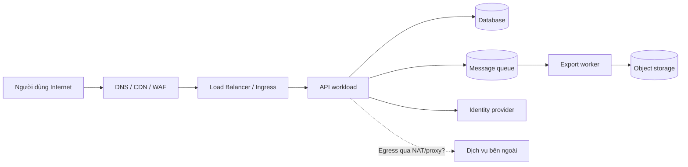
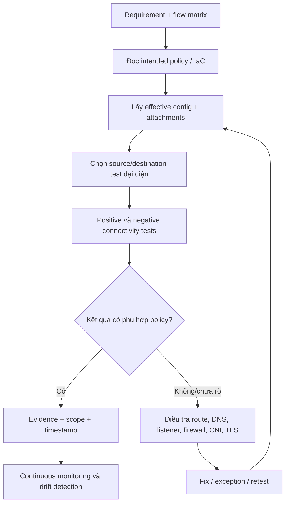
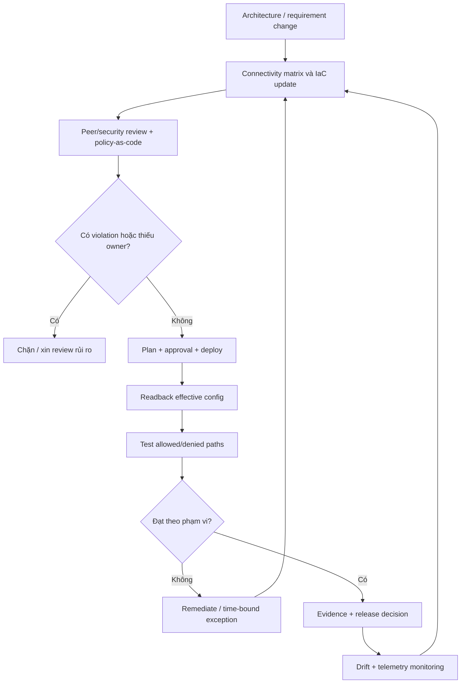

# Cấu hình network

Một công ty vận hành hệ thống SaaS quản lý tài liệu cho nhiều tenant. Kiến trúc dự kiến rất rõ: Internet chỉ được đến API Gateway qua HTTPS; ứng dụng chỉ được kết nối database, hàng đợi và những dịch vụ nội bộ cần thiết; database không có địa chỉ công khai; export worker chỉ được truy cập object storage và các điểm đến được phê duyệt. Nhóm hạ tầng quản lý phần lớn tài nguyên bằng Infrastructure as Code (IaC), và dashboard cloud cho thấy các firewall rule đã được tạo.

Trong một lần kiểm tra trước phát hành, nhóm phát hiện một security group tạm thời cho phép truy cập database từ mạng rộng hơn dự kiến; một namespace Kubernetes chưa thực thi NetworkPolicy vì thành phần mạng không hỗ trợ enforcement; đồng thời một worker vẫn có thể kết nối Internet qua NAT dù tài liệu kiến trúc ghi “không có egress”. Sơ đồ thiết kế nhìn đúng, tệp IaC cũng có vẻ đúng, nhưng **đường kết nối thực tế** không còn đáp ứng mục tiêu bảo mật.

Đây là vấn đề của **cấu hình network (network configuration)** trong **configuration assurance**: phải chứng minh rằng các rule về lưu lượng, phân vùng tin cậy, định tuyến và bảo vệ giao tiếp được **định nghĩa, áp dụng và vận hành đúng** — chứ không chỉ xuất hiện trong một tệp cấu hình.

Trong module **SECURITY_SECURITY_ASSURANCE**, cấu hình mạng là một phần của chuỗi bảo đảm có bằng chứng: **security objective → threat/risk → security requirement → network control → cấu hình mong muốn → cấu hình có hiệu lực → kiểm chứng → evidence → finding/khắc phục → assurance decision**. Bài học này tập trung cách đánh giá mạng của ứng dụng, cloud và container ở góc độ người phát triển, vận hành và security reviewer.

## 1. Cấu hình network là gì?

**Network configuration** là tập thiết lập quyết định **thành phần nào được giao tiếp với thành phần nào, qua đường nào, bằng giao thức/cổng gì và dưới điều kiện bảo vệ nào**. Nó có thể bao gồm địa chỉ IP/CIDR, subnet, VLAN, route, ACL, firewall, security group, NAT, load balancer, API gateway, proxy, DNS, TLS, Kubernetes NetworkPolicy, service mesh và chính sách kết nối ra ngoài.

**Network configuration assurance** là quá trình hình thành **niềm tin có căn cứ** rằng các cấu hình này đáp ứng mục tiêu bảo mật, được thực thi trong phạm vi cần bảo vệ và được duy trì khi hệ thống thay đổi.

### 1.1. Phân biệt cấu hình mong muốn, được áp dụng và được quan sát

| Trạng thái | Câu hỏi cần trả lời | Ví dụ bằng chứng | Giới hạn |
| --- | --- | --- | --- |
| **Intended / desired** | Kiến trúc và policy mong muốn điều gì? | Threat model, network matrix, IaC | Không chứng minh môi trường đang đúng |
| **Declared** | Tệp cấu hình nói điều gì? | Terraform, Kubernetes YAML, firewall policy | Có thể chưa deploy hoặc bị override |
| **Applied / effective** | Control nào thực sự có hiệu lực trên các tài nguyên? | Cloud API, cluster policy, route/firewall snapshot | Có thể bỏ sót lớp khác trong datapath |
| **Observed** | Lưu lượng được phép/chặn trong tình huống kiểm chứng nào? | Test kết nối, flow logs, metrics | Chỉ chứng minh các đường và thời điểm đã thử |
| **Assured** | Tập bằng chứng có đủ hỗ trợ claim ở phạm vi đã định không? | Evidence matrix, review, quyết định rủi ro | Vẫn tồn tại giả định và rủi ro còn lại |

Có một quy tắc `deny` trong tệp YAML không có nghĩa packet thực tế bị chặn. Cần kiểm tra cơ chế nào thực thi rule, đối tượng nào được chọn, có lớp chính sách khác can thiệp không và có đường đi vòng nào tồn tại.

### 1.2. Mục tiêu bảo mật liên quan

- **Confidentiality:** ngăn thành phần hoặc người không có quyền truy cập dịch vụ/dữ liệu.
- **Integrity:** giới hạn đường điều khiển, quản trị và sửa dữ liệu.
- **Availability:** hạn chế blast radius, phụ thuộc mạng và thay đổi gây mất dịch vụ.
- **Least privilege:** chỉ mở kết nối cần cho mục đích nghiệp vụ.
- **Segmentation:** giảm khả năng lan truyền giữa các vùng tin cậy.
- **Observability:** có log, tín hiệu và đường điều tra khi cấu hình bị thay.
- **Recoverability:** có quy trình thay đổi, rollback/roll-forward và xác minh sau sửa.

Mạng không thay thế xác thực và phân quyền ở ứng dụng. Ví dụ cho phép API kết nối database không đồng nghĩa mọi câu truy vấn đều được phép đọc dữ liệu của tenant khác.

## 2. Những lớp cần quan sát trong một kiến trúc mạng

Đường đi của một request có thể qua nhiều loại control.



Khi đánh giá, cần biết **control nào nằm trên đường đi thực tế**:

| Lớp | Thành phần cấu hình điển hình | Rủi ro thường gặp |
| --- | --- | --- |
| **Địa chỉ và subnet** | IP, CIDR, subnet, VLAN, VPC/VNet | Chồng lấn dải, chia vùng sai, đường truy cập không mong muốn |
| **Định tuyến** | Route table, peering, VPN, transit gateway, BGP | Kết nối sang vùng khác dù security model không tính đến |
| **Lọc gói L3/L4** | Firewall, ACL, cloud security group | Mở CIDR/port quá rộng, thiếu outbound rules |
| **L7 / gateway** | Reverse proxy, WAF, API gateway | Route công khai ngoài ý muốn, bypass gateway |
| **Tên và phân giải** | DNS nội bộ/công khai, resolver, split-horizon | Trả địa chỉ sai, shadow endpoint, resolver ngoài policy |
| **Bảo vệ giao tiếp** | TLS, mTLS, certificate, trust bundle | Mất xác minh peer, hết hạn chứng chỉ, plaintext ở một hop |
| **Workload networking** | Kubernetes Services, NetworkPolicy, CNI, service mesh | Namespace/pod selectors sai, policy không được thực thi |
| **Egress và kết nối ngoài** | NAT, proxy, endpoint policy, destination allowlist | SSRF, exfiltration, liên hệ endpoint không được phê duyệt |
| **Quản trị và quan sát** | Bastion, VPN, private endpoints, flow logs | Management plane lộ Internet, thiếu audit |

**Defense in depth** nghĩa là nhiều control bổ trợ. Một security group có thể hạn chế port database, nhưng vẫn cần xác thực database, quyền truy vấn tối thiểu và logging. Ngược lại, WAF không bảo vệ đường đi nội bộ trực tiếp tới service nếu route đó bỏ qua WAF.

## 3. Network baseline và connectivity matrix

Một **baseline** ghi cách mạng *phải* hoạt động. Baseline phải xuất phát từ nhu cầu nghiệp vụ, security requirements và trust boundaries, không phải sao chép toàn bộ kết nối đang thấy rồi mặc định chúng hợp lệ.

### 3.1. Network connectivity matrix

| Source | Destination | Protocol/port | Mục đích | Quyết định mặc định |
| --- | --- | --- | --- | --- |
| Internet | Public gateway | HTTPS/TCP 443 | Người dùng vào API | ALLOW có kiểm soát |
| Internet | Database | PostgreSQL/TCP 5432 | Không có lý do trực tiếp | DENY |
| Gateway | Document API | HTTP/TCP 8080 trong mạng tin cậy hoặc TLS theo thiết kế | Chuyển tiếp request | ALLOW giới hạn workload |
| Document API | Database | PostgreSQL/TCP 5432 | Metadata | ALLOW đúng service/identity |
| Document API | Message queue | Broker port theo triển khai | Tạo export job | ALLOW có điều kiện |
| Export worker | Test object storage/private endpoint | HTTPS/TCP 443 | Đọc/ghi kết quả | ALLOW đúng destination |
| Export worker | Internet bất kỳ | Mọi port | Không có nhu cầu được duyệt | DENY |
| Admin workstation | Management API | HTTPS/TCP 443 qua VPN/ZTNA/bastion | Vận hành | ALLOW theo danh tính và đường quản trị |
| Mọi workload | DNS resolver được phê duyệt | DNS UDP/TCP 53 hoặc giao thức được tổ chức dùng | Phân giải tên | ALLOW có giới hạn |

Các tên service, port và quyết định trên chỉ mang tính minh họa. Trong ứng dụng thật, không được tự suy rằng `8080` là an toàn vì chỉ dùng nội bộ; nếu đường cần mã hóa/chứng thực theo threat model thì phải có TLS hoặc cơ chế bảo vệ tương đương.

### 3.2. Các trường nên có cho mỗi luồng

Một connectivity record đủ phục vụ assurance thường gồm:

- ID bất biến của luồng (flow ID);
- source/destination theo **service identity**, subnet/CIDR và environment khi cần;
- direction (ingress/egress), protocol/port và loại kết nối;
- business justification và security requirement;
- owner của cả hai đầu, người phê duyệt và hạn hiệu lực nếu tạm thời;
- rule hoặc policy triển khai (ID, repository path, version);
- tiêu chí positive/negative verification;
- loại dữ liệu đi qua, yêu cầu mã hóa/xác thực;
- log/monitoring và điều kiện kiểm tra lại;
- ngoại lệ và rủi ro còn lại.

Không nên dùng duy nhất IP để nhận diện workload trong hệ thống thay đổi nhanh: pod, instance và dịch vụ có thể đổi IP. Dùng nhãn, security group reference, workload identity hoặc service discovery khi nền tảng hỗ trợ; đồng thời phải kiểm soát việc ai được sửa nhãn/identity đó.

### 3.3. Baseline phải có phạm vi

Một policy cho production không tự áp cho staging, và ngược lại. Baseline cần gắn môi trường, vùng/region, tài khoản cloud, cluster, namespace hoặc mạng vật lý mà nó điều khiển. Khi có nhiều region, phải kiểm tra từng deployment hoặc có lý do tin cậy cho phép suy luận.

## 4. Phân vùng mạng và trust boundaries

**Network segmentation** chia hệ thống thành vùng có mức tin cậy và quyền truy cập khác nhau. Mục tiêu là thu nhỏ bề mặt tấn công và **hạn chế lateral movement** nếu một thành phần bị xâm phạm.

Ví dụ phân vùng:

- **Public edge:** CDN/WAF/gateway nhận traffic từ Internet.
- **Application:** API/business services, chỉ mở cổng cần thiết.
- **Data:** database, cache, object storage/private endpoints.
- **Management:** control plane, bastion, monitoring, CI/CD administrative access.
- **Build/CI:** runner, registry, signing systems; cần boundary riêng với runtime.
- **Third-party integration:** destination được phê duyệt, có egress controls.
- **Tenant isolation:** thông thường cần thêm phân quyền ở tầng ứng dụng/dữ liệu; không mặc định mỗi tenant có một mạng riêng.

### 4.1. Default deny và allowlist có kiểm soát

Ở mỗi boundary, một chiến lược phổ biến là **deny by default, allow explicit required flows**. Nhưng cần xác định control đang nói tới:

- Tường lửa truyền thống có thể có default policy của chain;
- cloud security group thường cho phép theo các rule và có hành vi stateful theo provider;
- network ACL có thể hoạt động stateless, cần xét luồng phản hồi;
- Kubernetes NetworkPolicy dùng **mô hình isolation theo direction và additive allow rules**;
- service mesh có thể có policy L7 ngoài NetworkPolicy.

Do đó câu “đã bật default deny” **không đủ** nếu không chỉ ra **đối tượng và chiều traffic** thực sự bị cô lập, engine có thực thi không, và có lớp khác tạo bypass không.

### 4.2. Microsegmentation

Microsegmentation đưa việc hạn chế kết nối tới từng nhóm workload hoặc service thay vì chỉ tin subnet. Chẳng hạn, hai service cùng một namespace có thể bị hạn chế giao tiếp dựa trên label và policy, miễn là hệ thống mạng hỗ trợ.

Hiệu quả phụ thuộc tính chính xác của workload identity, cơ chế áp dụng policy và khả năng kiểm soát nhãn. Nếu mọi pod đều có thể tự gắn nhãn `role=trusted` và policy cho phép tất cả pod có nhãn đó, boundary có thể bị yếu đi.

### 4.3. Zero Trust không chỉ là “chia nhiều subnet”

Zero Trust nhấn mạnh **không cấp quyền dựa duy nhất trên vị trí mạng**, mà kết hợp xác thực danh tính, kiểm tra điều kiện, least privilege và giám sát. Segmentation hỗ trợ giảm phạm vi tấn công, nhưng không thay thế:
- xác thực service-to-service;
- authorization theo tài nguyên/tenant;
- bảo vệ session, secret và dữ liệu;
- đánh giá thiết bị hoặc workload posture khi có yêu cầu;
- logging và phát hiện hành vi bất thường.

## 5. Cấu hình ingress: kiểm soát đường đi vào

**Ingress** nói tới lưu lượng đi vào một mạng hoặc workload. Trong web/API architecture, thường có Internet → DNS/CDN/WAF → load balancer/ingress → service → pod/process.

### 5.1. Những nguyên tắc cần kiểm tra

1. Chỉ công khai những endpoint thực sự cần.
2. Cổng quản trị, metrics, debug và database không công khai ngoài ý muốn.
3. Các route tới internal service không bypass gateway/proxy bắt buộc.
4. TLS được cấu hình và kiểm tra nơi cần; redirect HTTP sang HTTPS nếu chính sách yêu cầu.
5. Trust chain cho client IP/header được định nghĩa; không tin tùy ý `X-Forwarded-*` từ Internet.
6. Service backend chỉ nhận kết nối từ đúng gateway/lớp nguồn đã xác định.
7. Health check được giới hạn thông tin và quyền phù hợp.
8. Các IPv6 listener, địa chỉ phụ, region dự phòng và cổng khác cũng được đánh giá.
9. Authentication/authorization của endpoint vẫn do service hoặc control được thiết kế bảo vệ, không chỉ gateway.

### 5.2. Một lỗi thường gặp: public origin bỏ qua WAF

Đội triển khai nghĩ mọi request đều đi qua CDN/WAF. Nhưng load balancer origin hoặc host backend vẫn có địa chỉ public và cho phép Internet kết nối trực tiếp. Nếu WAF là control bắt buộc, đây là **bypass** dù CDN được cấu hình đúng.

Cần kiểm tra đường route, nguồn được chấp nhận bởi origin, các alias DNS, host headers và policy tại backend. Nếu sử dụng secret header hoặc danh tính service giữa CDN và origin, phải đánh giá khả năng giả mạo và quy trình rotation; một header bí mật đơn lẻ có thể không đủ.

### 5.3. L7 authorization khác L3/L4 filtering

Firewall cho phép TCP 443 từ người dùng đến gateway không quyết định user được xem tài liệu nào. Ngay cả khi API chỉ truy cập được từ một subnet nội bộ, một workload bị xâm phạm trong subnet đó có thể vẫn gọi API. Cần xác thực service và authorization theo chính sách ở lớp ứng dụng.

## 6. Cấu hình egress: kiểm soát đường đi ra

**Egress** là lưu lượng rời khỏi workload/network đến các điểm đích khác. Nó thường bị xem nhẹ vì đội tập trung chặn request từ Internet vào.

### 6.1. Vì sao egress quan trọng?

Nếu một worker xử lý dữ liệu không tin cậy có thể tạo outbound connection tới bất kỳ địa chỉ nào, một lỗi SSRF hoặc compromise có thể cho phép kết nối tới dịch vụ ngoài ý muốn, metadata endpoint hoặc điểm nhận dữ liệu do kẻ tấn công kiểm soát.

Egress control cần xét:
- những destination/service thật sự cần cho nghiệp vụ;
- DNS resolver và cách hostname được giải thành IP;
- proxy, NAT, private endpoint và bypass routes;
- quyền của workload và dữ liệu có thể đi ra;
- trường hợp endpoint động/CDN dùng nhiều IP;
- telemetry của outbound traffic và cảnh báo vi phạm.

### 6.2. Deny all Internet không có nghĩa không có egress

Một worker có thể vẫn kết nối qua NAT gateway, HTTP proxy, service mesh egress gateway, một VPN hoặc private route. Ngược lại, một service không có public IP vẫn có thể đi Internet thông qua NAT.

**Không đánh đồng “private subnet” với “không có đường egress”.** Phải xem route table, NAT/proxy, security rules, DNS và hiệu lực thực tế của từng lớp.

### 6.3. Egress allowlist và giới hạn theo danh tính đích

Đối với điểm đến cố định, có thể dùng subnet/security group reference hoặc private endpoint. Với dịch vụ bên ngoài dùng hostname động, allowlist IP đơn giản có thể khó vận hành; cần giải pháp proxy hoặc policy hiểu FQDN, mTLS hay identity khi nền tảng hỗ trợ.

Không phải Kubernetes NetworkPolicy chuẩn nào cũng hỗ trợ allowlist theo FQDN. Tránh viết cấu hình như thể thuộc tính `toFQDNs` là một phần của NetworkPolicy chuẩn nếu đó là phần mở rộng riêng của CNI.

### 6.4. DNS là một phần của egress policy

Chỉ cho phép DNS tới resolver đã duyệt không chứng minh mọi kết nối sau phân giải đều đúng. Một endpoint có thể dùng IP trực tiếp, kết nối qua proxy hoặc DNS-over-HTTPS nếu được phép. Cần mô tả chính sách đầy đủ, không xem “chặn UDP 53” là biện pháp hoàn chỉnh để kiểm soát mọi đích.

### 6.5. Bảo vệ cloud metadata và các đích nội bộ nhạy cảm

Trên cloud, metadata service hoặc endpoint quản trị nội bộ có thể chứa dữ liệu nhạy cảm tùy cấu hình và quyền. Cần áp các cơ chế bảo vệ do nền tảng hỗ trợ (chẳng hạn cấu hình metadata, least privilege, workload identity và network restrictions phù hợp), không chỉ đặt một IP cụ thể vào denylist rồi cho rằng mọi đường đã bị chặn.

## 7. Cloud network: security group, ACL, route và private endpoint

Trên cloud, nhiều control tương tác tạo thành đường kết nối thực tế. Cần hiểu rõ **ngữ nghĩa của từng lớp** theo nhà cung cấp và môi trường triển khai.

### 7.1. Cloud security group

Security group thường đóng vai trò lọc các luồng kết nối tới/ra từ tài nguyên được gắn rule. Với nền tảng có tính **stateful**, lưu lượng phản hồi thuộc phiên đã được cho phép có thể được xử lý khác với một rule inbound mới. Nhưng cần đọc đúng tài liệu và cấu hình của provider; không suy rằng mọi firewall đều stateful.

Một rule như:

`Ingress TCP 5432 from 0.0.0.0/0`

là dấu hiệu rủi ro cao nếu được áp cho database production, kể cả khi host không có public IP ở thời điểm review. Vì route hoặc địa chỉ có thể thay đổi, cần đánh giá **mục tiêu và nguyên tắc least privilege**, không chỉ tình huống kết nối hiện tại.

### 7.2. Network ACL có thể là stateless

Với ACL stateless, phải xét cả hai chiều giao tiếp và các cổng phản hồi phù hợp. Không nên copy logic security group stateful sang ACL rồi kỳ vọng ứng dụng vẫn hoạt động.

Ví dụ, giới hạn egress tới port database nhưng quên return-path rule cần thiết có thể gây lỗi kết nối khó hiểu. Việc mở “mọi cổng phản hồi” không kiểm soát cũng cần đánh giá theo kiến trúc, không được làm bừa.

### 7.3. Route table, peering, transit và NAT

Route không tự là permission ở lớp ứng dụng, nhưng nó quyết định **đường có thể đi qua**. Một route mới sang mạng peered có thể thay đổi phạm vi mà firewall rule rộng vô tình bao phủ. Cần kiểm tra:
- nguồn và đích có route hai chiều khi cần;
- peering/transit/VPN tạo kết nối tới tài sản nào;
- NAT/proxy có cho phép outbound ngoài dự kiến;
- local/blackhole/overlapping CIDR;
- network path được kiểm tra có đúng đường production hay không;
- các route động hoặc thay đổi do nhà cung cấp.

### 7.4. Private endpoint

Private endpoint có thể giảm việc phải đi qua Internet công khai tới một dịch vụ cloud. Nhưng cần kiểm tra DNS, route, endpoint policy, quyền dịch vụ và egress thực tế. **“Private” không đồng nghĩa “đã có phân quyền ứng dụng”**: nếu principal có quyền quá rộng hoặc route sang endpoint khác vẫn mở, dữ liệu vẫn có thể bị truy cập sai.

## 8. Kubernetes NetworkPolicy: hiểu ngữ nghĩa trước khi viết YAML

**Kubernetes NetworkPolicy** là API cho việc mô tả chính sách lưu lượng giữa các pod và một số đích mạng. Nó cần **network plugin/CNI thực sự hỗ trợ và thực thi NetworkPolicy**. Tạo một object YAML thành công **không tự đảm bảo lưu lượng bị chặn**.

### 8.1. Những nguyên tắc dễ nhầm

- NetworkPolicy áp dụng cho **các pod được chọn bởi `podSelector`** trong namespace chứa policy.
- Chính sách **cho phép** lưu lượng bằng các rule; các allow rules từ nhiều policy có thể kết hợp. NetworkPolicy chuẩn không có rule “explicit deny” với precedence như firewall truyền thống.
- **Ingress isolation** và **egress isolation** được xét riêng theo `policyTypes` và các policy chọn pod.
- Với kết nối pod-to-pod, khi cả source egress và destination ingress đều bị cô lập, luồng cần được cho phép ở các phía liên quan.
- Selector rỗng, selector namespace và pod có ý nghĩa khác nhau; YAML thụt dòng sai có thể làm phạm vi thay đổi mạnh.
- Các trường hợp service IP, NAT, hostNetwork, traffic từ node và egress tới external endpoint có thể khác nhau theo CNI/cluster; phải kiểm tra datapath thực.
- NetworkPolicy không tự cung cấp mTLS, xác thực dịch vụ hoặc authorization tầng ứng dụng.

### 8.2. Ví dụ default deny ingress/egress trong namespace test

Giả sử namespace dành riêng cho test là `docs-test` và CNI đã được xác nhận có enforcement:

```yaml
apiVersion: networking.k8s.io/v1
kind: NetworkPolicy
metadata:
  name: default-deny-all
  namespace: docs-test
spec:
  podSelector: {}
  policyTypes:
    - Ingress
    - Egress
```

Policy này khiến các pod thuộc namespace trở nên **bị cô lập về ingress và egress theo ngữ nghĩa NetworkPolicy**, trừ những lưu lượng được cho phép qua policy khác hoặc các ngoại lệ của datapath/CNI. Việc áp dụng có thể làm hỏng DNS, health checks, metric scraping hoặc các luồng dịch vụ nếu chưa bổ sung allow rules cần thiết.

**Không áp mẫu default deny trực tiếp lên production khi chưa có inventory luồng, kiểm thử, kế hoạch thay đổi và phương án phục hồi.**

### 8.3. Ví dụ chỉ cho API nhận từ gateway và đi DB/DNS

Ví dụ NetworkPolicy sau chọn pod `app: document-api` trong namespace `docs-test`. Nó minh họa:
- ingress TCP 8080 chỉ từ các gateway pod được gắn nhãn trong namespace `edge-test`;
- egress TCP 5432 tới các pod DB được gắn nhãn trong namespace `data-test`;
- egress DNS UDP/TCP 53 tới các pod resolver mang nhãn được định nghĩa.

```yaml
apiVersion: networking.k8s.io/v1
kind: NetworkPolicy
metadata:
  name: document-api-allow-required
  namespace: docs-test
spec:
  podSelector:
    matchLabels:
      app: document-api
  policyTypes:
    - Ingress
    - Egress
  ingress:
    - from:
        - namespaceSelector:
            matchLabels:
              kubernetes.io/metadata.name: edge-test
          podSelector:
            matchLabels:
              app: edge-gateway
      ports:
        - protocol: TCP
          port: 8080
  egress:
    - to:
        - namespaceSelector:
            matchLabels:
              kubernetes.io/metadata.name: data-test
          podSelector:
            matchLabels:
              app: documents-db
      ports:
        - protocol: TCP
          port: 5432
    - to:
        - namespaceSelector:
            matchLabels:
              kubernetes.io/metadata.name: kube-system
          podSelector:
            matchLabels:
              k8s-app: kube-dns
      ports:
        - protocol: UDP
          port: 53
        - protocol: TCP
          port: 53
```

Đây là **minh họa có điều kiện**, không phải manifest production hoàn chỉnh. Cần xác minh nhãn namespace/pod thực tế; selector `k8s-app: kube-dns` không tồn tại trong mọi cluster, DNS có thể chạy ở node-local resolver hoặc dùng kiến trúc khác. API còn có thể cần message queue, IdP, object storage, telemetry và các đường health check. Nếu các luồng đó cần thiết, phải thiết kế và kiểm thử rule đúng requirement trước khi rollout.

Nếu DB namespace có **ingress isolation**, phía DB cũng cần policy cho phép source API phù hợp. Không được coi một rule API egress là đã đủ mở kết nối hai chiều dưới mọi cấu hình.

### 8.4. Lỗi selector có thể làm scope thay đổi lớn

Trong NetworkPolicy, cấu trúc:

```yaml
# Minh họa KHÁC BIỆT NGỮ NGHĨA; không phải policy hoàn chỉnh.
# Một phần tử peer có cả namespaceSelector và podSelector:
from:
  - namespaceSelector:
      matchLabels:
        kubernetes.io/metadata.name: edge-test
    podSelector:
      matchLabels:
        app: edge-gateway

# Hai phần tử peer riêng biệt là phép HOẶC và thường rộng hơn:
from:
  - namespaceSelector:
      matchLabels:
        kubernetes.io/metadata.name: edge-test
  - podSelector:
      matchLabels:
        app: edge-gateway
```

Trường hợp đầu có ý định chọn gateway pods **trong namespace cụ thể**; trường hợp sau có thể cho phép **tất cả pods trong namespace edge-test** hoặc các pods mang nhãn gateway trong namespace của policy, tùy ngữ nghĩa selector. Đây là lý do review cấu trúc YAML và kiểm tra kết nối thực tế đều quan trọng.

### 8.5. Test âm tính là phần bắt buộc

Sau khi áp policy trên môi trường được phép, cần kiểm tra:
- gateway được duyệt **kết nối được** API 8080;
- pod không thuộc nguồn được phép **không kết nối được** API 8080;
- API **kết nối được** DB đúng cổng;
- một pod API **không kết nối được** DB cổng quản trị không cần thiết;
- API **không ra được** destination Internet không nằm trong baseline;
- DNS và các dependency nghiệp vụ được phép vẫn hoạt động;
- lỗi/timeout được diễn giải đúng: có thể là service down, DNS fail, policy hoặc route, không tự coi mọi timeout là security deny.

**Positive controls và negative controls phải đi cùng nhau.** Nếu service đích đang down, cả request được phép và bị cấm đều thất bại; không được tuyên bố network policy đã bảo vệ đúng.

## 9. Terraform và Infrastructure as Code

IaC giúp review và tái lập network baseline, nhưng **source hợp lệ không tự chứng minh state đang chạy khớp**. Network assurance cần so sánh cấu hình được khai báo với effective configuration và hành vi mạng.

### 9.1. Ví dụ Terraform security group có scope hạn chế

Mẫu AWS dưới đây chỉ minh họa cách diễn tả rule có nguồn/đích giới hạn. Nó **không bao gồm toàn bộ Terraform provider, VPC, subnet, database security group hay cách cấp biến**:

```hcl
# Chỉ minh họa; không áp dụng trực tiếp nếu chưa review IaC/architecture.
resource "aws_security_group" "document_api" {
  name        = "document-api-restricted"
  description = "Permit only approved API inbound traffic"
  vpc_id      = var.vpc_id
}

resource "aws_vpc_security_group_ingress_rule" "from_gateway" {
  security_group_id            = aws_security_group.document_api.id
  referenced_security_group_id = var.gateway_security_group_id
  ip_protocol                  = "tcp"
  from_port                    = 8080
  to_port                      = 8080
  description                  = "API inbound from approved gateway SG"
}

resource "aws_vpc_security_group_egress_rule" "to_database" {
  security_group_id            = aws_security_group.document_api.id
  referenced_security_group_id = var.database_security_group_id
  ip_protocol                  = "tcp"
  from_port                    = 5432
  to_port                      = 5432
  description                  = "Approved DB connection"
}
```

**Quan trọng:** cần xác minh default/out-of-band rules, phiên bản provider, quyền tham chiếu SG, ingress phía database, route, DNS và các egress thực tế khác. Nếu Terraform resource hoặc module tạo rule egress bổ sung, ví dụ allow-all mặc định hoặc rule từ module khác, kết quả có thể rộng hơn mẫu. Đọc toàn bộ effective security group/ENI association thay vì chỉ nhìn một đoạn HCL.

### 9.2. Policy-as-code để ngăn rule nguy hiểm

Tổ chức có thể dùng kiểm tra trên IaC plan để phát hiện:
- tài nguyên DB mở cổng quản trị cho Internet;
- security group có dải `0.0.0.0/0` hoặc `::/0` ở những cổng bị cấm;
- load balancer public cho service thuộc data zone;
- NetworkPolicy mặc định không tồn tại ở namespace bắt buộc;
- route/NAT egress không có justification;
- logging bị tắt hoặc flow logs thiếu ở network nhạy cảm;
- ngoại lệ hết hạn nhưng vẫn được khai báo.

Ví dụ chính sách **giả mã**:

```text
for each proposed_network_change:
    identify asset, environment, owner and data classification
    compare desired connectivity against approved flow matrix

    if public_access_to_sensitive_database_port:
        BLOCK

    if added_ingress_or_egress_broadens_a_trust_boundary:
        REQUIRE_SECURITY_REVIEW_AND_EXPLICIT_APPROVAL

    if policy_will_remove_last_approved_business_path:
        REQUIRE_AVAILABILITY_IMPACT_REVIEW

    if mandatory_network_logging_or_identity_control_is_disabled:
        BLOCK_OR_REQUIRE_AUTHORIZED_EXCEPTION

    record policy_version, change_ref, evaluated_rules and decision
```

Đây là mô tả kiến trúc kiểm soát, không phải mã thực thi của OPA/Terraform. Một rule policy-as-code chỉ đáng tin nếu được review, test và không bị chính PR đang đánh giá tự ý tắt.

## 10. DNS assurance: tên dịch vụ có dẫn tới đúng đích?

DNS ảnh hưởng trực tiếp đến routing theo tên, các control egress và khả năng phát hiện đường đi ngoài dự kiến.

### 10.1. Những điểm cần kiểm tra

- DNS zone công khai/nội bộ có chủ sở hữu và quyền sửa rõ.
- Record của admin/debug service không trỏ ra public IP ngoài thiết kế.
- Split-horizon DNS có kết quả phù hợp từng mạng.
- Resolver cho workloads là resolver được phép, có logging khi chính sách yêu cầu.
- DNS search suffix, wildcard records và CNAME không vô tình mở rộng phạm vi.
- TTL và cache được xét khi thay endpoint khẩn hoặc thu hồi.
- DNS thay đổi được đối chiếu với route, TLS certificate và destination policy.
- Service discovery trong cluster phản ánh đúng endpoint và namespace.

**Không mặc định một lookup DNS thành công có nghĩa dịch vụ đích hợp lệ hoặc an toàn.** Cần xác minh certificate/peer identity và authorization khi yêu cầu.

### 10.2. DNS rebinding và destination validation

Với ứng dụng nhận URL do người dùng cung cấp, chỉ kiểm tra hostname trước khi kết nối có thể không đủ nếu phân giải thay đổi, redirect được theo hoặc có đường bypass proxy. Các biện pháp cần được thiết kế theo framework và network boundary: kiểm tra destination tại thời điểm kết nối, kiểm soát redirect, egress policy và quyền workload.

Không xem DNS allowlist là thay thế duy nhất cho thiết kế SSRF-safe hoặc authorization tới tài nguyên nội bộ.

## 11. TLS, mTLS và bảo vệ traffic giữa các hop

Cấu hình mạng còn liên quan đến **tính xác thực và bảo mật của kênh giao tiếp**.

### 11.1. Những câu hỏi quan trọng

1. Có sử dụng TLS ở những đường mà security requirement yêu cầu không?
2. Chứng chỉ server được xác minh chain of trust, hostname và thời hạn?
3. Có đoạn plaintext sau TLS termination không, và đoạn đó có thuộc trust model được phê duyệt?
4. Internal service-to-service có cần mTLS hoặc cơ chế xác thực service khác?
5. Ai cấp, luân chuyển và thu hồi certificates/trust roots?
6. Có tắt certificate validation ở môi trường production không?
7. Policy về protocol/cipher suite có phù hợp tiêu chuẩn tổ chức tại thời điểm đánh giá?
8. Các bản sao ở region khác, worker hoặc đường batch có cùng chính sách không?
9. Key material có được bảo vệ và không bị ghi log hoặc gắn vào config công khai?
10. Monitoring có phát hiện certificate hết hạn và kết nối downgraded không?

### 11.2. TLS termination không tự chứng minh end-to-end confidentiality

Nếu TLS được terminate ở gateway rồi gửi HTTP plaintext tới backend, cần đánh giá đoạn này có được bảo vệ bằng mạng tin cậy và control phù hợp hay không. Với threat model yêu cầu mã hóa từng hop, phải thiết kế thêm TLS/mTLS nội bộ.

Ngược lại, có mTLS giữa service cũng không tự làm API an toàn trước IDOR/BOLA. Chứng chỉ xác thực **service identity**; authorization vẫn phải xét principal, hành động, tài nguyên và tenant.

### 11.3. Service mesh có ích nhưng có phạm vi

Service mesh có thể hỗ trợ mTLS, traffic policy và telemetry. Tuy nhiên, cần biết mode triển khai, proxy bypass, workload không được inject, egress exceptions và khả năng thay đổi runtime. Một policy cho service mesh không thay thế firewall hoặc NetworkPolicy ở mọi lớp; cần hiểu đường traffic không đi qua sidecar/gateway.

## 12. IPv4, IPv6 và những đường bị bỏ sót

Một lỗi phổ biến là chỉ kiểm tra IPv4 nhưng dịch vụ đồng thời lắng nghe trên IPv6.

### 12.1. Những câu hỏi cho dual-stack

- Có listener và địa chỉ IPv6 nào đang được cấp?
- Firewall/security group có rule riêng cho `::/0` hay dải IPv6 cụ thể không?
- DNS AAAA record có công khai một đường không dự kiến?
- Route, load balancer, WAF/CDN và policy áp trên cả hai giao thức không?
- DNS/API allowlist và egress controls có xử lý địa chỉ IPv6?
- Pod/network CNI có dual-stack và NetworkPolicy enforcement phù hợp không?
- Các điểm quản trị có bị lộ qua IPv6 dù IPv4 đã bị hạn chế?

Một quy tắc chặn `0.0.0.0/0` chỉ mô tả địa chỉ IPv4; nó không phải biểu diễn của toàn bộ IPv6. Review cần xác định rõ cả hai address families và runtime effective listeners.

### 12.2. Đừng suy luận thiếu IPv6 từ việc không có test

Nếu công cụ kiểm tra chỉ sử dụng IPv4, báo cáo phải ghi **IPv6 not assessed** khi môi trường có khả năng hỗ trợ. Việc không thấy AAAA record cho một host cũng không tự chứng minh mọi internal/alternative path đều không có IPv6.

## 13. Network configuration và phân quyền theo tenant

Trong SaaS multi-tenant, network segmentation hỗ trợ kiểm soát tiếp cận nhưng **không thay thế phân quyền dữ liệu**.

Ví dụ: API và export worker cùng thuộc application zone, đều được phép kết nối database. Một worker mắc lỗi lấy object theo ID mà không kiểm tra tenant vẫn có thể đọc sai dữ liệu mặc dù mọi firewall rule đúng.

### 13.1. Một mô hình control nhiều lớp

| Security boundary | Control cần có | Điều nó không tự chứng minh |
| --- | --- | --- |
| Internet → Gateway | HTTPS, WAF, rate limit, public exposure rules | User có quyền với từng tài liệu |
| Gateway → API | Network allowlist, service authentication | API xử lý authorization đúng mọi endpoint |
| API → DB | SG/NetworkPolicy, DB authentication, least privilege | Mỗi truy vấn đều có tenant constraint |
| API → Queue | Broker access policy và network restrictions | Job metadata không bị giả mạo |
| Worker → Storage | Egress/destination control, workload identity | Worker chỉ lấy object thuộc job hợp lệ |
| Admin → Control plane | VPN/ZTNA/bastion, MFA, RBAC | Mọi hành động quản trị đều đúng chính sách |

**Network isolation** và **logical tenant isolation** là hai mục tiêu khác nhau. Network assurance nên liên kết với access-control/identity assurance để người đánh giá không phóng đại phạm vi của kết luận.

## 14. Kiểm chứng effective network configuration

Một bài review đáng tin nên kết hợp **configuration inspection** với **behavior verification**.

### 14.1. Bốn nguồn bằng chứng bổ trợ

1. **IaC/design evidence:** rule mong muốn, quyền review và thay đổi được phê duyệt.
2. **Runtime configuration evidence:** security groups, routes, NetworkPolicy objects, firewall config và resource attachment thực tế.
3. **Connectivity evidence:** phép thử positive/negative từ các nguồn và đích đại diện, với phiên bản/môi trường xác định.
4. **Telemetry/audit evidence:** flow logs, firewall counters, denied events, change logs và alert.

Không một nguồn nào một mình chứng minh mọi thứ. IaC có thể drift; runtime snapshot có thể đúng nhưng test dùng sai đường; logs có thể chưa bật hoặc được sampling; connectivity test có thể thất bại vì service down thay vì firewall block.

### 14.2. Positive và negative test matrix

| Test ID | Source | Destination | Kỳ vọng | Căn cứ giải thích |
| --- | --- | --- | --- | --- |
| `NET-01` | Approved gateway | API TCP 8080 | ALLOW | Luồng nghiệp vụ bắt buộc |
| `NET-02` | Untrusted test pod | API TCP 8080 | DENY | Ingress segmentation |
| `NET-03` | Document API | DB TCP 5432 | ALLOW | Luồng database |
| `NET-04` | Document API | DB management port | DENY | Không có nhu cầu |
| `NET-05` | Export worker | Approved object storage | ALLOW | Luồng export |
| `NET-06` | Export worker | Unapproved test destination | DENY | Egress restriction |
| `NET-07` | Internet test client | Database port | DENY | Database private |
| `NET-08` | Admin via approved access path | Management endpoint | ALLOW có authentication | Phép thử đường quản trị |
| `NET-09` | Untrusted external client | Management endpoint | DENY | Không công khai control plane |

Các test cần **được phê duyệt, dùng điểm đến test có chủ sở hữu**, không quét hàng loạt hệ thống của người khác. Đối với đích “không được phép”, tốt nhất dùng một endpoint canary giả lập do tổ chức kiểm soát thay vì gửi traffic tới host ngẫu nhiên bên ngoài.

### 14.3. Tách lỗi kết nối với bằng chứng chặn

Một kết nối thất bại có thể do:
- DNS không phân giải;
- service chưa khởi động;
- network route không tồn tại;
- cổng không lắng nghe;
- TLS handshake lỗi;
- authentication từ chối ở L7;
- firewall/NetworkPolicy deny;
- timeout hoặc test runner lỗi.

Nếu mục tiêu là kiểm tra **network filtering**, cần đủ chứng cứ để gán nguyên nhân: positive control cùng đích/cổng từ nguồn được phép, effective rules, counters/flow logs nếu có, và test setup đúng. Một HTTP `403` từ ứng dụng chứng minh request đã đến lớp ứng dụng, không chứng minh L3/L4 firewall chặn.

### 14.4. Kiểm tra kết nối bằng công cụ trên môi trường được phép

Ví dụ trên **test namespace/host do tổ chức kiểm soát**, không phải script quét mạng công cộng:

```bash
# Minh họa: thử truy cập API health endpoint test đã được phê duyệt.
curl --fail --silent --show-error \
  --max-time 5 \
  "http://document-api.docs-test.svc.cluster.local:8080/health"

# Kiểm tra một dịch vụ test có thể kết nối theo port định trước.
# 'nc' chỉ có nếu môi trường test được cài công cụ tương ứng.
nc -vz -w 3 documents-db.data-test.svc.cluster.local 5432

# Kiểm tra network policy objects trong namespace được cấp quyền xem.
kubectl -n docs-test get networkpolicy
kubectl -n docs-test describe networkpolicy document-api-allow-required
```

Các lệnh trên chỉ **minh họa công cụ**, không được chạy trong quá trình soạn bài và không đủ để chứng minh toàn bộ policy. Việc chạy từ một pod có identity phù hợp cần được thực hiện trong test harness được cấp quyền; tránh chạy từ chính node host nếu datapath host khác pod và test không đại diện cho workload.

### 14.5. Xác minh theo đường đi



### 14.6. Một snapshot không thể chứng minh liên tục

Network config có thể thay đổi ngay sau khi scan. Vì vậy, assurance cần liên kết kết quả với **timestamp, release, change ID, cluster/region** và bổ sung monitoring/detect drift. Claim nên được giới hạn thời gian/phạm vi thay vì tuyên bố “mạng luôn an toàn”.

## 15. Kiểm soát thay đổi và configuration drift

**Configuration drift** là sự khác biệt giữa baseline đã phê duyệt và cấu hình đang tồn tại. Nó có thể đến từ sửa thủ công, incident mitigation, provider defaults, auto-scaling, nâng cấp chart, thay nhãn hoặc cập nhật policy ngoài IaC.

### 15.1. Nguồn drift thường gặp

- Cloud console thay security group để “debug nhanh”.
- Rule tạm mở port không được xóa sau sự cố.
- Helm chart mới bỏ NetworkPolicy hoặc đổi labels.
- Một namespace mới không được áp baseline.
- NAT/route được thêm cho dependency bên ngoài rồi giữ nguyên.
- Security group gắn nhầm ENI/instance.
- Ingress được tạo với public load balancer thay vì internal.
- Certificate validation bị vô hiệu hóa khi sửa lỗi integration.
- IPv6 bật mặc định ở môi trường mới nhưng policy chỉ có IPv4.

### 15.2. Không nên tự động sửa drift mà không xét tác động

Một drift detection job có thể báo rule rộng bất thường. Một số thay đổi cần xử lý ngay; một số khác có thể liên quan incident response hoặc cutover đang được phê duyệt. Nên có:
1. Phân loại drift và owner;
2. So sánh với change record/exception;
3. Đánh giá security và availability impact;
4. Sửa lại theo IaC hoặc qua quy trình khẩn có audit;
5. Test lại effective behavior;
6. Ghi thời điểm, phạm vi và kết quả;
7. Chặn việc rule sai tái xuất hiện qua pipeline.

Tự ý rollback một firewall rule trong thời điểm incident có thể cắt kết nối ứng cứu. **Drift correction phải có guardrails**, đặc biệt với control plane và dịch vụ trọng yếu.

### 15.3. Tài nguyên ngắn hạn cũng cần baseline

Ephemeral pods, preview environments, CI runner và autoscaling instances có thể tồn tại trong thời gian ngắn nhưng vẫn có quyền network. Chỉ quét định kỳ mỗi tháng có thể bỏ qua chúng. Cần control ở admission/provisioning, policy trên template và logs thay đổi phù hợp.

## 16. Quy trình configuration assurance trong CI/CD

Luồng kiểm soát đề xuất:

1. **Design:** cập nhật connectivity matrix và threat model khi thay đổi mạng.
2. **Implement:** sửa Terraform/Kubernetes manifests hoặc policy theo source control.
3. **Review:** owner và security reviewer đánh giá thay đổi trust boundary.
4. **Static/policy checks:** validate cấu hình, policy-as-code, secret/permission checks.
5. **Plan/diff:** xem những tài nguyên/rule nào sẽ thay đổi.
6. **Deploy có kiểm soát:** dùng identity và quyền phù hợp, có audit.
7. **Read back effective state:** đối chiếu resource attachment, rule, route, labels, policy enforcement.
8. **Connectivity verification:** chạy allowed/denied tests trên môi trường được phép.
9. **Release gate/assurance decision:** tổng hợp evidence, findings và residual risk.
10. **Monitor:** phát hiện drift, rule hết hạn, đường egress mới, certificate và changes.



### 16.1. Release gate không phải chỉ là lint YAML

Một manifest hợp lệ cú pháp không có nghĩa chính sách đúng. Gate có thể yêu cầu:
- cấu hình có owner và flow justification;
- không mở cổng nhạy cảm ngoài baseline;
- IaC plan được review với risk impact;
- policy engine/admission đã thực thi;
- network policies thực sự chọn đúng workloads;
- không có route/SG attachment khác mở rộng đường đi;
- test kết nối bắt buộc đã chạy;
- không còn finding vượt ngưỡng chưa xử lý;
- artifact/config/evidence khớp release target.

Nếu scanner hoặc policy check lỗi, không mặc định kết luận PASS. **NOT_RUN/ERROR** phải là trạng thái riêng.

### 16.2. Exception không thể trở thành phép cho phép vĩnh viễn

Đôi khi đội vận hành cần mở tạm một kết nối để migrate dữ liệu hoặc khắc phục sự cố. Nếu policy cho phép, exception phải ghi:
- rule/asset và source/destination cụ thể;
- lý do nghiệp vụ, threat/risk và mức ảnh hưởng;
- control bù, logging và kiểm chứng;
- người duyệt có thẩm quyền;
- thời điểm bắt đầu/hết hạn, cleanup plan;
- trigger đánh giá lại;
- audit trail các thay đổi và ngày đóng.

Không dùng “temporary” trong mô tả mà không có expiry và owner.

## 17. Ví dụ tình huống: SaaS đa tenant có network drift

### 17.1. Kiến trúc mong muốn

Giả định một hệ thống:
- `document-gateway` công khai HTTPS;
- `document-api` không có public listener;
- `documents-db` chỉ nhận kết nối từ API;
- `export-worker` nhận job từ queue, đi object storage qua private endpoint;
- `idp-adapter` kết nối tới identity provider được phê duyệt;
- admin truy cập qua access path riêng có xác thực mạnh;
- tenant A/B được phân quyền logic trong ứng dụng/DB.

### 17.2. Các phát hiện trong audit

| Finding | Quan sát | Rủi ro | Điều cần kiểm chứng |
| --- | --- | --- | --- |
| `FIND-NET-01` | Security group DB mở TCP 5432 từ CIDR quá rộng | Mở rộng bề mặt truy cập dữ liệu | SG attachment, route, listener, source test |
| `FIND-NET-02` | Namespace `export` có default deny nhưng CNI không enforcement | Policy tồn tại nhưng không có tác dụng mong muốn | CNI capabilities và negative test |
| `FIND-NET-03` | Worker có route NAT outbound mọi đích | Egress ngoài baseline, tăng nguy cơ dữ liệu rời mạng | Effective SG/route/proxy và test canary |
| `FIND-NET-04` | Ingress internal API có public IP do chart default | Có thể bypass gateway/WAF | Endpoint exposure, listener và access policies |
| `FIND-NET-05` | Certificate check bị tắt trong HTTP client ở staging | Kênh không bảo đảm peer authenticity theo policy | Config đang chạy, test xác minh cert |
| `FIND-NET-06` | API test từ user B đọc tài liệu A | Lỗi logic authorization | Security regression, không giải bằng SG đơn thuần |

### 17.3. Ưu tiên xử lý dựa trên rủi ro

Đừng chỉ đếm sáu findings rồi sửa theo thứ tự phát hiện. Xem:
- Có asset production nào công khai và có route khai thác thực tế?
- Database chứa dữ liệu nhạy cảm, privilege của tài khoản là gì?
- Worker có input không tin cậy và quyền/secret ra sao?
- CNI không thực thi là trên staging hay production?
- Có dấu hiệu exploitation hoặc incident không?
- Có biện pháp containment an toàn nào trước khi thay đổi cấu hình?
- Các thay đổi có gây outage hoặc làm hỏng dependency cần thiết không?

**Severity của cấu hình** và **rủi ro của dịch vụ** không nhất thiết trùng nhau. Một rule “allow rộng” trên subnet không có route có thể khác với rule tương tự trên database public. Tuy nhiên, thiếu route hiện tại không phải lý do giữ cấu hình quá rộng nếu security baseline yêu cầu least privilege.

### 17.4. Kế hoạch khắc phục có thể kiểm chứng

Đối với `FIND-NET-01`:
1. Xác nhận source hợp lệ trong connectivity matrix.
2. Sửa IaC/SG để chỉ cho phép API sources cần thiết.
3. Kiểm tra ingress phía database và các SG khác cùng gắn.
4. Deploy có review và phương án phục hồi.
5. Test API kết nối DB thành công.
6. Test từ nguồn không được phép bị chặn (có positive control).
7. Xác minh effective rules/route và log thay đổi.
8. Đóng finding sau khi evidence chứng minh phạm vi liên quan.

Đối với `FIND-NET-02`, việc sửa YAML không đủ: phải bảo đảm CNI có NetworkPolicy enforcement, hoặc dùng một control mạng khác được đánh giá tương đương; sau đó test thực tế. Đối với `FIND-NET-06`, cần sửa authorization tại API/worker và chạy negative regression tests, không thể dùng network segmentation để tự kết luận đã xử lý lỗi logic.

## 18. Claim – Argument – Evidence cho cấu hình network

Security assurance yêu cầu **claim có phạm vi**, lập luận phù hợp và evidence hỗ trợ trực tiếp.

### 18.1. Claim ví dụ

> **CLM-NET-01:** Đối với release và môi trường production được xác định, các đường kết nối tới service và data stores trong phạm vi được hạn chế theo connectivity baseline đã phê duyệt; các network controls bắt buộc được thực thi và có bằng chứng kiểm chứng cho những luồng được phép/bị cấm đại diện.

Claim này **không có nghĩa** mạng không có đường tấn công mới, không có cấu hình sai chưa biết hoặc authorization của ứng dụng đã hoàn toàn đúng.

### 18.2. Lập luận

1. Có inventory tài sản, dataflow và trust boundaries đủ chính xác.
2. Connectivity baseline được phê duyệt theo security requirements.
3. IaC/ruleset được quản lý phiên bản và review trước triển khai.
4. Effective network controls được đọc lại từ nguồn vận hành.
5. NetworkPolicy/CNI, SG, firewall, routes và service attachments được xem xét ở các lớp liên quan.
6. Có positive và negative connectivity tests được thực hiện an toàn.
7. Những luồng quan trọng chưa kiểm tra, control không hoạt động hoặc exceptions được ghi rõ.
8. Findings có owner, remediation plan, retest và closure evidence.
9. Có monitoring/drift detection để đánh giá lại khi cấu hình thay đổi.

### 18.3. Evidence matrix

| Evidence ID | Hiện vật | Kết luận hỗ trợ | Giới hạn |
| --- | --- | --- | --- |
| `EV-NET-01` | Approved network topology và connectivity matrix | Những luồng nào được phép | Không chứng minh đã áp |
| `EV-NET-02` | IaC commit, plan, review | Cấu hình mong muốn được duyệt | Có thể không phản ánh thay đổi thủ công |
| `EV-NET-03` | Effective SG/ACL/firewall, route và attachment snapshot | Control thực sự đang gắn tài nguyên | Chỉ tại thời điểm snapshot |
| `EV-NET-04` | Kubernetes NetworkPolicy/CNI enforcement record | Policy được chọn và có cơ chế thực thi | Cần test datapath và exclusions |
| `EV-NET-05` | Positive connectivity results | Luồng nghiệp vụ cần thiết hoạt động | Không chứng minh đường khác bị chặn |
| `EV-NET-06` | Negative connectivity results + diagnostic | Luồng không được phép bị chặn trong test | Có thể có false conclusion nếu service down |
| `EV-NET-07` | TLS/certificate/mTLS validation | Đường được kiểm tra đáp ứng bảo vệ kênh | Không bao phủ mọi hop nếu chưa thử |
| `EV-NET-08` | DNS/ingress/egress and IPv6 checks | Những path thay thế được xét | Không bảo đảm discovery hoàn toàn |
| `EV-NET-09` | Flow logs, config-change events, drift alerts | Monitoring và lịch sử thay đổi | Có thể sampling/retention gap |
| `EV-NET-10` | Findings, risk exceptions, remediation/retest | Sai lệch được xử lý | Không đồng nghĩa mọi finding đã đóng |

### 18.4. Mẫu assurance record

```yaml
network_configuration_assurance:
  claim_id: "CLM-NET-01"
  service: "document-api"
  environment: "production"
  evaluated_at: "<UTC-timestamp>"
  scope:
    cloud_account_or_project: "<account-or-project-id>"
    region: "<region>"
    cluster: "<cluster-id>"
    namespaces: ["<namespace>"]
    release_or_config_ref: "<release-config-version>"
    exclusions: ["<out-of-scope-network-path>"]

  requirements:
    - id: "SR-NET-01"
      objective: "Only approved ingress paths are reachable"
    - id: "SR-NET-02"
      objective: "Database and egress are least-privilege"
    - id: "SR-NET-03"
      objective: "Required traffic is authenticated and protected"

  baseline:
    connectivity_matrix_ref: "<approved-flow-matrix>"
    topology_ref: "<trust-boundary-diagram>"
    policy_version: "<version>"
    approved_by: "<authorized-owner>"

  intended_configuration:
    iac_commit: "<commit-sha>"
    terraform_plan_ref: "<plan-review-id>"
    kubernetes_manifests_ref: "<manifest-digest>"

  effective_configuration:
    cloud_rules_snapshot: "<cloud-api-snapshot>"
    route_table_snapshot: "<route-snapshot>"
    workload_policy_snapshot: "<k8s-networkpolicy-snapshot>"
    enforcement_verification: "<cni-and-policy-verification>"

  behavioral_verification:
    test_plan_ref: "<approved-test-plan>"
    allowed_flow_tests: ["NET-01", "NET-03", "NET-05"]
    denied_flow_tests: ["NET-02", "NET-04", "NET-06"]
    results_ref: "<redacted-test-results>"
    ipv6_scope: "<tested|not-applicable-with-reason|not-tested>"
    tls_validation_ref: "<certificate-test-evidence>"

  monitoring:
    flow_log_ref: "<flow-logs-location>"
    drift_alert_ref: "<configuration-drift-monitoring>"
    last_reviewed_at: "<UTC-timestamp>"

  findings:
    open: ["<finding-id>"]
    remediated_and_retested: ["<finding-id>"]
    approved_exceptions: ["<exception-id>"]

  decision:
    status: "<pass|block|needs-review|conditional>"
    reviewer: "<authorized-reviewer>"
    decided_at: "<UTC-timestamp>"
    residual_risk: "<description>"
    limitations: ["<unknowns-and-coverage-gaps>"]
```

**Chú ý:** bản ghi trên là **mẫu minh họa**, không phải schema tool đang chạy và không phải bằng chứng đã có. Các placeholder phải liên kết tới artifact/log/record thực, được bảo vệ tính toàn vẹn và quyền truy cập theo chính sách.

## 19. Traceability từ yêu cầu đến network control

```mermaid
flowchart LR
    O["Security objective"] --> R["Risk / trust boundary"]
    R --> S["Security requirement"]
    S --> B["Connectivity baseline"]
    B --> C["IaC + SG / ACL / NetworkPolicy"]
    C --> E["Effective config / enforcement"]
    E --> T["Positive & negative tests"]
    T --> V["Evidence / findings"]
    V --> D["Remediation / risk decision"]
    D --> A["Assurance claim"]
```



Một yêu cầu có thể cần **nhiều controls** và **nhiều test**. Ví dụ yêu cầu “database không truy cập được từ Internet” cần review public addressing, routes, security groups, firewall và kiểm tra kết nối. Nếu môi trường dùng cả IPv4 và IPv6, test IPv4 đơn độc không đủ cho claim bao phủ hai address families.

## 20. Phân vai và trách nhiệm

| Vai trò | Trách nhiệm chính | Ví dụ evidence |
| --- | --- | --- |
| **System / architecture owner** | Xác định trust boundaries và connectivity requirements | Threat model, flow matrix |
| **Network / cloud engineer** | Thiết kế và duy trì route, firewall, SG, private endpoints | IaC, cloud snapshots, plan review |
| **Platform/Kubernetes engineer** | CNI, NetworkPolicy, ingress, service networking | Manifests, enforcement checks |
| **Application developer** | Định nghĩa dependency/service ports, authentication và authorization | API diagram, config, integration tests |
| **Security engineer** | Review exposure, egress, exceptions và test sufficiency | Risk assessment, findings, policy checks |
| **SRE/Operations** | Triển khai, monitoring, drift response và recovery | Runtime evidence, telemetry |
| **Risk owner** | Phê duyệt rủi ro còn lại trong thẩm quyền | Exception/approval |
| **Assurance/audit reviewer** | Đánh giá claim, evidence và những khoảng trống | Assurance case, audit findings |

Với nhóm nhỏ có thể kiêm vai trò, nhưng **quyền mở một boundary quan trọng và quyền phê duyệt ngoại lệ** nên được kiểm soát, không mặc định chính người thay đổi được tự xác nhận mọi risk decision.

## 21. Metrics của chương trình network configuration assurance

| Chỉ số | Câu hỏi trả lời | Giới hạn cần nhớ |
| --- | --- | --- |
| **Baseline coverage** | Bao nhiêu môi trường/asset quan trọng có connectivity matrix? | Có ma trận chưa chứng minh thực thi |
| **Effective policy coverage** | Bao nhiêu workload có control hoạt động đúng? | Resource object tồn tại không đồng nghĩa enforcement |
| **Denied-path verification coverage** | Bao nhiêu ranh giới quan trọng có negative tests? | Test âm tính cần positive control |
| **Unjustified open rules** | Có bao nhiêu rule mở rộng mà thiếu business justification? | Cần xét route và exposure thật |
| **Egress visibility** | Những luồng ra ngoài nào được đo/kiểm soát? | Flow logs có thể thiếu nội dung L7 |
| **Configuration drift age** | Drift tồn tại bao lâu trước khi xử lý? | Phải biết thời điểm phát hiện đầu tiên |
| **Temporary rule expiration compliance** | Exception/rule tạm có được thu hồi đúng hạn? | Lưu cả những lần quá hạn |
| **Network change failure rate** | Bao nhiêu thay đổi gây outage hoặc security regression? | Cần phân biệt lỗi thiết kế/test/triển khai |
| **Time to remediate exposed path** | Mất bao lâu để xử lý đường lộ không mong muốn? | Closure phải dựa trên effective verification |
| **IPv6 / secondary path coverage** | Có kiểm tra đường dual-stack và đường đi vòng? | Đếm rule IPv4 không thể thay thế |
| **Control-plane exposure incidents** | Có quản trị/debug endpoint bị lộ không? | Có thể phản ánh chất lượng monitoring |

Dashboard “0 public database” không đủ nếu kiểm kê bỏ sót tài khoản cloud hoặc region. **Coverage/freshness** phải được trình bày bên cạnh số findings.

## 22. Những sai lầm thường gặp

| Sai lầm | Vì sao nguy hiểm | Cách cải thiện |
| --- | --- | --- |
| Chỉ xem sơ đồ mạng | Không biết effective state | Readback runtime + test |
| Có tệp NetworkPolicy nên cho rằng đã chặn | CNI có thể không enforcement | Xác minh CNI và negative tests |
| Dùng allow-all SG vì “đây là private subnet” | Route/NAT/peering có thể thay đổi | Least privilege và scoped source/destination |
| Chỉ kiểm tra ingress | Outbound có thể dẫn tới exfiltration/SSRF | Egress baseline và verification |
| Mở `0.0.0.0/0` rồi quên `::/0` | Dual-stack không đồng nhất | IPv4/IPv6 review |
| Copy policy giữa namespace mà không kiểm labels | Selector có thể rộng/hẹp sai | Validate selectors, pod selection |
| Mở DNS cho mọi đích để sửa lỗi | Mất kiểm soát resolver/destination | Thiết kế resolver được duyệt |
| Coi private endpoint đã có auth | Network path không là resource authorization | Workload identity + IAM + authz |
| Chỉ test denied connection | Service down cũng làm test thất bại | Positive control cùng thời điểm |
| Chỉ test allowed connection | Không chứng minh đường cấm bị chặn | Negative test có giới hạn |
| Chỉ kiểm tra IPv4 | IPv6 có thể mở đường khác | Dual-stack evidence |
| Không xét route, proxy, NAT | SG đúng nhưng datapath khác dự kiến | Effective path review |
| Không kiểm đường direct origin | Gateway/WAF có thể bị bypass | Origin restrictions và exposure checks |
| Tin TLS gateway là mọi hop đã mã hóa | Backend có thể dùng plaintext | Hop-by-hop TLS requirements |
| Tin mTLS tự sửa lỗi IDOR | Service identity ≠ quyền dữ liệu | Authorization tests bổ sung |
| Terraform plan xanh là đã an toàn | Effective state có drift/override | Runtime readback và tests |
| Tự động sửa drift không xem impact | Có thể cắt đường incident/business cần thiết | Review và safe rollout |
| Tắt logging để giảm chi phí không có review | Mất khả năng điều tra | Monitoring policy và retention |
| Không quản lý temporary rules | Debug exception tồn tại lâu dài | Owner, expiry, alert |
| Đóng finding ngay khi sửa YAML | Policy có thể chưa áp hoặc chưa test | Verify deployment và effective behavior |

## 23. Checklist đánh giá cấu hình network

- [ ] Đã xác định security objectives, threat scenarios và trust boundaries.
- [ ] Có asset/network inventory đúng cloud account, region, cluster và environment.
- [ ] Có connectivity matrix gồm source, destination, direction, protocol, port, owner, justification.
- [ ] Đã tách intended, declared, effective và observed state.
- [ ] Internet ingress chỉ mở endpoint được phép; origin/backend không có bypass không mong muốn.
- [ ] DB, secrets, management/control plane không có exposure ngoài thiết kế.
- [ ] SG/firewall/ACL áp least privilege; hiểu stateful/stateless semantics theo nền tảng.
- [ ] Routes, NAT, peering, VPN, transit và proxy được đánh giá cùng security rules.
- [ ] Egress được quản lý, gồm DNS, external destinations, private endpoints và metadata.
- [ ] DNS, hostname, resolver và các alias công khai/nội bộ được kiểm tra.
- [ ] TLS/mTLS/certificate validation đạt yêu cầu trên các hop cần bảo vệ.
- [ ] IPv4/IPv6 và đường secondary endpoints được xét theo phạm vi thật.
- [ ] Kubernetes NetworkPolicy selectors đúng; CNI enforcement được xác minh.
- [ ] Ingress và egress isolation được kiểm tra theo từng direction.
- [ ] Có positive controls cho các luồng nghiệp vụ phải chạy.
- [ ] Có negative tests cho các đường nguy hiểm phải bị chặn.
- [ ] Kết quả test chỉ được dùng khi có xác minh source/destination và service readiness.
- [ ] Policy-as-code/IaC checks có version, review và điều kiện fail-safe.
- [ ] Effective config readback gắn timestamp, resource IDs và release/config version.
- [ ] Test không tạo tải hoặc tác động ngoài quyền đã phê duyệt.
- [ ] Flow logs/audit/change events được bảo vệ và dùng đúng phạm vi.
- [ ] Drift detection có owner, escalation và quy trình sửa có kiểm soát.
- [ ] Temporary rule/exception có ngày hết hạn, rủi ro còn lại và kế hoạch thu hồi.
- [ ] Không dùng network isolation thay cho application/tenant authorization.
- [ ] Findings có owner, priority, remediation và retest.
- [ ] Evidence hỗ trợ đúng claim, công khai unknowns và exclusions.
- [ ] Release gate phân biệt PASS, BLOCK, INCOMPLETE và approved conditional.
- [ ] Có post-deploy verification và đánh giá lại khi kiến trúc/network thay đổi.

## 24. Câu hỏi tình huống và lời giải

### Tình huống A: NetworkPolicy đã tạo nhưng pod vẫn truy cập được

Namespace đã có `default-deny-all`; hai pod ngoài flow matrix vẫn kết nối được. Có thể giải thích bằng “Kubernetes bị lỗi” không?

**Chưa đủ cơ sở.** Cần kiểm tra CNI có enforcement, policy có chọn đúng pod/direction không, có policy khác mở luồng, traffic từ host/node, đường NAT/service và testcase có phù hợp datapath không. Policy object tồn tại không chứng minh deny có hiệu lực.

### Tình huống B: Không có public IP nên chắc chắn DB không lộ

Database không có public IP nhưng security group cho phép 5432 từ dải quá rộng, VPC có peering với mạng khác. Có thể coi an toàn không?

**Không tự động.** Không có public IP là một điều kiện giảm exposure, nhưng peering/private connectivity có thể đưa traffic từ vùng khác đến. Cần giới hạn nguồn theo baseline và kiểm tra route, SG attachment, authentication và allowed/denied paths.

### Tình huống C: Denied test thất bại vì service không chạy

Tester thử truy cập DB từ pod không được phép và bị timeout; DB đang dừng bảo trì. Có thể đánh dấu policy chặn đúng không?

**Không.** Không có positive control khi DB hoạt động nên không phân biệt được policy deny với service unavailable. Phải chạy lại trong môi trường và thời điểm phù hợp, hoặc có bằng chứng bổ sung đủ hỗ trợ kết luận theo phương pháp đánh giá.

### Tình huống D: Ingress đã an toàn nhưng egress không giới hạn

Ứng dụng không có public IP và chỉ nhận request qua gateway, nhưng export worker có thể gọi mọi IP bên ngoài qua NAT. Có đạt least privilege network không?

**Chưa.** Egress là boundary riêng. Cần xác định điểm đến thực sự cần, proxy/private endpoint/destination controls và kiểm tra negative test phù hợp. Đường ingress an toàn không chứng minh outbound đã được hạn chế.

### Tình huống E: HTTPS tại gateway, HTTP tới backend

Tất cả client đều dùng HTTPS, nhưng gateway nói chuyện với API qua HTTP. Có phải lúc nào cũng sai?

**Phụ thuộc yêu cầu và threat model.** Nếu chính sách yêu cầu encryption từng hop, cấu hình hiện tại không đạt. Nếu thiết kế cho phép một trust boundary được kiểm soát, cần bằng chứng về bảo vệ đoạn nội bộ và lý do chấp nhận. Không tuyên bố “end-to-end TLS” khi thực tế chỉ terminate ở gateway.

### Tình huống F: IPv4 chặn, IPv6 mở

Cloud rule IPv4 chỉ cho phép VPN vào admin endpoint, còn IPv6 rule cho phép `::/0`. Một đợt scan chỉ dùng IPv4 báo pass. Có thể dùng kết quả đó để kết luận admin endpoint không công khai không?

**Không.** Claim bao phủ dual-stack cần kiểm tra IPv6 policy, listener, route và DNS AAAA; IPv4 scan không kiểm tra đường IPv6.

### Tình huống G: Terraform plan không có thay đổi

IaC kiểm tra cho thấy no-op, nhưng security group bị sửa thủ công trên cloud console. Có nên chấp nhận kết quả assurance từ IaC?

**Không chỉ dựa vào plan.** Cần đối chiếu effective rules, cloud audit logs và drift. Sau khi xác nhận, sửa theo quy trình, kiểm chứng lại và điều tra vì sao thay đổi thủ công không được phát hiện sớm.

### Tình huống H: API và worker cùng private namespace

Hai workload cùng namespace, nhưng worker có thể đọc dữ liệu tenant khác qua API nội bộ. Đưa chúng vào hai namespace và thêm NetworkPolicy có giải quyết triệt để không?

**Không.** Phân vùng mạng có thể giảm đường tiếp cận, nhưng lỗ hổng về quyền dữ liệu phải được xử lý bằng principal/workload authorization và tenant/object checks. Cần integration/negative regression test cho hành vi trái quyền.

### Tình huống I: Egress allowlist IP gây outage

Một SaaS provider dùng nhiều IP động, nhóm pin một IP rồi dịch vụ ngừng hoạt động khi IP đổi. Có nên mở outbound mọi địa chỉ để hệ thống chạy lại?

**Không mặc định.** Cần đánh giá giải pháp DNS-aware egress proxy, private endpoint hoặc kiểm soát theo identity khi nền tảng hỗ trợ, với logging và exceptions có hạn. Mở all-egress đánh đổi bảo mật lớn và có thể trái baseline.

### Tình huống J: Tạo namespace mới và quên default deny

Một preview namespace được tạo tự động cho PR, không có NetworkPolicy. Team cho rằng chỉ tồn tại vài giờ nên không cần kiểm soát. Nhận định đúng không?

**Không.** Namespace tạm thời có thể xử lý source code, token CI hoặc dữ liệu thử. Cần baseline/admission/provisioning rules để bảo vệ tài nguyên ngay khi tạo, với chính sách phù hợp môi trường.

### Tình huống K: Security group đúng nhưng origin public

WAF đã chặn một loại request, nhưng host backend có địa chỉ công khai và nhận traffic trực tiếp trên một cổng khác. Có thể kết luận WAF bảo vệ mọi ingress không?

**Không.** Cần giới hạn direct origin, xem route/SG/ingress listener và xác minh đường đi vòng; WAF chỉ bảo vệ traffic thực sự qua nó.

### Tình huống L: Network policy chặn ứng dụng sau triển khai

Một default deny được áp ngay trên production, API mất DNS và ngừng xử lý job. Có nên xóa policy rồi bỏ hẳn segmentation?

**Không nhất thiết.** Cần thực hiện quy trình khôi phục an toàn và xác định luồng DNS/job cần thiết, cập nhật flow matrix, thêm allow rules hẹp, kiểm thử trên môi trường được phép rồi rollout có canary. Policy làm hỏng nghiệp vụ không chứng minh segmentation sai về mục tiêu; nó cho thấy thiết kế/verification chưa đủ.

## 25. Kết luận

**Cấu hình network** là lớp security control quyết định những đường kết nối được phép, bị cấm và được bảo vệ giữa người dùng, dịch vụ, dữ liệu và hệ thống quản trị. Trong môi trường cloud/container, network assurance phải vượt qua việc đọc một tệp firewall hay IaC: cần hiểu **trust boundaries, effective routes và resource attachments, ingress/egress, DNS, IPv4/IPv6, TLS/mTLS, workload identity và khả năng thực thi thực tế của NetworkPolicy**.

Một chương trình đáng tin duy trì **connectivity baseline**, dùng IaC/policy-as-code có review, kiểm tra **positive và negative paths**, phát hiện drift, quản lý ngoại lệ có thời hạn và liên kết findings với remediation/retest. Kết quả được gắn với đúng tài sản, môi trường, cấu hình và thời điểm; các vùng chưa kiểm tra phải được công khai.

Trong **SECURITY_SECURITY_ASSURANCE**, mục tiêu không phải “có nhiều firewall rule” mà là **chứng minh các luồng cần thiết hoạt động, các luồng không được phép bị hạn chế đúng, những control bảo vệ mạng có hiệu lực và những quyết định rủi ro đều có bằng chứng kiểm tra được**.

**Một cấu hình network chỉ có giá trị security assurance khi cấu hình mong muốn, cấu hình đang được thực thi và hành vi mạng quan sát được đủ nhất quán để hỗ trợ đúng claim bảo mật trong phạm vi đã xác định.**
