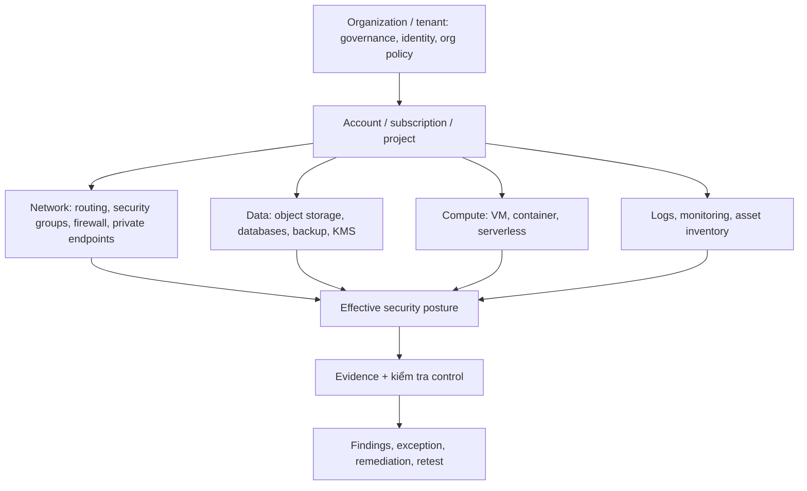
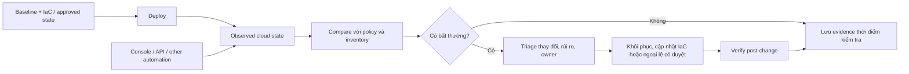

# Cấu hình cloud trong Configuration Assurance

## 1. Từ cấu hình cloud đến bằng chứng bảo mật

**Cấu hình cloud** là tập các thiết lập quyết định tài nguyên đám mây được tạo, kết nối, truy cập, mã hóa, ghi nhật ký, sao lưu, giám sát và quản trị như thế nào. Các thiết lập này có thể nằm ở nhiều lớp: tài khoản/organization, subscription/project, mạng, dịch vụ lưu trữ, máy ảo, container, hệ quản trị cơ sở dữ liệu, dịch vụ quản lý khóa và hệ thống nhận diện danh tính.

Trong **Configuration Assurance**, mục tiêu không dừng ở việc “đã bật một tùy chọn bảo mật”. Đội ngũ phải có **bằng chứng có thể kiểm tra** rằng cấu hình đang vận hành phù hợp với yêu cầu, security controls và mức rủi ro đã thống nhất. Nhiệm vụ này thuộc module **SECURITY_SECURITY_ASSURANCE**, nơi kết nối quản lý rủi ro, yêu cầu và kiểm soát bảo mật với kiểm thử, audit, xử lý phát hiện và cải tiến liên tục.

Một tài nguyên có thể được tạo an toàn lúc đầu nhưng trở nên rủi ro sau khi người vận hành sửa rule mạng, đổi policy IAM, bật quyền public hoặc thay đổi cấu hình dịch vụ. Vì vậy, bảo đảm cấu hình cloud là quá trình **liên tục**, bao gồm thiết kế baseline, kiểm tra trước triển khai, xác nhận trạng thái thực tế, phát hiện drift, khắc phục và lưu chứng cứ.

Sau bài học, người học có thể:

1. Phân biệt cấu hình dự kiến trong IaC với **trạng thái có hiệu lực** của tài nguyên trong cloud.
2. Xây dựng baseline có ưu tiên rủi ro cho IAM, mạng, dữ liệu, khóa, logging và workload.
3. Kiểm tra một cấu hình với chính sách, giải thích nguyên nhân và mức tác động của phát hiện.
4. Triển khai chu trình **policy-as-code → CI → deploy → kiểm tra runtime → phát hiện drift → remediation**.
5. Chuẩn bị evidence package đủ nguồn gốc và phạm vi cho đánh giá, kiểm toán và quyết định phát hành.
6. Quản lý ngoại lệ, khác biệt giữa các môi trường và trách nhiệm của cloud provider với khách hàng.

## 2. Mô hình trách nhiệm chia sẻ và ranh giới kiểm soát

Các nhà cung cấp cloud thường đảm nhận an toàn của **hạ tầng dịch vụ** thuộc phạm vi họ quản lý; khách hàng chịu trách nhiệm cấu hình và sử dụng dịch vụ phù hợp. Mức độ trách nhiệm của khách hàng khác nhau giữa IaaS, PaaS và SaaS, cũng như giữa từng sản phẩm. Không thể dùng một sơ đồ chung để suy luận rằng nhà cung cấp tự cấu hình mọi dịch vụ theo security policy của tổ chức.

| Mô hình | Nhà cung cấp chủ yếu vận hành | Khách hàng vẫn cần bảo đảm |
|---|---|---|
| **IaaS** | Trung tâm dữ liệu, phần cứng, nền tảng ảo hóa thuộc dịch vụ | IAM, mạng, hệ điều hành/workload, dữ liệu, cấu hình lưu trữ, secret, log và giám sát |
| **PaaS / managed services** | Thêm hệ điều hành hoặc runtime/phần mềm nền tảng tùy dịch vụ | Phân quyền, cấu hình dịch vụ, truy cập mạng, dữ liệu, mã hóa/khóa theo khả năng dịch vụ, kết nối và logging |
| **SaaS** | Phần lớn ứng dụng và nền tảng vận hành | Danh tính, tài khoản, chia sẻ dữ liệu, retention, tích hợp, audit và các tùy chọn mà khách hàng được quản lý |

**Ví dụ:** một database managed service có thể được provider vá lớp hệ điều hành, nhưng khách hàng vẫn có thể cấu hình tài khoản DB quá quyền hoặc cho phép truy cập mạng quá rộng. Cả hai đều có thể dẫn đến lộ dữ liệu ngay cả khi provider thực hiện đúng trách nhiệm vận hành hạ tầng.

Khi lập chương trình assurance, cần **lập bản đồ control owner**: ai sở hữu quyết định, ai triển khai, bằng chứng được lấy ở đâu và bên nào thực sự có khả năng sửa. Với thành phần do provider kiểm soát, có thể cần tài liệu/chứng nhận hoặc báo cáo bảo đảm do provider cung cấp thay vì tự chạy lệnh trên phần hạ tầng không được phép truy cập.

## 3. Bản đồ các lớp cấu hình cloud

Một thay đổi tại lớp cao có thể tác động hàng trăm tài nguyên con. Do đó, chỉ quét VM hoặc bucket riêng lẻ sẽ không đủ.



| Lớp | Cấu hình tiêu biểu | Câu hỏi assurance |
|---|---|---|
| Tổ chức/tenant | Landing zone, policy cấp tổ chức, phân tách môi trường | Các tài khoản có nằm trong governance và chính sách được quản lý không? |
| IAM | User, role, trust policy, federation, MFA, service identity | Ai có thể làm gì đối với tài nguyên nào, trong điều kiện gì? |
| Network | VPC/VNet, firewall, security group, route, load balancer | Đường truy cập nào thực sự mở từ Internet hoặc giữa các vùng tin cậy? |
| Data | Bucket, database, snapshot, backup, replication | Dữ liệu có bị public, thiếu kiểm soát quyền hoặc thiếu bảo vệ theo chính sách không? |
| Cryptography | KMS key, rotation policy, key access, TLS | Khóa do ai quản lý, dịch vụ nào sử dụng, đường truyền nào cần bảo vệ? |
| Compute | Image, metadata service, container, orchestration, serverless | Runtime có quyền phù hợp, được cập nhật và cách ly theo yêu cầu không? |
| Observability | Audit logs, event routing, alert, retention | Hoạt động quan trọng có được ghi và có thể truy vấn/điều tra không? |
| Resilience | Backup, versioning, restore, multi-zone | Có thể phục hồi được trong các mục tiêu RPO/RTO đã cam kết không? |

**Trạng thái hiệu lực (effective configuration)** có thể phụ thuộc nhiều lớp cùng lúc. Chẳng hạn bucket có cờ “block public” ở mức tài nguyên nhưng quyền truy cập vào dữ liệu vẫn cần xét policy IAM, access point, chia sẻ qua CDN và đường cấp signed URL. Đánh giá một thuộc tính đơn lẻ không đủ kết luận toàn bộ dữ liệu được bảo vệ.

## 4. Baseline bảo mật: chuyển mục tiêu thành điều kiện kiểm tra

**Security baseline** là tập yêu cầu cấu hình tối thiểu được tổ chức phê duyệt cho một nhóm tài sản hoặc môi trường. Có thể tham khảo các khung như CIS Benchmarks, NIST SP 800-53, CSA Cloud Controls Matrix và hướng dẫn của nhà cung cấp, nhưng cần **chuyển chúng thành điều kiện kiểm tra có phạm vi rõ ràng**, phù hợp với rủi ro, dịch vụ và kiến trúc thật.

Một control tốt nên chỉ rõ: *đối tượng nào*, *điều kiện nào*, *bằng chứng nào*, *ai chịu trách nhiệm*, *ngoại lệ ra sao*.

| Control ID minh họa | Đối tượng | Điều kiện kỳ vọng | Bằng chứng đề xuất |
|---|---|---|---|
| `CLOUD-IAM-01` | Tài khoản quản trị tương tác | Có xác thực mạnh/MFA theo chính sách và sử dụng danh tính tập trung | Chính sách IAM/IdP, trạng thái MFA của đối tượng trong scope |
| `CLOUD-NET-02` | Database chứa dữ liệu riêng tư | Không có đường truy cập Internet công khai nếu kiến trúc không yêu cầu | Firewall/route, endpoint cấu hình, kiểm tra đường kết nối có phép |
| `CLOUD-DATA-03` | Storage nội bộ | Không cho phép public access ngoài trường hợp đã duyệt | Cấu hình tài nguyên, policy truy cập, ACL và kiểm tra effective access |
| `CLOUD-CRYPT-04` | Dữ liệu nhạy cảm | Mã hóa nghỉ theo tiêu chuẩn được duyệt, dùng khóa phù hợp | Thuộc tính encryption, key ID và quyền truy cập khóa |
| `CLOUD-LOG-05` | Hoạt động quản trị | Audit event được thu thập, lưu và bảo vệ theo retention | Event source, destination, mẫu event, quyền chỉnh sửa và thời hạn lưu |
| `CLOUD-BCP-06` | Dữ liệu quan trọng | Có backup và kiểm tra phục hồi theo RPO/RTO | Policy backup, trạng thái job, biên bản restore test |

Các ID và chính sách trên là **minh họa**, không phải yêu cầu mặc định cho mọi cloud workload. Chẳng hạn public bucket phục vụ website tĩnh có thể là mục đích hợp lệ; control cần phân biệt bucket **dữ liệu riêng tư** với **tài nguyên công khai được phê duyệt**. Không nên đánh dấu mọi truy cập Internet là lỗi nếu đó là điểm vào public theo thiết kế và có biện pháp bảo vệ đúng.

### 4.1. Phân tầng baseline

Baseline nên phân tầng để tránh một profile áp dụng sai cho mọi dịch vụ:

- **Organization baseline:** quản trị tài khoản, audit nền tảng, phân tách môi trường, ranh giới identity.
- **Environment baseline:** production, staging, development có yêu cầu và mức dữ liệu khác nhau; môi trường không phải production vẫn phải bảo vệ secret và dữ liệu thật nếu có.
- **Service baseline:** object storage, managed database, Kubernetes, API gateway, queue có rủi ro và API cấu hình khác nhau.
- **Data/risk tier:** dữ liệu công khai, nội bộ, nhạy cảm, tài sản trọng yếu có mức kiểm soát tương ứng.

Một điều kiện nên ghi thành **testable invariant**, ví dụ: “Mọi database chứa dữ liệu khách hàng trong production chỉ chấp nhận kết nối từ subnet hoặc private endpoint được phép; không có public route trực tiếp”. Điều này cụ thể và kiểm tra được hơn câu “database phải an toàn”.

## 5. Nhóm kiểm soát trọng yếu cần kiểm tra

### 5.1. Identity and Access Management (IAM)

IAM kiểm soát hành động trên tài nguyên cloud. Các lỗi thường gặp là quyền quá rộng, role có trust relationship không cần thiết, credential lâu không sử dụng, service account dùng khóa tĩnh và thiếu bảo vệ tài khoản đặc quyền.

Kiểm tra nên bao gồm:

1. **Danh tính tương tác:** kết nối IdP/SSO khi phù hợp, MFA, quy trình offboarding, tài khoản khẩn cấp (break-glass) có audit.
2. **Phân quyền tối thiểu:** policy phù hợp nhiệm vụ; rà soát wildcard permission, quyền thay đổi IAM hoặc đọc secret, điều kiện theo resource.
3. **Workload identity:** ưu tiên danh tính gắn với workload hoặc token ngắn hạn được quản lý thay vì nhúng access key dài hạn vào image hoặc CI variable.
4. **Trust policy:** ai được assume role, điều kiện federation/issuer/audience, ranh giới giữa tài khoản hoặc tenant.
5. **Privileged action:** các thao tác thay đổi policy, tắt log, xóa backup, tạo key có được giám sát và phân tách nhiệm vụ?

Lưu ý **quyền có hiệu lực** là kết quả tổng hợp policy cho phép, policy từ chối, boundary, organization-level restrictions và ngữ cảnh request; không thể chỉ nhìn tên một role rồi khẳng định nó có thể truy cập mọi resource. Với phát hiện quan trọng, nên kiểm tra theo principal, resource và action cụ thể qua công cụ mô phỏng/kiểm thử được phép.

### 5.2. Network exposure và phân đoạn

Đánh giá luồng **ingress và egress**, không chỉ xem có port mở hay không. Ví dụ:

- Database và bảng điều khiển quản trị có public IP hoặc route trực tiếp không?
- Rule cho phép `0.0.0.0/0` hoặc `::/0` áp dụng cho port nào? Đây là Internet ingress được duyệt hay nhầm lẫn?
- Web tier có tách biệt private database, management plane và mạng đối tác không?
- Có private endpoint, network policy và kiểm soát egress cần thiết để hạn chế di chuyển ngang không?
- Các cấu hình cloud firewall, security group, route table, gateway và firewall tại workload kết hợp ra sao?

Rule mở `443/TCP` cho một load balancer public có thể hợp lệ; rule mở cổng quản trị tới toàn Internet thường cần xem xét khẩn. Cảnh báo phải dựa trên **chức năng và dữ liệu** của tài sản, thay vì mặc định tất cả tài nguyên public đều sai.

### 5.3. Object storage, database và backup

Với object storage, kiểm tra effective public access, bucket/resource policy, ACL khi còn áp dụng, mã hóa, versioning và vòng đời dữ liệu. Với database, xét network endpoint, quyền truy cập, cơ chế xác thực, encryption at rest/in transit, audit và backup.

**Mã hóa mặc định** ở một dịch vụ không luôn đáp ứng yêu cầu về **khóa do khách hàng quản lý**, quyền dùng khóa hoặc phân tách nhiệm vụ. Cần xác định control yêu cầu chỉ mã hóa dữ liệu hay còn yêu cầu customer-managed key và vòng đời khóa riêng.

**Backup configuration không chứng minh khả năng phục hồi.** Bằng chứng phải gồm thành công của job, retention, bảo vệ trước việc xóa/sửa trái phép và **restore test** theo mục tiêu RPO/RTO. Một bản snapshot tồn tại mà không thể khôi phục hoặc không chứa dữ liệu quan trọng chưa phải bằng chứng đủ.

### 5.4. Logging, monitoring và audit trail

Đánh giá cả ba khâu **sinh sự kiện → chuyển và lưu → phát hiện và phản ứng**:

- Có ghi các hoạt động quản trị và thay đổi cấu hình tại scope cần giám sát?
- Log của data plane có cần bật riêng không, có chi phí hoặc giới hạn đáng kể không?
- Log từ các tài khoản/project và vùng được hợp nhất hoặc có kế hoạch thu thập thống nhất?
- Ai có quyền tắt log, thay retention hoặc xóa bằng chứng?
- Thời gian hệ thống có đồng bộ và event có correlation ID để điều tra?
- Alert có được kiểm tra bằng sự kiện test được phép hay chỉ mới khai báo rule?

Việc “bật audit logging” chưa đủ nếu pipeline vận chuyển log lỗi, destination không nhận sự kiện, retention quá ngắn hoặc quyền xóa log quá rộng. Cần quan sát **một sự kiện mẫu** và kiểm tra quyền truy xuất theo chính sách.

### 5.5. Workload và dịch vụ quản lý

Với VM/container/serverless, quan tâm image cập nhật, quyền runtime, secret injection, policy metadata service, network egress và khả năng truy cập control plane. Với Kubernetes managed service, đánh giá thêm RBAC, network policy, admission controls, secret storage, audit và policy workload. Không suy diễn rằng managed control plane đồng nghĩa nhà cung cấp chịu trách nhiệm mọi cấu hình workload bên trong cluster.

## 6. Infrastructure as Code và trạng thái cloud thực tế

**Infrastructure as Code (IaC)** mô tả tài nguyên dưới dạng mã khai báo hoặc chương trình (ví dụ Terraform, CloudFormation, Bicep). IaC giúp review thay đổi, kiểm tra chính sách sớm và truy vết từ commit đến deployment. Nhưng file IaC chỉ thể hiện **trạng thái dự kiến** hoặc phần cấu hình được quản lý; nguồn lực có thể bị sửa trực tiếp trên console/API, trôi khỏi policy hoặc không nằm trong repo.

| Nguồn quan sát | Nó cho biết gì? | Giới hạn |
|---|---|---|
| IaC trong Git | Ý định thiết kế và lịch sử review | Không đảm bảo đúng cấu hình đã deploy |
| Plan/preview deployment | Thay đổi công cụ dự định áp dụng | Phụ thuộc state/provider; chưa phải cấu hình có hiệu lực |
| API/control plane snapshot | Thuộc tính tài nguyên tại một thời điểm | Có thể thiếu context và effective permission |
| Policy-as-code scanner | Vi phạm điều kiện có thể kiểm tự động | Có false positive/negative và rule coverage |
| Log thay đổi | Ai làm gì, lúc nào, qua API nào | Có thể thiếu event nếu logging chưa bao phủ |
| Runtime/behavior test | Đường truy cập hoặc quyền có hoạt động đúng không | Chỉ chứng minh trong scope và điều kiện đã test |

**Điểm khó của assurance:** cần so sánh **desired state**, **observed state** và **effective behavior**. Ví dụ, IaC đặt network private nhưng workload thực tế vẫn có public endpoint tạo thủ công; hoặc IaC bật log nhưng tài khoản mới chưa được đăng ký vào cơ chế thu thập chung.

### 6.1. Ví dụ Terraform: bucket chứa dữ liệu nội bộ

Đoạn sau minh họa một số thuộc tính của Amazon S3. Đây là **ví dụ học tập**, chưa phải module triển khai production hoàn chỉnh; cần bổ sung bucket policy, IAM, lifecycle, audit, tagging, yêu cầu chống xóa và kiểm tra phù hợp với hệ thống.

```hcl
resource "aws_s3_bucket" "internal_data" {
  bucket = "example-internal-data-unique-name"
}

resource "aws_s3_bucket_public_access_block" "internal_data" {
  bucket = aws_s3_bucket.internal_data.id

  block_public_acls       = true
  ignore_public_acls      = true
  block_public_policy     = true
  restrict_public_buckets = true
}

resource "aws_s3_bucket_versioning" "internal_data" {
  bucket = aws_s3_bucket.internal_data.id

  versioning_configuration {
    status = "Enabled"
  }
}

resource "aws_s3_bucket_server_side_encryption_configuration" "internal_data" {
  bucket = aws_s3_bucket.internal_data.id

  rule {
    apply_server_side_encryption_by_default {
      sse_algorithm = "aws:kms"
      kms_master_key_id = aws_kms_key.internal_data.arn
    }
  }
}
```

Đoạn mẫu giả định `aws_kms_key.internal_data` đã được định nghĩa và người triển khai có quyền sử dụng khóa. Trong môi trường thật, cần kiểm tra **key policy, quyền principal, vùng, tích hợp service, quy trình khôi phục, chi phí** và các yêu cầu bổ sung. Versioning giúp quản lý phiên bản nhưng không thay thế backup độc lập hoặc kiểm soát chống xóa. Tài nguyên có tên global phải chọn tên còn khả dụng, vì vậy tên ví dụ chưa chắc tạo được.

Một control có thể yêu cầu:

> **`CLOUD-DATA-03`:** Các bucket được gắn nhãn `data_class=internal` không được public qua bất kỳ policy hay ACL có hiệu lực nào; mọi ngoại lệ phải có phê duyệt.

Phân tích IaC có thể kiểm tra thuộc tính block public access, nhưng kết quả assurance đầy đủ cần đối chiếu **bucket thực tế**, policy IAM/access point, giới hạn truy cập hiện hành và bề mặt truy cập có liên quan.

### 6.2. Kiểm tra trước khi deploy

Trong pull request, nhóm có thể:

1. Kiểm tra định dạng và validate cấu hình IaC.
2. Phân tích chính sách trên source hoặc plan với bộ rule có phiên bản.
3. Phát hiện resource mới public, IAM quá rộng hoặc thiếu log theo policy.
4. Gắn finding với file/dòng, security control và người sở hữu.
5. Yêu cầu review trước khi merge; giữ kết quả kiểm tra và commit nguồn.

**Không tự động tin vào “plan pass”:** có tài nguyên tạo bằng API/console ngoài IaC, quyền phụ thuộc tổ chức hoặc cấu hình phát sinh runtime mà scanner chưa phân tích. Bước post-deploy vẫn cần xác nhận.

## 7. Policy-as-code và kiểm tra cấu hình tự động

**Policy-as-code** biểu diễn một phần chính sách bảo mật bằng các điều kiện máy có thể kiểm tra. Nó giúp chuyển câu “tài nguyên dữ liệu nội bộ không được công khai” thành phép kiểm được chạy thống nhất ở PR, CI và trên inventory tài nguyên cloud.

Ví dụ một quy tắc mô tả bằng **pseudocode**, không phải cú pháp thực thi của công cụ cụ thể:

```yaml
control_id: CLOUD-DATA-03
applies_to:
  type: object_storage_bucket
  labels:
    data_class: internal
require:
  effective_public_access: false
evidence_fields:
  - resource_id
  - account_or_project
  - region
  - access_configuration
  - evaluated_at
on_violation:
  classification: needs_review
  owner: storage_platform_team
```

Quy tắc nêu **mục đích và dữ liệu đánh giá**. Muốn chạy thật, cần triển khai theo schema mà công cụ đang dùng hỗ trợ; nhiều engine chỉ kiểm tra được thuộc tính đơn lẻ, không thể tự suy luận chính xác `effective_public_access` qua tất cả đường truy cập. Khi đó phải tách rule thành nhiều điều kiện và có phép kiểm bổ sung.

### Tích hợp ở những điểm nào?

| Điểm kiểm tra | Dữ liệu đầu vào | Kết quả cần thu |
|---|---|---|
| **Developer/IDE** | IaC cục bộ | Diagnostic sớm, file/dòng, rule |
| **PR/CI pre-deploy** | Source, plan và policy revision | PASS/FAIL/PENDING, resource, commit, link job |
| **Post-deploy** | Cấu hình tài nguyên từ cloud API | Resource ID, cấu hình quan sát, thời điểm, đối chiếu |
| **Continuous posture monitoring** | Inventory/asset events, snapshot định kỳ | Drift/finding mới, owner, lịch sử và SLA |
| **Audit/release review** | Bằng chứng đã xác minh và ngoại lệ | Kết luận có phạm vi, risk acceptance, retest |

Công cụ có thể bao gồm scanner IaC, công cụ đánh giá policy và dịch vụ quản trị cloud security posture (CSPM). Các hệ sinh thái cloud cũng có dịch vụ inventory, policy và configuration compliance riêng. Không nên giả định **một công cụ** bao phủ toàn bộ quyền có hiệu lực, network path, data-plane behavior và dịch vụ của mọi provider.

### Kiểm soát phiên bản quy tắc

Mỗi kết quả cần gắn **rule ID + phiên bản policy**. Nếu rule thay đổi sau một tháng, cùng một tài nguyên có thể chuyển từ PASS sang FAIL dù cấu hình không đổi. Phân biệt biến động **do resource thay đổi** với biến động **do tiêu chí đánh giá thay đổi** giúp tránh nhầm lẫn khi tổng hợp KPI và audit.

## 8. Configuration drift: khi triển khai và thực tế khác nhau

**Configuration drift** là sự lệch giữa cấu hình được quản lý/kỳ vọng với cấu hình tài nguyên đang tồn tại. Drift có thể phát sinh do sửa trực tiếp trên console, automation khác, cập nhật nhà cung cấp, provisioning ngoài pipeline hoặc thay đổi policy mà chưa điều chỉnh resource.

Không phải mọi thay đổi đều là drift nguy hiểm. Điều quan trọng là đánh giá nó có vi phạm baseline, làm tăng khả năng tấn công hay gây sai lệch bằng chứng không.



### Ba dạng lệch cần phân biệt

1. **State drift:** thuộc tính cloud đang khác cấu hình trong IaC, ví dụ security group bị mở rộng port quản trị.
2. **Policy drift:** baseline, rule set hoặc yêu cầu audit được cập nhật nhưng tài nguyên chưa đáp ứng.
3. **Coverage drift:** tài khoản mới, vùng mới hoặc dịch vụ mới không được công cụ kiểm tra; dashboard cũ vẫn hiển thị ít finding vì chưa thu thập tài nguyên mới.

**Ví dụ thực tế:** đội vận hành tạm mở ingress `0.0.0.0/0:22` cho VM để xử lý sự cố rồi quên đóng. IaC vẫn ghi CIDR private nhưng security group cloud đã thay đổi. Một lần scan source không phát hiện; kiểm tra trạng thái cloud, event audit hoặc drift detection mới nhìn thấy thay đổi đó.

Quy trình tốt cần ghi ai thay đổi, thời điểm, lý do, mức ảnh hưởng và trạng thái sửa. Nếu phải giữ ngoại lệ trong thời gian ngắn, giới hạn IP/thời gian, ghi người phê duyệt và đặt điều kiện hết hạn; tránh để một ngoại lệ khẩn cấp trở thành baseline mới không được review.

### Remediation: sửa cloud hay sửa IaC?

Không có đáp án cố định:

- Nếu thay đổi trực tiếp là **trái policy**, ưu tiên đưa cloud trở về cấu hình đã duyệt bằng quy trình kiểm soát thay đổi.
- Nếu thay đổi trực tiếp là **hợp lệ và cần duy trì**, review rồi cập nhật IaC, policy hoặc hồ sơ ngoại lệ để thống nhất nguồn quản lý.
- Nếu tài nguyên không được quản lý bằng IaC, xác định owner và quyết định onboarding hoặc điều khiển thông qua phương án quản trị khác.

Không nên tự động “rollback mọi drift” khi có khả năng phá vỡ dịch vụ, khóa truy cập vận hành hoặc gián đoạn khôi phục sự cố. Các thay đổi có tác động phải được đánh giá và có biện pháp rollback trước khi thực hiện.

## 9. Thực hành kiểm tra: một bucket bị nghi public

### 9.1. Giả định và mục tiêu

Nhóm đang bảo vệ kho object chứa hồ sơ nội bộ. Một CSPM scanner báo bucket có khả năng public. Security requirement giả lập:

> **`CLOUD-DATA-03`:** Bucket gắn `data_class=internal` không cho phép actor không được ủy quyền đọc object qua các đường truy cập trong phạm vi đã đánh giá.

**Scope:** một bucket test tại staging, thuộc một tài khoản cloud và vùng đã định; các object thử không chứa dữ liệu thật. Nhóm được quyền xem cấu hình và thực hiện kiểm tra truy cập không làm thay đổi dữ liệu.

### 9.2. Điều tra từng lớp

| Câu hỏi | Bằng chứng phù hợp | Vì sao cần? |
|---|---|---|
| Bucket nào bị báo? | Resource ID/ARN, account, region, tag, timestamp | Tránh nhầm bucket tên gần giống |
| Bucket thuộc phân loại nào? | Data classification, owner, intended use | Không kết luận bucket public static asset là sai nếu được phép |
| Quyền public ở mức tài nguyên ra sao? | Public access block, bucket policy, ACL nếu áp dụng | Thấy cấu hình bề mặt |
| Có đường truy cập gián tiếp? | Access point, CDN, ứng dụng proxy/signed URL, policy liên quan | Tránh bỏ sót các đường cấp dữ liệu |
| Ai có quyền đổi policy? | IAM/resource policy và boundary liên quan | Phòng ngừa tái phát do privilege quá rộng |
| Truy cập thực tế thế nào? | Thử truy cập object canary bằng actor không được cấp quyền, trong phạm vi cho phép | Đối chiếu expected vs actual |
| Có drift hay ngoại lệ? | IaC commit, event audit, ticket, approval | Giải thích nguyên nhân và trách nhiệm |

Đối với Amazon S3, một bước điều tra **read-only** có thể tham khảo:

```bash
aws s3api get-public-access-block --bucket example-internal-data-unique-name
aws s3api get-bucket-policy --bucket example-internal-data-unique-name
aws s3api get-bucket-encryption --bucket example-internal-data-unique-name
```

Các lệnh minh họa cho tài nguyên và quyền xem đã được cấp. Nếu lệnh trả lỗi do thiếu quyền, bucket không tồn tại hoặc một thuộc tính chưa cấu hình, phải ghi nguyên nhân; không diễn giải lỗi API thành PASS. Kết quả từng API cần xem cùng với các chính sách và đường truy cập khác, và không nên đưa toàn bộ policy có thông tin nhạy cảm vào ticket công khai.

**Đối chứng hành vi:** dùng object canary không có dữ liệu thật; truy cập dưới danh tính đã được cấp quyền phải thành công theo policy, còn actor ngoài phạm vi quyền phải bị từ chối. Một request không thành công có thể do object sai, lỗi DNS, missing credentials hoặc WAF; cần xác nhận những yếu tố đó trước khi kết luận.

### 9.3. Ví dụ phát hiện và kết luận

Giả sử quét cho thấy bucket policy cấp quyền đọc cho public principal và kiểm tra object canary xác nhận người dùng không đăng nhập vẫn tải được nội dung. Khi baseline yêu cầu private, đây là **true positive** trong phạm vi kiểm tra. Hồ sơ cần nêu:

- Finding: `CLOUD-DATA-03` violated.
- Resource: account + region + bucket ID + tag phân loại nội bộ.
- Observed: policy cho phép public read; request không xác thực đọc được canary.
- Expected: actor ngoài quyền không được đọc object.
- Impact: nguy cơ lộ dữ liệu trong bucket nếu các object nhạy cảm cùng chịu policy.
- Remediation: điều chỉnh policy/public access control theo thiết kế, review các đường chia sẻ hợp lệ, retest.

Không nên mặc định mọi object đã bị lộ hoặc đã có actor tải dữ liệu. Muốn khẳng định có **data exposure trong quá khứ**, cần bằng chứng riêng như log truy cập đã được bật và dữ liệu lịch sử tương ứng; thiếu log không chứng minh không có truy cập.

### 9.4. Retest sau sửa

Sau khi thay đổi policy ở build/change được ghi nhận:

1. Kiểm tra lại cấu hình thực tế bằng API/cloud inventory, không chỉ xem IaC.
2. Xác minh actor ngoài quyền không tải được canary, trong khi actor hợp lệ còn truy cập theo policy.
3. Kiểm tra rule chung của bucket và các đường truy cập liên quan; bảo đảm thay đổi không làm hỏng tích hợp được phép.
4. Đối chiếu event log, ticket, PR, thời điểm và người review.
5. Cập nhật finding thành `verified fixed` với giới hạn scope; tiếp tục theo dõi drift.

### Đối chiếu công cụ và hành vi

| Quan sát | Cách phân loại ban đầu |
|---|---|
| Policy chỉ public cho bucket được phê duyệt phục vụ static website | Xem scope/control; có thể là not applicable hoặc ngoại lệ được duyệt |
| Bucket nội bộ có quyền public và object canary đọc được | TP, cần đánh giá tác động và sửa |
| Rule nói bucket public nhưng cấu hình effective access chứng minh chỉ principal được phép | FP có bằng chứng, sau review |
| Không xem được policy hoặc access point; test thiếu quyền | Inconclusive, bổ sung dữ liệu |
| Bucket đã private nhưng nhật ký cho thấy từng public trước đó | Cần đánh giá rủi ro lịch sử; không xóa finding quá khứ chỉ vì hiện tại đã sửa |

## 10. Evidence package: chứng minh trạng thái cấu hình

Assurance cần một chuỗi bằng chứng có thể truy xuất từ **control** đến trạng thái tài nguyên và quyết định xử lý. Một screenshot console không đủ khi thiếu tài khoản, vùng, resource ID, timestamp hoặc cách xác nhận ảnh đại diện cho cấu hình tại thời điểm đánh giá.

### 10.1. Mẫu hồ sơ bằng chứng

| Thành phần | Nội dung cần giữ |
|---|---|
| Mục tiêu và control | Security requirement, baseline ID, phiên bản policy, tiêu chí PASS/FAIL |
| Tài sản | Cloud provider, organization/account/project, region, resource ID, owner, data classification |
| Môi trường | Production/staging/dev, IaC commit, deployment/change ID |
| Phương pháp | Read-only API, policy scanner, thử nghiệm hành vi được phép, tần suất |
| Dữ liệu gốc | Cấu hình đã khử nhạy cảm, output API, scanner report, log thay đổi |
| Kết quả | Actual vs expected, TP/FP/inconclusive, mức độ tin cậy và rủi ro |
| Xử lý | Owner, ticket, quyết định, phê duyệt ngoại lệ nếu có |
| Xác minh | Thời điểm, bản sửa, ảnh chụp trạng thái sau sửa và test bổ sung |
| Phạm vi thiếu | Tài khoản/vùng không có quyền thu thập, tài nguyên không bao phủ |

Ví dụ một manifest **giả lập** để trình bày evidence, không phải dữ liệu quét thực:

```yaml
evidence_id: CLOUD-EV-EXAMPLE-007
service: SECURITY_SECURITY_ASSURANCE
control_id: CLOUD-DATA-03
policy_revision: baseline-example-r3
collected_at: "2026-11-28T03:15:00Z"
cloud:
  provider: aws
  account_alias: example-security-staging
  region: ap-southeast-1
resource:
  type: object_storage_bucket
  id: example-internal-data-unique-name
  classification: internal
source:
  type: cloud_control_plane_api
  configuration_ref: artifacts/bucket-config-redacted.json
  iac_commit: example-commit-abc123
assessment:
  expected: "No unauthorized public read access"
  actual: "Public-read path confirmed against canary object"
  classification: true_positive
  reviewer: "Security assurance reviewer"
tracking:
  ticket: CLOUD-EXAMPLE-127
  retest: pending
limits:
  - "Only designated staging bucket and canary object checked"
```

Manifest phải ghi rõ dữ liệu là **snapshot tại thời điểm thu thập**, không phải lời cam kết cấu hình sẽ giữ nguyên về sau. Nếu sử dụng automation, nên ghi tool version, phạm vi truy cập, asset inventory timestamp và trạng thái job chạy thành công hoặc chưa hoàn tất.

### 10.2. Tính toàn vẹn, bí mật và khả năng truy vết

Một evidence package có thể gồm `manifest.yml`, `policy-results.json`, `resource-snapshot-redacted.json`, `audit-events-redacted.json`, `triage.md` và `retest-report.json`. Nếu tính SHA-256 cho artifact, cần giữ manifest/checksum trong hệ thống hạn chế quyền sửa đổi, có lịch sử thay đổi hoặc chữ ký theo chính sách; hash một mình không chứng minh nguồn gốc nếu kẻ tấn công sửa được cả file và checksum.

Cloud configuration đôi khi chứa tên mạng nội bộ, ARN/resource ID, policy principal, secret reference và metadata nhạy cảm. **Không lưu access key hoặc token trong bằng chứng chia sẻ**. Dùng nguyên tắc tối thiểu hóa và che dữ liệu, giữ lại phần cấu hình thực sự hỗ trợ kết luận. Nếu bản gốc được lưu riêng, ghi rõ bản đã khử nhạy cảm được sinh từ phiên bản nào.

### 10.3. Phân biệt “được cấu hình” và “đã hoạt động”

| Control | Bằng chứng cấu hình | Bằng chứng hoạt động bổ sung |
|---|---|---|
| Audit logging | Policy bật luồng log và destination | Sự kiện test xuất hiện, được lưu đúng retention |
| Backup | Backup plan và lịch chạy | Restore thử thành công, đo RPO/RTO |
| Private database | Network ACL/firewall không mở Internet | Kiểm tra đường truy cập có phép từ vùng ngoài |
| Least privilege | IAM policy mô tả quyền dự kiến | Đánh giá effective permissions, thử hành động theo role |
| Encryption | Attribute chỉ định KMS/TLS | Kiểm tra khóa, quyền, thao tác hợp lệ và đường kết nối |

Không phải mọi control đều cần thử nghiệm runtime ở mọi lần quét. Tuy nhiên, với rủi ro trọng yếu hoặc khi cấu hình có nhiều lớp phụ thuộc, bằng chứng chỉ từ một cờ cấu hình thường chưa đủ.

## 11. Triển khai assurance trên AWS, Azure và Google Cloud

Các cloud provider dùng mô hình resource, tên thuộc tính và công cụ khác nhau, nhưng **mục tiêu bảo mật** thường có thể thống nhất ở cấp tổ chức. Không nên chỉ chuyển tên rule từ cloud này sang cloud khác mà không xét cách mô hình quyền và đường truy cập được triển khai.

| Mục tiêu | Ví dụ ở AWS | Ví dụ ở Azure | Ví dụ ở Google Cloud |
|---|---|---|---|
| Inventory / posture | AWS Config và asset inventory liên quan | Azure Resource Graph, Azure Policy | Cloud Asset Inventory, Organization Policy |
| Phân quyền | IAM policies, roles, Organizations controls | Azure RBAC, Microsoft Entra ID, Azure Policy | Cloud IAM, organization policies |
| Network | VPC, security groups, network ACLs | Virtual Network, NSG, firewall | VPC firewall rules, hierarchical policies |
| Object storage | S3 bucket policies và public access controls | Storage account/container access settings | Cloud Storage IAM và public access controls |
| Audit | CloudTrail và log của từng dịch vụ | Azure Activity Log, diagnostic settings | Cloud Audit Logs và log của từng dịch vụ |
| Keys / encryption | KMS, encryption options của dịch vụ | Key Vault và encryption options | Cloud KMS và encryption options |

Đây là **bản đồ khái niệm** nhằm gợi ý nơi thu thập dữ liệu, không phải cam kết mỗi công cụ tự kiểm tra đủ mọi control. Ví dụ audit management event, data event và quyền truy cập dữ liệu có thể được ghi theo các cơ chế khác nhau. Cần kiểm tra loại event, phạm vi, vùng, chế độ bật và chi phí trong kiến trúc cụ thể.

### 11.1. Quy tắc chung, cách đo riêng

Một yêu cầu ở cấp tổ chức có thể là:

> “Mọi workload chứa dữ liệu nhạy cảm phải chặn truy cập quản trị công khai và có audit log của thay đổi quyền.”

Với từng provider, nhóm xác định tập resource/API cần kiểm, phép kết hợp quyền, network route và log source khác nhau. Do đó evidence nên có **control ID chung** và **cloud-specific test procedure**. Cấu trúc này giúp so sánh kết quả đa cloud mà vẫn giữ lại sắc thái kỹ thuật.

### 11.2. Cẩn thận với quyền ở nhiều tầng

Một policy cấp organization có thể chặn hành động dù resource policy cho phép. Ngược lại, một role không có wildcard nhưng vẫn có thể phối hợp nhiều quyền để đạt hành vi nhạy cảm. Với network, public endpoint có thể đứng sau gateway, CDN hoặc proxy có policy riêng. **Effective behavior** phải được xác định trong bối cảnh toàn bộ đường thực thi, không chỉ một policy rời rạc.

## 12. Triage, ngoại lệ và remediation

Khi công cụ phát hiện “vi phạm cấu hình”, quyết định đầu tiên là **xác minh** chứ không phải tắt tài nguyên ngay. Một thay đổi cấu hình có thể ảnh hưởng vận hành, availability hoặc quyền quản trị khẩn cấp.

### 12.1. Các trạng thái cần phân biệt

| Trạng thái | Giải thích | Hành động |
|---|---|---|
| **True positive** | Cấu hình có hiệu lực vi phạm điều kiện áp dụng | Đánh giá rủi ro, tìm owner, khắc phục hoặc trình chấp nhận rủi ro |
| **False positive** | Rule báo sai so với cấu hình thực và policy | Lưu bằng chứng, điều chỉnh rule/scope hoặc suppression hẹp |
| **Inconclusive** | API/scan thiếu quyền, inventory không đủ, hiệu lực chưa rõ | Thu thập thêm dữ liệu, không tính như PASS |
| **Not applicable** | Điều kiện không thuộc loại tài sản/nhóm dữ liệu này | Ghi lý do và phiên bản policy |
| **Accepted risk** | Vi phạm có thật nhưng được cấp có thẩm quyền chấp nhận có điều kiện | Ghi owner, thời hạn, biện pháp giảm thiểu và lịch xem lại |
| **Verified fixed** | Có bằng chứng cấu hình hoặc hành vi đã đạt sau thay đổi | Lưu retest; tiếp tục giám sát drift |

**Ví dụ:** một security group mở `0.0.0.0/0` cho cổng quản trị của VM nội bộ là finding cần ưu tiên điều tra. Nếu cổng đó chỉ là port của reverse proxy public được thiết kế cho người dùng, rule kiểm tra có thể đang áp sai scope. Nếu rule đúng nhưng vận hành tạm thời cần kết nối rộng, đó là **ngoại lệ rủi ro** cần hạn chế thời gian và phê duyệt, không phải false positive.

### 12.2. Ưu tiên dựa trên rủi ro

Mức độ ưu tiên nên xét:

- **Độ nhạy dữ liệu/tài sản:** secret, dữ liệu cá nhân, thông tin thanh toán, hệ thống quản trị.
- **Khả năng tiếp cận:** Internet public, bên đối tác, nội bộ VPC, principal chỉ có quyền giới hạn.
- **Quyền có hiệu lực:** đọc dữ liệu, thay đổi policy, tạo credential, phá hủy backup, dừng logging.
- **Khả năng khai thác và điều kiện:** cần xác thực không, có bảo vệ bổ sung không, có đường gián tiếp không?
- **Phạm vi ảnh hưởng:** một resource hay cả tổ chức, một region hay nhiều account.
- **Bằng chứng bổ trợ:** log cho thấy có thay đổi trái phép hay hành vi thực tế, hoặc chỉ có cảnh báo heuristic.

Severity của scanner là một đầu vào, không tự thay thế đánh giá rủi ro theo hệ thống. Không nên mặc định mọi rule “public” đều Critical hoặc mọi cảnh báo thiếu log đều Low.

### 12.3. Khắc phục an toàn

Quy trình khuyến nghị:

1. **Xác nhận finding:** resource ID, owner, current state, baseline và bối cảnh.
2. **Đánh giá tác động thay đổi:** service nào phụ thuộc rule, có khách hàng/automation hợp lệ nào sẽ bị chặn?
3. **Chuẩn bị thay đổi có kiểm soát:** PR/IaC hoặc ticket theo chính sách; có phương án rollback.
4. **Triển khai trong cửa sổ phù hợp:** ưu tiên qua pipeline được quản lý, có audit.
5. **Kiểm tra lại:** xác nhận observed state, effective access/behavior và các chức năng hợp lệ.
6. **Đóng vòng evidence:** ghi commit/change ID, thời điểm, người review, kết quả retest và khoảng trống còn lại.

Với tài nguyên liên quan incident đang diễn ra, quy trình khẩn cấp có thể khác quy trình thông thường. Dù vậy cần ghi dấu vết và reconcile lại IaC/baseline sau khi xử lý.

### 12.4. Ngoại lệ phải nhỏ, có điều kiện và có hạn

Một hồ sơ ngoại lệ nên có:

```yaml
exception_id: CLOUD-EXAMPLE-EX-012
control_id: CLOUD-NET-02
resource: example-admin-bastion
reason: "Temporary maintenance access through approved source IP"
allowed_scope:
  source_cidr: "192.0.2.10/32"
  port: 22
owner: platform_operations
approved_by: security_risk_owner
expires_at: "2026-12-01T00:00:00Z"
compensating_controls:
  - "Restricted identity and audit logging"
review_trigger:
  - "Maintenance ends"
  - "Network path or role changes"
```

Đây là mẫu hư cấu sử dụng địa chỉ IPv4 thuộc dải tài liệu. Địa chỉ thực tế phải theo nguồn được phép của đơn vị. Ngoại lệ không nên chỉ gồm “Ignore until further notice”; nó cần liên kết finding, phạm vi tài nguyên, người chịu trách nhiệm và điều kiện tự hết hiệu lực hoặc được rà soát lại.

## 13. Tổ chức chương trình kiểm tra cấu hình liên tục

Một quy trình bền vững thường kết nối nhiều vai trò: chủ tài nguyên, cloud/platform team, developer, đội bảo mật và người phê duyệt rủi ro. Không nên giao toàn bộ trách nhiệm cho một dashboard CSPM.

| Vai trò | Trách nhiệm |
|---|---|
| Service / resource owner | Xác định nhu cầu truy cập, phân loại dữ liệu, sửa phát hiện và xác nhận tác động |
| Platform / cloud team | Quản trị landing zone, account, IAM nền tảng, policy enforcement và telemetry |
| Developer / DevOps | Quản lý IaC, review PR, không tạo drift qua đường không kiểm soát |
| Security Assurance / AppSec | Định nghĩa tiêu chí kiểm tra, xác minh phát hiện quan trọng, đánh giá chất lượng evidence |
| Risk owner / approver | Quyết định accepted risk trong thẩm quyền; quy định thời hạn và biện pháp bù trừ |
| Audit / compliance | Kiểm tra tính truy vết của control, evidence và quyết định; nêu phạm vi không đạt |

### Quy trình đề xuất

```text
1. Inventory: biết account, project, region, resource và owner
2. Classification: dữ liệu, mức rủi ro và baseline áp dụng
3. Prevention: guardrails, IaC validation và policy-as-code tại PR
4. Deployment: thay đổi có review, lưu build/change ID
5. Detection: quét observed state, audit events và inventory delta
6. Triage: xác minh TP/FP/inconclusive và tác động
7. Remediation: xử lý bằng thay đổi an toàn hoặc ngoại lệ được duyệt
8. Retest: xác minh control và hành vi, cập nhật evidence
9. Review: đo drift, coverage và hiệu lực của policy, cải tiến baseline
```

### Tránh tạo lỗ hổng giám sát

Tài khoản mới có thể không nằm trong inventory; một region bị bỏ qua có thể làm dashboard trông “xanh” dù còn tài sản chưa đánh giá. Mỗi đợt tổng hợp cần ghi **tổng tài nguyên dự kiến, số tài nguyên đã đánh giá, số bị loại trừ và lý do thiếu**.

Không nên dùng số phát hiện giảm làm chỉ số duy nhất. Finding có thể giảm vì tài nguyên được sửa, nhưng cũng có thể do quyền scanner bị thu hồi hoặc công cụ lỗi. Phải theo dõi trạng thái chạy và coverage để giải thích đúng xu hướng.

## 14. Các chỉ số để đánh giá hiệu quả

| Chỉ số | Cách đo | Giới hạn cần biết |
|---|---|---|
| **Inventory coverage** | Tài khoản/project, vùng và tài nguyên đã kiểm / tổng trong scope | Inventory gốc cũng có thể chưa đầy đủ |
| **Baseline compliance** | Tỷ lệ tài nguyên áp dụng control đang PASS sau kiểm chứng | Không so sánh khi baseline/rule revision khác nhau |
| **Time to detect drift** | Thời gian từ thay đổi trái policy đến finding được tạo | Phụ thuộc độ trễ log/snapshot và timestamp |
| **Time to remediate** | Thời gian từ TP xác nhận đến retest pass | Tách theo severity và tài sản |
| **Tỷ lệ finding có owner** | Finding có người phụ trách và ticket thực tế | Owner gán sai vẫn làm số liệu đẹp |
| **Số inconclusive** | Finding thiếu quyền hoặc dữ liệu để kết luận | Không tự đóng để làm giảm backlog |
| **Tỷ lệ ngoại lệ quá hạn** | Accepted risk chưa review sau expiry | Chú ý ngoại lệ đã hết hiệu lực nhưng chưa rollback |
| **Evidence completeness** | Finding/run có resource, rule, thời gian, actual, quyết định, retest | Đủ trường không có nghĩa kết quả kỹ thuật đúng |

**Ví dụ:** 200 tài nguyên trong phạm vi, 180 đã được scanner kiểm tra thành công, 12 chưa có quyền đọc API và 8 chưa được onboarding. Coverage là `180/200 = 90%`. Nếu 162 trong 180 tài nguyên đã kiểm được xác minh PASS theo baseline, compliance **trong tập đã kiểm** là `162/180 = 90%`. Không nên báo “toàn bộ cloud đạt 90% compliance” mà không nói còn 20 tài nguyên chưa được đánh giá.

Các tỷ lệ chỉ có ý nghĩa khi có mẫu số rõ, asset scope ổn định và biết phiên bản chính sách. Một phần tài sản được loại trừ hợp lệ cũng cần đưa vào báo cáo để reviewer hiểu chính xác phạm vi kết luận.

## 15. Bài thực hành: đánh giá cấu hình cloud có bằng chứng

**Bối cảnh:** một đội phát triển lưu file nội bộ trên object storage của môi trường thử nghiệm. Scanner tạo finding `CLOUD-DATA-03`: “Bucket có khả năng public access”. Bạn được cấp quyền chỉ đọc cloud configuration, policy result, source IaC và một object canary không chứa dữ liệu cá nhân.

### Yêu cầu

1. **Xác định phạm vi:** cloud account, region, resource ID, environment, owner và phân loại dữ liệu.
2. **Viết điều kiện control:** expected behavior của bucket nội bộ và cách kiểm chứng khi có nhiều lớp quyền.
3. **Đối chiếu IaC và observed state:** chỉ ra cấu hình nào xuất hiện trong code, cấu hình nào đang có hiệu lực.
4. **Xác minh cảnh báo:** kiểm tra policy/resource settings và thử read-only với canary trong phạm vi đã cấp quyền; có đối chứng actor hợp lệ.
5. **Triage:** kết luận TP, FP hoặc inconclusive với bằng chứng, không dựa vào một cảnh báo scanner.
6. **Nếu là TP:** đánh giá tác động, đề xuất sửa, mô tả ảnh hưởng đến tích hợp và kế hoạch rollback.
7. **Thiết kế retest:** xác minh private read bị từ chối với actor ngoài quyền, actor hợp lệ còn hoạt động và IaC nhất quán.
8. **Tạo gói bằng chứng:** ghi manifest, expected/actual, snapshot đã khử nhạy cảm, policy version, owner, ticket và giới hạn.
9. **Mở rộng:** nêu cách theo dõi drift để cảnh báo tương tự không tái phát.

### Worksheet thực hành

```markdown
Control ID / policy revision:
Resource ID / account / region:
Environment / data classification:
Owner and authorized scope:
Baseline requirement:
IaC commit / planned configuration:
Observed cloud configuration and collected_at:
Effective access / behavior test:
Positive and negative control:
Expected vs actual:
Finding classification and rationale:
Risk and impacted data assumptions:
Remediation / rollback plan:
Retest evidence:
Exception reference if applicable:
Untested paths and limitations:
Reviewer:
```

**Tiêu chí đạt:** có khả năng truy vết **control → resource → cấu hình dự kiến → trạng thái thật → kết quả kiểm tra → quyết định → retest**; phân biệt rõ vấn đề thật và kết quả chưa đủ dữ liệu; bảo vệ secret; có kế hoạch xử lý an toàn và không khẳng định vượt scope.

## 16. Những sai lầm thường gặp

| Sai lầm | Hệ quả | Cách cải thiện |
|---|---|---|
| Dùng duy nhất IaC scan để tuyên bố cloud đã đạt policy | Bỏ qua drift và resource tạo thủ công | Kiểm tra observed state sau triển khai và inventory liên tục |
| Chỉ đọc một cờ “public” | Không hiểu effective access và các đường chia sẻ khác | Đối chiếu policy, ACL, principal, access path và hành vi |
| Mọi tài nguyên public đều bị coi là lỗ hổng | False positive cho dịch vụ cố ý public | Phân loại tài sản, expected behavior và ngoại lệ hợp lệ |
| Bật encryption rồi coi dữ liệu chắc chắn được bảo vệ | Có thể key policy quá rộng, quyền đọc không đúng | Kiểm tra key access, identity, lifecycle và mô hình dữ liệu |
| Bật logging nhưng không thử có event | Pipeline log có thể lỗi hoặc thiếu phạm vi | Kiểm tra sự kiện mẫu, destination, retention và quyền xóa |
| Có backup job mà chưa restore | Không chứng minh đáp ứng RPO/RTO | Chạy bài kiểm tra khôi phục, ghi kết quả |
| Scanner báo 0 finding nên kết luận PASS | Có thể thiếu quyền, region hoặc tài nguyên | Theo dõi coverage và lỗi thu thập |
| Sửa trực tiếp console mà không cập nhật IaC | Drift tái xuất hiện khi deploy lại | Reconcile nguồn quản lý và review change |
| Auto-remediate toàn bộ policy violation | Có thể làm gián đoạn dịch vụ | Đánh giá tác động, giới hạn tự động hóa, rollback |
| Suppress finding mãi mãi | Cấu hình rủi ro tồn tại không được kiểm soát | Ngoại lệ hẹp, có owner, expiry và điều kiện review |
| Lưu bản cấu hình kèm secret trong ticket công khai | Làm lộ thông tin hệ thống | Redact và phân quyền evidence package |
| Dùng kết quả staging khẳng định production an toàn | Khác biệt policy, IAM, network hoặc dữ liệu | Ghi giới hạn và kiểm chứng production theo chính sách |

## 17. Tổng kết kiến thức

**Configuration Assurance cho cloud** là quá trình liên tục kiểm chứng rằng cấu hình đang vận hành đáp ứng yêu cầu và security baseline được phê duyệt. Quy trình này phải bao quát **tài nguyên, quyền, mạng, dữ liệu, mã hóa, log, phục hồi, workload và các lớp chính sách quản trị**, đồng thời xem xét sự khác biệt giữa IaC, observed state và hành vi có hiệu lực.

Giá trị cốt lõi của hoạt động này đối với **SECURITY_SECURITY_ASSURANCE** là chuỗi bằng chứng **rủi ro → security control → cấu hình kỳ vọng → kiểm tra cấu hình thực → đánh giá → khắc phục hoặc ngoại lệ → retest → audit**. Chỉ khi có nguồn gốc, phạm vi, thời điểm, người chịu trách nhiệm và khả năng kiểm tra lại, kết quả “compliant” mới đủ ý nghĩa để hỗ trợ quyết định bảo mật trong phát triển và vận hành.
