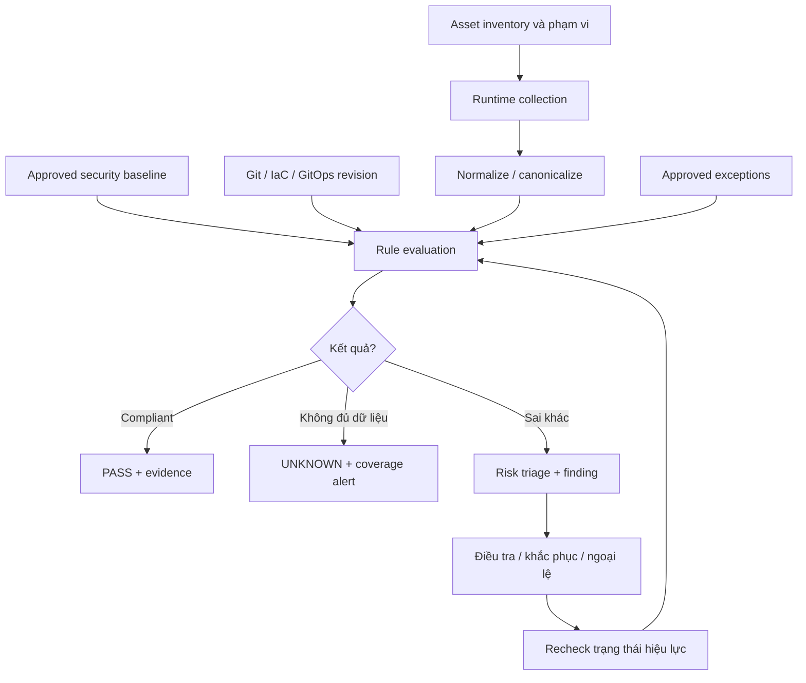

# Drift detection: Phát hiện sai lệch cấu hình và bảo đảm trạng thái bảo mật liên tục

## 1. Mục tiêu học tập

Sau bài này, người học có thể:

- Giải thích **configuration drift** và **drift detection**, phân biệt sai lệch cấu hình với thay đổi được phê duyệt, lỗi kiểm kê, sai khác tạm thời và sự thay đổi của baseline.
- Thiết kế phép so sánh giữa **cấu hình chuẩn đã được phê duyệt**, **trạng thái mong muốn trong code** và **trạng thái hiệu lực của tài sản đang vận hành**.
- Kết hợp kiểm tra định kỳ, theo sự kiện và policy-as-code để phát hiện sai lệch ở hạ tầng cloud, IAM, hệ điều hành, container và Kubernetes.
- Phân loại cảnh báo theo tác động bảo mật, xử lý ngoại lệ có kiểm soát, điều tra nguyên nhân và xác minh kết quả khắc phục.
- Xây dựng **bằng chứng assurance** có phạm vi, thời điểm, phiên bản baseline và khả năng truy vết; đo lường độ bao phủ và thời gian phát hiện.

Nội dung nằm trong chương **Configuration assurance** của dịch vụ `SECURITY_SECURITY_ASSURANCE`. Đích đến của chương trình là đánh giá **có bằng chứng** rằng hệ thống đáp ứng các mục tiêu bảo mật, đi từ rủi ro và security controls đến kiểm thử, audit, khắc phục phát hiện và giám sát liên tục trong phát triển cũng như vận hành.

## 2. Drift detection là gì và tại sao quan trọng?

**Configuration drift** là sự sai khác giữa trạng thái cấu hình thực tế của một tài sản và một trạng thái tham chiếu được xác định. Trong security assurance, tham chiếu nên là **baseline bảo mật đang được phê duyệt và áp dụng cho đúng tài sản, môi trường, phiên bản, thời điểm**.

**Drift detection** là quá trình thu thập dữ liệu cấu hình, chuẩn hóa, đối chiếu với tham chiếu, đánh giá sai khác và phát hiện các trường hợp có khả năng làm thay đổi mức độ an toàn của hệ thống.

Ví dụ: một nhóm đã triển khai security group cho máy chủ API, chỉ cho phép HTTPS từ Internet và SSH từ mạng quản trị. Khi xử lý sự cố, người vận hành mở SSH từ `0.0.0.0/0` rồi quên đóng lại. Mẫu Terraform trong Git vẫn giữ cấu hình cũ, nhưng luật mạng đang có hiệu lực trên cloud đã khác. Nếu chỉ xem repository, nhóm có thể kết luận nhầm rằng tài sản đang an toàn.

Drift detection làm rõ ba câu hỏi:

1. **Cái gì đã thay đổi hoặc sai khác?** Xác định tài sản, trường cấu hình, giá trị mong muốn và giá trị quan sát.
2. **Sai khác này có ảnh hưởng bảo mật không?** Liên kết với yêu cầu, threat model, mức độ lộ diện và chính sách ngoại lệ.
3. **Có thể chứng minh việc phát hiện và xử lý không?** Lưu lại nguồn quan sát, thời điểm, phiên bản rule, người xử lý và kết quả kiểm tra lại.

### 2.1. Bốn trạng thái cần phân biệt

| Trạng thái | Câu hỏi cần trả lời | Ví dụ |
|---|---|---|
| **Approved baseline** | Giá trị nào được security và chủ hệ thống phê duyệt? | Không mở cổng quản trị ra Internet |
| **Declared desired state** | IaC/manifest/policy đang khai báo gì? | Terraform giới hạn SSH trong VPN CIDR |
| **Observed state** | API, agent hoặc bộ kiểm tra nhìn thấy giá trị gì? | Security group có luật SSH từ mọi IPv4 |
| **Effective state** | Khi các chính sách được tổng hợp, hệ thống thực sự cho phép điều gì? | Luồng SSH được route và firewall khác cho phép từ Internet |

Hai khái niệm cuối không luôn giống nhau. Ví dụ, một security group có luật mở cổng nhưng firewall ở lớp khác vẫn chặn; quyền IAM hiển thị trong một policy riêng có thể còn chịu tác động của policy kế thừa, permission boundary hoặc explicit deny. Với control trọng yếu, cần đánh giá **quyền và hành vi hiệu lực**, không chỉ so sánh một tập tin văn bản.

### 2.2. Phân biệt drift và các tình huống gần giống

- **Unauthorized drift:** giá trị sản xuất thay đổi ngoài quy trình hoặc trái baseline; ví dụ tắt audit log, tăng quyền IAM, mở public access.
- **Approved change:** baseline và trạng thái mong muốn đã được duyệt, triển khai có mã thay đổi và được kiểm tra; đây là thay đổi có quản lý.
- **Temporary deviation:** lệch có thời hạn và được phê duyệt để xử lý sự cố; vẫn cần được ghi nhận, giám sát, đóng ngoại lệ.
- **Environmental difference:** production và development dùng các baseline khác nhau; không được lấy baseline của môi trường này để kết luận sai cho môi trường kia.
- **Generated/runtime value:** IP pod, thời gian cập nhật, ID do nền tảng tạo có thể thay đổi bình thường; không phải mọi sai khác đều là vi phạm.
- **Baseline evolution:** yêu cầu bảo mật được tăng cường; cấu hình cũ có thể chưa thay đổi nhưng trở nên *không tuân thủ baseline mới*. Đây là phát hiện về compliance, không nhất thiết là thay đổi trái phép của tài sản.
- **Assessment gap:** mất quyền thu thập, nguồn dữ liệu ngắt, đối tượng không nằm trong inventory; trạng thái đúng phải là `UNKNOWN` hoặc `NOT_ASSESSED` thay vì `PASS`.

Vì vậy, câu “có drift” chỉ là điểm bắt đầu của điều tra; chưa đủ để kết luận nguyên nhân, mức độ nghiêm trọng hay có sự xâm nhập.

## 3. Các nguồn gây drift trong hệ thống hiện đại

Drift có thể xuất hiện ở nhiều cấp, kể cả khi nhóm đã áp dụng Infrastructure as Code (IaC).

| Nguồn gốc | Tình huống thực tế | Rủi ro có thể phát sinh |
|---|---|---|
| Thao tác thủ công | Sửa firewall rule trực tiếp trong console | Lộ cổng, mất phân đoạn mạng |
| Thay đổi khẩn cấp | Tạm tắt xác thực hoặc logging để khắc phục lỗi | Mất kiểm soát truy cập hoặc dấu vết điều tra |
| Automation khác cùng quản lý tài sản | Hai controller cùng thay một trường | Thay đổi lặp đi lặp lại, mất hiệu lực chính sách |
| Triển khai không đồng nhất | Một số pod/node còn chạy cấu hình cũ | Một phần hệ thống vẫn có bề mặt tấn công |
| Cập nhật nhà cung cấp/nền tảng | Thay đổi giá trị mặc định, phiên bản dịch vụ | Baseline cần được thẩm định lại |
| Quyền kế thừa | Một nhóm người dùng được thêm vào vai trò rộng | Effective permission vượt mức dự kiến |
| Tài sản mới chưa được quản lý | Tạo database hoặc tài khoản cloud ngoài pipeline | Tài sản không có baseline, không được quét |
| Sai khác trong khôi phục sự cố | Restore snapshot cũ, thiếu một số security control | Khôi phục cả cấu hình yếu trước đây |

**Drift bảo mật nghiêm trọng** thường liên quan đến danh tính/quyền, network exposure, secrets, mã hóa, khả năng ghi log, runtime privilege, cơ chế kiểm tra an toàn và cấu hình backup. Có những sai khác chỉ ảnh hưởng đến hiệu năng hoặc vận hành; vẫn có thể cần xử lý nhưng không nên báo động bảo mật với cùng mức ưu tiên.

### 3.1. Drift theo tầng

- **Source drift:** nội dung Git/IaC khác baseline đã phê duyệt, ví dụ người phát triển vô hiệu hóa kiểm tra TLS trong file cấu hình.
- **Deployment drift:** release artifact hoặc tài nguyên được triển khai không còn khớp với phiên bản mong muốn.
- **Runtime drift:** giá trị đang chạy thay đổi, ví dụ role hoặc firewall được sửa trực tiếp qua API.
- **Effective-policy drift:** kết quả cấp quyền hoặc luồng mạng thực tế khác yêu cầu vì có tương tác nhiều policy.

Các phép kiểm ở mỗi tầng tạo ra bằng chứng khác nhau. Một lần scan CI đạt yêu cầu chỉ nói về input tại thời điểm scan; nó không chứng minh trạng thái của tất cả tài sản đang chạy sau đó.

## 4. Thiết kế baseline để drift detection có ý nghĩa

### 4.1. Xác định nguồn chân lý và phạm vi áp dụng

Trong hệ thống thực, “source of truth” thường có nhiều lớp:

- **Security policy / baseline:** định nghĩa điều gì *phải* đúng; liên kết security objective và rủi ro.
- **IaC / GitOps:** mô tả một trạng thái mong muốn cụ thể và lịch sử thay đổi.
- **Asset inventory:** xác định những tài sản nào thực sự tồn tại, ai sở hữu và phải áp dụng baseline nào.
- **Runtime API/agent:** cung cấp quan sát tại thời điểm kiểm tra.
- **Approval / exception registry:** cung cấp căn cứ giải thích khác biệt có thời hạn.

Không nên coi toàn bộ giá trị hiện tại của Git là “an toàn” nếu Git chứa một thay đổi chưa được duyệt hoặc baseline đã lỗi thời. Tương tự, không dùng runtime làm chuẩn mới chỉ vì cấu hình ấy đã tồn tại lâu ngày.

Mỗi rule nên được định nghĩa với các trường tối thiểu:

| Trường | Ví dụ | Mục đích |
|---|---|---|
| `rule_id` | `NET-ADMIN-001` | Định danh ổn định |
| `objective` | Hạn chế truy cập quản trị từ Internet | Liên kết với mục tiêu bảo mật |
| `scope` | Tài nguyên production có cổng quản trị | Xác định tài sản phải kiểm tra |
| `expected` | SSH chỉ từ mạng quản trị được duyệt | Tiêu chí đạt |
| `evaluation` | Đánh giá luật ingress hiệu lực và phạm vi mạng | Phép kiểm |
| `severity` | High nếu quản trị lộ Internet | Ưu tiên phản ứng |
| `baseline_version` | `NET-BASELINE-2026.1` | Tái hiện kết luận |
| `owner` | Platform security / network operations | Xử lý phát hiện |

### 4.2. Tránh so sánh sai khi cấu hình biến động

Trước khi so sánh, bộ phát hiện cần **canonicalization / normalization**:

1. Chọn **những trường có ý nghĩa bảo mật**, ví dụ `allowPrivilegeEscalation`, `publicAccess`, `adminCidr`.
2. Chuẩn hóa kiểu và biểu diễn tương đương: CIDR chuẩn, chữ hoa/chữ thường khi hợp lệ, mảng luật không phân biệt thứ tự, đơn vị thời gian.
3. Xác định ngữ nghĩa “thiếu thuộc tính”: `null`/không khai báo không mặc nhiên tương đương `false`; có thể phụ thuộc default của nền tảng.
4. Xử lý giá trị do nền tảng tự sinh: pod IP, metadata thời gian cập nhật, resource version, trạng thái autoscaling.
5. Đánh giá **ngoại lệ đã phê duyệt** theo ID rule/tài sản và thời hạn; giữ dấu vết ngoại lệ thay vì xóa phát hiện.
6. Phân biệt cấu hình **đang chờ rollout** với cấu hình thực sự sai; đánh giá theo thời hạn triển khai được cho phép.

Ví dụ: Kubernetes có thể tự điền giá trị mặc định vào object; khác biệt của một số trường trong `kubectl get` và file YAML không phải lúc nào cũng làm sai security control. Ngược lại, nếu giá trị mặc định không đáp ứng yêu cầu, việc bỏ trống trường có thể là lỗi dù file khai báo không nêu rõ.

### 4.3. Không để tài sản ngoài vùng giám sát

Độ bao phủ là điều kiện của assurance. Một hệ thống quét chính xác 100% các máy chủ đã biết nhưng bỏ sót toàn bộ tài nguyên cloud vừa tạo vẫn không bảo đảm an toàn. Inventory nên đối chiếu nguồn độc lập như cloud asset API, Kubernetes API, CMDB và dữ liệu cấp phát hạ tầng; xác định chính sách cho tài sản chưa có owner hoặc chưa được gán baseline.

## 5. Kiến trúc phát hiện drift

Một pipeline có thể được thiết kế như sau:



**Luồng kiểm tra mẫu:**

1. **Discover:** lấy danh sách tài sản trong phạm vi, xác định owner, môi trường, loại tài sản, phiên bản và nhãn phân loại.
2. **Resolve:** chọn baseline/rule đúng phiên bản, cộng với các ngoại lệ còn hiệu lực.
3. **Collect:** đọc cấu hình từ nguồn có thẩm quyền bằng quyền tối thiểu; nếu cần, dùng nhiều nguồn để kiểm tra hiệu lực.
4. **Normalize:** loại sai khác vô nghĩa, chuẩn hóa dữ liệu và giữ lại các trường cấu hình cần đánh giá.
5. **Evaluate:** tạo kết quả `PASS`, `FAIL`, `UNKNOWN`, `NOT_APPLICABLE`; nêu rõ lý do và phạm vi.
6. **Correlate:** đối chiếu với changelog, audit log, rollout và ticket để biết sai khác do đâu.
7. **Respond:** ưu tiên xử lý theo rủi ro; mở finding, cảnh báo, khắc phục an toàn hoặc phê duyệt ngoại lệ.
8. **Verify:** kiểm tra lại trạng thái thực và lưu bằng chứng đóng phát hiện.

Khi có cảnh báo, cần giữ **giá trị được mong đợi**, **giá trị quan sát** và **thời điểm quan sát**. Thiếu một trong ba làm suy yếu khả năng kiểm tra lại hoặc chứng minh nguyên nhân.

### 5.1. Các cách kích hoạt kiểm tra

| Cách làm | Ưu điểm | Giới hạn và lưu ý |
|---|---|---|
| **Periodic snapshot / polling** | Đánh giá lại toàn bộ tài sản, phát hiện cả thay đổi bỏ lọt sự kiện | Có khoảng trống thời gian giữa các lần quét; tốn API quota |
| **Event-driven detection** | Phát hiện nhanh khi có API change, IaC apply, IAM update | Sự kiện có thể trễ, thiếu, trùng hoặc không biểu diễn trạng thái hiệu lực |
| **Continuous reconciliation (GitOps)** | Controller đưa trạng thái về desired state, có tín hiệu lệch | Chỉ bao phủ đối tượng/trường mà controller quản lý; không tự chứng minh desired state an toàn |
| **Policy-as-code at deployment/admission** | Chặn cấu hình vi phạm trước khi xuất hiện ở runtime | Không phát hiện thay đổi qua đường khác hoặc tài sản đã tồn tại nếu không có re-evaluation |
| **Behavior / reachability checks** | Kiểm tra tác động thực như cổng có thể tiếp cận hoặc quyền có hiệu lực | Có thể tốn công, ảnh hưởng tải, cần thiết kế kiểm thử an toàn |

Một chiến lược hiệu quả thường kết hợp **sự kiện để phát hiện sớm**, **snapshot định kỳ để đối soát đầy đủ**, và **kiểm tra thực tế** đối với control có rủi ro cao. Tần suất quét cần gắn với tốc độ thay đổi và tác động: thay đổi IAM quản trị có thể cần phát hiện trong vài phút, còn một cấu hình ít rủi ro có thể kiểm tra theo chu kỳ dài hơn.

### 5.2. Cửa sổ nhất quán và chống nhiễu

Hệ thống phân tán hiếm khi cập nhật đồng thời. Trong lúc rolling update, một phần pod có image cũ và phần khác có image mới; API cloud cũng có thể phản ánh trạng thái không đồng nhất trong thời gian ngắn.

Bộ phát hiện nên lưu phiên bản release, trạng thái rollout và sử dụng **grace period có giới hạn** cho những sai khác dự kiến. Đối với sai lệch cực kỳ nguy hiểm, ví dụ mở quyền quản trị công khai, không nên áp dụng grace period dài một cách mặc định. Có thể dùng cơ chế chống lặp cảnh báo theo khóa `asset_id + rule_id + baseline_version`, nhưng phải ghi nhận mọi lần quan sát và không để việc gom cảnh báo che mất sự leo thang.

## 6. Ví dụ 1: Phát hiện security group drift bằng Infrastructure as Code

**Bối cảnh:** nhóm quản lý security group của máy chủ API bằng Terraform. Baseline cho phép truy cập HTTPS qua TCP/443 từ Internet, và TCP/22 chỉ từ mạng VPN `10.8.0.0/16`. Một thay đổi thủ công vô tình thêm rule TCP/22 từ `0.0.0.0/0`.

| Thành phần | Giá trị |
|---|---|
| Approved baseline | SSH chỉ từ CIDR VPN được duyệt |
| Declared Terraform | TCP/22 từ `10.8.0.0/16` |
| Observed security group | TCP/22 từ `10.8.0.0/16` **và** TCP/22 từ `0.0.0.0/0` |
| Finding | Luật ingress ngoài baseline khiến cổng quản trị có thể lộ rộng hơn |
| Hành động | Xác minh mức độ tiếp cận thực; theo quy trình, gỡ luật bất thường, điều tra audit log, quét lại |

Cấu hình đơn giản hóa để minh họa:

```json
{
  "asset_id": "sg-api-prod-01",
  "baseline_version": "NET-BASELINE-2026.1",
  "expected": [
    {"protocol": "tcp", "port": 443, "cidr": "0.0.0.0/0"},
    {"protocol": "tcp", "port": 22, "cidr": "10.8.0.0/16"}
  ],
  "observed": [
    {"protocol": "tcp", "port": 443, "cidr": "0.0.0.0/0"},
    {"protocol": "tcp", "port": 22, "cidr": "10.8.0.0/16"},
    {"protocol": "tcp", "port": 22, "cidr": "0.0.0.0/0"}
  ]
}
```

Đoạn Python minh họa sau so sánh hai tập luật từ một file `sg-snapshot.json`. Nó **không gọi API cloud** và **không sửa firewall**, phù hợp để học cách phát hiện giá trị ngoài phạm vi được duyệt:

```python
import ipaddress
import json
from pathlib import Path


def canonical_rule(rule):
    return (
        rule["protocol"].lower(),
        int(rule["port"]),
        str(ipaddress.ip_network(rule["cidr"], strict=False)),
    )


snapshot = json.loads(
    Path("sg-snapshot.json").read_text(encoding="utf-8")
)

expected = {canonical_rule(r) for r in snapshot["expected"]}
observed = {canonical_rule(r) for r in snapshot["observed"]}

extra = sorted(observed - expected)
missing = sorted(expected - observed)

print("Rules unexpected:", extra)
print("Rules missing:", missing)
print("Status:", "PASS" if not extra and not missing else "FAIL")
```

Kết quả dự kiến có luật `('tcp', 22, '0.0.0.0/0')` trong `Rules unexpected` và trạng thái `FAIL`.

**Giới hạn có chủ đích của ví dụ:** mã chỉ so sánh inbound IPv4 CIDR, một port và giao thức đã biết. Kiểm tra production còn cần IPv6, port range, source security group, egress, luật kế thừa, hiệu lực route/firewall khác, trường hợp không có dữ liệu và phạm vi tài nguyên. Không nên áp dụng đoạn mã ví dụ này làm bộ kiểm soát production nguyên trạng.

### 6.1. Tích hợp với Terraform

Trong môi trường có Terraform, có thể dùng:

```bash
terraform plan -refresh-only -detailed-exitcode
```

Lệnh này **chỉ lập kế hoạch** cập nhật Terraform state theo các thay đổi quan sát ở hạ tầng từ xa, không chủ động sửa tài nguyên. Với `-detailed-exitcode`, mã thoát thường là `0` (không có thay đổi), `2` (có thay đổi dự kiến trong plan) và `1` (lỗi). Kết quả 2 ở chế độ refresh-only là tín hiệu cần xem xét trạng thái drift so với state đã lưu; **không phải kết luận mọi thay đổi đều vi phạm bảo mật**.

Để thấy các thay đổi Terraform đề xuất nhằm đưa tài nguyên khớp với cấu hình hiện tại, dùng:

```bash
terraform plan -detailed-exitcode
```

Plan thông thường có thể thay đổi vì **cả chỉnh sửa cấu hình có chủ đích lẫn drift ngoài hệ thống**, nên không được coi mọi dòng plan là drift. Phải đối chiếu commit/phê duyệt, state và tài nguyên thực tế. Cả hai dạng plan có thể chứa dữ liệu nhạy cảm; lưu trữ và chia sẻ output phải theo cơ chế kiểm soát quyền truy cập.

Tùy kiểu tài nguyên, cơ chế import/state, drift do thay đổi ngoài Terraform và các thuộc tính bị bỏ qua như `lifecycle.ignore_changes`, một số sai lệch có thể không xuất hiện trong plan như kỳ vọng. Vì thế cần bổ sung truy vấn trực tiếp và policy checks cho control quan trọng.

## 7. Ví dụ 2: Drift của Deployment Kubernetes

**Yêu cầu:** workload `payments-api` ở namespace `production` phải chạy container không đặc quyền, bật `allowPrivilegeEscalation: false` và không tự mount token của service account nếu ứng dụng không cần Kubernetes API.

Manifest đã được duyệt:

```yaml
apiVersion: apps/v1
kind: Deployment
metadata:
  name: payments-api
  namespace: production
spec:
  replicas: 2
  selector:
    matchLabels:
      app: payments-api
  template:
    metadata:
      labels:
        app: payments-api
    spec:
      automountServiceAccountToken: false
      containers:
        - name: api
          image: registry.example.com/payments-api@sha256:aaaaaaaaaaaaaaaaaaaaaaaaaaaaaaaaaaaaaaaaaaaaaaaaaaaaaaaaaaaaaaaa
          securityContext:
            runAsNonRoot: true
            allowPrivilegeEscalation: false
```

Đây là **mẫu rút gọn** để tập trung vào các rule cần so sánh. Digest chỉ là ký hiệu minh họa; dùng image đã build và kiểm chứng của tổ chức khi thực hành.

Để tìm sai khác khai báo, người vận hành có thể dùng:

```bash
kubectl diff -f deployment.yaml
```

`kubectl diff` so sánh trạng thái mong muốn khi áp dụng manifest với đối tượng hiện có trên API server và báo sai khác theo đầu ra diff. Lệnh có thể trả mã thoát `1` khi tìm thấy sai khác và `2` khi lỗi; do đó không được quy kết mọi mã khác 0 thành lỗi thao tác. Chạy trong cluster/namespace đúng đối tượng, với quyền được cấp phù hợp.

Để đánh giá workload thực tế, thu thập thêm:

```bash
kubectl -n production get deployment payments-api -o json
kubectl -n production get pods -l app=payments-api -o json
```

Cần kiểm tra cả Deployment và các Pod đang tồn tại: trong một rollout, Pod cũ có thể còn cấu hình yếu dù template đã được sửa. Nếu control yêu cầu xác minh hành vi thực tế, phải kết hợp kiểm tra security admission, quyền của workload, môi trường runtime và dữ liệu khác liên quan.

**Không xuất bản nguyên bản output `kubectl get -o json` lên ticket hoặc dashboard công khai.** Metadata và các biến cấu hình có thể chứa thông tin nội bộ, giá trị nhạy cảm. Chỉ lưu các trường cần chứng minh, kèm cơ chế bảo vệ bằng chứng.

### 7.1. So sánh một số trường liên quan

Ví dụ logic kiểm tra ở mức rule:

| Rule | Expected | Observed | Kết luận |
|---|---|---|---|
| `K8S-PRIV-001` | `allowPrivilegeEscalation: false` | `true` | FAIL, có thể tăng quyền trong container |
| `K8S-ID-002` | `automountServiceAccountToken: false` | `false` | PASS |
| `K8S-IMAGE-003` | Image trùng digest đã phê duyệt | Tag `latest` | FAIL theo baseline nếu yêu cầu cố định digest |
| `K8S-NET-004` | Ingress chỉ qua luồng được duyệt | Chưa thu thập được NetworkPolicy | UNKNOWN, cần kiểm tra bổ sung |

Một ví dụ pod có `allowPrivilegeEscalation: true` sẽ vi phạm rule ngay cả khi cluster admission cho phép tạo workload. Admission policy là hàng rào phòng ngừa; drift detection là cơ chế quan sát và đánh giá sau triển khai. Cả hai cần phối hợp với cơ chế phân quyền cập nhật workload và audit log.

Trong mô hình GitOps, controller có thể tự đưa object quay về trạng thái mong muốn. Dù vậy, **sự kiện drift vẫn cần được ghi nhận và điều tra**, nhất là khi thao tác trái phép liên tục lặp lại hoặc mô hình đe dọa cho thấy kẻ tấn công có quyền thay đổi. Việc controller hòa giải thành công không có nghĩa sự kiện đã vô hại.

## 8. Phát hiện drift theo sự kiện và theo lịch

Một hệ thống vận hành tốt không chỉ dựa vào scan hàng ngày.

### 8.1. Theo sự kiện

Nhận sự kiện từ audit log cloud, Kubernetes audit, IAM audit, IaC apply, Git commit và thay đổi từ hệ thống quản trị. Ví dụ khi có sự kiện cập nhật security group:

1. Xác định `asset_id`, tác nhân, thời điểm, kênh thay đổi và event ID.
2. Truy vấn **trạng thái hiện tại** từ cloud API để kiểm chứng; không dùng nội dung event như bằng chứng duy nhất về trạng thái hiệu lực.
3. Lấy baseline và danh sách ngoại lệ áp dụng cho tài sản.
4. Đánh giá drift và mức độ rủi ro.
5. Gửi cảnh báo, liên kết với change request, ghi bằng chứng và theo dõi tới lúc kiểm chứng khắc phục.

Sự kiện là tín hiệu khởi phát, không phải bảo đảm tuyệt đối. Event có thể trễ, tới sai thứ tự hoặc mất do hệ thống thu thập lỗi. Vì thế vẫn cần đối soát snapshot định kỳ.

### 8.2. Theo lịch

Tạo job định kỳ chạy trên toàn bộ tài sản trong inventory, đồng thời so danh sách inventory với cloud account/region/cluster để tìm tài sản mới. Mỗi lần quét nên ghi:

- Phạm vi: account, region, cluster, namespace, loại tài sản và thời điểm bắt đầu/kết thúc.
- Phiên bản baseline, mã commit rule/policy và phiên bản collector.
- Số tài sản đã biết, số tài sản thu thập thành công, số không truy cập được, số có ngoại lệ.
- Kết quả theo rule và trường hợp `UNKNOWN`/`NOT_APPLICABLE`.
- Tham chiếu evidence và các finding đã tạo hoặc cập nhật.

Khi collector lỗi, không được báo “không có drift”. Một hệ thống không nhìn thấy cấu hình không thể đưa ra kết luận chắc chắn về tuân thủ.

### 8.3. Tối ưu chi phí và khả năng mở rộng

Với lượng tài sản lớn, có thể chia theo account/region, sử dụng incremental scan khi có sự kiện, cache metadata ít thay đổi và giới hạn tốc độ truy vấn API. Tuy vậy cần quét toàn phần định kỳ để phát hiện sai lệch bị bỏ sót. Khi mở rộng, nên theo dõi **detection lag** và **collection freshness** của từng nguồn, tránh tạo một dashboard đẹp nhưng số liệu đã cũ.

## 9. Triage và xử lý drift theo mức rủi ro

Không nên đánh giá mọi sai khác như nhau. Một mô hình phân loại dựa trên **mức tác động nếu bị khai thác**, **mức lộ diện**, **độ tin cậy của kết quả**, **mức độ bao phủ** và **khả năng bù trừ** sẽ thực tế hơn.

| Loại phát hiện | Ví dụ | Hướng xử lý |
|---|---|---|
| **Critical / High** | Public access bất thường đến dữ liệu nhạy cảm; tăng quyền IAM quản trị không phê duyệt | Xác minh và chặn tác động sớm theo playbook; điều tra nhật ký, đánh giá phạm vi |
| **Medium** | Workload mới chưa bật một hardening control có ảnh hưởng nhưng chưa mở lộ rõ rệt | Giao owner, hạn xử lý theo SLA, kiểm chứng sau khi sửa |
| **Low / Informational** | Trường metadata không nhạy cảm khác mẫu, nhưng không làm thay đổi control | Điều chỉnh phép so sánh hoặc cập nhật nguồn quản lý |
| **Unknown** | Mất quyền đọc cấu hình, sự kiện thu thập thiếu, đối tượng chưa phân loại | Khôi phục telemetry/coverage, không kết luận PASS |

### 9.1. Quy trình phản ứng với drift đáng ngờ

1. **Xác nhận phát hiện:** kiểm tra collector, ID tài sản, timestamp, nguồn API và khả năng dữ liệu cũ.
2. **Đánh giá hậu quả:** hiểu giá trị hiệu lực, dữ liệu bị ảnh hưởng, bề mặt tấn công, tài sản liên quan; nếu nghi có truy cập trái phép thì chuyển quy trình ứng phó sự cố.
3. **Truy vết nguyên nhân:** đối chiếu event, change ticket, actor, Git commit, IaC apply, lịch bảo trì và rollout.
4. **Cô lập hoặc khắc phục:** theo runbook và quyền đã được giao; với sai lệch nguy hiểm có thể thu hồi quyền hoặc đóng tuyến truy cập ngay.
5. **Kiểm chứng:** thu lại cấu hình từ nguồn đáng tin cậy và kiểm tra hành vi/bề mặt tấn công nếu cần.
6. **Ngăn tái diễn:** đưa cấu hình về Git/IaC, bổ sung guardrail/admission rule, siết phân quyền, sửa playbook, bổ sung cảnh báo.

**Tự động khắc phục (auto-remediation)** chỉ nên áp dụng khi có điều kiện kích hoạt, phạm vi, tác động và cơ chế rollback rõ ràng. Ví dụ tự động loại bỏ một public ingress rule trong một hệ thống sản xuất có thể làm gián đoạn dịch vụ nếu rule đó được mở khẩn cấp có chủ đích; cần tích hợp phê duyệt/ngoại lệ và mức độ rủi ro phù hợp.

### 9.2. Quản lý ngoại lệ có thời hạn

Một ngoại lệ có thể chứa:

```yaml
exception_id: EX-2026-044
asset_id: legacy-batch-prod
rule_id: K8S-PRIV-001
reason: "Workload cũ chưa tương thích với yêu cầu hardening"
compensating_controls:
  - "Giới hạn network egress"
  - "Tài khoản dịch vụ chỉ có quyền tối thiểu"
risk_owner: application-owner
approved_by: security-risk-owner
expires_at: "2026-12-31T23:59:59Z"
remediation_ticket: SEC-1842
```

Dữ liệu trên chỉ là ví dụ. Trong quá trình đánh giá, trường hợp có ngoại lệ nên được đánh dấu `EXCEPTION_APPROVED` hoặc một trạng thái tương đương, **không chuyển thành PASS**. Cần giám sát thời hạn và xác minh biện pháp bù trừ vẫn có hiệu lực. Ngoại lệ quá hạn phải quay lại hàng đợi triage.

## 10. Xây dựng bằng chứng assurance cho drift detection

Một cảnh báo tốt cần trả lời được: **ai, cái gì, so với chuẩn nào, sai khác ở đâu, phát hiện khi nào, có đáng tin hay không, xử lý thế nào và đã kiểm tra lại chưa?**

Ví dụ bản ghi minh họa:

```json
{
  "finding_id": "DRIFT-2026-00182",
  "asset_id": "sg-api-prod-01",
  "environment": "production",
  "rule_id": "NET-ADMIN-001",
  "baseline_version": "NET-BASELINE-2026.1",
  "expected": "SSH chỉ từ 10.8.0.0/16",
  "observed": "Có thêm TCP/22 từ 0.0.0.0/0",
  "status": "FAIL",
  "detected_at": "2026-11-28T03:20:00Z",
  "collector": "cloud-config-collector/2.1",
  "source": "cloud security group API",
  "change_event_id": "audit-event-731",
  "owner": "platform-team",
  "evidence_ref": "evidence://security/DRIFT-2026-00182",
  "remediation_status": "OPEN"
}
```

Không nên ghi dữ liệu secrets, access token hoặc toàn bộ output chứa thông tin nội bộ vào event log hay finding. Dùng bản trích tối thiểu, mã hóa, quyền xem hạn chế, thời hạn lưu giữ phù hợp và checksum/chữ ký nếu hệ thống yêu cầu bảo đảm tính toàn vẹn.

### 10.1. Đánh giá chất lượng bằng chứng

| Thuộc tính | Câu hỏi kiểm tra |
|---|---|
| **Identity** | Có đúng tài sản, account, region, cluster, namespace, instance không? |
| **Scope** | Bộ kiểm tra có bao phủ toàn bộ loại tài sản và biến thể cần áp dụng? |
| **Freshness** | Bằng chứng được thu thập lúc nào, còn phản ánh runtime hiện tại? |
| **Traceability** | Có liên kết baseline version, rule ID, commit, change request? |
| **Integrity** | Bằng chứng có bị chỉnh sửa/xóa tùy ý; có truy vết được người thay đổi? |
| **Repeatability** | Có lưu phiên bản collector, tham số, cách chuẩn hóa, cách tính kết quả? |
| **Resolution** | Kết quả FAIL có người chịu trách nhiệm, thời hạn, bằng chứng kiểm tra lại? |

Khi đóng finding, nên có **hai bộ chứng cứ**: bằng chứng phát hiện ban đầu và bằng chứng trạng thái mới sau khắc phục. Ghi thời điểm xử lý khác với thời điểm xác minh, vì tài nguyên có thể cần thời gian để rollout hoặc policy phát huy hiệu lực.

### 10.2. Kết quả kiểm tra phải có ngữ nghĩa rõ

Không gộp mọi trường hợp vào hai nhãn PASS/FAIL:

- `PASS`: control đang đạt yêu cầu tại thời điểm và phạm vi kiểm tra.
- `FAIL`: có bằng chứng sai khác vi phạm quy tắc.
- `UNKNOWN`: chưa đủ dữ liệu đáng tin cậy để kết luận.
- `NOT_APPLICABLE`: rule không áp dụng, có lý do rõ ràng.
- `EXCEPTION_APPROVED`: có sai khác nhưng rủi ro được chấp nhận tạm thời theo quy trình.
- `PENDING_ROLLOUT`: trong cửa sổ triển khai đã được phê duyệt; phải kiểm tra lại khi hết hạn.

Bộ nhãn thực tế tùy tổ chức, nhưng ý nghĩa cần nhất quán từ collector đến dashboard, ticket và báo cáo audit.

## 11. Đo lường hiệu quả drift detection

Các chỉ số sau hỗ trợ đánh giá chương trình assurance:

| Chỉ số | Công thức hoặc ý nghĩa | Điểm cần tránh |
|---|---|---|
| **Asset coverage** | Tài sản thuộc phạm vi có collector và baseline phù hợp / tổng tài sản thuộc phạm vi | Bỏ qua tài sản chưa gắn owner |
| **Scan success rate** | Số lần kiểm tra thành công / số lần kiểm tra cần thực hiện | Coi mất dữ liệu là PASS |
| **Drift rate** | Số tài sản hoặc rule có FAIL / tổng tài sản hoặc rule đã kiểm tra, kèm mẫu số | So sánh tỷ lệ khi phạm vi quét thay đổi |
| **MTTD** | Thời gian trung bình từ phát sinh drift đến phát hiện | Nhầm thời gian tạo ticket với thời gian phát hiện |
| **MTTR** | Thời gian trung bình từ phát hiện đến sửa và xác minh xong | Đóng finding trước khi recheck |
| **Drift recurrence** | Số sai lệch tái diễn ở cùng rule/tài sản sau khi đã sửa | Chỉ tính số ticket đang mở |
| **Exception aging** | Số ngoại lệ còn mở, sắp hết hạn, quá hạn | Gộp ngoại lệ được duyệt vào PASS |
| **Evidence freshness** | Độ trễ của dữ liệu so với thời điểm xem báo cáo | Hiển thị dashboard cũ như kết quả hiện tại |

Ví dụ: có 1.000 tài sản trong phạm vi, 850 tài sản quét thành công, 50 tài sản xuất hiện ít nhất một rule FAIL. Không được báo “95% tài sản tuân thủ” mà không nói còn **150 tài sản chưa đánh giá được**. Báo cáo chính xác là **85% coverage thành công** và **50/850 tài sản đã kiểm tra có FAIL** tại thời điểm đo; cần làm rõ trường hợp ngoại lệ và phạm vi áp dụng.

Mục tiêu vận hành nên có các ngưỡng cụ thể cho tài sản rủi ro cao, chẳng hạn: phát hiện drift có tác động đến đường quản trị nhanh hơn drift metadata; độ trễ tối đa của dữ liệu; và thời hạn xử lý cảnh báo. Các ngưỡng là quyết định theo rủi ro của tổ chức, không có một số phút cố định phù hợp với mọi hệ thống.

## 12. Những lỗi triển khai thường gặp

1. **Chỉ so Git với Git:** không thu thập cấu hình thực nên bỏ sót thao tác trực tiếp trên production.
2. **So sánh nguyên văn YAML/JSON:** báo giả do thứ tự trường, giá trị mặc định hoặc metadata sinh tự động.
3. **Bỏ qua kết quả hiệu lực:** ví dụ IAM policy khai báo tối thiểu nhưng người dùng nhận quyền bổ sung qua nhóm khác.
4. **Không quản lý baseline version:** thay đổi rule rồi gán mọi tài sản cũ là “mới xảy ra drift”, khiến MTTD và lịch sử trở nên sai.
5. **Không có asset inventory đáng tin:** tài sản không được quét vẫn bị bỏ khỏi mẫu số.
6. **Chỉ dựa vào event:** miss sự kiện khi pipeline log ngắt hoặc API gửi chậm.
7. **Chỉ dựa vào periodic scan:** sai lệch ngắn nhưng nghiêm trọng có thể mở lộ dữ liệu giữa hai lần quét.
8. **Quá nhiều alert thiếu ngữ cảnh:** team khó xác định rủi ro thực và mất cảnh giác.
9. **Đồng nhất ngoại lệ với đạt chuẩn:** làm ẩn rủi ro còn lại và che ngoại lệ quá hạn.
10. **Sửa trước, kiểm chứng sau không đầy đủ:** mất bằng chứng nguyên nhân, hoặc sửa manifest nhưng quên xác minh workload đang chạy.
11. **Hệ thống phát hiện có quyền sửa quá rộng:** tăng thiệt hại nếu automation bị chiếm quyền; tách quyền đọc và quyền sửa theo nhiệm vụ.
12. **Tự động chốt trạng thái khi collector lỗi:** tạo báo cáo compliance sai nghiêm trọng.

## 13. Bài tập thực hành: Thiết kế chương trình phát hiện drift

**Tình huống:** một doanh nghiệp vận hành ba nhóm tài sản:

- 40 Kubernetes workloads; 10 workload xử lý dữ liệu cá nhân, phải kiểm soát quyền và network access chặt hơn.
- 25 security groups trên cloud; một số đang bảo vệ database production.
- 80 danh tính máy hoặc service accounts có thể thay đổi quyền qua nhiều nhóm vai trò.

Trong một tuần, công cụ ghi nhận các sự kiện sau:

| Sự kiện | Quan sát |
|---|---|
| A | Security group của database có thêm inbound rule từ `0.0.0.0/0` |
| B | Một Deployment giảm số replica theo cấu hình autoscaling đã phê duyệt |
| C | Service account được thêm quyền tạo tài nguyên nhạy cảm, không có change request |
| D | Một workload đang rolling update, vài pod còn dùng image digest cũ trong cửa sổ được phê duyệt |
| E | Collector mất quyền đọc IAM của một account production |

**Yêu cầu thực hiện:**

1. Phân loại từng sự kiện là `FAIL`, `PASS`, `PENDING_ROLLOUT`, `UNKNOWN` hoặc loại khác có giải thích; đề xuất ưu tiên.
2. Với sự kiện A và C, chỉ ra **nguồn bằng chứng runtime** và audit log cần thu để xác minh trạng thái hiệu lực và truy vết thay đổi.
3. Thiết kế rule ID, scope, expected value, phương pháp đánh giá, người xử lý, tần suất kiểm tra cho ít nhất ba rule.
4. Đề xuất cơ chế phối hợp **event-driven detection** và **periodic scan** để phát hiện cả thay đổi vừa phát sinh lẫn thay đổi bị bỏ lọt.
5. Mô tả điều kiện đóng finding: bước sửa gì, cần bằng chứng nào, ai phê duyệt nếu phải dùng ngoại lệ.

**Gợi ý tự kiểm tra:**

- **A:** nhiều khả năng là FAIL ưu tiên cao nếu public access trái baseline; cần xác định database có thực sự tiếp cận được từ Internet và xử lý gấp.
- **B:** thay đổi số replica trong giới hạn autoscaling đã phê duyệt thường không vi phạm baseline bảo mật; không nên báo drift chỉ vì số lượng instance khác bản tĩnh.
- **C:** FAIL có khả năng nghiêm trọng; cần tính effective permission, xác định actor và thời điểm thay đổi, thu hồi quyền bất thường theo quy trình.
- **D:** PENDING_ROLLOUT trong thời hạn được duyệt; hết cửa sổ mà pod cũ còn chạy cần đánh giá lại.
- **E:** UNKNOWN/coverage failure, phải ưu tiên khôi phục khả năng quan sát; tuyệt đối không ghi PASS cho tài sản chưa quét.

Một lời giải tốt xác định được **mục tiêu bảo mật, sai khác có ý nghĩa, bằng chứng quan sát, chủ sở hữu và cơ chế xử lý**; nó còn chứng minh rằng sau khi sửa, trạng thái hiệu lực đã quay về ngưỡng chấp nhận.

## 14. Ghi nhớ cốt lõi

Drift detection giúp thu hẹp khoảng cách giữa **“hệ thống được cấu hình an toàn trên tài liệu hoặc trong repository”** và **“hệ thống vẫn đáp ứng cấu hình bảo mật khi đang vận hành”**. Hoạt động này không chỉ là so sánh file; nó đòi hỏi baseline có phiên bản, dữ liệu runtime đúng phạm vi, đánh giá ngữ nghĩa của sai khác, phát hiện có độ bao phủ và quy trình xác minh khắc phục.

Trong `SECURITY_SECURITY_ASSURANCE`, mỗi kết luận về drift là một mắt xích của security assurance liên tục: từ rủi ro, security control và cấu hình mong muốn đến phép kiểm, bằng chứng kiểm chứng, phát hiện cần xử lý và xác nhận trạng thái sau sửa. Một kết luận có giá trị phải nói rõ **tài sản nào, rule/baseline nào, thời điểm nào, dữ liệu nào, trạng thái nào và rủi ro còn lại ra sao**.
