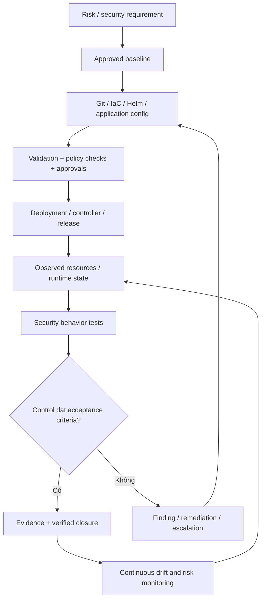
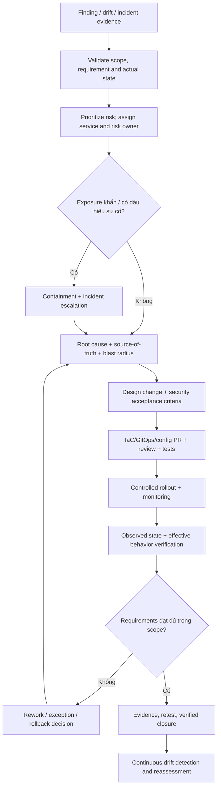
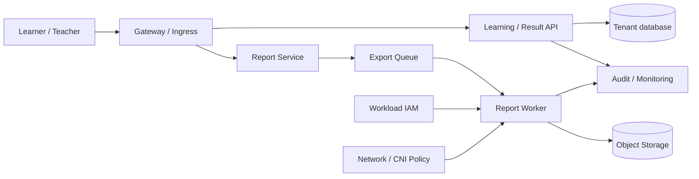

# Remediation cấu hình: khắc phục sai cấu hình và chứng minh security controls có hiệu lực

## 1. Tình huống mở đầu: sửa YAML có đủ để bảo đảm an toàn?

Một nhóm vận hành nền tảng học tập Java/Spring Boot phát hiện endpoint quản trị của dịch vụ xuất bảng điểm đang bị expose trên Internet. Đội phát triển sửa `application-prod.yml` để chỉ công bố endpoint health, tạo pull request và merge thành công. Dashboard báo “configuration issue resolved”.

Tuy nhiên một replica vẫn dùng cấu hình được cấp bởi biến môi trường cũ; ở một region khác, ingress rule còn định tuyến đường quản trị; còn một Helm release chạy template chưa được nâng cấp. Dù tệp YAML đã thay, endpoint vẫn có thể truy cập ở một số đường.

**Đây chưa phải remediation cấu hình hoàn tất.** Việc chỉnh file chỉ tạo ra *ý định thay đổi*. Cần chứng minh cấu hình mới được phát hành, triển khai đúng nơi, có **hiệu lực tại runtime**, không bị override bởi nguồn khác và thực sự đáp ứng security requirement. Sau đó phải theo dõi để lỗi không tái xuất hiện.

Trong chương **Configuration assurance** thuộc module **SECURITY_SECURITY_ASSURANCE**, **remediation cấu hình (configuration remediation)** là quy trình có kiểm soát để xác định, ưu tiên, sửa, kiểm chứng và duy trì các thiết lập hệ thống phù hợp với baseline, yêu cầu bảo mật và quyết định rủi ro. Hoạt động này nối **risk → security requirement → configuration control → finding → change → runtime evidence → closure → continuous monitoring**.

### Mục tiêu học tập

Sau bài học, bạn có thể:

1. Phân biệt sai cấu hình, drift, policy exception và lỗ hổng code; xác định đúng trạng thái *desired*, *applied* và *effective*.
2. Tiếp nhận và ưu tiên configuration findings theo ảnh hưởng thực tế, exposure, threat scenario và nguồn cấu hình.
3. Phân tích root cause, thứ tự ưu tiên/override và blast radius trước khi sửa.
4. Lập kế hoạch remediation cho Java/Spring Boot, container, Kubernetes, hạ tầng cloud, mạng, identity, TLS và logging.
5. Dùng Infrastructure as Code (IaC), GitOps và policy as code để đưa thay đổi vào nguồn chuẩn và ngăn drift.
6. Thiết kế kiểm thử trước triển khai, canary/rollout, rollback hoặc roll-forward có kiểm soát.
7. Xác minh cấu hình thực tế bằng cả kiểm tra trạng thái lẫn thử nghiệm hành vi bảo mật.
8. Lập assurance claims, hồ sơ bằng chứng, retest criteria và quản lý residual risk.

## 2. Định nghĩa và phạm vi remediation cấu hình

**Sai cấu hình bảo mật (security misconfiguration)** xảy ra khi một hoặc nhiều thiết lập phần mềm, dịch vụ, hạ tầng hoặc môi trường không đáp ứng yêu cầu bảo mật áp dụng. Ví dụ:

- Bật debug/management endpoints ngoài phạm vi cần thiết.
- Dịch vụ có CORS hoặc CSRF policy không phù hợp cơ chế xác thực.
- Pod/container chạy đặc quyền không cần thiết.
- Storage bucket hoặc object policy cho phép truy cập rộng.
- Cloud IAM role có quyền vượt quá nhiệm vụ.
- Network rule mở ingress/egress ngoài phạm vi đã duyệt.
- TLS client bỏ qua xác minh chứng thư/hostname.
- Bật logging chứa token, secret hoặc thông tin người học.
- Audit logs bị tắt hoặc không có đủ thuộc tính để truy vết.

Remediation cấu hình nhằm **đưa các controls về trạng thái chấp nhận được, kiểm chứng rằng chúng có hiệu lực và duy trì trạng thái đó**. Việc sửa có thể nằm ở configuration files, environment variables, secrets manager, Kubernetes resources, cloud IAM, gateway, application runtime hoặc quy trình vận hành.

### Không phải mọi cấu hình khác baseline đều là lỗi

Một deviation có thể là:

1. **Misconfiguration confirmed:** vi phạm yêu cầu đã áp dụng và có evidence.
2. **Drift:** cấu hình thực tế lệch khỏi nguồn chuẩn, chưa chắc luôn dẫn đến lỗ hổng.
3. **Authorized exception:** khác baseline nhưng được chấp nhận theo phạm vi, thời hạn và controls có thẩm quyền.
4. **Intentional alternate design:** kiến trúc khác với baseline mẫu nhưng đáp ứng security objective bằng control tương đương.
5. **False positive / inaccurate inventory:** scanner diễn giải sai version, phạm vi hay cách cấu hình thực tế.
6. **Unknown:** chưa đủ bằng chứng, cần điều tra, không tự coi là an toàn.

**Baseline không phải mục tiêu tự thân**; mục tiêu là đáp ứng những security requirements có lý do và bằng chứng. Baseline giúp chuẩn hóa, nhưng cần versioning và đánh giá khi công nghệ, threat model hoặc phạm vi thay đổi.

## 3. Ba lớp trạng thái: mong muốn, đã áp dụng và thực sự có hiệu lực

Đây là phân biệt cốt lõi của configuration assurance.

| Lớp | Câu hỏi | Ví dụ | Giới hạn |
|---|---|---|---|
| **Desired configuration** | Chính sách/khai báo mong muốn là gì? | Git chứa Helm values yêu cầu `allowPrivilegeEscalation: false` | Không chứng minh pod production dùng values đó |
| **Applied / deployed configuration** | Thay đổi đã được nạp vào môi trường hay chưa? | Deployment/Pod spec thể hiện securityContext mới | Một phiên bản cũ vẫn có thể chạy; webhook có thể đổi spec |
| **Effective runtime behavior** | Control thực sự hạn chế hành vi như yêu cầu không? | Process không có quyền tăng privilege và test unauthorized action bị từ chối | Cần kiểm tra enforcement trong scope, không chỉ xem YAML |

Từ ba trạng thái này, có thể đặt các assurance claims riêng:

- **CLM-D:** nguồn khai báo phù hợp baseline.
- **CLM-A:** mọi đối tượng thuộc scope đã nhận đúng cấu hình.
- **CLM-E:** control được runtime/platform thực thi theo tiêu chí.
- **CLM-M:** monitoring phát hiện hoặc ngăn sai lệch quay lại.

Chỉ khi evidence hỗ trợ đủ các claims cần thiết, mới có thể kết luận một finding đã được xử lý trong scope.

### Ví dụ về cấu hình nhiều lớp



Không nên kết luận `helm upgrade` hoặc `terraform apply` thành công là security control đã được kiểm chứng. Chúng là evidence cho quá trình triển khai, **không thay thế runtime inspection và thử nghiệm hành vi khi cần**.

## 4. Các nguồn cấu hình và lý do dễ xảy ra sai lệch

Một ứng dụng hiện đại có nhiều nguồn cấu hình xếp chồng; khác biệt ở từng lớp có thể làm thay đổi giá trị hiệu lực.

| Nguồn | Ví dụ | Nguy cơ cần xét |
|---|---|---|
| Source repository | `application.yml`, policy files | Giá trị đã merge chưa chắc là giá trị đang chạy |
| Build artifact/image | Config đóng vào JAR/container | Bản build cũ hoặc cached image |
| Environment variables | Cấu hình theo môi trường, feature flags | Override không được quản trị hoặc khác giữa replicas |
| Command-line arguments | Tham số startup ứng dụng | Thứ tự ưu tiên cao hơn cấu hình mặc định |
| Secret/config store | Secret manager, ConfigMap, Vault | Rotation, permissions, cache và stale data |
| Deployment template | Helm/Kustomize/Kubernetes manifest | Values override, namespace và chart version khác nhau |
| Admission/mutating controllers | Pod security hoặc injected sidecar | Cấu hình sau admission khác template |
| Host/network policy | Firewall, node settings, CNI policies | Control nằm ngoài application manifest |
| Cloud management plane | IAM, bucket policy, managed services | Console hotfix hoặc drift ngoài IaC |
| Runtime feature flags | Nạp lại cấu hình khi chạy | Thay đổi không cần redeploy, khó truy vết |
| Gateway/ingress/service mesh | Routes, headers, mTLS, auth policies | Các lớp áp dụng hoặc bypass không nhất quán |

### 4.1. Thứ tự ưu tiên cấu hình

Trong Spring Boot, property sources có thứ tự ưu tiên và cơ chế override khác nhau tùy version, loại nguồn và cách ứng dụng được khởi chạy. Vì vậy **không nên suy luận thứ tự cụ thể từ một file duy nhất**. Hãy dựa trên tài liệu của version đang dùng, cấu hình start process và quan sát an toàn giá trị thực tế.

Ví dụ một developer sửa `management.endpoints.web.exposure.include` trong `application-prod.yml`, nhưng ở production biến môi trường tương ứng hoặc đối số command line vẫn có thể override. Chỉ diff source code không loại trừ trường hợp này.

### 4.2. Cấu hình phân tán theo nhiều môi trường

Một finding có thể xuất hiện ở production khu vực A nhưng không có ở staging hoặc production khu vực B. Nên định danh ít nhất:

**Service → environment → cluster/account/region → namespace → workload/instance → configuration version → policy baseline**.

Nếu bỏ qua một chiều, team có thể đóng finding khi mới sửa một replica hoặc một cloud account.

## 5. Configuration baseline và tiêu chí chấp nhận

**Security configuration baseline** là tập các cấu hình và kiểm soát được phê duyệt cho một nhóm tài sản trong một phạm vi. Baseline có thể dựa trên tổ chức, kiến trúc và các nguồn tham chiếu như CIS Benchmarks, NIST controls, vendor hardening guidance hay tiêu chuẩn nội bộ.

### Baseline tốt cần có

1. **Identifier và version:** có thể biết policy/baseline nào đang áp dụng.
2. **Asset class:** ứng dụng web/API, database, worker, Kubernetes node, storage, IAM, v.v.
3. **Environment:** production và test có thể có yêu cầu khác, nhưng không được bỏ kiểm soát tùy tiện.
4. **Security objective:** kiểm soát nhằm giảm rủi ro nào.
5. **Measurable criterion:** giá trị hoặc hành vi cần kiểm chứng.
6. **Ownership:** đội chịu trách nhiệm duy trì và ngoại lệ.
7. **Verification method:** static policy, runtime inspection, dynamic negative test, audit evidence.
8. **Exception process:** ai có quyền cho phép deviation và trong điều kiện nào.

### Ví dụ ma trận baseline

| Baseline ID | Asset | Yêu cầu | Tiêu chí quan sát | Evidence |
|---|---|---|---|---|
| CFG-API-01 | Spring Boot production | Không expose management endpoint nhạy cảm ngoài boundary quản trị | Chỉ các endpoint được duyệt có thể truy cập đúng actor/network | Config thực + route inspection + HTTP negative tests |
| CFG-CON-02 | Container workload | Không tăng quyền nếu không có lý do phê duyệt | Effective securityContext/policy phù hợp và workload vẫn hoạt động | Pod spec + admission + runtime checks |
| CFG-NET-03 | Export worker | Chỉ được egress đến đích cần thiết | Kết nối ngoài allowlist bị từ chối theo policy | CNI/network policy + egress tests |
| CFG-IAM-04 | Service account | Quyền tối thiểu trên object storage | Chỉ đọc/ghi prefix được cấp, denied ngoài scope | Effective IAM permissions + negative tests |
| CFG-TLS-05 | External API client | Chứng thư/hostname được xác minh đúng | Chứng thư không tin cậy hoặc tên sai bị từ chối | Client config + TLS negative tests |
| CFG-LOG-06 | API/worker | Không ghi raw token hoặc thông tin kết quả thi vượt policy | Logs/traces không chứa dữ liệu thử nghiệm nhạy cảm | Redaction tests + logging config |
| CFG-AUD-07 | Hệ thống quan trọng | Audit events phù hợp và có retention | Event cho thao tác nhạy cảm có identity, action, result theo policy | Audit tests + storage/retention settings |

### Không copy baseline mù quáng

Ví dụ một ứng dụng gọi đến database qua mạng có thể cần egress rule, trong khi batch worker chỉ xử lý queue có thể không cần route Internet. Tự áp dụng “deny all” mà không có kế hoạch kết nối hợp lệ có thể khiến ứng dụng ngừng hoạt động, hệ thống monitoring lỗi hoặc bị buộc rollback sang cấu hình không an toàn.

## 6. Từ finding đến phạm vi ảnh hưởng

Configuration finding có thể được phát hiện bởi:

- Cloud Security Posture Management (CSPM) hoặc inventory scanners.
- Kubernetes policy/admission audit và cluster configuration checks.
- SAST/secret scanning hoặc policy-as-code checks.
- Pentest, architecture review, audit hoặc vulnerability management.
- Runtime telemetry: debug endpoint được truy cập, bucket public, thay đổi quyền bất thường.
- Incident investigation hoặc kiểm tra thủ công có ghi evidence.

### 6.1. Câu hỏi triage quan trọng

| Câu hỏi | Bằng chứng |
|---|---|
| Finding thuộc cấu hình nào? | Rule, resource ID, path, property, value |
| Có áp dụng đúng môi trường không? | Project/account, region, namespace, service, instance |
| Giá trị effective là gì? | Runtime/API/cloud control plane inspection |
| Baseline/requirement nào bị vi phạm? | Requirement ID, policy version, threat model |
| Ai có thể tiếp cận tính năng/tài nguyên? | Network path, auth/role, identity, access logs |
| Dữ liệu và business impact thế nào? | Asset classification, tenant/data flow |
| Có ngoại lệ hợp lệ không? | Approval, scope, expiry, compensating controls |
| Nguồn sai lệch ở đâu? | Git/IaC/console/env/secret/chart override |
| Có bao nhiêu đối tượng dùng cùng pattern? | Inventory by template, account, cluster, release |
| Nếu sửa thì rủi ro gián đoạn gì? | Dependency map, traffic, availability constraints |

### 6.2. Phân biệt severity và remediation priority

Finding “mở port” cần biết port ở đâu, network reachability thế nào, dịch vụ có authentication không và dữ liệu nhạy cảm ra sao. Một container thiếu setting trong template không tự chứng minh exploitability; ngược lại cloud IAM wildcard có thể ảnh hưởng cả account nếu credential bị lộ.

Ưu tiên theo **risk = threat/exploitability/exposure + impact + effective controls + uncertainty**, không chỉ số lượng violations hoặc nhãn scanner. Nếu xuất hiện lộ dữ liệu thật, token hoặc dấu hiệu compromise, cần escalation tới quy trình incident response chứ không chỉ chờ remediation backlog.

## 7. Quy trình remediation cấu hình



### Bước 1 — Xác minh scope và actual/effective state

Không thay đổi cấu hình theo một screenshot scanner chưa kiểm tra. Đối chiếu asset, môi trường, bản policy, giá trị được nạp và behavior trong đúng scope.

### Bước 2 — Triage và containment

Nếu một tài nguyên đang public hoặc credential có nguy cơ lộ, cần giảm exposure ngay theo thẩm quyền, có ghi lại thay đổi và kiểm tra hiệu lực. Với dấu hiệu compromise, phối hợp incident response.

### Bước 3 — Phân tích root cause và blast radius

Đánh giá tại sao setting sai: baseline thiếu, template sai, parameter override, thay đổi console, quyền quá rộng, controller không reconcile, thiếu tests hay exception hết hạn. Tìm mọi workload/region/account dùng chung nguồn.

### Bước 4 — Định nghĩa target và acceptance criteria

Không chỉ viết “secure config”. Cần nêu giá trị/policy mới và những hành vi cần **được phép** hoặc **bị từ chối**, với owner và bằng chứng dự kiến.

### Bước 5 — Sửa nguồn chuẩn và thay đổi có kiểm soát

Ưu tiên cập nhật Git/IaC/GitOps hoặc configuration source được tổ chức công nhận, qua review/CI. Nếu phải hotfix khẩn ở runtime, cần reconciliation về nguồn chuẩn để tránh controller ghi đè hoặc drift quay lại.

### Bước 6 — Kiểm thử tương thích và triển khai

Kiểm tra config syntax/schema, policy-as-code, tích hợp, auth/security negative tests, routing và functional tests. Triển khai canary/rolling khi phù hợp; có điều kiện dừng và kế hoạch khôi phục.

### Bước 7 — Xác minh hiệu lực

Đối chiếu declared vs observed, inspect đúng instance và thử hành vi cần được bảo vệ, kể cả alternate paths. Không đóng finding chỉ vì apply thành công.

### Bước 8 — Lưu evidence, retest và monitoring

Gắn change, policy version, resource identity, rollout, runtime observations và tests. Đóng theo acceptance criteria; tiếp tục phát hiện drift, thay đổi threat model và exceptions hết hạn.

## 8. Phân tích nguyên nhân gốc của sai cấu hình

### 8.1. Những nguyên nhân thường gặp

| Nhóm nguyên nhân | Ví dụ | Cách cải tiến hệ thống |
|---|---|---|
| **Manual changes ngoài nguồn chuẩn** | Sửa firewall/cloud role qua console | IaC/GitOps, drift alerts, break-glass process |
| **Template mặc định không an toàn** | Chart cho phép privileged pod | Hardened defaults, policy checks |
| **Config precedence/override** | Environment variable ghi đè YAML đã sửa | Runtime effective config inventory |
| **Environment divergence** | Production có ingress không có ở staging | Environment diff, safe production checks |
| **Kế thừa quyền không rõ** | IAM policy trực tiếp và qua group/role | Effective permission evaluation |
| **Thiếu policy ở đường khác** | Gateway chặn nhưng direct service port còn mở | End-to-end trust-boundary review |
| **Quá hạn ngoại lệ** | Rule tạm mở mạng tồn tại nhiều tháng | Expiring exception + alert |
| **Thiếu ownership** | Config shared không có người chịu trách nhiệm | RACI, resource owner tags |
| **Dữ liệu inventory lỗi thời** | Scanner chỉ thấy deployment trước rollout | Refresh collection và timestamps |
| **Rollback gây tái xuất hiện** | Helm chart cũ được redeploy | Versioned baselines, admission guardrails |

### 8.2. Root cause không chỉ ở một dòng YAML

Ví dụ phát hiện `management.endpoints.web.exposure.include: "*"`. Vấn đề không chỉ là dấu `*`. Cần hỏi:

1. Vì sao property đó được bật: debugging, monitoring, hay cấu hình template cũ?
2. Management endpoints có nằm ở port/network riêng, được Spring Security bảo vệ và qua gateway không?
3. Có override từ environment, profiles hoặc command line?
4. Những endpoint nào thực tế enabled/exposed, có chứa dữ liệu hoặc thao tác nhạy cảm?
5. Policy quản lý endpoint đã được chuẩn hóa cho các service khác chưa?
6. CI/review nào lẽ ra phải phát hiện thay đổi?

Một remediation bền vững thường gồm **thay setting + bảo vệ access path + kiểm thử truy cập + policy gate + monitoring**, không chỉ thay ký tự ở file.

## 9. Thiết kế remediation an toàn trước khi triển khai

### 9.1. Kế hoạch thay đổi cần có

- Finding ID, asset, service owner, baseline ID và phiên bản.
- Expected/observed configuration và root cause.
- Target configuration và rationale theo security requirement.
- Danh sách environment/account/region/namespace/replica liên quan.
- Các dịch vụ phụ thuộc và những kết nối hợp lệ cần bảo toàn.
- Policy checks, negative security tests và positive functional tests.
- Rollout window, maintenance constraints, canary/rollback/roll-forward.
- Monitoring, alert và người trực ứng phó sự cố thay đổi.
- Retest criteria, evidence artifacts và người phê duyệt.

### 9.2. Kiểm tra ảnh hưởng ngoài ý muốn

| Thay đổi | Ảnh hưởng có thể xảy ra | Test cần thiết |
|---|---|---|
| Hạn chế ingress | Health probes, gateway, partner callbacks bị chặn | Allowed/denied network path |
| Hạn chế egress | DNS, queue, database, telemetry, certificate checks bị ảnh hưởng | Egress matrix + app integration |
| Giảm IAM permissions | App không thể đọc/ghi object đúng scope | Positive + negative IAM tests |
| Bật TLS/mTLS chặt hơn | Client cũ thiếu CA, SNI hoặc cert rotation | Handshake, rotation, failure tests |
| Vô hiệu debug endpoints | Monitoring/tool vận hành cần endpoint | Health/metrics exposure tests |
| Tắt permissive CORS | Web client hợp lệ lỗi cross-origin | Browser origin tests + server auth checks |
| Thêm non-root/read-only FS | App cần ghi temp file hoặc bind port | Startup + volume/temp integration |
| Bật audit logging | Chi phí/tải tăng, PII có thể bị ghi sai | Security events + redaction + resource |

Một security configuration mạnh nhưng khiến hệ thống không thể vận hành có thể bị rollback vội vàng. Thiết kế nên **đảm bảo cả yêu cầu bảo mật và khả năng phục vụ**, giảm khả năng quay lại cấu hình nguy hiểm.

## 10. Ví dụ 1 — Spring Boot management endpoint exposure

### 10.1. Finding giả định

`result-service` chạy Spring Boot ở production. Team phát hiện một số endpoint Actuator/management có thể truy cập qua đường Internet không nằm trong policy cho phép. Cần xác minh phiên bản Spring Boot, các endpoints có mặt, cách management port/bind, ingress và Spring Security filter chain thực tế trước khi quyết định.

### 10.2. Cấu hình mục tiêu minh họa

```yaml
# application-prod.yml — minh họa, cần xem version Spring Boot và topology thực tế.
management:
  endpoints:
    web:
      exposure:
        include: "health,info"
  endpoint:
    health:
      show-details: "never"
```

Ví dụ này chỉ giới hạn danh sách endpoint được expose qua web theo cơ chế cấu hình liên quan. **Không tự coi mọi health/info endpoint là luôn công khai an toàn.** Tùy nội dung và security requirements, có thể cần authentication, network restriction hoặc management port/interface riêng. Giá trị hiệu lực phải được đánh giá trong bối cảnh profile, overrides và routes.

### 10.3. Những control khác cần xét

- Gateway/ingress có public route tới management port không?
- SecurityFilterChain bảo vệ management requests có được nạp không?
- Có health liveness/readiness probes cho orchestrator và monitoring?
- `info` endpoint có công bố build metadata nhạy cảm hay thông tin nội bộ không?
- Có thêm actuator endpoints do dependency hoặc custom extensions?
- Management endpoints có thể truy cập qua direct service port khác đường public không?
- Có biến môi trường thay đổi exposure theo runtime không?

### 10.4. Negative test phải kiểm tra reachability

Trong môi trường được cấp quyền, test người gọi không thuộc mạng/quyền quản trị không thể sử dụng endpoint nhạy cảm. Không nên định nghĩa acceptance criteria chỉ là “`/actuator/env` trả 404”; tùy Spring Boot, endpoint có thể được chặn bởi policy trả 401/403 hoặc hoàn toàn không expose. Tiêu chí thực sự là **endpoint nhạy cảm không được tiết lộ hoặc thực thi trái phạm vi**, đồng thời probes hợp lệ vẫn hoạt động.

### 10.5. Evidence cần thu thập

| Evidence | Điều hỗ trợ |
|---|---|
| Approved baseline/ADR | Các endpoint, actor và network được phép |
| Git/PR/CI run | Giá trị cấu hình thay đổi và review |
| Deployment/environment inventory | Profile và config source có hiệu lực |
| Runtime route/management config | Endpoint thực tế có mặt và exposed |
| Authorized HTTP tests | Không truy cập trái phép; allowed probes pass |
| Audit/access records | Kiểm tra đường truy cập trong scope, không log secrets |

## 11. Ví dụ 2 — Kubernetes container securityContext

### 11.1. Finding và security objective

Một `report-worker` chạy dưới quyền cao hơn cần thiết và cho phép privilege escalation. Đội platform đặt mục tiêu chạy worker với quyền tối thiểu trong container, không phụ thuộc vào root hoặc quyền ghi lên root filesystem.

### 11.2. Fragment YAML minh họa

```yaml
# Mẫu Pod container fragment, chưa phải manifest hoàn chỉnh.
apiVersion: apps/v1
kind: Deployment
metadata:
  name: report-worker
  namespace: learning
spec:
  replicas: 2
  selector:
    matchLabels:
      app: report-worker
  template:
    metadata:
      labels:
        app: report-worker
    spec:
      securityContext:
        runAsNonRoot: true
        runAsUser: 10001
        seccompProfile:
          type: RuntimeDefault
      containers:
        - name: report-worker
          image: registry.example.org/learning/report-worker@sha256:<approved-digest>
          securityContext:
            allowPrivilegeEscalation: false
            readOnlyRootFilesystem: true
            capabilities:
              drop: ["ALL"]
          volumeMounts:
            - name: temp
              mountPath: /tmp
      volumes:
        - name: temp
          emptyDir:
            sizeLimit: 256Mi
```

**Placeholder** `<approved-digest>` phải được thay trước khi deploy; mẫu chưa bao gồm resource limits, readiness, serviceAccountName, network policy và những cấu hình khác cần theo kiến trúc. `emptyDir.sizeLimit` và quyền ghi filesystem cần được kiểm tra tương thích thực; không mặc định giới hạn dung lượng đã được enforce chính xác trong mọi tình huống hoặc filesystem.

### 11.3. Các vấn đề tinh tế

1. **Policy áp dụng ở Pod hay container?** Một số fields thuộc Pod-level, một số ở container; override có thể khác nhau.
2. **Init containers và sidecars:** Nếu chỉ kiểm tra main container, có thể bỏ sót containers khác.
3. **Admission controls:** Pod Security Admission, validating/mutating webhooks và policy engine có thể chặn hoặc biến đổi tài nguyên.
4. **Runtime support:** `RuntimeDefault` phụ thuộc runtime/node OS và platform capabilities.
5. **Host-level permissions:** Network/IAM/host mounts vẫn có thể tạo rủi ro ngoài securityContext.
6. **Application compatibility:** Java hoặc native library cần ghi file, tạo temp hoặc dùng một capability đã bị drop.

### 11.4. Kiểm chứng

```bash
# Các lệnh chỉ đọc trên cluster đã được cấp quyền.
kubectl -n learning get deployment report-worker -o yaml
kubectl -n learning get pods -l app=report-worker -o wide

# Xem tên pod, trạng thái và image ID của container đang chạy.
kubectl -n learning get pods -l app=report-worker \
  -o jsonpath='{range .items[*]}{.metadata.name}{"\t"}{range .status.containerStatuses[*]}{.name}{" "}{.imageID}{";"}{end}{"\n"}{end}'
```

Những lệnh này hiển thị thông tin khai báo và trạng thái, **không chứng minh mọi thuộc tính runtime đã có hiệu lực**. Với yêu cầu nhạy cảm, cần policy/admission test, kiểm tra runtime thích hợp và negative tests trong môi trường được phép; không tùy tiện thử escape hoặc hành vi có thể gây hại trên production.

## 12. Ví dụ 3 — NetworkPolicy và egress của worker

### 12.1. Bài toán

`document-import-worker` cần gọi một dịch vụ nhận dữ liệu đáng tin và một số service nội bộ. Nếu pod có quyền gọi tùy ý ra Internet hoặc mạng quản trị, nguy cơ SSRF và data exfiltration có thể tăng.

**Security objective:** egress được giới hạn theo danh sách đích/protocol hợp lệ; đường tới những dịch vụ không được phép bị chặn; các dependency cần thiết vẫn hoạt động.

### 12.2. NetworkPolicy mẫu: default deny egress

```yaml
# Default-deny egress cho các pod trong namespace learning.
# Mẫu chỉ định policy; hiệu lực phụ thuộc CNI và các policy khác.
apiVersion: networking.k8s.io/v1
kind: NetworkPolicy
metadata:
  name: default-deny-egress
  namespace: learning
spec:
  podSelector: {}
  policyTypes:
    - Egress
```

NetworkPolicy trên chọn tất cả pod thuộc namespace và cô lập egress, **nếu plugin mạng hỗ trợ enforcement NetworkPolicy**. Trong Kubernetes, nhiều NetworkPolicies được kết hợp theo union của lưu lượng được phép, không có thứ tự deny-over-allow giống một số firewall. Do đó **một policy default-deny có thể bị policy khác cho phép egress mở rộng**.

Không áp dụng mẫu vào production mà chưa xem DNS, DB, queue, metrics, NTP hoặc dịch vụ khác cần thiết. Sau default deny, phải có **allow policies** chỉ cho phép đường cần thiết, và test negative/positive theo ứng dụng.

### 12.3. Khác biệt giữa network policy và SSRF controls

Egress policy có thể chặn kết nối tới một số mạng, nhưng không thay thế URL validation, DNS/redirect handling, request timeout, giới hạn dữ liệu hoặc quyền của HTTP client. Với dịch vụ yêu cầu kết nối ra Internet theo tên miền, Kubernetes NetworkPolicy cơ bản chủ yếu làm việc với IP/CIDR và labels, không tự cung cấp FQDN-based allowlist phổ quát; một số CNI có cơ chế mở rộng riêng cần đánh giá.

### 12.4. Test theo security invariant

- Worker vẫn truy cập được DB/queue/storage endpoints hợp lệ.
- Kết nối tới destination được mô phỏng là không được phép bị từ chối.
- Các đường direct egress, proxy và sidecar được kiểm tra phù hợp.
- Có giới hạn DNS, redirects và endpoint metadata theo threat model.
- Các pods mới từ autoscaling áp dụng cùng policies.
- Những namespace/cluster/region trong scope đều được đối chiếu.

Khi xác minh, dùng **test server và network destinations giả có quyền kiểm soát** thay vì truy cập endpoint nội bộ thật ngoài scope hoặc tạo lưu lượng phá hoại.

## 13. Ví dụ 4 — Cloud IAM và quyền truy cập object storage

### 13.1. Finding

`report-worker` cần ghi file PDF cho mỗi tenant vào object storage. Tuy nhiên workload identity được cấp quyền đọc và xóa mọi object trong nhiều bucket, hoặc policy bucket cho phép public read ngoài dự kiến.

**Security objective:** một instance của worker chỉ được phép thực hiện các hành động cần thiết trên tài nguyên phù hợp; file chứa dữ liệu người học không được truy cập bởi anonymous actor hoặc tenant khác.

### 13.2. Phân tích phạm vi quyền

| Thành phần quyền | Câu hỏi |
|---|---|
| **Principal** | Workload service account hoặc cloud role nào thực sự được dùng? |
| **Actions** | Chỉ cần upload, read, list, delete hay quyền IAM administration? |
| **Resources** | Bucket, prefix, object/tag/condition nào được phép? |
| **Conditions** | Có ràng buộc tenant, encryption, network, identity hay session không? |
| **Inheritance** | Role/group/trust policy/bucket policy/organization policy phối hợp thế nào? |
| **Runtime identity** | Pod thực nhận identity nào khi gọi cloud API? |
| **Alternatives** | Có workload khác hoặc signed URL bypass đường kiểm tra quyền? |
| **Credentials** | Có static key trong image hoặc environment không cần thiết? |

Cloud IAM có thể có nhiều lớp policy, deny rules, resource-based policy, boundary và tổ chức mẹ. **Một allow statement trong source không đủ để suy ra effective permissions**. Cần đánh giá theo provider, service, identity và tình trạng runtime.

### 13.3. Mục tiêu sửa

1. Sử dụng workload identity phù hợp, tránh static credentials nếu hạ tầng hỗ trợ.
2. Chỉ cấp actions và tài nguyên cần thiết; tách producer/consumer/downloader khi quyền khác nhau.
3. Bảo vệ storage với policy chống public exposure theo requirement.
4. Ràng buộc đối tượng theo tenant/ownership và lifecycle ở application layer.
5. Kiểm tra quyền của upload path, download path và signed links độc lập.
6. Ghi IaC, PR, approval và runtime evaluation results; không chỉ sửa policy trong cloud console.

### 13.4. Positive và negative tests

| Identity | Hành động | Expected |
|---|---|---|
| Export worker của tenant A | Ghi object ở prefix được duyệt | Allow theo policy |
| Export worker của tenant A | Xóa object tenant B | Deny |
| Anonymous caller | Tải file bảng điểm từ bucket private | Deny |
| User đã đăng nhập nhưng khác tenant | Tải báo cáo tenant B qua app | Deny |
| Service khác không cần storage | Đọc bucket kết quả | Deny |
| Authorized download flow | Nhận file đúng quyền trước khi link hết hạn | Allow đúng thời hạn |
| Token hoặc signed URL hết hiệu lực | Tải file theo URL cũ | Deny theo contract |

Thử nghiệm chỉ dùng object/data giả và tài nguyên staging; không cần đọc hoặc xuất file thật để xác nhận policy. Với IAM, negative tests phải đi qua **identity thực được workload sử dụng**, không chỉ một user admin đang thao tác console.

## 14. Ví dụ 5 — TLS, CORS, CSRF và chính sách xác thực

Sai cấu hình bảo mật ứng dụng thường không thể đánh giá chỉ bằng một dòng trong YAML; phải xét luồng và threat model.

### 14.1. TLS validation

Một HTTP client dùng custom `TrustManager` hoặc `HostnameVerifier` chấp nhận mọi chứng thư là trường hợp cần xem nghiêm túc. Mục tiêu là chứng minh server identity được xác minh và kết nối chỉ dùng TLS protocol/cipher phù hợp với policy.

Các tests cần:

- Kết nối với server có chứng thư hợp lệ được phê duyệt thành công.
- Chứng thư không đáng tin bị từ chối.
- Hostname mismatch bị từ chối.
- Client certificate/mTLS có hiệu lực nếu kiến trúc yêu cầu.
- CA bundle/truststore rotation không gây ngừng dịch vụ ngoài mức chấp nhận.
- Config theo profiles/test-only không vô tình đi vào production.

Không nên “sửa” sự cố TLS bằng cách tắt certificate validation hoặc cho phép weak protocols không có phê duyệt. Nếu bên đối tác dùng chứng thư lỗi, cần khắc phục trust/certificate lifecycle hoặc có quyết định rủi ro có điều kiện.

### 14.2. CORS là chính sách của browser, không phải backend authorization

Ví dụ `@CrossOrigin(origins = "*")` hoặc gateway trả `Access-Control-Allow-Origin` rộng có thể là finding trong API chứa PII. Nhưng phải xét:

- API public hay có dữ liệu tenant?
- Browser có gửi cookie/session hoặc credentials tự động không?
- Những origins nào được phép đọc response theo business requirement?
- Endpoint có còn bảo vệ server-side authorization?
- App, gateway và CDN có trả headers nhất quán?

**CORS không thay thế authentication/authorization.** Một non-browser client không bị browser same-origin policy giới hạn theo cùng cách; backend vẫn phải xác minh quyền.

### 14.3. CSRF phụ thuộc vào credential flow

`csrf.disable()` trong Spring Security không tự động là safe hay vulnerability. Nếu browser tự gắn cookie/session hoặc HTTP Basic và có request thay đổi trạng thái, cần đánh giá CSRF theo threat model. Với API chỉ dùng bearer token do client chủ động đặt trong header và không chấp nhận ambient credentials, chính sách CSRF có thể khác; cần chứng minh các giả định này.

### 14.4. Authentication và authorization

Configuration fixes như đổi `issuer-uri`, `audience`, trust keys, session TTL hoặc role mapping cần test cả:

- Token hợp lệ đúng issuer/audience và scope được chấp nhận theo policy.
- Token sai chữ ký, issuer, audience hoặc hết hạn bị từ chối.
- Caller xác thực thành công nhưng không có quyền trên object/tenant vẫn bị chặn.
- Đường admin/debug, batch, async worker có enforcement phù hợp.
- Quyền đã bị thu hồi có hành vi theo revocation policy.

**Một JWT hợp lệ chứng minh danh tính/scope được xác nhận theo verifier, không chứng minh caller có quyền với mọi tài nguyên**. Điều chỉnh auth configuration không giải quyết BOLA/BFLA/BOPLA nếu application logic còn thiếu.

## 15. Ví dụ 6 — Logging, auditing và bảo vệ secrets

### 15.1. Logging configuration

Nhóm dev bật verbose request logging để debug export. Khi production dùng cùng config, log có thể chứa `Authorization` header, cookie, signed URLs, dữ liệu học viên hoặc các field nhạy cảm.

Một remediation đúng cần:

1. Xác định những logging filters, interceptors, agents và proxies thực sự ghi request/response.
2. Thiết kế data minimization, redaction/masking, access permissions và retention.
3. Kiểm tra ở mọi môi trường, bao gồm job/worker error paths.
4. Chạy negative tests với dữ liệu thử có mẫu secret giả dễ nhận diện.
5. Xác minh log/traces/metrics exporters không tự mở đường rò rỉ khác.
6. Giữ security audit events cần thiết; không giải quyết vấn đề bằng cách tắt mọi logging.

### 15.2. Audit logging không tự chứng minh an toàn

Một cloud audit setting chuyển sang `enabled` có thể chưa đủ nếu log không ghi đúng nguồn, không lưu ở nơi có integrity hoặc retention quá ngắn. Cần xác nhận:

- Những sự kiện bảo mật nào phải có actor, action, outcome, time và target?
- Tổ chức có thể phát hiện thay đổi privilege, policy hoặc IAM không?
- Có thể bảo vệ log khỏi chỉnh sửa/xóa trái phép không?
- Độ trễ, forwarding failure và alerting được giám sát không?
- Logs có chứa dữ liệu cá nhân ngoài mục tiêu không?

### 15.3. Secrets remediation

Nếu configuration file hoặc image chứa password/API key, cần phân biệt **di chuyển cách lưu secret** và **xử lý secret đã lộ**.

- Đưa secret sang secret manager/identity mechanism thích hợp.
- Thu hồi hoặc rotate credential bị lộ theo rủi ro và policy.
- Kiểm tra secret cũ có còn hiệu lực, kể cả ở bản deploy cũ.
- Xác định nơi secret đã xuất hiện: Git history, CI logs, container layers, monitoring, ticket.
- Điều chỉnh IAM của secret store và quyền workload; tránh expose toàn bộ secrets vào môi trường nếu không cần.
- Kiểm tra rotation, restart/reload, cache TTL và rollback strategy.

**Đặt credential vào Kubernetes Secret không tự chứng minh credential được bảo vệ tuyệt đối.** Cần xét RBAC, encryption-at-rest configuration, control plane access, pod env/volume exposure, audit và lifecycle. Secret store là một thành phần trong security design, không thay thế quyền tối thiểu.

## 16. Source of truth: IaC, GitOps và configuration lifecycle

Một thay đổi thủ công có thể xử lý sự cố ngay nhưng làm lệch nguồn khai báo. **Source of truth** phải được xác định rõ, nếu không lần reconcile sau có thể tái đưa cấu hình lỗi.

### 16.1. IaC và GitOps

| Khái niệm | Ý nghĩa trong remediation |
|---|---|
| **Infrastructure as Code (IaC)** | Quản lý tài nguyên/cấu hình theo khai báo có version và review |
| **GitOps** | Tự động reconcile actual state về desired state được quản lý theo Git/policy |
| **Policy as Code** | Diễn đạt một số guardrails dưới dạng quy tắc máy có thể kiểm tra |
| **Drift detection** | Phát hiện actual state khác source/baseline được phê duyệt |
| **Drift reconciliation** | Khôi phục về source chuẩn hoặc cập nhật source sau quyết định hợp lệ |
| **Break-glass change** | Thay đổi khẩn với quyền đặc biệt và kiểm toán, cần reconcile sau |

### 16.2. Ba loại drift

1. **Declared-to-applied drift:** Git đã thay nhưng controller/rollout chưa nhận.
2. **Applied-to-effective drift:** spec đã cập nhật nhưng runtime hoặc layered overrides làm hành vi khác.
3. **Policy-to-declared drift:** nguồn Git/IaC tự nó đã lệch baseline mới hoặc policy được duyệt.

Phải nhận diện đúng loại drift mới chọn được hành động. Reconcile GitOps không thể sửa một baseline sai; sửa Git không giải quyết việc rollout bị kẹt; xem PodSpec không giải quyết được IAM permission đang thừa.

### 16.3. Quy trình emergency hotfix

Trong trường hợp cloud bucket đang public sai, đội trực có thể phải chặn public access ngay qua control plane theo quy trình khẩn, trước khi PR hoàn tất. Khi đó:

1. Ghi lý do, người phê duyệt, resource ID, thời điểm và thay đổi.
2. Kiểm chứng public access đã thực sự bị chặn.
3. Cập nhật source IaC/GitOps tương ứng để reconcile không phục hồi cấu hình sai.
4. So sánh actual state với template sau khi triển khai.
5. Điều tra nguyên nhân và test policy để ngăn tái diễn.
6. Đánh giá liệu đã có dữ liệu bị truy cập trái phép hay không theo quy trình được ủy quyền.

Không nên tự động “revert drift” khi actual state đang là **hotfix an toàn hơn** còn Git chứa config lỗi. Cần quyết định source-of-truth nào đúng ở thời điểm sự cố và cập nhật nó trước khi reconcile.

### 16.4. Immutable artifact và runtime config

Container images bất biến giúp tạo build có thể truy vết, nhưng config vẫn có thể được nạp từ ConfigMaps, Secrets, env vars, service mesh và cloud provider. Do đó image digest chỉ chứng minh **một phần của runtime state**. Hồ sơ assurance cần gắn artifact với config version/effective policy được dùng khi test.

## 17. Policy as code: phát hiện và chặn tái diễn

Policy as code có thể kiểm tra cấu hình trước khi merge, lúc deploy hoặc sau deploy. Ba thời điểm này có ý nghĩa khác nhau.

| Thời điểm | Loại kiểm tra | Điểm cần nhớ |
|---|---|---|
| **Pre-commit/PR** | Validate templates, Terraform plans, Helm render, static rules | Không chứng minh runtime đã áp dụng |
| **Admission/deploy** | Validate tài nguyên được gửi đến API server | Có thể có phạm vi/trạng thái audit/enforce khác nhau |
| **Runtime/continuous** | Đối chiếu live resources với baseline, drift alerts | Cần freshness, scope, ownership và xử lý exceptions |

Các công cụ thường dùng tùy hệ thống có thể gồm OPA/Conftest, Kyverno, Gatekeeper, Terraform policy checks, cloud posture management và custom validations. **Cú pháp rule, admission semantics và phạm vi có thể thay đổi theo phiên bản**, nên ví dụ bên dưới là cấu trúc logic chứ không phải policy chạy được trên mọi công cụ.

### 17.1. Policy kiểm tra theo ý nghĩa

```yaml
# Mô tả policy ở mức khái niệm, không phải resource Kubernetes chuẩn.
policy_id: "POL-CONTAINER-BASELINE-01"
target: "production application containers"
requirements:
  - "allowPrivilegeEscalation must be false"
  - "privileged must not be true"
  - "readOnlyRootFilesystem must be true, except authorized cases"
  - "unneeded Linux capabilities must be dropped"
  - "workloads must not use unapproved host mounts"
decision:
  on_violation: "deny or audit according to rollout plan"
  exception: "must have owner, scope, expiry, approval"
verification:
  - "policy unit tests"
  - "rendered manifest tests"
  - "admission outcomes"
  - "runtime inventory"
```

### 17.2. Kiểm thử chính policy

Một policy chặn cấu hình nguy hiểm nên có:

- **Positive case:** manifest hợp lệ không bị từ chối sai.
- **Negative case:** manifest có thiết lập bị cấm bị phát hiện.
- **Missing-field case:** trường thiếu được xử lý theo baseline.
- **Exception case:** waiver đúng scope/expiry được áp dụng, ngoài phạm vi thì không.
- **Mutation case:** các controllers/webhooks khác không tạo trạng thái cuối vi phạm.
- **Runtime case:** resources được tạo trước khi policy hoạt động được đánh giá và remediation.

**Audit mode không bằng enforce mode.** Một policy chạy audit có thể báo vi phạm nhưng không ngăn tài nguyên được tạo; cần ghi rõ claim là *detection* hay *prevention*.

### 17.3. Không để policy phá hoạt động chính

Trước khi áp dụng deny cho toàn cluster, nên đánh giá inventory, false positives, workload đặc biệt, platform components và phương án ngoại lệ. Một lộ trình an toàn có thể là audit → rà soát → canary enforce → rollout rộng, tùy mức rủi ro và chính sách triển khai.

Không vì giảm cảnh báo mà để tất cả exceptions vĩnh viễn; cũng không vì muốn “zero violations” mà chặn cả những thành phần cần chạy đúng chức năng.

## 18. Kiểm thử remediation: static, integration và runtime

Một configuration change cần nhiều cấp kiểm chứng vì nguồn sai lệch có thể xuất hiện trước, trong và sau triển khai.

### 18.1. Lớp kiểm thử

| Lớp | Điều kiểm chứng | Evidence |
|---|---|---|
| **Syntax/schema** | YAML/JSON/HCL/Helm template đúng cấu trúc | Validator report |
| **Policy/semantic** | Values phù hợp baseline và exception | Policy-as-code tests |
| **Render/plan** | Manifest/plan cuối chứa giá trị mong muốn | Rendered manifest, Terraform plan review |
| **Integration** | App, network, identity, storage vẫn kết nối được | Positive functional/security tests |
| **Negative security** | Request/identity/path không được phép bị từ chối | HTTP/network/IAM/TLS tests |
| **Deployment verification** | Đối tượng thuộc scope nhận đúng config | Rollout/resource revision, actual state |
| **Runtime/effective** | Security property có hiệu lực với process/workload thực | Authorized runtime inspection, behavior tests |
| **Resilience/rollback** | Thay đổi không gây outage hoặc tái đưa cấu hình lỗi | Controlled failure tests, rollback policy |
| **Continuous detection** | Drift hoặc config lỗi tái xuất hiện được báo | Alerts, reconciliation, audit records |

### 18.2. Hai kiểu test phải đi cùng nhau

**Negative:** một caller không thuộc mạng quản trị không truy cập được management endpoint; worker không gọi destination bị cấm; service account không đọc object tenant khác.

**Positive:** health probes và monitoring được phép vẫn hoạt động; worker gọi DB/queue đúng; role hợp lệ tải file của mình.

Nếu chỉ có negative tests, một cấu hình “chặn tất cả” có thể làm dashboard xanh nhưng gây downtime. Nếu chỉ có positive tests, những đường vượt quyền vẫn có thể mở.

### 18.3. Kiểm chứng hiệu lực runtime

Đối với Java/Spring, test cần đi qua filter chain/route cấu hình thật; các test helpers mô phỏng principal có thể không chứng minh JWT signature/issuer/audience verification. Với Kubernetes, phải xem workloads thực tế, init/sidecar containers, admission và CNI. Với IAM, cần xác minh quyền của identity mà workload dùng, không phải quyền của operator admin.

### 18.4. Mức độ tin cậy của tests

Một test `403` không chứng minh toàn bộ rủi ro được xử lý nếu API đã gửi job trước khi từ chối. Một NetworkPolicy hợp lệ về YAML không chứng minh CNI đang enforce. Một CloudTrail/audit toggle được bật không chứng minh audit events đầy đủ. Luôn liên kết test với **security property cần chứng minh**, không chỉ giá trị config.

## 19. Rollout, rollback và quản trị thay đổi

### 19.1. Chiến lược rollout

| Chiến lược | Khi phù hợp | Điều cần lưu ý |
|---|---|---|
| **Canary** | Thay security config có nguy cơ lỗi kết nối/tương thích | Thời gian mixed versions, rủi ro instance cũ |
| **Rolling update** | Workload đủ replica/capacity | Readiness, version skew, policy cho pod mới |
| **Blue-green** | Cần switch rõ giữa hai môi trường | Drift giữa môi trường, state và dữ liệu |
| **Change window** | Thay hạ tầng có downtime dự kiến | Business impact, recovery, escalation |
| **Emergency hotfix** | Exposure đang khẩn, phải containment | Audit, approval, reconciliation về source |
| **Phased policy enforcement** | Policy mới có thể chặn workloads hợp lệ | Audit, exceptions, canary, enforce |

### 19.2. Rollback có thể làm mất security control

Nếu bản config mới gây lỗi TLS tới đối tác, rollback về bản cho phép “trust all” có thể phục hồi kết nối nhưng tái mở đường man-in-the-middle. Cần cân nhắc:

1. Có thể roll forward bằng CA/certificate fix đúng chính sách không?
2. Nếu phải rollback, có giảm exposure hoặc giới hạn mạng/tính năng không?
3. Ai phê duyệt residual risk, trong thời gian nào?
4. Source-of-truth, ticket và monitoring có phản ánh actual state không?
5. Khi nào bắt buộc mở lại finding?

**Rollback là một quyết định rủi ro, không đơn thuần là thao tác DevOps.** Cấu hình cũ có thể đã được chứng minh không đáp ứng security requirements.

### 19.3. Rủi ro trong rollout có nhiều replica

Một Deployment được đánh dấu hoàn tất không chứng minh mọi Job/CronJob/worker/namespace sử dụng cùng baseline. Khi có autoscaling hoặc controller tạo pod mới, template cũ có thể tái đưa config vi phạm. Cần kiểm tra **đường tạo tài nguyên** và policy admission trong suốt lifecycle.

## 20. Tình huống xuyên suốt: nền tảng học tập nhiều tenant

### 20.1. Kiến trúc

Giả sử nền tảng gồm:

- **learning-api:** Spring Boot xử lý quyền learner/teacher.
- **result-service:** lưu kết quả thi trong PostgreSQL theo tenant.
- **report-service:** nhận yêu cầu xuất bảng điểm.
- **report-worker:** tiêu thụ queue và tạo PDF lên object storage.
- **gateway/ingress:** định tuyến và xác thực một phần request.
- **Kubernetes/cloud platform:** quản lý workloads, identities và network.



### 20.2. Bốn configuration findings

| Finding | Observed state giả định | Security risk |
|---|---|---|
| **CFG-F01** | Management endpoints của `report-service` được route ra Internet | Lộ thông tin nội bộ hoặc chức năng nhạy cảm theo endpoint |
| **CFG-F02** | Worker container cho phép privilege escalation | Tăng tác động nếu process bị compromise |
| **CFG-F03** | Worker có egress rộng tới các mạng không cần thiết | Tăng khả năng SSRF/exfiltration |
| **CFG-F04** | Workload IAM có quyền đọc/xóa báo cáo nhiều tenant | Blast radius lớn khi identity bị lạm dụng |

### 20.3. Triage khác nhau

CFG-F01 cần xác minh endpoint nào thực exposed, auth/network boundary, profile/env override và public ingress. CFG-F02 cần kiểm tra có được runtime/admission áp dụng và có exception hay không. CFG-F03 cần xem các policy tổng hợp và CNI. CFG-F04 cần đánh giá effective IAM permissions và cả object storage access controls.

**Bốn findings có thể tồn tại đồng thời nhưng không phải một remediation duy nhất.** Các controls nằm ở nhiều chủ sở hữu và có phương pháp test khác nhau.

### 20.4. Ma trận kế hoạch xử lý

| Finding | Target state | Owner | Evidence sau sửa |
|---|---|---|---|
| F01 | Management access chỉ theo network/identity được duyệt | API + Platform | Git config, ingress, HTTP negative/positive tests |
| F02 | Pod chạy theo securityContext tối thiểu | Platform + Java team | Render, admission, observed spec, startup tests |
| F03 | Egress theo allow paths | Platform/SRE | NetworkPolicies, CNI checks, allowed/denied network tests |
| F04 | Role/bucket policy theo least privilege | Cloud IAM + Service owner | Effective IAM evaluation, cross-tenant denied tests |

### 20.5. Các tình huống chưa đạt dù CI xanh

- F01: `application-prod.yml` đúng nhưng một biến môi trường vẫn override.
- F02: Pod template mới đúng nhưng một Job cũ vẫn chạy với securityContext lỗi.
- F03: Có default-deny nhưng một policy khác vẫn cho phép toàn bộ egress.
- F04: Role đã giảm actions nhưng bucket policy vẫn public read.

Những trường hợp này chứng minh vì sao **desired state, applied state và effective behavior** phải được đánh giá riêng.

### 20.6. Kết luận assurance đúng

**Không phù hợp:** “Tất cả sai cấu hình đã được sửa do policy scan không còn báo.”

**Phù hợp hơn:** “Ở release R, cluster C và cloud account A, bốn findings F01–F04 đã được đối chiếu với baseline phiên bản B; các resources trong scope được xác minh config và negative/positive tests theo ma trận. Một CronJob thuộc môi trường khác chưa được đánh giá và đang có owner/hạn xử lý; closure chỉ áp dụng phạm vi đã được chứng minh.”

Kết luận phù hợp vì công bố rõ **phạm vi, thời điểm, phương pháp, bằng chứng và giới hạn**.

## 21. Assurance claims và verification matrix

**Configuration assurance** không chỉ chứng minh một giá trị trong file “đúng”, mà phải chứng minh security objective được đáp ứng bằng controls có hiệu lực.

### 21.1. Claim phải rõ phạm vi

**Quá rộng:** “Cụm Kubernetes đã an toàn.”

**Có thể kiểm chứng:** “Đối với hai replica `report-worker` thuộc namespace `learning` trên cluster `C` ở release `R`, effective container security configuration đáp ứng baseline `CFG-CON-02`; các chức năng import/export hợp lệ vẫn hoạt động và không phát hiện quyền vượt chuẩn trong các checks đã thực hiện.”

Claim thứ hai giới hạn **asset, environment, artifact, requirement và test scope**, nên có thể được đánh giá bằng evidence.

### 21.2. Assurance case dạng cây

```text
GOAL: Configuration remediation đáp ứng security objectives
      cho report-service + report-worker trong scope release R.
 |
 +-- CLAIM A: Baseline đúng và được phê duyệt
 |     +-- Evidence: requirement IDs, policy version, approvals
 |
 +-- CLAIM B: Sources của cấu hình đã được sửa đúng
 |     +-- Evidence: Git/IaC diff, code review, rendered manifests
 |
 +-- CLAIM C: Cấu hình mới được áp dụng lên mọi resource thuộc scope
 |     +-- Evidence: deployment revision, resource inventory, image ID
 |
 +-- CLAIM D: Controls thực sự có hiệu lực
 |     +-- Evidence: HTTP, network, IAM, runtime security tests
 |
 +-- CLAIM E: Những hành vi nghiệp vụ hợp lệ vẫn hoạt động
 |     +-- Evidence: startup/health, DB, queue, storage positive tests
 |
 +-- CLAIM F: Drift/exception được theo dõi
       +-- Evidence: policy gates, monitoring, approved exceptions
 |
 +-- ASSUMPTIONS: Test fixtures và identity đại diện cho policy thật
 +-- LIMITATIONS: Provider-managed control plane nằm ngoài scope
```

### 21.3. Claim – acceptance criteria – evidence

| Claim | Acceptance criteria | Evidence phù hợp |
|---|---|---|
| **CLM-CFG-01: Đúng baseline** | Source và runtime state có mapping tới baseline được duyệt | Baseline version, policy-as-code report |
| **CLM-CFG-02: Không còn cấu hình override sai** | Mọi nguồn effective trong scope được đối chiếu | Runtime property provenance, deployment/env inventory |
| **CLM-CFG-03: Không lộ management endpoints** | Caller ngoài policy không truy cập chức năng nhạy cảm | Gateway/Actuator config, HTTP negative tests |
| **CLM-CFG-04: Workload không vượt quyền** | Pod có securityContext đã duyệt và đúng controls hỗ trợ | Pod/admission inventory, runtime checks |
| **CLM-CFG-05: Network được phân đoạn đúng** | Chỉ đích/protocol hợp lệ được phép qua policy | Policies + CNI support + allowed/denied traffic tests |
| **CLM-CFG-06: IAM tối thiểu** | Workload chỉ được actions/resource trong policy | Role and resource policy, effective permission tests |
| **CLM-CFG-07: Dữ liệu/secret được bảo vệ** | Logs, config và storage không lộ credential/PII trái policy | Redaction tests, secret/ACL/retention verification |
| **CLM-CFG-08: Không suy giảm nghiệp vụ** | API, queue, health và legitimate flows hoạt động | Functional/integration tests, SLO monitoring |
| **CLM-CFG-09: Rollout bao phủ toàn scope** | Tất cả workload/namespaces/regions trong finding đã được kiểm tra | Resource list, revisions, deployment records |
| **CLM-CFG-10: Drift được phát hiện** | Cấu hình không được phê duyệt bị chặn/báo theo policy | Policy checks, audit events, reconciliation alerts |
| **CLM-CFG-11: Residual risk được quản trị** | Ngoại lệ có owner, approval, time limit, verified controls | Risk register, exception review, monitoring |

### 21.4. Kiểm chứng bằng chứng theo hai hướng

**Forward traceability:** requirement → policy → artifact → deployment → test → evidence.

**Backward traceability:** resource ở runtime → config source/version → approval → requirement → risk.

Nếu chỉ đi từ Git xuống deployment, có thể bỏ sót resource tạo thủ công ngoài Git. Nếu chỉ nhìn resource đang chạy, có thể không biết vì sao setting đó đúng hoặc ai chịu trách nhiệm duy trì.

## 22. Hồ sơ remediation và retest có thể kiểm toán

### 22.1. Mẫu YAML của một configuration finding

```yaml
finding_id: "CFG-F-DEMO-001"
category: "Security misconfiguration"
service: "report-service"
environment: "staging-isolated"
resource:
  cluster: "cluster-C"
  namespace: "learning"
  workload: "report-service"
  kind: "Deployment + Ingress"
control:
  baseline_id: "CFG-API-01"
  baseline_version: "2026-demo-v1"
  requirement: "Management endpoints chỉ được phép qua boundary quản trị"
observed:
  management_exposure: "Có route ngoài phạm vi cho phép"
  discovery_method: "Approved configuration review and HTTP test"
  evidence: "restricted://<initial-finding-evidence>"
risk:
  scenario: "Caller ngoài phạm vi có thể tiếp cận endpoint nhạy cảm"
  impact: "Lộ thông tin hoặc thao tác quản trị tùy endpoint"
  priority: "Theo risk assessment của tổ chức"
root_cause:
  configuration_source: "Ingress override không được quản lý cùng app config"
  systemic_scope: "Kiểm tra các deployments cùng chart"
remediation:
  owner: "application-and-platform-team"
  change_id: "<approved-change-id>"
  source_commit: "<reviewed-commit>"
  approach: "Hạn chế endpoint exposure và ingress route"
  artifact_digest: "sha256:<approved-image-digest>"
  config_version: "<approved-config-revision>"
verification:
  methods:
    - "Rendered IaC/policy checks"
    - "Observed ingress and application config"
    - "Allowed/denied management access tests"
  result: "PENDING"
  retest_evidence: []
limitations:
  - "Production region khác chưa nằm trong lần kiểm này"
decision:
  status: "RETEST_PENDING"
  risk_owner: "<authorized-risk-owner>"
  security_reviewer: "<authorized-reviewer>"
  reviewed_at: "<verification-timestamp>"
```

Đây là **mẫu giả định**, các giá trị trong ngoặc phải được thay bằng thông tin thật. Không đặt `VERIFIED` khi chưa thu thập evidence và kiểm tra cùng phiên bản triển khai.

### 22.2. Kế hoạch retest riêng cho cấu hình

| Test ID | Đối tượng | Negative test | Positive test | Evidence |
|---|---|---|---|---|
| RC-01 | Actuator | Caller không có quyền không xem endpoint nhạy cảm | Health probe được phép hoạt động | HTTP + ingress/runtime |
| RC-02 | Pod securityContext | Manifest/Pod vi phạm bị cảnh báo/chặn theo policy | Workload hợp lệ khởi động | Policy test + observed resources |
| RC-03 | Egress | Worker không tới địa chỉ test bị cấm | DB/queue/partner được duyệt hoạt động | Network telemetry + integration |
| RC-04 | IAM | Workload không đọc/xóa object ngoài scope | Ghi file trong scope được phép | Identity-based access test |
| RC-05 | TLS | Client từ chối hostname/cert sai | Client kết nối server đáng tin | TLS integration tests |
| RC-06 | Logging | Secret giả không xuất hiện trong log | Audit events cần thiết vẫn có | Redacted logs + config |
| RC-07 | Multi-instance | Không có replica với config lỗi | Mọi instance healthy | Inventory + revisions |
| RC-08 | Drift | Config không được duyệt bị phát hiện | Reconciliation về bản chuẩn khi phù hợp | Alert/policy reconciliation |

### 22.3. Đánh giá outcome của retest

| Outcome | Ý nghĩa | Hành động |
|---|---|---|
| **PASS** | Test chạy và đúng acceptance criteria trong scope | Lưu evidence, xét điều kiện closure |
| **FAIL** | Vẫn vi phạm requirement hoặc tạo regression | Rework, risk reassessment |
| **PARTIAL** | Một số resource/đường đã đạt, số khác chưa | Giữ finding mở hoặc tách scope rõ |
| **INCONCLUSIVE** | Không đủ dữ liệu hoặc môi trường/test harness không đáng tin | Sửa test, kiểm tra lại |
| **SKIPPED / NOT_RUN** | Test chưa được thực hiện | Không tính là pass |
| **NOT_APPLICABLE** | Không áp dụng theo architecture/requirement đã được xác minh | Ghi rationale, reviewer và scope |

**Một test pass ở một Pod không đủ để kết luận toàn Deployment đã đạt** nếu còn replica, InitContainer, Job hoặc region chưa được kiểm.

## 23. Những trường hợp remediation chưa hoàn tất

### 23.1. Đã sửa source, nhưng runtime còn giá trị lỗi

Nguyên nhân có thể do config override, rollout chưa xong hoặc process chưa reload. Hành động:

- Đối chiếu Git commit với deployment revision và config sources.
- Kiểm tra required restart/reload behavior cho setting cụ thể.
- Đánh giá mỗi instance thuộc scope, không chỉ một pod.
- Retest control ở runtime sau khi rollout hoàn tất.

### 23.2. Đã áp dụng policy, nhưng chưa enforce

Một policy engine đang chạy `audit` có thể tạo violations, không tự deny. Cần tách claim **phát hiện** và **ngăn chặn**, đồng thời kiểm tra effective admission mode và policy coverage.

### 23.3. Đã bật default deny, nhưng rule khác vẫn mở

Trong Kubernetes, các NetworkPolicies áp dụng được kết hợp theo union cho phép ở mỗi hướng. Phải kiểm tra tất cả policy chọn pod và enforcement của CNI. Không suy từ tên `default-deny` rằng mọi egress bị chặn.

### 23.4. Tắt public route nhưng direct access còn mở

Một ingress rule có thể chặn Internet, nhưng load balancer khác hoặc service endpoint nằm ngoài gateway vẫn reachable. Kiểm chứng ranh giới phải bao quát các paths trong scope, có cả host/network identity.

### 23.5. Cloud role đã giảm nhưng resource policy còn mở

Effective permissions có thể đến từ identity policy, resource policy, trust relationship và các cơ chế khác. Cần test trên principal/resource thực, không chỉ đọc một policy document.

### 23.6. Exception cũ không còn phù hợp

Một exception mở port chỉ để chuyển đổi hạ tầng có thể hết hạn hoặc business context đổi. Không được tiếp tục coi deviation là hợp lệ chỉ vì nó từng được phê duyệt. Cần reassessment trigger và thông báo owner.

### 23.7. Scanner báo “đã compliant” do không còn inventory

Nếu workload biến mất khỏi scanner nhưng vẫn tồn tại, “0 violations” có thể phản ánh **coverage loss**. Cần theo dõi inventory completeness, freshness và data collection errors; không đánh đồng missing data với safe.

## 24. Quản lý ngoại lệ và rủi ro còn lại

Một số cấu hình cần khác baseline, ví dụ workload đặc biệt có yêu cầu host devices hoặc một dịch vụ legacy chưa tương thích với mTLS mới. Những trường hợp này cần một **exception có điều kiện** thay vì vô hiệu policy trên toàn cluster.

### 24.1. Mẫu exception tối thiểu

```yaml
exception_id: "CFG-EX-DEMO-01"
baseline_id: "CFG-CON-02"
asset: "legacy-conversion-worker"
scope:
  cluster: "cluster-C"
  namespace: "conversion-test"
  workload: "legacy-conversion-worker"
reason: "Native plugin chưa tương thích một phần hardening baseline"
deviation:
  property: "readOnlyRootFilesystem"
  approved_value: false
residual_risk:
  scenario: "Process có thể ghi vào root filesystem của container"
  impact: "Tăng rủi ro thay đổi file trong container nếu bị compromise"
compensating_controls:
  - "Workload identity quyền tối thiểu"
  - "Giới hạn ingress/egress và nguồn input"
  - "Runtime monitoring có alert"
verification:
  - "Network negative tests"
  - "IAM permission checks"
  - "Observed pod securityContext and audit logs"
owner: "conversion-service-owner"
approved_by: "<authorized-risk-approver>"
expires_at: "<approved-expiry-date>"
remediation_plan: "Thay native plugin, chuyển sang read-only root filesystem"
reassessment_triggers:
  - "Thay plugin hoặc image"
  - "Thay đổi network exposure"
  - "Lỗ hổng mới hoặc tín hiệu khai thác"
status: "CONDITIONAL_ACCEPTANCE"
```

**Ngoại lệ chỉ có giá trị trong scope/điều kiện đã duyệt.** Không dùng lý do “cần chạy ứng dụng” để miễn trừ vô thời hạn. Policy engine cần phân biệt waiver hợp lệ với resource không có exception, đồng thời báo khi hết hạn.

### 24.2. Mitigation không thay cho sửa gốc

Một WAF rule hoặc network restriction có thể giảm exposure nhưng không loại bỏ root cause ở ứng dụng. Nếu yêu cầu remediation là sửa object authorization, thì chặn một pattern URL không đồng nghĩa control đã được triển khai đúng. Hồ sơ nên ghi rõ **mitigated pending fix** và các điều kiện được kiểm chứng.

### 24.3. Khi nào cần escalation?

- Finding thực tế có nguy cơ cao hoặc đang bị khai thác.
- Asset critical mất control bảo mật quan trọng.
- Không thể xử lý trong SLA đã duyệt.
- Ngoại lệ hết hạn hoặc compensating control không còn hiệu lực.
- Việc thay cấu hình có thể gây outage lớn hoặc ảnh hưởng kỳ thi.
- Có bằng chứng truy cập trái phép tới dữ liệu cá nhân/điểm thi.

Trường hợp có dấu hiệu xâm nhập hoặc lộ dữ liệu thật, cần phối hợp incident response và bảo toàn bằng chứng theo quy trình riêng; không xử lý như một ticket cấu hình thông thường.

## 25. Ownership và trách nhiệm vận hành

| Vai trò | Trách nhiệm |
|---|---|
| **Service owner** | Định nghĩa business criticality và chịu trách nhiệm xử lý finding |
| **Platform/SRE** | Kiểm soát deployment, Kubernetes/network, monitoring, recovery |
| **App/Java team** | Cấu hình Spring, identity integration, logging và test code |
| **Cloud/IAM team** | Role, resource policies, cloud control plane và least privilege |
| **Security architecture/AppSec** | Baseline, requirements, threat model và security review |
| **Vulnerability/configuration management** | Inventory, drift, SLA, findings, exception lifecycle |
| **Risk owner** | Chấp nhận residual risk theo thẩm quyền, không tự động là người vận hành |
| **Release/change approver** | Phê duyệt thay đổi và điều kiện rollout/rollback |
| **Audit/assurance reviewer** | Kiểm tra scope, independence, provenance và chất lượng evidence |

### Ví dụ phân định trách nhiệm

Một finding mở `/actuator/env` có thể cần nhóm Java sửa property, platform chỉnh ingress, SRE triển khai, AppSec xác minh access policy và service owner xác nhận ảnh hưởng nghiệp vụ. Nếu không có người điều phối, mỗi nhóm có thể tuyên bố “phần của mình đã xong” trong khi đường public vẫn mở.

**Một finding chỉ nên có một trạng thái end-to-end rõ ràng**, dù remediation gồm nhiều tasks ở các nhóm. Có thể tách subtasks nhưng cần đối soát theo acceptance criteria chung.

## 26. Metrics cho chương trình configuration remediation

| Chỉ số | Giá trị sử dụng | Cảnh báo diễn giải |
|---|---|---|
| **Configuration inventory coverage** | Tỷ lệ resources có owner, config source và baseline | Asset thiếu inventory không có nghĩa compliant |
| **Effective compliance coverage** | Phần trăm resources đáp ứng controls sau runtime verification | Chỉ static scan dễ gây đánh giá sai |
| **Time to triage** | Từ detection đến owner, scope, priority | Nhanh không đồng nghĩa chính xác |
| **Time to contain** | Từ phát hiện risk khẩn đến control tạm có hiệu lực | Contained không đồng nghĩa fixed |
| **Time to verified remediation** | Từ finding đến retest/closure trên runtime | Nên đo riêng với thời gian merge/apply |
| **Drift detection latency** | Thời gian phát hiện thay đổi ngoài source/policy | Cần đo freshness và collector health |
| **Drift recurrence** | Cấu hình lỗi tái xuất hiện sau fix/rollback | Cần mapping resource và root cause |
| **Policy gate effectiveness** | Rule ngăn sai trước deploy hoặc cảnh báo đúng | Xem false positives, false negatives và audit/enforce |
| **Exception age/expiry** | Ngoại lệ quá hạn hoặc thiếu controls | Không nên tối ưu bằng cách xóa hồ sơ |
| **Failed retest / reopen rate** | Bản sửa chỉ một phần hoặc bị tái đưa lỗi | Khuyến khích học từ nguyên nhân |
| **Change-caused security regressions** | Security fix tạo sai lệch/hỏng control khác | Đánh giá chất lượng kế hoạch test |
| **Business availability after hardening** | SLO, health, latency sau thay đổi | Không đổi an toàn lấy outage không kiểm soát |
| **Evidence completeness** | Closure có policy, artifact, runtime và test evidence | Đầy đủ trường không có nghĩa bằng chứng đúng |

### Không tối ưu chỉ số bằng cách giảm kiểm tra

Nếu chỉ đo số “noncompliant findings”, nhóm có thể disable rule, suppress hàng loạt hoặc ngừng thu thập dữ liệu. Một chương trình assurance trưởng thành nên đánh giá **mức độ kiểm kê đầy đủ, khả năng chứng minh control có hiệu lực, thời gian xử lý rủi ro cao và tỷ lệ tái diễn**, không chỉ một con số dashboard.

## 27. Những sai lầm thường gặp

| Sai lầm | Vì sao nguy hiểm? | Cách khắc phục |
|---|---|---|
| Chỉ sửa file YAML rồi đóng finding | Không chứng minh runtime nhận thay đổi | Source → deploy → effective validation |
| Chỉ nhìn scanner compliant | Có thể thiếu inventory hoặc policy coverage | Coverage/freshness/runtime evidence |
| Coi “default deny” luôn chặn hết | Policy khác có thể allow, CNI có thể không enforce | Evaluate all policies và behavior tests |
| Chỉ test một replica/region | Các instances khác còn config cũ | Scope inventory và từng workload |
| Dùng cấu hình mạnh nhưng không test tích hợp | Gây outage rồi rollback insecure | Positive + negative tests, canary |
| Đặt tất cả secrets vào env vars rồi xem là đủ | Quyền process/log/debug có thể làm lộ | Secret lifecycle, least privilege, redaction |
| Chỉ giảm IAM ở identity policy | Resource-based policy có thể vẫn cho phép | Effective permissions và resource policy review |
| Đóng ingress nhưng giữ direct route | Boundary có thể bị bypass | End-to-end reachability inventory |
| Chặn CORS rồi coi như đã fix BOLA | CORS không thay server authorization | Test object/function/property permissions |
| Tắt CSRF vì “REST stateless” | Cookie/Basic credentials có thể vẫn ambient | Threat model actual authentication flow |
| Bật policy ở audit mode rồi nói đã chặn | Audit không phải enforce | Ghi rõ prevention/detection claims |
| Hotfix runtime nhưng không cập nhật IaC | Reconcile lại config lỗi | Reconcile source-of-truth ngay sau hotfix |
| Rollback không mở lại finding | Security risk tái xuất hiện | Versioned findings + drift alerts |
| Chấp nhận ngoại lệ không owner hoặc hết hạn | Rủi ro tồn tại không kiểm soát | Scoped waiver, expiry, reassessment |
| Cấu hình log ít hơn nên thiếu audit | Khó phát hiện/điều tra vi phạm | Data minimization và event quality |
| Không kiểm tra init containers/sidecars | Một phần workload ngoài baseline | Inventory mọi container/entry point |
| Xem “not reproducible” là fixed | Test có thể sai hoặc môi trường khác | Inconclusive + điều tra và retest |

## 28. Checklist remediation cấu hình

### A. Intake và risk assessment

- [ ] Finding có asset/resource ID, environment, owner, phiên bản và evidence?
- [ ] Baseline/security requirement nào bị vi phạm đã được xác nhận?
- [ ] Có đối chiếu desired/applied/effective configuration?
- [ ] Có xem exposure, exploitability, business impact, affected scope?
- [ ] Có phát hiện duplicate, false positive hoặc exception hiện hành?
- [ ] Có escalation/containment khi rủi ro nghiêm trọng hoặc incident?

### B. Root cause và thiết kế fix

- [ ] Biết config source, precedence, override và controller nào đang quản lý?
- [ ] Đã đánh giá blast radius trên environments, clusters, namespaces, tenants?
- [ ] Có target config và acceptance criteria đo được?
- [ ] Có positive tests cho luồng hợp lệ và negative security tests?
- [ ] Đã kiểm tra tác động tới networking, IAM, TLS, health, logging và availability?
- [ ] Có rollback/roll-forward, exception/mitigation theo thẩm quyền nếu cần?

### C. Build, policy và triển khai

- [ ] Thay đổi nằm trong source-of-truth hoặc emergency hotfix được reconcile?
- [ ] Git/IaC/Helm review và policy-as-code tests đạt?
- [ ] Rendered/deployment plan phản ánh giá trị đúng?
- [ ] Có build, config revision, resource IDs và approval để truy vết?
- [ ] Có canary/rolling/change window và điều kiện dừng?
- [ ] Đã kiểm tra admission, sidecars, Jobs, autoscaling và policy mode?

### D. Effective verification

- [ ] Mọi resource thuộc finding scope có cấu hình mới?
- [ ] Đã xác minh runtime behavior, không chỉ source/pod spec?
- [ ] Các đường không được phép bị chặn theo requirement?
- [ ] Các chức năng hợp lệ, health/monitoring và dependencies vẫn hoạt động?
- [ ] Có xem alternate ingress, direct service access, inherited IAM/policies?
- [ ] Không có secret/PII exposure hoặc logging regression?
- [ ] Retest results phân biệt PASS/FAIL/PARTIAL/INCONCLUSIVE/SKIPPED?

### E. Closure và hoạt động liên tục

- [ ] Evidence đầy đủ: baseline, finding, PR, config version, rollout, tests, runtime?
- [ ] Có reviewer/sign-off và closure đúng phạm vi?
- [ ] Residual risk/exception có owner, scope, expiry và verified controls?
- [ ] Drift monitoring/admission/policy gates ngăn lỗi tái diễn?
- [ ] Có trigger review lại khi config, threat, runtime hoặc exposure thay đổi?
- [ ] Findings và trạng thái ở security tracker, risk register và deployment records nhất quán?

Checklist giúp quá trình có cấu trúc. **Một đáp án “đạt baseline” chỉ có giá trị assurance khi phần cấu hình được kiểm tra thực sự chi phối security behavior của tài sản thuộc scope.**

## 29. Bài tập tình huống

Một hệ thống Java/Spring Boot xử lý hồ sơ và kết quả thi có ba môi trường production ở hai region. Sau một kỳ review cấu hình, báo cáo ghi:

1. **CFG-A:** `report-service` dùng `management.endpoints.web.exposure.include: "*"` trong một environment variable, dù Git đã giới hạn danh sách; một ingress phụ định tuyến tới management port.
2. **CFG-B:** `report-worker` có NetworkPolicy `default-deny-egress`, nhưng một policy khác trong namespace cho phép `0.0.0.0/0`; worker phải truy cập DB/queue/đối tác được phê duyệt.
3. **CFG-C:** IAM role của worker cho phép đọc/xóa toàn bộ file báo cáo; bucket policy có một rule public read cũ.
4. **CFG-D:** Một Helm chart mới đã thêm `allowPrivilegeEscalation: false` nhưng CronJob cũ tạo pods từ chart version trước; production vẫn có công việc batch cuối tuần.

Đội phát triển merge PR sửa application YAML và NetworkPolicy. Terraform plan cũng đã được duyệt. CI báo policy checks pass nhưng chưa có rollout hoàn tất.

### Nhiệm vụ

1. Đối với từng finding, nêu **desired**, **applied** và **effective** state cần kiểm chứng.
2. Xác định nguồn cấu hình nào có thể override hoặc tạo drift.
3. Phân tích risk, exposure và blast radius của bốn findings mà không chỉ dựa vào severity.
4. Đề xuất thứ tự remediation khi nền tảng đang phục vụ kỳ thi, có điều kiện containment.
5. Thiết kế target configuration cho management endpoints và acceptance criteria ở ứng dụng lẫn ingress.
6. Giải thích vì sao một NetworkPolicy `default-deny` chưa chứng minh F-B được sửa.
7. Viết ma trận positive/negative egress tests mà không gây tác động tới hạ tầng ngoài phạm vi.
8. Đề xuất cách kiểm tra effective IAM permissions và bucket policy bằng dữ liệu giả.
9. Nêu phương án cập nhật CronJob/source chart và kiểm tra việc tạo pod mới.
10. Thiết kế kế hoạch rollout và rollback sao cho không tái đưa cấu hình lỗi.
11. Lập bảng `finding → baseline → root cause → owner → remediation → evidence → retest status`.
12. Viết hai assurance claims có scope và limitations, nêu điều kiện chưa thể đóng finding.
13. Thiết kế một policy-as-code gate và một continuous drift alert cho lỗi có khả năng tái diễn.
14. Nếu nhóm phải tạm mở một egress rule để xử lý sự cố, đề xuất exception có owner, expiry và controls.

### Gợi ý tự đánh giá

Một bài làm tốt sẽ không coi “PR merged”, “Terraform plan approved” hay “default-deny tồn tại” là bằng chứng cuối cùng. Đáp án phải kiểm tra **environment overrides, ingress bypass, union của NetworkPolicies, effective IAM/resource permissions, CronJob cũ và behavior thực tế**. Các kết luận chưa đủ evidence cần ghi trạng thái điều tra, không tự đóng.

## 30. Câu hỏi tự ôn tập và tổng kết

### 30.1. Câu hỏi tự ôn tập

1. Remediation cấu hình là gì? Nó khác việc chỉnh một file cấu hình như thế nào?
2. Vì sao cần phân biệt desired, applied và effective state?
3. Một drift có tự động là vulnerability không? Khi nào là ngoại lệ hợp lệ?
4. Vì sao security baseline cần asset scope, version, owner và verification method?
5. Những nguồn nào có thể override một property trong ứng dụng Spring Boot?
6. Tại sao `application-prod.yml` đúng không chứng minh management endpoints production an toàn?
7. Một `helm upgrade` thành công chưa chứng minh các pod thuộc scope được sửa như thế nào?
8. Vì sao policy `default-deny-egress` chưa đủ để kết luận Kubernetes không cho egress?
9. Policy as code ở audit mode khác enforce mode ra sao?
10. Những điều kiện nào cần xem khi chuyển từ audit sang enforce trên cluster?
11. Vì sao một container chạy non-root vẫn có thể có IAM permissions quá rộng?
12. Điều gì làm effective cloud IAM policy khó suy ra từ một allow statement?
13. Khi sửa một bucket public, bằng chứng nào xác nhận anonymous access thực sự bị chặn?
14. Vì sao tắt TLS certificate validation để khôi phục kết nối có thể là security regression?
15. Một CORS rule có thể thay thế object-level authorization không?
16. Tại sao chỉ tắt logging không phải remediation đủ cho việc lộ dữ liệu trong logs?
17. Nếu một secret đã lộ vào Git history, di chuyển nó sang secret manager có đủ không?
18. Khi nào emergency hotfix cần được reconcile vào IaC/GitOps và vì sao?
19. Negative tests và positive tests bổ sung nhau thế nào khi hardening network?
20. Khi nào cần kiểm tra queue, CronJob, sidecar hoặc các region ngoài deployment chính?
21. Vì sao retest `INCONCLUSIVE` không thể đánh dấu `PASS`?
22. Một assurance claim tốt phải ghi phạm vi, version, phương pháp và limitations thế nào?
23. Risk acceptance phải có những trường nào để không trở thành ngoại lệ vô thời hạn?
24. Khi rollback tái triển khai chart cũ, xử lý finding và drift alerts ra sao?
25. Metric nào phản ánh hiệu quả khắc phục thay vì chỉ số lượng tickets đóng?

### 30.2. Ghi nhớ cốt lõi

- **Remediation cấu hình là sửa và chứng minh security controls có hiệu lực**, không chỉ thay giá trị trong Git/YAML hay thông báo công cụ.
- Luôn phân biệt **desired → applied → effective state**. Sai lệch có thể nằm ở config precedence, override, admission, cloud resource policy, rollout hoặc runtime.
- Baseline cần được định nghĩa **theo asset, environment, threat scenario, requirement và verification criteria**, không áp dụng máy móc cho mọi workload.
- **Risk-based triage** xét exploitability, exposure, business impact, effective controls và uncertainty.
- **Root cause và blast radius** quyết định phạm vi sửa; một template có thể ảnh hưởng nhiều clusters/regions, một policy có thể bị override bởi policy khác.
- **IaC/GitOps và policy-as-code** giúp kiểm soát nguồn và ngăn drift, nhưng không thay thế runtime/behavior verification.
- Remediation cần cả **negative security tests** và **positive functional tests**; một cấu hình “chặn tất cả” không phải thành công nếu làm ngừng nghiệp vụ.
- Ngoại lệ phải có **owner, thẩm quyền, điều kiện, thời hạn, controls bù đắp và evidence**, không dùng suppression để che rủi ro.
- Chuỗi assurance cần truy vết **risk → baseline/control → finding → fix → review → artifact/config → rollout → runtime verification → retest → closure**.
- **Security assurance liên tục** phát hiện drift, rollback và những thay đổi làm mất hiệu lực kết luận đã có.

### Tài liệu tham khảo định hướng

- **NIST SP 800-53 — Security and Privacy Controls for Information Systems and Organizations:** các control liên quan configuration management, least privilege, audit và access control.
- **NIST SP 800-128 — Guide for Security-Focused Configuration Management of Information Systems:** chương trình quản lý cấu hình tập trung bảo mật.
- **NIST SP 800-218 — Secure Software Development Framework (SSDF):** thực hành xác minh, thay đổi và khắc phục trong SDLC.
- **CIS Benchmarks và CIS Controls:** nguồn tham chiếu hardening/baselines; cần đối chiếu sản phẩm, version và áp dụng theo risk.
- **Kubernetes Documentation — Security Context, Pod Security Standards, Network Policies, Admission Controllers:** cơ chế cấu hình và giới hạn enforcement.
- **Spring Boot Reference Documentation — Externalized Configuration và Actuator Endpoints:** tham khảo configuration precedence, properties và security management endpoints theo version ứng dụng.
- **OWASP Application Security Verification Standard (ASVS) và Cheat Sheet Series:** yêu cầu xác minh cấu hình TLS, authentication, CORS, CSRF, logging, secrets và API.
- **Open Policy Agent / Gatekeeper / Kyverno documentation:** tham khảo policy-as-code/admission checks theo phiên bản đang sử dụng.
- **Cloud provider IAM/Storage/Logging security documentation:** tham chiếu effective permissions, resource policies, least privilege và audit theo dịch vụ thực tế.
- **NIST SP 800-40 Rev. 4 — Guide to Enterprise Patch Management Planning:** tham khảo cách tổ chức xử lý lỗ hổng/cấu hình theo rủi ro và evidence.

Khi triển khai thực tế, hãy kiểm tra version tài liệu, cấu hình nền tảng và phạm vi có quyền truy cập. **Một finding cấu hình chỉ nên được coi là đã khắc phục trong phạm vi xác định khi evidence cho thấy control đúng được áp dụng, thực sự bảo vệ hành vi cần thiết và không để lại rủi ro ngoài quyết định được phê duyệt.**
