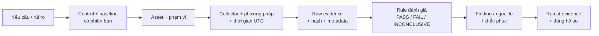

# Bằng chứng configuration trong Security Assurance

## 1. Bằng chứng cấu hình chứng minh điều gì?

Trong **Configuration assurance**, một cấu hình chỉ được xem là đáp ứng yêu cầu bảo mật khi có cách xác minh đủ tin cậy và có thể kiểm tra lại. Tệp chính sách đã được duyệt, kết quả chạy lệnh trên máy, dữ liệu từ API quản lý cloud và thông báo “compliant” trên dashboard là các loại bằng chứng khác nhau: mỗi loại trả lời một phần câu hỏi, với độ tin cậy và giới hạn riêng.

Trong chương trình **SECURITY_SECURITY_ASSURANCE**, việc đánh giá có bằng chứng phải liên kết **mục tiêu bảo mật → rủi ro → yêu cầu → security control → trạng thái triển khai → kết quả kiểm tra → phát hiện/khắc phục**. Bằng chứng configuration (configuration evidence) là dữ liệu có nguồn gốc, phạm vi và thời điểm rõ ràng, giúp người đánh giá kết luận rằng một yêu cầu cấu hình đã được đáp ứng, chưa được đáp ứng hoặc chưa có đủ thông tin để kết luận.

Ví dụ: baseline yêu cầu máy bastion Linux *không cho phép đăng nhập trực tiếp bằng tài khoản root qua SSH*. Các thông tin sau không tương đương nhau:

- **Yêu cầu**: “Cấm SSH trực tiếp với root” là tiêu chí cần chứng minh, chưa phải bằng chứng.
- **Ý định triển khai**: mã Ansible khai báo `PermitRootLogin no` chứng minh *mong muốn cấu hình*, chưa chứng minh máy đang chạy đúng giá trị.
- **Trạng thái có hiệu lực**: đầu ra `sshd -T` cho một ngữ cảnh kết nối cho biết cấu hình mà daemon SSH diễn giải tại thời điểm đo.
- **Hành vi được quan sát**: một phép thử được phê duyệt ghi nhận root bị từ chối cho biết điều kiện được kiểm tra có hiệu lực trên đường truy cập đã thử.
- **Kết luận assurance**: `PASS`/`FAIL` chỉ có ý nghĩa khi gắn với baseline, asset, phạm vi phép thử và bằng chứng thô ở trên.

Một ảnh chụp màn hình không ghi tên máy hoặc ngày đo thường không đủ để xác nhận trạng thái của toàn hệ thống. Ngược lại, một bản ghi có phương pháp đo, giá trị kỳ vọng và quan sát, phiên bản chính sách và nguồn dữ liệu có thể được tái kiểm tra bởi nhóm vận hành, auditor hoặc người xử lý phát hiện.

### Mục tiêu học tập

Sau bài này, người học có thể:

1. Phân loại bằng chứng cấu hình theo nguồn và mức độ chứng minh.
2. Lập cấu trúc một bộ evidence liên kết control, baseline, tài sản, phép đo và kết luận.
3. Thu thập dữ liệu cấu hình từ Linux, Windows, cloud và hệ thống quản lý cấu hình.
4. Đánh giá tính đầy đủ, tính mới, tính toàn vẹn và độ tin cậy của bằng chứng.
5. Theo dõi drift, quản lý ngoại lệ và chứng minh kết quả khắc phục qua các lần kiểm tra lại.

## 2. Phân biệt yêu cầu, bằng chứng và kết luận

Cần tách ba thành phần: **mệnh đề cần chứng minh (claim)**, **dữ liệu hỗ trợ (evidence)** và **phán đoán theo quy tắc (assessment)**. Sự tách biệt cho phép kiểm tra lại kết luận khi baseline thay đổi mà vẫn giữ nguyên dữ liệu đo trong quá khứ.

| Thành phần | Ví dụ | Câu hỏi cần trả lời |
|---|---|---|
| Mục tiêu bảo mật | Giảm nguy cơ lạm dụng quyền quản trị | Tại sao control cần tồn tại? |
| Control và tiêu chí đo | `OS-SSH-01`: trên bastion Linux, SSH root trực tiếp bị cấm | Điều kiện đạt là gì, áp dụng cho ai? |
| Baseline được phê duyệt | `linux-bastion-v3`, `permitrootlogin no` | Giá trị nào là chuẩn tại thời điểm đánh giá? |
| Evidence thô | Đầu ra `sshd -T -C ...`, exit code, timestamp | Máy thực sự trả về gì, thu bằng cách nào? |
| Kết quả đánh giá | `FAIL` khi quan sát `permitrootlogin prohibit-password` | Quan sát có khớp tiêu chí không? |
| Phát hiện và xử lý | `CFG-241`, owner, deadline, bằng chứng kiểm tra lại | Ai xử lý và bằng cách nào chứng minh đã sửa? |

Một **bản ghi kết luận** không thay thế **bằng chứng gốc**. Nếu chỉ lưu `PASS`, về sau không thể xác định scanner có đủ quyền, script có tính đúng giá trị hiệu lực hoặc baseline lúc đó là bản nào.

Điều ngược lại cũng đúng: **đống dữ liệu thô không có tiêu chí đánh giá** chỉ phản ánh trạng thái, chưa phải kết quả assurance. Ví dụ, danh sách 200 cổng lắng nghe không cho biết cổng nào được phép nếu thiếu kiến trúc và vai trò máy.

## 3. Phân loại nguồn bằng chứng

Nên kết hợp nhiều lớp bằng chứng phù hợp với rủi ro và đặc điểm control.

| Lớp | Nguồn ví dụ | Có thể chứng minh | Giới hạn cần ghi nhận |
|---|---|---|---|
| **Thiết kế/chính sách** | Baseline, yêu cầu, phê duyệt kiến trúc, bảng ánh xạ control | Tiêu chí và phạm vi mong đợi | Không chứng minh môi trường thực tế đã áp dụng |
| **Trạng thái mong muốn** | Terraform plan/state, Ansible inventory/playbook, GPO, MDM, image template | Ý định cấu hình và nguồn triển khai | Có thể sai lệch so với máy đang chạy; state chưa chắc phản ánh runtime |
| **Cấu hình đã triển khai** | File, registry, OS security policy, cấu hình firewall, API cloud | Giá trị được lưu hoặc do hệ thống quản lý trả về | Có thể bị override, không được nạp hoặc thay đổi ngoài băng |
| **Trạng thái có hiệu lực** | `sshd -T`, trạng thái profile firewall đang áp dụng, service runtime | Giá trị dịch vụ/OS đang sử dụng trong ngữ cảnh đã đo | Chỉ đúng với thời điểm, host và điều kiện kiểm tra |
| **Kiểm thử hành vi** | Thử kết nối có kiểm soát, kiểm tra quyền truy cập, thử tạo sự kiện audit | Control hoạt động trong tình huống kiểm thử | Mẫu kiểm thử có giới hạn; kết quả thành công không loại trừ mọi đường tấn công |
| **Giám sát và lịch sử** | SIEM log, drift detection, change log, ticket, bản vá, agent heartbeat | Biến động, sự kiện và chuỗi xử lý theo thời gian | Log có thể thiếu sự kiện hoặc lệch giờ; cần xác minh nguồn và độ phủ |
| **Xác nhận bởi bên khác** | Báo cáo auditor, kết quả công cụ bên ngoài, attestation có phạm vi | Góc nhìn đánh giá hoặc xác nhận độc lập | Phải xét ngày, phương pháp, phạm vi và trách nhiệm của bên xác nhận |

Đối với control quan trọng như tài khoản đặc quyền, phân đoạn mạng, mã hóa và audit trail, chỉ có ảnh màn hình từ công cụ cấu hình thường chưa đủ. Cần đối chiếu **trạng thái có hiệu lực** và, khi an toàn và được phê duyệt, **hành vi thực tế**.

### Ví dụ: ba lớp bằng chứng của host firewall

1. **Declared**: bộ quy tắc được lưu trong repository cấu hình hoặc chính sách quản trị nói chỉ cho phép kết nối quản trị từ subnet được duyệt.
2. **Effective**: host firewall đang chạy, đúng profile và có bộ quy tắc đã nạp cho interface/liên kết mạng tương ứng.
3. **Behavioral**: từ một vùng mạng không được duyệt, kết nối thử tới cổng quản trị bị chặn; từ vùng được duyệt, luồng hợp lệ hoạt động.

Kết luận cần xác định cả *chiều vào hay chiều ra*, *giao thức/cổng*, *nguồn/đích* và *thời điểm*. Một thử nghiệm trên một interface không tự chứng minh toàn bộ đường đi còn lại.

## 4. Những thuộc tính làm bằng chứng có giá trị

Bằng chứng tốt không nhất thiết là báo cáo dài; nó phải trả lời được các câu hỏi kiểm toán quan trọng.

| Thuộc tính | Tiêu chí đánh giá | Rủi ro khi thiếu |
|---|---|---|
| **Relevance — liên quan** | Dữ liệu đúng control, tài sản, phiên bản OS và môi trường | Dùng log đúng định dạng nhưng từ máy khác |
| **Provenance — nguồn gốc** | Biết người/agent thu thập, nguồn API/host, phiên bản công cụ và quyền thực thi | Không thể xác minh cách hình thành dữ liệu |
| **Accuracy — độ chính xác** | Lệnh/phương pháp phù hợp với cấu hình hiệu lực, kiểm tra lỗi và điều kiện áp dụng | Báo `PASS` từ giá trị cũ hoặc từ lệnh sai |
| **Completeness — đầy đủ** | Bao phủ tài sản và kiểm soát dự kiến; có báo cáo phần không đo được | Ẩn host offline, control bị bỏ quên |
| **Freshness — tính mới** | Timestamp UTC, tuổi evidence, thời hạn hiệu lực theo rủi ro | Dùng bằng chứng tuần trước cho thay đổi hôm nay |
| **Reproducibility — tái lập** | Có input, lệnh, ngữ cảnh, baseline và cách xử lý kết quả | Người khác không lặp lại phép đo |
| **Integrity — toàn vẹn** | Lưu bản gốc, ghi hash hoặc dùng kho có quản lý phiên bản/audit trail | Dữ liệu bị chỉnh sửa sau khi thu thập |
| **Confidentiality — bí mật** | Giới hạn truy cập, loại bỏ secret, có retention hợp lý | Rò rỉ cấu hình nhạy cảm, danh sách tài khoản hoặc token |

**Lưu ý về tính toàn vẹn:** một giá trị SHA-256 có thể phát hiện nội dung thay đổi *nếu giá trị băm chuẩn được lưu và tin cậy*, nhưng tự nó **không chứng minh ai đã thu thập** và **không chứng minh dữ liệu phản ánh đúng máy cần đo**. Cần kết hợp danh tính collector, kênh thu thập được xác thực, log truy cập, phiên bản evidence và, nếu cần, chữ ký số hoặc kho lưu trữ chống sửa đổi.

**Lưu ý về tính mới:** evidence phản ánh trạng thái **tại thời điểm đo**, trừ khi có cơ chế giám sát liên tục đủ tin cậy. Bản ghi `PASS` hôm qua không bảo đảm máy vẫn đúng cấu hình sau cập nhật chính sách, reboot, cài ứng dụng hoặc thay đổi thủ công hôm nay.

## 5. Thiết kế bộ hồ sơ evidence

Mỗi control được đánh giá nên liên kết tới một tập bằng chứng có cấu trúc. Gợi ý bộ trường tối thiểu:

| Nhóm | Trường nên lưu | Vai trò |
|---|---|---|
| Phạm vi | `asset_id`, environment, role, OS/platform, region/tenant | Xác định chính xác đối tượng |
| Control | `control_id`, `baseline_version`, tài liệu nguồn, điều kiện áp dụng | Gắn phép đo với yêu cầu |
| Phương pháp | `collector_id`, tool/version, command/API, quyền và ngữ cảnh | Xác minh cách thu thập |
| Thời gian | `collected_at_utc`, thời gian nguồn, thời gian xử lý, tuổi evidence | Đánh giá tính mới và thứ tự sự kiện |
| Quan sát | `expected`, `observed`, `exit_code`/API status, error, đơn vị/ngữ cảnh | Tách giá trị thực tế khỏi kết luận |
| Kết quả | `result`, rule/version, lý do, mức độ tin cậy/giới hạn | Tái tạo phép ra quyết định |
| Bằng chứng | `raw_evidence_ref`, checksum, metadata lưu trữ, phân quyền | Truy xuất và bảo quản bản gốc |
| Theo dõi | `finding_id`, owner, exception_id, ticket, retest reference | Theo dõi sai lệch đến khi hoàn thành |

Một **bản ghi minh họa** cho phép kiểm soát bảo mật SSH:

```yaml
evidence_id: ev-20261128-001
asset_id: vm-bastion-01
environment: production
asset_role: linux-bastion
control_id: OS-SSH-01
baseline_version: linux-bastion-v3
claim: "Root cannot log in directly by SSH"
expected:
  permitrootlogin: "no"
observed:
  permitrootlogin: "prohibit-password"
assessment:
  result: FAIL
  rule_version: "os-ssh-01-check-v2"
  reason: "Root login still permitted through non-password methods"
collection:
  collector_id: collector-platform-01
  tool: "OpenSSH sshd"
  method: "sshd -T -C user=root,host=bastion.example.internal,addr=192.0.2.10"
  collected_at_utc: "2026-11-28T03:00:00Z"
  outcome: success
evidence:
  raw_ref: "secure-evidence/ev-20261128-001/stdout.txt"
  sha256: "<digest-calculated-from-raw-file>"
  access_classification: internal-restricted
follow_up:
  finding_id: CFG-241
  owner: platform-ops
```

*Đây là dữ liệu mô phỏng để minh họa schema, không phải bản ghi kiểm tra từ một host thực.* Giá trị `sha256` là chỗ trống phải thay bằng digest tính từ tệp đã lưu; không dùng chuỗi ví dụ đó như bằng chứng.

Thông thường cần giữ **hai thành phần riêng**:

- **Raw artifact**: stdout/stderr, response API, event log, export chính sách hoặc ảnh chụp gốc (nếu thực sự cần), kèm ngữ cảnh thu thập.
- **Normalized assessment**: trường đã chuẩn hóa, kết quả `PASS`/`FAIL`, lý do, phiên bản quy tắc, tham chiếu sang raw artifact.

Cách tách này cho phép cập nhật quy tắc đánh giá hoặc baseline và chạy lại phép so sánh trên bằng chứng cũ, đồng thời thể hiện rõ các kết luận mới chỉ dựa trên trạng thái lịch sử.

## 6. Thu thập bằng chứng một cách có thể tái lập

Một quy trình thu thập có thể triển khai thành sáu bước:

1. **Chọn tập tài sản từ inventory** đã đối chiếu owner và environment; tránh chỉ quét những máy đang online rồi coi đó là toàn bộ phạm vi.
2. **Xác định control và phiên bản baseline** theo OS, vai trò, mức rủi ro và ngoại lệ được phê duyệt.
3. **Ghi phương pháp thu thập**: lệnh/API, tham số, tài khoản được cấp quyền đọc, phiên bản scanner và kỳ vọng đầu ra.
4. **Thu thập dữ liệu thô** với thời điểm UTC, exit code/API status và lỗi; không bỏ mất stderr hay đổi lỗi thành dữ liệu rỗng.
5. **Đánh giá theo quy tắc có phiên bản**; ghi `PASS`, `FAIL`, `INCONCLUSIVE`, `NOT_APPLICABLE` cùng lý do.
6. **Lưu và bảo vệ evidence**: liên kết asset/control, checksum, retention, finding và lịch tái kiểm tra.

### 6.1. Ví dụ Linux: kiểm chứng SSH và dịch vụ

Các lệnh dưới đây chỉ mang tính minh họa cho hệ thống Linux dùng OpenSSH, systemd và nftables; một số lệnh chỉ có trên bản phân phối phù hợp. Chạy trong phạm vi quyền quản trị được cấp và theo chính sách thu thập của hệ thống.

```bash
# Dữ liệu định danh host và nền tảng
hostnamectl
cat /etc/os-release
uname -r

# Kết quả SSH có hiệu lực cho ngữ cảnh đang đánh giá
sudo sshd -T -C user=root,host=bastion.example.internal,addr=192.0.2.10 \
  | grep -E '^(permitrootlogin|passwordauthentication|pubkeyauthentication) '

# Trạng thái dịch vụ và các cổng TCP lắng nghe
systemctl is-active sshd   # Một số distribution sử dụng tên ssh
sudo ss -ltnp

# Chỉ áp dụng nếu hệ thống dùng nftables và có quyền đọc
sudo nft list ruleset
```

Khi lưu output, phải ghi **host, thời gian, lệnh đầy đủ, exit code, phiên bản của công cụ và quyền chạy**. Không dựa riêng vào grep: nếu lệnh `sshd -T` lỗi hoặc không trả về trường yêu cầu, trạng thái kiểm tra là `INCONCLUSIVE`; một pipeline không kiểm soát exit code có thể vô tình che lỗi lệnh trước dấu `|`.

Để nhận biết override, cần xem xét `Include`, `Match`, công cụ quản lý cấu hình và việc daemon đã reload sau khi thay đổi. Cấu hình trên đĩa có thể khác cấu hình tiến trình đang dùng nếu thay đổi chưa có hiệu lực; kiểm thử hành vi hoặc quan sát thực tế có thể cần thiết tùy control.

### 6.2. Ví dụ Windows: kiểm tra chính sách đang áp dụng

```powershell
# Phiên bản Windows để gắn evidence với nền tảng
Get-ComputerInfo -Property WindowsProductName,WindowsVersion,OsBuildNumber

# Trạng thái firewall đang áp dụng
Get-NetFirewallProfile -PolicyStore ActiveStore |
  Select-Object Name,Enabled,DefaultInboundAction,DefaultOutboundAction

# Danh sách quy tắc firewall có hiệu lực ở mức host
Get-NetFirewallRule -PolicyStore ActiveStore |
  Select-Object DisplayName,Enabled,Direction,Action

# Nhận diện GPO đang áp dụng với máy
gpresult /scope computer /r

# Chính sách audit có hiệu lực theo hệ thống
auditpol /get /category:*
```

Các câu lệnh chỉ cho thấy một phần trạng thái; khi tiêu chí quy định cổng/nguồn IP cụ thể, cần kiểm tra thêm bộ lọc địa chỉ/cổng tương ứng, profile đang hoạt động, đường mạng và hành vi kết nối. Trong môi trường domain, kiểm tra chính sách từ GPO/MDM và chính sách hiệu lực; ảnh local policy có thể không phản ánh giá trị đang được áp dụng.

### 6.3. Cloud và Infrastructure as Code

Trong cloud, cần tách **cấu hình khai báo** (IaC), **tài nguyên được triển khai** (đọc API hiện tại) và **hành vi trên đường kết nối**. Ví dụ Terraform khai báo giới hạn SSH đến subnet quản trị có thể khác security group đang thực tế gắn với VM vì thay đổi ngoài pipeline, nhầm resource hoặc trạng thái bị lệch.

Đối với một kiểm soát network access trên cloud, bộ evidence có thể gồm:

- Commit/tag và kết quả kiểm tra policy-as-code cho Terraform hoặc mẫu IaC tương đương.
- Resource ID, region, account/project, timestamp và output API thể hiện rule thật sự gắn với workload được kiểm tra.
- Kết quả phân tích đường đi và, nếu được phê duyệt, phép thử lưu lượng từ vùng nguồn đại diện.
- Liên kết tới change request và scanner lần sau triển khai; kết quả drift detection nếu có.

Không đưa API token, private key, secret trong pipeline, chuỗi kết nối hoặc dữ liệu khách hàng vào raw evidence. Nếu chỉ ghi lời xác nhận của người triển khai rằng “Terraform đã chạy”, phạm vi chứng minh rất hạn chế.

## 7. Ra quyết định PASS, FAIL và trạng thái chưa đủ bằng chứng

Nên có một **quy tắc đánh giá xác định**, áp dụng nhất quán với từng phiên bản control. Một mô hình cơ bản:

| Trạng thái | Điều kiện dùng | Hành động |
|---|---|---|
| `PASS` | Control áp dụng; dữ liệu được thu thập hợp lệ và khớp giá trị/điều kiện kỳ vọng | Lưu evidence, giám sát tuổi dữ liệu và drift |
| `FAIL` | Control áp dụng; thu thập thành công nhưng quan sát không thỏa tiêu chí | Tạo finding, đánh giá rủi ro, phân công xử lý và kiểm tra lại |
| `INCONCLUSIVE` | Không thể đưa ra kết luận do mất kết nối, lỗi quyền, thiếu trường, nguồn không đáng tin hoặc dữ liệu quá cũ | Ghi lỗi rõ ràng, khôi phục khả năng đo hoặc kiểm tra bổ sung |
| `NOT_APPLICABLE` | Control không áp dụng cho tài sản theo điều kiện đã định và có lý do | Lưu lý do/logic xác định phạm vi |
| Ngoại lệ được chấp thuận | Có quyết định chấp nhận rủi ro với phạm vi, người phê duyệt và thời hạn | Theo dõi riêng `exception_id`; không sửa giá trị quan sát thành `PASS` |

Ví dụ logic giả cho control SSH:

```text
if asset.os_family != "linux" or asset.role != "bastion":
    return NOT_APPLICABLE with reason

if baseline_version is missing or evidence.age > allowed_age:
    return INCONCLUSIVE with reason

if collection.error or collection.exit_code != 0:
    return INCONCLUSIVE with original_error

if effective_config.permitrootlogin == "no":
    return PASS
else:
    return FAIL with observed_value
```

**Điều kiện kiểm tra cần sát với mục tiêu.** Ví dụ yêu cầu `passwordauthentication no` không đủ để kết luận root bị cấm đăng nhập; yêu cầu `permitrootlogin no` mới khớp tiêu chí “root không thể SSH trực tiếp” trong bối cảnh OpenSSH. Đối với control yêu cầu hành vi hiệu quả, `PASS` ở lớp cấu hình chỉ nên được ghi là *đạt phép kiểm tra cấu hình*; kết luận end-to-end cần nguồn chứng cứ bổ sung.

Trong báo cáo, **độ phủ** và **tỷ lệ đạt** là hai đại lượng khác nhau. Nếu có 100 host thuộc phạm vi, 80 host đo thành công và 78 host đạt, có thể báo:

- Độ phủ đánh giá thành công: **80/100 = 80%**.
- Tỷ lệ đạt trong tập đã kiểm tra thành công: **78/80 = 97,5%**.
- 20 host chưa đánh giá phải được hiển thị riêng; chưa đủ căn cứ công bố 97,5% fleet đạt chuẩn.

Nếu mỗi máy có nhiều control, phải nêu rõ đơn vị đếm là *host*, *control* hay *cặp host-control*. Tránh so sánh tỷ lệ khác mẫu số.

## 8. Bảo quản, tính toàn vẹn và chuỗi truy vết

Một bộ evidence cần đủ tính truy vết từ khi tạo đến lúc được kiểm toán hoặc hết hạn lưu giữ.



**Chuỗi truy vết** (chain of custody/provenance) nên ghi được: ai hoặc service identity nào tạo artifact, lấy từ tài sản nào, thu vào lúc nào, file được chuyển và lưu tại đâu, các phiên bản/biến đổi đã thực hiện và ai đã truy cập/chấp thuận kết luận.

Một tổ chức có thể sử dụng kho object có versioning và chính sách immutability, hệ thống lưu trữ có audit log hoặc công cụ GRC tích hợp. Cơ chế cụ thể tùy yêu cầu; điều cần chứng minh là bằng chứng quan trọng không bị sửa âm thầm và có thể truy xuất đúng bản lúc đánh giá.

**Ví dụ kiểm tra checksum của file thô đã lưu** (trên hệ thống được ủy quyền):

```bash
sha256sum ssh-effective-config.txt
```

Nếu hash được ghi vào manifest, lần truy xuất sau có thể tính lại hash và so sánh. Mọi thao tác xử lý như loại secret, chuẩn hóa log hoặc định dạng lại output đều phải được ghi nhận. Nếu cần redaction, hãy tạo **bản đã che** và lưu liên kết với bản gốc trong vùng bảo mật được kiểm soát; nếu chính sách cấm giữ bản gốc chứa secret thì không thu thập chúng ngay từ đầu.

### Bảo vệ dữ liệu trong evidence

Dữ liệu cấu hình có thể làm lộ tên máy, tài khoản, hostname nội bộ, IP, rule firewall, đường dẫn file, mô hình phân quyền hoặc secret. Thực hiện các nguyên tắc:

- **Tối thiểu hóa:** chỉ thu các trường thật sự cần để chứng minh control; tránh dump toàn bộ environment variables, file secret hoặc cấu hình chứa credential.
- **Phân quyền:** người phụ trách control/audit chỉ xem được phạm vi cần thiết; quản lý service account của collector và lịch sử truy cập.
- **Bảo vệ truyền và lưu:** dùng kết nối được xác thực, mã hóa phù hợp và cơ chế chống chỉnh sửa theo chính sách hệ thống.
- **Vòng đời:** định nghĩa thời gian lưu, quy tắc hết hạn/xóa, trách nhiệm bảo quản, cách xử lý dữ liệu khi nhân sự hoặc tài sản thay đổi.
- **Log chính collector:** thu nhận cả lỗi, kết quả thiếu trường, thay đổi phiên bản, mất quyền và thời điểm ngừng gửi dữ liệu.

## 9. Evidence trong kiểm thử, audit và vận hành liên tục

Không nên đợi sát ngày audit mới thu thập bằng chứng. Cùng một control cần được quan sát ở nhiều giai đoạn:

| Giai đoạn | Bằng chứng nên có | Mục đích |
|---|---|---|
| Thiết kế và đánh giá rủi ro | Control mapping, baseline, quyết định áp dụng | Xác định chuẩn cần đạt |
| Build image/IaC | Kết quả policy-as-code, kiểm tra artifact và pipeline log | Phát hiện sai lệch trước khi triển khai |
| Provisioning | Log triển khai, phiên bản image, ID tài sản và policy | Nối yêu cầu với phiên bản đã áp dụng |
| Sau triển khai | API/host query, runtime policy, phép kiểm tra hành vi phù hợp | Chứng minh trạng thái thực tế |
| Vận hành | Quét định kỳ/sau thay đổi, drift alert, log/telemetry | Phát hiện thay đổi ngoài dự kiến |
| Khắc phục finding | Ticket, change approval, raw evidence trước/sau, retest | Chứng minh nguyên nhân được xử lý |
| Audit | Bộ evidence có chỉ mục, phạm vi, lịch sử và giới hạn | Cho phép bên kiểm tra tái dựng kết luận |

**Sự kiện nên kích hoạt đo lại:** thay đổi baseline, thay image, nâng cấp OS, thay GPO/MDM, thay chính sách network, chỉnh nhóm quản trị, rotate khóa, triển khai công cụ bảo mật, phát hiện drift, máy phục hồi từ backup hoặc thay đổi lớn về rủi ro.

Có thể lập lịch quét hàng ngày, hàng tuần hoặc theo sự kiện tùy rủi ro. Không có một chu kỳ cố định đúng cho mọi hệ thống. Nếu bằng chứng có tuổi quá mức quy định, nên chuyển sang `INCONCLUSIVE` hoặc đánh dấu `STALE` trong metadata và yêu cầu đo lại; không tiếp tục tuyên bố trạng thái hiện tại dựa trên kết quả cũ.

### Phát hiện và xử lý drift bằng evidence

Configuration drift là sự khác nhau giữa **trạng thái mong đợi** và **trạng thái quan sát**. Drift có thể do thay đổi thủ công, rollout GPO/MDM, thay image, app installer, thao tác khẩn cấp hoặc thay đổi bên thứ ba.

Khi phát hiện drift, evidence cần thể hiện ít nhất:

1. Phiên bản baseline và giá trị đã từng đạt.
2. Giá trị hiện tại bị lệch, timestamp và công cụ đo.
3. Change event liên quan nếu có; tránh suy luận nguyên nhân chỉ từ sự trùng thời gian.
4. Rủi ro phát sinh và tác động kinh doanh.
5. Quyết định khắc phục hoặc ngoại lệ có thẩm quyền.
6. Giá trị đo lại, timestamp, outcome và link tới finding.

Tự động trả cấu hình về baseline có thể gây gián đoạn mạng, khóa đăng nhập hoặc ảnh hưởng dịch vụ. Các thay đổi có nguy cơ cao cần thử trên canary, phương án rollback và đánh giá khả năng truy cập sau triển khai.

## 10. Tình huống thực hành: điều tra evidence bị mâu thuẫn

**Bối cảnh:** một máy bastion Linux production có control `OS-SSH-01` yêu cầu root không đăng nhập SSH trực tiếp. Pipeline Ansible hiển thị trạng thái “successful”. Dashboard scanner cũ báo “compliant”, nhưng một kỹ sư thấy root vẫn có khả năng đăng nhập bằng khóa công khai.

**Nguồn bằng chứng thu được:**

| Nguồn | Giá trị/quan sát | Ý nghĩa |
|---|---|---|
| Playbook Ansible version `v3` | `PermitRootLogin no` | Cho biết ý định quản lý cấu hình |
| Kết quả pipeline cách đây 5 ngày | `success` | Cho biết tác vụ chạy thành công theo điều kiện pipeline |
| Báo cáo scanner cách đây 7 ngày | `PASS`, thiếu raw output | Bằng chứng cũ, không đủ tái kiểm tra |
| `sshd -T -C` hiện tại cho ngữ cảnh root | `permitrootlogin prohibit-password` | Cấu hình hiệu lực cho phép một số cách đăng nhập root |
| Kiểm thử đăng nhập được phép | Root có thể đăng nhập bằng khóa | Bằng chứng hành vi đối với đường thử đã chọn |

**Phân tích:** yêu cầu “root SSH bị cấm hoàn toàn” không đạt ở thời điểm đo. Pipeline thành công không chứng minh daemon đang dùng đúng giá trị; scanner cũ thiếu dữ liệu thô và đã quá tuổi. Có thể có `Include`, `Match`, thứ tự áp dụng thiết lập khác với kỳ vọng hoặc trạng thái tiến trình chưa được nạp lại. Chưa kết luận nguyên nhân cho đến khi kiểm tra cấu hình và lịch sử thay đổi.

**Hành động đề xuất:** tạo finding gắn asset và control, ghi nguồn chứng cứ mâu thuẫn, mức rủi ro và chủ sở hữu. Nhóm vận hành tìm nguồn cấu hình hiệu lực, sửa tại nguồn quản lý, xác minh cú pháp, thử canary và đảm bảo đường truy cập khẩn cấp trước khi reload dịch vụ.

**Đóng finding:** lưu output `sshd -T -C` mới với `permitrootlogin no`, thử SSH root bị từ chối và tài khoản quản trị hợp lệ vẫn hoạt động, lưu change ticket và raw evidence trước/sau. Dashboard chỉ thay đổi sau khi có kết quả kiểm tra mới với phương pháp và baseline được xác định.

Tình huống cho thấy một “evidence package” có thể chứa **các nguồn đưa ra kết quả khác nhau**. Người đánh giá cần tìm điểm khác biệt về *thời gian, phạm vi, nguồn và ngữ cảnh*, giải quyết sự không nhất quán trước khi kết luận.

## 11. Các lỗi phổ biến khi xây dựng bằng chứng configuration

| Lỗi | Hệ quả | Cách khắc phục |
|---|---|---|
| Chỉ lưu “compliant: true” | Không tái kiểm tra được kết luận | Lưu raw output và phiên bản logic đánh giá |
| Dùng screenshot không có tài sản/thời điểm | Không xác định được đối tượng hoặc tính mới | Gắn resource ID, UTC, người/agent và ngữ cảnh |
| Kiểm tra file thay vì trạng thái hiệu lực | Không phát hiện override hoặc service chưa reload | Kết hợp declared, effective, behavioral |
| Bỏ qua lỗi thu thập hoặc host offline | Tỷ lệ đạt bị thổi phồng | Đặt `INCONCLUSIVE` và công bố độ phủ |
| Không phân loại asset/baseline | So sai tiêu chí và tạo false finding | Gắn role/OS/env với baseline có phiên bản |
| Dùng hash nhưng không quản lý nguồn hash | Không chống được thay đổi đồng thời file và manifest | Lưu manifest tin cậy, quản lý phiên bản và audit trail |
| Lưu log chứa password, token hoặc secret | Phát sinh rò rỉ mới từ chính quy trình assurance | Tối thiểu hóa dữ liệu, tách nơi lưu và phân quyền |
| Chấp nhận ngoại lệ như `PASS` | Che giấu rủi ro chưa được xử lý | Theo dõi trạng thái đo và `exception_id` tách biệt |
| Không thu lại evidence sau thay đổi | Finding đóng trên lời xác nhận | Retest với cùng điều kiện/tiêu chí và evidence mới |
| Chỉ quét một phần tài sản | Báo cáo không phản ánh toàn fleet | Nêu rõ population, coverage và khoảng trống |

## 12. Bài thực hành thiết kế evidence package

Giả sử nhóm cần kiểm tra yêu cầu: *trên các máy Windows member server thuộc production, Windows Firewall phải được bật cho những profile được sử dụng; đường quản trị từ mạng ngoài danh sách cho phép phải bị chặn*.

Hãy thiết kế một package gồm:

1. **Control record:** định danh control, tiêu chí đạt, baseline/phiên bản, nguồn rủi ro, danh sách máy và chính sách áp dụng cho từng máy.
2. **Phương pháp thu:** xác định lệnh/API kiểm tra firewall active profile, effective rules và network test được phê duyệt; ghi quyền, thời gian UTC, địa chỉ nguồn/đích dùng thử.
3. **Raw evidence:** giá trị quan sát và lỗi đầu ra nguyên bản; metadata host/OS/collector; đường dẫn lưu, hash và giới hạn truy cập.
4. **Assessment:** cách so sánh profile/rule/luồng mạng; tách `PASS`, `FAIL`, `INCONCLUSIVE`, `NOT_APPLICABLE`.
5. **Remediation:** tạo finding cho máy lệch chuẩn, link thay đổi GPO/MDM hoặc host policy, giữ bằng chứng trước/sau và kiểm thử lại.
6. **Báo cáo:** tổng số máy trong phạm vi, số đã đo thành công, số đạt, số không đạt, số chưa đo được, ngoại lệ và tuổi bằng chứng.

**Câu hỏi tự đánh giá:**

- Một file baseline có chữ ký phê duyệt có đủ chứng minh máy chủ đã áp dụng baseline không?
- Tại sao cùng một lệnh kiểm tra SSH lại cần tham số người dùng và địa chỉ nguồn kết nối?
- Chỉ số “99% PASS” thiếu thông tin gì nếu không biết số tài sản hoặc số control chưa kiểm tra?
- Hash file evidence giúp phát hiện điều gì và không chứng minh được điều gì?
- Khi security group trên cloud thay đổi sau lần quét gần nhất, cần thu thập lại bằng chứng ở những lớp nào?
- Nếu scanner không có quyền đọc policy trên một máy, nên trả `FAIL`, `PASS` hay `INCONCLUSIVE`? Vì sao?

## 13. Tiêu chí hoàn thành một bộ evidence có thể dùng để audit

Trước khi bàn giao, người đánh giá cần kiểm tra rằng bộ bằng chứng xác định được **control nào, áp dụng cho tài sản nào, theo baseline phiên bản nào, được đo bằng phương pháp gì, vào thời điểm nào, kết quả quan sát là gì và tại sao đưa ra kết luận**. Evidence thô phải truy xuất được bằng quyền phù hợp; các lỗi thu thập, khoảng trống độ phủ, ngoại lệ và thay đổi sau lần quét phải được thể hiện rõ.

Bằng chứng configuration có giá trị khi hỗ trợ **tái kiểm tra độc lập**, làm rõ phần nào đã được chứng minh và phần nào còn chưa chắc chắn. Nó nối việc cấu hình hệ thống hằng ngày với chương trình security assurance liên tục: từ nhận diện rủi ro, định nghĩa security control, đo trạng thái thực tế, kiểm thử/audit, đến khắc phục và xác minh lại.
