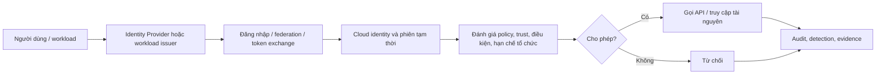

# Cloud identity: Bảo đảm danh tính và quyền truy cập trên cloud

## 1. Cloud identity là gì và vì sao phải đánh giá?

Trong môi trường cloud, **identity** là danh tính mà nền tảng sử dụng để nhận biết một chủ thể đang yêu cầu truy cập: nhân viên, quản trị viên, ứng dụng, workload, pipeline CI/CD, dịch vụ tự động hoặc đối tác bên ngoài. Identity thường đi kèm thông tin xác thực, thuộc tính, quan hệ tin cậy, phiên làm việc và các quyền cho phép thực hiện hành động trên tài nguyên.

**Cloud identity assurance** là quá trình xác định yêu cầu bảo mật cho danh tính và quyền truy cập; triển khai các kiểm soát phù hợp; **thu thập bằng chứng có thể kiểm chứng** rằng các kiểm soát đang có hiệu lực; phát hiện sai lệch; và xử lý, xác minh kết quả khắc phục trong suốt quá trình phát triển, vận hành.

Trong module **SECURITY_SECURITY_ASSURANCE**, việc chỉ thấy một tài khoản “đã bật MFA” hay một role “không phải administrator” chưa đủ để kết luận hệ thống an toàn. Cần trả lời được:

1. Ai hoặc workload nào thực sự có thể truy cập tài nguyên nào, trong bối cảnh nào?
2. Danh tính được tạo, xác thực, cấp quyền, giám sát và thu hồi như thế nào?
3. Có đường cấp quyền gián tiếp, trust federation hoặc quyền tạm thời làm tăng đặc quyền hay không?
4. Khi thay đổi chính sách, sự kiện truy cập và kết quả kiểm tra có được lưu thành bằng chứng đáng tin cậy không?
5. Nếu phát hiện quyền không phù hợp, ai chịu trách nhiệm khắc phục và kiểm tra lại?

Ví dụ, một pipeline có thể không nắm giữ access key dài hạn nhưng vẫn có thể triển khai lên production thông qua **OIDC federation**. Nếu quan hệ tin cậy của cloud role chấp nhận token từ quá nhiều repository hoặc branch, một pipeline ngoài dự kiến cũng có thể nhận quyền triển khai. Assurance phải kiểm tra đồng thời *người phát hành token, audience, subject, điều kiện trust, quyền được cấp và log các phiên thực tế*.

### Phân biệt các khái niệm

| Khái niệm | Câu hỏi chính | Ví dụ |
| --- | --- | --- |
| **Identity** | Chủ thể được hệ thống nhận biết là ai? | Nhân viên, service account, workload identity |
| **Authentication** | Chủ thể chứng minh danh tính như thế nào? | Passkey, MFA, certificate, workload token |
| **Authorization** | Chủ thể được làm hành động gì trên tài nguyên nào? | Quyền đọc bucket, tạo máy ảo, quản lý khóa |
| **Federation** | Cloud tin tưởng danh tính do hệ thống khác xác thực thế nào? | Workforce SSO qua OIDC/SAML, workload OIDC |
| **Role / policy / group** | Quyền được mô hình hóa và quản lý ra sao? | RBAC role, IAM policy, group assignment |
| **Session / token** | Quyền được thực thi trong khoảng thời gian và bối cảnh nào? | Phiên nhận từ Security Token Service |
| **Assurance evidence** | Dựa vào dữ liệu nào để tin rằng yêu cầu đã đạt? | Policy hiệu lực, audit event, kết quả thử từ chối |

Việc xác thực đúng một người **không đồng nghĩa** người đó phải được cấp mọi quyền. Tương tự, một danh tính được cấp quyền hạn chế ở một nơi vẫn có thể đạt đặc quyền cao hơn qua một *đường ủy quyền* hoặc một tài nguyên khác.

## 2. Bối cảnh cloud: shared responsibility và identity plane

Các nhà cung cấp cloud cung cấp dịch vụ IAM, identity federation, token issuance, logging và công cụ hỗ trợ quản trị. Tuy nhiên, khách hàng vẫn phải cấu hình chính sách, gắn quyền đúng đối tượng, quản lý vòng đời tài khoản và xác minh các quyết định truy cập theo mô hình trách nhiệm chia sẻ.

Những thành phần thường tham gia vào một yêu cầu truy cập:



Sơ đồ minh họa luồng logic, không đại diện chính xác thứ tự nội bộ của mọi cloud. Trong thực tế, một quyết định còn phụ thuộc vào nhiều lớp: quyền của identity, resource policy, organization/tenant guardrails, session constraints, network context và quyền do dịch vụ đích thực thi.

**Đừng đồng nhất hệ thống Identity Provider (IdP) với toàn bộ hệ thống phân quyền cloud.** SSO có thể chứng minh danh tính, trong khi IAM/RBAC ở cloud và resource-level policies mới quyết định hành động nào được phép.

### Các nhóm identity cần đưa vào phạm vi

| Nhóm | Ví dụ | Rủi ro đặc trưng |
| --- | --- | --- |
| **Human workforce** | Developer, SRE, DBA, security auditor | Tài khoản bỏ quên, MFA yếu, phân quyền theo group quá rộng |
| **Privileged / emergency identity** | Global admin, AWS account root, break-glass identity | Bị chiếm quyền có thể thay đổi kiểm soát hoặc xóa log |
| **Workload identity** | VM, pod, function, service account, managed identity | Credential lộ, role dùng chung, gán quyền quá rộng |
| **Automation / CI/CD** | Build runner, release bot, IaC runner | Trust federation rộng, token dùng sai audience, quyền triển khai nhiều môi trường |
| **External / guest / vendor** | Đối tác hỗ trợ, hệ thống SaaS tích hợp | Quan hệ trust không được thu hồi khi hợp đồng kết thúc |
| **Cross-account / cross-project** | Role được assume từ account khác, service account impersonation | Đường ủy quyền bị bỏ sót khi review chỉ một account |

Một dịch vụ có thể sử dụng nhiều identity: tài khoản máy chủ, Kubernetes ServiceAccount, cloud role được liên kết, ứng dụng OAuth client và tài khoản database. Cần lập bản đồ **chuỗi danh tính**, không chỉ kiểm tra một tên role.

## 3. Tài sản, chính sách và đường cấp quyền cần inventory

Để đánh giá có ý nghĩa, trước tiên xác định **mẫu số** của chương trình assurance: những identity, tài nguyên và quan hệ trust nào thực sự thuộc phạm vi.

- **Phạm vi tổ chức:** tenant/organization, account/subscription/project, region và môi trường dev/test/staging/production.
- **Đối tượng:** users, groups, roles, service principals, service accounts, managed identities, workload pools, IAM policies và external principals.
- **Quan hệ:** group membership, role assignment, role assumption, policy attachment, service account impersonation, resource trust và federation với IdP.
- **Vòng đời:** ngày tạo, chủ sở hữu, lý do tồn tại, nguồn HR/IdP, last-used signal có độ tin cậy được mô tả, ngày hết hạn và trạng thái thu hồi.
- **Độ quan trọng:** quyền thay đổi chính sách, truy cập dữ liệu nhạy cảm, vô hiệu hóa logging, quản trị encryption keys, triển khai production, tạo token/credential mới.
- **Bằng chứng:** snapshot cấu hình, kết quả phân tích quyền hiệu lực, phát hiện truy cập, log thay đổi và phê duyệt ngoại lệ.

Không có **role được liệt kê trong console** chưa chắc nghĩa là không có đường truy cập: principal có thể đến từ tenant khác, cross-account trust, federation, resource-based policy hoặc nhóm được đồng bộ từ IdP.

### Truy vết một quyền từ đầu đến cuối

Giả sử người dùng Alice được thêm vào nhóm `prod-operators` của IdP; nhóm này gắn với role quản trị vận hành trên subscription production. Để đánh giá, cần liên kết được:

`Human → IdP account → group membership → federation/SSO → cloud role assignment → policy/condition → tài nguyên → API event`

Nếu chỉ kiểm tra role assignment mà bỏ qua việc Alice vẫn nằm trong nhóm sau khi chuyển bộ phận, chương trình assurance sẽ bỏ sót lỗi ở vòng đời tài khoản. Nếu chỉ có log đăng nhập IdP, cũng chưa đủ kết luận Alice đã được hay chưa được phép truy cập dữ liệu cụ thể.

## 4. Authentication assurance cho người dùng

### 4.1. Xác minh tài khoản và phương thức đăng nhập

Nên tích hợp cloud console với hệ thống quản lý danh tính tập trung khi phù hợp; yêu cầu xác thực nhiều yếu tố cho người dùng tương tác, đặc biệt các vai trò đặc quyền. Với đối tượng và nền tảng hỗ trợ, **phương thức chống phishing** như passkey/FIDO2 hoặc cơ chế tương đương thường giảm nguy cơ bị đánh cắp mã OTP qua trang giả mạo.

Kiểm soát cần gắn với kịch bản truy cập: thiết bị được quản lý hay không, vị trí/mạng, mức nhạy cảm của hành động, mức rủi ro phiên và ngoại lệ vận hành. Không nên giả định “đã đăng nhập bằng SSO” đồng nghĩa có MFA ở đúng phiên hoặc phiên được tái xác thực sau khi đặc quyền thay đổi.

**Bằng chứng phù hợp:** cấu hình chính sách bắt buộc MFA/conditional access, danh sách danh tính và nhóm nằm trong phạm vi, kết quả thử đăng nhập với điều kiện hợp lệ và không hợp lệ, bản ghi sign-in cho phiên mẫu, lịch sử thay đổi policy.

### 4.2. Root, super-admin và break-glass

Mọi nền tảng đều có các mức đặc quyền cao, nhưng tên gọi và khả năng khác nhau. Ví dụ: **AWS account root** không đồng nghĩa **Global Administrator** trong Microsoft Entra ID; phải mô tả từng loại identity theo provider.

Nguyên tắc quản lý:

1. Giảm tối đa sử dụng identity có quyền tối cao cho công việc thường ngày.
2. Bảo vệ cơ chế đăng nhập theo khả năng provider; lưu credential khẩn cấp có kiểm soát và phân tách trách nhiệm.
3. Xác định người sở hữu, trường hợp sử dụng, cách giám sát và hậu kiểm phiên khẩn cấp.
4. Kiểm thử định kỳ rằng quy trình khẩn cấp hoạt động mà không tạo tài khoản bí mật tồn tại vô thời hạn.
5. Cảnh báo đối với hành động đặc quyền bất thường và thay đổi chính sách IAM/logging.

Không nên áp dụng máy móc cùng một conditional access policy cho mọi break-glass account nếu điều đó khiến không thể truy cập trong tình huống mất IdP; cần cơ chế ngoại lệ được đánh giá rủi ro và giám sát riêng.

## 5. Authorization assurance: kiểm soát quyền thực sự có hiệu lực

### 5.1. Least privilege và phân tách nhiệm vụ

**Least privilege** yêu cầu identity chỉ có hành động và phạm vi tài nguyên cần thiết trong khoảng thời gian cần thiết. **Separation of duties** (SoD) giảm khả năng một cá nhân hoặc workload tự tạo, tự phê duyệt và tự triển khai thay đổi nhạy cảm mà không có kiểm soát độc lập.

Ví dụ role của dịch vụ gửi hóa đơn có thể chỉ cần đọc một secret và ghi object vào một bucket nhất định, không cần tạo IAM user, sửa encryption key, đọc tất cả bucket hoặc xóa log.

Các chiều cần xét đồng thời:

- **Actions:** danh sách hành động API được phép; thao tác ghi/xóa thường nhạy cảm hơn đọc thông tin mô tả.
- **Resources:** account, project, subscription, region, bucket/object, secret hoặc key cụ thể.
- **Conditions:** thời hạn, identity claims, tags, network context và các điều kiện được cloud hỗ trợ.
- **Delegation:** quyền assume role, impersonate identity, pass role cho dịch vụ, tạo token hoặc policy khác.
- **Administrative boundaries:** giới hạn do tổ chức, permission boundaries/session constraints, deny policies và service-specific controls.
- **Resource permissions:** quyền trực tiếp từ bucket/key/queue policies hoặc tương đương.

**Role không tên “admin” vẫn có thể trở thành quyền nguy hiểm** nếu nó được phép tạo một workload mang role mạnh hơn, sửa policy, cấp quyền cho chính mình hoặc truy cập dữ liệu qua resource policy. Đánh giá chỉ dựa vào tên role là không đủ.

### 5.2. Các mô hình cấp quyền và khác biệt nền tảng

| Nền tảng | Thành phần thường phải kiểm tra | Sai lầm dễ gặp |
| --- | --- | --- |
| **AWS** | IAM identity/resource policies, role trust policy, session policies, permissions boundary, SCP/RCP nếu áp dụng, policy conditions | Thấy IAM allow rồi kết luận quyền hiệu lực; bỏ qua explicit deny hoặc role trust |
| **Azure** | Entra identities, Azure RBAC role assignments và scope, deny assignments, managed identities, PIM, Conditional Access | Nhầm quyền Entra directory với quyền quản lý Azure resource hoặc quyền data-plane |
| **Google Cloud** | IAM allow/deny, principal/group membership, service account impersonation, organization policy, resource hierarchy và conditions | Bỏ sót quyền kế thừa từ tổ chức/folder, hoặc service account được impersonate |

Đây là **bản đồ khái niệm** để định hướng kiểm tra. Quy tắc đánh giá quyền hiệu lực cụ thể tùy dịch vụ, loại API, thời điểm và phiên bản provider. Ví dụ, AWS resource-based policies và cross-account access có ngữ nghĩa riêng; một công cụ IAM simulator hoặc policy analyzer chỉ chứng minh kết quả đối với tập hành động, tài nguyên và context đã mô phỏng.

### 5.3. Access review có bằng chứng

Quy trình review quyền định kỳ cần xác nhận *có cần quyền này nữa không*, không chỉ đánh dấu đã đọc. Kết quả nên lưu: chủ identity, tài nguyên, role/grant, lý do nghiệp vụ, người rà soát độc lập khi cần, quyết định giữ/giảm/thu hồi, hạn xử lý, bằng chứng đã thực thi và kết quả retest.

Đối với tài khoản bỏ việc, chuyển nhóm, contractor hết hạn hoặc workload bị hủy, cần đối chiếu nguồn authoritative (HR/IdP/repository/service catalog) với trạng thái cloud. Tài khoản bị disabled ở IdP không mặc nhiên thu hồi mọi access key, service credential hoặc phiên cloud còn hiệu lực.

## 6. Workload identity: xác thực giữa các dịch vụ

Machine-to-machine thường không sử dụng MFA kiểu người dùng; cần ràng buộc credential với **workload đúng danh tính**, nguồn phát hành đáng tin cậy, thời hạn hợp lý và quyền tối thiểu.

### Những cách cấp danh tính phổ biến

| Cách tiếp cận | Đặc điểm | Kiểm soát assurance |
| --- | --- | --- |
| Access key / client secret dài hạn | Dễ tích hợp nhưng khó luân chuyển và dễ bị sao chép | Kiểm kê, bảo vệ secret, giới hạn quyền, cảnh báo lộ lọt, lộ trình thay thế |
| Managed identity / instance role | Nền tảng cấp credential tạm thời cho compute resource | Ràng buộc đúng compute, giới hạn role, kiểm tra metadata/token exposure |
| Workload Identity Federation (OIDC hoặc tương đương) | Trao đổi token từ nguồn bên ngoài lấy quyền cloud có giới hạn | Kiểm tra issuer, subject, audience, trust và TTL |
| Service account impersonation | Workload thay mặt identity đích theo quyền ủy quyền | Kiểm tra ai được impersonate, scope và log gọi token |

Trong Kubernetes, một Pod có Kubernetes ServiceAccount không có nghĩa tự động có quyền cloud. Quyền cloud có thể được liên kết thông qua cơ chế provider-specific; cần kiểm tra cả **Kubernetes service account, workload selector, federation binding và cloud role**. Cũng cần xác minh Pod khác không thể sử dụng danh tính hoặc token của workload cần bảo vệ.

Token ngắn hạn giảm thời gian một credential bị lộ có thể sử dụng, nhưng **không bảo đảm an toàn tuyệt đối**: kẻ tấn công vẫn có thể lợi dụng token khi còn hiệu lực. Cần hạn chế nơi token được phát hành, nơi sử dụng, audience, quyền và cơ chế phát hiện.

## 7. Federation: kiểm soát quan hệ tin cậy giữa IdP và cloud

Federation cho phép cloud tin tưởng danh tính được xác thực bởi nguồn khác, thường qua **SAML** cho một số luồng workforce SSO hoặc **OIDC** cho workload và ứng dụng. Đánh giá federation phải xem cả hai phía:

1. **Issuer:** ai phát hành assertion/token, có đúng tổ chức hoặc hệ thống đáng tin cậy không?
2. **Audience:** token phát hành cho bên nhận nào? Một token cho dịch vụ A có bị dùng ở dịch vụ B không?
3. **Subject / claims:** token đại diện đúng người, workload, repository, branch, environment hay service account nào?
4. **Trust mapping:** claims được ánh xạ thành role/quyền cloud như thế nào? Có wildcard rộng hay nhầm namespace không?
5. **Token lifecycle:** thời gian hiệu lực, key rotation, kiểm tra chữ ký, revoke/disable và xử lý sự cố.
6. **Effective permissions:** khi federation thành công, role đích có thể làm gì; có thể chuyển tiếp hoặc tăng quyền không?

Không phải mọi hệ thống OIDC đều có cùng định dạng `sub` hoặc claims. Giá trị phải căn cứ tài liệu **issuer và integration cụ thể**; không suy diễn từ một ví dụ khác.

### 7.1. Ví dụ trust policy của AWS cho pipeline OIDC

Giả sử pipeline GitHub Actions của repository `example-org/payments` được phép nhận role triển khai **chỉ từ branch `main`**. Một trust policy **minh họa** có thể được thiết kế như sau:

```json
{
  "Version": "2012-10-17",
  "Statement": [
    {
      "Sid": "AllowSpecificGitHubWorkflowIdentity",
      "Effect": "Allow",
      "Principal": {
        "Federated": "arn:aws:iam::<ACCOUNT_ID>:oidc-provider/token.actions.githubusercontent.com"
      },
      "Action": "sts:AssumeRoleWithWebIdentity",
      "Condition": {
        "StringEquals": {
          "token.actions.githubusercontent.com:aud": "sts.amazonaws.com",
          "token.actions.githubusercontent.com:sub": "repo:example-org/payments:ref:refs/heads/main"
        }
      }
    }
  ]
}
```

**Đây là trust policy minh họa, không phải cấu hình sẵn dùng**: phải có OIDC provider đã đăng ký trong AWS account, account ID thật, repository/subject thực tế, permissions được phê duyệt và quy trình phát hành phù hợp. Nếu dùng GitHub environment hoặc chủ thể khác, `sub` có thể thay đổi; cần lấy từ cấu hình và token thực tế theo tài liệu của issuer.

Trust policy chỉ trả lời **ai được assume role**. Quyền API mà phiên đó nhận còn phụ thuộc vào **permission policies**, boundaries, organization controls và resource policies. Vì vậy bộ kiểm tra phải xác minh cả trust lẫn quyền của role, cùng log những phiên đã assume.

### 7.2. Kiểm thử tích cực và tiêu cực

Với ví dụ trên, kiểm thử có kiểm soát có thể yêu cầu:

| Kịch bản | Kết quả kỳ vọng |
| --- | --- |
| Token từ repository và branch được phê duyệt, audience đúng | Có thể nhận phiên nếu các điều kiện khác cũng thỏa |
| Token từ repository khác | Bị từ chối |
| Token từ branch khác | Bị từ chối |
| Token không dành cho audience `sts.amazonaws.com` | Bị từ chối |
| Token hợp lệ nhưng role không có quyền ghi vào tài nguyên nhạy cảm | Hành động ghi bị từ chối |

Các bài thử nên thực hiện ở môi trường và phạm vi được phép; tránh cấp đặc quyền production chỉ để kiểm tra một trường hợp từ chối. Một kết quả cho phép ở một lần thử không chứng minh mọi context đều an toàn; cần lưu chính xác input và phạm vi kiểm thử.

## 8. Cấu hình baseline cho cloud identity

Chuyển mục tiêu bảo mật thành **quy tắc đánh giá được**, gắn với asset/identity, nguồn dữ liệu, bằng chứng và hành động khi có sai lệch.

| ID | Yêu cầu | Phạm vi | Cách đánh giá |
| --- | --- | --- | --- |
| ID-001 | Các phiên quản trị con người phải dùng xác thực mạnh theo policy | Privileged workforce identities | IdP/Conditional Access policy + sign-in evidence |
| ID-002 | Workload production không dùng credential dài hạn nếu có cơ chế identity tạm thời được hỗ trợ | Workload trong inventory | Inventory key/secret + runtime credential path |
| ID-003 | Role triển khai production chỉ tin cậy workload source được phê duyệt | CI/CD federation roles | Trust claims + negative test + event logs |
| ID-004 | Quyền truy cập dữ liệu nhạy cảm không vượt nhu cầu được duyệt | Human và machine principals | Effective permission analysis + business owner review |
| ID-005 | Identity không còn nhu cầu phải được vô hiệu hóa/thu hồi theo SLA | Leavers, stale service identities | HR/IdP/service catalog reconciliation + revocation evidence |
| ID-006 | Thay đổi IAM nhạy cảm tạo được audit event bảo vệ khỏi sửa đổi trái phép | Account/project/subscription thuộc phạm vi | Event test + log destination/integrity/retention |
| ID-007 | Quyền khẩn cấp được quản trị có trách nhiệm và hậu kiểm | Break-glass identities | Emergency access test, approvals, alerts, activity review |

Ví dụ một hồ sơ baseline **mang tính khái niệm** (không phải cấu hình chuẩn của AWS/Azure/Google Cloud):

```yaml
baseline:
  id: CLOUD-ID-PROD
  version: "1.1.0"
  state: approved
  scope:
    environments: [production]
    providers: [aws, azure, gcp]
  owner: Cloud Security
  approvedBy: Security and Cloud Platform
  sourceRevision: "<approved-git-commit>"

rules:
  - id: ID-003
    category: federation-trust
    subject: cicd-production-roles
    expected:
      approvedIssuersOnly: true
      restrictAudience: true
      restrictSubjectToApprovedWorkloads: true
    verify:
      - trust-policy-readback
      - identity-inventory-reconciliation
      - controlled-negative-test
    severity: critical
  - id: ID-005
    category: identity-lifecycle
    subject: inactive-or-deprovisioned-identities
    expected:
      noUnapprovedActiveCredentials: true
    verify:
      - source-of-truth-reconciliation
      - credential-and-session-review
    severity: high
```

Các tên field `approvedIssuersOnly`, `restrictAudience` và `restrictSubjectToApprovedWorkloads` là **đặc tả nghiệp vụ minh họa**. Muốn tự động hóa, cần xây evaluator riêng cho mỗi cloud/provider và định nghĩa chính xác thế nào là issuer, subject, credential, trường hợp ngoại lệ và trạng thái không thể quan sát.

## 9. Thu thập bằng chứng IAM và xác minh trạng thái thực tế

Một chương trình assurance nên kết hợp nhiều nguồn. Chỉ chụp màn hình console không đủ vì ảnh không cho biết toàn bộ phạm vi, rule evaluation hoặc các thay đổi sau thời điểm chụp.

| Nguồn bằng chứng | Chứng minh được điều gì | Giới hạn |
| --- | --- | --- |
| IdP directory và policy | User/group, auth factor, sign-in, chính sách conditional access | Không tự chứng minh quyền API thực tế trên cloud |
| Cloud IAM/RBAC API | Role, binding, policy, trust và thuộc tính cấu hình tại thời điểm đọc | Có thể bỏ sót quyền hiệu lực nếu chỉ đọc một lớp |
| Organization/tenant guardrails | Các hạn chế chung theo hierarchy | Phải xét scope, ngoại lệ và cách kế thừa |
| Resource policy | Quyền được cấp tại tài nguyên | Một số quyết định phụ thuộc identity policy và context |
| Access analyzer/policy simulation | Đường truy cập tiềm năng hoặc kết quả trên kịch bản cụ thể | Không thay thế kiểm tra thực tế và review ngữ nghĩa |
| Audit/sign-in/API logs | Ai đã thử hoặc thực hiện thao tác, thời điểm, nguồn và kết quả quan sát | Không chứng minh các quyền chưa từng được sử dụng |
| Thử nghiệm cho phép/từ chối | Một hành động trong context xác định được phép hay bị chặn | Không bao phủ mọi tổ hợp quyền và ngữ cảnh |
| Ticket/approval/review | Quyền có lý do và người chịu trách nhiệm | Quyết định phê duyệt chưa chứng minh cấu hình đã thay đổi |

### 9.1. Ví dụ kiểm tra chỉ đọc trên AWS

Với một role giả định tên `ci-deployer`, có thể thu thập đầu vào như:

```bash
# Xem trust policy và thuộc tính của role.
aws iam get-role --role-name ci-deployer

# Liệt kê managed policies gắn trực tiếp với role.
aws iam list-attached-role-policies --role-name ci-deployer

# Liệt kê inline policies của role; cần đọc nội dung từng policy tương ứng.
aws iam list-role-policies --role-name ci-deployer
```

Đây là lệnh **chỉ đọc**, cần credential và quyền IAM phù hợp; đầu ra không nên đưa nguyên văn vào hệ thống báo cáo công khai. `get-role` chưa mô tả đầy đủ quyền được phép; managed policy cần đọc đúng **default policy version**, inline policy cần đọc nội dung, và cần xét permissions boundary, applicable SCP/resource policy/session context. Đồng thời phải liên kết kết quả với thông tin inventory, phiên bản baseline và thời gian quan sát.

Ví dụ trên không mặc nhiên kiểm tra đầy đủ một tài khoản AWS, và các dịch vụ khác như Microsoft Entra/Azure RBAC hoặc Google Cloud IAM phải dùng API, trường dữ liệu và cách diễn giải riêng.

### 9.2. Bản ghi kết quả có thể audit

```json
{
  "assetId": "aws/production/account-a/role/ci-deployer",
  "identityType": "federated-workload-role",
  "baselineId": "CLOUD-ID-PROD",
  "baselineVersion": "1.1.0",
  "ruleId": "ID-003",
  "observedAt": "2026-11-28T04:00:00Z",
  "result": "FAIL",
  "expected": "Restrict issuer, audience and subject to approved CI workloads",
  "observed": "Subject condition allows an unapproved branch",
  "source": "cloud-iam-api-and-policy-evaluator",
  "findingId": "ID-FINDING-018",
  "evidenceRef": "evidence://cloud-identity/ID-FINDING-018"
}
```

*Các tên account, giá trị và thời gian trong bản ghi là giả định để minh họa, không phải kết quả kiểm tra hệ thống thật.*

Bằng chứng thực tế nên có **định danh provider/account/tenant/project**, source revision, phiên bản công cụ đánh giá, thời điểm thu thập có múi giờ, dữ liệu gốc hoặc hash, rule evaluation context, chủ sở hữu, kết quả và đường dẫn đến ticket. Kiểm soát quyền đọc bằng chứng để tránh làm lộ tên nội bộ, token, thông tin cá nhân hoặc secret.

### 9.3. Các trạng thái kết quả

- **PASS:** quy tắc áp dụng cho identity/tài nguyên này, phép kiểm đủ bằng chứng và điều kiện được thỏa.
- **FAIL:** quan sát được cấu hình/quyền không đạt baseline có hiệu lực.
- **UNKNOWN:** dữ liệu thiếu, API lỗi, không đủ quyền, không rõ quan hệ trust hoặc không đánh giá được quyền hiệu lực.
- **EXCEPTION:** một sai khác đã được phê duyệt chấp nhận rủi ro với lý do, phạm vi, người chịu trách nhiệm và thời hạn; vẫn được thống kê riêng.

Nếu một account production chưa bật cơ chế thu thập IAM hoặc không thể truy cập API, **không được báo PASS** chỉ vì các account khác đạt. Báo cáo phải ghi độ bao phủ inventory và các trường hợp UNKNOWN.

## 10. Phát hiện privilege drift, identity drift và hành vi bất thường

**Identity drift** là thay đổi ngoài dự kiến của identity, group membership, credential, trust relation hoặc vòng đời danh tính. **Privilege drift** là quyền hiệu lực tăng/giảm so với trạng thái được phê duyệt, có thể do policy, group, hierarchy, resource policy hoặc quan hệ ủy quyền thay đổi.

Ví dụ:

1. Nhân sự chuyển nhóm nhưng vẫn giữ quyền quản trị production qua nhóm cũ.
2. Pipeline tạo thêm wildcard trust cho mọi branch để sửa lỗi deploy.
3. Một service account tạo key dài hạn dù baseline yêu cầu token tạm thời.
4. Một role được gán quyền IAM management gián tiếp qua group hoặc resource policy.
5. Vendor được thu hồi tài khoản IdP nhưng cross-account role trust vẫn cho phép identity khác của vendor assume role.
6. Bộ thu thập log bị mất quyền khiến một phần thay đổi IAM không còn quan sát được.

Drift không tự động chứng minh có tấn công. Cần đánh giá xem thay đổi có được phê duyệt không, tài sản nào bị ảnh hưởng, phiên nào đã sử dụng quyền và dữ liệu nào có thể bị truy cập.

### Kết hợp cấu hình và hành vi

Đối với phát hiện trust policy mở rộng, ít nhất nên kiểm tra:

- Trước/sau policy và người/hệ thống thực hiện thay đổi.
- Mọi identity có thể được trust theo chính sách mới, bao gồm external principals.
- Các phiên assume/impersonation trong khoảng phơi lộ, nếu nguồn log sẵn có.
- Quyền đích có thể truy cập tài nguyên nhạy cảm hay không.
- Thông tin approval, ticket và ngoại lệ.

Sự **vắng mặt của API event** không chứng minh không có khả năng khai thác, và có thể xuất phát từ thiếu độ bao phủ log hoặc thời gian lưu đã hết. Kết luận cần diễn đạt đúng giới hạn bằng chứng.

## 11. Quy trình khắc phục và quản lý thay đổi identity

Một chương trình cloud identity assurance cần kết nối giữa IAM team, cloud platform, application owner, security và nhân sự khi xử lý danh tính con người.

### Xử lý phát hiện có kiểm soát

1. **Xác nhận phạm vi và mức độ:** identity, tài nguyên, môi trường, quyền hiệu lực, nguồn thay đổi và baseline áp dụng.
2. **Đánh giá tác động:** dữ liệu nhạy cảm, quyền cấp phát thêm quyền, thời gian credential/phiên còn hiệu lực và hệ thống phụ thuộc.
3. **Giảm rủi ro ngay nếu cần:** vô hiệu hóa credential, chặn trust, thu hồi role assignment hoặc giới hạn network; cân nhắc nguy cơ ngừng dịch vụ.
4. **Sửa qua quy trình:** thay policy/IdP membership/IaC, phê duyệt, kiểm thử trước và triển khai có kiểm soát.
5. **Xác minh sau sửa:** đọc lại quyền hiệu lực, kiểm thử âm tính và dương tính phù hợp, xem log cấp phiên mới và xác nhận phiên/credential cũ được xử lý theo khả năng provider.
6. **Lưu bằng chứng:** liên kết policy diff, thời gian thực thi, ticket, chủ xử lý, kết quả retest và nguyên nhân gốc.

Đối với sự cố nghiêm trọng, cần theo quy trình incident response của tổ chức, đồng thời ghi nhận chi tiết mà không làm rò rỉ token hoặc secret trong ticket.

### Quản lý ngoại lệ và break-glass

Ngoại lệ phải mô tả rule, principal, phạm vi, quyền được miễn, lý do, risk owner, biện pháp bù trừ, ngày hết hạn và kế hoạch đưa về baseline. Quyền khẩn cấp có thể cần được kích hoạt nhanh, nhưng thao tác phải được ghi nhận và hậu kiểm. Việc đã được phê duyệt ngoại lệ **không biến vi phạm thành PASS**.

Khi thay đổi policy, tránh sửa baseline chỉ để “hợp thức hóa” cấu hình hiện tại. Baseline phiên bản mới phải có lý do, đánh giá rủi ro và người phê duyệt riêng.

## 12. Tình huống: pipeline có thể nhận quyền production ngoài dự kiến

Nhóm phát triển lưu ứng dụng thanh toán trong repository `example-org/payments`. Pipeline phát hành dùng OIDC để assume role `ci-deployer` ở cloud production. Baseline ID-003 yêu cầu chỉ workflow đã duyệt trên branch `main` mới được nhận quyền. Trong một lần khắc phục lỗi CI/CD, người quản trị mở rộng điều kiện subject để chấp nhận mọi branch mà không có phê duyệt.

### Đánh giá và xử lý

| Bước | Thao tác của nhóm assurance | Bằng chứng đầu ra |
| --- | --- | --- |
| 1. Phát hiện | So sánh trust policy thực tế với baseline và bản cấu hình đã phê duyệt | Policy diff, tài khoản/role, thời gian, người sửa |
| 2. Xác định ảnh hưởng | Phân tích branch/workflow có thể nhận token, quyền của role và tài nguyên được truy cập | Sơ đồ trust path, effective permission review |
| 3. Quan sát | Kiểm tra audit events nhận phiên và thao tác API liên quan trong khoảng phơi lộ | Event IDs, thời gian, nguồn, phạm vi log |
| 4. Khắc phục | Khôi phục trust giới hạn issuer/aud/sub phù hợp; sửa pipeline qua IaC/approval | Change request, commit và deployment record |
| 5. Retest | Thử token đúng branch được phép, branch ngoài phạm vi bị từ chối và hành động nhạy cảm bị giới hạn theo policy | Kết quả PASS/FAIL theo từng kịch bản |
| 6. Ngăn tái diễn | Bổ sung rule CI và phát hiện thay đổi IAM ngoài pipeline | Rule version, cảnh báo thử nghiệm và owner |

**Điểm cần chú ý:** ngay cả sau khi trust policy được sửa, cần xem xét các phiên tạm thời đã được cấp trước đó còn hiệu lực hay không và thực hiện bước giảm thiểu theo khả năng provider và mức rủi ro. Sửa trust không mặc nhiên hủy ngay mọi phiên đang tồn tại.

Nếu nhật ký không bao phủ đầy đủ khoảng phơi lộ, báo cáo phải nêu **giới hạn điều tra**; không suy luận chắc chắn “không có truy cập trái phép”.

## 13. Tích hợp assurance vào SDLC và cloud operations

| Thời điểm | Kiểm soát được thực hiện | Bằng chứng cần giữ |
| --- | --- | --- |
| Thiết kế hệ thống | Threat modeling danh tính, luồng trust, phân tách vai trò, phương án workload identity | Diagram identity flow, baseline, decision record |
| Review IaC/PR | Phát hiện wildcard actions/resources, trust rộng, credential dài hạn, quyền IAM delegation nguy hiểm | Policy diff, rule findings, approval |
| Trước triển khai | Kiểm tra liên kết IdP–cloud và khả năng workload lấy đúng quyền | Integration test, negative test, rollback plan |
| Sau triển khai | Đọc lại IAM policy thực tế, trust, group membership và role assignments | Snapshot API, rule evaluation và nguồn quan sát |
| Vận hành liên tục | So khớp HR/IdP inventory, giám sát quyền mới, session bất thường và IAM drift | Alerts, findings, access review records |
| Định kỳ | Rà soát privileged access, external identities, stale keys và ngoại lệ quá hạn | Quyết định review, bằng chứng thu hồi, retest |
| Sau sự cố | Xác định nguồn truy cập, phạm vi ảnh hưởng, thu hồi credential và khắc phục nguyên nhân | Timeline, logs, recovery verification |

Các kiểm tra **trước triển khai** giúp ngăn cấu hình nguy hiểm đi vào production; các kiểm tra **runtime và sau triển khai** giúp phát hiện thay đổi trực tiếp từ console/API hoặc độ trễ đồng bộ. Để bảo đảm liên tục, cần cả hai.

## 14. Đo lường chất lượng cloud identity assurance

| Chỉ số | Cách hiểu | Rủi ro khi đọc sai |
| --- | --- | --- |
| **Identity coverage** | Identity trong inventory có đánh giá hợp lệ / tổng identity thuộc phạm vi | Bỏ sót service accounts khiến tỷ lệ PASS cao giả tạo |
| **Privileged access coverage** | Privileged identities có owner, MFA/guardrails phù hợp và review hợp lệ | Tên role không phản ánh mọi đường tăng quyền |
| **Policy compliance** | Cặp identity–control đạt PASS / tập cặp được đánh giá theo quy ước; nêu FAIL, UNKNOWN và EXCEPTION riêng | Không được coi không thu thập được là PASS |
| **Long-lived credential exposure** | Số credential dài hạn còn sử dụng, đặc biệt không có owner/hạn/luân chuyển | Không suy ra an toàn chỉ từ số lượng thấp |
| **Access revocation latency** | Thời gian từ sự kiện rời/chuyển vai trò đến lúc quyền và credential không còn hiệu lực | Vô hiệu hóa IdP chưa chắc chấm dứt cloud session |
| **Excessive permissions** | Số phát hiện quyền vượt nhu cầu, đường escalation hoặc public trust | Phụ thuộc phạm vi và khả năng của analyzer |
| **Finding remediation time** | Thời gian từ phát hiện đến xác minh lại trạng thái đúng | Cần phân lớp theo severity và mức quan trọng |
| **Exception aging** | Số ngoại lệ hết hạn hoặc thiếu đánh giá lại | Ngoại lệ kéo dài che giấu rủi ro thường trực |

Một dashboard hữu ích phải thể hiện **mức bao phủ**, **bằng chứng đã hết hạn**, **phát hiện đang mở**, **quyền được chấp nhận rủi ro** và **nguồn dữ liệu không sẵn có**, không chỉ một tỷ lệ tuân thủ tổng hợp.

## 15. Những hiểu lầm và sai sót thường gặp

1. **Chỉ xem MFA của người dùng:** bỏ qua workload, service principal, role federation và access key.
2. **Đánh giá quyền theo tên role:** role tưởng như nhỏ vẫn có thể thay policy, pass role hoặc impersonate principal mạnh hơn.
3. **Tin rằng SSO giải quyết mọi thứ:** IdP xác thực người dùng, còn quyền cloud và tài nguyên cần đánh giá riêng.
4. **Chỉ quét identity policy:** bỏ qua resource-based policy, deny/organization guardrails và quyền kế thừa.
5. **Dùng long-lived secrets trong CI:** làm tăng nguy cơ rò rỉ và gánh nặng rotation khi có thể dùng workload federation.
6. **Tin rằng credential ngắn hạn miễn nhiễm bị đánh cắp:** token vẫn bị lạm dụng trong thời gian hiệu lực.
7. **Quên danh tính ngoài tổ chức:** vendor, SaaS integration, guest và cross-account trust không còn owner.
8. **Dùng access last-used làm kết luận duy nhất:** dữ liệu không đầy đủ hoặc có giới hạn quan sát; quyền chưa từng sử dụng vẫn có thể nguy hiểm.
9. **Đồng nhất “không có log” với “không có vi phạm”:** thiếu log coverage không chứng minh hoạt động chưa xảy ra.
10. **Đóng finding khi policy được sửa nhưng chưa retest:** bỏ qua phiên còn hiệu lực hoặc cấu hình chưa áp dụng thành công.

## 16. Câu hỏi và bài tập thực hành

1. Một nhân viên chuyển từ team production sang team hỗ trợ nhưng IdP group cũ vẫn còn. Hãy mô tả chuỗi kiểm soát từ HR/IdP đến role cloud cần đối chiếu và bằng chứng để đóng phát hiện.
2. Một role AWS có permission policy chỉ cho đọc bucket, nhưng resource policy của một bucket khác cho role đó ghi dữ liệu. Vì sao review riêng identity policy có thể sai, và cần đánh giá thêm yếu tố gì?
3. Một GitHub Actions role chỉ kiểm tra OIDC issuer mà không kiểm tra repository/branch. Hãy xác định rủi ro, điều kiện trust cần siết lại, kịch bản kiểm thử âm tính và nơi lưu bằng chứng.
4. Service account không có key dài hạn nhưng nhiều workload có thể impersonate nó. Bằng chứng nào cần thêm trước khi tuyên bố workload identity an toàn?
5. Một cloud account không trả về role bindings vì collector thiếu quyền API. Hãy ghi trạng thái assurance và cách tính coverage đúng.
6. Break-glass identity cần tồn tại khi IdP không khả dụng. Hãy đề xuất bảo vệ credential, kích hoạt, cảnh báo và hậu kiểm sao cho vẫn đáp ứng vận hành.

**Tiêu chí tự đánh giá:** Với mỗi câu trả lời, hãy nêu rõ *mục tiêu bảo mật → identity và phạm vi → đường tin cậy/quyền hiệu lực → phương pháp kiểm chứng → bằng chứng → kết luận → khắc phục/retest*.

## 17. Tài liệu tham khảo để đào sâu

- **NIST SP 800-53**, các họ kiểm soát **AC (Access Control), IA (Identification and Authentication), AU (Audit and Accountability), CM (Configuration Management)**: xác định yêu cầu và cách chứng minh kiểm soát.
- **NIST SP 800-63** (Digital Identity Guidelines): tham khảo mức bảo đảm danh tính, phương thức xác thực và federation cho người dùng số; lựa chọn phần phù hợp từng loại identity.
- **NIST SP 800-207** (Zero Trust Architecture): các quyết định truy cập dựa trên identity, context và nguyên tắc xác minh liên tục.
- **Cloud Security Alliance Cloud Controls Matrix (CCM)**: tham khảo kiểm soát identity, access management và quản trị cloud.
- **AWS IAM và IAM Identity Center documentation**: policy evaluation, cross-account trust, temporary credentials, permissions boundaries, AWS Organizations controls và audit bằng CloudTrail.
- **Microsoft Entra và Azure RBAC documentation**: SSO/Conditional Access, managed identities, PIM, Azure role assignments, access reviews và audit/sign-in logs.
- **Google Cloud IAM documentation**: IAM allow/deny policies, service accounts, Workload Identity Federation, impersonation, organization hierarchy và Cloud Audit Logs.

Tài liệu nhà cung cấp phải được đối chiếu với **dịch vụ, phạm vi triển khai và phiên bản hiện hành**. Một baseline hợp lệ cho AWS role không thể sao chép nguyên thành kiểm tra tương đương cho Azure hoặc Google Cloud.

Cloud identity assurance hiệu quả khi mọi quyền và quan hệ tin cậy quan trọng đều có **chủ sở hữu, lý do cấp quyền, baseline áp dụng, trạng thái thực tế, bằng chứng có thể truy vết và quy trình xử lý sai lệch**. Nhờ đó, tổ chức có thể chứng minh rằng những người và workload đúng được thực hiện hành động phù hợp trên cloud, trong phạm vi và thời gian đã được chấp thuận.
