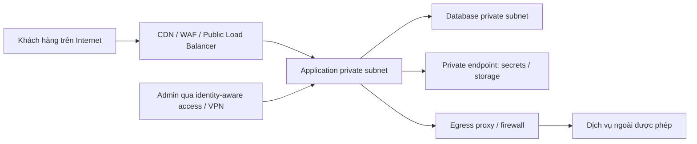
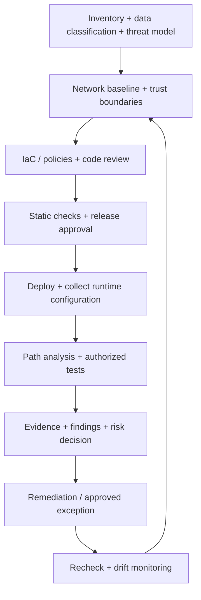

# Cloud network: Kiến trúc mạng đám mây và bằng chứng bảo đảm an toàn

## 1. Mục tiêu học tập

Sau bài này, người học có thể:

- Giải thích vai trò của **cloud network** trong mô hình bảo mật đám mây và phân biệt **kết nối mạng có tồn tại** với **khả năng truy cập thực tế**.
- Nhận diện các thành phần mạng quan trọng: VPC/VNet, subnet, route table, internet gateway, NAT, load balancer, firewall/security group, private endpoint, DNS, VPN, kết nối riêng và mạng Kubernetes.
- Thiết kế **trust boundary**, phân đoạn mạng, kiểm soát **ingress/egress**, luồng quản trị và kết nối giữa các môi trường theo nguyên tắc quyền tối thiểu.
- Xây dựng yêu cầu, baseline, phép kiểm và bằng chứng cho các network security controls; xác định giới hạn của từng nguồn quan sát.
- Thực hiện đánh giá kiến trúc, kiểm tra cấu hình, phân tích đường đi, kiểm thử kết nối có kiểm soát và phát hiện drift để tạo **cloud network assurance** liên tục.
- Xử lý các tình huống cụ thể: database bị mở public access, egress không kiểm soát, sai lệch security group, rò rỉ qua DNS và workload Kubernetes di chuyển ngang.

Bài học thuộc chương **Cloud assurance** của dịch vụ `SECURITY_SECURITY_ASSURANCE`. Phạm vi của dịch vụ là xây dựng cách đánh giá **có bằng chứng** rằng hệ thống đáp ứng mục tiêu bảo mật, từ phân tích rủi ro, yêu cầu và security controls đến kiểm thử, audit và khắc phục phát hiện. Với cloud network, bằng chứng phải phản ánh cả **cấu hình được khai báo** và **đường truy cập có hiệu lực** trong môi trường vận hành.

## 2. Cloud network là gì?

**Cloud network** là tập hợp các tài nguyên và chính sách điều khiển cách các workload, người dùng, dịch vụ quản lý, tài nguyên dữ liệu và hệ thống ngoài cloud giao tiếp với nhau. Mạng cloud bao gồm cả **data plane** (lưu lượng thực) và **control plane** (API, cấu hình, quyền quản trị thay đổi mạng).

Trong mô hình truyền thống, kỹ sư thường cấu hình router, switch và firewall vật lý. Trên cloud, nhiều phần tương ứng được cung cấp dưới dạng dịch vụ và API: subnet, virtual routing, security group, network policy, cloud firewall, private connectivity, DNS và load balancing. Điều này mang lại khả năng tự động hóa nhưng cũng khiến sai lệch lan nhanh qua template, quyền API hoặc deployment pipeline.

Ví dụ, một ứng dụng giao hàng có kiến trúc:



Ở kiến trúc này, đường công khai phục vụ khách hàng chỉ nên tới thành phần biên. Application và database có thể không cần nhận kết nối trực tiếp từ Internet. Tuy nhiên, việc gắn nhãn “private subnet” **chưa đủ** để kết luận hệ thống an toàn: còn phải xét route, các luật ingress/egress, kết nối xuyên VPC/VNet, peering, DNS, chính sách identity và quyền truy cập thông qua quản trị cloud.

### 2.1. Phân biệt cloud network security và cloud network assurance

| Khía cạnh | Cloud network security | Cloud network assurance |
|---|---|---|
| Câu hỏi | Cần bảo vệ những đường truy cập nào và bằng control gì? | Có bằng chứng rằng control được áp dụng đúng và đang hiệu lực không? |
| Đầu vào | Threat model, sơ đồ mạng, chính sách phân đoạn, yêu cầu nghiệp vụ | Baseline, trạng thái tài nguyên, kết quả kiểm thử, audit log và thông tin tài sản |
| Kỹ thuật | Security group, firewall, DNS controls, private endpoints, WAF, mTLS | Policy-as-code, đối chiếu cấu hình, reachability analysis, probing có phép, drift monitoring |
| Đầu ra | Kiến trúc và các luật bảo vệ mạng | Kết quả PASS/FAIL/UNKNOWN, bằng chứng, ngoại lệ, phát hiện và hành động khắc phục |

Một topology nhìn hợp lý vẫn có thể có đường quản trị bị mở do security group khác, ACL khác, tuyến mạng trung gian hoặc quyền điều khiển control plane không được giới hạn. Assurance đòi hỏi chứng minh các giả định này qua phép kiểm phù hợp.

## 3. Các thành phần mạng cloud và ranh giới bảo mật

### 3.1. Không gian mạng ảo, subnet và định tuyến

- **VPC/VNet:** không gian mạng ảo được quản lý trong một phạm vi tài khoản/dự án/subscription và vùng triển khai nhất định; cung cấp nền tảng địa chỉ IP, subnet, route và chính sách mạng.
- **Subnet:** phân chia dải địa chỉ cho các nhóm tài nguyên. Phân biệt public/private thường dựa trên **khả năng định tuyến và cấu hình tài nguyên**, không chỉ ở tên subnet.
- **Route table:** quyết định next hop của gói tin tới các mạng đích, như tuyến nội bộ, gateway, NAT hoặc thiết bị bảo mật.
- **Internet gateway / public endpoint:** tạo khả năng kết nối với Internet khi đi kèm điều kiện thích hợp như địa chỉ công khai, route và luật cho phép.
- **NAT:** cho phép các kết nối outbound theo mô hình mạng cụ thể; NAT không tự bảo đảm chỉ truy cập các đích an toàn và không thay thế firewall egress.
- **Peering, transit/hub network, VPN và private circuit:** nối các miền mạng, tài khoản hoặc môi trường on-premises. Mỗi kết nối tạo thêm đường đi tiềm tàng và cần kiểm soát phạm vi định tuyến.
- **Private endpoint / private service access:** cung cấp đường truy cập riêng tới dịch vụ cloud hoặc tài nguyên; vẫn cần kiểm tra DNS, IAM/resource policy và các điều kiện truy cập khác.

Không phải dịch vụ nào cũng có subnet theo cùng một cách. Dịch vụ PaaS/serverless có thể sử dụng public service endpoint, private endpoint hoặc network integration tùy tính năng và cấu hình. Không nên suy luận rằng dịch vụ PaaS đã nằm trong “private subnet” chỉ vì ứng dụng gọi nó từ private subnet.

### 3.2. Các lớp lọc lưu lượng

| Thành phần | Vai trò phổ biến | Giới hạn cần nhớ |
|---|---|---|
| Security group / virtual firewall | Kiểm soát nguồn, đích, cổng, giao thức của tài nguyên hoặc interface | Không chứng minh được ứng dụng xác thực đúng người gọi |
| Subnet ACL / network ACL | Lọc lưu lượng theo luật tại mức subnet hoặc segment | Một số nền tảng có cơ chế stateless, phải xét cả chiều trả lời |
| Managed network firewall | Kiểm soát tuyến mạng, domain, stateful inspection tùy dịch vụ | Muốn có hiệu lực cần bảo đảm lưu lượng đi qua đúng điểm kiểm soát |
| WAF | Lọc HTTP(S) theo các tín hiệu lớp ứng dụng | Không thay thế kiểm soát authorization hoặc chặn mọi tấn công |
| Load balancer / reverse proxy | Điểm vào, điều phối, TLS termination, health check | Không mặc nhiên giới hạn mọi đường truy cập khác vào backend |
| NetworkPolicy trong Kubernetes | Giới hạn traffic giữa các Pod/namespace và đích mạng tùy plugin | Chỉ có hiệu lực khi CNI thực thi; không thay thế RBAC, service mesh, firewall cloud |
| Private endpoint | Giảm phụ thuộc đường public để truy cập dịch vụ | Cần kiểm tra DNS, access policy và việc public endpoint còn được phép hay không |

**Lưu ý về khác biệt nhà cung cấp:** trên AWS, security group là cơ chế stateful, còn network ACL ở mức subnet là stateless. Các dịch vụ tương ứng trên Azure và Google Cloud có cấu trúc, thứ tự áp dụng và đặc tính khác nhau. Không sao chép một kết luận kỹ thuật giữa các nền tảng chỉ vì chúng dùng tên gọi gần giống nhau.

### 3.3. DNS và lớp danh tính

DNS ảnh hưởng trực tiếp tới đường đi và nơi đến của kết nối. Một ứng dụng dự định dùng private endpoint nhưng vẫn phân giải tên miền về địa chỉ public có thể gửi traffic ra đường không mong muốn. DNS cũng có thể bị lạm dụng làm kênh điều khiển hoặc truyền dữ liệu, tùy khả năng quan sát và chính sách egress.

Mạng giới hạn *ai có thể kết nối ở tầng mạng*, trong khi **IAM và xác thực dịch vụ** quyết định *ai được làm gì*. Ví dụ, chặn truy cập công khai tới object storage là cần thiết nhưng chưa đủ nếu identity của workload có quyền đọc tất cả bucket. Ngược lại, IAM chặt chẽ cũng không phải lý do để mở cổng cơ sở dữ liệu ra Internet không cần thiết.

## 4. Threat modeling cho cloud network

Muốn thiết kế control đúng, trước hết cần nêu rõ **tài sản, luồng dữ liệu, điểm tin cậy, quyền quản trị và hậu quả khi mất kiểm soát**.

### 4.1. Các luồng phải đưa vào threat model

1. **North–south traffic:** traffic từ Internet/đối tác/on-premises tới workload và chiều ngược lại.
2. **East–west traffic:** traffic giữa các service, pod, namespace, subnet, VPC/VNet và account.
3. **Management plane:** đường quản trị, API cloud, bastion, hệ thống vận hành, CI/CD và kết nối đến control plane.
4. **Data and secrets access:** đường từ workload đến database, object storage, KMS, secret manager và các dịch vụ nhạy cảm.
5. **DNS and external dependencies:** phân giải tên, cập nhật phần mềm, telemetry và third-party API.
6. **Disaster recovery / multi-region paths:** luồng đồng bộ, backup, restore và failover có thể mở rộng vùng truy cập.

### 4.2. Từ kịch bản đe dọa đến yêu cầu

| Kịch bản | Rủi ro | Yêu cầu kiến trúc | Phép kiểm assurance |
|---|---|---|---|
| Database truy cập được từ Internet | Truy cập trái phép, khai thác dịch vụ, rò rỉ dữ liệu | Không có public ingress; chỉ app subnet/identity được duyệt truy cập | Kiểm endpoint, route, firewall, thử đường truy cập từ nguồn được phép và bị chặn |
| App bị khai thác rồi truy cập các service khác | Lateral movement | Chỉ cho phép luồng east–west cần thiết | Phân tích security group/NetworkPolicy và thử kết nối chéo vùng |
| Workload gửi dữ liệu đến đích ngoài tùy ý | Exfiltration, C2 | Egress qua điểm kiểm soát, whitelist đích theo nhu cầu | Kiểm route, policy, log egress và thử đích bị cấm |
| Nhân viên truy cập admin endpoint từ Internet | Chiếm quyền điều hành | Quản trị qua kênh identity-aware hoặc mạng quản trị được duyệt, xác thực mạnh | Kiểm policy và thử từ nguồn quản trị/nguồn công cộng |
| Thay đổi luật mạng ngoài IaC | Mất kiểm soát và không phát hiện | Change control, quyền sửa hạn chế, drift monitoring | So runtime với baseline, audit API và ticket |
| Private endpoint phân giải sang public IP | Bỏ qua đường riêng đã thiết kế | Kiểm soát DNS/private zone; hạn chế public access khi khả dụng | DNS lookup từ workload, route và kiểm cấu hình dịch vụ |

Trong môi trường multi-tenant hoặc nhiều account, cần xem riêng ranh giới giữa các nhóm khách hàng hoặc nhóm vận hành. “Cùng nằm trong một cloud” không đồng nghĩa với “được phép truy cập lẫn nhau”.

## 5. Thiết kế kiến trúc mạng theo nguyên tắc an toàn

### 5.1. Phân vùng theo mức tin cậy và chức năng

Một kiến trúc tham chiếu có thể chia thành:

- **Edge zone:** nhận kết nối từ bên ngoài qua CDN/WAF/load balancer, có chống lạm dụng và logging phù hợp.
- **Application zone:** chạy backend; nhận traffic từ thành phần edge hoặc service đã định danh.
- **Data zone:** database, object storage, secret access; chỉ chấp nhận những luồng hẹp phục vụ nghiệp vụ.
- **Management zone:** truy cập vận hành có xác thực mạnh, có ghi log; tránh đặt cổng quản trị trực tiếp trên Internet khi không cần.
- **Shared services zone:** DNS resolver, logging collector, artifact registry, service discovery, proxy egress, backup.
- **Partner/on-premises boundary:** định tuyến và quyền cho từng kết nối liên tổ chức, tránh quảng bá CIDR quá rộng.

Chọn phân vùng dựa trên rủi ro, môi trường và luồng phụ thuộc thực. Chỉ tạo nhiều subnet mà không có chính sách east–west hoặc network boundary hữu hiệu thì chưa tạo được phân đoạn bảo mật.

### 5.2. Kiểm soát ingress

**Ingress** là lưu lượng đi vào thành phần hoặc mạng đang xét. Quy tắc tốt thể hiện rõ: *nguồn nào → đích nào → giao thức/cổng nào → vì sao được phép*. Ưu tiên định danh theo security group hoặc service identity ở nơi nền tảng hỗ trợ, giảm dùng dải địa chỉ quá rộng và những thay đổi khó bảo trì.

Ví dụ:

| Đích | Nguồn | Cổng | Kết luận thiết kế |
|---|---|---|---|
| Public load balancer | Internet | TCP/443 | Có thể hợp lệ nếu API công khai, TLS và kiểm soát ở biên đúng |
| Application | Security group của load balancer | TCP/8080 | Cho phép theo dependency |
| Database | Security group của application | TCP/5432 | Cho phép đúng bên gọi |
| Database | `0.0.0.0/0` | TCP/5432 | Không đáp ứng baseline private database |
| SSH/RDP quản trị | Internet | TCP/22 hoặc TCP/3389 | Cần đánh giá nghiêm ngặt; thường trái baseline quản trị riêng |

Một rule `0.0.0.0/0` có nghĩa cho phép **mọi địa chỉ IPv4** trong phạm vi luật, chứ chưa tự chứng minh tài nguyên tiếp cận được từ Internet. Cần xem địa chỉ public, route, policy khác và đường truyền. Kiểm tra thêm `::/0` nếu môi trường sử dụng IPv6.

### 5.3. Kiểm soát egress

**Egress** quan trọng vì workload bị khai thác thường tìm cách kết nối tới kẻ tấn công hoặc rút dữ liệu ra ngoài. “Subnet private có NAT” không đồng nghĩa với “egress đã được kiểm soát”.

Các biện pháp thường dùng:

- Mặc định hạn chế egress và chỉ cho phép những đích/giao thức cần thiết theo workload.
- Dùng egress proxy, cloud firewall, DNS policy, FQDN/domain filtering hoặc private endpoint theo khả năng nền tảng; xác minh lưu lượng thực sự đi qua điểm kiểm soát.
- Giới hạn kết nối đến metadata endpoint/credential sources đối với workload không cần và bảo vệ cơ chế cấp danh tính máy.
- Bảo vệ DNS resolver, kiểm soát khả năng dùng resolver khác; hiểu rằng domain allowlist có thể bị ảnh hưởng bởi DNS động, CDN, mã hóa DNS và thay đổi địa chỉ IP.
- Giám sát hành vi outbound, lượng dữ liệu bất thường và kết nối tới vùng hoặc đích không được phép.

Trong Kubernetes, hạn chế egress bằng NetworkPolicy cần lưu ý DNS, time synchronization, telemetry và luồng tới cloud services; vô tình chặn tất cả có thể làm hỏng ứng dụng. Để đạt an toàn thực, cần thiết kế allowlist có kiểm thử hồi quy.

### 5.4. Zero Trust và defense in depth

Nguyên tắc Zero Trust không mặc định tin cậy một kết nối chỉ vì nó xuất phát từ “mạng nội bộ”. Đối với các API nhạy cảm nên kết hợp:

1. Quy tắc đường mạng hẹp.
2. Danh tính workload/service và xác thực đầu cuối.
3. Authorization ở lớp ứng dụng hoặc dữ liệu.
4. Mã hóa truyền tải phù hợp, quản lý chứng chỉ/khóa.
5. Ghi log và giám sát cả thay đổi policy lẫn hành vi truy cập.

mTLS hoặc service mesh giúp xác thực và mã hóa dịch vụ nhưng không tự thay thế segmentation của VPC, firewall và Kubernetes NetworkPolicy. Ngược lại, network ACL cũng không bảo đảm kẻ gọi đã được phép thực hiện hành động nghiệp vụ.

## 6. Mô hình trách nhiệm và phạm vi đánh giá

Trong cloud, nhà cung cấp chịu trách nhiệm bảo vệ hạ tầng thuộc phạm vi dịch vụ của họ, còn khách hàng chịu trách nhiệm nhiều phần cấu hình mạng, quyền truy cập, workload và dữ liệu. Ranh giới cụ thể phụ thuộc mô hình IaaS, PaaS hay SaaS và thỏa thuận dịch vụ.

| Mô hình | Phần khách hàng thường cần đánh giá | Bằng chứng điển hình |
|---|---|---|
| IaaS VM | VPC/VNet, route, security group, firewall/ACL, public IP, hệ điều hành và workload | API snapshot, IaC, logs, reachability test |
| Container/Kubernetes | NetworkPolicy, ingress gateway, identity, service discovery, network plugin, cloud networking | Manifest, policy evaluation, pod/network observation, audit |
| PaaS database | Public/private accessibility, private endpoint, allowed network, TLS, identity/policy | API cấu hình dịch vụ, kết quả kết nối, audit access |
| Serverless | Function ingress/auth, VPC connector/egress, service identity, API gateway policy | Cấu hình service, connector, network tests, service logs |
| SaaS | Tenant network restrictions, IP allowlist, SSO, integrations, audit logs tùy dịch vụ | Admin settings, tenant evidence, service assurance reports |

Không thể suy từ một chứng nhận của nhà cung cấp rằng toàn bộ cấu hình khách hàng đang đạt. Báo cáo assurance của provider có thể là **bằng chứng bổ trợ** cho phần provider quản lý; kiểm tra cấu hình thực tế của tenant vẫn cần được tổ chức riêng.

## 7. Tạo baseline và các tiêu chí nghiệm thu cho cloud network

Một **cloud network baseline** cần có phiên bản, chủ sở hữu và điều kiện áp dụng. Các tiêu chí không nên quá chung như “đã cấu hình firewall” mà phải cho biết lưu lượng nào được phép và trạng thái nào là vi phạm.

Mẫu baseline mang tính minh họa:

```yaml
baseline_id: CLOUD-NET-2026-01
asset_class: production-api
owner: platform-security
rules:
  - id: NET-ING-001
    requirement: "Backend chỉ nhận request từ load balancer đã duyệt"
    expected:
      source: "sg-public-load-balancer"
      destination: "sg-backend-api"
      protocol: tcp
      port: 8080
    evaluate: "Kiểm tra rules và effective reachability"

  - id: NET-DATA-002
    requirement: "Production database không có public ingress"
    expected:
      public_endpoint: false
      ingress_only_from: "sg-backend-api"
    evaluate: "API cấu hình, route/firewall, thử đường truy cập"

  - id: NET-EGR-003
    requirement: "Workload outbound chỉ đi theo các tuyến đã duyệt"
    expected:
      allowed_destinations:
        - "private-database"
        - "private-secrets-endpoint"
        - "approved-egress-proxy"
    evaluate: "Policy, routing, telemetry egress, kiểm thử"

  - id: NET-MGMT-004
    requirement: "Không mở cổng quản trị trực tiếp cho Internet"
    expected:
      forbidden_sources: ["0.0.0.0/0", "::/0"]
      ports: [22, 3389]
    evaluate: "Ingress effective rules, IPv4/IPv6, network path"
```

Đây là **ví dụ tài liệu baseline**, chưa phải schema của công cụ cloud cụ thể. Đối với phần mềm thực, mỗi rule cần xác định các trường chuẩn hóa, nguồn dữ liệu, toán tử đánh giá, trường hợp `NOT_APPLICABLE`, mức nghiêm trọng và cách xử lý ngoại lệ.

### 7.1. Liên kết yêu cầu với rủi ro và security control

Một bản ghi có thể liên kết như sau:

```text
Rủi ro: truy cập trái phép vào database production
    ↓
Mục tiêu: không tồn tại đường truy cập public vào DB
    ↓
Control: phân đoạn data zone, kiểm ingress/route/public endpoint
    ↓
Baseline: NET-DATA-002, v2026-01
    ↓
Phép kiểm: cấu hình cloud API + path analysis + thử kết nối được phép
    ↓
Bằng chứng: kết quả tại thời điểm T, account/region/asset ID
    ↓
Kết luận: PASS / FAIL / UNKNOWN / EXCEPTION
    ↓
Finding + owner + hành động + kiểm chứng lại
```

Đối chiếu các nhóm kiểm soát trong NIST SP 800-53 như **SC-7** (Boundary Protection), **AC-4** (Information Flow Enforcement), **CM-6** (Configuration Settings), **AU-12** (Audit Record Generation) và các hướng dẫn chuyên ngành/benchmark cloud phù hợp sản phẩm. Mapping chỉ giúp truy xuất yêu cầu; không thay thế việc kiểm tra control có hiệu lực.

## 8. Đánh giá cloud network theo nhiều lớp bằng chứng

Một đợt đánh giá chỉ đọc firewall rules không thể mô tả toàn bộ trạng thái. Nên kết hợp:

### 8.1. Thiết kế và tài liệu kiến trúc

Xác minh sơ đồ luồng thực tế, trust boundary, phân vùng, cách kết nối multi-account/on-premises, hoạt động failover và thành phần chịu trách nhiệm. Kiểm tra các luồng được phép có owner, lý do nghiệp vụ, vùng dữ liệu và mức rủi ro. Dùng threat model để xác định kiểm thử quan trọng.

**Giới hạn:** sơ đồ thiết kế chứng minh ý định, không xác nhận runtime.

### 8.2. IaC / policy-as-code

Kiểm pull request, Terraform/Bicep/CloudFormation hoặc manifest phù hợp để phát hiện luật mở rộng không được duyệt, public IP ngoài thiết kế, tuyến kết nối rộng, DNS không đúng hoặc policy gắn sai đối tượng. Có thể tổ chức gate CI để chặn một số vi phạm trước khi triển khai.

**Giới hạn:** IaC có thể chưa triển khai, triển khai sai tài khoản hoặc bị sửa trực tiếp qua console/API.

### 8.3. Kiểm tra control plane thực tế

Truy vấn network configuration qua cloud API: route table, security group, NACL/firewall, public IP, endpoint access, load balancer listener, DNS zone, peering/transit attachments, VPN và IAM quyền thay đổi mạng. Đối chiếu với inventory, environment và baseline có hiệu lực.

**Giới hạn:** cấu hình không luôn phản ánh hết khả năng truy cập do policy chồng lớp, runtime behavior hoặc thay đổi chưa hội tụ.

### 8.4. Path analysis và kiểm tra data plane

- **Reachability/path analysis:** phân tích đồ thị mạng và chính sách để trả lời liệu gói tin từ một nguồn có *đường khả thi* đến đích/cổng không. Một số cloud có công cụ tương ứng; cần hiểu phạm vi và những yếu tố công cụ mô phỏng.
- **Connection testing:** từ vị trí kiểm soát xác định trước, thử luồng được phép và luồng phải bị chặn. Phải bao gồm IPv4/IPv6 nếu áp dụng.
- **Application-level verification:** nếu yêu cầu bao gồm TLS/mTLS, authorization hoặc kiểm soát API, đánh giá thêm ở tầng tương ứng.
- **Flow logs / traffic telemetry:** xác nhận traffic quan sát được, xu hướng bất thường và điểm tập trung egress.

**Giới hạn:** thử kết nối thất bại tại một thời điểm không đủ để chứng minh mọi nguồn đều bị chặn; thử thành công cũng cần xét nguồn có được phép không. Flow log thường cung cấp metadata chứ không phải nội dung gói tin và có giới hạn do phạm vi cấu hình/độ trễ/định dạng của từng dịch vụ.

### 8.5. Change history và assurance liên tục

Liên kết cấu hình hiện tại với commit, change ticket, actor thực hiện API, thời điểm thay đổi và bằng chứng kiểm thử sau phát hành. Theo dõi configuration drift và các thay đổi route, public endpoint, policy mạng ngoài quy trình.

Một đánh giá tốt trả lời hai câu hỏi tách biệt: **cấu hình đúng theo baseline không?** và **trạng thái hiệu lực có đáp ứng giả định của threat model không?**

## 9. Ví dụ thực hành 1: Assurance cho database production

**Bối cảnh:** ứng dụng `orders-api` chạy trong private application subnet; database PostgreSQL production phải chỉ chấp nhận kết nối TCP/5432 từ application và nhân sự quản trị thông qua luồng quản trị được duyệt. Không có đường public inbound trực tiếp tới database.

### 9.1. Bảng kiểm theo control

| Hạng mục | Mong đợi | Bằng chứng cần thu |
|---|---|---|
| Public endpoint | Database không public khi baseline yêu cầu private | API metadata của managed DB, public IP/endpoint |
| Route | Data subnet không có tuyến public inbound khả thi | Route table, peering/transit/VPN connections |
| Ingress | Chỉ nhóm app và luồng admin được duyệt được truy cập TCP/5432 | SG/firewall effective rules, source identity |
| Egress từ database | Giới hạn tới những dịch vụ thật sự cần | Effective routes/firewall, dependency map |
| DNS | Tên database phân giải đúng private endpoint từ app | Truy vấn DNS từ ứng dụng, private zone config |
| TLS & identity | Client xác minh server và đăng nhập theo quyền cần thiết | Cấu hình driver/TLS, database access policy và test |
| Audit | Thay đổi endpoint/rule và phiên truy cập quan trọng được ghi lại | Cloud audit events, DB logs, quyền xem log |

### 9.2. Tình huống sai lệch

Khi kiểm tra, đội bảo mật tìm thấy:

- Cấu hình trong IaC vẫn để database private.
- Managed database API cho biết public endpoint đã được bật.
- Security group cho TCP/5432 từ `0.0.0.0/0`.
- Không có change ticket tương ứng.

Đây là **finding nghiêm trọng về cấu hình**, cần nhanh chóng xác minh đường truy cập hiệu lực. Tài nguyên có public endpoint và rule mở rộng không tự chứng minh mọi nguồn Internet đều kết nối được; vẫn có thể bị chặn bởi các lớp khác. Nhưng việc vi phạm baseline đã đủ để mở finding và triển khai biện pháp khắc phục theo playbook.

Quy trình khắc phục nên gồm: đánh giá có traffic bất thường hay không, thu hẹp/quay về private access, xem lại actor thay đổi, xác minh từ nguồn hợp lệ và không hợp lệ, cập nhật control chống tái diễn, rồi lưu bằng chứng mới. Nếu có dấu hiệu lạm dụng, chuyển sang quy trình ứng phó sự cố.

### 9.3. Định nghĩa nghiệm thu sau sửa

Một finding chỉ nên được đóng khi:

1. Cloud API cho thấy public access đã bị vô hiệu hóa theo baseline.
2. Effective network rules và routes không còn đường public trái phép.
3. `orders-api` vẫn kết nối hợp lệ bằng giao thức và danh tính đúng yêu cầu.
4. Kết nối thử từ nguồn không được phép bị từ chối, trong phạm vi kiểm thử đã định.
5. Audit/change record và bằng chứng kiểm tra lại được liên kết với finding.

Không được lấy việc sửa file Terraform làm bằng chứng duy nhất rằng runtime đã thay đổi thành công.

## 10. Ví dụ thực hành 2: NetworkPolicy cho Kubernetes

Kubernetes là ví dụ điển hình của **east–west segmentation**. Nếu các Pod không được kiểm soát đường mạng, một ứng dụng bị xâm nhập có thể tìm cách kết nối đến những service khác trong cluster.

Giả sử ở namespace `payments` có ba nhóm workload: `gateway`, `api` và `database`. Yêu cầu: `api` chỉ nhận TCP/8080 từ `gateway` và chỉ mở outbound TCP/5432 đến `database`. Có thể diễn đạt một phần baseline bằng Kubernetes NetworkPolicy:

```yaml
apiVersion: networking.k8s.io/v1
kind: NetworkPolicy
metadata:
  name: payments-api-traffic
  namespace: payments
spec:
  podSelector:
    matchLabels:
      app: api
  policyTypes:
    - Ingress
    - Egress
  ingress:
    - from:
        - podSelector:
            matchLabels:
              app: gateway
      ports:
        - protocol: TCP
          port: 8080
  egress:
    - to:
        - podSelector:
            matchLabels:
              app: database
      ports:
        - protocol: TCP
          port: 5432
```

Ý nghĩa:

- Chỉ Pod có nhãn `app: api` trong namespace `payments` mới là đối tượng của policy.
- `podSelector` trong `from` và `to` ở ví dụ này chọn Pod **cùng namespace** với NetworkPolicy.
- Policy hạn chế các luồng TCP quy định, nhưng không tự tạo DNS egress, telemetry hay luồng khác. Nếu ứng dụng cần những kết nối đó, phải bổ sung rule được duyệt.
- Đây không phải network isolation của *toàn bộ namespace*; các Pod khác cần policy phù hợp riêng.
- NetworkPolicy có hiệu lực hay không phụ thuộc CNI/network plugin hỗ trợ thực thi. Một số luồng qua host network, node hoặc gateway có thể chịu cách xử lý khác tùy nền tảng.
- Policy chỉ kiểm soát mạng L3/L4 trong phạm vi API hỗ trợ, không thay thế chứng thực service hoặc phân quyền database.

### 10.1. Bằng chứng để đánh giá Kubernetes network

```bash
kubectl -n payments get networkpolicy payments-api-traffic -o yaml
kubectl -n payments get pods --show-labels
kubectl -n payments get services
```

Đây là những lệnh đọc cấu hình trên cluster đã được cấp quyền. Dùng kết quả để xác nhận label selector thực tế và network policy đã hiện diện. Cần kiểm tra chính sách của CNI, các policy khác có thể bổ sung lưu lượng được phép và trạng thái workload đang chạy.

Đối với network policy, nhiều quy tắc có thể hợp nhất theo ngữ nghĩa cho phép; một policy hạn chế không bảo đảm một policy khác không mở thêm traffic. Đánh giá phải xét **tập policy hiệu lực** cho Pod, không chỉ một file.

Sau đó, từ nguồn thử nghiệm được phép, kiểm tra các ca:

| Ca thử | Nguồn → Đích | Kỳ vọng |
|---|---|---|
| NP-01 | Gateway → API:8080 | Cho phép |
| NP-02 | Pod không được ủy quyền → API:8080 | Bị chặn |
| NP-03 | API → Database:5432 | Cho phép |
| NP-04 | API → Pod khác:5432 | Bị chặn nếu không có rule khác cho phép |
| NP-05 | API → DNS resolver | Phụ thuộc rule DNS bổ sung và kiến trúc cluster |

Chỉ thử các địa chỉ/đích đã được phép trong môi trường kiểm thử hoặc theo quy trình production thích hợp; ghi lại nguồn thử, thời điểm, kết quả và phạm vi để tránh suy diễn “toàn bộ cluster đã được chặn”.

## 11. Ví dụ thực hành 3: Phát hiện drift của cloud firewall

Một nhóm quản trị luật mạng theo phiên bản IaC. Rule baseline ghi rõ “cổng 22 chỉ cho phép từ dải VPN của tổ chức”. Runtime API cho thấy một rule bổ sung cho phép TCP/22 từ `0.0.0.0/0`.

Bộ phát hiện có thể đối chiếu hai tập luật đã chuẩn hóa:

```json
{
  "asset": "production-admin-security-group",
  "baseline_version": "CLOUD-NET-2026-01",
  "expected": [
    {"direction": "ingress", "protocol": "tcp", "port": 22, "source": "10.8.0.0/16"}
  ],
  "observed": [
    {"direction": "ingress", "protocol": "tcp", "port": 22, "source": "10.8.0.0/16"},
    {"direction": "ingress", "protocol": "tcp", "port": 22, "source": "0.0.0.0/0"}
  ]
}
```

Một mô hình đánh giá tối thiểu:

```python
import ipaddress
import json
from pathlib import Path


def canonical_rule(rule):
    return (
        rule["direction"].lower(),
        rule["protocol"].lower(),
        int(rule["port"]),
        str(ipaddress.ip_network(rule["source"], strict=False)),
    )


snapshot = json.loads(
    Path("network-snapshot.json").read_text(encoding="utf-8")
)
expected = {canonical_rule(rule) for rule in snapshot["expected"]}
observed = {canonical_rule(rule) for rule in snapshot["observed"]}

unexpected = sorted(observed - expected)
missing = sorted(expected - observed)

print("Unexpected rules:", unexpected)
print("Missing rules:", missing)
print("Policy match:", not unexpected and not missing)
```

Với snapshot minh họa, `unexpected` chứa luật SSH công khai. Đó là một **tín hiệu drift**. Bộ kiểm thực tế còn cần xử lý IPv6, port range, rule theo source security group, rule kế thừa, egress, trạng thái nguồn dữ liệu và các trường hợp thiếu quyền đọc. Đoạn mã trên chỉ đọc file JSON, không đụng tới cloud API hay thay đổi firewall.

### 11.1. Ngữ nghĩa kết quả

- `PASS`: quy tắc áp dụng đã được kiểm chứng với dữ liệu đủ tin cậy trong phạm vi đo.
- `FAIL`: sai lệch trái baseline được xác nhận từ nguồn thích hợp.
- `UNKNOWN`: không thu được cấu hình hoặc không đánh giá được quyền/đường đi hiệu lực.
- `NOT_APPLICABLE`: quy tắc không áp dụng cho loại tài sản/môi trường đó.
- `EXCEPTION_APPROVED`: có sai lệch nhưng đã được chấp nhận rủi ro có thời hạn; không ghi thành PASS.
- `PENDING_ROLLOUT`: trong cửa sổ thay đổi đã duyệt, cần kiểm tra lại khi hết hạn.

Không bao giờ coi collector mất quyền truy vấn là “không phát hiện vi phạm”. Với một security group đang chạy production, `UNKNOWN` phải kích hoạt xử lý độ bao phủ hoặc telemetry.

## 12. DNS, private endpoints và những đường đi khó nhìn thấy

### 12.1. Kiểm chứng tên miền và private endpoint

Một ứng dụng được cấu hình dùng managed database hoặc object storage qua private endpoint. Cần xác minh:

1. DNS resolution từ **chính workload hoặc subnet nguồn** trả về địa chỉ/đích đúng theo thiết kế.
2. Private endpoint/route được gắn với đúng network và được cho phép bởi policy.
3. Tài nguyên đích có chính sách IAM/resource policy phù hợp.
4. Nếu yêu cầu “chỉ private”, public endpoint và đường public thay thế đã bị hạn chế theo khả năng của dịch vụ.
5. Dòng lưu lượng có thể kiểm chứng qua log hoặc thử kết nối có phép.

Việc hostname trả về private IP chưa chứng minh kết nối an toàn nếu identity truy cập quá rộng hoặc tài nguyên có đường public khác vẫn mở.

### 12.2. Egress DNS và metadata service

DNS policy cần được xem xét riêng vì ứng dụng có thể phân giải tên qua nhiều resolver hoặc cơ chế DNS mã hóa. Biện pháp lọc domain chỉ có hiệu lực với traffic đi qua hệ thống kiểm soát tương ứng. Với cloud metadata endpoint, hạn chế truy cập không cần thiết, tuân thủ cơ chế bảo vệ metadata của nhà cung cấp và giảm quyền của workload identity.

### 12.3. Kết nối xuyên account, region và on-premises

Khi dùng peering, transit gateway/hub, VPN hoặc private circuit, câu hỏi cần kiểm tra gồm:

- Có route quảng bá quá rộng hoặc transitive path làm lộ data zone?
- Hai CIDR chồng lấn có gây NAT/routing không dự kiến?
- Chính sách định tuyến có khiến traffic vượt qua vùng kiểm soát egress?
- Truy cập của đối tác có còn phù hợp sau khi hợp đồng/quyền thay đổi?
- Failover giữa region có giữ mức bảo vệ tương đương không?

Một đường kết nối private về mặt vật lý hoặc nhà cung cấp không tự đảm bảo dữ liệu được mã hóa hay người gọi được xác thực đúng. Cần làm rõ từng lớp đảm bảo theo threat model.

## 13. Quan sát, logging và kiểm chứng dữ liệu mạng

### 13.1. Nhóm telemetry cần kết hợp

| Nguồn | Chứng minh được | Giới hạn |
|---|---|---|
| Cloud config snapshot | Đối tượng và rule đã cấu hình tại thời điểm thu | Chưa phản ánh toàn bộ trạng thái hiệu lực |
| Cloud audit log | Ai/API nào thay đổi network, thời điểm và thông tin thay đổi | Không tự xác nhận traffic đã đi qua |
| VPC/VNet flow log | Metadata kết nối đã quan sát trong phạm vi bật logging | Không cung cấp đầy đủ payload; có độ trễ và giới hạn |
| Firewall/WAF log | Quyết định lọc tại điểm kiểm soát cụ thể | Nếu traffic không đi qua thì log không có |
| DNS query log | Tên miền được hỏi tại resolver đang quan sát | Không phải mọi kết nối đều dùng resolver đó |
| Application access log | Request, danh tính ứng dụng và kết quả nghiệp vụ | Không mô tả toàn bộ luồng L3/L4 |
| Network test evidence | Kết quả thử đường đi từ một nguồn tới một đích | Chỉ chứng minh trường hợp, thời điểm, điều kiện đo |

Tránh diễn giải “không thấy lưu lượng trong flow log” là “không có đường truy cập”. Có thể đơn giản là chưa có request, phạm vi logging chưa bật hoặc telemetry chưa được thu đủ.

### 13.2. Bảo vệ dữ liệu quan sát

Network telemetry có thể chứa IP nội bộ, domain, đường dẫn, định danh dịch vụ và thông tin vận hành. Cần phân quyền xem, quy định thời hạn lưu, phân loại dữ liệu và tránh đưa thông tin nhạy cảm vào dashboard công khai. Với packet capture hoặc TLS inspection, phải đánh giá tính cần thiết và ảnh hưởng quyền riêng tư, hiệu năng, bảo mật khóa.

### 13.3. Kết hợp phép kiểm chủ động và thụ động

- **Thụ động:** truy vấn API, phân tích audit/flow log, drift monitoring.
- **Chủ động:** path analysis, thử kết nối và kiểm tra TLS/authorization có phép.
- **Thiết kế:** xem threat model, tài liệu baseline, diagram và phê duyệt.

Ba nguồn chứng cứ có thể bổ trợ và phát hiện mâu thuẫn lẫn nhau. Ví dụ baseline nói data zone không có public ingress, config API nói có luật ingress rộng, nhưng thử từ một nguồn Internet bị timeout. Kết luận phù hợp là “có vi phạm cấu hình, khả năng tiếp cận từ nguồn đã thử chưa xác nhận”; không được tự sửa thành PASS.

## 14. Tổ chức cloud network assurance theo vòng đời



### 14.1. Trước triển khai

Thiết kế dựa trên dependency map, mở kết nối cần thiết theo luồng nghiệp vụ cụ thể. Mọi thay đổi ingress/egress, routing hoặc identity có tác động phải có change record, người chịu trách nhiệm và phân tích ảnh hưởng. Dùng review + policy-as-code ở pipeline để ngăn vi phạm rõ ràng như database public hoặc cổng quản trị mở toàn Internet.

### 14.2. Sau triển khai

Thu cấu hình thực và đối chiếu với baseline áp dụng cho tài sản. Sử dụng network path analysis, test có kiểm soát và telemetry để xác nhận các đường quan trọng. Báo cáo độ bao phủ, không chỉ tỷ lệ rule PASS. Nếu không có quyền thu thập hoặc tài sản chưa được kiểm kê, phải ghi nhận `UNKNOWN` và xử lý.

### 14.3. Khi có thay đổi

Nhận event từ audit API, IaC apply hoặc hệ thống quản lý để đánh giá ngay tài sản bị tác động; kết hợp quét toàn bộ định kỳ để bắt sai lệch bỏ lọt. Mọi sửa chữa nên được đưa về nguồn cấu hình được quản lý, kiểm thử sau sửa và bổ sung guardrail phòng ngừa tái diễn.

### 14.4. Khi xảy ra sự cố mạng

Trong tình huống nghi ngờ truy cập trái phép, phải xem cả **dòng mạng** và **quyền IAM/control plane**. Kẻ tấn công có thể thay đổi security group hoặc route qua API cloud. Tạm chặn một tuyến mạng có thể giảm tác động nhưng chưa đủ nếu credential dùng để sửa luật vẫn còn hiệu lực. Quy trình khắc phục cần phối hợp với ứng phó sự cố, thu hồi quyền/token khi cần và bảo toàn bằng chứng điều tra.

## 15. Bằng chứng đánh giá và báo cáo kết quả

Một record kết quả cần có: tài sản, phạm vi mạng, phiên bản baseline và rule, expected/observed, cách kiểm, nguồn, thời điểm, kết quả, ngoại lệ, phát hiện và người chịu trách nhiệm.

Ví dụ bản ghi **minh họa, không phải kết quả đo thực tế**:

```yaml
assessment_id: CLOUD-NET-ASMT-2026-011
asset_id: orders-db-prod
cloud_scope: "account-prod / region-a / vpc-app"
environment: production
baseline_id: CLOUD-NET-2026-01
rule_id: NET-DATA-002
expected: "Không có public inbound đến PostgreSQL"
observed: "Public endpoint bật; TCP/5432 từ 0.0.0.0/0"
status: FAIL
checked_at: "2026-11-28T03:40:00Z"
collector: "cloud-network-auditor/1.3"
evidence_refs:
  - "evidence://cloud-network/assessment-011/config"
  - "evidence://cloud-network/assessment-011/path-analysis"
owner: database-platform-team
finding_id: "NET-FINDING-2026-044"
remediation_status: OPEN
```

Cần bảo vệ bằng chứng bằng quyền truy cập thích hợp, lưu phiên bản công cụ, nguồn dữ liệu, tham số truy vấn, phạm vi test và dấu thời gian. Nếu dữ liệu chứa thông tin nhạy cảm, nên trích xuất trường cần thiết và tham chiếu tới kho bằng chứng an toàn thay vì đính kèm output thô cho người không có quyền.

### 15.1. Chất lượng của bằng chứng

| Đặc tính | Câu hỏi đánh giá |
|---|---|
| Đúng tài sản | Có ID tài nguyên, tenant/account, region, VPC/subnet/namespace? |
| Đúng baseline | Có phiên bản rule, điều kiện áp dụng và phê duyệt? |
| Đủ độ bao phủ | Đã xem ingress, egress, IPv4/IPv6, các tuyến phụ, multi-account? |
| Đúng thời điểm | Bằng chứng còn phản ánh trạng thái runtime hiện tại? |
| Đúng ngữ nghĩa | Chứng minh cấu hình hay khả năng truy cập hiệu lực? |
| Có thể tái lập | Có phương thức, nguồn, phiên bản công cụ và tham số kiểm tra? |
| Có thể tin cậy | Bằng chứng có hạn chế quyền sửa và audit trail thích hợp? |
| Có theo dõi xử lý | Có finding, owner, SLA, ngoại lệ và recheck sau sửa? |

### 15.2. Đóng finding và quản lý ngoại lệ

Một phát hiện chưa được sửa vì lý do nghiệp vụ phải có chủ tài sản, người chấp nhận rủi ro đủ thẩm quyền, lý do, biện pháp bù trừ, thời hạn và kế hoạch khắc phục. Nếu được chấp nhận có thời hạn thì ghi `EXCEPTION_APPROVED`, không chuyển thành PASS. Khi hết hạn, đánh giá lại. Đối với finding đã sửa, lưu bằng chứng **trước và sau**, có thể đối chiếu để chứng minh control được khôi phục.

## 16. Chỉ số và lỗi đánh giá phổ biến

### 16.1. Các chỉ số vận hành

| Chỉ số | Ý nghĩa |
|---|---|
| Network asset coverage | Tỷ lệ tài sản thuộc phạm vi đã nhận diện, có owner và baseline phù hợp |
| Assessment coverage | Tỷ lệ đối tượng cần đánh giá đã được kiểm tra thành công trong chu kỳ |
| Public exposure findings | Số tài sản/dịch vụ lộ public ngoài baseline, phân theo mức rủi ro |
| Excessive-rule rate | Tỷ lệ luật nguồn/đích/quyền mạng rộng hơn nhu cầu được duyệt |
| Drift detection latency | Thời gian từ thay đổi ngoài quy trình đến phát hiện |
| Remediation time | Thời gian phát hiện → sửa xong và được kiểm chứng |
| Exception aging | Số ngoại lệ còn hiệu lực, sắp hết hạn và quá hạn |
| Evidence freshness | Độ mới của dữ liệu cấu hình/luồng so với thời điểm báo cáo |

Ví dụ: 200 tài sản phải kiểm tra, công cụ chỉ đánh giá thành công 160, trong đó 12 có finding. Báo cáo phải nói rõ **80% assessment coverage** và **12/160 tài sản đã kiểm tra có finding**; không thể khẳng định 94% toàn bộ tài sản đã an toàn. Các tài sản không được kiểm tra là khoảng trống assurance cần xử lý.

### 16.2. Những sai lầm dễ gặp

1. **Đánh đồng private subnet với an toàn:** bỏ qua peering, route, endpoint, management access và IAM.
2. **Chỉ kiểm IPv4:** bỏ sót IPv6 `::/0` hoặc những địa chỉ public khác.
3. **Cho rằng không mở ingress là không có rủi ro:** egress rộng vẫn có thể cho phép C2 hoặc rò rỉ dữ liệu.
4. **Chỉ nhìn một security group:** quên luật khác, NetworkPolicy khác hoặc các lớp cloud firewall.
5. **Đánh đồng WAF với firewall và authorization:** control khác lớp không thay thế lẫn nhau.
6. **Tin vào file IaC mà không kiểm runtime:** thay đổi qua console/API có thể làm hệ thống lệch baseline.
7. **Bỏ qua DNS/private endpoint:** DNS sai khiến ứng dụng đi tuyến khác thiết kế.
8. **Cho rằng không có log nghĩa là không có truy cập:** thiếu telemetry, không có request trong thời gian đo hoặc log không đủ phạm vi.
9. **Bỏ qua quyền thay đổi control plane:** principal có quyền sửa mạng có thể vô hiệu hóa policy dù rules hiện tại đang đúng.
10. **Tự động gỡ rule mà không đánh giá tác động:** có thể chặn tuyến dự phòng hoặc luồng khẩn cấp hợp lệ.
11. **Báo FAIL mà không có owner và bằng chứng:** cảnh báo nhiều nhưng không thể kiểm tra hay xử lý thực tế.
12. **Báo PASS cho tài sản chưa được quét:** làm sai lệch tỷ lệ assurance và che khuất blind spot.

## 17. Bài tập: Đánh giá mạng cloud của một ứng dụng thương mại

Một hệ thống có kiến trúc:

- Public load balancer cung cấp HTTPS cho người dùng.
- Hai nhóm application instances chạy private subnet.
- Managed PostgreSQL ở data zone.
- Storage và secret manager truy cập qua private endpoint nếu khả dụng.
- Kết nối on-premises qua VPN.
- Log mạng được thu thập tập trung.

Trong đợt review có năm phát hiện:

| Mã | Quan sát |
|---|---|
| A | Database có security group inbound TCP/5432 từ `0.0.0.0/0` |
| B | Application outbound TCP tới mọi địa chỉ Internet, chưa có danh sách dependency |
| C | DNS từ application phân giải tên object storage về public endpoint |
| D | Một service account có quyền sửa toàn bộ security group và route table, không có nhu cầu quản trị |
| E | Flow log chưa được bật ở một VPC mới, nhưng dashboard hiển thị 100% “network secure” |

**Yêu cầu:**

1. Phân loại rủi ro từng phát hiện; ghi rõ thông tin nào còn thiếu trước khi kết luận đường truy cập hiệu lực.
2. Với A, thiết kế cách xác minh bằng cấu hình + path analysis + thử kết nối từ nguồn được phép và không được phép.
3. Với B và C, xác định dependency map và cách kiểm soát egress/DNS mà vẫn duy trì hoạt động ứng dụng.
4. Với D, đề xuất ranh giới IAM và dấu vết audit cần theo dõi để hạn chế khả năng sửa security controls.
5. Với E, thiết kế cách tính assessment coverage và cách biểu diễn `UNKNOWN` để báo cáo không gây hiểu lầm.
6. Tạo ba baseline rules với `rule_id`, phạm vi, expected value, phương pháp kiểm, mức độ ưu tiên, owner và tiêu chí đóng finding.
7. Chỉ ra cần lưu những bằng chứng nào trước và sau khắc phục.

**Gợi ý tự đánh giá:**

- **A:** rule ingress trái baseline cần ưu tiên xử lý; kiểm public endpoint/route để xác định tiếp cận thực. Không chờ chứng minh khai thác thành công mới sửa cấu hình yếu.
- **B:** egress quá rộng là rủi ro; phải thống kê dependency, đưa đường outbound qua điểm kiểm soát phù hợp, kiểm thử thay đổi.
- **C:** có thể là lỗi DNS/private endpoint; cần kiểm hostname resolution, route, access policy và public access settings.
- **D:** là rủi ro control plane; quyền sửa mạng phải được cấp theo công việc và chịu phê duyệt/giám sát.
- **E:** coverage chưa đầy đủ; gắn trạng thái `UNKNOWN` cho phạm vi thiếu telemetry, sửa pipeline báo cáo.
- Finding chỉ được đóng sau khi có **runtime evidence** khớp baseline và các luồng nghiệp vụ hợp lệ tiếp tục hoạt động.

## 18. Tổng kết

Bảo vệ cloud network đòi hỏi hiểu cả **đường đi của gói tin** lẫn **quyền thay đổi cấu hình**. Baseline phải bao phủ ingress, egress, trust boundaries, DNS, kết nối riêng, quản trị, IPv4/IPv6 và trường hợp nhiều account/region. Network security chỉ thực sự được bảo đảm khi có **bằng chứng theo thời điểm**: cấu hình được duyệt, nguồn dữ liệu runtime, phân tích đường khả thi, kiểm thử có phép, log phù hợp và khả năng truy vết thay đổi.

Trong chương trình `SECURITY_SECURITY_ASSURANCE`, mục tiêu không phải đếm bao nhiêu firewall rule được cấu hình, mà là **chứng minh hệ thống đang đáp ứng các yêu cầu bảo mật đã xác định, biết rõ phần chưa đánh giá được và khắc phục những sai lệch có tác động**. Câu hỏi kết thúc mỗi lần đánh giá nên là: **đã kiểm tra luồng nào, trên tài sản nào, theo baseline nào, bằng phương pháp nào, vào thời điểm nào và còn rủi ro nào cần xử lý?**
