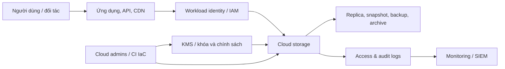
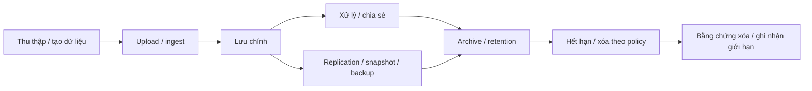
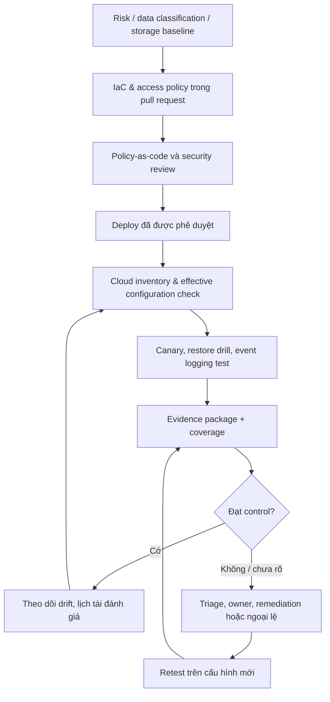

# Cloud Storage Assurance: đánh giá bảo mật lưu trữ đám mây bằng bằng chứng

## 1. Mục tiêu và bối cảnh

**Cloud storage** là các dịch vụ lưu trữ dữ liệu trên hạ tầng đám mây, thường gồm **object storage** (đối tượng trong bucket/container), **block storage** (ổ đĩa gắn với máy ảo hoặc workload), **file storage** (hệ thống tệp chia sẻ) và các bản sao lưu, snapshot hoặc archive liên quan. Mỗi dạng có mô hình quyền, cách truy cập, mức độ quản lý và đặc tính khôi phục khác nhau.

Trong chương **Cloud assurance** của module **SECURITY_SECURITY_ASSURANCE**, nhiệm vụ không chỉ là chọn cấu hình bảo mật hợp lý. Nhóm phải **chứng minh bằng bằng chứng** rằng hệ thống lưu trữ đáp ứng các yêu cầu bảo mật đã xác định: người đúng quyền được truy cập, dữ liệu được bảo vệ, hoạt động quan trọng có thể truy vết, bản sao có thể khôi phục và phát hiện được cấu hình sai hoặc thay đổi ngoài quy trình. Điều này liên kết quản lý rủi ro, security controls, kiểm thử, audit và xử lý phát hiện thành một chương trình assurance liên tục.

Sau bài học, người học có thể:

1. Phân biệt các mô hình lưu trữ cloud, tài sản cần bảo vệ và ranh giới trách nhiệm.
2. Xây dựng yêu cầu kiểm chứng cho **confidentiality, integrity, availability**, dữ liệu cá nhân và vòng đời dữ liệu.
3. Đánh giá quyền có hiệu lực, truy cập công khai, chia sẻ giữa tài khoản/tenant và URL cấp quyền tạm thời.
4. Kiểm tra mã hóa, quản lý khóa, retention, versioning, backup và khả năng khôi phục.
5. Thu thập bằng chứng từ cấu hình thực tế, kiểm thử hành vi, audit events và hồ sơ xử lý phát hiện.
6. Thiết kế cơ chế giám sát liên tục để phát hiện drift, kiểm tra lại sau thay đổi và hỗ trợ quyết định phát hành.

**Phạm vi bài học:** tập trung vào bảo đảm an toàn dữ liệu lưu trữ trong cloud. Những ví dụ về object storage được dùng để học phương pháp; các điều kiện cần áp dụng phù hợp với block/file storage và đặc thù dịch vụ. Không coi một cấu hình mẫu là chính sách bắt buộc cho mọi tài sản.

## 2. Nhận diện loại storage và mô hình trách nhiệm

| Loại | Cách sử dụng điển hình | Bề mặt rủi ro cần ưu tiên |
|---|---|---|
| **Object storage** | Ảnh, tài liệu, artifact, log, data lake, backup file | Bucket/container policy, access key, object ACL, public endpoint, signed URL, lifecycle |
| **Block storage** | Disk máy ảo, database disk, volume workload | Snapshot, quyền gắn volume, encryption, backup, dữ liệu còn lại khi tháo disk |
| **File storage** | Shared file system cho ứng dụng, NAS managed | Network share, file permission/ACL, identity mapping, mount policy, snapshot |
| **Archive / cold storage** | Lưu bằng chứng, dữ liệu lâu năm, backup lạnh | Retention, khôi phục chậm, quyền xóa, chi phí retrieval, tính toàn vẹn |
| **Storage trong dịch vụ quản lý** | Snapshot hoặc export database, artifact CI, file của SaaS | Quyền xuất dữ liệu, vị trí sao lưu, retention, hợp đồng/trách nhiệm provider |

Một dịch vụ có thể hỗ trợ nhiều cấp lưu trữ hoặc cơ chế chia sẻ. Vì vậy trước khi áp dụng baseline, cần biết **dữ liệu được đọc/ghi thông qua API nào**, ai sở hữu phiên bản và phần nào do provider quản lý.

### 2.1. Shared responsibility

Nhà cung cấp thường bảo vệ các thành phần hạ tầng mà họ vận hành; khách hàng phải cấu hình đúng **identity, access policy, dữ liệu, key management, exposure, logging, retention, backup và tích hợp** trong phạm vi dịch vụ cho phép. Mức chia sẻ trách nhiệm thay đổi theo sản phẩm và mô hình IaaS/PaaS/SaaS. Không suy ra rằng “managed storage” mặc định có bộ quyền và lịch lưu trữ đúng chính sách tổ chức.

Ví dụ, provider có thể bảo vệ độ bền vật lý của object theo đặc tính dịch vụ, nhưng **việc người dùng có quyền xóa mọi object**, việc đặt bucket public hoặc việc mất quyền dùng khóa do khách hàng quản lý vẫn có thể khiến dữ liệu không còn truy cập được.

### 2.2. Ba cấp độ kiểm chứng

| Cấp độ | Câu hỏi | Bằng chứng điển hình |
|---|---|---|
| **Thiết kế mong muốn** | Baseline/policy và IaC yêu cầu gì? | Security requirement, IaC, policy version, PR review |
| **Trạng thái quan sát** | Cloud API hiện báo tài nguyên được cấu hình thế nào? | Resource inventory, IAM/resource policies, encryption/lifecycle settings và timestamp |
| **Hành vi có hiệu lực** | Actor được phép/không được phép thực sự đọc, ghi hoặc xóa được không? | Test với dữ liệu canary, principal riêng, log, request ID, kết quả restore |

Không được dùng **một cờ cấu hình** để khẳng định an toàn của toàn hệ thống. Chẳng hạn bucket không public qua ACL có thể vẫn lộ qua một policy hoặc ứng dụng trung gian; storage đã mã hóa có thể vẫn bị một principal quá quyền đọc dữ liệu qua API hợp lệ.

## 3. Lập threat model cho dữ liệu lưu trữ

Một bài đánh giá storage nên bắt đầu bằng **dữ liệu và đường đi**, thay vì mở dashboard rồi đếm cảnh báo.



Sơ đồ làm lộ nhiều **trust boundary**: người dùng đến ứng dụng, ứng dụng đến storage, principal quản trị đến policy, storage đến bản sao/backup, và dữ liệu sự kiện đến hệ thống log. Một control chỉ bảo vệ đường truy cập trực tiếp vào bucket có thể bỏ qua dữ liệu được chia sẻ qua CDN, ứng dụng hoặc backup.

### 3.1. Phân loại tài sản và tác động

Với mỗi dataset, ghi rõ:

- **Loại dữ liệu:** công khai, nội bộ, bí mật kinh doanh, dữ liệu cá nhân, credential, log bảo mật, bằng chứng audit.
- **Mức ảnh hưởng:** lộ dữ liệu, bị sửa, bị xóa, không thể khôi phục, bị giữ quá hạn hoặc chuyển sang vùng không được phép.
- **Owner và người dùng hợp lệ:** service nào đọc/ghi, ai có quyền quản trị, đối tác hoặc tenant nào được chia sẻ.
- **Vòng đời:** tạo, truyền lên, lưu, xử lý, chia sẻ, sao chép/backup, archive và xóa.
- **Yêu cầu phục hồi:** mục tiêu điểm khôi phục (RPO), thời gian khôi phục (RTO), retention và trường hợp cần chống xóa.

Ví dụ, một bucket chứa ảnh sản phẩm công khai có thể được cho phép đọc rộng rãi nhưng cấm ghi từ Internet. Một bucket chứa bản sao cơ sở dữ liệu khách hàng cần giới hạn quyền nghiêm ngặt, mã hóa theo policy, log phù hợp và biện pháp phục hồi độc lập. Gắn cùng một rule “không public” cho mọi loại bucket sẽ tạo false positive và làm thiếu tập trung vào rủi ro thật.

### 3.2. Các tình huống đe dọa trọng yếu

| Tình huống | Nguyên nhân thường gặp | Điều cần chứng minh |
|---|---|---|
| Dữ liệu riêng tư bị public | Policy/ACL công khai, gateway hoặc URL chia sẻ sai | Actor ngoài quyền không thể đọc dữ liệu theo các đường truy cập thuộc scope |
| Truy cập chéo tenant | IAM thiếu resource condition, ứng dụng không kiểm tra quyền owner | Tenant B không đọc, ghi hoặc liệt kê object của A |
| Lộ access key / signed URL | Token nhúng vào log/URL, thời hạn quá dài, quyền rộng | Quyền tối thiểu, hạn sử dụng hợp lý, cách thu hồi và bảo vệ URL |
| Xóa hoặc ghi đè dữ liệu | Quyền xóa rộng, thiếu versioning/retention, automation lỗi | Khả năng giới hạn xóa/ghi, phục hồi và lưu lịch sử theo yêu cầu |
| Mất truy cập vì khóa | Key policy sai, KMS disabled/deleted, rotation/replication chưa xét | Người/ứng dụng hợp lệ vẫn giải mã được, có quy trình khôi phục khóa |
| Ransomware / phá backup | Credential quá quyền, backup cùng ranh giới kiểm soát | Bản sao độc lập/khó sửa xóa và diễn tập restore đạt yêu cầu |
| Thiếu bằng chứng audit | Data access log không bật hoặc không thu đúng loại event | Sự kiện test thực sự tới nơi lưu, có retention và bảo vệ |
| Vi phạm vòng đời/địa lý | Replication, export, retention hoặc delete chưa đúng | Vị trí dữ liệu, bản sao, thời hạn và quy trình xóa được kiểm chứng |

Một threat model tốt phải nêu **actor, điểm vào, điều kiện tiên quyết, mục tiêu vi phạm và nguồn bằng chứng**, không chỉ liệt kê nhãn như “data breach”.

## 4. Xây dựng security requirements và control matrix

**Storage assurance** nên chuyển mục tiêu rủi ro thành các tiêu chí có thể kiểm. Bảng sau dùng ID minh họa do bài học đặt ra, không phải ID của một tiêu chuẩn bắt buộc:

| Control ID | Yêu cầu / tài sản | Điều kiện đạt | Bằng chứng cần có |
|---|---|---|---|
| `STO-ACCESS-01` | Dataset nội bộ | Principal ngoài danh sách quyền không thể đọc/liệt kê/ghi | IAM/resource policy, test positive/negative, log |
| `STO-PUBLIC-02` | Bucket chứa dữ liệu riêng tư | Không có đường công khai ngoài ngoại lệ được duyệt | Cấu hình, policy, các đường chia sẻ, test canary |
| `STO-CRYPT-03` | Dữ liệu nhạy cảm | Mã hóa nghỉ và khi truyền theo chính sách, key access phù hợp | Storage encryption, KMS policy, TLS check |
| `STO-INTEGRITY-04` | Dữ liệu nghiệp vụ/audit | Có cơ chế phát hiện thay đổi và bảo vệ khỏi sửa/xóa trái phép | Object versions, digest, retention policy, test quyền |
| `STO-RESILIENCE-05` | Dữ liệu quan trọng | Restore được trong RPO/RTO được duyệt | Backup job, restore drill, kết quả đo, owner |
| `STO-LOG-06` | Truy cập và quản trị storage | Sự kiện thuộc phạm vi có thể truy vết, log được bảo vệ | Source config, event canary, destination, retention |
| `STO-LIFECYCLE-07` | Dữ liệu có thời hạn | Lưu, archive và xóa theo phân loại/pháp lý | Rule lifecycle, inventory bản sao, test deletion |
| `STO-GOV-08` | Toàn bộ storage quan trọng | Có inventory, owner và đánh giá drift định kỳ | Asset snapshot, IaC version, findings và retest |

Điều kiện đạt cần được bổ sung chi tiết như **dataset, môi trường, principal, action, thời điểm và ngoại lệ**. Ví dụ “không có truy cập public” có thể áp cho dữ liệu nhạy cảm nhưng không áp cho static assets đã phê duyệt. Thay đổi yêu cầu cũng cần quản lý phiên bản policy để biết một kết quả compliance đổi do **resource** hay do **tiêu chí**.

## 5. Quyền truy cập có hiệu lực: trọng tâm của storage assurance

Quyền storage thường không nằm tại một nơi duy nhất:

1. **Identity-based policy:** quyền gán cho user, group, role hoặc workload identity.
2. **Resource policy/ACL:** điều kiện gắn với bucket, container, object hoặc file share.
3. **Organization-level guardrails:** giới hạn cấp tổ chức/account/project, policy từ chối, permission boundary và điều kiện riêng của provider.
4. **Storage-specific access:** access point, shared access token, signed URL, public access controls, file ACL/mount policy.
5. **Đường trung gian:** API ứng dụng, CDN, proxy, data-sharing job hoặc export service có danh tính và kiểm soát riêng.

Việc một IAM policy chứa quyền `GetObject` không đủ chứng minh một actor thật sự đọc được object: còn phải xét principal, resource, key policy, network route, các điều kiện deny và các lớp khác. Ngược lại, không thấy một quyền trực tiếp trên user cũng chưa chứng minh data không thể bị lộ qua ứng dụng hoặc URL cấp quyền tạm thời.

### 5.1. Kiểm thử phân quyền có đối chứng

Xây **ma trận actor × action × resource**:

| Actor | Tài nguyên | Đọc | Ghi | Xóa | Ghi chú |
|---|---|---|---|---|---|
| Ứng dụng xử lý đơn hàng | Prefix dữ liệu đơn của tenant A | Cho phép | Cho phép theo nhiệm vụ | Giới hạn | Workload identity |
| Analyst chỉ đọc | Dataset báo cáo được duyệt | Cho phép | Từ chối | Từ chối | Không cần quyền data admin |
| Ứng dụng tenant B | Prefix riêng của tenant A | Từ chối | Từ chối | Từ chối | Kiểm tra cô lập tenant |
| Tài khoản không đăng nhập | Dataset nội bộ | Từ chối | Từ chối | Từ chối | Kiểm tra public exposure |
| Backup service | Storage backup được chỉ định | Theo workflow | Cho phép tạo bản sao | Hạn chế | Tránh quyền xóa toàn bộ backup |

Mỗi ô cần kiểm tra bằng **effective policy analysis**, và khi thích hợp bằng thử nghiệm thực tế với **dữ liệu canary và tài khoản test đã được ủy quyền**. Positive control rất quan trọng: nếu cả actor hợp lệ và không hợp lệ đều nhận lỗi vì object không tồn tại, ta chưa chứng minh cơ chế phân quyền hoạt động.

### 5.2. Public access và external sharing

Một số dịch vụ cho phép public read theo chủ đích. Quy trình phải xác định **data classification**, mục đích công khai và những con đường thực sự đưa dữ liệu ra ngoài. Kiểm tra đồng thời policy/ACL, các cờ chặn public, endpoint, signed URL, CDN và các dịch vụ xuất dữ liệu liên quan. Với dữ liệu nhạy cảm, cần kiểm tra **public access hiệu lực**, không chỉ việc bật một cờ.

Khi một rule báo “public bucket” nhưng bucket chỉ chứa ảnh website đã phê duyệt, trạng thái có thể là *not applicable* hoặc ngoại lệ hợp lệ tùy baseline. Khi bucket nội bộ cho phép actor vô danh đọc object thử, đó là phát hiện có cơ sở. Không kết luận toàn bộ bucket đã bị đọc trong quá khứ nếu không có bằng chứng truy cập lịch sử.

### 5.3. Signed URL, SAS và token chia sẻ

**Presigned URL / signed URL / shared access signature** là những cơ chế mà một người hoặc ứng dụng có quyền tạo ra để trao quyền truy cập có điều kiện trong một khoảng thời gian. Cú pháp và tính năng thay đổi theo provider.

Đánh giá cần làm rõ:

- Token/URL cho phép action nào, trên object nào, có bắt buộc TLS hoặc giới hạn điều kiện nào?
- Thời hạn còn hiệu lực có tương xứng rủi ro và nhu cầu nghiệp vụ không?
- URL có xuất hiện trong log, analytics, Referer, lịch sử trình duyệt hoặc nơi chia sẻ không?
- Chính sách revoke phụ thuộc key, identity và điều kiện ký thế nào? Không được giả định mọi URL có thể bị vô hiệu hóa riêng lẻ ngay lập tức.
- App có kiểm tra actor được quyền tải file **trước khi cấp URL** không?

Một URL không thể đoán được vẫn là **bearer capability** khi ai sở hữu URL có thể dùng quyền mà nó biểu thị. Vì vậy phải quản lý như dữ liệu nhạy cảm, không dán URL thật vào ticket hoặc screenshot công khai.

## 6. Mã hóa storage và vòng đời khóa

Mã hóa có ích nhưng không thay thế authorization. Actor được cấp quyền giải mã hợp lệ có thể đọc toàn bộ nội dung; vì vậy không được suy từ “encryption enabled” thành “dữ liệu không thể lộ”.

### 6.1. Data at rest và data in transit

| Control | Câu hỏi cần kiểm tra | Giới hạn |
|---|---|---|
| Encryption at rest | Dịch vụ/bản sao/snapshot có được mã hóa theo chính sách không? | Mã hóa không tự ngăn actor có quyền API đọc dữ liệu |
| Transport protection | Đường client → endpoint và liên dịch vụ có dùng TLS theo policy không? | TLS ở endpoint không bảo vệ dữ liệu sau khi được giải mã |
| Key ownership | Provider-managed key hay customer-managed key được yêu cầu? | Không phải mọi dataset bắt buộc customer-managed key |
| KMS/key policy | Principal nào được encrypt/decrypt, quản trị key, sửa policy hoặc disable key? | Quyền sử dụng key có thể phụ thuộc cả IAM, resource policy và dịch vụ |
| Lifecycle/rotation | Có yêu cầu rotation, retention, revoke và khôi phục key? | Rotation không tự khắc phục credential lộ hay quyền truy cập quá rộng |
| Replication/backup | Bản sao ở vùng/account khác có được mã hóa và dùng key có thể truy cập khi restore? | Nếu mất key, bản sao đã mã hóa có thể trở nên không đọc được |

**Encryption envelope:** nhiều dịch vụ dùng data encryption key được bảo vệ bằng key cấp cao hơn; chi tiết vận hành phụ thuộc provider. Khi xây bằng chứng, nên xem thuộc tính mã hóa **trên tài nguyên và các bản sao**, loại key, key ID, policy, trạng thái key và kết quả đọc/restore có phép nếu cần.

### 6.2. Tránh các kết luận sai

- “Mọi object đã mã hóa” **không** chứng minh key policy tối thiểu hoặc quyền storage tối thiểu.
- “KMS key được rotation” **không** chứng minh backup sẽ restore được ở tài khoản/vùng dự phòng.
- “Dữ liệu sử dụng TLS” **không** chứng minh secret không bị log hoặc sao chép ra hệ thống khác.
- “Provider mặc định mã hóa” có thể đáp ứng control mã hóa cơ bản nhưng **chưa chắc** đáp ứng control yêu cầu customer-managed key.

Nên thực hiện test đọc/ghi/restore bằng danh tính hợp lệ và test từ chối bằng danh tính ngoài quyền trên fixture. Không thử vô hiệu hóa hoặc xóa key thật của production nếu không có kế hoạch và ủy quyền đặc biệt: đây có thể là thao tác làm dữ liệu không thể truy cập.

## 7. Tính toàn vẹn, versioning và chống sửa/xóa trái phép

**Integrity assurance** trả lời câu hỏi: dữ liệu có bị thay đổi ngoài quy trình không, và nếu có thì có thể phát hiện, phục hồi hoặc chứng minh lịch sử được không?

Các cơ chế có vai trò khác nhau:

| Cơ chế | Có ích để | Không tự chứng minh |
|---|---|---|
| **Checksum/digest** | Kiểm tra nội dung thay đổi so với giá trị đối chiếu đáng tin | Ai tạo file, tính xác thực nguồn nếu digest cùng bị sửa |
| **Versioning** | Giữ nhiều phiên bản object, hỗ trợ khôi phục ghi đè/xóa ngoài ý muốn | Bảo vệ tuyệt đối trước principal có quyền xóa phiên bản |
| **Object lock / immutable retention** | Chặn sửa/xóa trong khoảng thời gian theo chế độ và quyền được hỗ trợ | Một bản immutable ở mọi provider đều có semantics giống nhau |
| **Legal hold** | Bảo lưu dữ liệu phục vụ điều tra/pháp lý theo cơ chế dịch vụ | Chính sách lưu trữ/tiêu hủy đã được xây dựng đầy đủ |
| **Replication** | Tạo bản sao tại vùng/account hoặc miền lỗi khác | Bản sao độc lập với sai sót cấu hình hoặc xóa đồng bộ |
| **Backup độc lập** | Tạo điểm phục hồi ngoài đường vận hành chính | Khôi phục thành công nếu chưa từng thử restore |

Các dịch vụ có thể phân biệt chế độ retention và quyền của quản trị viên. Chẳng hạn hai chế độ *governance* và *compliance* của một tính năng object lock có những bảo đảm khác nhau. Khi yêu cầu chống sửa/xóa, cần xem cụ thể semantics của provider, vai trò được bypass, phạm vi object/version và điều kiện giữ bản sao.

**Ví dụ:** ứng dụng vô tình ghi đè `invoice-2026-11.pdf`. Versioning có thể cho phép lấy phiên bản trước; nếu actor có quyền xóa vĩnh viễn mọi version hoặc backup cùng credential bị xâm nhập, versioning đơn lẻ có thể không đủ bảo vệ. Với dữ liệu phải bất biến để phục vụ audit, cần control mạnh hơn và chứng minh bằng test quyền đọc/ghi/xóa trong phạm vi có phép.

## 8. Availability, durability, backup và khôi phục

Các khái niệm dễ nhầm:

- **Durability:** xác suất dữ liệu còn nguyên theo đặc tính lưu trữ của dịch vụ trong một khoảng thời gian.
- **Availability:** khả năng truy cập dịch vụ khi cần.
- **Replication:** sao chép dữ liệu đến vị trí khác, có thể để tăng khả dụng hoặc phục hồi.
- **Backup:** bản sao tại một điểm thời gian/phiên bản hoặc theo cơ chế được thiết kế để phục hồi.
- **Disaster recovery (DR):** kế hoạch khôi phục dịch vụ sau sự cố, gồm con người, quyền, mạng, khóa, dữ liệu và quy trình.

Độ bền cao theo công bố của nhà cung cấp không thay thế backup: actor quá quyền hoặc lỗi nghiệp vụ có thể xóa dữ liệu theo các cách vẫn nằm trong semantics của hệ thống lưu trữ. Replication có thể đồng bộ cả thao tác xóa hoặc nội dung bị hỏng, tùy cơ chế và cấu hình; cần kiểm tra thiết kế cụ thể.

### 8.1. Chuyển yêu cầu RPO/RTO thành test

Giả sử ứng dụng lưu hợp đồng và đặt yêu cầu ví dụ:

- **RPO:** tối đa 15 phút dữ liệu được phép mất trong một kịch bản đã xác định.
- **RTO:** khôi phục chức năng đọc hợp đồng trong vòng 2 giờ.

Một bài assurance cần kiểm tra:

1. Snapshot/backup/lifecycle tạo bản sao theo lịch **thực sự chạy thành công**, không chỉ được khai báo.
2. Quyền backup được giới hạn và nơi lưu nằm trong trust boundary phù hợp, tránh cùng một credential bị xâm nhập có thể xóa hết bản gốc và backup.
3. Key và thông tin xác thực cần thiết để restore vẫn sử dụng được ở môi trường đích.
4. Thử restore **đủ metadata, ACL, object versions và dữ liệu** cần thiết; ghi dữ liệu thử và thời gian thực tế.
5. Đối chiếu điểm phục hồi và thời gian khôi phục đo được với RPO/RTO yêu cầu.

**Tính RPO thực nghiệm:** so sánh thời điểm thay đổi cuối cùng được phục hồi với thời điểm sự cố giả định. **Tính RTO thực nghiệm:** đo từ mốc khởi động quy trình khôi phục/sự cố giả định đã xác định tới khi dịch vụ đạt tiêu chí vận hành. Mọi phép đo phải ghi rõ mốc bắt đầu và kết thúc, tránh dùng số chỉ từ hoàn tất copy file mà bỏ qua DNS, identity hoặc thời gian khởi động ứng dụng.

### 8.2. Các tình huống cần diễn tập

| Tình huống | Nội dung xác minh |
|---|---|
| Xóa nhầm một object | Khôi phục phiên bản hoặc backup đã xác định |
| Ghi đè dữ liệu | Phát hiện thay đổi và lấy dữ liệu trước sai sót |
| Hỏng hoặc mã hóa dữ liệu bởi actor không hợp lệ | Bản sao độc lập còn đọc được, có phương án khóa quyền actor |
| Mất vùng lưu trữ | Khôi phục tại vùng khác cùng dữ liệu, khóa, identity và mạng |
| Mất/disable key do thao tác sai | Quy trình phát hiện, xử lý và khôi phục theo policy mà không hủy dữ liệu |
| Lỗi retention/lifecycle | Bản sao không bị xóa trước hạn; có cách sửa và kiểm tra lại |

Kết quả phải thể hiện **PASS, FAIL hoặc INCONCLUSIVE** gắn với bằng chứng. Việc có backup job “Succeeded” chưa đủ để kết luận restore sẽ đáp ứng RTO/RPO.

## 9. Vòng đời dữ liệu, quyền riêng tư và vị trí lưu trữ

Storage không chỉ có tính chất bảo mật tại thời điểm upload. Dữ liệu có thể được **nhân bản, cache, xuất ra file, backup, chuyển lớp lưu trữ, archive hoặc xóa** trong nhiều hệ thống. Một yêu cầu về retention hoặc data residency cần xem xét các bản sao có liên quan, không chỉ bucket chính.

### 9.1. Lập data lifecycle map



Để lập bản đồ, cần biết nguồn dữ liệu, loại dữ liệu, chủ sở hữu, mục đích xử lý, region và account/project của các bản sao, điểm tích hợp, luật retention và nơi ghi sự kiện.

| Yêu cầu | Điều cần hỏi | Bằng chứng phù hợp |
|---|---|---|
| **Data classification** | Dữ liệu nào được coi là nhạy cảm và được gắn nhãn thế nào? | Inventory, dataset owner, classification decision |
| **Retention** | Dữ liệu phải được giữ bao lâu và khi nào được xóa? | Lifecycle rules, policy approval, test object có vòng đời được phép |
| **Legal hold** | Có dữ liệu nào bị tạm ngưng xóa theo yêu cầu pháp lý? | Hold status, quyền cấp/hủy hold, audit trail |
| **Data residency** | Dữ liệu/bản sao được phép nằm ở những vùng nào? | Resource region, replication/export configuration, data-flow map |
| **Data deletion** | Làm sao xóa dữ liệu ở object versions, backup, cache và bản sao liên quan? | Delete workflow, report, các ngoại lệ do retention/backup |
| **Access after offboarding** | Người dùng/đối tác rời hệ thống có còn quyền qua key hoặc signed URL? | IAM review, revocation process, token expiry tests |

**Lưu ý về xóa dữ liệu:** thao tác xóa có thể tạo *delete marker*, xóa một version, xóa theo lifecycle hoặc thay đổi cơ chế truy cập tùy provider. Xóa ở ứng dụng không nhất thiết xóa mọi bản sao trong backup ngay lập tức. Phải diễn đạt thời gian xóa, ngoại lệ và cơ chế purge phù hợp với chính sách và yêu cầu pháp lý áp dụng, không hứa “xóa hoàn toàn tức thời” nếu kiến trúc không bảo đảm.

### 9.2. Vị trí và quyền quản lý dữ liệu

Một bucket khai báo ở một region không chứng minh mọi bản sao lưu, luồng analytics, CDN hoặc export vẫn trong region đó. Nếu có yêu cầu địa lý, cần kiểm tra replication, backup location, dịch vụ phân tích tích hợp và phương án DR. Khi đánh giá privacy assurance, nên phân biệt **nghĩa vụ pháp lý**, **cam kết hợp đồng** và **security baseline nội bộ**; không áp đặt một quy tắc retention cho mọi quốc gia hoặc loại dữ liệu.

## 10. Logging, detection và khả năng điều tra

Khả năng phát hiện và truy vết sự cố phụ thuộc vào **sự kiện được tạo, thu thập, lưu giữ và truy vấn được**. Nhiều dịch vụ cloud phân biệt event quản trị (thay policy, xóa bucket, sửa key) với event truy cập dữ liệu (đọc, ghi, xóa object); bật một loại event không chứng minh loại kia đã được ghi.

### 10.1. Các nhóm sự kiện cần ưu tiên

- Thay đổi IAM/resource policy, public sharing, access keys, trust relationship và quyền key.
- Tạo, thay đổi, xóa bucket/container/volume và rule lifecycle/replication.
- Các thao tác đọc, ghi, xóa object nhạy cảm theo phạm vi logging đã được duyệt.
- Thay đổi KMS key policy, disable/rotation/deletion key theo semantics dịch vụ.
- Lỗi xác thực, truy cập bị từ chối, signed URL bất thường và tải dữ liệu tăng đột biến.
- Tác vụ backup, restore, object lock, retention và thay đổi đặc quyền quản trị.

Không phải cứ bật **mọi data event** là tối ưu: có thể gây chi phí lớn và tạo thêm dữ liệu nhạy cảm. Xây policy logging dựa trên threat model, khả năng điều tra, retention và tính phù hợp của dữ liệu được ghi.

### 10.2. Kiểm tra hệ thống log bằng event có kiểm soát

1. Chọn object canary và principal thử nghiệm đã được phép.
2. Thực hiện một hành động **read-only**, sau đó xác định event type và trường nào được kỳ vọng.
3. Ghi thời điểm có múi giờ, resource ID, actor, correlation/request ID nếu nền tảng hỗ trợ.
4. Xác nhận event đến log destination; tính đến độ trễ ingestion và khả năng sampling.
5. Kiểm tra quyền xem, retention và hạn chế xóa/sửa log theo policy.
6. Xác minh đường đi alert nếu kiểm soát yêu cầu phát cảnh báo, thay vì chỉ xem rule tồn tại.

**Không kết luận “không ai truy cập” khi chưa tìm được log:** nguyên nhân có thể là loại event chưa bật, ingestion lỗi, thiếu quyền truy vấn, thời gian lệch hoặc retention quá ngắn. Kết quả phù hợp khi đó là *insufficient evidence* hoặc *logging coverage gap*.

## 11. Thực hiện storage assurance: từ cấu hình đến hành vi

Một đợt kiểm tra được phép nên diễn ra theo chuỗi nhất quán:

1. **Chốt scope và owner:** tài khoản/subscription/project, region, resource ID, data classification, actor được phép và ngoài quyền.
2. **Đóng băng ngữ cảnh:** thời điểm, revision IaC, change/release ID, phiên bản baseline/rule set, công cụ và quyền scanner.
3. **Thu cấu hình:** identity/resource policies, public access settings, encryption, lifecycle, versioning, lock, logging và replication liên quan.
4. **Đánh giá effective access:** xét quyền từ nhiều lớp, các đường public/signed URL/CDN và biện pháp bù trừ.
5. **Kiểm tra canary có đối chứng:** actor hợp lệ thực hiện được hành động; actor ngoài quyền bị từ chối theo đúng control.
6. **Đánh giá vận hành:** backup/restore, log event, lifecycle và drift trên các tài sản ưu tiên.
7. **Triage:** true positive, false positive, chưa đủ bằng chứng, ngoài phạm vi hoặc cần quyết định chấp nhận rủi ro.
8. **Khắc phục và retest:** liên kết ticket, PR/change, build/config revision, thời điểm, kết quả sau sửa và giới hạn.

### 11.1. Một số lệnh xem cấu hình trên Amazon S3

Nhóm sử dụng AWS có thể thu **một phần bằng chứng read-only** như sau với bucket thử nghiệm trong phạm vi được phép:

```bash
aws sts get-caller-identity

aws s3api get-public-access-block \
  --bucket example-storage-assurance-lab

aws s3api get-bucket-policy \
  --bucket example-storage-assurance-lab

aws s3api get-bucket-encryption \
  --bucket example-storage-assurance-lab

aws s3api get-bucket-versioning \
  --bucket example-storage-assurance-lab

aws s3api get-bucket-lifecycle-configuration \
  --bucket example-storage-assurance-lab
```

Đây là **lệnh minh họa**, không hàm ý bucket tồn tại hoặc người học đã đăng nhập AWS CLI. Các API cần quyền đọc thích hợp; một lệnh báo lỗi **AccessDenied**, **NoSuch...** hoặc cấu hình chưa tồn tại không đồng nghĩa tài nguyên đã đạt hay đã vi phạm baseline. Một số lệnh sẽ không trả cấu hình nếu tính năng chưa được bật; phải giải thích dựa trên rule và đối tượng thực tế.

Đối với bài kiểm tra public exposure, kết quả từ `get-public-access-block` hoặc `get-bucket-policy` chưa đủ kết luận. Cần xem các cấu hình cấp account, resource policy, ACL khi áp dụng, access point, quyền identity và đường chia sẻ khác. Kiểm tra anonymous read nên chỉ dùng **object canary không nhạy cảm**, tránh tải dữ liệu thật không được phép.

### 11.2. Nhận diện lỗi cấu hình và lỗi quét

| Tình huống | Không nên kết luận | Xử lý đúng |
|---|---|---|
| API trả AccessDenied cho scanner | “Không có public access” | Ghi thiếu quyền kiểm tra; bổ sung principal có quyền đọc được phê duyệt |
| Bucket không chứa canary cần kiểm | “Anonymous read bị chặn” | Kiểm tra fixture tồn tại bằng positive control |
| Công cụ cảnh báo public nhưng policy chỉ áp dụng với static assets đã duyệt | “Dữ liệu nội bộ chắc chắn bị lộ” | Phân loại lại tài sản, đối chiếu baseline |
| Object được mã hóa bằng key | “IAM quá rộng không nguy hiểm” | Đánh giá principal có quyền storage và decrypt |
| Backup job thành công | “Khôi phục đạt RTO” | Chạy restore drill và đo thời gian |
| Không có log truy cập | “Không có ai đọc” | Xác minh nguồn event, ingestion, retention, quyền truy vấn |
| IaC đã được sửa | “Runtime đã an toàn” | Đối chiếu cloud state, effective behavior và drift |

## 12. Case study: xác minh quyền đọc của kho hồ sơ khách hàng

### 12.1. Bối cảnh và security requirement

Giả sử dịch vụ giả lập lưu hồ sơ khách hàng trong object storage ở staging:

- Bucket/container: `customer-files-lab`.
- Prefix chứa canary: `tenants/A/proof.txt`.
- Tài khoản thử `SERVICE_A` được phép đọc canary của tenant A.
- Tài khoản thử `SERVICE_B` thuộc tenant B không được đọc canary của A.
- Actor vô danh không được đọc hoặc liệt kê file.
- Yêu cầu `STO-ACCESS-01` và `STO-PUBLIC-02` áp dụng vì dữ liệu được phân loại *internal*.

Không cần đưa dữ liệu khách hàng thật vào bài kiểm tra. Canary có thể chứa chuỗi vô hại như `CLOUD-STORAGE-LAB-CANARY-001`; chỉ người/automation được cấp quyền mới tạo và đọc nó.

### 12.2. Giả thuyết rủi ro

Scanner posture báo một policy có khả năng cho phép external read. Nhưng tín hiệu đó chưa nói chính xác actor nào đọc được object; có thể tồn tại deny cấp organization, policy sai scope, quyền KMS hoặc một đường chia sẻ khác.

**Giả thuyết cần kiểm chứng:** principal ngoài tenant A hoặc actor vô danh có thể đọc canary khi dùng một trong các đường truy cập thuộc scope.

### 12.3. Thiết kế phép thử có đối chứng

| Test | Actor / điều kiện | Hành động | Expected |
|---|---|---|---|
| Positive control | `SERVICE_A`, credential hợp lệ | Đọc `tenants/A/proof.txt` | Thành công, nội dung đúng canary |
| Negative control 1 | `SERVICE_B`, credential hợp lệ | Đọc cùng key | Không nhận nội dung |
| Negative control 2 | Anonymous, không có credential | Đọc cùng key theo endpoint được phép thử | Không nhận nội dung |
| Negative control 3 | `SERVICE_B` | Liệt kê prefix của A nếu API nằm trong scope | Không liệt kê dữ liệu |
| Write/delete control | Actor không có quyền ghi/xóa | Không thử trên dữ liệu thật; dùng fixture đặc biệt nếu RoE cho phép | Không có thay đổi dữ liệu |

**Positive control phải pass trước khi diễn giải negative control.** Nếu object không tồn tại, tài khoản hết hạn hoặc request nhầm endpoint thì việc B nhận lỗi không chứng minh có cơ chế cô lập tenant.

### 12.4. Kết quả minh họa

Giả sử trên build/policy revision `storage-lab-r5`, tester ghi nhận:

```text
Test A: SERVICE_A reads tenants/A/proof.txt
Result: 200, canary content verified

Test B: SERVICE_B reads tenants/A/proof.txt
Result: 200, same canary content unexpectedly returned

Test anonymous: unauthenticated read
Result: 403

Context: IAM/resource policy revision storage-lab-r5
Environment: staging, test account and region recorded
```

Khi xác minh đúng principal, object owner, trạng thái xác thực và không có delegation hợp lệ, kết quả B có thể là **true positive về truy cập chéo tenant**. Kết quả anonymous 403 chỉ bác bỏ một đường truy cập vô danh đã thử; nó **không xóa** lỗ hổng quyền giữa các identity được xác thực.

Ngược lại, nếu `SERVICE_B` chỉ được trả một error body từ ứng dụng proxy với HTTP 200, tester không được gọi đó là data leak; phải so sánh nội dung thật và trạng thái object. Thí nghiệm cũng cần xác định có đi thẳng tới storage hay qua ứng dụng trung gian, vì điểm cần sửa có thể nằm ở lớp policy khác nhau.

### 12.5. Khắc phục và retest

Hướng sửa tùy provider và kiến trúc, nhưng cần đảm bảo quyền `SERVICE_B` không thỏa điều kiện đọc prefix của A, và ứng dụng không cấp signed URL vượt quyền. Có thể thu hẹp resource scope, bổ sung điều kiện theo tenant hoặc chuyển truy cập object qua backend thực thi authorization đáng tin.

Sau sửa:

1. Thu policy revision mới, change ticket, người phê duyệt.
2. Chạy lại A read canary để xác nhận chức năng hợp lệ còn hoạt động.
3. Chạy lại B và anonymous với cùng key/test fixture, xác nhận không đọc được nội dung.
4. Khi có yêu cầu, kiểm tra cả list, write, delete và các đường share còn lại.
5. Đối chiếu audit event, resource inventory, kết quả scanner và điều kiện đã test.

**Kết luận phù hợp:** “Đường đọc object canary của tenant A từ principal B đã bị chặn trên staging, policy revision r6; chưa kết luận các service/prefix/region khác.” Tránh khẳng định mọi dữ liệu đã an toàn nếu chỉ kiểm tra một key.

## 13. Bằng chứng Cloud Storage Assurance

Một gói bằng chứng nên giữ được **nguồn gốc, trạng thái tài nguyên tại thời điểm thu thập, cách kiểm tra, kết quả và người quyết định**.

### 13.1. Thành phần tối thiểu

| Thành phần | Ví dụ trường thông tin |
|---|---|
| **Control** | Control ID, policy revision, điều kiện PASS/FAIL |
| **Tài sản** | Provider, account/subscription/project, region, bucket/volume/share ID, owner, data class |
| **Phiên bản** | IaC commit, deployment/config revision, resource version khi có |
| **Phương pháp** | API read-only, scanner/policy rules, behavior test, restore drill |
| **Raw observation** | Resource configuration, policy, request/response đã khử nhạy cảm, log |
| **Coverage** | Principal, operation, resource, data state và đường truy cập đã kiểm |
| **Triage** | TP/FP/inconclusive, severity theo rủi ro, giả định và giới hạn |
| **Xử lý** | Owner, ticket, bản sửa, thời gian, quyết định ngoại lệ nếu có |
| **Retest** | Cấu hình mới, test positive/negative, log và reviewer xác nhận |

### 13.2. Ví dụ manifest có thể máy đọc

```yaml
evidence_id: STO-EV-LAB-006
service: SECURITY_SECURITY_ASSURANCE
control_ids: [STO-ACCESS-01, STO-PUBLIC-02]
collected_at: "2026-11-28T04:00:00Z"
scope:
  provider: example-cloud
  account: example-staging-account
  region: example-region
  asset: customer-files-lab
  classification: internal
  object_key: tenants/A/proof.txt
configuration:
  deployment_revision: storage-lab-r5
  policy_revision: storage-baseline-v2
tests:
  - id: owner-positive
    actor: SERVICE_A
    action: read
    observed: allow
  - id: cross-tenant-negative
    actor: SERVICE_B
    action: read
    observed: unexpected_allow
  - id: anonymous-negative
    actor: ANONYMOUS
    action: read
    observed: deny
evidence:
  - artifacts/configuration-redacted.json
  - artifacts/a-read-redacted.txt
  - artifacts/b-read-redacted.txt
  - artifacts/anonymous-read-redacted.txt
  - artifacts/access-log-redacted.txt
assessment:
  classification: true_positive
  rationale: "SERVICE_B reads a canary belonging to tenant A"
  owner: storage-platform-team
  reviewer: security-assurance-reviewer
  ticket: STO-LAB-TICKET-17
limits:
  - "Only this canary object, actors and environment verified"
```

Toàn bộ tên tài khoản, region, timestamp và finding trong ví dụ đều **hư cấu**. Khi thu thực tế phải lấy dữ liệu từ run, không tự điền thông tin minh họa rồi gọi là bằng chứng thật.

### 13.3. Bảo quản chứng cứ

- **Khử nhạy cảm:** không đính kèm access key, token, session cookie, signed URL còn hiệu lực, dữ liệu khách hàng hoặc khóa giải mã.
- **Giữ liên kết:** khi che principal và object ID, dùng mã giả ổn định để reviewer phân biệt A/B và quan hệ sở hữu.
- **Ghi thời gian có múi giờ:** để đối chiếu API snapshot, test case, audit logs và thời điểm thay đổi.
- **Kiểm soát quyền lưu trữ:** phân quyền riêng bản gốc và bản phục vụ review; quản lý retention theo policy.
- **Bảo đảm tính toàn vẹn:** dùng checksum/digest và nơi lưu có lịch sử hoặc cơ chế chống chỉnh sửa; checksum đơn lẻ không chứng minh nguồn gốc nếu có thể sửa cả file lẫn checksum.
- **Truy vết quyết định:** finding → triage → ticket → IaC/change → observed state → retest → reviewer.

Một bản snapshot cấu hình **chỉ chứng minh tại thời điểm thu**. Cloud có thể thay đổi sau vài phút; vì vậy evidence phải đi kèm monitoring drift hoặc chu kỳ kiểm tra lại. Đừng mô tả kết quả tại staging là bảo đảm production nếu hai môi trường khác IAM, encryption keys, policy hoặc đường truy cập.

## 14. Triage kết quả, false positive và ngoại lệ

Finding của scanner hoặc kiểm thử cần đi qua bước xác minh có lập luận:

| Trạng thái | Điều kiện | Ví dụ |
|---|---|---|
| **True positive** | Control thực sự bị vi phạm trong scope đã kiểm | Identity B đọc được canary của A |
| **False positive** | Rule báo sai so với policy áp dụng và bằng chứng hiệu lực | Scanner báo private dataset public nhưng đã xác minh các đường thuộc scope bị chặn |
| **Inconclusive** | Thiếu dữ liệu, quyền scanner, fixture hoặc hành vi mâu thuẫn | API AccessDenied, không đọc được policy hoặc chưa có test đối chứng |
| **Not applicable** | Rule không áp dụng với nhóm dữ liệu/tài sản | Public image bucket đã được phê duyệt theo baseline riêng |
| **Accepted risk** | Vi phạm thật được chấp thuận theo quy trình, có thời hạn/biện pháp bù trừ | External share cần duy trì ngắn hạn cho đối tác |
| **Verified fixed** | Có bằng chứng thay đổi và kiểm tra lại pass | B bị từ chối, A vẫn đọc hợp lệ trên policy revision mới |

**Accepted risk không phải false positive.** Một tài nguyên public theo lý do nghiệp vụ nhưng trái baseline vẫn là rủi ro cần được xem xét và có thể cần ngoại lệ. Một phát hiện bị scanner hiểu sai vì rule áp dụng không đúng tài sản có thể được xác nhận false positive hoặc not applicable; phải ghi rõ tiêu chí.

### 14.1. Ưu tiên xử lý theo tác động

Nên xét:

1. Phân loại dữ liệu và số lượng object có khả năng bị ảnh hưởng.
2. Độ rộng principal và operation: read, list, write, delete, change policy hay decrypt.
3. Mức độ tiếp cận: Internet public, actor đã xác thực, account khác, service nội bộ.
4. Kiểm soát giảm thiểu: organization policy, KMS, network restriction, logging, object lock.
5. Khả năng khôi phục nếu dữ liệu bị xóa hoặc ghi đè.
6. Thời gian phát hiện, bằng chứng truy cập lịch sử và phạm vi chưa xác minh.

Đánh giá rủi ro phải tách **severity của rule** khỏi **độ tin cậy của bằng chứng**. Một phát hiện có thể có tiềm năng tác động lớn nhưng dữ liệu xác minh chưa đủ; khi đó không được tự động hạ nguy cơ về 0 hay khẳng định đã khai thác.

### 14.2. Quản lý ngoại lệ

Ngoại lệ cần có **phạm vi nhỏ nhất**, resource/principal/action cụ thể, chủ sở hữu, lý do, người phê duyệt, biện pháp bù trừ, ngày hết hạn hoặc điều kiện xem lại. Ví dụ một đối tác cần tải một file trong thời gian ngắn thì cấp signed URL với quyền và thời hạn phù hợp có thể an toàn hơn mở public read cả bucket; tuy nhiên phải đánh giá nguy cơ URL bị phát tán và khả năng revoke.

Khi dữ liệu bị thay đổi, chủ sở hữu đổi, signed URL hết hạn, policy mới được ban hành hoặc scanner được cập nhật, các kết luận FP/accepted risk cần xem lại theo điều kiện đã ghi. Tránh suppression diện rộng, vô thời hạn chỉ để làm số cảnh báo giảm.

## 15. Storage assurance liên tục qua IaC, CI/CD và cloud posture monitoring

Không có một lần kiểm tra nào giữ giá trị mãi mãi: tài nguyên mới được tạo, quyền được thay đổi, bản sao được thêm vào và workload bắt đầu sử dụng storage qua đường chưa được review. Chương trình liên tục cần bao phủ **trước triển khai, sau triển khai và trong vận hành**.



### 15.1. Các điểm chặn và bằng chứng

| Giai đoạn | Kiểm tra đề xuất | Bằng chứng nên giữ |
|---|---|---|
| **Thiết kế** | Data class, access model, retention, encryption/key, backup/DR | Approved requirement, threat model, control mapping |
| **PR** | IaC validation, policy-as-code, IAM trust/policy review, secret scanning | Commit, rule revision, review và scanner result |
| **Deploy** | Tài nguyên được tạo đúng mục đích, encryption và identity không bị thay đổi ngoài dự kiến | Deployment/change ID, output đã lọc nhạy cảm |
| **Post-deploy** | Resource actual state, effective access, audit, logging, canary | Inventory snapshot, test record, event ID |
| **Vận hành** | Drift, new public exposure, key lifecycle, restore drill, retention | Findings có thời gian/owner, retest và exception |
| **Trước phát hành/audit** | Control evidence đầy đủ, finding quan trọng được xử lý | Evidence package, status, risk acceptance và coverage gaps |

### 15.2. Policy-as-code không giải quyết mọi câu hỏi

Ví dụ một rule có thể kiểm tra thuộc tính bucket:

```yaml
# Pseudopolicy cho bài học, KHÔNG phải cấu hình có thể chạy trực tiếp
control: STO-PUBLIC-02
applies_to:
  resource_type: object_bucket
  data_class: internal
expect:
  effective_public_read: false
  effective_public_list: false
on_failure:
  action: create_finding
  require_owner: true
```

Một số scanner chỉ kiểm tra được policy/ACL riêng lẻ, không thể suy luận mọi đường chia sẻ và authorization ứng dụng. Vì vậy chỉ nên kết luận rằng **rule cụ thể đã pass** khi đã ghi rõ các điều kiện được đánh giá. Với tài sản quan trọng, cần phối hợp phép thử canary, effective access analysis, test logic ứng dụng và review thủ công.

### 15.3. Configuration drift và coverage drift

Hai vấn đề cần theo dõi tách biệt:

- **Configuration drift:** quyền, public access, retention, key, logging hoặc replication trên cloud khác IaC/baseline đã duyệt.
- **Coverage drift:** tài khoản/project/region/bucket mới chưa được scanner thu thập, hoặc scanner mất quyền đọc tài nguyên.

Một dashboard “0 findings” có thể xuất hiện vì tài nguyên thực sự được sửa, nhưng cũng có thể do account không còn trong scope hoặc job lỗi. Vì vậy gói báo cáo cần có **status chạy, số tài sản dự kiến, số đã quét và các đối tượng bị loại trừ**.

### 15.4. Trách nhiệm trong quy trình

| Vai trò | Trách nhiệm |
|---|---|
| **Dataset/resource owner** | Phân loại dữ liệu, xác định nhu cầu truy cập, retention và mức tác động |
| **Cloud/platform team** | Chính sách cấp tổ chức, identity, guardrails, inventory, khả năng phục hồi và điều phối sửa |
| **Developer/DevOps** | IaC, quyền ứng dụng, signed URL, kiểm thử trong CI và reconcile drift |
| **Security Assurance/AppSec** | Mapping control, định nghĩa bằng chứng, review phát hiện quan trọng, đánh giá giới hạn |
| **Risk owner** | Phê duyệt ngoại lệ và rủi ro tồn dư trong phạm vi thẩm quyền |
| **Audit/compliance** | Xem xét traceability và việc đáp ứng các yêu cầu đã thống nhất |

Một thay đổi storage ảnh hưởng ứng dụng cần được review cùng service owner. Ví dụ tự động chặn mọi public access có thể làm hỏng một website tĩnh được thiết kế công khai; tự động siết quyền KMS có thể khiến ứng dụng không giải mã được dữ liệu. **Auto-remediation** chỉ phù hợp với các trường hợp đã được đánh giá tác động, có giới hạn và phương án rollback.

## 16. Đo chất lượng chương trình storage assurance

Một chương trình mạnh đo **phần được kiểm chứng và tốc độ xử lý**, không chỉ số lượng cảnh báo.

| Chỉ số | Định nghĩa gợi ý | Điều kiện diễn giải |
|---|---|---|
| **Inventory coverage** | Số tài nguyên trong scope đã kiểm / số tài nguyên dự kiến | Inventory gốc có thể chưa đầy đủ |
| **Control coverage** | Số cặp (tài sản, control áp dụng) có kết quả hợp lệ / tổng cặp yêu cầu | Cần phân biệt not applicable và untested |
| **Tỷ lệ đạt đã kiểm chứng** | Số cặp PASS / tổng cặp đã đánh giá thành công | Không đưa lỗi scanner vào mẫu số PASS |
| **External exposure findings** | Số tài sản dữ liệu nội bộ có đường truy cập ngoài quyền được xác minh | Tách confirmed từ potential findings |
| **Khả năng restore** | Số bài restore drill đạt RPO/RTO / số bài đã thực hiện | Phải ghi kịch bản và mức dữ liệu thử |
| **Mean/median time to remediate** | Thời gian từ xác nhận finding đến retest đạt | Nên tách theo severity và loại dữ liệu |
| **Exception hygiene** | Ngoại lệ có owner, hết hạn và được review đúng lịch | Ngoại lệ không đồng nghĩa control pass |
| **Evidence completeness** | Tỷ lệ finding có asset, policy, thời điểm, test, quyết định và retest | Chất lượng kỹ thuật còn phải review |
| **Coverage gap & inconclusive** | Số tài nguyên/test không có kết luận do thiếu điều kiện | Không ép vào PASS để làm đẹp bảng |

### 16.1. Ví dụ cách tính

Giả sử có **50 bucket thuộc phạm vi assurance**. Bộ kiểm tra có quyền đọc và hoàn tất đánh giá trên 44 bucket; 4 bucket thiếu quyền kiểm tra, 2 bucket chưa được đưa vào inventory đúng cách.

\[
\text{Inventory coverage}=\frac{44}{50}\times 100\%=88\%
\]

Trong 44 bucket đã đánh giá, 39 đạt control `STO-PUBLIC-02`, 3 có vi phạm được xác nhận, 2 còn chờ triage. Khi đó có thể báo **39 PASS, 3 FAIL, 2 INCONCLUSIVE trên 44 đã kiểm tra**. Không nên tự gọi 39/44 là compliance cuối cùng nếu còn các finding chưa kết luận, và càng không thể coi 6 bucket chưa kiểm là PASS.

Một thông báo trung thực:

> “Trên bộ tài sản được liệt kê, đã kiểm tra 44/50 bucket (88%). Với control public exposure, 39 PASS, 3 vi phạm đã xác nhận và 2 chưa kết luận; còn 6 bucket chưa có bằng chứng vì vấn đề quyền/inventory.”

KPI về số lượng chỉ hữu ích khi giữ được phạm vi, thời điểm, policy revision và lý do không đánh giá được.

## 17. Bài thực hành: đánh giá một kho cloud storage nội bộ

**Bối cảnh:** một nhóm phát triển triển khai object storage để giữ hợp đồng trong hệ thống thử nghiệm. Có ba danh tính thử: `APP_A` được phép đọc/ghi các tài liệu của A, `APP_B` không được đọc dữ liệu A, và `ANONYMOUS` không được truy cập. Nhóm cung cấp inventory, cấu hình hiện tại, security baseline, fixture canary và quyền truy vấn log trong môi trường được phép.

### 17.1. Nhiệm vụ

1. **Phân loại dữ liệu:** chọn data class, owner và yêu cầu bảo vệ quan trọng nhất; giải thích vì sao dữ liệu này khác static website assets.
2. **Thiết kế hai control:** một control về effective access (`STO-ACCESS-01`), một control về phục hồi (`STO-RESILIENCE-05`); ghi điều kiện PASS có thể kiểm.
3. **Thu cấu hình:** kiểm tra identity/resource policy, public access, mã hóa/key, versioning, retention, logging và backup/replication theo tài sản.
4. **Tạo ma trận actor/action:** test APP_A đọc được canary, APP_B và actor vô danh không đọc được; nếu được phép, thêm thử list/write trên fixture.
5. **Đối chiếu hành vi:** ghi expected vs actual, trạng thái token/session, thời điểm và source log, phân biệt lỗi quyền với object không tồn tại.
6. **Kiểm tra toàn vẹn và phục hồi:** giả lập tình huống ghi đè/xóa trong lab, thử version restore hoặc backup restore theo policy và ghi RPO/RTO khi có kịch bản.
7. **Triage:** kết luận PASS/TP/FP/inconclusive cho từng control; nếu có vi phạm thì đánh giá tác động và đề xuất remediation.
8. **Lưu gói bằng chứng:** manifest với asset, policy revision, test ID, artifacts đã khử nhạy cảm, owner, ticket và hạn chế kết luận.
9. **Đề xuất giám sát:** tạo ít nhất một điều kiện phát hiện drift về quyền public hoặc key/lifecycle.
10. **Retest:** nêu cách xác minh sau sửa rằng actor ngoài quyền bị chặn trong khi chức năng hợp lệ và backup vẫn hoạt động.

### 17.2. Mẫu worksheet

```markdown
# Cloud Storage Assurance Worksheet

Dataset / asset / owner:
Data classification and risk:
Authorized account, region, resource ID:
IaC / policy revision:
Control ID and expected condition:

Identity and resource access rules:
Encryption and KMS controls:
Retention, versioning, backup, restore:
Logging and monitoring coverage:
Actual cloud configuration snapshot time:

Positive control (actor, action, object, result):
Negative control (actor, action, object, result):
Behavior and log evidence refs:
Known limitations and untested access paths:

Finding classification and rationale:
Risk assessment / affected data:
Owner, reviewer and decision:
Remediation / rollback:
Retest result or acceptance criteria:
Evidence package location and redaction notes:
```

**Tiêu chí đạt:** thể hiện rõ **dataset → security requirement → control → cấu hình quan sát → hành vi thử → bằng chứng → quyết định → retest**; nêu được các đường truy cập chưa kiểm, không nhầm scanner error với PASS; có thử nghiệm phục hồi hoặc kế hoạch đo theo RPO/RTO; không đưa secret và dữ liệu thật vào báo cáo chia sẻ.

### 17.3. Câu hỏi tự kiểm tra

| Quan sát | Kết luận hợp lý |
|---|---|
| Bucket bật encryption at rest, nhưng một user ngoài quyền đọc được file | Có vấn đề access control; encryption không làm mất finding |
| Signed URL hết hạn sau một thời gian, nhưng bị đưa vào log công khai khi còn hiệu lực | Có rủi ro rò capability; cần xem quyền, TTL và log |
| Policy scan PASS nhưng live resource khác IaC | Cần điều tra configuration drift |
| Không thể gọi API kiểm tra vì thiếu quyền | Inconclusive/coverage gap, không được đánh dấu control PASS |
| Backup job thành công nhưng không thử restore | Chưa chứng minh yêu cầu khôi phục được đáp ứng |
| Actor B nhận 404 vì canary không tồn tại, actor A cũng nhận 404 | Không có đối chứng hợp lệ để kết luận authorization |
| Object versioning bật, actor quá quyền có thể xóa mọi version | Cần bổ sung kiểm soát xóa/backup/immutability theo risk |
| Mọi object trong test đều private nhưng CDN vẫn phân phối dữ liệu sai quyền | Đường trung gian còn rủi ro; phải kiểm tra end-to-end |

## 18. Những sai lầm phổ biến

| Sai lầm | Hậu quả | Cách cải thiện |
|---|---|---|
| Coi storage “managed” là đã được bảo mật toàn bộ | Bỏ qua IAM, data lifecycle và quyền ứng dụng | Xác định shared responsibility theo dịch vụ |
| Chỉ xem bucket-level public block | Bỏ sót identity policy, access point hoặc ứng dụng trung gian | Đánh giá effective access và các đường chia sẻ |
| Không phân biệt dataset công khai với dữ liệu nội bộ | Alert sai, suppression tùy tiện | Gắn classification và baseline theo tài sản |
| Encryption enabled nghĩa là không thể rò dữ liệu | Chủ thể quá quyền vẫn đọc được qua API | Kiểm tra cả IAM, KMS, key policy và behavior |
| Gắn signed URL vào log/ticket | Lộ bearer capability còn hiệu lực | Redact, TTL hợp lý, review cách cấp và thu hồi |
| Có replication nên không cần backup | Xóa/hỏng dữ liệu có thể đồng bộ sang bản sao | Đặt mục tiêu phục hồi và thử restore độc lập |
| Có versioning nên chống được mọi xóa dữ liệu | Principal quá quyền có thể xóa version hoặc key | Giới hạn quyền, retention, backup độc lập |
| Chỉ bật audit log mà không xem event | Log pipeline hoặc data event có thể thiếu | Gửi event test và xác minh nơi lưu |
| Scan IaC thành công là cloud đã tuân thủ | Console/API vẫn có thể thay đổi runtime | Thu observed state và giám sát drift |
| Ghi 0 findings cho một scan bị AccessDenied | Che coverage gap | Phân biệt run incomplete với security PASS |
| Tạo ngoại lệ public access không thời hạn | Tăng khả năng lộ dữ liệu lâu dài | Ngoại lệ hẹp, owner, expiry, điều kiện review |
| Chia sẻ report chứa credential, file thật hoặc key ID nhạy cảm | Sinh ra rủi ro mới từ chính bằng chứng | Dùng canary và artifact đã khử nhạy cảm |
| Kết luận storage production an toàn bằng test staging | Bỏ qua khác biệt policy, key, region, network | Ghi giới hạn và xác minh môi trường phù hợp |
| Đếm số bucket PASS mà không ghi số chưa kiểm | Trình bày sai mức độ bao phủ | Báo đồng thời mẫu số, untested và inconclusive |

## 19. Tổng kết

**Cloud Storage Assurance** là quá trình chứng minh rằng dữ liệu lưu trên cloud được bảo vệ **đúng yêu cầu** trong cả vòng đời: tạo, truyền, truy cập, sao chép, lưu trữ, khôi phục và xóa. Cần đánh giá kết hợp **identity/resource access**, đường chia sẻ có hiệu lực, encryption/KMS, integrity/immutability, backup/DR, retention, audit logging và các lớp quản trị liên quan.

Một bài kiểm tra có giá trị phải nối được **rủi ro → dữ liệu và owner → security requirement/control → trạng thái cloud quan sát → phép thử có đối chứng → bằng chứng → quyết định → khắc phục → retest**. Bằng chứng cần ghi rõ tài sản, actor, action, thời điểm, revision, môi trường và những phần chưa được kiểm thử. Chương trình liên tục dùng IaC, CI, kiểm tra runtime và phát hiện drift để kết luận assurance không chỉ đúng trong một lần quét, mà còn được **giám sát, xác minh lại và cải tiến** trong phát triển và vận hành.
