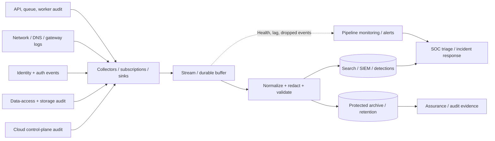
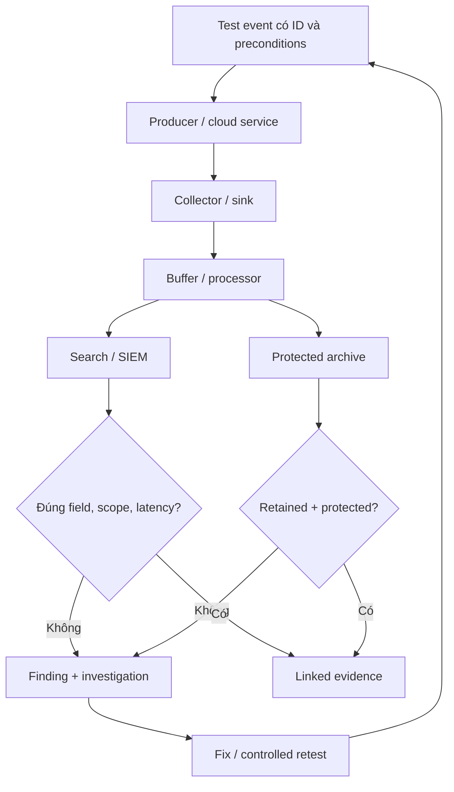
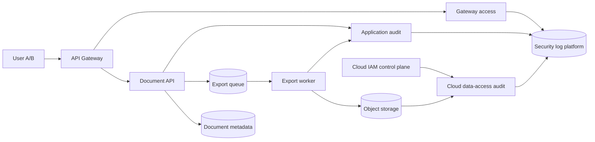
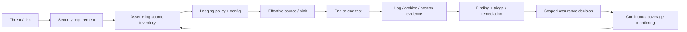

# Cloud logging

Một công ty phát triển nền tảng SaaS quản lý tài liệu cho nhiều tổ chức trên cloud. Tổ chức đã bật log cho API Gateway và đưa log ứng dụng vào hệ thống tập trung. Khi xảy ra nghi vấn một tài khoản bị chiếm quyền, nhóm SOC muốn biết ai đã sửa IAM policy, có bucket nào được mở public, ai truy cập tài liệu của tenant khác và liệu một worker có đưa dữ liệu ra điểm đến không được phê duyệt hay không. Họ phát hiện chỉ có HTTP access logs; cloud audit logs ở một account phụ chưa được thu thập, data-access logs cho object storage chưa bật trên những tài nguyên nhạy cảm, và một thay đổi cấu hình đã làm đường gửi log ứng dụng ngừng hoạt động hai ngày trước đó.

Hệ thống **có log**, nhưng **không có đủ bằng chứng để trả lời các câu hỏi bảo mật quan trọng**. Đây chính là bài toán của **Cloud logging** trong **Cloud assurance**: không chỉ cấu hình một nơi ghi nhật ký, mà phải có căn cứ rằng các sự kiện cần thiết **được tạo, thu thập, bảo vệ, truyền đến nơi cần, giữ trong khoảng thời gian phù hợp và có thể dùng để điều tra, phát hiện và kiểm toán**.

Trong module **SECURITY_SECURITY_ASSURANCE**, Cloud logging phục vụ mục tiêu xây dựng niềm tin có bằng chứng về security controls. Dòng truy vết cần có là **risk / threat → security requirement → logging control → nguồn sự kiện → cấu hình hiệu lực → phép thử → evidence → finding / khắc phục → quyết định assurance**. Một dashboard hiện số lượng log rất lớn không đồng nghĩa một hành vi trái quyền cụ thể có thể được truy vết.

## 1. Cloud logging là gì?

**Cloud logging** là tập hợp các cơ chế tạo và quản trị nhật ký liên quan đến tài nguyên, API, danh tính, workload và kết nối trong môi trường cloud. Nhật ký có thể đến từ **cloud provider**, **hạ tầng được quản lý**, **cluster/container**, **ứng dụng**, **identity provider** hoặc các lớp bảo mật trung gian.

Một log event có thể mô tả:
- Ai hoặc thành phần nào thực hiện hành động?
- Hành động gì, lên loại tài nguyên nào?
- Thời điểm, kết quả và môi trường liên quan?
- Đường request / correlation ID là gì?
- Có thay đổi policy hoặc data access không?
- Có dấu hiệu vượt quyền, thất bại xác thực, thay đổi cấu hình hoặc ngắt logging pipeline không?

**Cloud logging assurance** đánh giá mức độ đáng tin của toàn bộ chuỗi từ **nguồn phát sinh** tới **khả năng sử dụng được bằng chứng**, thay vì chỉ kiểm tra một cờ “logging enabled”.

### 1.1. Log, metric, trace và audit evidence khác nhau

| Khái niệm | Mục tiêu | Ví dụ | Giới hạn |
| --- | --- | --- | --- |
| **Application log** | Ghi sự kiện từ ứng dụng | Quyết định `document.download denied` | Có thể thiếu cloud identity và đường hạ tầng |
| **Cloud audit log** | Ghi hoạt động của API/quản trị cloud | IAM policy được thay đổi | Không tự ghi mọi hành vi nghiệp vụ bên trong ứng dụng |
| **Access/request log** | Ghi request tại gateway/proxy/service | Method, route, status và thời gian | Không nhất thiết cho biết quyết định phân quyền theo tài liệu |
| **Network/flow log** | Ghi metadata luồng mạng | Source, destination, port, action | Thường không đọc được nội dung ứng dụng và danh tính người dùng cuối |
| **Metric** | Giá trị tổng hợp theo thời gian | Số login thất bại/phút | Mất chi tiết từng sự kiện |
| **Distributed trace** | Liên kết span qua các thành phần | Request API → queue → worker → storage | Có thể sampling, không phải audit trail đầy đủ |
| **Security evidence record** | Hiện vật được kiểm soát phục vụ claim | Log + cấu hình + test run + reviewer | Chỉ đáng tin khi phạm vi, nguồn và tính toàn vẹn rõ |

**Observability** thường kết hợp logs, metrics và traces. **Security logging** đặc biệt chú trọng tính đầy đủ của các sự kiện có giá trị kiểm toán, khả năng quy trách nhiệm, bảo vệ dữ liệu và sử dụng để phát hiện/điều tra. Một hệ thống tracing lấy mẫu không thể tự thay thế audit log bắt buộc cho mọi hành động quan trọng.

### 1.2. Những khái niệm cần phân biệt

- **Event generated:** hệ thống phát sinh một bản ghi.
- **Event emitted:** ứng dụng hoặc dịch vụ gửi bản ghi ra cơ chế thu thập.
- **Event ingested:** collector/stream đón nhận bản ghi.
- **Event retained:** dữ liệu được lưu ở nơi có chính sách retention.
- **Event searchable:** bản ghi có thể tìm thấy trong chỉ mục/hệ thống điều tra.
- **Event actionable:** alert hoặc truy vấn giúp phát hiện/điều tra với ngữ cảnh đủ.
- **Event trustworthy:** có căn cứ về nguồn, tính toàn vẹn, thời gian, quyền truy cập và giới hạn.

Một event chỉ xuất hiện ở stdout của container có thể bị mất khi pod bị thay, dù developer thấy câu lệnh `logger.info(...)` đã chạy.

## 2. Từ threat model đến yêu cầu logging

Không nên bắt đầu bằng câu “bật mọi log cho toàn cloud”. Các loại log có giá trị, chi phí, tác động quyền riêng tư và cách lưu khác nhau. Bắt đầu từ **risk scenarios** và **security requirements** để định nghĩa điều cần quan sát.

### 2.1. Những rủi ro logging cần hỗ trợ

| Risk / threat scenario | Câu hỏi điều tra | Log/evidence quan trọng |
| --- | --- | --- |
| Cloud admin key bị lộ | Ai gọi API thay quyền hoặc tạo khóa mới? | Identity/control-plane audit, actor, source context |
| Bucket nhạy cảm bị mở truy cập rộng | Policy/ACL thay lúc nào và bởi identity nào? | Cloud configuration/audit events, resource snapshot |
| Người dùng đọc tài liệu tenant khác | Principal nào yêu cầu object nào, quyết định quyền ra sao? | Application authorization event, object/tenant context |
| Export worker đọc nhiều dữ liệu bất thường | Job nào, ai tạo, worker identity nào và output ở đâu? | API/job/worker events, storage access logs theo scope |
| Workload giao tiếp điểm đến lạ | Source workload kết nối đích gì và bị chặn không? | Network flow, proxy/egress, DNS logs nếu áp dụng |
| Security logging bị tắt | Ai đổi cấu hình, log cuối đến lúc nào và có alert không? | Independent audit, config drift, delivery heartbeat |
| Secret bị đọc trái quy định | Vai trò nào truy cập secret nào? | Secret manager data-access audit theo hỗ trợ |
| Deployment mở quyền không mong muốn | Release, config, IAM/SG thay thế nào? | CI/CD audit, cloud activity, deployment provenance |

Một finding có thể cần **nhiều nguồn log bổ trợ**. Ví dụ event `download=200` tại API không chứng minh người dùng có quyền; cần thông tin principal, quyết định authorization và object ownership trong phạm vi dữ liệu được phép ghi.

### 2.2. Security requirement mẫu

> **SR-LOG-01 — Auditability:** Mọi thay đổi quyền quản trị cloud và thay đổi chính sách truy cập của tài nguyên nhạy cảm trong phạm vi phải để lại audit event có thể truy vết actor, hành động, tài nguyên, thời điểm và kết quả theo khả năng của nền tảng.

> **SR-LOG-02 — Authorization events:** Các hành động truy cập dữ liệu nhạy cảm của ứng dụng phải có sự kiện bảo mật đủ để xác định principal, loại tài nguyên, quyết định cấp/từ chối quyền và correlation ID, không ghi nội dung tài liệu hoặc secret.

> **SR-LOG-03 — Logging pipeline health:** Khi một nguồn log bắt buộc không hoạt động, bị đổi cấu hình hoặc không gửi sự kiện trong điều kiện cần có, đội vận hành phải phát hiện và điều tra theo policy.

> **SR-LOG-04 — Evidence protection:** Log thuộc phạm vi kiểm toán được bảo vệ chống truy cập, sửa hoặc xóa trái phép, có retention và cơ chế xử lý dữ liệu theo chính sách.

Những yêu cầu này cần được làm **testable**. Ví dụ “log đầy đủ” là mơ hồ; nên ghi rõ loại sự kiện, nguồn tài nguyên, expected fields, môi trường, retention, người nhận và test case chứng minh.

## 3. Shared responsibility trong cloud logging

Mô hình **shared responsibility** có thể chia trách nhiệm theo IaaS, PaaS, SaaS và từng dịch vụ. Cloud provider vận hành hạ tầng nền tảng, còn khách hàng vẫn thường chịu trách nhiệm cấu hình, lựa chọn nguồn sự kiện, quyền xem log, retention và phản ứng với cảnh báo trong phạm vi họ quản lý.

| Lớp | Những việc provider có thể quản lý | Những việc khách hàng thường cần làm |
| --- | --- | --- |
| **Cloud control plane** | Tạo một số audit/event records theo dịch vụ | Bật cấu hình cần thiết, tổ chức thu thập/retention/alert trong account/project |
| **Managed database/storage** | Hỗ trợ audit/data access/cấu hình log | Chọn mức log cần thiết, bảo vệ dữ liệu, kiểm tra phạm vi instance/bucket |
| **Virtual machines** | Dịch vụ cloud cung cấp hạ tầng/metadata | Cài agent hoặc cấu hình hệ điều hành và ứng dụng, kiểm tra agent health |
| **Kubernetes managed service** | Một số control-plane components | Chọn control-plane audit options, workload/stdout, CNI/network, RBAC và log sinks |
| **Identity integration** | IdP ghi hoặc cung cấp audit/auth events theo tính năng | Cấu hình ingestion, phân quyền, test sự kiện và xử lý incident |
| **SaaS bên thứ ba** | Nhà cung cấp vận hành dịch vụ và log nguồn | Hợp đồng, audit export/API, phạm vi, SLA và khả năng bàn giao evidence |

**Không mặc định “cloud đã bật audit logging” nghĩa là mọi hành động đều được lưu.** Cần xem dịch vụ, vùng/region, loại event, tính năng đang bật, quyền truy cập, gói dịch vụ và những giới hạn cụ thể. Với SaaS managed, khả năng xuất log có thể khác đáng kể so với IaaS.

### 3.1. Trách nhiệm theo đường sự kiện

Trong một sự cố, event có thể bắt đầu ở browser, đi qua gateway, ứng dụng, queue, worker và cloud object storage. Provider có thể ghi lời gọi object-storage API; nhưng chỉ ứng dụng mới hiểu **principal người dùng**, **tenant**, **job nghiệp vụ** và quyết định authorization ở mức tài liệu. Hai nguồn phải liên kết được mà không suy luận sai rằng provider principal chính là user cuối.

## 4. Những nhóm cloud logs cần phân biệt

### 4.1. Control-plane / management activity logs

Ghi các hoạt động quản trị, ví dụ tạo VM, thay role/policy, đổi security group, bật/tắt cấu hình dịch vụ, thay log destination. Các event này quan trọng để phát hiện **privilege escalation, persistence, weakening security controls và configuration drift**.

Không phải log quản trị nào cũng ghi được trạng thái *trước/sau* đầy đủ. Có khi cần đối chiếu resource snapshots, IaC plan và change record để biết chính xác rule nào bị mở rộng.

### 4.2. Data-plane / data-access logs

Mô tả thao tác đọc/ghi dữ liệu hoặc gọi API trên tài nguyên, chẳng hạn truy cập object trong bucket hoặc gọi dịch vụ dữ liệu nhạy cảm. Chúng có thể **khác mặc định** so với management logs và tạo chi phí lớn; cần phân loại theo resource và risk.

Data-access event ở storage thường thể hiện **cloud/service principal thực hiện request**, không nhất thiết cho biết người dùng ứng dụng phía sau. Vì vậy cần liên kết ứng dụng/worker logs với storage access trên cơ sở correlation và quyền.

### 4.3. Identity / authentication logs

Bao gồm đăng nhập, thất bại MFA, token/session, việc tạo/thu hồi credential, thay role/binding, sử dụng tài khoản đặc quyền và một số hoạt động service account. Log từ cloud IAM, IdP, directory và ứng dụng có thể khác nhau.

Không đưa password, access token, refresh token, private key hay full authorization headers vào audit event. **Ghi sự kiện xác thực**, không ghi bí mật dùng để xác thực.

### 4.4. Network, DNS, load balancer và WAF logs

Dùng để xem luồng mạng, request ingress, verdict WAF, truy vấn DNS hoặc kết nối outbound. Có thể giúp triage SSRF, egress bất thường, traffic đến admin endpoint và dấu hiệu tấn công.

Network flow logs thường là **metadata** với mức độ tổng hợp/sampling tùy tính năng; không phải packet capture toàn bộ. Một flow được ghi `ACCEPT` ở lớp mạng không chứng minh ứng dụng cho phép thao tác nghiệp vụ đó.

### 4.5. Compute, container và orchestration logs

Bao gồm process/OS audit, container stdout/stderr, Kubernetes audit, control-plane activities, scheduler/cluster logs và workload events. Phải phân biệt pod event với application security event.

Nếu ứng dụng chỉ viết vào local file trong container mà không có shipper hoặc persistent mechanism, log có thể biến mất khi container bị thay. Với Kubernetes, cần kiểm tra cơ chế thu thập trên node, log rotation, những namespace được quét và pod/host coverage.

### 4.6. Application, business và security decision logs

Những sự kiện quan trọng thường chỉ ứng dụng biết:
- Login/session state và kết quả authorization theo tài nguyên.
- Tạo/chỉnh sửa/chia sẻ tài liệu, thay owner/tenant trong những workflow có kiểm soát.
- Export job được tạo, thực hiện, thất bại hoặc hoàn thành.
- Truy cập API nhạy cảm bị từ chối.
- Thay đổi chính sách nghiệp vụ hoặc quyền người dùng.
- Hoạt động cấp/thu hồi API key của sản phẩm.

**Audit event nghiệp vụ phải mô tả quyết định và bối cảnh tối thiểu**, không biến logging system thành bản sao của dữ liệu khách hàng.

## 5. Đặc thù trên AWS, Azure và Google Cloud

Các nền tảng khác nhau về tên dịch vụ, phân loại log, phạm vi mặc định và cấu hình export. Cần kiểm tra tài liệu hiện hành của **dịch vụ và tính năng đang dùng** trước khi tuyên bố một nguồn đã được thu thập đầy đủ.

| Cloud | Ví dụ nguồn control-plane | Ví dụ data/network/workload | Điểm cần xác minh |
| --- | --- | --- | --- |
| **AWS** | AWS CloudTrail management events | CloudTrail data events theo resources, VPC Flow Logs, WAF/ALB logs, workload logs qua CloudWatch hoặc pipeline khác | Trails/event data stores, event selectors, account/region/organization scope và destinations |
| **Microsoft Azure** | Azure Activity Log | Azure resource logs qua diagnostic settings hoặc phương án tích hợp, network/identity logs tùy dịch vụ | Subscription/resource scope, diagnostic categories, export destinations, retention và tenant identity |
| **Google Cloud** | Cloud Audit Logs, gồm Admin Activity và những loại theo khả năng dịch vụ | Data Access audit logs khi được cấu hình và hỗ trợ, VPC Flow Logs, Cloud Logging workloads | Project/folder/organization, log categories, exclusions, sinks, bucket retention và quyền truy cập |

### 5.1. AWS: management events khác data events

CloudTrail có khả năng ghi những loại hoạt động khác nhau; **không nên coi việc nhìn thấy một số management events là bằng chứng mọi object-level access đã được ghi**. Cần kiểm tra data event selectors và tài nguyên đã chọn nếu mục tiêu là theo dõi những thao tác tương ứng. Với nhiều accounts/regions, nên đánh giá khả năng quản trị tập trung và coverage thực sự theo cấu hình tổ chức.

Không phải mọi event luôn xuất hiện ngay lập tức trong nơi tìm kiếm. Cần tính đến độ trễ thu thập, permissions, resource selection và cơ chế lưu trữ.

### 5.2. Azure: Activity Log và resource logs không đồng nhất

Activity Log chủ yếu liên quan hoạt động ở tầng subscription/control plane. Các loại log của resource/service có thể cần **diagnostic settings** hoặc cơ chế xuất riêng, và không phải mọi category có cùng nội dung. Khi đánh giá, kiểm tra nguồn phát sinh, phạm vi subscription/resource, destination và chính sách giữ log.

Identity logs có thể nằm ở dịch vụ danh tính và theo các cơ chế truy cập/export khác; không suy rằng subscription Activity Log bao phủ mọi sự kiện đăng nhập người dùng.

### 5.3. Google Cloud: audit categories và sinks

Google Cloud phân biệt các loại Cloud Audit Logs theo khả năng dịch vụ; một số loại Data Access không nhất thiết được bật hoặc cấu hình giống Admin Activity. Cần xác minh coverage theo project/folder/organization, phương án routing, exclusions, log buckets, retention và IAM đối với audit logs.

Một sink đã tạo không tự chứng minh từng event nguồn đang đến đích mong muốn, đặc biệt khi có exclusions, thiếu quyền hoặc sai phạm vi.

### 5.4. Multi-cloud cần một mô hình chung nhưng không xóa khác biệt

Có thể chuẩn hóa những field như `actor`, `action`, `resource`, `event_time`, `outcome` và `cloud_scope` để phân tích. Tuy nhiên, phải giữ **raw event/reference** cùng provider-specific semantics. Ví dụ “success” trong một API event không phải lúc nào cũng đồng nghĩa nghiệp vụ thành công, và một nguồn chỉ có management logs không được chuẩn hóa nhầm thành “full audit coverage”.

## 6. Kiến trúc cloud logging tham chiếu



Đây là **kiến trúc logic**, không phải yêu cầu phải dùng một sản phẩm duy nhất. Một hệ thống nhỏ có thể dùng managed logging trực tiếp; tổ chức lớn có thể có nhiều collectors, buses và kho lưu trữ. Điều quan trọng là **mỗi bước có owner, kiểm soát lỗi và có thể xác minh**.

### 6.1. Các điểm mất log có thể xảy ra

- Nguồn sự kiện chưa bật hoặc thiếu quyền phát sinh/export.
- Resource mới sinh ra nằm ngoài cấu hình thu thập.
- Collector/agent không chạy trên node/pod mới.
- Queue đầy, network lỗi hoặc có giới hạn quota/rate.
- Bộ lọc loại nhầm event bảo mật.
- Schema transformation làm mất actor/tenant/resource context.
- Index hết hạn trước thời hạn điều tra, archive chưa nhận bản ghi.
- Query permissions khiến SOC không nhìn được log dù dữ liệu vẫn tồn tại.
- Thay key/permissions làm consumer không giải mã được.
- Attacker có quyền sửa cấu hình logging hoặc xóa log trong cùng account.

**Logging pipeline health** phải được kiểm soát như chính một security control; không chỉ quan sát số events chung.

## 7. Thiết lập inventory và log coverage matrix

Trước khi bật detector, cần biết **tài sản nào phải tạo loại log nào**.

### 7.1. Ma trận minh họa cho SaaS

| Asset / boundary | Expected event | Source | Owner | Cách chứng minh |
| --- | --- | --- | --- | --- |
| Organization cloud accounts | Thay IAM/security config | Provider control-plane audit | Cloud security | Event test + account/region scope |
| Sensitive object storage | Đọc/ghi object thuộc scope | Provider data-access audit | Data platform | Test object access và event đến destination |
| Public API Gateway | Request, route, outcome | Gateway access logs | Platform | Request test có request ID |
| Document API | Authorization allowed/denied | Application security events | Service owner | Negative/positive authorization test |
| Export queue/worker | Job created/started/completed/denied | Application/queue/worker logs | Backend owner | Test job và correlation tới output |
| Identity provider | Sign-in/MFA/role changes | Identity audit export | IAM owner | Test identity event |
| Private network | Egress, DNS, flow metadata | Flow/proxy/DNS logs theo platform | Network team | Test flow được phê duyệt |
| CI/CD / registry | Deploy, role use, artifact changes | CI and registry audit | DevSecOps | Release event và artifact reference |
| Logging infrastructure | Log config/sink change, access, deletion | Independent audit/admin logs | Security operations | Change event + delivery heartbeat |

Ma trận cần gắn **environment/account/region/project/cluster**, đặc biệt khi chỉ một số nơi chứa dữ liệu nhạy cảm. Một service có hai region có thể được logging ở một region nhưng thiếu ở region còn lại.

### 7.2. Phân biệt các trạng thái coverage

| Trạng thái | Ý nghĩa |
| --- | --- |
| `REQUIRED` | Có requirement rõ cho event/source |
| `CONFIGURED` | Có cấu hình được khai báo |
| `ENABLED` | Runtime/effective setting đang bật |
| `GENERATED` | Test hoặc hành vi tạo event ở nguồn |
| `DELIVERED` | Bản ghi đến đúng collector/destination |
| `SEARCHABLE` | Reviewer được phép tìm thấy và hiểu event |
| `ALERT_TESTED` | Một tín hiệu được diễn giải thành alert đúng |
| `INCOMPLETE` | Có gap, timeout, lack of identity hoặc thiếu loại log |
| `EXEMPTED` | Ngoại lệ có owner, phạm vi và hạn |
| `NOT_APPLICABLE` | Có bằng chứng lý do không áp dụng |

**CONFIGURED không đồng nghĩa VERIFIED.** Nếu tài nguyên không sinh ra sự kiện, một lần kiểm tra dashboard rỗng không đủ kết luận cấu hình hoạt động.

### 7.3. Log source owner và data owner

Log có thể chứa thông tin cá nhân hoặc dữ liệu liên quan nhiều tenant. **Source owner** chịu trách nhiệm tạo sự kiện đúng, **pipeline owner** bảo đảm thu thập và delivery, **security owner** định nghĩa khả năng phát hiện, còn **data/privacy owner** quyết định giới hạn sử dụng/retention theo nghĩa vụ áp dụng. Không giao mọi trách nhiệm cho một nhóm SOC chỉ vì SOC đọc log.

## 8. Thiết kế security event có cấu trúc

Nhật ký dạng văn bản tự do dễ viết nhưng khó truy vấn, kiểm tra trường và liên kết sự kiện. Với sự kiện bảo mật quan trọng, nên dùng **structured logging** và schema có version.

### 8.1. Những trường nên xem xét

| Field | Mục đích | Lưu ý |
| --- | --- | --- |
| `event_id` | Nhận diện bản ghi để chống đếm trùng / audit | Cần cơ chế sinh ID đủ ổn định |
| `event_type` | Nhóm sự kiện | Từ điển event types được quản trị |
| `event_time` | Thời điểm nguồn ghi nhận | Nêu timezone/UTC; không thay bằng ingestion time |
| `ingested_at` | Thời điểm pipeline nhận | Dùng đo latency, có thể khác event time |
| `environment` | Production/staging | Tránh trộn dữ liệu |
| `cloud_account/project` | Phạm vi cloud | Có thể là thông tin nhạy cảm |
| `service / version` | Nguồn và artifact | Giúp điều tra theo release |
| `actor_type / actor_id` | Human, service, workload hoặc automation | Không lưu secret |
| `tenant_ref` | Phạm vi tenant liên quan | Dùng ID opaque và phân quyền |
| `resource_type / resource_ref` | Đối tượng được tác động | Không ghi nguyên nội dung dữ liệu |
| `action` | Read, export, policy_update... | Có quy ước thống nhất |
| `outcome` | Allowed, denied, error... | Đừng đồng nhất API success với authorization success |
| `reason_code` | Chính sách hoặc điều kiện | Không lộ thông tin không cần thiết |
| `request_id / trace_id` | Tương quan xuyên dịch vụ | Trace có thể sampling |
| `job_id` | Liên kết async workflow | Không dùng làm bằng chứng quyền một mình |
| `source_context` | IP/region/client metadata cần thiết | Cần privacy policy và data minimization |
| `schema_version` | Kiểm soát thay đổi parser | Có migration/test |

Không bắt buộc mọi event phải có tất cả các field. **Sự kiện quản trị cloud và sự kiện nghiệp vụ có semantics khác nhau**. Các field cần phù hợp rủi ro, quyền riêng tư và khả năng tạo dữ liệu từ nguồn.

### 8.2. Ví dụ JSON audit event an toàn

```json
{
  "schema_version": "1.0",
  "event_id": "evt-test-0007",
  "event_type": "document.authorization",
  "event_time": "2026-01-01T12:00:00Z",
  "environment": "staging",
  "service": "document-api",
  "service_version": "rc-example",
  "actor": {
    "type": "user",
    "ref": "user-test-b"
  },
  "tenant_ref": "tenant-test-b",
  "resource": {
    "type": "document",
    "ref": "doc-test-a"
  },
  "action": "download",
  "outcome": "denied",
  "reason_code": "cross_tenant_access",
  "request_id": "req-test-42",
  "trace_id": "trace-test-42"
}
```

**Đây là dữ liệu giả lập.** Bản ghi cho thấy quyết định quyền, không chứa bearer token, session cookie, object content hoặc tài liệu khách hàng. Trong một hệ thống thật, việc dùng cả actor ID và tenant ID có thể là thông tin cần bảo vệ; cần áp quyền truy cập và retention tương ứng.

### 8.3. Lỗi thường gặp trong event schema

- Ghi `success=true` nhưng không biết thành công của **HTTP handler**, **authorization** hay **job**.
- Thiếu field actor, khiến không quy trách nhiệm được.
- Dùng timestamp local không kèm timezone và không có nguồn giờ đáng tin.
- Ghi URL nguyên vẹn chứa token/query secrets.
- Ghi stack trace gồm credentials hoặc dữ liệu cá nhân.
- Thay schema âm thầm khiến SIEM parser bỏ event.
- Dùng cùng `request_id` cho nhiều request không liên quan.
- Tin dữ liệu actor/tenant do client gửi mà không ràng buộc với principal đã xác thực.

### 8.4. Event không phải nguồn chân lý duy nhất

Một event có thể được sinh trước khi transaction commit rồi thao tác thất bại. Với các hành động cần audit chính xác, thiết kế **thời điểm ghi sự kiện** và semantic rõ: `attempted`, `authorized`, `committed`, `failed`. Khi audit event phải gắn transaction state, cân nhắc transactional outbox hoặc cơ chế khác phù hợp, song phải xử lý duplication và delivery failure. Không hứa “exactly once” nếu hệ thống chỉ cung cấp at-least-once delivery.

## 9. Java: log quyết định bảo mật và tương quan request

Ví dụ một API Java sử dụng SLF4J ghi sự kiện khi yêu cầu tải tài liệu bị từ chối. Mục tiêu là minh họa cách giữ **bối cảnh có cấu trúc và không ghi token**. Đoạn mã không triển khai đầy đủ authorization service hoặc cấu hình JSON encoder.

```java
import org.slf4j.Logger;
import org.slf4j.LoggerFactory;
import org.slf4j.MDC;

public final class DocumentAccessAudit {
    private static final Logger LOG =
        LoggerFactory.getLogger(DocumentAccessAudit.class);

    public static void recordDownloadDecision(
            String requestId,
            String authenticatedActorRef,
            String trustedTenantRef,
            String documentRef,
            boolean allowed) {

        try {
            MDC.put("request_id", requestId);
            MDC.put("actor_ref", authenticatedActorRef);
            MDC.put("tenant_ref", trustedTenantRef);

            LOG.info(
                "security_event={} action={} resource_type={} " +
                "resource_ref={} outcome={}",
                "document.authorization",
                "download",
                "document",
                documentRef,
                allowed ? "allowed" : "denied"
            );
        } finally {
            MDC.remove("request_id");
            MDC.remove("actor_ref");
            MDC.remove("tenant_ref");
        }
    }
}
```

**Lưu ý kỹ thuật:**
- Giá trị `authenticatedActorRef` và `trustedTenantRef` phải đến từ context đáng tin sau xác thực, không phải header tùy ý của client.
- Tùy logging backend, MDC có thể được xuất thành JSON fields nếu cấu hình encoder tương ứng; code trên **không tự biến output thành JSON**.
- MDC thường gắn với thread; với asynchronous/reactive execution cần thiết kế propagation hoặc context logging phù hợp, không mặc định context sẽ đi qua thread khác.
- Trong hệ thống có nested MDC scopes, việc `remove` một key có thể làm mất context cũ; cần thiết kế save/restore hoặc scope helper khi cần.
- Không log tài liệu, password, private key, bearer token, session ID hoặc request body nhạy cảm.
- Logging security decision không thay thế việc **thực thi** authorization; nó chỉ ghi kết quả của control.

### 9.1. Trace ID và span ID không phải security principal

Một correlation ID giúp nối API, queue và worker, nhưng **không chứng minh ai có quyền**. Audit event nên gắn identity đáng tin được xác nhận ở mỗi trust boundary; khi chuyển job qua queue phải bảo vệ các thuộc tính nguồn và xác minh quyền phù hợp trước khi thực hiện.

### 9.2. Log một số sự kiện cần độ tin cậy cao

Nếu audit event là yêu cầu bắt buộc cho một thao tác nhạy cảm, cần thiết kế hành vi khi logging thất bại: từ chối thao tác, đưa event vào outbox bền vững hoặc hoạt động suy giảm có kiểm soát tùy threat/risk và availability requirement. **Không có một chính sách fail-open/fail-closed đúng cho mọi loại log.** Một debug log lỗi không nên luôn dừng ứng dụng; một hành động quản trị nhạy cảm không nên âm thầm không có audit trail khi requirement bắt buộc.

## 10. Thu thập và vận chuyển log đáng tin cậy

### 10.1. Producer, collector, buffer, sink

- **Producer:** cloud API/service, agent, app hoặc workload tạo event.
- **Collector:** agent, service connector, subscription hoặc log forwarder.
- **Buffer/stream:** giữ dữ liệu trong lúc downstream chậm hay lỗi.
- **Processor:** parse schema, kiểm tra field, lọc và redact.
- **Destination:** search/SIEM, object store/archive, detection engine.
- **Monitoring:** giám sát health, latency, dropped events và config changes.

Tại mỗi bước cần biết failure mode, owner, retry/timeout, quota, cấp quyền và mức bảo đảm delivery.

### 10.2. At-most-once, at-least-once và duplicate events

Một pipeline có thể đánh mất event khi mạng lỗi, hoặc gửi trùng khi retry. Không nên tự giả định mọi log pipeline có **exactly-once semantics**.

Nếu dùng at-least-once delivery, cần event ID/sequence hoặc cách dedup phù hợp; SIEM detection không nên tính lặp mỗi bản ghi thành một hành vi mới nếu semantics là một hành động. Nếu có lỗ hổng mất log, phải có cơ chế phát hiện và xử lý thay vì âm thầm bỏ qua.

### 10.3. Backpressure và quota

Khi hệ thống search/SIEM không nhận kịp:
- buffer có giới hạn dung lượng và retention;
- có cảnh báo khi queue age/lag hoặc dropped events vượt ngưỡng;
- có runbook cho dịch vụ không nhận log;
- ưu tiên sự kiện audit/security quan trọng theo policy;
- không để một loại log noisy làm mất cả luồng security events;
- lưu trạng thái sự kiện bị loại hoặc bị parse lỗi.

Cần cân bằng **availability của ứng dụng**, **bảo đảm audit** và **chi phí** theo risk. Ghi rõ tình huống log nào không thể mất mà không có quyết định rủi ro.

### 10.4. Kiểm tra event có đến đích không

Một test event **được phê duyệt và nhận diện rõ** nên được tạo ở nguồn, rồi xác minh qua ingestion/search/archive. Chỉ kiểm tra collector job đang chạy không chứng minh nguồn đang tạo event hoặc sink đang nhận đúng.

## 11. Bảo vệ tính toàn vẹn và quyền truy cập log

Log bảo mật là mục tiêu tấn công: kẻ xâm nhập có thể cố **xóa dấu vết**, sửa nội dung, cản việc gửi event hoặc lấy token/data trong báo cáo.

### 11.1. Nguyên tắc kiểm soát

1. **Least privilege:** application producer chỉ có quyền ghi cần thiết, không được sửa/xóa archive.
2. **Separation of duties:** người quản trị workload không mặc định có quyền xóa log điều tra liên quan.
3. **Centralization:** gửi những nguồn quan trọng sang account/project/tenant bảo mật phù hợp.
4. **Encryption:** bảo vệ dữ liệu khi truyền và lưu; quản trị khóa, truy cập và rotation.
5. **Integrity controls:** versioning/immutability/WORM hoặc cơ chế tương đương khi yêu cầu.
6. **Access auditing:** ghi ai đã xem, thay quyền, export, sửa retention hoặc xóa log.
7. **Retention enforcement:** có thời hạn và cơ chế legal hold phù hợp nghĩa vụ.
8. **Tamper detection:** phát hiện logging bị tắt, sink thay đổi, archive bị xóa hoặc quyền rộng bất thường.
9. **Recovery:** khả năng khôi phục và truy vấn log khi hệ thống phân tích chính gặp sự cố.

### 11.2. Immutable storage và điều kiện thực tế

Object storage với cơ chế immutability/WORM, retention lock hoặc tính năng tương đương có thể tăng khả năng bảo vệ log archive. Tuy nhiên phải cấu hình đúng **chế độ bảo vệ, tài khoản/quyền quản trị, key lifecycle, thời hạn, vùng lưu và cơ chế xóa khi hết hạn**. Bật versioning riêng không đồng nghĩa có WORM chống xóa có chủ đích.

Không tuyên bố “log không thể sửa” nếu super-admin, key admin hoặc quy trình backup vẫn có đường làm dữ liệu không còn truy cập được. Assurance claim cần mô tả **mô hình đe dọa và khả năng chống sửa/xóa trong phạm vi**.

### 11.3. KMS và quyền giải mã

Mã hóa log giúp bảo vệ tính bí mật nhưng có thể làm log không sử dụng được nếu key bị xóa/thu hồi hoặc SOC thiếu quyền giải mã. Cần kiểm soát vòng đời key, separation of duties, backup/retention theo nền tảng và kiểm thử người điều tra có thể truy cập đúng evidence khi cần.

### 11.4. Bảo mật hệ thống logging

SIEM, object storage archive, log forwarders và service accounts chính là tài sản nhạy cảm. Chúng cần patching, IAM, network restrictions, audit, backup và security monitoring; không xem logging platform là nơi được tin tuyệt đối.

## 12. Data privacy và log minimization

Việc “ghi càng nhiều càng tốt” có thể gây **rò rỉ dữ liệu** và tăng nghĩa vụ xử lý dữ liệu cá nhân. Security logging phải tuân thủ data classification, privacy requirements và nguyên tắc chỉ lưu thông tin cần để đạt mục đích kiểm toán.

### 12.1. Những dữ liệu không nên ghi theo mặc định

- Password, OTP, recovery code, private key, secret, API token hoặc session cookie.
- Authorization header/bearer token.
- Full request/response body chứa tài liệu, thông tin sức khỏe, tài chính hoặc dữ liệu khách hàng.
- Database connection string có credentials.
- Nội dung object storage hoặc dữ liệu tenant khác chỉ để “dễ debug”.
- Link tải ký sẵn, token reset hoặc URL có query secrets.
- Các trường định danh cá nhân không cần thiết cho mục tiêu điều tra.

Một số sự kiện cần identity để truy vết, nhưng phải **chọn mức định danh phù hợp**: opaque reference, pseudonymization, masking, role-based access và retention có giới hạn. Hash một trường không nhất thiết làm dữ liệu mất tính chất cá nhân nếu có thể liên kết lại với người dùng.

### 12.2. Redaction đặt ở đâu?

Có thể redact ở **nguồn** trước khi emit, ở collector và trước khi index/export. Ưu tiên tránh thu thập secret ngay từ đầu; chỉ redact ở SIEM khi bản raw đã đi qua nhiều nơi là chưa đủ. Cần test parser, exception logging, HTTP middleware và error paths vì chúng dễ ghi request body/header ngoài ý muốn.

### 12.3. Multi-tenant log isolation

Một SaaS có thể dùng kho log chung nhưng cần giới hạn quyền theo môi trường, đội, tenant hoặc mục đích xử lý. Không cho khách hàng A truy vấn log chứa event/data của khách hàng B qua observability portal. Với security operations toàn hệ thống, cũng cần quy định ai được truy vấn, thời hạn và lý do truy cập dữ liệu nhiều tenant.

### 12.4. Retention, deletion và legal hold

Retention phụ thuộc chính sách tổ chức, luật/nghĩa vụ hợp đồng trong phạm vi, đặc tính sự kiện và khả năng điều tra. **Không có một mốc ngày chung** thích hợp cho mọi log.

Cần phân biệt:
- **Hot searchable retention:** dữ liệu giữ trong hệ thống tìm kiếm.
- **Archive retention:** dữ liệu giữ dài hạn với chi phí/phương thức truy cập khác.
- **Backup retention:** bản dự phòng có quy tắc riêng.
- **Legal hold:** lưu bổ sung khi có nghĩa vụ cụ thể.
- **Deletion/disposal:** xóa đúng hạn, kể cả bản sao và dữ liệu tạm khi áp dụng.

Phải bảo đảm quy trình xóa không âm thầm phá evidence của incident đang xử lý hoặc để dữ liệu vượt hạn không có căn cứ.

## 13. Thời gian, thứ tự sự kiện và tương quan đa dịch vụ

### 13.1. Event time khác ingestion time

Một bản ghi thường có ít nhất hai thời điểm:
- `event_time`: thời gian producer ghi nhận hành động;
- `ingested_at`: thời gian pipeline nhận event.

Độ trễ được tính từ hai mốc, nhưng còn phụ thuộc clock skew. Event có thể đến sai thứ tự do buffer, retry hoặc xử lý bất đồng bộ. Không xây dựng timeline điều tra dựa duy nhất vào thứ tự event được hiển thị trong SIEM.

### 13.2. Clock synchronization

VM/node/container và các thành phần phân tán nên dùng nguồn thời gian phù hợp. Khi đọc nhiều event, cần ghi UTC, timezone, mức chính xác và khả năng lệch đồng hồ; xem provider timestamp semantics và collector transformations.

Không mặc định timestamp từ client đáng tin như server timestamp. Nếu attacker kiểm soát timestamp trong request body, nó chỉ là **claimed client time**, không phải audit time của máy chủ.

### 13.3. Correlation qua API, queue và worker

Ví dụ:
1. User B gọi API tạo export.
2. API ghi request ID và authorization decision.
3. Message queue nhận job có job ID và correlation context.
4. Worker ghi actor/workload identity cùng job ID và trạng thái.
5. Object storage ghi cloud principal/service identity của request.
6. Hệ thống điều tra nối chuỗi theo job ID, trace ID, resource reference và time window.

Các ID cần được **tạo và xác minh tại trust boundary**, tránh tin nguyên giá trị do client tự gửi để suy ra hành vi của người dùng khác.

### 13.4. Sampling

Sampling có thể thích hợp với debug traces hoặc request logs khối lượng lớn, nhưng phải phân biệt log **bắt buộc cho audit**. Nếu security requirement yêu cầu mọi thay đổi quyền quản trị được ghi, lấy mẫu ngẫu nhiên không đáp ứng yêu cầu. Khi sampling là chấp nhận được cho mục tiêu khác, report phải công khai tỷ lệ, quy tắc và giới hạn khi suy luận.

## 14. Phát hiện sự cố từ cloud logging

Nhật ký có giá trị khi được dùng thành **tín hiệu phát hiện, điều tra và phản ứng**; không chỉ lưu lại để kiểm toán.

### 14.1. Ví dụ detection use cases

| Use case | Tín hiệu | Correlation/triage cần thêm | Rủi ro false positive |
| --- | --- | --- | --- |
| Thay IAM role rộng bất thường | Control-plane policy update | Actor, phạm vi, change ticket, thời điểm | Deployment được phê duyệt |
| Tắt hoặc đổi audit logging | Log configuration change / missing heartbeat | Nguồn audit độc lập, quyền người sửa | Bảo trì được phê duyệt |
| Public access của storage thay đổi | Resource config event | Snapshot effective policy, dữ liệu nhạy cảm | Tài nguyên public-by-design |
| Access secret tăng bất thường | Data-access audit | Service identity, workload, lịch triển khai | Rotation hoặc migration |
| API bị từ chối quyền hàng loạt | Application authz events | Principal/tenant/resource, network context | Test hoặc lỗi client |
| Export khối lượng bất thường | Job + storage/object access | Requester, tenant, business justification | Batch export hợp lệ |
| Egress tới đích lạ | Flow/proxy/DNS data | Asset owner, policy baseline, threat signals | Vendor IP thay đổi |
| Tài khoản đặc quyền login thất bại nhiều lần | IdP/auth logs | MFA, địa điểm, device context | Nhầm mật khẩu hoặc test |
| Truy vấn SIEM trái phép | Logging platform access logs | Actor và phạm vi dữ liệu truy cập | Audit review hợp lệ |

### 14.2. Một alert không thay risk assessment

Rule cảnh báo khi số request tăng đột ngột có thể báo nhầm lúc người dùng làm việc hợp lệ. Ngược lại, một actor nguy hiểm có thể thực hiện ít request nhưng truy cập tài nguyên rất nhạy cảm. Triage nên kết hợp mức nhạy cảm, identity, hành vi nền, điều kiện nghiệp vụ và các nguồn evidence khác.

### 14.3. Phát hiện log bị ngắt là một use case riêng

Nếu log pipeline bị tắt hoặc không có event, SIEM có thể “im lặng” đúng lúc cần nhất. Cần có **heartbeat, canary events hoặc expected source activity** để kiểm chứng. Không tự cảnh báo “log mất” chỉ vì một dịch vụ ít hoạt động không có event trong vài phút; điều kiện kỳ vọng phải dựa trên cấu hình và nhịp hoạt động.

### 14.4. Không xóa dấu vết khi incident response

Khi nghi xâm phạm, cần preserve audit sources, xác định thời điểm đầu/cuối coverage, kiểm tra quyền và mức tin cậy của logs. Nếu attacker có quyền xóa log ở account nguồn, có thể cần evidence từ account bảo mật độc lập, identity provider, network telemetry hoặc backup snapshots để đối chiếu. Không suy rằng **không có event = không xảy ra hành vi**.

## 15. Kiểm tra logging control bằng phép thử có chủ đích

Một chương trình assurance cần chứng minh log thực sự ghi được **sự kiện bắt buộc**, có đủ field, đến đích, tìm được và không rò dữ liệu.

### 15.1. Test matrix minh họa

| Test ID | Thao tác trong môi trường được phép | Kỳ vọng | Evidence |
| --- | --- | --- | --- |
| `LOG-01` | API test từ chối user B đọc document A | Event `authorization denied` có identity và request ID | API response + structured audit event |
| `LOG-02` | User A đọc test object hợp lệ | Event access theo requirement, không có object body | Positive access + event |
| `LOG-03` | Identity test thay role qua workflow được duyệt | Cloud/IdP audit ghi actor và thay đổi | Change ID + audit record |
| `LOG-04` | Test principal gọi data-access operation trên test object | Data-access event đến sink theo scope | Provider event + archive search |
| `LOG-05` | Test worker tạo và hoàn tất export job | API/worker/job events tương quan được | Request ID, job ID, output metadata |
| `LOG-06` | Gửi log canary từ nguồn bắt buộc | Collector, SIEM và archive nhận đúng event | End-to-end delivery timestamps |
| `LOG-07` | Mô phỏng collector/destination lỗi trong sandbox | Có alert/backpressure/loss signal theo policy | Alert, queue metrics, recovery |
| `LOG-08` | Test identity không có quyền đọc archive | Bị từ chối, có access audit phù hợp | IAM test + audit |
| `LOG-09` | Thay đổi logging config trong môi trường thử có phép | Change được ghi và/hoặc drift alert | Config snapshot và detection |
| `LOG-10` | Gửi request chứa token giả test-only | Không ghi nguyên chuỗi giả nhạy cảm vào nơi không được phép | Redaction test |
| `LOG-11` | Thực hiện event trong account/region phụ | Log được route đến nơi tập trung | Account/region log lookup |
| `LOG-12` | Thử một event trên app version mới | Schema/parser/detection còn hoạt động | Versioned test result |

**Giới hạn:** các test phải được phê duyệt. Không tắt logging ở production thật chỉ để chứng minh detector có hoạt động; sử dụng sandbox, cơ chế giả lập hoặc kiểm tra an toàn phù hợp.

### 15.2. Positive control và negative control

- **Positive:** event cần có được tạo và tìm thấy ở destination phù hợp.
- **Negative:** người không có quyền không đọc/sửa/xóa được log; token giả không xuất hiện ở output; log từ môi trường ngoài scope không bị đưa nhầm vào nơi có quyền đọc rộng.
- **Failure-path:** khi pipeline lỗi, hệ thống phát hiện và báo tình trạng `INCOMPLETE` hoặc `DEGRADED` theo policy.

Một truy vấn không trả bản ghi có thể do event không phát sinh, pipeline mất, index chưa cập nhật, thiếu quyền truy vấn hoặc sai khoảng thời gian. Vì thế **test âm tính cho privacy/access** cần positive control tương ứng để tránh kết luận sai.

### 15.3. Từ event tới archive/search



### 15.4. Các kết quả không được gộp thành PASS

- `NOT_RUN`: test chưa thực hiện.
- `SOURCE_NOT_ENABLED`: nguồn sự kiện chưa bật.
- `EVENT_NOT_GENERATED`: không có stimulus hoặc source lỗi.
- `EVENT_NOT_DELIVERED`: mất trong pipeline.
- `NOT_SEARCHABLE`: dữ liệu có nhưng reviewer không tìm được.
- `SCHEMA_INVALID`: parser không hiểu hoặc thiếu field bắt buộc.
- `UNAUTHORIZED_ACCESS`: logging store vi phạm quyền.
- `SENSITIVE_DATA_EXPOSED`: có dữ liệu không nên lưu.
- `INCONCLUSIVE`: thiếu precondition, phiên bản hoặc thông tin.
- `PASS`: tất cả tiêu chí đã được thực hiện đạt trong phạm vi.
- `EXCEPTION_APPROVED`: có ngoại lệ có hạn, **không** phải control đã pass.

Nếu `LOG-04` không thấy data-access event, không được kết luận “không có truy cập dữ liệu” khi chính khả năng ghi sự kiện chưa được kiểm chứng.

## 16. SaaS đa tenant: trường hợp xuyên suốt

### 16.1. Các luồng cần quan sát

Giả sử hệ thống có:
- Gateway public cho REST API;
- Document API đọc/ghi metadata;
- Database chứa tenant/object ownership;
- Queue và export worker;
- Object storage giữ tài liệu và file export;
- Cloud IAM/workload identities;
- Identity provider cho người dùng;
- Logging pipeline tập trung.



### 16.2. Hai danh tính không được đánh đồng

**User B** gọi API. **Workload identity** của export worker gọi object storage. Storage audit có thể chỉ thấy identity của worker, không phải B. Muốn điều tra, cần liên kết:
- authenticated principal B tại API;
- tenant và object ownership;
- authorization decision;
- request/job ID;
- worker identity và hành động thực hiện;
- storage operation và output ID.

Không nên ghi credentials hoặc đưa raw request body vào log để “dễ liên kết”. Dùng các reference tối thiểu, được tạo trong hệ thống đáng tin.

### 16.3. Một sự cố giả định

Sau deploy, dashboard phát hiện nhiều event `export_job.created` của user B. SOC muốn biết B có xuất tài liệu A không.

**Các bước triage có bằng chứng:**
1. Xác nhận sự kiện xuất hiện từ service, environment và release nào.
2. Kiểm tra actor, tenant, job ID, object IDs ở mức reference được phép.
3. Kiểm tra outcome authorization tại API và worker.
4. Đối chiếu job transition và storage data-access logs.
5. Xác định có output được tạo và ai có thể truy cập, không tự mở dữ liệu khách hàng ngoài quyền.
6. Kiểm tra có bị thiếu events hoặc delay trong thời gian quan tâm không.
7. Nếu có dấu hiệu vượt quyền, theo quy trình incident response; bảo toàn log và đánh giá blast radius.
8. Gắn finding với nguyên nhân, bản sửa, negative regression tests và retest evidence.

**Nếu pipeline mất event worker**, không được mặc định worker không làm gì. Kết luận phải ghi phần thiếu và dùng nguồn bổ trợ khi có.

### 16.4. Kết luận bảo mật phải có phạm vi

Nếu test `LOG-01` trên staging pass, claim hợp lý là “đối với API build này và test fixture A/B, event authorization denied được ghi và tìm thấy trong logging platform”. Chưa đủ để tuyên bố “mọi yêu cầu truy cập trái quyền ở mọi region production đều được ghi”.

## 17. IaC và policy-as-code cho logging

Cloud logging nên được quản lý như các control khác: có baseline, code review, thay đổi được truy vết, effective readback và phát hiện drift.

### 17.1. Policy requirements trên hạ tầng

- Những account/project/subscription và region nào phải có audit logging.
- Những dịch vụ nhạy cảm nào cần data-access logs và event selectors phù hợp.
- Cấu hình log destinations, retention, encryption và quyền truy cập tối thiểu.
- Quyền sửa/xóa logging và cơ chế phê duyệt.
- Network/agent permissions để log được ship.
- Alert nếu sink, audit source, KMS permission hoặc quyền lưu trữ đổi bất thường.
- Kiểm tra log source coverage khi tạo tài nguyên mới.
- Dữ liệu nào bị cấm log, cần redact hoặc cần kiểm soát riêng.

### 17.2. Mẫu policy logic (không phải cấu hình thực thi)

```yaml
# Mẫu mô hình quản trị, không phải cú pháp của cloud provider cụ thể.
cloud_logging_policy:
  id: "SEC-CLOUD-LOGGING"
  version: "1.0"
  required_scope:
    environments: ["production"]
    cloud_accounts: ["<approved-account-inventory>"]
    regions: ["<approved-region-inventory>"]
  controls:
    management_audit:
      enabled: true
      centralized: true
    data_access:
      selection_based_on_asset_classification: true
    application_security_events:
      required_event_types:
        - "document.authorization"
        - "export_job.authorization"
        - "security_policy.changed"
    pipeline_health:
      expected_canary: true
      alert_on_delivery_failure: true
    evidence_protection:
      encryption: true
      write_only_producer: true
      retention_policy_ref: "<policy-ref>"
      immutable_archive_where_required: true
  validation:
    require_effective_config_readback: true
    require_end_to_end_event_test: true
    missing_required_source: "BLOCK_OR_NEEDS_REVIEW"
    expired_exception: "BLOCK"
```

### 17.3. Cấu hình source không phải effective enforcement

Một pull request chứa Terraform resource cho audit logging có thể được review và merge nhưng chưa được apply, apply vào sai region hoặc bị sửa ngoài band. Cần:
1. Đọc lại **effective provider configuration**;
2. đối chiếu những account/resources thực sự nằm trong scope;
3. tạo test event được phê duyệt;
4. tìm event tại destination;
5. xác minh quyền/retention và detection;
6. lưu evidence với thời điểm, config version, owner.

Không chuyển finding sang `VERIFIED_FIXED` chỉ vì PR đã được merge.

### 17.4. Change impact analysis

Một thay đổi IAM, account onboarding, service migration, framework logging, queue schema hoặc SIEM parser có thể làm mất bằng chứng. Pipeline nên chọn logging regression tests phù hợp và có test bắt buộc trên đường rủi ro cao ngay cả khi PR không trực tiếp sửa file logging.

## 18. Giám sát liên tục và phát hiện logging drift

### 18.1. Drift ví dụ

- Cloud organization có account mới nhưng chưa có audit export.
- Data-access event selector không bao phủ bucket mới.
- Diagnostic setting/resource log category bị tắt.
- Log sink bị đổi destination hoặc mất permission.
- Một collector DaemonSet không chạy trên node mới.
- Library update đổi tên field `actor_ref` khiến SIEM detection lỗi.
- IAM cấp quyền xóa archive cho application role.
- Retention policy bị giảm mà không có phê duyệt.
- SIEM parser drop events do schema mới.
- Một region mới không có alert/canary.
- Query logs bị xóa theo retention quá sớm trong incident đang mở.

### 18.2. Monitoring pipeline nên đo gì?

| Metric / signal | Ý nghĩa | Giới hạn |
| --- | --- | --- |
| **Expected source heartbeat** | Nguồn bắt buộc còn phát được event? | Cần hiểu nhịp hoạt động thực |
| **Ingestion latency** | Event đến chậm bao nhiêu? | Clock skew và batch delivery |
| **Delivery success/failure** | Sink/collector có nhận dữ liệu? | Thành công ở collector chưa bảo đảm searchable |
| **Dropped/rejected events** | Có bản ghi bị loại/quota/parse lỗi? | Một số nguồn không cung cấp count đầy đủ |
| **Queue age/backlog** | Pipeline có đang tích tụ? | Có thể không mất log nhưng trễ alert |
| **Active sources vs expected** | Nguồn nào biến mất? | Inventory phải cập nhật |
| **Schema validation errors** | Event không đáp ứng fields cần thiết? | Có thể do release hợp lệ thay schema |
| **Access/retention change events** | Ai thay quyền/xóa/đổi thời hạn? | Cần audit độc lập với nguồn bị thay |
| **Alert execution health** | Detection có còn chạy? | Có log chưa chắc có alert đúng |
| **Canary end-to-end success** | Event mẫu có đến nơi và truy vấn được? | Chỉ đại diện đường và điều kiện test |

Đừng kết luận “không mất log” chỉ từ việc ingest rate ổn định; có thể một nguồn quan trọng bị mất trong khi nguồn debug ồn ào vẫn tạo rất nhiều sự kiện.

## 19. Release gate và ngoại lệ logging

Một release hoặc thay đổi cloud infrastructure có thể tạo khoảng trống audit. Gate cần xử lý theo risk policy, không chỉ đếm số event hiện có.

| Điều kiện | Hướng quyết định minh họa |
| --- | --- |
| Required source, retention và delivery được xác minh trong scope | `PASS` cho logging control tương ứng |
| Có nguồn bắt buộc chưa bật hoặc chưa được kiểm chứng | `BLOCK` hoặc `NEEDS_REVIEW` |
| Kết quả test thiếu do agent/collector lỗi | `INCOMPLETE`, không thành PASS |
| Logging platform có nguy cơ lộ token/dữ liệu nhạy cảm | Ưu tiên khắc phục và đánh giá tác động |
| Ngoại lệ có hạn được duyệt cùng control bù | `CONDITIONAL_APPROVAL` nếu policy cho phép |
| KMS/archive permission mất khiến không đọc được evidence | `BLOCK/NEEDS_REVIEW` theo requirement |
| Một dashboard không hiển thị event nhưng archive đầy đủ | Điều tra index/query/permission; không tự coi đã đạt khả năng điều tra |

### 19.1. Ngoại lệ cần có điều kiện

Ví dụ service vendor chưa xuất được data-access logs. Nếu policy cho phép exception, ghi:
- nguồn log và resources bị ảnh hưởng;
- rủi ro/rationale, điều kiện khai thác;
- control bù như application audit hoặc network logs và **giới hạn** của chúng;
- owner và approver;
- thời hạn, trigger đánh giá lại;
- vendor ticket/SLA và remediation plan;
- cảnh báo hoặc kiểm soát thay thế;
- evidence còn thiếu đối với assurance claim.

**Risk acceptance không biến dữ liệu chưa được ghi thành dữ liệu đã tồn tại.** Báo cáo phải minh bạch về investigation blind spot.

## 20. Claim – Argument – Evidence cho Cloud logging

Một assurance case cần chỉ rõ **log evidence hỗ trợ security claim nào và trong điều kiện nào**.

### 20.1. Claim có phạm vi

> **CLM-CLOUD-LOG-01:** Đối với những cloud accounts, regions, workloads và release trong phạm vi đánh giá, các nguồn nhật ký bắt buộc về thay đổi cloud configuration, danh tính và hành động dữ liệu nhạy cảm đã được cấu hình, kiểm chứng phát sinh/thu thập và bảo vệ theo logging policy; các khoảng trống và rủi ro còn lại được ghi nhận.

Claim này **không khẳng định** hệ thống không có lỗ hổng, mọi event toàn tổ chức đã được ghi hoặc detection chắc chắn nhận ra mọi cuộc tấn công.

### 20.2. Lập luận

1. Rủi ro và security requirements được ánh xạ tới loại sự kiện phải có.
2. Inventory account/project/resource và event coverage đúng phạm vi.
3. Cấu hình logging được quản trị bằng quyền, review và IaC thích hợp.
4. Effective provider settings và collector configuration được đọc lại.
5. Có test tạo event từ nguồn thực trong môi trường được phép.
6. Sự kiện đến destination đúng, giữ fields và có thể truy vấn.
7. Log được bảo vệ trước sửa/xóa/truy cập trái phép và dữ liệu nhạy cảm được hạn chế.
8. Delivery, parser, archive và detection health được theo dõi.
9. Missing sources, test failures, sampling, exclusions và ngoại lệ được ghi.
10. Quyết định release/assurance gắn với artifact/config, thời điểm và evidence.

### 20.3. Evidence matrix

| Evidence ID | Hiện vật | Hỗ trợ kết luận | Giới hạn |
| --- | --- | --- | --- |
| `EV-CLOG-01` | Risk/requirements và event coverage matrix | Vì sao nguồn/event cần thiết | Inventory có thể thiếu asset |
| `EV-CLOG-02` | Logging IaC, policy version, review | Cấu hình mong muốn được phê duyệt | Chưa chứng minh đã deploy |
| `EV-CLOG-03` | Provider effective config snapshot | Nguồn/destination đang cấu hình | Chỉ tại thời điểm đọc |
| `EV-CLOG-04` | Test event generation records | Nguồn có thể phát sự kiện | Có thể không đại diện mọi hành động |
| `EV-CLOG-05` | Collector/SIEM/archive query results | Event tới nơi và truy vấn được | Không chứng minh tổng thể không mất sự kiện |
| `EV-CLOG-06` | IAM, encryption, retention và tamper checks | Log được bảo vệ theo policy | Giới hạn phụ thuộc key/admin threat model |
| `EV-CLOG-07` | Redaction/negative access tests | Không ghi dữ liệu cấm hoặc mở quyền sai trong test | Chỉ những fields/path đã thử |
| `EV-CLOG-08` | Pipeline heartbeat/latency/drop metrics | Có monitoring đối với delivery | Có thể còn blind spots |
| `EV-CLOG-09` | Detector tests và incident runbooks | Log hỗ trợ phản ứng trong kịch bản cụ thể | Không bảo đảm mọi tấn công bị phát hiện |
| `EV-CLOG-10` | Findings, fixes, retest và exceptions | Có vòng khắc phục rủi ro | Phải kiểm chứng production scope |

### 20.4. Mẫu assurance record

```yaml
cloud_logging_assurance:
  claim_id: "CLM-CLOUD-LOG-01"
  service: "document-platform"
  assessed_at: "<UTC-timestamp>"
  scope:
    environments: ["production"]
    accounts_or_projects: ["<approved-scope>"]
    regions: ["<approved-regions>"]
    workloads: ["document-api", "export-worker"]
    exclusions: ["<unassessed-scope-and-reason>"]
  requirements:
    - "SR-LOG-01"
    - "SR-LOG-02"
    - "SR-LOG-03"
    - "SR-LOG-04"
  source_inventory:
    manifest_ref: "<source-coverage-matrix>"
    required_sources:
      - "cloud-control-plane"
      - "sensitive-storage-data-access"
      - "application-authorization"
      - "identity"
      - "pipeline-health"
  configuration:
    policy_version: "<approved-version>"
    iac_ref: "<commit-or-plan>"
    effective_settings_ref: "<provider-snapshot>"
    sink_and_route_ref: "<destination-config>"
  end_to_end_tests:
    plan_ref: "<approved-test-plan>"
    runs:
      - test_id: "LOG-01"
        run_ref: "<redacted-test-run>"
        event_ref: "<event-id>"
        result: "<pass|fail|inconclusive>"
      - test_id: "LOG-06"
        run_ref: "<canary-run>"
        event_ref: "<canary-event>"
        result: "<pass|fail|inconclusive>"
    tested_artifact_or_config: "<release-or-config-id>"
  evidence_protection:
    iam_review_ref: "<least-privilege-review>"
    encryption_and_key_ref: "<approved-config>"
    retention_ref: "<retention-policy>"
    immutable_storage_ref: "<if-required>"
    redaction_test_ref: "<privacy-test>"
  pipeline_health:
    last_canary_ref: "<test-ref>"
    ingestion_latency_report: "<metric-ref>"
    loss_or_drop_report: "<metric-ref>"
    alert_test_ref: "<detector-test-ref>"
  findings:
    open: ["<finding-id>"]
    verified_fixed: ["<finding-id>"]
    exceptions: ["<approved-exception-id>"]
  assurance_decision:
    status: "<pass|block|needs-review|conditional>"
    reviewer: "<authorized-reviewer>"
    decided_at: "<UTC-timestamp>"
    residual_risks: ["<risk-or-coverage-gap>"]
    limitations: ["<assumptions-or-untested-paths>"]
```

Mẫu YAML là **ví dụ học thuật**; các placeholders không phải chứng cứ đã tạo. Một evidence reference chỉ có giá trị khi trỏ tới hiện vật thật, có quyền truy cập đúng, metadata đầy đủ và được bảo vệ chống thay đổi trái phép.

## 21. Traceability từ logging requirement tới assurance decision



Trong review, yêu cầu `SR-LOG-02` có thể được hỗ trợ bởi một test authorization từ chối ở API, log event được đọc từ SIEM và cấu hình retention. Nhưng điều này chưa chứng minh việc truy cập tài liệu qua download link, queue hoặc service khác cũng được ghi. **Mapping requirement → event types → source → test cases → evidence** phải chỉ rõ những đường quan trọng đã bao phủ.

## 22. Những vai trò chịu trách nhiệm

| Vai trò | Trách nhiệm | Bằng chứng |
| --- | --- | --- |
| **Cloud platform owner** | Inventory account/project, audit configuration, sinks và IAM | Provider configs, IaC, changes |
| **Application/service owner** | Business/security event semantics, trusted identity và redaction | Schema, application tests |
| **Identity owner** | Sign-in, credential, policy change event coverage | IdP/identity audit export |
| **Network owner** | Flow/DNS/proxy logs và quy tắc quản trị egress | Network source config |
| **Security engineering / SOC** | Detection use cases, coverage, triage và incident runbooks | Detector tests, alert outcomes |
| **Data/privacy owner** | Phân loại log, mức định danh, retention và access policy | Privacy/retention assessment |
| **SRE / observability team** | Collector, ingestion, queue, archive health và availability | Metrics, SLO/alerts |
| **Risk owner** | Đánh giá residual risk và phê duyệt ngoại lệ | Risk acceptance |
| **Assurance/audit reviewer** | Kiểm tra phạm vi claim và chất lượng evidence | Audit workpapers, review decision |

Trong tổ chức nhỏ có thể kiêm nhiều vai trò, nhưng nên kiểm soát **quyền thay đổi logging + quyền xóa archive + quyền phê duyệt ngoại lệ** theo nguyên tắc phân nhiệm thích hợp.

## 23. Metrics để đánh giá hiệu quả Cloud logging

| Chỉ số | Câu hỏi | Tránh suy diễn |
| --- | --- | --- |
| **Required source coverage** | Bao nhiêu tài sản có nguồn log bắt buộc? | “Có cấu hình” không đồng nghĩa event tới đích |
| **End-to-end canary success** | Event mẫu có đi từ nguồn đến SIEM/archive? | Canary không chứng minh mọi event |
| **Audit event field completeness** | Actor, action, resource, outcome có đủ trong test? | Đầy field chưa chứng minh đúng semantics |
| **Delivery latency P50/P95** | Log đến chậm thế nào? | Đồng hồ lệch có thể làm số sai |
| **Dropped/rejected event rate** | Có mất/loại event ở pipeline? | Một số nguồn không có thống kê đầy đủ |
| **Schema/parser error rate** | Release mới có phá correlation hoặc detector? | Phải xét phiên bản event |
| **Retention/access compliance** | Log được giữ và truy cập đúng chính sách? | Hot index và archive khác nhau |
| **Logging config drift age** | Thay đổi ngoài chuẩn tồn tại bao lâu? | Cần xác định thời điểm bắt đầu |
| **Detection test coverage** | Những threat scenarios quan trọng có test alert? | Test detector không chứng minh mọi attack bị phát hiện |
| **Time to triage alert** | Alert có đến người và được xử lý? | Alert nhiều chưa chắc hữu ích |
| **Unresolved blind spots** | Bao nhiêu nguồn/region không kiểm chứng được? | Rủi ro có thể cao dù số finding thấp |
| **Expired logging exceptions** | Ngoại lệ đã quá hạn còn mở không? | Exception không phải fix |
| **Cost per useful signal** | Có thể giảm noisy logs mà không mất audit bắt buộc? | Không tối ưu chi phí bằng cách tắt event quan trọng |

Không nên sử dụng chỉ số “số GB log/ngày” làm KPI bảo mật duy nhất. Một hệ thống ghi nhiều debug logs nhưng thiếu IAM audit hoặc authorization denied events vẫn có blind spot nghiêm trọng.

### 23.1. Đo coverage có trọng số rủi ro

Ví dụ, 95% tài sản có logging nhưng 5% thiếu gồm database quan trọng và audit account quản trị có thể không thể chấp nhận. Nên phân loại theo **critical assets, threat scenarios và mức độ nhạy cảm**, không chỉ trung bình toàn tổ chức.

## 24. Anti-patterns thường gặp

| Sai lầm | Hậu quả | Cách cải thiện |
| --- | --- | --- |
| Chỉ bật gateway logs và coi đó là full cloud audit | Không biết ai thay IAM/storage policy | Tách control-plane và data/business logs |
| Mặc định management logs bao phủ mọi data access | Bỏ sót object-level hoặc secret access | Kiểm tra selectors/categories theo dịch vụ |
| Chỉ lưu log ở local pod/VM | Mất khi node bị thay hoặc bị xâm phạm | Central collection và archive |
| Ứng dụng có `logger.info` nên cho là có audit | Event có thể không đến collector | End-to-end canary |
| Dùng trace lấy mẫu thay mọi audit event | Thiếu các hành động có yêu cầu đầy đủ | Audit stream riêng khi cần |
| Không ghi role/tenant/resource trong event | Khó điều tra hành vi trái quyền | Trusted structured security schema |
| Ghi token, document body để debug | Lộ bí mật/dữ liệu trong kho log | Data minimization và redaction tests |
| Mọi developer có quyền xóa archive | Có thể che dấu vết | Least privilege và separation of duties |
| Cho rằng mã hóa bảo đảm chống sửa | Encryption không tự tạo immutability | Integrity/retention controls bổ sung |
| Bật object versioning rồi gọi là WORM | Version có thể vẫn bị xóa theo quyền | Kiểm tra immutability policy thực tế |
| Log parser đổi field nhưng không test | Detection im lặng | Schema contract + regression tests |
| SIEM không có alert khi log dừng | Blind spot kéo dài | Heartbeat, delivery monitoring và test |
| Event không tới là “không có tấn công” | Suy luận từ dữ liệu thiếu | Phân biệt missing/unknown với clean result |
| Archive retention dài nhưng không giải mã được | Không thể dùng làm evidence | KMS/access recovery verification |
| Chỉ kiểm tra một region/account | Sót môi trường phụ hoặc account mới | Inventory và coverage theo scope |
| Không ghi timezone/ingest latency | Timeline điều tra sai | UTC, event/ingestion time và clock checks |
| Cho người dùng xem log của tenant khác | Lộ dữ liệu gián tiếp | Multi-tenant log access control |
| Tắt noisy security logs để giảm chi phí | Mất detection/audit quan trọng | Phân loại, tier storage, tuning có review |
| Đóng finding sau khi sửa IaC | Runtime chưa chắc có hiệu lực | Effective readback và retest |
| Chỉ nhìn dashboard xanh, không kiểm từng requirement | Có nhiều logs nhưng thiếu event cần thiết | Requirement–source–test–evidence matrix |

## 25. Checklist vận hành và đánh giá

- [ ] Có security objectives, threat scenarios và logging requirements testable.
- [ ] Có inventory cloud accounts/projects/subscriptions, regions, clusters và critical resources.
- [ ] Đã phân biệt control-plane, data-access, identity, network và application audit logs.
- [ ] Có shared responsibility/owner cho từng nguồn và pipeline.
- [ ] Cấu hình event categories/selectors đúng với loại tài nguyên và risk.
- [ ] Resource/account mới được đưa vào logging baseline qua provisioning/admission.
- [ ] Log sources, sinks, processors và destinations có version và review.
- [ ] Đã đọc lại effective provider configuration, không chỉ tệp IaC.
- [ ] Có end-to-end test event cho những nguồn bắt buộc.
- [ ] Có bằng chứng sự kiện tới đúng destination, giữ fields và tìm được.
- [ ] Authorization/session/job/security decisions được log bằng identity đáng tin.
- [ ] Có correlation giữa API, worker, storage và cloud identity khi cần.
- [ ] Không ghi password, token, private key hoặc dữ liệu khách hàng không cần thiết.
- [ ] Có redaction test cho request/error/logging middleware.
- [ ] Log destinations có encryption, key management và IAM least privilege.
- [ ] Quyền sửa/xóa log tách khỏi quyền producer khi threat model yêu cầu.
- [ ] Retention, archive, legal hold và deletion phù hợp nghĩa vụ trong phạm vi.
- [ ] Nếu yêu cầu immutability, đã kiểm tra cơ chế thực thi không chỉ tên tính năng.
- [ ] Có audit về truy cập log và thay đổi logging config.
- [ ] Có heartbeat/canary và cảnh báo pipeline lag/dropped event.
- [ ] Có xử lý parse/schema errors và retry/duplicate events.
- [ ] Có test detector/alert từ event tới SOC theo kịch bản đã duyệt.
- [ ] Có bản đồ coverage theo environment/region/tenant/workload.
- [ ] Ghi rõ scan/test failures, missing sources, exclusions và sampling.
- [ ] Không suy từ absence of logs thành absence of attack.
- [ ] CI/CD gate phân biệt PASS, BLOCK, INCOMPLETE và exception có hạn.
- [ ] Findings gắn owner, remediation plan, retest và evidence theo release.
- [ ] Assurance claim nêu đúng phạm vi và residual risk.

## 26. Câu hỏi tình huống và lời giải

### Tình huống A: Có CloudTrail nhưng thiếu truy cập object

Đội vận hành thấy audit về thay IAM role và kết luận mọi thao tác trên object storage đều đã được ghi. Khi hỏi ai đọc một object nhạy cảm, không tìm ra event. Nhận định ban đầu có đủ căn cứ không?

**Không.** Cần phân biệt management và data-access events, kiểm tra selectors và resource scope, thời gian, nơi lưu và quyền truy vấn. Không suy luận có data audit từ management log.

### Tình huống B: App ghi log nhưng collector bị lỗi

Developer xác minh câu lệnh `log.info` được gọi, nhưng collector ngừng gửi log sau nâng phiên bản. Có thể đánh dấu requirement auditability đạt không?

**Không.** Bằng chứng cần kiểm tra đường đi từ producer qua collector tới nơi được truy vấn/retained. Trạng thái hiện tại là incomplete/degraded; cần xử lý pipeline và retest.

### Tình huống C: Log chứa bearer token

Một middleware log toàn bộ HTTP headers để phục vụ debug và lưu bearer token trong SIEM. Đây chỉ là vấn đề chi phí lưu trữ?

**Không.** Nó tạo nguy cơ lộ credential và truy cập trái phép. Phải ngừng ghi trường đó, đánh giá khả năng token bị lộ, thu hồi/luân chuyển khi phù hợp và xử lý dữ liệu đã lưu theo quy trình bảo mật/privacy.

### Tình huống D: SOC không thấy event nào nên báo an toàn

Một account cloud mới chưa kết nối về hệ thống trung tâm. SIEM không có alert từ account trong tuần qua, và báo cáo ghi “không có sự cố”. Kết luận có hợp lệ không?

**Không.** Nguồn chưa được thu thập, vì vậy không có căn cứ quan sát. Phải ghi blind spot, bổ sung audit export và kiểm tra bằng test event.

### Tình huống E: Storage audit có service identity, không có user

Storage log cho thấy worker role đọc file; ứng dụng cần xác định user cuối nào kích hoạt. Có thể tự gán mọi request của worker cho user vừa đăng nhập gần nhất không?

**Không.** Cần correlation có căn cứ từ API/job/worker events, identity và object references. Tương quan theo thời gian gần nhất một mình có thể dẫn tới quy trách nhiệm sai.

### Tình huống F: Bật immutability nhưng cùng admin có quyền xóa key

Archive được bảo vệ chống xóa object nhưng một admin có quyền xóa key giải mã. Có thể tuyên bố evidence “không thể mất” không?

**Không.** Cần xem threat model, key lifecycle, quyền admin và phục hồi. Immutable storage không bảo đảm log còn đọc được khi key không tồn tại.

### Tình huống G: Chạy test và thấy 403 ở API, không có audit event

Một security regression test xác nhận user B bị từ chối đọc tài liệu A. Nhưng SIEM không có event authorization denied. Có thể coi cả authorization và logging requirements đã đạt không?

**Chỉ requirement authorization được hỗ trợ** bởi hành vi từ chối trong test. Logging requirement chưa đạt hoặc chưa đủ evidence; cần điều tra producer, schema, collector và sink.

### Tình huống H: Thay tên field trên release mới

Application đổi `principal_ref` thành `actor_ref`, SIEM parser vẫn chỉ đọc tên cũ, alert về access denied biến mất. Có phải vì ứng dụng không có rủi ro nào không?

**Không.** Đây là schema/detection regression. Cần versioned schema contract, parser tests, detector canary và roll-forward theo chính sách.

### Tình huống I: Lưu mọi log 10 năm

Nhóm đề nghị giữ mọi request body và log trong 10 năm để “đề phòng audit”. Có phù hợp không?

**Không tự động.** Cần đánh giá mục đích, phân loại dữ liệu, chi phí, privacy/retention requirements và nghĩa vụ áp dụng. Auditability không biện minh cho thu thập secret hoặc dữ liệu không cần thiết.

### Tình huống J: Query không thấy event chứng minh network không có traffic

Một nguồn VPC flow logging có sampling/aggregation và config chưa được xác minh. SOC không tìm thấy flow đến đích bất thường. Có thể chứng minh không tồn tại kết nối không?

**Không.** Absence trong logs chỉ đáng diễn giải trong giới hạn coverage, aggregation, retention, query và khả năng mất event. Có thể cần kiểm chứng network path và nguồn bổ trợ.

### Tình huống K: Một test canary đến SIEM nhưng không đến archive

Collector gửi event canary đến SIEM, còn archival sink mất quyền ghi. Dashboard search vẫn xanh. Logging assurance có thể PASS toàn bộ không?

**Không nếu archive là control bắt buộc.** Cần phân biệt searchable và retained; cập nhật quyền và xác minh canary xuất hiện ở cả hai destination theo policy.

### Tình huống L: Production deploy bản khác staging

Security logs được kiểm thử trên image A ở staging; production dùng image B có cấu hình log khác. Có thể dùng kết quả test staging để tuyên bố production đáp ứng hoàn toàn không?

**Không tự động.** Cần chứng minh artifact/config tương đương với phần được kiểm thử hoặc thực hiện kiểm chứng phù hợp trên môi trường đích, trong phạm vi được phê duyệt.

### Tình huống M: Log bị tắt trong lúc điều tra sự cố

SOC phát hiện thay đổi cấu hình ngừng audit delivery và muốn tự khôi phục bằng thao tác trên production. Phải làm gì để bảo toàn bằng chứng?

Cần kích hoạt incident/change procedure có thẩm quyền, ghi thời điểm và hiện trạng, bảo toàn nguồn audit độc lập, đánh giá impact rồi khôi phục có kiểm soát. Không thay đổi dấu vết tùy tiện mà không có audit trail.

### Tình huống N: Data-access log chi phí cao

Một dịch vụ tạo lượng object requests lớn; bật data-access logs toàn bộ rất tốn chi phí. Có nên tắt tất cả không?

**Không chỉ vì chi phí.** Phân loại tài nguyên nhạy cảm, requirements, event selection, retention tiers, phạm vi logging và các control khác; điều chỉnh với review/risk acceptance nếu chính sách cho phép. Không tắt kiểm toán bắt buộc mà không có quyết định.

## 27. Kết luận

**Cloud logging** là một security control phục vụ **khả năng truy vết, phát hiện, điều tra và tạo bằng chứng** trên cloud. Chương trình đáng tin phải quản lý đồng thời **cloud audit, data-access, identity, network và application events** theo yêu cầu bảo mật; không gộp các nguồn này thành một biểu tượng “logging enabled”.

Để đạt **cloud assurance**, tổ chức phải chứng minh không chỉ có cấu hình mà còn có **sự kiện thực sự được tạo, thu thập, giữ đúng fields, tìm được, bảo vệ khỏi sửa/xóa/truy cập trái phép và dùng được trong các kịch bản phát hiện/điều tra**. Cần kiểm soát privacy, retention, encryption, IAM, schema changes, pipeline failure và drift khi dịch vụ, tài nguyên hoặc khu vực triển khai thay đổi.

Trong **SECURITY_SECURITY_ASSURANCE**, Cloud logging là cầu nối giữa **security requirements, controls, testing, audit, findings, remediation và assurance decision**. Một kết luận có giá trị phải công khai asset/region/time scope, nguồn nào đã được kiểm chứng, dữ liệu nào còn thiếu và rủi ro còn lại.

**Cloud logging chỉ thực sự tạo được niềm tin có căn cứ khi tổ chức có thể chứng minh rằng những sự kiện bảo mật cần thiết không chỉ được ghi ra, mà còn đến đúng nơi, được bảo vệ và có thể dùng làm bằng chứng vào đúng lúc cần.**
