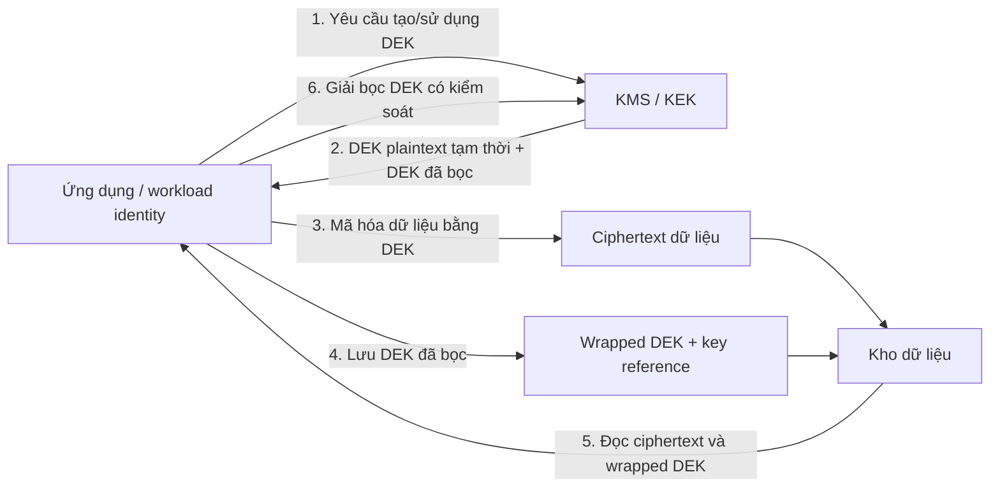
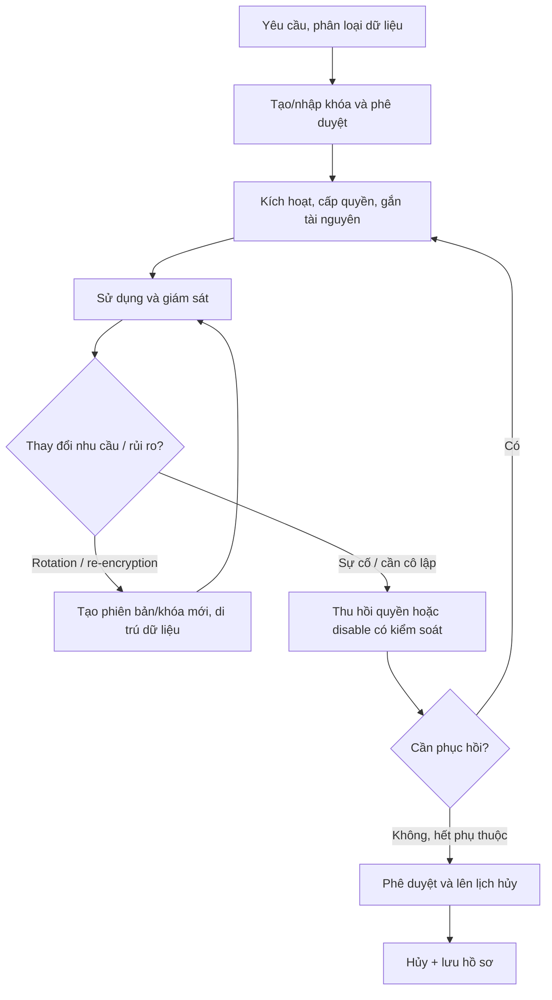
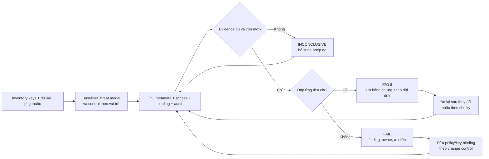

# Cloud key management trong Security Assurance

## 1. Vì sao quản lý khóa trên cloud cần được bảo đảm?

Mã hóa dữ liệu chỉ đáng tin cậy khi **khóa mã hóa** được tạo, sử dụng, cấp quyền, luân chuyển, giám sát và hủy theo chính sách phù hợp. Một cơ sở dữ liệu được bật tùy chọn *encryption at rest* vẫn có thể gặp rủi ro nếu mọi quản trị viên đều có quyền giải mã, khóa có thể bị xóa khiến dữ liệu không thể khôi phục, hoặc hệ thống đang sử dụng khóa khác với khóa được phê duyệt.

**Cloud key management** là việc quản lý các khóa mật mã trong môi trường cloud, thường thông qua dịch vụ Key Management Service (KMS), hardware security module (HSM) hoặc hệ thống khóa bên ngoài. Trong phạm vi **Cloud assurance** của module **SECURITY_SECURITY_ASSURANCE**, mục tiêu là tạo được **kết luận có bằng chứng** rằng việc quản lý khóa đáp ứng mục tiêu bảo mật: bảo vệ tính bí mật và toàn vẹn, giảm rủi ro lạm dụng quyền, duy trì khả năng truy xuất dữ liệu hợp lệ, đồng thời hỗ trợ kiểm thử, audit và khắc phục phát hiện trong suốt vòng đời hệ thống.

Cần phân biệt ba câu hỏi:

1. **Policy/intent:** tổ chức yêu cầu dùng loại khóa nào, trong vùng nào, với ai được phép sử dụng?
2. **Effective configuration:** key hiện có trạng thái, cấu hình, chính sách cấp quyền và liên kết tới tài nguyên như thế nào?
3. **Actual operation:** ứng dụng/dịch vụ có thực sự mã hóa bằng khóa dự kiến, chỉ danh tính được ủy quyền mới có thể giải mã và sự kiện sử dụng khóa có được ghi nhận không?

Chẳng hạn, thông báo “rotation enabled” cho một khóa **không chứng minh** dữ liệu cũ đã được mã hóa lại; một chính sách KMS hạn chế quyền cũng **không tự chứng minh** mọi bản sao dữ liệu đang dùng đúng khóa. Assurance phải gắn **control → tài sản/khóa → phương pháp kiểm tra → dữ liệu gốc → kết luận → finding và lần kiểm tra lại**.

### Kết quả học tập

Sau bài học, người học có thể:

- Giải thích các thành phần của quản lý khóa cloud và ranh giới trách nhiệm giữa khách hàng với nhà cung cấp.
- Mô hình hóa vòng đời khóa và xác định rủi ro tại các bước tạo, cấp quyền, sử dụng, rotation, vô hiệu hóa và xóa.
- Định nghĩa baseline kiểm soát khóa với tiêu chí có thể đo được cho từng loại workload.
- Thu thập bằng chứng từ KMS, IAM, nhật ký truy cập và tài nguyên mã hóa; đánh giá giới hạn của từng nguồn.
- Xây dựng quy trình phát hiện sai lệch, quản lý ngoại lệ, xử lý sự cố và kiểm chứng sau khắc phục.

## 2. Các khái niệm và ranh giới kỹ thuật

| Khái niệm | Vai trò | Cần lưu ý khi assurance |
|---|---|---|
| **KMS** | Dịch vụ quản lý khóa và cung cấp thao tác mật mã, chính sách truy cập, quản lý vòng đời | Phải xác minh key metadata, IAM/key policy, trạng thái key, log và các dịch vụ đang dùng khóa |
| **HSM** | Phần cứng/chế độ vận hành có ranh giới bảo vệ khóa mật mã | Cần xác định mức đảm bảo/cấu hình thực tế, trách nhiệm quản trị; không mặc định KMS nào cũng đáp ứng cùng yêu cầu HSM |
| **Key Encryption Key (KEK)** | Khóa dùng để bọc/giải bọc khóa dữ liệu; thường là key được quản lý bằng KMS | Kiểm tra quyền sử dụng key và dữ liệu nào phụ thuộc vào nó |
| **Data Encryption Key (DEK)** | Khóa dùng mã hóa dữ liệu ứng dụng, thường là khóa đối xứng | Không lưu bản plaintext DEK lâu dài, không log/đẩy vào repository; xem cách lưu DEK đã bọc |
| **Envelope encryption** | Mã hóa dữ liệu bằng DEK, rồi bọc DEK bằng KEK/KMS | Xác minh cả metadata của DEK bọc, key reference và phép giải mã hợp lệ |
| **Key ID / key version** | Định danh khóa logic và phiên bản vật liệu khóa (cách biểu diễn tùy nhà cung cấp) | Khi rotation cần xác định dữ liệu mới/cũ dùng phiên bản nào, cách decrypt dữ liệu lịch sử |
| **Customer-managed key** | Khóa do khách hàng quản lý chính sách, vòng đời hoặc các quyền cho phép, tùy dịch vụ | Cho phép kiểm soát nhiều hơn nhưng tăng trách nhiệm quản trị, backup/recovery và tránh mất dữ liệu |
| **Provider-managed key** | Khóa do nhà cung cấp/dịch vụ quản lý theo mô hình được cung cấp | Không suy ra quyền sửa policy, xem log hay tự chọn lịch rotation giống customer-managed key |
| **BYOK / External key** | Khóa/vật liệu nguồn bên ngoài hoặc cơ chế phụ thuộc dịch vụ quản lý khóa bên ngoài | Cần làm rõ nơi lưu/truy xuất vật liệu khóa, độ sẵn sàng, độ trễ và cách chứng minh kiểm soát |
| **Secret / certificate** | Mật khẩu, API token, chứng thư hoặc khóa TLS có quy trình quản lý liên quan | Không đánh đồng vòng đời secret/certificate với vòng đời khóa mã hóa dữ liệu trong KMS |

**Khóa đối xứng** thường phục vụ mã hóa/giải mã dữ liệu (ví dụ qua AES với mode phù hợp). **Khóa bất đối xứng** được dùng cho ký/xác minh hoặc mã hóa/giải mã tùy thuật toán và mục đích đã tạo. Không nên áp cùng một chính sách rotation hay cùng một phép thử cho cả hai; với khóa ký, việc thay khóa còn liên quan phân phối khóa công khai, chuỗi tin cậy và khả năng xác minh chữ ký cũ.

Một **alias** hoặc tên thân thiện không nhất thiết là một phiên bản vật liệu khóa. Alias có thể trỏ sang khóa khác sau thay đổi: evidence nên giữ định danh khóa thực tế, không chỉ ghi alias.

### Trách nhiệm chia sẻ trên cloud

Nhà cung cấp thường chịu trách nhiệm nhiều lớp bảo vệ hạ tầng KMS, còn khách hàng chịu trách nhiệm chọn loại khóa, cấu hình policy, định danh nào được dùng khóa, gắn khóa với dữ liệu, giám sát hoạt động và quản lý vòng đời. Mức phân chia thay đổi theo sản phẩm và chế độ quản lý khóa.

Ví dụ với database được quản lý: nhà cung cấp có thể thực hiện mã hóa storage, nhưng khách hàng vẫn phải xác định **instance và backup/snapshot nào đang dùng loại khóa nào**, quyền quản trị khóa và điều gì xảy ra khi khóa bị vô hiệu hóa. Với application-level encryption, khách hàng còn chịu trách nhiệm luồng xử lý DEK, bộ nhớ, cache, metadata bản mã và cách ứng dụng gọi KMS.

## 3. Envelope encryption: khóa nào bảo vệ dữ liệu nào?

Trong nhiều kiến trúc, không dùng trực tiếp KMS cho từng kilobyte dữ liệu. Ứng dụng sử dụng DEK để mã hóa dữ liệu và dùng KEK được quản lý bởi KMS để bảo vệ DEK. Mô hình minh họa:



Sơ đồ giản lược để giải thích **trust boundary**: plaintext DEK chỉ nên tồn tại tạm thời tại thành phần có thẩm quyền thực hiện mã hóa/giải mã; không đưa vào log, Git, ticket hoặc bộ evidence. Nếu một dịch vụ cloud tự quản lý envelope encryption, ứng dụng có thể không bao giờ thấy plaintext DEK; phải xác minh qua cấu hình và audit của dịch vụ đó.

**Các giả định cần được kiểm chứng:**

- Danh tính workload được phép gọi đúng thao tác mã hóa/giải mã trên **đúng key** trong account/project/subscription và region được phê duyệt.
- Những principal không được ủy quyền không có đường cấp quyền khác qua key policy, IAM, grants/role assignments hoặc quyền quản trị gián tiếp.
- Ciphertext gắn được với key ID/version hoặc thông tin cần cho giải mã hợp lệ về sau.
- Plaintext DEK không được ghi bền vững, rò rỉ qua logging/debug/tracing hoặc phơi bày cho thành phần không cần thiết.
- KMS và kết nối tới KMS có cơ chế vận hành, giám sát và phục hồi phù hợp với mục tiêu sẵn sàng.

Khi cần ràng buộc thêm ngữ cảnh bản mã (ví dụ tenant/resource), một số KMS và thuật toán hỗ trợ **authenticated encryption context/associated data**. Đây thường là metadata phải khớp khi giải mã và có thể xuất hiện trong log: không đặt secret hay dữ liệu cá nhân nhạy cảm vào giá trị ngữ cảnh. Phải kiểm tra tính năng và semantics của provider/thuật toán thực tế.

## 4. Vòng đời khóa và mục tiêu assurance ở mỗi giai đoạn

Một khóa không chỉ có trạng thái “enabled”. Cần xem cả các quyết định quản trị, liên kết với dữ liệu lịch sử và tác động khi thay đổi trạng thái.

| Giai đoạn | Hoạt động | Câu hỏi kiểm chứng |
|---|---|---|
| **Thiết kế** | Chọn mục tiêu, thuật toán, key origin, phân vùng/region, chủ sở hữu và thời gian lưu | Quyết định có dựa trên phân loại dữ liệu và threat model không? |
| **Tạo/nhập khóa** | KMS/HSM tạo key hoặc nhập vật liệu khóa theo quy trình được duyệt | Key có đúng loại, mục đích sử dụng và nơi lưu vật liệu không? |
| **Kích hoạt/gán** | Cấp quyền, liên kết dịch vụ/app với key | Principal và resource thực tế có khớp thiết kế không? |
| **Sử dụng** | Encrypt/decrypt, wrap/unwrap, sign/verify tùy key | Quyền có tối thiểu, thao tác có được ghi nhận theo yêu cầu không? |
| **Rotation** | Tạo key version mới, thay key reference hoặc chính sách dùng khóa cho dữ liệu mới | Có bản kế hoạch, điều kiện hỗ trợ và bằng chứng sử dụng key mới không? |
| **Tạm ngừng/thu hồi** | Disable key, thu hồi grants/quyền, cô lập workload khi có sự cố | Đã đánh giá tác động tới dữ liệu, backup, queue và DR chưa? |
| **Lưu giữ/phục hồi** | Giữ khả năng giải mã dữ liệu cũ, bảo vệ key version cũ | Restore thực tế có thành công trong RTO/RPO và vùng/tenant cần thiết không? |
| **Xóa/hủy** | Lên lịch xóa, hết thời gian chờ, hủy vật liệu theo policy | Đã chứng minh không còn phụ thuộc và có phê duyệt phù hợp chưa? |



**Rotation không đồng nghĩa mã hóa lại toàn bộ dữ liệu.** Tùy thiết kế, KMS giữ vật liệu phiên bản cũ để giải mã bản mã cũ, còn hoạt động mã hóa mới dùng phiên bản mới. Nếu tổ chức yêu cầu loại bỏ phụ thuộc vào vật liệu khóa cũ, cần một kế hoạch **re-encryption / rewrap / migrate** riêng và phép thử đọc dữ liệu cũ.

**Disable và delete** có tác động khác nhau: disable có thể đảo ngược nếu cơ chế cloud cho phép; xóa sau thời gian chờ có thể không thể phục hồi. Kết quả “khóa đã xóa” không chứng minh dữ liệu cũng đã được xóa an toàn nếu còn plaintext hoặc bản sao được mã hóa bằng khóa khác. Ngược lại, xóa khóa khi còn dữ liệu phụ thuộc có thể dẫn đến mất dữ liệu không thể đảo ngược.

## 5. Threat model cho cloud key management

Security assurance nên bắt đầu từ các mối đe dọa có ý nghĩa với workload, thay vì chỉ bật tất cả tính năng có sẵn.

| Kịch bản rủi ro | Tác động | Kiểm soát cần kiểm chứng |
|---|---|---|
| Principal quá rộng được phép `Decrypt` hoặc thao tác tương đương | Lộ dữ liệu dù storage đã được mã hóa | Key policy/IAM/grants/conditions có hiệu lực; thử truy cập âm tính có kiểm soát |
| Một người vừa sửa key policy vừa có thể dùng key và xóa log | Vượt qua phê duyệt, giảm khả năng truy vết | Phân tách trách nhiệm, hạn chế quyền escalation, audit lưu ở vùng có kiểm soát độc lập |
| Alias hoặc resource được chuyển sang key khác | Dữ liệu mới không dùng key được phê duyệt | Đối chiếu key ID thực tế của tài nguyên và cấu hình theo baseline |
| Khóa nằm sai region/account/project | Vi phạm nơi lưu dữ liệu, tăng khó khăn DR | Định danh vùng, tenant, dự án, policy data residency và danh mục tài sản |
| KMS key disable/delete khi dữ liệu còn phụ thuộc | Mất khả năng đọc database, snapshot hoặc backup | Kiểm kê phụ thuộc, phê duyệt nhiều bước, kiểm tra khôi phục, cảnh báo thao tác nguy hiểm |
| Rotation mất tương thích | Ứng dụng không giải mã dữ liệu cũ hoặc xác minh chữ ký cũ | Thử đọc dữ liệu lịch sử, versioning và kế hoạch chuyển đổi |
| Plaintext DEK bị log hoặc giữ lâu trong bộ nhớ/cache | Lộ khóa và dữ liệu liên quan | Code/config review, kiểm soát secret/logging, thử nghiệm theo threat model |
| Nhật ký KMS thiếu/không tới nơi tập trung | Không thể phát hiện sử dụng bất thường hay điều tra sự cố | Cấu hình data-plane audit, thời gian nhận log, cảnh báo mất log |
| Key store bên ngoài/KMS bị gián đoạn | Ngưng mã hóa/giải mã, tăng thời gian phục hồi | Thiết kế retry/timeout/cache được xét rủi ro, kiểm thử gián đoạn và runbook |

Phân biệt **quyền quản lý** (`create`, `update policy`, `disable`, `schedule deletion`) và **quyền sử dụng vật liệu khóa** (`encrypt`, `decrypt`, `sign`, `verify`, `generate data key`). Một user không được cấp `Decrypt` trực tiếp vẫn có thể tạo đường truy cập nếu có quyền sửa key policy, tạo grant hoặc gán role cho chính mình. Việc rà soát phải đi đến **effective permissions**, kể cả kế thừa và cấp quyền gián tiếp.

## 6. Baseline các security control cho khóa cloud

Ví dụ bộ control minh họa, cần điều chỉnh theo nền tảng và yêu cầu dữ liệu thực tế:

| Control ID | Yêu cầu có thể đo | Bằng chứng/kiểm tra | Giới hạn thường gặp |
|---|---|---|---|
| `KEY-01 Inventory` | Mỗi key thuộc phạm vi có owner, purpose, môi trường, region và tài sản phụ thuộc | Danh mục key/API metadata, tags, CMDB, map resource-to-key | Tag đẹp không chứng minh mọi tài sản đều được ghi nhận |
| `KEY-02 Approved crypto` | Thuật toán, key type, key size/origin và cấu hình đáp ứng baseline theo mục đích sử dụng | Key metadata, tài liệu yêu cầu, thuộc tính crypto của workload | Chỉ nhìn tên dịch vụ không chứng minh thuật toán thực tế của toàn luồng dữ liệu |
| `KEY-03 Least privilege` | Chỉ principal được phê duyệt mới dùng/đổi key; quyền admin và data-plane được tách theo chính sách | Key policy, IAM/grant/role assignment, effective access analysis, thử truy cập | Policy ở một lớp có thể bị thay đổi/bổ sung bởi lớp khác |
| `KEY-04 Correct binding` | Workload và tài nguyên trong phạm vi thực sự sử dụng key được phê duyệt | Metadata resource, key ID/version, output API, phép thử đọc/ghi khi phù hợp | Một tùy chọn default encryption không chứng minh mọi dữ liệu lịch sử đã dùng key |
| `KEY-05 Rotation` | Mỗi loại key có lịch/trigger rotation được phê duyệt và triển khai | Metadata rotation, lịch sử thay đổi version/ID, evidence kiểm thử dữ liệu cũ | Rotation flag không chứng minh migration/re-encryption |
| `KEY-06 Safe deactivation` | Disable/delete có review, kiểm kê phụ thuộc, thời gian chờ và phục hồi phù hợp | Approval, policy guardrails, alerts, runbook, kết quả thử restore | Nhiều thao tác phụ thuộc provider và có thể không khôi phục được sau hủy |
| `KEY-07 Auditability` | Hoạt động sử dụng và quản trị khóa trọng yếu được ghi, lưu, giám sát theo chính sách | Cấu hình audit, sự kiện thử nghiệm, độ trễ nhận log, SIEM alert | Không phải mọi event được ghi mặc định ở mọi cloud/service |
| `KEY-08 Resilience` | RTO/RPO và kịch bản sự cố KMS/key store được kiểm chứng | Dependency inventory, kế hoạch DR, thử failover/restore | Key multi-region/backup không tự bảo đảm dữ liệu khôi phục được |
| `KEY-09 Drift & exceptions` | Sai lệch policy/key binding được phát hiện, xử lý và ngoại lệ có hạn | Kết quả scanner, change history, finding, exception register | “Accepted risk” không biến trạng thái không tuân thủ thành `PASS` |

Đối với tiêu chuẩn phải dùng module mật mã có chứng nhận hoặc mức đảm bảo cụ thể, phải kiểm tra **mô hình triển khai, phiên bản, phạm vi chứng nhận và chế độ vận hành được áp dụng**. Không suy ra chứng nhận từ tên thương mại “HSM” hay “KMS”.

## 7. Kiểm soát quyền truy cập và tách biệt trách nhiệm

Quyền sử dụng khóa thường được quyết định qua nhiều lớp: IAM, resource/key policy, role assignment, grants, service identity, network boundary, điều kiện theo workload và cơ chế của nhà cung cấp. Cần xác nhận **kết quả kết hợp**, không đánh giá một JSON policy đơn lẻ rồi suy ra toàn bộ quyền.

### Phân vai tham khảo

| Vai trò | Quyền cần thiết | Quyền nên hạn chế |
|---|---|---|
| Security governance | Duyệt baseline, ngoại lệ, chính sách vòng đời; xem báo cáo | Trực tiếp decrypt dữ liệu sản xuất khi không có nhiệm vụ |
| Key administrator | Tạo key, áp policy theo quy trình, cấu hình rotation và theo dõi trạng thái | Data decrypt tùy yêu cầu phân tách trách nhiệm; tự duyệt thao tác hủy |
| Workload/service identity | Encrypt/decrypt/generate data key với đúng key và điều kiện ứng dụng | Sửa policy, tạo grant ngoài phạm vi, disable/delete key |
| Auditor/read-only collector | Xem metadata, policy hiệu lực, trạng thái, log cần thiết | Sử dụng key để decrypt hoặc điều chỉnh policy |
| Break-glass | Quyền khẩn cấp có giới hạn, xác thực mạnh và ghi log | Quyền thường trực, không có hậu kiểm và thời hạn |

Ví dụ minh họa ở mức khái niệm:

```text
Principal: service-role/payment-api-prod
Allowed actions: Encrypt, Decrypt, GenerateDataKey
Scope: key-id/payment-data-prod, only approved environment/account
Conditions: workload identity + permitted encryption context (if supported)
Not allowed: key policy update, grant management, disable, deletion
Owner: payments-platform
Approval: SEC-ARCH-091, review date: scheduled
```

Khi kiểm toán, cần truy ngược mọi cơ chế có thể mở rộng quyền: quyền admin trên account, khả năng giả mạo/assume workload role, cấu hình trust, cross-account grants, machine identity, inherited roles và key policy. Các tên action và các cơ chế áp dụng khác nhau giữa AWS, Azure, Google Cloud; nội dung ví dụ trên chỉ là mô hình kiểm soát, không phải policy có thể áp dụng nguyên văn.

**Phép thử âm tính** (negative test) nên sử dụng danh tính thử nghiệm được phép, tài nguyên thử và thao tác không gây rủi ro. Kiểm tra người không có quyền `Decrypt` thực sự bị từ chối; đồng thời kiểm tra workload hợp lệ không bị khóa sau khi siết policy. Không dùng key dữ liệu production hoặc thử disable/delete key chỉ để chứng minh control nếu không có kế hoạch triển khai được phê duyệt.

## 8. Rotation, re-encryption và key version

Đánh giá rotation cần phân biệt các cơ chế:

1. **Automatic key material rotation**: dịch vụ giữ key logic nhưng tự cập nhật vật liệu/phiên bản (nếu loại key được hỗ trợ); thông thường bản mã cũ vẫn giải được bằng vật liệu cũ được lưu trong dịch vụ.
2. **Manual key replacement**: tạo key mới, chuyển alias/reference hoặc cập nhật cấu hình resource; cần thử ứng dụng, dữ liệu cũ và quá trình cutover.
3. **DEK rotation/rewrap**: tạo DEK mới hoặc bọc lại DEK cũ bằng KEK khác. **Rewrap** không nhất thiết mã hóa lại plaintext dữ liệu; phải xác định mục tiêu thay đổi vật liệu DEK hay chỉ đổi lớp bảo vệ DEK.
4. **Full re-encryption**: giải mã và mã hóa lại dữ liệu bằng khóa mới, có thể cần xử lý bản sao, backup, cache, version và giao dịch đang chạy.

| Kết luận muốn chứng minh | Bằng chứng tối thiểu |
|---|---|
| Key hỗ trợ và bật automatic rotation | Loại key, API metadata, phiên bản/cấu hình và trạng thái rotation |
| Dữ liệu mới đang dùng khóa/phiên bản mong muốn | Metadata đối tượng mới, key reference, phép thử ghi và đọc có kiểm soát |
| Dữ liệu cũ vẫn dùng được sau rotation | Tập mẫu dữ liệu lịch sử, phép thử decrypt/restore hợp lệ |
| Dữ liệu cũ không còn phụ thuộc vật liệu cũ | Kế hoạch migration, inventory và kiểm tra trạng thái sau re-encryption/rewrap; không chỉ nhìn rotation flag |
| Key cũ có thể ngừng dùng an toàn | Danh sách phụ thuộc đầy đủ, thử khôi phục, phê duyệt và giám sát sau cutover |

Rotation định kỳ **không thay thế** phản ứng khi nghi ngờ lộ khóa. Sự cố có thể cần cô lập quyền, thu hồi grant, thay key, tái mã hóa dữ liệu, điều tra phạm vi phơi nhiễm và cập nhật chứng cứ theo quy trình incident response.

## 9. Vận hành, sao lưu và khả năng khôi phục

Khả năng sẵn sàng của dữ liệu phụ thuộc vào **cả dữ liệu mã hóa và khả năng dùng key tương ứng**. Snapshot còn tồn tại không đồng nghĩa khôi phục được nếu KMS key đã bị xóa, không sẵn có ở vùng khôi phục hoặc role của dịch vụ backup không có quyền decrypt/rewrap.

Với mỗi lớp dữ liệu quan trọng, cần trả lời:

- Khóa nào (ID/version/region/tenant) đang bảo vệ database, disk, object, snapshot và các bản sao?
- RTO/RPO được xác định ra sao? Khi KMS, HSM hoặc external key store mất kết nối, ứng dụng xử lý thế nào?
- Khóa/metadata cần cho recovery có sẵn ở vùng/site dự phòng không? Cơ chế multi-region hoặc replication thực tế hỗ trợ loại key này ở mức nào?
- Ai có quyền restore và dùng key ở recovery account; quyền này có thể kiểm tra mà không mở rộng cho toàn bộ vận hành không?
- Đã thử khôi phục cả bản dữ liệu cũ sau rotation và sau thay đổi policy chưa?
- Với imported material hoặc external key, ai giữ bản dự phòng theo quy định và rủi ro mất vật liệu được xử lý ra sao?

### Quy trình an toàn trước khi disable/delete

Một danh sách kiểm tra có thể bao gồm: xác nhận owner và phê duyệt; liệt kê mọi resource/backup còn phụ thuộc; kiểm tra kế hoạch di trú; thử restore với data set đại diện; đánh giá thời gian chờ xóa và phương án hủy yêu cầu nếu được hỗ trợ; thiết lập cảnh báo; quan sát hậu thay đổi. Không thể xem thao tác “scheduled deletion” là kết thúc an toàn khi chưa xác nhận ràng buộc dữ liệu.

Khi buộc phải vô hiệu hóa key để xử lý sự cố, cần phối hợp chủ hệ thống, ứng cứu sự cố, bảo mật và vận hành. **Kết quả assurance** phải phản ánh cả mục tiêu giảm truy cập trái phép lẫn rủi ro tính sẵn sàng, không chỉ việc trạng thái key đã chuyển từ enabled sang disabled.

## 10. Thu thập bằng chứng kiểm tra key trên cloud

Một bộ bằng chứng tốt gồm ít nhất bốn nguồn hỗ trợ nhau:

- **Key metadata:** ID/ARN hoặc tên đầy đủ, loại key, mục đích, trạng thái, nguồn vật liệu, vùng, owner, ngày tạo/rotation nếu áp dụng.
- **Effective access:** IAM, key policy, grants/role bindings, điều kiện và đường leo thang quyền có liên quan.
- **Resource binding:** metadata của đúng database/disk/bucket/object/backup đang dùng khóa; xác nhận khóa tại thời điểm đo.
- **Runtime và audit:** sự kiện sử dụng/quản trị khóa, thay đổi policy, rotation, lỗi truy cập và kết quả kiểm thử được phép.

Không nên chỉ chạy một lệnh rồi đưa kết luận cho toàn bộ key estate. Một số thông số rotation chỉ có cho **loại key cụ thể**; lỗi “unsupported operation” cần được phân loại theo khả năng áp dụng của key, không tự động gán là `FAIL`.

### 10.1. Ví dụ AWS KMS (lệnh quan sát)

Các ví dụ dưới đây dùng AWS CLI trong tài khoản được ủy quyền, thay giá trị minh họa bằng định danh của tổ chức. Không chứa thao tác tạo, disable hay xóa key.

```bash
# Xác định tài khoản/định danh thực thi và vùng dự kiến
aws sts get-caller-identity

# Key metadata và trạng thái hiện tại
aws kms describe-key --key-id alias/app-data-prod --region ap-southeast-1

# Key policy hiện có (cần quyền đọc tương ứng)
aws kms get-key-policy \
  --key-id alias/app-data-prod --policy-name default \
  --region ap-southeast-1

# Tags phục vụ inventory/owner, nếu có
aws kms list-resource-tags --key-id alias/app-data-prod \
  --region ap-southeast-1

# Chỉ sử dụng khi loại key cho phép kiểm tra rotation bằng API này
aws kms get-key-rotation-status --key-id alias/app-data-prod \
  --region ap-southeast-1
```

**Diễn giải:** `describe-key` và `get-key-policy` mô tả một phần cấu hình; muốn xác nhận đường cấp quyền hiệu lực, cần xét identity policy, grants, role assumption, điều kiện và account policy. `get-key-rotation-status` không áp dụng giống nhau cho tất cả key type, key origin và chế độ quản lý. Kết quả API còn phải đối chiếu **tài nguyên đang dùng key ID nào**; alias không phải bằng chứng rằng một object hay database thực sự được mã hóa bằng key đó.

Đối với audit, có thể thu lịch sử sự kiện được cấu hình trong CloudTrail/hệ thống SIEM và kiểm tra event của một thao tác được phê duyệt. Cần xác minh **event selectors, nguồn log, vùng lưu, độ trễ và retention**; không được mặc định mọi lần sử dụng key đã được ghi hoặc đưa vào hệ thống tập trung.

### 10.2. Ví dụ Google Cloud KMS (lệnh quan sát)

```bash
# Key metadata trong key ring và location cụ thể
gcloud kms keys describe app-data \
  --keyring=prod-ring --location=asia-southeast1 \
  --project=example-security-project

# Các phiên bản và trạng thái của key
gcloud kms keys versions list \
  --key=app-data --keyring=prod-ring \
  --location=asia-southeast1 --project=example-security-project

# IAM policy ở cấp key (cần kiểm tra thêm quyền được kế thừa)
gcloud kms keys get-iam-policy app-data \
  --keyring=prod-ring --location=asia-southeast1 \
  --project=example-security-project
```

**Diễn giải:** policy ở cấp key không tự cho thấy đầy đủ quyền kế thừa từ project/folder/organization; cần phân tích cấu trúc quyền thực tế. Khi thu audit log, kiểm tra cấu hình và khả năng truy cập **Data Access logs**/Admin Activity phù hợp với tổ chức; thiếu một event chưa chứng minh thao tác không diễn ra.

### 10.3. Ví dụ Azure Key Vault (lệnh quan sát)

```bash
# Key metadata, thuộc tính và phiên bản hiện hành
az keyvault key show \
  --vault-name example-prod-vault --name app-data

# Đặc điểm vault, gồm chế độ phân quyền nếu thuộc tính có sẵn
az keyvault show --name example-prod-vault
```

**Diễn giải:** cần xác định cấu hình vault/managed HSM, key versions, RBAC hoặc access policy được sử dụng, role assignments có hiệu lực, quyền tại subscription/resource group và diagnostic settings cho audit. Trạng thái key trong vault là một lớp evidence; phải đối chiếu mã định danh key được tham chiếu bởi storage/database/app thật sự. Tính năng và lệnh cụ thể thay đổi theo loại dịch vụ, phiên bản và chế độ sử dụng.

**Mẫu bảo mật khi chạy các lệnh:** sử dụng tài khoản chỉ đọc, chọn đúng subscription/project/account và region, lưu cả kết quả lỗi, timestamp và phiên bản CLI. Không in ra secret, plaintext key hoặc thông tin khách hàng để tạo bằng chứng. Các định danh trong ví dụ là giả định, không phải tài nguyên tồn tại.

## 11. Thiết kế record bằng chứng cho key assurance

Ví dụ bản ghi YAML **mô phỏng** cho một key dùng bởi dịch vụ dữ liệu production:

```yaml
assessment_id: cloud-key-assurance-20261128-01
scope:
  provider: example-cloud
  account_or_project: example-prod
  region: region-a
  environment: production
  resource_id: db-orders-prod
  resource_type: managed-database
control:
  id: KEY-04
  baseline_version: cloud-data-keys-v3
  requirement: "Database uses an approved customer-managed key"
expected:
  key_id: key-orders-prod-001
observed:
  key_id: key-orders-prod-001
  key_state: enabled
  observed_at_utc: "2026-11-28T04:00:00Z"
collection:
  identity: auditor-readonly-role
  method: "Cloud API read: key metadata + database encryption config"
  tool_version: "collector-v2"
  outcome: success
assessment:
  result: PASS
  rule_version: "key-binding-check-v2"
  limitations: "Configuration binding only; no behavioral restore test"
evidence:
  key_metadata_ref: "evidence/KEY-04/key-metadata.json"
  resource_config_ref: "evidence/KEY-04/database-config.json"
  integrity_manifest_ref: "evidence/KEY-04/checksums.sha256"
owner: data-platform
```

Đây là **bản ghi minh họa**, không phản ánh một cloud resource đã được đo. Việc khai báo `PASS` trong ví dụ chỉ có nghĩa **control KEY-04 về key binding** đã đạt theo quy tắc và nguồn dữ liệu được nêu. Không nên dùng kết quả đó để khẳng định IAM least privilege, logging, recovery hay tính toàn vẹn của mọi backup cũng đạt.

### Trường dữ liệu evidence quan trọng

| Trường | Câu hỏi cần trả lời |
|---|---|
| `control_id` + `baseline_version` | Tiêu chí nào được dùng để so sánh? |
| `asset_id`/`resource_id` + provider/account/region | Chính xác khóa/tài nguyên nào, trong môi trường nào? |
| `key_id` + `key_version` (nếu áp dụng) | Key nào thực sự được dùng? Thay alias có ảnh hưởng gì? |
| `collector_identity` + method/tool version | Ai/agent nào thu thập, dùng cách và quyền nào? |
| `collected_at_utc` + `observed_at_utc` | Trạng thái có mới và thuộc cùng lần đánh giá không? |
| `expected`, `observed`, error/API status | Dữ liệu gốc cho kết luận là gì? |
| `raw_evidence_ref` + hash/manifest | Có thể truy hồi đúng bản và phát hiện bị sửa không? |
| `result` + `limitations` + `finding_id` | Kết luận có giới hạn nào và ai xử lý sai lệch? |

Có thể dùng checksum và kho có versioning/audit trail để bảo vệ tính toàn vẹn. **Checksum không xác thực nguồn gốc** nếu manifest cũng có thể bị sửa; cần bảo vệ danh tính collector, kênh chuyển, quyền ghi và lịch sử truy cập. Bản export policy/log có thể tiết lộ tên tài nguyên, role và cấu trúc hệ thống; lưu ở nơi phân quyền phù hợp, có thời hạn retention và cơ chế loại bỏ dữ liệu nhạy cảm.

## 12. Quy trình assurance từ baseline tới finding



**Bước 1 — Inventory và rủi ro.** Liệt kê key, alias, type, origin, region, owner, trạng thái, tài nguyên/dữ liệu phụ thuộc, key phục vụ DR hoặc backup. Đối chiếu giữa inventory cloud và asset inventory để phát hiện tài nguyên chưa khai báo.

**Bước 2 — Gán baseline.** Ví dụ key của dữ liệu thanh toán production cần customer-managed key ở vùng được duyệt, phân tách quyền admin/decrypt, logging và lịch rotation theo chính sách. Các tiêu chí về key origin, HSM và thời hạn sẽ phụ thuộc threat model, compliance và ứng dụng.

**Bước 3 — Thu raw evidence.** Lấy metadata KMS, IAM/key policy/grants, effective permissions khi có khả năng phân tích, metadata tài nguyên và audit event. Gắn asset ID, timestamp UTC, collector identity, output/API status và phiên bản tool. Lưu riêng dữ liệu thô và bản normalized assessment.

**Bước 4 — Đưa kết luận chính xác.** Dùng `PASS` khi đạt tiêu chí và có bằng chứng hợp lệ; `FAIL` khi quan sát sai; `INCONCLUSIVE` nếu thiếu quyền, dữ liệu cũ, log không có hoặc loại key không hỗ trợ phương pháp đo; `NOT_APPLICABLE` khi control không áp dụng và có lý do. Ngoại lệ được phê duyệt phải theo dõi riêng, không biến `FAIL` thành `PASS`.

**Bước 5 — Khắc phục và kiểm chứng.** Tạo finding có owner, hạn, rủi ro, kế hoạch thay đổi, bằng chứng trước/sau; kiểm tra tác động tới service và backup. Đóng finding sau khi có phép đo mới đáp ứng tiêu chí, kể cả kiểm thử hành vi khi control đòi hỏi.

**Bước 6 — Theo dõi liên tục.** Quét sau tạo key, cập nhật policy/IAM, thay alias, đổi key binding, rotation, thay key state, thay cấu hình logging và trong chu kỳ phù hợp với mức rủi ro. Cảnh báo khi thiếu dữ liệu khảo sát hoặc evidence quá tuổi.

### Kiểm tra ở ba mức

- **Declared:** tiêu chí trong policy và IaC, thiết kế/key ownership đã được phê duyệt.
- **Effective:** IAM/key policy, resource binding và key state thực tế trong cloud.
- **Behavioral:** workload hợp lệ mã hóa/giải mã thành công; danh tính không được phép bị từ chối; recovery được kiểm thử khi cần.

Phép thử hành vi cần giới hạn phạm vi, dùng dữ liệu kiểm thử và được phê duyệt. Tránh chủ động vô hiệu hóa/xóa key production hoặc làm phát sinh bản mã chứa dữ liệu nhạy cảm chỉ để tạo evidence.

## 13. Case study: "Encryption enabled" nhưng dùng sai key

**Bối cảnh.** Công ty vận hành database đặt hàng production; control `KEY-04` yêu cầu database và các snapshot quan trọng sử dụng customer-managed key `key-orders-prod-001`. Dashboard báo “Encryption at rest: enabled”. Key metadata của `key-orders-prod-001` cho thấy key enabled, rotation theo chính sách và không có finding IAM.

**Phát hiện.** Phép đọc metadata database cho thấy instance sử dụng khóa do dịch vụ cloud quản lý. Một snapshot tạo trước đó gắn với key khác. Không có bằng chứng cho thấy dữ liệu và snapshot đều dùng `key-orders-prod-001` như yêu cầu.

**Đánh giá.**

- “Encryption enabled” có thể chứng minh tính năng mã hóa lưu trữ đang bật, nhưng **không đủ** để chứng minh *đúng customer-managed key* được dùng.
- Metadata của `key-orders-prod-001` thể hiện trạng thái của key, không thể thay thế resource binding.
- Kết quả `KEY-04 = FAIL` cho các tài nguyên không dùng key dự kiến; nếu không truy xuất được thông tin snapshot thì kết quả kiểm tra snapshot là `INCONCLUSIVE` cho đến khi có bằng chứng.
- Không nên tắt key cũ hoặc thay đổi resource ngay: cần kiểm tra khả năng đổi key sau khi tạo tài nguyên, cách snapshot/backup hoạt động và kế hoạch di trú của từng dịch vụ.

**Khắc phục có kiểm soát.** Tạo finding gắn database/snapshot ID, owner, vùng, baseline và raw API evidence; phê duyệt phương án di trú theo khả năng của dịch vụ; thử trên môi trường đại diện; xác minh đọc/ghi và restore sau chuyển đổi; đánh giá chi phí/gián đoạn và phương án rollback. Với snapshot cũ, chọn phương án copy/re-encryption theo tính năng thực tế của cloud và chính sách giữ dữ liệu.

**Đóng hồ sơ.** Thu metadata instance và snapshot mới sau thay đổi, xác nhận đúng key ID, thử restore bằng principal được ủy quyền, xác nhận logging hoạt động; lưu evidence trước/sau và ticket. Đánh giá lại KEY-03 (least privilege), KEY-06 (deactivation) và KEY-08 (resilience) nếu việc di trú thay đổi key dependency hay quyền sử dụng.

Bài học ở đây là **một kiểm soát đạt ở lớp KMS không bảo đảm tài nguyên phụ thuộc đạt**. Kết luận assurance phải dựa trên đúng đối tượng và đúng tiêu chí.

## 14. Những sai lầm phổ biến

| Sai lầm | Hậu quả | Cách phòng tránh |
|---|---|---|
| Xem `encryption enabled` là bằng chứng đúng customer key | Bỏ qua resource dùng key khác | Đối chiếu key ID/version ở từng resource, backup và snapshot |
| Chỉ xem policy trực tiếp trên key | Bỏ qua IAM kế thừa, role assumption hoặc grants | Phân tích đường cấp quyền hiệu lực và principal thực tế |
| Bật automatic rotation rồi tuyên bố dữ liệu cũ đã re-encrypt | Hiểu sai phạm vi bảo vệ của rotation | Tách rotation, rewrap và full re-encryption; đo dữ liệu lịch sử |
| Gộp key admin với data decrypt cho mọi người | Tăng nguy cơ lạm dụng quyền và leo thang | Phân tách trách nhiệm theo rủi ro; rà soát quyền gián tiếp |
| Xóa key ngay sau khi thay alias | Mất khả năng đọc ciphertext, backup cũ | Inventory phụ thuộc và kiểm thử restore trước khi ngừng key |
| Mặc định audit được ghi đầy đủ | Mất dấu hoạt động quan trọng | Kiểm tra event selectors, diagnostic settings, độ phủ và cảnh báo mất log |
| Chỉ dùng ảnh màn hình/key alias | Không biết nguồn/thời điểm/key ID thật | Lưu raw API output, UTC, account/region, key ID và checksum |
| Biến scanner timeout thành `PASS` | Thổi phồng tỷ lệ tuân thủ | Trả `INCONCLUSIVE` với lỗi và lên lịch thu thập lại |
| Xuất plaintext DEK để chứng minh tính đúng | Tạo lỗ hổng mới và làm lộ vật liệu khóa | Thu metadata, ciphertext thử và trạng thái thao tác an toàn |
| Coi ngoại lệ đã duyệt như control đạt | Che khuất rủi ro chưa khắc phục | Giữ `FAIL` và theo dõi `exception_id`, owner, thời hạn riêng |

## 15. Bài tập áp dụng: đánh giá kho lưu trữ dữ liệu khách hàng

**Đề bài.** Một bucket object storage lưu dữ liệu khách hàng phải dùng customer-managed key theo baseline, chỉ workload ứng dụng production được sử dụng `Decrypt`, các thao tác quản trị key cần được ghi log; dữ liệu phải khôi phục được sau rotation hoặc lỗi vùng. Có 30 bucket thuộc phạm vi, trong đó scanner đọc được đầy đủ 24 bucket, 4 bucket không truy cập được metadata, 2 bucket chưa có owner.

Thiết kế một **assurance package** gồm:

1. **Inventory:** key, account/project/subscription, region, owner, data classification, bucket và backup/snapshot liên quan.
2. **Control statements:** tiêu chí đo được cho key binding, quyền decrypt, logging, rotation và recovery.
3. **Evidence:** API/CLI metadata key và bucket, effective access, cấu hình log, event test, kết quả thử restore bằng dữ liệu mẫu, method/version/timestamp.
4. **Decision logic:** `PASS`/`FAIL`/`INCONCLUSIVE`/`NOT_APPLICABLE` với rule version và cách xử lý khi thiếu metadata.
5. **Finding và ngoại lệ:** chủ sở hữu, mức rủi ro, deadline, phê duyệt, biện pháp bù trừ và kiểm chứng sau xử lý.
6. **Coverage:** số đối tượng trong phạm vi, số đã đo đủ, số chưa đánh giá, độ tuổi evidence và tỷ lệ đạt trên tập có kết luận hợp lệ.

**Phân tích nhanh:** 24/30 bucket được thu thập đầy đủ nghĩa là độ phủ kết quả đầy đủ là **80%**. Bốn bucket thiếu quyền và hai bucket thiếu owner vẫn thuộc tập phải xử lý; không thể kết luận toàn bộ 30 bucket đạt chỉ vì dashboard báo tốt ở 24 bucket.

### Câu hỏi tự kiểm tra

1. Tại sao bản ghi key “enabled” không đủ chứng minh dữ liệu thực sự được mã hóa bằng key đó?
2. Vai trò có quyền thay key policy nhưng không được cấp `Decrypt` trực tiếp còn tạo ra rủi ro gì?
3. Rotation khác rewrap và full re-encryption ở điểm nào? Kiểm thử nào cần cho dữ liệu cũ?
4. Một key đã đổi alias sang key mới, nhưng snapshot lịch sử vẫn dùng key cũ. Có thể hủy key cũ ngay không?
5. Nếu hệ thống audit không thu được sự kiện sử dụng key do cấu hình log chưa bật, nên đưa ra trạng thái assurance nào?
6. Khi dữ liệu được sao chép sang vùng dự phòng, phải bổ sung những bằng chứng nào về key availability và quyền restore?

## 16. Tiêu chí hoàn thành đánh giá Cloud key management

Một lượt đánh giá đáng tin cậy phải xác định được **khóa nào bảo vệ dữ liệu nào, theo policy phiên bản nào, principal nào có thể sử dụng hoặc quản trị khóa, khóa đang ở trạng thái gì, thao tác có được ghi nhận và khả năng phục hồi ra sao**. Bằng chứng phải có asset/key ID, account/region, thời điểm UTC, nguồn thu thập, giá trị quan sát, giới hạn phép thử, kết luận và liên kết tới finding/ticket.

Khi chưa có dữ liệu đủ tin cậy, cần công bố **khoảng trống bằng chứng** thay vì tuyên bố đạt. Khi phát hiện lệch chuẩn, phải theo dõi tới lần kiểm tra lại có bằng chứng. Đó là cách quản lý khóa cloud chuyển từ một cấu hình vận hành đơn lẻ thành **security assurance liên tục, có thể audit và có thể bảo vệ được kết luận**.
