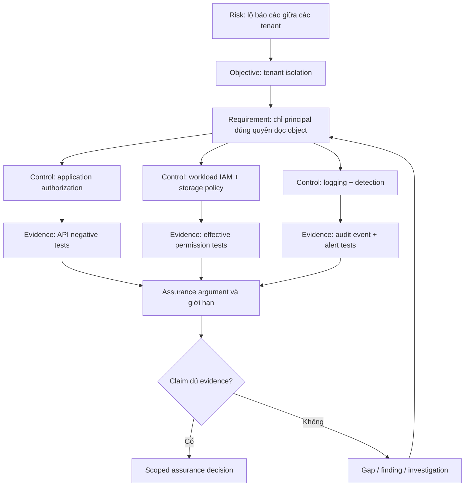
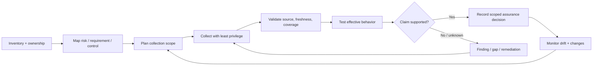
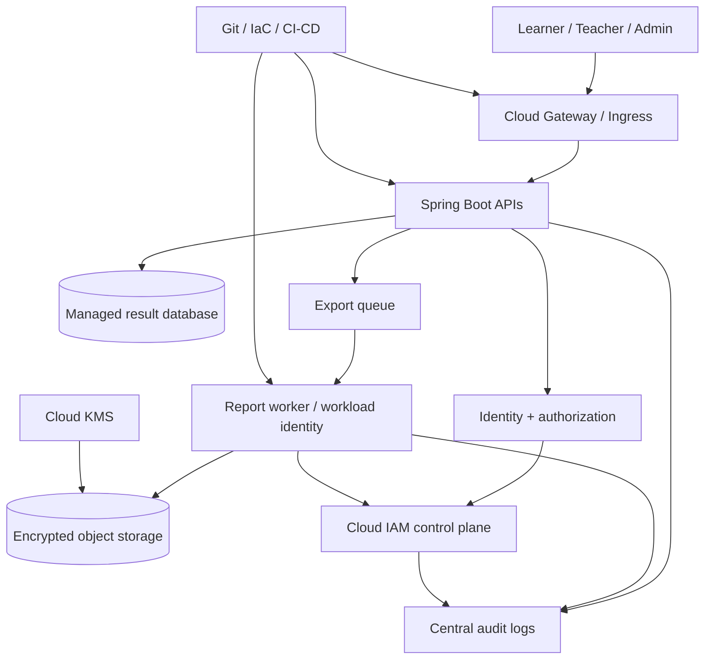

# Bằng chứng cloud control: chứng minh các biện pháp bảo mật đám mây thực sự có hiệu lực

## 1. Từ dấu kiểm “Compliant” đến bằng chứng đáng tin

Một nền tảng học tập vận hành trên cloud sử dụng API Java/Spring Boot, Kubernetes, cơ sở dữ liệu được quản lý, object storage và dịch vụ quản lý khóa. Dashboard quản trị báo các bucket “đã mã hóa”, nhiều policy IAM “đã tuân thủ” và hệ thống audit logging “đã bật”. Trưởng nhóm kết luận: “Các cloud controls đã an toàn, không cần kiểm tra thêm.”

Nhưng một giáo viên tenant A vẫn có thể tải file báo cáo của tenant B vì application authorization kiểm tra sai object ownership. Một job export chạy bằng service account quyền quá rộng. Audit trail ở region phụ không được thu thập về kho tập trung. Bucket được cấu hình encryption-at-rest, nhưng đối tượng tải về vẫn bị truy cập sai quyền.

Các ví dụ trên cho thấy **“control được bật” không tự động đồng nghĩa “mục tiêu bảo mật đã đạt”**.

**Bằng chứng cloud control (cloud control evidence)** là thông tin có nguồn gốc, phạm vi và thời điểm xác định, dùng để hỗ trợ hoặc phản bác một kết luận về **thiết kế, triển khai, vận hành và hiệu lực** của security control trong môi trường cloud.

Trong chương **Cloud assurance** của module **SECURITY_SECURITY_ASSURANCE**, bằng chứng cloud control là thành phần trung tâm của **security assurance có thể kiểm chứng**: từ phân tích rủi ro, yêu cầu và controls đến verification, audit, phát hiện sai lệch, khắc phục và theo dõi liên tục trong phát triển lẫn vận hành.

### Mục tiêu học tập

Sau bài học, bạn có thể:

1. Giải thích cloud control evidence và phân biệt **khai báo, trạng thái thực tế, hiệu lực hành vi**.
2. Ánh xạ risk scenario, security objective, requirement, control, test và evidence theo một chuỗi có thể truy vết.
3. Hiểu trách nhiệm chia sẻ giữa cloud provider và khách hàng; phân biệt **inherited**, **shared** và **customer-operated controls**.
4. Xác định bằng chứng cần có cho IAM, network isolation, encryption, object storage, Kubernetes, logging, backup, cloud workload và data protection.
5. Đánh giá evidence theo **relevance, provenance, integrity, freshness, completeness, repeatability, independence và limitations**.
6. Thiết kế thu thập bằng chứng tự động có phân quyền, dữ liệu tối thiểu và kiểm soát chống sửa đổi.
7. Phân biệt một finding “chưa thu thập được evidence” với một control “đã xác nhận không hiệu lực”.
8. Lập assurance case và thực hành kiểm chứng trên tình huống nền tảng học tập Java/Spring Boot nhiều tenant.

## 2. Cloud control là gì?

**Cloud security control** là biện pháp kỹ thuật, quy trình hoặc tổ chức nhằm giảm một rủi ro bảo mật trong hệ thống sử dụng tài nguyên cloud. Có thể là:

- Identity and Access Management (IAM) policy, workload identity và quy trình cấp/thu hồi quyền.
- Network segmentation, ingress/egress restriction, private endpoints hoặc firewall.
- Encryption at rest/in transit, key management và certificate lifecycle.
- Logging, audit trails, alerting và phát hiện bất thường.
- Storage access policies, data classification, backup và retention.
- Kubernetes admission policies, pod security, image integrity và runtime isolation.
- CI/CD guardrails, IaC review, configuration drift detection.
- Quy trình incident response, vulnerability remediation và periodic access review.
- Controls do cloud provider vận hành theo trách nhiệm của họ.

Các control có nhiều kiểu:

| Kiểu | Mục tiêu | Ví dụ |
|---|---|---|
| **Preventive** | Ngăn hành vi trái phép trước khi xảy ra | IAM deny, admission gate, private route, authentication |
| **Detective** | Phát hiện sự kiện hoặc sai lệch | Audit log, posture scanner, network anomaly alert |
| **Corrective** | Khắc phục vấn đề đã xảy ra | Revoke key, quarantine object, rollback policy |
| **Deterrent** | Giảm ý định vi phạm qua răn đe và trách nhiệm giải trình | Chính sách giám sát, thông báo hoạt động có audit |
| **Compensating** | Đáp ứng một mục tiêu khi primary control chưa áp dụng được | Restricted egress, enhanced monitoring trong ngoại lệ được duyệt |
| **Administrative** | Quy định trách nhiệm, phê duyệt và quy trình | Change approval, access review, risk acceptance |

Một control có thể vừa preventive vừa detective ở nhiều lớp. Khi thu evidence phải biết **claim cụ thể là “ngăn chặn”, “phát hiện” hay “khắc phục”**. Một hệ thống đang chạy ở chế độ audit-only chỉ có thể hỗ trợ claim về detection, không tự chứng minh prevention.

## 3. Evidence khác configuration value, finding và risk assessment thế nào?

| Thành phần | Câu hỏi trả lời | Ví dụ |
|---|---|---|
| **Risk scenario** | Điều gì có thể xảy ra, ai tác động và hậu quả? | Workload bị lạm dụng để đọc báo cáo tenant khác |
| **Security objective** | Tài sản cần được bảo vệ ra sao? | Dữ liệu giữa các tenant phải được cô lập |
| **Requirement** | Điều kiện nào bắt buộc đúng? | Chỉ principal đủ quyền mới được đọc object thuộc tenant của mình |
| **Control** | Biện pháp nào thực thi requirement? | IAM policy + application object authorization + storage ACL |
| **Evidence** | Thông tin nào cho biết control tồn tại và có hiệu lực? | Effective permissions, denied access tests, runtime logs |
| **Finding** | Điều gì không đáp ứng, hoặc chưa đủ evidence? | Một đường tải file không kiểm tra ownership |
| **Risk decision** | Xử lý rủi ro thế nào và ai phê duyệt? | Fix, mitigate hoặc accepted exception có thời hạn |
| **Assurance claim** | Kết luận nào có thể đưa ra dựa trên evidence? | File export không bị đọc xuyên tenant qua các đường đã test |

**Ảnh chụp màn hình cho thấy nút “Encryption: Enabled” là evidence về trạng thái một setting tại một thời điểm**, nhưng không đủ chứng minh dữ liệu không thể bị lộ qua API authorization, không chứng minh khóa có vòng đời phù hợp hoặc mọi object trong scope đều được kiểm chứng.

### Từ “một setting đúng” đến “security property được bảo đảm”

Một control thường cần nhiều điều kiện:

1. **Designed correctly:** thiết kế giải quyết đúng threat scenario.
2. **Configured correctly:** giá trị khai báo đáp ứng policy.
3. **Deployed correctly:** cấu hình được áp dụng tới đúng tài nguyên.
4. **Effective at runtime:** runtime/provider thực thi hành vi mong muốn.
5. **Operated continuously:** control tiếp tục hoạt động; drift, exception và failure được phát hiện.

Thiếu một trong các mắt xích có thể làm claim yếu đi. Bằng chứng cần bao phủ những điều kiện quan trọng theo risk, không chỉ tăng số lượng ảnh chụp.

## 4. Chuỗi Claim – Argument – Evidence trong cloud assurance

Một **assurance case** liên kết:

- **Claim:** điều cần chứng minh.
- **Argument:** vì sao các controls và kết quả kiểm chứng đủ hỗ trợ claim.
- **Evidence:** records, tests, configuration và observations có thể kiểm tra.
- **Assumptions / context / limitations:** giả định, phạm vi, điều chưa xác định.

### Ví dụ claim cho object storage nhiều tenant

> **CLM-DATA-01:** Trong release R và cloud account A, các file báo cáo thuộc hai tenant được kiểm tra chỉ có thể được tải qua các đường ứng dụng được phê duyệt bởi principal có quyền phù hợp; public access bị từ chối.

Để hỗ trợ claim đó có thể cần:

1. Chính sách phân loại dữ liệu và ma trận quyền theo tenant.
2. Policy/IAM/resource ACL hiệu lực cho bucket/prefix trong scope.
3. Application-level authorization review cho download/export endpoints.
4. Negative tests với anonymous user, learner/teacher của tenant khác.
5. Kiểm tra signed URL TTL, cache và đường tải trực tiếp nếu có.
6. Evidence về object storage, runtime workload identity, API version và test release.

Chỉ có một bucket policy mà không kiểm tra application path hoặc principal thực tế sẽ không đủ để hỗ trợ kết luận rộng này.



**Một evidence object có thể hỗ trợ nhiều claims, nhưng phải ghi rõ mối liên hệ.** Ngược lại, một claim quan trọng thường cần nhiều evidence độc lập ở các tầng khác nhau.

## 5. Mô hình trách nhiệm chia sẻ và bằng chứng kế thừa

Cloud không chuyển giao toàn bộ trách nhiệm bảo mật cho provider. **Shared responsibility model** quy định provider và khách hàng chịu trách nhiệm ở các phần khác nhau; ranh giới thay đổi theo dịch vụ IaaS, PaaS, SaaS, loại managed service và hợp đồng.

### 5.1. Phân chia theo mô hình dịch vụ

| Mô hình | Provider thường đảm trách | Khách hàng thường đảm trách |
|---|---|---|
| **IaaS** | Cơ sở hạ tầng vật lý, một phần platform virtualization | Guest OS, workload, network/security groups, IAM, app, data và config |
| **PaaS** | Nhiều thành phần platform/runtime được quản lý | App, data, identities, service config, client access và các lựa chọn bảo mật |
| **SaaS** | Phần lớn ứng dụng và hạ tầng dịch vụ | Identity/tenant config, dữ liệu, sharing policy, monitoring và quy trình sử dụng |
| **Managed database** | Một số hoạt động platform, patch/backup theo gói dịch vụ | Access policy, dữ liệu, encryption lựa chọn, network, backup requirements, query/app authorization |
| **Managed Kubernetes** | Một phần control plane và dịch vụ được quản lý | Workload, node tùy mô hình, RBAC, network policy, identity, image, data |

Đây là phân chia khái quát: cần đọc **tài liệu shared-responsibility và điều khoản của dịch vụ/region thực tế**. Chẳng hạn một managed service có thể tự động patch một số lớp, nhưng khách hàng vẫn phải xác nhận cấu hình và trách nhiệm đối với thành phần do mình kiểm soát.

### 5.2. Ba loại control ownership

| Loại | Diễn giải | Evidence thường cần |
|---|---|---|
| **Provider-inherited** | Khách hàng thừa hưởng control do provider vận hành trong phạm vi dịch vụ | Provider assurance report, scope dịch vụ, thời gian hiệu lực và exceptions |
| **Shared / complementary** | Provider cung cấp cơ chế, khách hàng phải cấu hình và vận hành phần của mình | Provider docs/attestation **và** customer effective config/tests |
| **Customer-operated** | Khách hàng chịu trách nhiệm chính | IaC, runtime configuration, test result, audit/operations records |

### 5.3. Chứng nhận nhà cung cấp không tự động chứng minh tenant configuration

Provider có thể công bố các báo cáo như SOC 2, ISO/IEC 27001 hoặc kết quả đánh giá theo chương trình assurance liên quan. Chúng có giá trị khi kiểm tra **phạm vi hệ thống, dịch vụ, khoảng thời gian, exceptions, complementary user entity controls và ý nghĩa đánh giá**.

Nhưng:

- Chứng nhận provider không tự chứng minh bucket của khách hàng không public.
- Báo cáo về control plane không chứng minh ứng dụng đã kiểm tra quyền đối tượng.
- Kiểm soát do provider kế thừa có thể chỉ bao phủ một số region/dịch vụ hoặc thời kỳ báo cáo.
- Một nhà cung cấp thứ ba trong chuỗi xử lý vẫn cần được xem theo trách nhiệm và luồng dữ liệu cụ thể.

**Không chỉ hỏi “cloud provider có chứng nhận không?”, mà hỏi “claim nào có thể kế thừa, ở dịch vụ/thời điểm nào, và customer phải cung cấp thêm evidence gì?”**

## 6. Những loại bằng chứng cloud control

### 6.1. Phân loại theo tầng

| Loại evidence | Ví dụ | Claim thường hỗ trợ |
|---|---|---|
| **Policy/design** | Threat model, baseline, control definition, architecture decision | Control được thiết kế có căn cứ |
| **Declared** | Terraform, CloudFormation, Bicep, ARM, Helm, Kustomize | Cấu hình mong muốn đã được khai báo |
| **Review/change** | PR, approval, change ticket, plan/render output | Thay đổi có người duyệt và được kiểm tra |
| **Control plane snapshot** | Cloud resource/IAM/network settings đã đọc từ API | Giá trị quản trị tại thời điểm quan sát |
| **Runtime observation** | Pod/container/image identity, node/network runtime | Resources thực tế dùng cấu hình tương ứng |
| **Behavioral verification** | Allowed/denied API, network, IAM, storage tests | Control có hiệu lực trước hành vi cụ thể |
| **Operational logs** | Audit events, access logs, security alerts | Detection và hoạt động liên tục |
| **Continuity evidence** | Backup status, restore test, replication/retention | Khả năng khôi phục trong mục tiêu đã định |
| **Provider evidence** | Control reports/attestations và scope | Phần kiểm soát được provider đảm trách |
| **Exception/risk decision** | Waiver, residual risk approval, expiry | Sai lệch được quản trị đúng thẩm quyền |
| **Remediation/retest** | Finding, fix commit, redeploy, test result | Vấn đề được xử lý và kiểm chứng trong scope |

### 6.2. Bằng chứng trạng thái và bằng chứng hành vi

**State evidence** có thể cho biết bucket policy không chứa public allow, firewall rule đóng port, cloud logging được bật hoặc key được quản lý. Nó quan trọng nhưng đôi khi không đủ, vì các policy có thể tương tác hoặc có đường khác tới tài nguyên.

**Behavioral evidence** kiểm tra một property cụ thể: anonymous principal không tải được object giả; workload không được cấp quyền không đọc được secret giả; request ngoài tenant bị từ chối và không tạo side effect.

**Operational evidence** bổ sung rằng violations được phát hiện, gửi cảnh báo, điều tra và xử lý trong quy trình vận hành thực.

Ba nhóm này nên **được kết hợp theo risk**, thay vì chọn một loại rồi kết luận cho mọi controls.

## 7. Chất lượng evidence: không phải cứ thu được nhiều là tốt

Một record không trở thành evidence đáng tin chỉ vì nó do API cloud provider trả về. Phải đánh giá tính liên quan, nguồn gốc và khả năng truy vết.

| Tiêu chí | Câu hỏi cần trả lời | Evidence yếu điển hình |
|---|---|---|
| **Relevance** | Nó chứng minh claim/control nào? | Ảnh dashboard không liên quan security objective |
| **Provenance** | Ai/công cụ nào thu từ nguồn nào, dùng identity gì? | CSV không ghi cloud account, API hoặc collector |
| **Freshness** | Được thu khi nào, còn phản ánh version hiện tại? | Snapshot từ trước khi thay IAM |
| **Scope completeness** | Bao phủ mọi account/region/resource/tenant trong claim? | Chỉ kiểm tra một region rồi kết luận toàn tổ chức |
| **Correctness** | Expected criterion đúng với security requirement? | Thấy encryption enabled rồi suy ra không thể lộ dữ liệu |
| **Integrity** | Có dấu vết thay đổi, kiểm soát chỉnh sửa, hash/retention phù hợp? | Screenshot có thể bị ghi đè không có audit |
| **Repeatability** | Reviewer khác có thể thu/test lại không? | Một lời bình “đã kiểm tra thủ công” |
| **Independence** | Có phản biện phù hợp mức độ rủi ro không? | Người sửa tự tuyên bố kiểm thử đã đạt không có bằng chứng |
| **Timeliness** | Evidence có sẵn trước khi quyết định release/audit không? | Chưa thu nhưng đã ghi PASS |
| **Uncertainty disclosure** | Có ghi thiếu coverage hoặc collector lỗi không? | “0 findings” khi scanner không có quyền xem resource |
| **Confidentiality** | Evidence có chứa secret, PII, topology cần hạn chế không? | Đưa raw token vào ticket hoặc báo cáo công khai |

### 7.1. Snapshot tại một thời điểm không chứng minh hiệu lực liên tục

Một bản kiểm tra lúc 10:00 có thể xác nhận policy đúng khi đó. Nếu permission được thay lúc 11:00, claim cho cả tháng không còn dựa được vào snapshot ban đầu. Để hỗ trợ **continuous assurance**, cần theo dõi các thay đổi, drift, audit alerts, periodic recertification hoặc test định kỳ theo risk.

### 7.2. “Không có finding” chưa chắc là bằng chứng an toàn

Khi collector không đọc được account B, scanner có thể trả “không có violations” hoặc thiếu resource; đây là **coverage gap**, không phải compliance. Collector phải báo inventory completeness, permission failure, API throttling, last successful run và các vùng không thể quan sát.

### 7.3. Evidence tốt cần đi kèm giới hạn

Ví dụ: “Test denied anonymous read trên bucket `reports-test` trong account `A`, region `R` với object giả, lúc `T`. Chưa xác minh các object được tạo ở account `B` hoặc cached signed links bên ngoài flow.”

Câu này đáng tin hơn “Bucket hoàn toàn an toàn” vì xác định **đã làm gì, ở đâu, khi nào, với giả định nào**.

## 8. Định danh scope trong môi trường cloud phức tạp

Cloud resource có thể trùng tên giữa accounts/projects/subscriptions và regions. Vì vậy evidence phải chứa **định danh ổn định**.

### 8.1. Các chiều quan trọng

- **Organization/tenant:** organization hoặc billing/security boundary theo provider.
- **Cloud account/project/subscription:** vùng quản trị và IAM policy.
- **Region/zone:** dữ liệu và cấu hình có thể khác nhau giữa vùng.
- **Environment:** development, test, staging, production.
- **Service/workload:** API, worker, database, identity, storage.
- **Resource identifier:** ARN, resource ID, full name, cluster/namespace/UID tùy provider.
- **Configuration source/version:** IaC commit, rendered plan, policy version.
- **Runtime artifact:** image digest, container/workload revision, instance ID.
- **Identity:** user/role/workload principal và effective policy.
- **Time window:** thời gian thực tế của control và thời gian thu record.
- **Data classification:** public/internal/personal/sensitive; owner/tenant scope.

**Đừng coi tên bucket hoặc tên Kubernetes Deployment là định danh toàn cục**. Một tên giống nhau trong nhiều context có thể dẫn đến sai mapping.

### 8.2. Ví dụ evidence identity

```yaml
scope:
  provider: "example-cloud"
  organization_id: "<organization-id>"
  account_or_project: "<account-or-project-id>"
  region: "<region-id>"
  environment: "staging"
  service: "report-service"
  resource_type: "object-storage-bucket"
  resource_id: "<provider-resource-identifier>"
  workload:
    cluster: "<cluster-id>"
    namespace: "learning"
    image_digest: "sha256:<verified-digest>"
  classification: "student-results"
  captured_at: "<UTC-timestamp>"
```

Mẫu dùng placeholder; ở môi trường thực phải lấy các giá trị từ inventory và provider API có quyền, không tự suy đoán.

## 9. Vòng đời bằng chứng cloud control

Một chương trình thường có các bước:



### 9.1. Thiết kế trước khi thu thập

Không nên bắt đầu bằng việc xuất toàn bộ cloud account ra JSON rồi mới tìm ý nghĩa. Trước tiên xác định claim, evidence needed, nguồn, phạm vi, collector identity, tần suất và retention.

### 9.2. Thu thập

Dùng API provider, platform inventory, policy tools, CI/CD, audit logs và các test được phép. Ưu tiên collector có **read-only/least-privilege access**; hoạt động thử nghiệm có side effects phải dùng test identity và dữ liệu giả.

### 9.3. Chuẩn hóa và liên kết

Chuyển các record vào schema nhất quán có `control_id`, `resource_id`, `observed_value`, `collected_at`, `source`, `configuration_version`, `test_id` và `result`. Không làm mất provider-specific context cần diễn giải.

### 9.4. Đánh giá và quyết định

Xem evidence có đúng claim không, kiểm tra độ bao phủ và độ mới. Nếu thiếu, ghi **NOT_ASSESSED** hoặc **INCONCLUSIVE** thay vì tự gắn PASS; nếu xác nhận vi phạm thì mở finding.

### 9.5. Lưu trữ và tái đánh giá

Lưu evidence bảo mật theo access/retention policy; kết nối với release/risk decision. Tái thu khi thay source/config/identity, khi control thay đổi, khi exception hết hạn hoặc khi có finding mới.

## 10. Một ma trận evidence trước khi đi sâu vào từng control

| Control | Declarative/state evidence | Behavioral/operational evidence | Giới hạn phải ghi |
|---|---|---|---|
| IAM least privilege | Identity/resource policies, role bindings | Denied access với principal ngoài quyền | Effective policy có thể phức tạp và phụ thuộc context |
| Network segmentation | Security groups, firewall, network policies | Allowed/denied network flows | Có route, proxy, sidecar hoặc policy khác |
| Storage privacy | Bucket/object policy, public access settings | Anonymous/cross-tenant read denied | Signed URLs, application path, CDN/cache |
| Encryption at rest | Service/key settings, key lifecycle records | Resource/object-level state, key usage evidence | Encryption không thay thế authorization |
| TLS in transit | Listener/client/certificate configuration | Negative TLS identity checks | Ingress khác, sidecar, truststore/client overrides |
| Audit logging | Log collection/retention configuration | Event generated, delivered, alerted | Delay, missing events, log access/integrity |
| Backup/restore | Backup policy, job records, retention | Restore drill và dữ liệu đối soát | Backup thành công không chứng minh khôi phục được |
| Kubernetes posture | PodSpec, admission policies, RBAC | Runtime inspection, admission test | Init/sidecars, node/CNI/provider boundaries |
| CI/supply chain | Branch policy, scan/SBOM/provenance | Build artifact match, deploy gate outcomes | Test có thể bị skip hoặc artifact khác được deploy |
| Incident readiness | Runbook, escalation policy, monitoring | Alert delivery, tabletop/test outcomes | Kịch bản chưa thử và on-call availability |

Các ví dụ tiếp theo sẽ dùng đúng tư duy **control có thể được khai báo, nhưng claim về hiệu lực đòi hỏi kiểm chứng theo ranh giới tin cậy cụ thể**.

## 11. Bằng chứng IAM và workload identity

**Identity and Access Management (IAM)** là một trong những controls quan trọng nhất khi hệ thống học tập lưu trữ điểm thi, kết quả và thông tin cá nhân trên cloud.

### 11.1. Một IAM claim có thể kiểm chứng

> `report-worker` chỉ được ghi file vào vùng lưu trữ báo cáo thuộc phạm vi được phân công và không có quyền đọc/xóa dữ liệu của tenant khác hoặc quản trị IAM.

Claim trên phải chỉ rõ identity nào, bucket/prefix/object nào, các actions được phép và cách tenant boundaries được enforce. Đừng coi một policy có tên `least-privilege` là bằng chứng hiệu lực.

### 11.2. Các lớp quyền cần kiểm tra

| Lớp | Điều cần xem |
|---|---|
| **Principal identity** | Pod/service thực dùng identity nào? Có mapping đúng tới role/service account? |
| **Trust/assume relationship** | Principal nào có thể nhận role hoặc impersonate workload? |
| **Identity policy** | Role/user/group được phép actions/resources nào? |
| **Resource policy** | Bucket/key/queue/service có cấp quyền trực tiếp cho actor khác không? |
| **Organization/boundaries** | Có SCP, permission boundary hoặc deny mechanism theo provider? |
| **Session/context conditions** | Claims, tags, network source, time và session policy có ảnh hưởng? |
| **Temporary credentials** | TTL, refresh, rotation, revoked identities có hành vi ra sao? |
| **Alternate identity paths** | Static keys, metadata, cross-account trust hoặc admin automation? |

**Effective permissions là kết quả phối hợp nhiều policy và ngữ cảnh**, tùy cloud provider. Chỉ đọc một allow statement không chứng minh toàn bộ quyền, và một deny ở lớp này không tự chứng minh không có đường khác vào cùng tài nguyên.

### 11.3. Bộ evidence đề xuất

1. Approved IAM requirement và resource ownership.
2. IaC hoặc policy source cùng reviewed commit.
3. Control-plane snapshot của identity/trust/resource policies.
4. Runtime workload identity thực tế được dùng.
5. Positive test cho hành động được phép.
6. Negative test cho action/resource/tenant bị cấm.
7. Cloud audit event tương ứng với test trong phạm vi.
8. Change/access-review records và monitoring của policy drift.

### 11.4. Test quyền không cần sử dụng dữ liệu thật

| Principal thử | Thao tác giả định | Expected |
|---|---|---|
| Worker A | Upload file giả thuộc vùng A | Allow |
| Worker A | Đọc object giả thuộc vùng B | Deny |
| Worker A | Xóa object giả thuộc vùng B | Deny |
| Worker A | Đổi policy/key IAM | Deny |
| Anonymous | Tải báo cáo giả private | Deny |
| Admin A theo scope | Truy cập thông tin quản trị được cấp | Allow, có audit |
| Credential đã bị thu hồi | Tiếp tục gọi API ngoài thời hạn cho phép | Deny theo lifecycle policy |

**Lưu ý:** Nếu storage backend dùng một workload identity chung có quyền trên dữ liệu nhiều tenant, *application authorization* vẫn phải enforce tenant ownership. IAM chỉ bảo vệ ranh giới mà nó quản lý; nó không thể tự hiểu mọi quan hệ lớp–giảng viên–người học.

### 11.5. Evidence mẫu cho IAM claim

```yaml
claim_id: "CLM-IAM-01"
resource_scope:
  provider: "example-cloud"
  account: "<account-id>"
  workload: "report-worker"
  identity: "<observed-workload-principal>"
required_property: >
  Chỉ được thực hiện storage actions đã phê duyệt;
  không quản trị IAM và không truy cập tài nguyên ngoài scope.
evidence:
  - kind: "policy-definition"
    reference: "git://<reviewed-policy-commit>"
  - kind: "observed-identity"
    reference: "snapshot://<runtime-identity-check>"
  - kind: "effective-permission-test"
    reference: "test://<allowed-and-denied-cases>"
result: "INCONCLUSIVE"
limitations:
  - "Chưa đối chiếu resource policy của region phụ"
```

Trong ví dụ, `INCONCLUSIVE` là kết luận đúng cho tới khi kiểm tra phần resource policy còn thiếu, dù một số tests đã đạt.

## 12. Bằng chứng network isolation và cloud egress

### 12.1. Mục tiêu bảo mật

Một dịch vụ lưu kết quả thi chỉ nhận kết nối từ các workloads được phê duyệt; worker export chỉ được kết nối tới database, queue, storage và đối tác cần thiết, không thể tự ý truy cập vùng quản trị hoặc những destinations bị cấm.

Các control có thể xuất hiện ở:

- Cloud virtual network/VPC/VNet, subnet và route tables.
- Security groups, network security groups, firewall hoặc cloud-native ACL.
- Private endpoints, service endpoints, NAT, gateway và proxy.
- Kubernetes NetworkPolicy hoặc policy của CNI.
- Service mesh/mTLS và workload-to-workload authorization.
- DNS, outbound proxy và egress firewall.
- Network access restrictions ở managed services.

### 12.2. Evidence không thể chỉ là “port 443”

Một rule mở `TCP/443` có thể cần thiết, nhưng nếu áp dụng `0.0.0.0/0` vào service quản trị, không thể tự kết luận an toàn do “đang dùng HTTPS”. Reviewer phải đánh giá **source/destination, identity, route, resource, exposure và security objective**.

### 12.3. Evidence cần phối hợp

| Lớp | Evidence | Câu hỏi |
|---|---|---|
| **Declared network** | Terraform/IaC, policy source | Route/ACL đã được thiết kế theo requirement? |
| **Control plane** | Security group/firewall/route snapshots | Những rules thực đang áp dụng là gì? |
| **Workload mapping** | ENI/VM/pod/endpoint identity | Control áp dụng đúng instance trong scope? |
| **Effective test** | Network request đến allowed/denied test destinations | Có thực chặn và cho đúng đường? |
| **Observability** | Network flow logs, firewall logs, alert test | Vi phạm được phát hiện trong giới hạn định nghĩa? |
| **Change history** | PR, cloud audit event, approval | Ai đổi rule, khi nào, vì sao? |

**Một route không xuất hiện trong sơ đồ mạng không đồng nghĩa nó không tồn tại.** Nếu traffic có thể qua peering, proxy, shared VPC/VNet hoặc direct service endpoint, cần kiểm tra những đường liên quan.

### 12.4. Kubernetes NetworkPolicy và network thực tế

Trong Kubernetes, network policies phụ thuộc CNI hỗ trợ enforcement. Các policies có hiệu lực thường kết hợp các luồng được phép, không có thứ tự “deny” thông thường. Một policy tên `default-deny` không đủ nếu policy khác vẫn cho egress mở rộng.

Vì vậy evidence nên gồm:

- List các policies có thể chọn pod/namespace thuộc scope.
- CNI/platform capability và phiên bản liên quan.
- Pod labels, namespace labels, service accounts và thời điểm hiện tại.
- Các connectivity tests với **đích giả được phép**: allowed và denied.
- Trường hợp DNS/redirect/proxy và service mesh theo threat model.
- Verification cho pods tạo lại sau autoscaling hoặc rollout.

### 12.5. Không kiểm thử phá hoại

Đối với hệ thống production, không cần dùng scan diện rộng, flood packets hoặc truy cập mạng ngoài scope. Kiểm tra từ một test workload có giới hạn request đến controlled endpoints thường đủ để xác nhận chính sách trong phạm vi đã thiết kế.

## 13. Bằng chứng bảo vệ object storage và dữ liệu đa tenant

### 13.1. Những control thường gặp

- Bucket/container-level access policy và public access restrictions.
- Object permissions, tags và prefix-level access.
- Default/object encryption, key selection và metadata.
- Versioning, object lock/immutability và lifecycle khi được yêu cầu.
- Signed URL hoặc delegated access token với scope/TTL phù hợp.
- Application-level authorization cho export/download.
- Access logs, audit events và detection.
- Data retention, deletion và backup theo chính sách.

### 13.2. Tại sao public-access setting chưa đủ?

Một bucket có `block public access` có thể vẫn bị đọc trái quyền bởi một principal nội bộ được cấp phép quá rộng; một signed URL có thể tồn tại lâu và được chia sẻ; một API download có thể trả object sai tenant; cache/CDN có thể phục vụ nội dung không đúng policy.

Do đó phải xác định control bảo vệ **khỏi actor nào**, qua đường nào:

| Actor | Path | Security expectation |
|---|---|---|
| Anonymous | Truy cập object trực tiếp | Deny dữ liệu private |
| User tenant A | Application download của tenant B | Deny |
| Worker A | Ghi object đúng vùng | Allow |
| Worker A | Xóa object tenant B | Deny nếu policy yêu cầu |
| Người có link đã hết hạn | Truy cập signed URL | Deny theo TTL |
| Admin được cấp quyền | Lấy evidence/file theo chức năng | Allow có audit và scope |
| Client qua cache/CDN | Lấy report thuộc user khác | Không trả dữ liệu trái quyền |

### 13.3. Quy trình chứng minh storage privacy

1. Thu bucket/object/policy inventory từ đúng account và region.
2. Xác định data classification và owner của các object/prefix.
3. Đối chiếu effective policies, signed URLs và application routes.
4. Dùng object giả thuộc tenant A/B để test anonymous, authorized và unauthorized flows.
5. Ghi response, object metadata, runtime identity và audit/flow event, có redaction.
6. Xác nhận phần còn lại: backup copy, replication, CDN và test environments.

Không nên tải hàng loạt file thật để tăng “mức thuyết phục”. Một test object giả, kết hợp policy/identity inventory, thường là cơ sở xác minh phù hợp và an toàn hơn.

## 14. Bằng chứng mã hóa dữ liệu và quản lý khóa

**Encryption at rest** và **encryption in transit** cần được đánh giá theo security requirement cụ thể, không chỉ nhìn một cờ cấu hình.

### 14.1. Câu hỏi về mã hóa tại nơi lưu trữ

- Dịch vụ/tài nguyên nào phải được mã hóa, và data classification nào?
- Cơ chế mã hóa áp dụng cho object/volume/database/snapshot nào?
- Dữ liệu cũ, replication hoặc backup có được bảo vệ đúng scope?
- Key do provider quản lý hay customer-managed; yêu cầu về key ownership là gì?
- Ai có quyền encrypt/decrypt, generate data key, change policy, disable/delete key?
- Có rotation/revocation/expiry phù hợp với kiến trúc và yêu cầu?
- Access policy, TLS và application authorization vẫn được thực thi độc lập?

### 14.2. Bằng chứng cần lấy

| Kiểu evidence | Ví dụ | Claim có thể hỗ trợ |
|---|---|---|
| **Encryption configuration** | Service settings, key reference, algorithm/mode theo service | Tài nguyên được cấu hình mã hóa |
| **Resource-level observation** | Object/volume/snapshot metadata, database settings | Tài nguyên thuộc scope áp dụng encryption |
| **Key policy** | KMS permissions, grants, trust relationship | Quyền sử dụng/quản lý key được giới hạn |
| **Key lifecycle record** | Rotation policy, key state, audit events | Key được quản lý theo lifecycle |
| **Negative key-access test** | Principal ngoài quyền không sử dụng key | Khả năng chặn hoạt động trái quyền |
| **Data-path verification** | Đường upload/download/backup sử dụng config đúng | Dữ liệu đi qua control mong muốn |
| **Provider evidence** | Attestation cho lớp mã hóa do provider quản lý | Inherited phần provider chịu trách nhiệm |

### 14.3. Những kết luận dễ sai

- **“Mã hóa nên không thể lộ dữ liệu”**: sai nếu API trả plaintext cho user không có quyền.
- **“Có KMS key nên quyền an toàn”**: cần xem effective IAM/key/resource policies.
- **“Rotation enabled nên mọi key cũ không còn hiệu lực”**: rotation và revocation là hai vấn đề khác nhau; hành vi key versions tùy dịch vụ.
- **“Default encryption đã bật nên mọi bản backup/replica đều đạt”**: phải xác minh phạm vi object, bản sao và nguồn dữ liệu theo yêu cầu.

### 14.4. TLS ở ranh giới dịch vụ

Một claim “API dùng TLS” có thể yêu cầu kiểm tra listener, gateway, service mesh, backend connection, certificate chain, hostname verification, cipher/protocol policy và client exceptions. **HTTPS ở public gateway không chứng minh mọi luồng nội bộ và external API call đều được bảo vệ tương đương**.

Với test TLS, dùng server kiểm thử có chứng thư hợp lệ/không hợp lệ trong môi trường được cấp quyền; không tắt xác minh để “giảm lỗi kết nối”.

## 15. Bằng chứng audit logging và khả năng phát hiện

### 15.1. “Logging enabled” có nghĩa gì?

Một cloud logging setting được bật có thể mới chứng minh **nguồn có cấu hình thu log**. Muốn chứng minh khả năng giám sát, cần xem:

1. Sự kiện quan trọng có được tạo bởi service thực?
2. Event có actor, action, target, outcome, time và context cần thiết?
3. Có được chuyển về sink/central logging đúng region/account?
4. Delivery delay, ingestion failure và gap có được giám sát?
5. Ai có quyền đọc, sửa hoặc xóa log?
6. Log integrity, retention, encryption và access policy có phù hợp?
7. Alert có được kích hoạt và chuyển tới người xử lý khi gặp event mẫu?
8. Logs có tránh tiết lộ token, secret hoặc PII không cần thiết?

### 15.2. Kiểm chứng detection bằng một sự kiện thử có kiểm soát

Ví dụ với cloud IAM, tạo một **denied access request** từ test principal tới test resource. Sau đó kiểm tra:

- Request bị từ chối theo policy.
- Cloud audit event được ghi (nếu loại event nằm trong phạm vi thu thập được cấu hình).
- Event được chuyển về nơi dự kiến, có timestamp và resource/principal định danh.
- Detection rule phát hiện khi cần và alert đi đúng kênh.
- Có người hoặc automation phản hồi theo runbook, với kết quả được lưu.

**Không phải mọi loại cloud API request đều được log theo cùng cơ chế hoặc mặc định**. Ở từng provider/service, cần phân biệt management, data-plane, network và access logs, phạm vi cấu hình và phí/retention của chúng.

### 15.3. Audit record không phải nguồn duy nhất để kết luận

Nếu chưa thấy event trong dashboard, có thể do collector chậm, filter thiếu, request không thuộc nhóm log, region sai hoặc ingestion lỗi. Không tự kết luận “không có truy cập”. Ngược lại, có event “denied” không chứng minh mọi đường truy cập đã bị chặn.

### 15.4. Bằng chứng vận hành liên tục

| Nguồn | Điều hỗ trợ |
|---|---|
| Cloud audit trails | Ai thay policy, resource và thời điểm trong scope |
| Central log pipeline | Việc gửi/nhận log và retention |
| Alert rules | Điều kiện phát hiện đã được cấu hình |
| Test alert deliveries | Detection hoạt động với sự kiện mẫu |
| On-call/audit acknowledgements | Cảnh báo đến người xử lý |
| Incident/runbook records | Quy trình phản ứng được thực hiện hoặc diễn tập |
| Log integrity/permissions | Evidence được bảo vệ chống thay đổi trái phép |

Một chương trình cloud assurance có thể kiểm tra detection controls theo chu kỳ, ngoài việc kiểm tra preventive settings khi release.

## 16. Bằng chứng backup, phục hồi và resilience

**Backup enabled** khác **restore verified**. Với một hệ thống điểm thi, mục tiêu là dữ liệu có thể khôi phục trong **RPO/RTO đã định**, với quyền truy cập và integrity phù hợp.

### 16.1. Phân biệt các claim

- **CLM-BACKUP-01:** backup policy được định nghĩa cho những nguồn dữ liệu quan trọng.
- **CLM-BACKUP-02:** backup jobs thực tế đã chạy và tạo recovery points trong scope.
- **CLM-BACKUP-03:** bản sao có encryption/retention/access controls theo yêu cầu.
- **CLM-RESTORE-04:** có thể phục hồi dữ liệu mẫu đúng và trong thời gian cho phép.
- **CLM-RESILIENCE-05:** quy trình điều phối phục hồi, dependencies và DNS/IAM đáp ứng yêu cầu.

### 16.2. Evidence matrix

| Claim | Evidence tối thiểu có ích | Giới hạn |
|---|---|---|
| Backup scheduled | Backup plan, resource mapping | Lịch không chứng minh job thành công |
| Backup completed | Job history, recovery point inventory | Thành công không chứng minh dữ liệu restore được |
| Backup protected | Access/KMS/retention/immutability config và tests | Quyền thực tế có thể thay đổi hoặc có account khác |
| Restore meets RPO | Recovery point time và dữ liệu đối soát | Phải xác định dữ liệu/trạng thái khi backup |
| Restore meets RTO | Restore drill duration + dependency checks | Một lần diễn tập không bao phủ mọi loại sự cố |
| Tenant data integrity | Object counts/checksum/DB consistency/functional tests | Cần bảo vệ dữ liệu thật, ưu tiên fixture |

### 16.3. Diễn tập phục hồi trong môi trường cô lập

Một restore exercise an toàn có thể phục hồi backup được phép vào môi trường kiểm thử mới, kiểm tra database schema, record count, dữ liệu mẫu, khóa/truy cập và chức năng API. Không nên đè lên production database hoặc khôi phục dữ liệu thật vào môi trường test thiếu kiểm soát.

### 16.4. Ransomware và khả năng chống sửa/xóa backup

Với mục tiêu bảo vệ backup khỏi xóa bởi một principal bị chiếm, cần xem quyền quản trị, immutability/object lock khi dịch vụ hỗ trợ, account isolation, key lifecycle và các thao tác restore. **Một nút “immutable” trong UI chưa chắc chứng minh mọi recovery points thuộc scope không thể bị xóa bởi các vai trò khác**; acceptance criteria cần mô tả threat actor và kiểm chứng trong phạm vi được phép.

## 17. Bằng chứng cloud Kubernetes và container security

Kubernetes thường có nhiều tầng:

- Cloud provider quản lý một số thành phần control plane của managed service.
- Customer cấu hình cluster access, RBAC và namespace isolation.
- Workload security phụ thuộc PodSpec, images, runtime, host/node, admission và network policies.
- Service account và cloud workload identity ảnh hưởng quyền tới managed services.
- CI/CD kiểm soát artifacts, signing/provenance và deployment changes.

### 17.1. Mẫu Pod security configuration

```yaml
# Đoạn minh họa container trong PodSpec; không phải manifest hoàn chỉnh.
spec:
  securityContext:
    runAsNonRoot: true
    seccompProfile:
      type: RuntimeDefault
  containers:
    - name: result-api
      image: registry.example.org/learning/result-api@sha256:<approved-digest>
      securityContext:
        allowPrivilegeEscalation: false
        readOnlyRootFilesystem: true
        capabilities:
          drop: ["ALL"]
```

**Không copy nguyên mẫu để triển khai.** Placeholder digest cần thay; ứng dụng có thể cần writable volume, resource limits, serviceAccountName và kiểm tra tương thích. Một số chức năng bảo vệ phụ thuộc version Kubernetes, runtime và nền tảng. Một PodSpec đúng chưa chứng minh image thực được triển khai hoặc các sidecar/init container cùng đáp ứng.

### 17.2. Bằng chứng cần phân biệt

| Evidence | Chứng minh gì? | Không chứng minh gì? |
|---|---|---|
| Helm/Kustomize/Git | Desired template | Resources live và runtime |
| Admission policy | Quy tắc duyệt/chặn trước khi tạo | Các Pod cũ đã bị sửa; mọi path không bypass |
| Observed PodSpec | Cấu hình resource đang được API server ghi nhận | Mọi cơ chế kernel/runtime đã enforce |
| Pod status/image ID | Container đang chạy và image identity | Code không có lỗ hổng |
| Runtime security checks | Một số thuộc tính thực tế có hiệu lực | Tất cả attack paths đều bị ngăn |
| Kubernetes RBAC review | Quyền truy cập API server theo roles/bindings | Quyền cloud IAM thông qua workload identity |
| NetworkPolicy + CNI tests | Phân đoạn trong phạm vi được kiểm | Mọi đường network/cloud/provider ngoài scope |
| Image scan/SBOM/provenance | Thành phần và đường build/deploy | Business authorization hoặc mọi runtime configuration |

### 17.3. Read-only inventory minh họa

```bash
# Chỉ dùng với Kubernetes context/namespace được cấp quyền.
kubectl -n learning get deployments -o wide
kubectl -n learning get pods -o wide
kubectl -n learning get networkpolicies
kubectl -n learning get serviceaccounts

# Quan sát identity của image trong các container đang chạy.
kubectl -n learning get pods -o jsonpath='{range .items[*]}{.metadata.name}{"\t"}{range .status.containerStatuses[*]}{.name}{"="}{.imageID}{";"}{end}{"\n"}{end}'
```

Đây là ví dụ **đọc trạng thái**, không phải tập test bảo mật hoàn chỉnh. Cần kiểm tra resource IDs, init containers, sidecars, Jobs/CronJobs, namespaces và policy semantics khi mục tiêu assurance bao phủ chúng.

## 18. Bằng chứng về API, dữ liệu và business authorization

Cloud security không dừng tại IAM, firewall và encryption. Một nền tảng SaaS nhiều tenant có thể dùng cloud-managed database/object storage đúng chuẩn nhưng vẫn lộ dữ liệu qua **application business logic**.

### 18.1. Security objective

> Giáo viên tenant A không thể xem, sửa hoặc xuất kết quả thi của tenant B qua API, worker, cache hoặc download path.

### 18.2. Những evidence cần phối hợp

| Control | Evidence |
|---|---|
| API gateway authentication | Token issuer/audience/signature tests ở đường xác minh thực |
| Application authorization | Role × tenant × object negative tests |
| Database tenant scoping | Query/service review, negative tests và dữ liệu fixture |
| Async job authorization | Queue/worker state và denied side-effect assertions |
| Cache isolation | Cache key/scope review và cross-tenant negative tests |
| Storage permissions | IAM/resource policy và signed URL tests |
| Audit controls | Actor, action, object, outcome với dữ liệu đã redacted |

### 18.3. Vì sao HTTP `403` chưa đủ?

Một API có thể tạo export job rồi mới trả `403`. Nếu worker xử lý job đó, đã có side effect không được phép. Do đó test phải kiểm tra:

- Không có job trái quyền trong DB.
- Không có queue message trái quyền được phát.
- Không tạo file hoặc signed URL có thể tải.
- Không thay đổi trạng thái result/class hoặc cache theo tenant sai.
- Audit event phản ánh deny thay vì ghi một success event gây hiểu nhầm.

### 18.4. Spring Boot test minh họa

```java
@SpringBootTest
@AutoConfigureMockMvc
class ReportAccessAssuranceIT {
    @Autowired MockMvc mvc;
    @Autowired TestFixtureStore fixtures;
    @Autowired SignedTestTokenIssuer tokens;

    @Test
    void teacherAHasNoExportSideEffectsOnTenantB() throws Exception {
        var teacherA = fixtures.teacherIn("tenant-A");
        var classB = fixtures.classIn("tenant-B");
        String testToken = tokens.validFor(teacherA);

        mvc.perform(post("/api/reports/export")
                .header("Authorization", "Bearer " + testToken)
                .contentType(MediaType.APPLICATION_JSON)
                .content("{\"classId\":\"" + classB.id() + "\"}"))
            .andExpect(status().isForbidden());

        assertThat(fixtures.jobsFor(classB.id())).isEmpty();
        assertThat(fixtures.messagesFor(classB.id())).isEmpty();
        assertThat(fixtures.filesFor(classB.id())).isEmpty();
    }
}
```

`TestFixtureStore` và `SignedTestTokenIssuer` là **helpers giả định**, không phải API sẵn có của Spring Boot. Test chỉ chứng minh JWT verification nếu request thật sự đi qua verifier cấu hình thích hợp; một số test helpers mô phỏng principal không kiểm tra chữ ký JWT. Nếu security claim liên quan gateway hoặc cloud IAM, cần bổ sung verification ở các lớp đó.

### 18.5. Bằng chứng cloud và bằng chứng ứng dụng bổ trợ nhau

Khi test tenant isolation thất bại, việc bucket có server-side encryption không làm finding biến mất. Cloud-managed storage bảo vệ một số khía cạnh dữ liệu, còn quyền ở cấp object/business phải được thực thi trong ứng dụng và nơi dữ liệu được phục vụ.

## 19. Evidence về change management, CI/CD và supply chain

### 19.1. Tại sao evidence cần gắn với release?

Một CI report có thể PASS trên commit A trong khi production đang chạy image B và ConfigMap C. Khi không biết mối liên hệ, report không thể chứng minh control đang áp dụng.

Chuỗi truy vết mong muốn:

**Requirement → policy → IaC/application source → reviewed PR → CI tests → artifact digest → deployment revision → live resource → runtime verification → release/risk decision.**

### 19.2. Những controls trong chuỗi cung ứng

| Control | Evidence có ích |
|---|---|
| Branch protection/review | Branch rule, approved review, commit identity |
| Build reproducibility/provenance | Build run, source revision, dependency inputs, artifact digest |
| Dependency policy | SBOM/SCA results, affectedness, exceptions và fix |
| Secrets protection | Secret scanning, CI credential policy, scoped access |
| Artifact integrity | Hash/digest/signature verification khi được dùng |
| Deployment authorization | Approval/policy gate và identity thực hiện deploy |
| IaC guardrails | Policy tests trên rendered/plan config |
| Runtime version | Observed image ID, workload revision, effective configuration |
| Remediation | Finding, fix, retest trên artifact phù hợp |

### 19.3. Phân biệt attestation với behavior

Build provenance hoặc chữ ký có thể hỗ trợ claim “artifact được tạo/kiểm soát theo quy trình đã định”, **không tự chứng minh code không có BOLA, IAM phù hợp hoặc runtime không có sai cấu hình**. Cần kết hợp artifact evidence với functional/security testing và cloud posture.

### 19.4. Tránh mất provenance

Một image tag có thể thay đổi; không nên chỉ ghi `latest` hoặc `stable` khi quyết định rằng bản đã kiểm thử là bản đang chạy. Lưu digest và kiểm tra runtime deployment theo resource scope. Với serverless hoặc managed deployment, dùng resource revision/version identifier của provider.

## 20. Provider attestations và bằng chứng bên thứ ba

### 20.1. Tài liệu provider có thể hỗ trợ điều gì?

Tùy mô hình và yêu cầu, một tổ chức có thể sử dụng:

- Báo cáo assurance độc lập của provider như SOC 2 cho phạm vi dịch vụ cụ thể.
- Chứng chỉ và phạm vi ISO/IEC 27001 hoặc chương trình tương đương.
- Tài liệu security architecture, shared responsibility và data protection.
- Chứng nhận/compliance mapping của dịch vụ/region liên quan.
- Penetration testing statements, independent assessments hoặc service-specific reports nếu có.
- Thông tin về subservice organizations, exceptions và complementary controls.

### 20.2. Checklist đánh giá evidence kế thừa

1. **Entity:** đúng pháp nhân/provider cung cấp dịch vụ không?
2. **Service:** đúng sản phẩm dùng (IaaS/PaaS/managed DB/storage/Kubernetes) không?
3. **Region/environment:** có nằm trong phạm vi đánh giá hoặc chỉ một khu vực?
4. **Period:** reporting period có phù hợp thời gian xét không?
5. **Control objectives:** báo cáo hỗ trợ đúng claim nào?
6. **Exclusions:** hệ thống nào bị loại khỏi scope?
7. **Exceptions/findings:** có ngoại lệ ảnh hưởng tới control mình cần không?
8. **Customer responsibilities:** có điều kiện khách hàng phải cấu hình/vận hành?
9. **Subprocessors/subservices:** có phụ thuộc mà provider không trực tiếp bao phủ?
10. **Access/confidentiality:** báo cáo hạn chế chia sẻ phải được bảo vệ theo thỏa thuận?

### 20.3. Ví dụ kết luận có và không có cơ sở

**Không đủ:** “Provider có SOC 2 nên ứng dụng đạt mọi yêu cầu bảo mật.”

**Đúng phạm vi hơn:** “Báo cáo provider P hỗ trợ bằng chứng về một số controls do provider quản lý trong thời kỳ T và dịch vụ S; khách hàng đã xác minh bổ sung IAM, object access, log collection và encryption configuration trong account A, region R qua test set E.”

Lý do là **provider assurance có thể được kế thừa cho phần provider chịu trách nhiệm, nhưng customer-specific security controls cần customer evidence riêng**.

## 21. Evidence as Code: tự động thu thập có kiểm soát

**Evidence as Code** là cách thiết kế việc tạo, kiểm tra, phiên bản hóa và liên kết evidence bằng quy trình tự động/khai báo có thể lặp lại. Nó không nhất thiết là một sản phẩm hay tiêu chuẩn duy nhất.

### 21.1. Vì sao cần tự động hóa?

Ở hệ thống gồm nhiều accounts/projects, regions, clusters, namespaces và microservices, một lần tổng hợp ảnh chụp vào cuối kỳ dễ gặp các vấn đề:

- Evidence đã cũ khi kiểm toán.
- Không thể xác định ai chụp hoặc settings thuộc release nào.
- Các controls bị thay đổi sau khi team tuyên bố compliant.
- Khó so sánh giữa các account/region.
- Có “vùng mù” do API permission hoặc collector bị lỗi.
- Auditor phải yêu cầu ảnh chụp mới nhiều lần.
- Finding đã sửa nhưng trạng thái runtime chưa đồng bộ.

Tự động hóa có thể cải thiện tính nhất quán và freshness, nhưng **không được tự động chuyển “tool báo compliant” thành bảo đảm toàn diện**.

### 21.2. Đặc tả một bằng chứng

Một evidence record nên chứa tối thiểu:

| Nhóm trường | Ví dụ |
|---|---|
| **Identity** | Evidence ID, control ID, claim ID, risk/requirement ID |
| **Source** | Collector name/version, provider API, test tool, audit report |
| **Scope** | Provider, account/project, region, environment, resource ID |
| **Temporal** | Observation time, collection time, validity window nếu xác định |
| **Configuration linkage** | IaC commit, policy version, resource revision, image digest |
| **Methodology** | Cách đo/test, input fixture, expected result |
| **Result** | PASS/FAIL/INCONCLUSIVE/NOT_ASSESSED và observed value |
| **Evidence pointer** | URI nội bộ tới artifact, digest/checksum, access classification |
| **Review** | Owner, reviewer, approval và decision reference |
| **Limitations** | Các tài nguyên, conditions hoặc boundary chưa được thử |

### 21.3. Ví dụ manifest evidence-as-code

```yaml
evidence_id: "EV-CLOUD-DEMO-2026-042"
claim_id: "CLM-STORAGE-PRIVATE-01"
control_id: "CTRL-STORAGE-01"
requirement_id: "REQ-TENANT-DATA-01"
source:
  kind: "cloud-control-plane-and-test"
  collector: "approved-cloud-evidence-runner"
  collector_version: "<collector-version>"
  api_reference: "<provider-api-or-test-method>"
  principal: "<read-only-collector-identity>"
scope:
  provider: "example-cloud"
  account: "<account-id>"
  region: "<region>"
  resource_id: "<full-storage-resource-id>"
  environment: "staging"
  tenant_fixtures: ["tenant-A", "tenant-B"]
versions:
  policy_version: "<approved-baseline-version>"
  source_commit: "<git-commit>"
  deployed_revision: "<revision-id>"
observations:
  configuration:
    public_access_setting: "restricted"
  tests:
    - id: "ST-01"
      actor: "anonymous-test-client"
      action: "read-private-synthetic-object"
      expected: "DENY"
      actual: "DENY"
      result: "PASS"
    - id: "ST-02"
      actor: "tenant-A-test-user"
      action: "read-tenant-B-synthetic-object"
      expected: "DENY"
      actual: "DENY"
      result: "PASS"
time:
  observed_at: "<UTC-timestamp>"
  collected_at: "<UTC-timestamp>"
result: "PASS_WITH_SCOPE_LIMITATIONS"
artifacts:
  - uri: "restricted-evidence://<config-snapshot-id>"
    sha256: "<actual-content-digest>"
  - uri: "restricted-evidence://<redacted-test-report-id>"
    sha256: "<actual-content-digest>"
limitations:
  - "Chưa kiểm tra signed URLs trong CDN"
  - "Không bao phủ storage ở account dự phòng"
review:
  owner: "cloud-platform"
  reviewer: "<authorized-assurance-reviewer>"
  decision_reference: "<approval-or-ticket-id>"
```

Mọi ID, kết quả và timestamp trong ví dụ là **dữ liệu minh họa**. Không đặt `PASS` trước khi chạy test có evidence thật. Mẫu dùng chuỗi `PASS_WITH_SCOPE_LIMITATIONS` như quy ước nội bộ; sản phẩm thực tế có thể dùng trạng thái khác.

### 21.4. Tính toàn vẹn và nguồn gốc

Hash cho biết bytes của artifact có thay đổi so với digest đã lưu; **hash riêng lẻ không chứng minh người tạo hoặc nội dung đúng**. Cần kết hợp trusted storage, access controls, audit trail, provenance và chữ ký/attestation nếu kiến trúc yêu cầu. Với dữ liệu thay đổi nhanh, evidence cũng cần thời điểm quan sát chính xác.

### 21.5. Bảo vệ collector

Một collector đọc cloud policies thường có quyền nhìn thấy topology, account IDs, user/role mappings và thậm chí metadata nhạy cảm. Do đó:

- Cấp quyền tối thiểu, ưu tiên read-only theo scope.
- Dùng workload identity hoặc credentials ngắn hạn khi khả thi.
- Không sử dụng super-admin token chỉ để lấy screenshots.
- Bảo vệ collector code/CI runner và audit mọi lần truy vấn.
- Kiểm soát tốc độ API để không gây throttling/chi phí quá mức.
- Redact secrets, bearer tokens, user personal data.
- Lưu evidence vào kho được phân quyền, không công khai log chi tiết.
- Monitor collector health và coverage failures.

## 22. Continuous assurance: sự kiện nào làm evidence mất hiệu lực?

Cloud thay đổi liên tục. Một bằng chứng từng đúng có thể không còn áp dụng sau cấu hình, deployment hoặc thay đổi quyền.

### 22.1. Các trigger cần thu thập/đánh giá lại

| Trigger | Claim dễ bị ảnh hưởng | Hành động |
|---|---|---|
| Thay IAM/role/trust policy | Least privilege, cross-account access | Effective permission review/test |
| Đổi bucket/container policy | Storage privacy/retention | Public/cross-tenant access tests |
| Thay network route/security group | Network segmentation | Path inventory và allowed/denied tests |
| Deploy image mới | Runtime security, code, dependencies | Verify digest, controls, regression |
| Thay KMS/key policy | Key access, encryption lifecycle | Permission tests, key/state review |
| Tạo region/account mới | Evidence completeness | Mở rộng collector và mapping |
| Thay ingress/gateway/mesh | API auth, TLS, exposure | End-to-end access checks |
| Đổi worker service account | IAM, secrets, queue/object scope | Verify identity và negative operations |
| Mở feature flag | New endpoint, data flow, authz | Threat model và targeted tests |
| Thay backup/replication policy | Recovery, retention, data residency | Backup/restore/integrity checks |
| Exception hết hạn | Residual risk | Reassess, revoke waiver hoặc approve lại |
| Provider advisory/incident | Inherited control assumptions | Đánh giá impact và provider evidence mới |
| Pentest finding/sự cố | Assurance confidence | Containment, remediation, retest |
| Collector ngừng hoạt động | Freshness/coverage | Đánh dấu evidence stale/unknown, sửa collector |

### 22.2. Evidence TTL không có giá trị chung cho mọi control

Một bằng chứng về thay IAM có thể cần cập nhật gần như ngay khi policy đổi; provider audit report có reporting period theo quy trình riêng; restore drill có lịch được xác định bởi RPO/RTO và risk. Không nên quy định một TTL duy nhất rồi mặc định mọi evidence dưới TTL là đủ.

Tổ chức nên xác định:

- **Change-driven:** refresh khi nguồn/config/identity thay đổi.
- **Periodic:** revalidate theo chu kỳ hợp lý cho control có rủi ro tương ứng.
- **Event-driven:** kiểm tra lại khi có alert, incident, threat intelligence hoặc finding.
- **Release-driven:** lấy evidence gắn với build/deployment trước decision gate.

### 22.3. Phát hiện drift có ba loại

1. **Policy-to-source drift:** source Git/IaC không còn đáp ứng baseline hiện hành.
2. **Source-to-applied drift:** source đã sửa nhưng deploy/control plane vẫn khác.
3. **Applied-to-effective drift:** resource spec “đúng” nhưng runtime/authorization không thực thi như mong đợi.

Ví dụ một IAM role đã giảm quyền trong Terraform nhưng resource policy vẫn allow rộng; một Kubernetes NetworkPolicy tồn tại nhưng CNI hoặc một policy khác vẫn cho phép network flow bị cấm. **Remediation và evidence phải tập trung vào tầng đang sai**, không chỉ chạy lại template scanner.

### 22.4. Eventual consistency và time window

Một số provider APIs, cloud logs và control changes có độ trễ giữa apply và observation. Evidence cần ghi **observation time**, **collection time**, điều kiện để coi rollout hoàn tất và những kết quả chưa đồng bộ. Không tự ghi failure hoặc success dựa trên một truy vấn duy nhất đúng lúc đang chuyển trạng thái.

### 22.5. Khi nào cần mở lại claim?

Khi có evidence mới cho thấy requirement bị vi phạm, khi một resource/region trong scope chưa được kiểm, khi artifact cũ bị rollback hoặc khi policy exception mất hiệu lực, cần đánh giá lại claim. Một assurance decision phải có khả năng **superseded/reopened**, không phải “chứng nhận vĩnh viễn”.

## 23. Evidence collector pipeline và release gate

### 23.1. Quy trình minh họa

```yaml
# Pseudocode mô tả workflow; không phải file CI có thể thực thi nguyên văn.
pipeline: continuous-cloud-control-evidence
trigger:
  - "infra-policy-or-application-change"
  - "scheduled-control-review"
  - "significant-cloud-audit-event"
steps:
  - read_approved_control_baseline
  - discover_authorized_accounts_regions_resources
  - verify_inventory_coverage_and_collector_permissions
  - validate_iac_and_rendered_policy
  - deploy_or_observe_scoped_release
  - collect_cloud_control_plane_state
  - collect_runtime_resource_identity_and_revision
  - run_authorized_positive_negative_control_tests
  - verify_logging_and_alert_pipeline
  - redact_and_store_artifacts_with_integrity_metadata
  - evaluate_claim_scope_freshness_and_limitations
  - open_findings_or_require_review_for_unknowns
  - publish_assurance_decision_and_evidence_links
policy:
  critical_control_failure: "BLOCK_OR_APPROVED_RISK_EXCEPTION"
  collector_error: "INCONCLUSIVE_NOT_PASS"
  missing_required_account_or_region: "NOT_ASSESSED"
  expired_exception: "REASSESS_AND_ESCALATE"
evidence_outputs:
  - "control-claim-record"
  - "resource-scope-and-inventory-report"
  - "redacted-behavioral-test-results"
  - "cloud-api-snapshot-and-source-links"
  - "finding-risk-and-approval-links"
```

### 23.2. Điểm quan trọng: failures của hệ thống thu thập

Một pipeline cần phân biệt:

- **CONTROL_FAILED:** control bị xác nhận vi phạm tiêu chí.
- **TEST_FAILED:** test đã chạy nhưng không đạt expected behavior.
- **COLLECTOR_ERROR:** không thể lấy/đọc evidence do lỗi quyền, API hoặc chương trình.
- **NOT_ASSESSED:** không nằm trong lần kiểm tra hoặc test chưa chạy.
- **INCONCLUSIVE:** evidence có nhưng chưa đủ cho kết luận.
- **PASS:** đã đáp ứng tiêu chí trong scope, kèm time/limitations.
- **APPROVED_EXCEPTION:** có sai lệch đã được xử lý bằng quyết định rủi ro có thẩm quyền, không đồng nghĩa PASS.

Nếu collector lỗi nhưng dashboard vẫn báo “100% passed checks”, báo cáo đã gây hiểu lầm. Một chương trình tốt đo **coverage của việc thu thập** và **hiệu lực của control** như hai trục riêng.

### 23.3. Release gate có cần chặn mọi cloud violation?

Không nhất thiết. Gate nên dựa trên risk và phân biệt:

- Control trọng yếu bị xác nhận thất bại trong đường dữ liệu nhạy cảm.
- Resource không thuộc scope hoặc policy không áp dụng, có rationale.
- Finding đang điều tra và thiếu evidence trước release.
- Exception đã phê duyệt có thời hạn và controls bù đắp.
- Finding do environment trước đó nhưng artifact mới chưa được triển khai.

Những trường hợp này có thể dẫn tới các quyết định khác nhau. Chính sách phải rõ **ai được override, trong tình huống nào và với evidence/approval nào**; không để một checkbox làm thay quy trình risk management.

## 24. Case study: nền tảng học tập SaaS trên cloud nhiều tenant

### 24.1. Bối cảnh

Giả sử nền tảng `learning-platform` phục vụ tenant A và B. Kiến trúc:

- Người học/giáo viên gọi API Spring Boot qua cloud load balancer/ingress.
- Identity provider cấp access token cho user và workloads.
- Kubernetes cluster chạy `learning-api`, `result-service` và `report-worker`.
- Managed database lưu hồ sơ/điểm theo tenant.
- Message queue nhận export jobs.
- Object storage chứa PDF kết quả thi.
- Cloud KMS quản lý keys cho một số dữ liệu.
- Audit logs được tổng hợp về security account và alert pipeline.
- CI/CD và IaC quản lý application/config resources.



### 24.2. Rủi ro và requirements

| Risk ID | Risk scenario | Requirement |
|---|---|---|
| **R-01** | User tenant A tải file tenant B | API và storage phải enforce quyền theo tenant |
| **R-02** | Worker credential bị lạm dụng để xóa dữ liệu rộng | Workload IAM tối thiểu theo action/resource |
| **R-03** | File export bị lộ qua public object URL | Private object access theo policy |
| **R-04** | Import URL gọi mạng nội bộ bị cấm | Egress/SSRF controls hiệu lực |
| **R-05** | Chỉnh IAM/bucket policy không được phát hiện | Audit + alert pipeline đầy đủ |
| **R-06** | Mất database trong sự cố hạ tầng | Backup/restore trong RPO/RTO |
| **R-07** | Deploy bản image/ConfigMap cũ | Release integrity và drift monitoring |
| **R-08** | KMS key bị sử dụng ngoài quyền | Key access/lifecycle policy |

### 24.3. Evidence matrix cho tám risk scenarios

| Claim | Evidence thiết kế/cấu hình | Test thực tế | Limitations |
|---|---|---|---|
| **C-01: tenant isolation** | Access matrix, API policy, IAM/storage settings | Negative API + no side effects + cross-tenant download | API v1/async/download paths phải nằm trong scope |
| **C-02: least privilege** | Identity trust/resource policies | Allowed/denied storage and IAM operations | Context conditions/cross-account trust |
| **C-03: storage private** | Bucket/public policy, object permissions | Anonymous denied, signed URL expiry | CDN/cache/replicas |
| **C-04: egress restricted** | Firewall/CNI/egress configs | Allowed/denied controlled destinations | Proxy, DNS, redirect behavior |
| **C-05: auditable changes** | Cloud log settings, collector retention | Generate controlled policy event và kiểm alert | Delivery latency/region coverage |
| **C-06: recoverable database** | Backup policy, recovery points | Isolated restore drill, data integrity | Provider RTO exclusions/dependencies |
| **C-07: release integrity** | PR, provenance, IaC/Helm revisions | Check live workload identity and digest | CronJobs/replicas/regions |
| **C-08: key access** | KMS/key resource policy, lifecycle | Authorized/unauthorized key-operation tests | Provider-managed portions/inherited controls |

### 24.4. Bốn phát hiện giả định

Giả sử assurance review thu được các kết quả:

**Finding F-01 — IAM quá rộng:** `report-worker` thực tế nhận role có quyền list/read object ở nhiều buckets. Terraform source đã giảm quyền nhưng một trust/resource policy còn giữ allow rộng.

**Finding F-02 — NetworkPolicy thiếu hiệu lực:** Pod có policy tên `deny-all`, nhưng CNI/policy tổng hợp vẫn cho egress tới test endpoint bị cấm.

**Finding F-03 — Audit coverage gap:** Cloud control-plane log được bật ở account chính nhưng collector không có quyền đọc audit resources từ region phụ. Dashboard cho thấy 0 findings tại region đó.

**Finding F-04 — Tenant object access violation:** Mặc dù object storage encryption enabled, endpoint tải file vẫn chấp nhận job ID của tenant B dưới token tenant A trong fixture.

### 24.5. Đánh giá đúng từng phát hiện

| Finding | Điều đã biết | Không nên kết luận | Hành động |
|---|---|---|---|
| F-01 | Workload effective permissions rộng | “Terraform đã đúng nên fixed” | Review trust, identity/resource policy, negative tests |
| F-02 | Denied test flow vẫn thành công | “Có default-deny nên secure” | Xác minh CNI và tất cả policies, sửa/retest |
| F-03 | Evidence thiếu từ region phụ | “Region phụ compliant vì 0 alerts” | **NOT_ASSESSED**, sửa collector, backfill nếu cần |
| F-04 | Application authorization thất bại trong scope | “Mã hóa at rest đã bảo vệ data” | Mở security finding, containment nếu cần, fix BOLA/retest |

Điểm quan trọng: **F-03 là evidence coverage failure**, còn **F-02/F-04 đã có quan sát về hiệu lực control không đạt**. F-01 cần điều tra effective permission và đường tài nguyên; không nên dùng cùng một status cho mọi trường hợp.

### 24.6. Kế hoạch khắc phục

1. Đánh giá mức ưu tiên theo exposure, impact và bằng chứng; nếu đã thấy dữ liệu thật hoặc dấu hiệu khai thác, chuyển incident response.
2. F-01: thu hẹp IAM/resource policies tại source chuẩn, kiểm tra runtime identity và denied operations.
3. F-02: xác định nguyên nhân ở chính sách/CNI, cập nhật policies và test allowed/denied egress, không gây gián đoạn dependencies.
4. F-03: khôi phục quyền thu thập đúng scope, đo gap, bổ sung audit source; không tự gắn PASS cho giai đoạn thiếu evidence.
5. F-04: enforce tenant/object authorization tại API và worker/download, bổ sung negative integration tests.
6. Liên kết changes với reviewed commit, build/config revision, deployment và evidence hậu triển khai.
7. Retest trong môi trường và identity fixtures thích hợp; đánh giá các vùng/đường chưa kiểm.
8. Đưa các findings đã xác minh vào continuous monitoring và regression testing.

### 24.7. Decision mẫu sau retest

Một bản ghi tốt có thể nói:

> Ở release R, account A/region R và staging cluster C, F-01/F-02/F-04 được retest với các fixtures và controls xác định, đạt acceptance criteria sau bản sửa. F-03 còn thiếu evidence cho region phụ, có owner và mốc xử lý. Không tuyên bố toàn bộ cloud environment compliant cho đến khi hoàn tất scope còn thiếu và đánh giá các giả định.

Đó là **assurance decision có giới hạn và có thể phản biện**, thay vì tuyên bố “cloud secured” không có điều kiện.

## 25. Quản lý findings và remediation evidence

### 25.1. Finding không luôn đồng nghĩa một lỗ hổng đã khai thác được

Khi phát hiện thiếu evidence phải phân biệt:

- **Confirmed control failure:** negative test hoặc config/effective state cho thấy requirement bị vi phạm.
- **Potential weakness:** dấu hiệu rủi ro chưa được xác nhận.
- **Evidence gap:** collector/test không có dữ liệu đủ để đánh giá.
- **Authorized exception:** deviation được chấp nhận đúng thẩm quyền và thời hạn.
- **Not applicable:** control không áp dụng với lý do kiến trúc/requirement được review.
- **False positive:** phát hiện sai, có bằng chứng bác bỏ.

Không tự đánh dấu **PASS** cho những gì chưa được quan sát. Không tự gắn “Critical vulnerability” cho mọi lỗi collector; mức ưu tiên phụ thuộc tài sản, blind spot và risk.

### 25.2. Finding record minh họa

```yaml
finding_id: "CF-F-DEMO-04"
title: "Download report không enforce tenant ownership"
classification: "CONFIRMED_CONTROL_FAILURE"
asset:
  service: "report-download-api"
  environment: "staging-isolated"
  cloud_account: "<account-id>"
  region: "<region-id>"
  artifact_digest: "sha256:<observed-digest>"
requirement: "REQ-TENANT-DATA-01"
claim: "CLM-DATA-01"
security_invariant: >
  Actor tenant A không thể tải file báo cáo tenant B
  qua API, signed links hoặc worker path thuộc scope.
observed:
  actor: "teacher-A test principal"
  resource: "synthetic-report-B"
  access_result: "Unexpected allowed response"
evidence:
  - "restricted-test://<redacted-http-evidence>"
  - "restricted-test://<fixture-ownership-record>"
impact:
  confidentiality: "Nguy cơ lộ kết quả thi giữa tenant"
  exposure: "Authenticated API path"
priority: "Cần đánh giá theo risk methodology của tổ chức"
owner: "report-service-owner"
status: "OPEN"
remediation:
  - "Enforce tenant/object ownership tại server"
  - "Review download, queue, cache và file link paths"
  - "Add cross-tenant negative regression tests"
retest_criteria:
  - "Denied path trả response theo policy"
  - "Không đọc/trả file hoặc tạo side effects trái quyền"
  - "Authorized tenant vẫn tải báo cáo hợp lệ"
limitations:
  - "Chưa đánh giá production CDN cache"
```

### 25.3. Trạng thái remediation nên có ý nghĩa rõ

| Trạng thái | Diễn giải |
|---|---|
| **OPEN / CONFIRMED** | Control không đạt và cần xử lý |
| **NEEDS_INVESTIGATION** | Chưa đủ evidence cho kết luận |
| **MITIGATED** | Rủi ro đã giảm bằng biện pháp tạm; root cause có thể còn |
| **FIX_IMPLEMENTED** | Source/config đã thay đổi; chưa chứng minh deployed/effective |
| **DEPLOYED_PENDING_RETEST** | Đã triển khai, đang chờ kiểm chứng |
| **PARTIALLY_FIXED** | Một phần scope đạt, phần khác vẫn sai |
| **RETEST_INCONCLUSIVE** | Không đủ dữ liệu hoặc harness lỗi |
| **FIXED_VERIFIED** | Acceptance criteria đạt trong scope/release đã ghi |
| **RISK_ACCEPTED** | Residual risk có phê duyệt, conditions và expiry |
| **REOPENED** | Lỗi/drift quay lại hoặc giả định bị phá vỡ |

Tên trạng thái là một **mô hình tham khảo**, không phải cấu trúc bắt buộc của mọi hệ thống quản lý findings. Quan trọng là giữ rõ khác biệt giữa **code fixed, deployed, effective verified và accepted risk**.

### 25.4. Đóng finding cần ít nhất gì?

1. Requirement/claim được xác định rõ.
2. Root cause và phạm vi ảnh hưởng đã được đánh giá.
3. Thay đổi được review và gắn với đúng artifact/config.
4. Runtime/live scope đã được đối chiếu.
5. Retest positive/negative đạt theo tiêu chí.
6. Phần chưa kiểm và residual risk được ghi rõ.
7. Closure/release decision có người phê duyệt theo policy.
8. Có monitoring hoặc trigger để phát hiện tái diễn.

**Đóng finding trong dashboard không phải bằng chứng nếu không chứng minh cloud security property thực tế đã được phục hồi.**

## 26. Ngoại lệ, residual risk và yêu cầu bằng chứng riêng

Trong cloud, một số workloads có thể cần deviation khỏi baseline: dịch vụ legacy chưa hỗ trợ private endpoint, một thành phần cần đặc quyền tạm thời, một managed service chưa hỗ trợ chức năng mà tổ chức đặt ra. **Deviation phải được quản lý như rủi ro**, không bị che bằng cách tắt rule.

### 26.1. Những thành phần của một ngoại lệ hợp lệ

| Thành phần | Yêu cầu |
|---|---|
| **Control/requirement** | Baseline và security property đang bị sai lệch |
| **Affected resources** | Đúng account, region, project, workload, version |
| **Reason** | Hạn chế kỹ thuật/nghiệp vụ có căn cứ |
| **Residual risk** | Threat scenario, impact và phần chưa kiểm |
| **Compensating controls** | Biện pháp giảm rủi ro và evidence chứng minh hiệu lực |
| **Approval** | Risk owner có thẩm quyền, reviewer phù hợp |
| **Expiry** | Ngày hết hạn hoặc milestone phải đánh giá lại |
| **Remediation plan** | Hành động thay thế/sửa gốc, owner và mốc |
| **Monitoring** | Cách phát hiện nếu điều kiện rủi ro thay đổi |
| **Reassessment triggers** | Exposure, IAM, release, advisory hoặc exception hết hạn |

### 26.2. Ví dụ YAML exception

```yaml
exception_id: "CLOUD-EX-DEMO-07"
control_id: "CTRL-EGRESS-04"
requirement_id: "REQ-NET-04"
resources:
  account: "<account-id>"
  region: "<region>"
  workload: "legacy-import-worker"
  environment: "staging"
deviation: "Chưa thể áp dụng private endpoint theo baseline"
reason: "Legacy integration đang trong giai đoạn chuyển đổi"
residual_risk:
  scenario: "Worker gọi mạng ra qua public egress"
  impact: "Tăng exposure khi xử lý URL từ bên ngoài"
compensating_controls:
  - "Outbound allowlist theo destinations đã duyệt"
  - "Least privilege workload identity"
  - "Timeout, download-size and redirect limits"
  - "Network monitoring and alert tests"
evidence:
  - "restricted-test://<controlled-egress-test>"
  - "restricted-config://<effective-firewall-policy>"
  - "restricted-test://<alert-delivery-test>"
approved_by: "<authorized-risk-owner>"
owner: "import-service-owner"
expires_at: "<approved-expiry-date>"
remediation_plan: "Migrate integration to approved private connectivity"
reassessment_triggers:
  - "Change in network exposure"
  - "New relevant advisory or threat information"
  - "Failed compensating control verification"
status: "CONDITIONAL_ACCEPTANCE"
```

Mẫu là minh họa, không phải một phê duyệt thật. Không tuyên bố “đã giảm rủi ro” chỉ vì có tài liệu mô tả controls bù đắp; cần evidence từ policy và tests phù hợp.

### 26.3. Ngoại lệ của provider và ngoại lệ của khách hàng

Một provider report có thể ghi control exception thuộc phạm vi của họ. Khách hàng cần xem nó ảnh hưởng đến inherited assurance claims nào và có cần đánh giá risk bổ sung không. Ngược lại, nếu ứng dụng customer đặt IAM sai, không thể dùng chứng nhận provider để chấp nhận deviation đó.

### 26.4. Không xóa hoặc ghi đè lịch sử

Khi exception hết hạn, được gia hạn hay bị thu hồi, giữ lịch sử với thời điểm, người phê duyệt và scope. Đối với evidence đã cũ, đánh dấu superseded hoặc stale, không viết đè nó như thể lần kiểm tra cũ đã có kết quả mới.

## 27. Tổ chức review, audit và trách nhiệm đối với evidence

### 27.1. Các vai trò

| Vai trò | Trách nhiệm |
|---|---|
| **Service owner** | Hiểu nghiệp vụ và data classification, xác nhận security requirements |
| **Cloud/platform owner** | Quản lý accounts, IAM, network, storage, runtime và cấu hình hạ tầng |
| **Application engineering** | Code/API authorization, test business invariants và runtime dependencies |
| **Security architect/AppSec** | Threat model, mapping controls, thiết kế assurance claims |
| **GRC/compliance team** | Control framework mapping, evidence review và audit coordination |
| **Cloud security operations** | Monitoring, posture findings, incident escalation, drift |
| **Evidence collection owner** | Collector identities, API scope, schema, reliability và retention |
| **Risk owner** | Phê duyệt residual risk và ngoại lệ trong thẩm quyền |
| **Independent assessor/auditor** | Đánh giá claim, quality và limitations của evidence |
| **Release/change approver** | Quyết định triển khai theo policy và trạng thái findings |

Một người có thể đảm nhiệm nhiều vai trò trong tổ chức nhỏ, nhưng **trách nhiệm và thẩm quyền phê duyệt phải minh bạch**, nhất là với dữ liệu cá nhân hoặc controls rủi ro cao.

### 27.2. Review evidence theo hai bước

**Technical validation:** evidence đúng resource, đúng thời gian, đúng phương pháp? Assertions có thực sự chứng minh prevention/detection? Test harness có bỏ qua control đang được kiểm?

**Assurance evaluation:** tập evidence có đủ để hỗ trợ claim trong risk context không? Có missing account, provider-inherited dependency hoặc unacceptable residual risk?

Một API integration test có thể PASS về kỹ thuật nhưng chưa đủ để hỗ trợ claim “toàn bộ tổ chức không truy cập xuyên tenant” nếu không có evidence cho các đường khác.

### 27.3. Audit sampling và tính đầy đủ

Kiểm toán có thể xem mẫu records, nhưng sampling cần phản ánh resource population, asset criticality, control frequency và nhiều cấp quản lý. Nếu một account bị loại khỏi collector, không được che bằng cách chọn toàn bộ mẫu từ account khác.

Nên cung cấp:

1. Resource inventory và cách xác định population.
2. Control mapping và sampling methodology.
3. Evidence record có provenance và collection time.
4. Exceptions/failures/collector errors.
5. Retest/remediation/approvals của các trường hợp không đạt.
6. Ghi chú phân biệt provider-operated và customer-operated controls.

### 27.4. Bảo vệ dữ liệu và bí mật trong evidence

Audit artifacts có thể chứa cloud account IDs, network topology, role policies, access logs, security group rules hoặc thông tin user. Vì vậy:

- Phân loại evidence phù hợp mức nhạy cảm.
- Dùng restricted storage và access logging.
- Không đưa raw secrets hoặc personal data vào report khi có thể dùng fixture.
- Redact chỉ những gì không cần thiết, vẫn giữ thông tin phục vụ reproduction.
- Kiểm soát retention, deletion và xuất báo cáo cho bên ngoài.
- Dùng secure sharing khi chuyển provider audit reports bị giới hạn phân phối.

**Minimization không đồng nghĩa làm mất traceability:** reviewer vẫn cần biết resource identity, test context và kết quả, dù credential/token bị che.

## 28. Metrics và những ngộ nhận thường gặp

### 28.1. Chỉ số chương trình cloud control evidence

| Chỉ số | Giá trị sử dụng | Lưu ý |
|---|---|---|
| **Resource inventory coverage** | Có bao nhiêu resources/accounts/regions được quan sát? | “Không thấy resource” không nghĩa resource không có |
| **Control evidence coverage** | Tỷ lệ requirements/claims có evidence | Số lượng không thay đánh giá chất lượng |
| **Evidence freshness** | Evidence còn trong kỳ phù hợp với risk và change history? | TTL không đồng nhất cho mọi control |
| **Runtime verification coverage** | Có bao nhiêu controls được kiểm chứng hành vi? | Không phải control nào cũng có test trực tiếp an toàn |
| **Missing-source/collector error rate** | Độ tin cậy của quá trình thu thập | Collector lỗi không thể tính PASS |
| **Confirmed control failure rate** | Controls vi phạm được phát hiện | Phụ thuộc coverage và threat model |
| **Time to validate finding** | Từ alert đến quyết định có căn cứ | Đừng hạ severity để tăng tốc |
| **Time to verified remediation** | Từ finding đến retest trên runtime | Merge PR chưa phải verified |
| **Drift detection/response latency** | Thời gian phát hiện/xử lý config thay đổi | Cần theo dõi collector freshness |
| **Exception expiry compliance** | Ngoại lệ được xét lại đúng hạn | Không xóa exceptions để làm đẹp số liệu |
| **Provider evidence validity** | Báo cáo kế thừa còn hiệu lực và đúng scope | Provider attestations có reporting period |
| **Cross-tenant negative-test coverage** | Tỷ lệ role×tenant×object được kiểm chứng | Dùng risk-based sampling khi ma trận lớn |
| **Restoration verification coverage** | Tài nguyên có restore drill theo RPO/RTO | Backup success không đủ |
| **Evidence retrievability** | Có thể cung cấp đúng artifact khi audit/incident? | Không nên giữ dữ liệu nhạy cảm quá hạn |

### 28.2. Những ngộ nhận cần tránh

| Ngộ nhận | Vì sao không đúng? | Thực hành tốt |
|---|---|---|
| “Cloud provider chịu trách nhiệm toàn bộ” | Customer còn IAM, app, data và config | Shared-responsibility mapping |
| “Đã có SOC 2 nên tenant không thể lộ dữ liệu” | Attestation provider không bao phủ business logic của khách hàng | Inherited + customer evidence |
| “IaC compliant nên production compliant” | Deployment drift, env override và manual change | Observe effective state |
| “KMS encryption enabled nên dữ liệu an toàn” | Authorized-but-wrong user vẫn có thể nhận plaintext | Data access tests và key policy review |
| “Audit log enabled nên mọi hành động được ghi” | Khác loại event, region, collector và retention | Test event generation/delivery |
| “Không có alert nghĩa không có rủi ro” | Detection/collector có thể bị tắt hoặc không bao phủ | Coverage/health monitoring |
| “Private network bảo đảm API authorization” | Internal actor vẫn có thể truy cập sai object | Identity/tenant negative tests |
| “Backup job success nghĩa phục hồi được” | Restore có thể thất bại do keys, dependencies hoặc corruption | Restore drills và integrity checks |
| “Default-deny NetworkPolicy chặn mọi egress” | Các policies có thể cho phép bổ sung; cần CNI enforce | Policy evaluation + connectivity tests |
| “Chỉ kiểm tra một region là đủ” | Account/region khác có control khác | Scope inventory và explicit exclusions |
| “Test bị skip vẫn xem như pass” | Không có evidence về hành vi | Phân biệt PASS/FAIL/ERROR/SKIP |
| “Chỉ cần hash screenshot” | Hash không chứng minh đúng nguồn hoặc nội dung | Provenance, identity, audit + integrity |
| “Cloud dashboard xanh nên không có findings” | Scanner chưa biết mọi asset/risk scenario | Threat model, evidence gaps, effective tests |
| “Release tag chứng minh bản đang chạy” | Tag có thể mutable và rollout không đồng nhất | Observed digest/revision |
| “Một control đúng vĩnh viễn” | Cloud changes/drift và threat conditions thay đổi | Revalidation triggers |
| “Exception được chấp nhận nghĩa control đạt” | Residual risk vẫn có, thuộc phạm vi có điều kiện | Tách accepted risk khỏi compliant |

### 28.3. Chỉ số phải khuyến khích đúng hành vi

Nếu nhóm chỉ tối ưu phần trăm “compliant checks”, họ có thể tắt rules nhiều cảnh báo, bỏ khó khăn collector khỏi mẫu, hoặc không scan region mới. Vì vậy nên báo cáo song song:

**Coverage của asset inventory + độ mới của evidence + controls thực sự được xác minh + findings còn mở + exceptions + gaps/uncertainty.**

Một chương trình tốt làm **tăng khả năng phát hiện và xử lý rủi ro**, chứ không chỉ làm giảm số ô đỏ trong dashboard.

## 29. Checklist đánh giá bằng chứng cloud control

### A. Trước khi thu evidence

- [ ] Đã định nghĩa security objective, risk scenario và requirement cụ thể?
- [ ] Biết control là preventive, detective, corrective hoặc compensating?
- [ ] Có mapping provider-inherited/shared/customer-operated controls?
- [ ] Biết cloud service, account/project/subscription, region và environment trong scope?
- [ ] Có inventory và resource IDs đủ, không chỉ tên hiển thị?
- [ ] Đã xác định owner, reviewer, collection method và thời điểm?
- [ ] Có tiêu chí PASS/FAIL/INCONCLUSIVE/NOT_ASSESSED?

### B. Thu thập evidence

- [ ] Collector có identity và quyền tối thiểu được phê duyệt?
- [ ] Có source/tool version, timestamp và resource identity?
- [ ] Có declared/IaC evidence và observed control-plane state khi cần?
- [ ] Có runtime/effective checks cho security property quan trọng?
- [ ] Có positive và negative tests trên tài nguyên/dữ liệu giả phù hợp?
- [ ] Có kiểm tra collector errors, missing regions/resources và API failures?
- [ ] Có evidence của logging/alert delivery hoặc restore drill nếu claim yêu cầu?
- [ ] Có giới hạn request, data access và safeguards cho tests?

### C. Chất lượng và bảo vệ

- [ ] Evidence trực tiếp hỗ trợ claim thay vì chỉ là ảnh chụp chung?
- [ ] Có config/source commit, build/image digest và deployment revision nếu liên quan?
- [ ] Có provenance, integrity metadata và lịch sử thay đổi?
- [ ] Freshness phù hợp event/change và control frequency?
- [ ] Có nêu rõ assumptions, exclusions và scope limitations?
- [ ] Secret, token, personal data và topology nhạy cảm được bảo vệ?
- [ ] Storage/retention/access/audit phù hợp tổ chức?
- [ ] Reviewer khác có thể tái thu hoặc tái test theo cách đã ghi?

### D. Quyết định và cải tiến

- [ ] Findings phân biệt control failure với evidence collection gap?
- [ ] Có owner, priority, acceptance criteria và plan remediation?
- [ ] Có evidence sau fix trên đúng artifact/config/runtime?
- [ ] Exception có risk owner, approval, expiry và controls bù đắp?
- [ ] Provider attestations được đối chiếu scope, period, exceptions và user responsibilities?
- [ ] Release/risk decision ghi rõ phiên bản, scope và limitations?
- [ ] Có monitoring/triggers phát hiện drift, rollback và policy changes?
- [ ] Không coi SKIPPED/UNKNOWN hoặc collector error là PASS?

Checklist này không tạo ra bảo đảm tự động. **Chất lượng nằm ở chỗ evidence liên quan đến claim cụ thể, còn hiệu lực, có nguồn gốc và chứng minh được hành vi quan trọng của security control.**

## 30. Bài tập, câu hỏi tự ôn tập và tổng kết

### 30.1. Bài tập tình huống

Một trường học vận hành `learning-platform` với hai cloud accounts: `production-primary` và `production-dr`. API Spring Boot, managed database, Kubernetes workers và object storage lưu kết quả thi theo hai tenant A/B. Có các yêu cầu:

- Dữ liệu điểm thi giữa tenant không được đọc hoặc xuất trái quyền.
- Worker chỉ có IAM actions và resource scope cần thiết.
- Báo cáo được mã hóa ở nơi lưu trữ, truy cập qua TLS theo policy.
- IAM changes và storage access bất thường phải tạo audit events/alerts.
- Backup có thể phục hồi theo RPO/RTO tổ chức phê duyệt.
- Mọi cloud security changes phải truy được tới PR/IaC, deployment và runtime.

Đợt review hiện tại thu được:

1. Cloud posture scanner báo **storage encryption enabled** ở primary account.
2. Terraform policy của worker đã giới hạn đọc theo prefix, nhưng một legacy resource policy có thể cho phép principal khác.
3. Kubernetes Namespace có NetworkPolicy tên `default-deny`; chưa có test CNI/network behavior.
4. Audit events về IAM xuất hiện trong primary nhưng collector không truy cập được disaster-recovery account.
5. Backup jobs ba ngày gần đây đều thành công; kỳ restore drill gần nhất bị đánh dấu skipped.
6. Integration test cho `GET /api/reports/{id}` chỉ chạy với token admin tenant A.
7. CI đã build image mới, nhưng một worker ở region phụ vẫn dùng image digest cũ.

**Nhiệm vụ:**

1. Viết ít nhất **sáu assurance claims** đủ phạm vi thay cho tuyên bố “cloud đã an toàn”.
2. Phân loại mỗi quan sát thành state evidence, behavioral evidence, operational evidence hoặc gap.
3. Xác định controls thuộc provider, customer hoặc shared responsibility; nêu evidence của mỗi bên.
4. Với IAM, thiết kế positive/negative tests bằng principal và objects giả để xác minh effective permissions.
5. Với storage, giải thích vì sao `encryption enabled` không chứng minh cross-tenant privacy; đề xuất bộ kiểm thử tương ứng.
6. Với NetworkPolicy, xác định những điều phải kiểm tra ngoài policy name và YAML.
7. Với account DR, đề xuất cách phân biệt collector failure với control failure và không báo PASS giả.
8. Với backup, thiết kế restore drill có thể kiểm tra RPO/RTO mà không làm ảnh hưởng production.
9. Với API test chỉ dùng admin, viết ma trận role × tenant × object, gồm negative tests cần bổ sung.
10. Với worker image cũ, giải thích cách liên kết build/release, digest và runtime inventory để kiểm chứng.
11. Tạo bảng `claim → control → resource scope → evidence → result → limitations → owner`.
12. Viết một record YAML cho finding và một record cho evidence gap.
13. Thiết kế trigger revalidation khi IAM, bucket policy hoặc release thay đổi.
14. Đề xuất decision trước release: những claims nào có thể tạm xác nhận, những gì vẫn phải điều tra hoặc cần ngoại lệ.

**Gợi ý đánh giá:** Một lời giải tốt phải phân biệt **“đã thu được config”**, **“test chứng minh control hoạt động”** và **“không có dữ liệu để kết luận”**. Không được gộp account DR thiếu audit, backup chưa restore và worker image cũ thành “compliant” chỉ vì dashboard primary xanh.

### 30.2. Câu hỏi tự ôn tập

1. Cloud control evidence là gì và vì sao không đồng nghĩa ảnh chụp cấu hình?
2. Phân biệt claim, argument, evidence, finding và risk decision.
3. Security control preventive khác detective ở loại bằng chứng nào?
4. Vì sao một provider attestation không tự chứng minh IAM customer đã đúng?
5. Shared responsibility thay đổi thế nào giữa IaaS, managed database và SaaS?
6. Ba cấp declared, applied và effective state khác nhau ra sao?
7. Những trường scope nào giúp tránh đánh giá nhầm cloud resource?
8. Hash một artifact có chứng minh nguồn gốc và tính đúng nội dung không?
9. Vì sao evidence freshness phải phụ thuộc change events và risk?
10. “0 findings” từ collector không có quyền đọc region B có nghĩa gì?
11. Vì sao cần negative IAM tests ngoài đọc policy source?
12. Cloud network policy cần kiểm chứng những alternate paths nào?
13. Bucket encryption có bảo vệ khỏi API trả plaintext trái quyền không?
14. Mã hóa at rest, TLS và authorization có thể thay thế lẫn nhau không?
15. Key rotation khác key revocation thế nào ở mức assurance?
16. Một audit setting enabled cần evidence gì để chứng minh detection?
17. Vì sao backup success không đủ cho RPO/RTO claim?
18. Kubernetes PodSpec có thể khác runtime behavior ở những khía cạnh nào?
19. Khi kiểm thử API nhiều tenant, vì sao `403` cần kèm DB/queue/storage assertions?
20. Vì sao artifact digest phải được gắn với config/release khi đánh giá cloud controls?
21. Evidence as Code giúp kiểm toán như thế nào và có thể gây rủi ro gì?
22. Những sự kiện nào làm một assurance decision trở nên stale?
23. Phân biệt control failure với collector failure hoặc NOT_ASSESSED.
24. Ngoại lệ hợp lệ cần owner, phạm vi, thời hạn và chứng cứ gì?
25. Làm sao trình bày kết luận cloud assurance trung thực với phần chưa kiểm?

### 30.3. Ghi nhớ

- **Bằng chứng cloud control là dữ liệu có nguồn gốc, thời điểm và phạm vi**, hỗ trợ hoặc phản bác claim về security controls trong cloud.
- **“Compliant”, “enabled” hoặc “deployed” chưa đủ**: phải xem thiết kế, applied state, effective behavior và khả năng vận hành liên tục.
- **Cloud shared responsibility** đòi hỏi phân biệt control do provider thực hiện, control shared và control customer vận hành. Chứng nhận provider **không thay bằng chứng cho cấu hình và ứng dụng riêng**.
- Claims quan trọng cần nối được **risk → requirement → control → resource → test/evidence → finding/decision**.
- IAM, network, storage, encryption, logging, backup, Kubernetes và application authorization cần những loại bằng chứng khác nhau; **không có một screenshot áp dụng cho mọi control**.
- Evidence phải đạt **relevance, provenance, freshness, completeness, integrity, repeatability, access protection và honest limitations**.
- **Không có evidence không phải PASS**. Phân biệt gap/collector error/inconclusive với control failure đã xác nhận.
- **Evidence as Code** và continuous monitoring giúp phát hiện drift, nhưng collector và policy cũng phải được kiểm tra đúng.
- Một finding chỉ nên được đóng khi control đáp ứng acceptance criteria ở **đúng release/resource/runtime scope** đã đánh giá, hoặc residual risk được quản lý bằng quyết định hợp lệ.
- Security assurance là **quá trình liên tục** trong thiết kế, xây dựng, triển khai, vận hành, audit và khắc phục rủi ro.

### 30.4. Tài liệu tham khảo định hướng

- **NIST SP 800-53 — Security and Privacy Controls for Information Systems and Organizations:** taxonomy và guidance về controls, assessments và accountability.
- **NIST SP 800-53A — Assessing Security and Privacy Controls:** tư duy phương pháp examine, interview và test để đánh giá implementation/effectiveness.
- **NIST SP 800-137 — Information Security Continuous Monitoring (ISCM):** nguyên tắc giám sát liên tục dựa trên rủi ro.
- **NIST SP 800-210 — General Access Control Guidance for Cloud Systems:** tham chiếu thiết kế và đánh giá cloud access control.
- **NIST SP 800-218 — Secure Software Development Framework (SSDF):** nối yêu cầu, verification và vulnerability remediation vào SDLC.
- **Cloud Security Alliance Cloud Controls Matrix (CCM) / CAIQ:** control categories và câu hỏi đánh giá cloud security.
- **CIS Controls và CIS Benchmarks:** hardening/baselines theo công nghệ và phiên bản phù hợp.
- **ISO/IEC 27001 và ISO/IEC 27017:** hệ thống quản lý an toàn thông tin và hướng dẫn controls liên quan cloud services.
- **Provider Shared Responsibility Models, IAM/Storage/Network/KMS/Logging/Backup documentation:** tài liệu đặc thù AWS, Microsoft Azure, Google Cloud hoặc provider thực tế được dùng.
- **Kubernetes Documentation — RBAC, Pod Security, NetworkPolicy và Admission Controllers:** cấu hình platform và giới hạn enforcement.
- **OWASP Application Security Verification Standard (ASVS) và API Security Top 10:** tham chiếu kiểm chứng authentication, authorization, data protection và API security.

Tài liệu tham khảo giúp lựa chọn controls và phương pháp evidence; khi áp dụng cần đối chiếu phiên bản, phạm vi dịch vụ, hợp đồng và chính sách tổ chức. **Một kết luận cloud assurance đáng tin phải cho thấy security property nào được kiểm chứng, trên tài sản/phiên bản nào, bằng chứng nào hỗ trợ, còn hạn chế gì và ai chịu trách nhiệm khi điều kiện thay đổi.**
