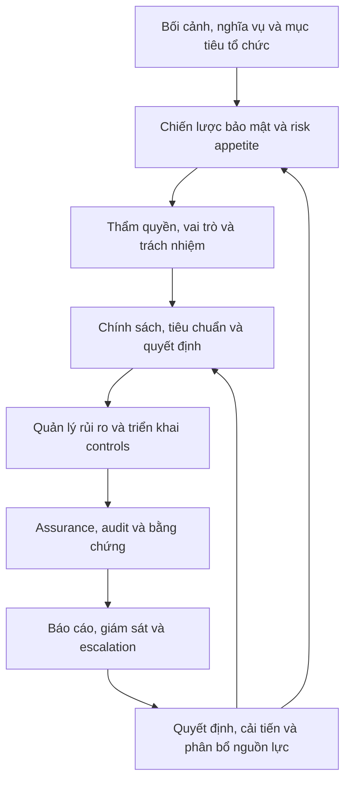
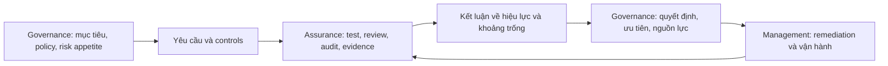

# Security governance là gì?

## 1. Bảo mật cần được quản trị như một trách nhiệm của tổ chức

Một nền tảng học tập có thể dùng thư viện mã hóa tốt, bật xác thực đa yếu tố và chạy kiểm thử bảo mật trước mỗi lần phát hành. Tuy vậy, những biện pháp này vẫn có thể thất bại nếu không ai chịu trách nhiệm phê duyệt quyền truy cập dữ liệu, đội sản phẩm liên tục trì hoãn sửa lỗi nghiêm trọng, nhà cung cấp được kết nối mà không qua đánh giá, hoặc ban lãnh đạo không biết rủi ro nào đang được chấp nhận.

Đó là vấn đề **security governance (quản trị bảo mật)**. Quản trị bảo mật thiết lập định hướng, nguyên tắc, quyền ra quyết định, trách nhiệm giải trình và cơ chế giám sát để bảo đảm an ninh thông tin được quản lý phù hợp với mục tiêu và mức chấp nhận rủi ro của tổ chức.

Security governance trả lời những câu hỏi ở cấp tổ chức:

- Tổ chức cần bảo vệ tài sản, dữ liệu và dịch vụ nào, và vì sao?
- Mục tiêu bảo mật nào được ưu tiên, dựa trên chiến lược và nghĩa vụ nào?
- Ai có quyền quyết định, ai chịu trách nhiệm triển khai, ai giám sát độc lập?
- Rủi ro nào có thể chấp nhận, ai được phép chấp nhận và trong điều kiện nào?
- Làm thế nào để biết chính sách và security controls thực sự có hiệu lực?
- Khi có thay đổi, ngoại lệ hoặc sự cố, ai phải được thông báo và quyết định điều gì?

Trong module **SECURITY_SECURITY_ASSURANCE**, quản trị bảo mật tạo ra khuôn khổ để chương trình security assurance hoạt động có mục tiêu và có người chịu trách nhiệm. Assurance cung cấp bằng chứng về hiệu lực kiểm soát; governance sử dụng thông tin đó để giám sát, phân bổ nguồn lực, xử lý vấn đề và đưa ra quyết định rủi ro.

### Mục tiêu học tập

Sau bài này, bạn có thể:

1. Giải thích security governance và phân biệt governance với security management.
2. Mô tả các thành phần chính: định hướng, chính sách, trách nhiệm, quyền quyết định, quản lý rủi ro, giám sát và assurance.
3. Nhận diện vai trò của lãnh đạo, CISO, risk owner, control owner, nhóm kỹ thuật và audit.
4. Giải thích cách chính sách và ngưỡng rủi ro chuyển thành quyết định trong phát triển và vận hành.
5. Đề xuất cơ chế theo dõi, báo cáo và cải tiến chương trình quản trị bảo mật.

## 2. Định nghĩa và bản chất của security governance

**Security governance** là hệ thống các cơ chế mà tổ chức sử dụng để:

- **Direct — định hướng:** xác định mục tiêu, nguyên tắc, ưu tiên và kết quả bảo mật cần đạt.
- **Authorize — trao quyền:** phân định ai được quyết định, phê duyệt, chấp nhận rủi ro và phân bổ nguồn lực.
- **Oversee — giám sát:** theo dõi kết quả, rủi ro, mức tuân thủ, hiệu lực controls và tiến độ khắc phục.
- **Account — giải trình:** yêu cầu người có trách nhiệm giải thích quyết định và kết quả trong phạm vi quyền hạn.

Governance không phải là một chức danh, một ủy ban hoặc một bộ tài liệu chính sách riêng lẻ. Đó là cách tổ chức phân bổ quyền lực và trách nhiệm, thiết lập quy tắc ra quyết định và kiểm tra xem các quyết định có đem lại kết quả mong muốn hay không.

Quản trị bảo mật thường nằm trong hệ thống quản trị doanh nghiệp và kết nối với quản trị rủi ro, quản trị công nghệ, quyền riêng tư, tuân thủ, liên tục kinh doanh và quản lý nhà cung cấp. Mô hình cụ thể phụ thuộc quy mô, ngành nghề, quy định, mức độ phụ thuộc công nghệ và cấu trúc tổ chức.

### Governance khác gì management?

Hai hoạt động gắn bó nhưng có trọng tâm khác nhau:

| Khía cạnh | Security governance | Security management |
|---|---|---|
| Trọng tâm | Định hướng, quyền quyết định, trách nhiệm và giám sát | Lập kế hoạch và tổ chức thực hiện công việc bảo mật |
| Câu hỏi chính | Tổ chức cần đạt điều gì, ai quyết định và kiểm soát kết quả ra sao? | Thực hiện bằng cách nào, với nguồn lực và quy trình nào? |
| Chủ thể thường gặp | Hội đồng quản trị/cấp lãnh đạo, ban điều hành, cơ chế giám sát | CISO, security team, IT, engineering, operations và các chủ control |
| Hoạt động | Phê duyệt chiến lược, risk appetite, chính sách cấp cao, giám sát rủi ro | Vận hành IAM, vá lỗi, giám sát, ứng phó sự cố, kiểm thử và khắc phục |
| Đầu ra | Mục tiêu, quyết định, thẩm quyền, mức chịu đựng rủi ro, báo cáo giám sát | Kế hoạch, quy trình, cấu hình, controls, hồ sơ kiểm thử và vận hành |
| Tiêu chí đánh giá | Quyết định đúng thẩm quyền, rủi ro trong giới hạn, có giải trình và giám sát | Công việc được thực hiện hiệu quả, đúng yêu cầu và có bằng chứng |

Ví dụ: ban lãnh đạo phê duyệt nguyên tắc rằng dữ liệu cá nhân phải được bảo vệ theo mức phân loại và mọi rủi ro truy cập trái phép nghiêm trọng phải được báo cáo. Đó là định hướng governance. Nhóm bảo mật và kỹ thuật thiết kế RBAC, triển khai policy, chạy test và theo dõi log là công việc management.

Ranh giới không nhất thiết trùng với sơ đồ chức danh. Ở tổ chức nhỏ, một người có thể kiêm nhiều vai trò; điều cần giữ là quyền quyết định, trách nhiệm thực hiện và cơ chế kiểm tra phải rõ ràng, đặc biệt với rủi ro cao.

## 3. Vì sao tổ chức cần security governance?

### 3.1. Gắn bảo mật với mục tiêu kinh doanh

Bảo mật cần bảo vệ khả năng cung cấp dịch vụ, niềm tin của người dùng, dữ liệu và nghĩa vụ của tổ chức. Governance giúp tránh hai cực đoan: đầu tư dàn trải vào controls ít liên quan đến rủi ro, hoặc hy sinh các yêu cầu bảo mật trọng yếu để tối ưu tốc độ phát hành ngắn hạn.

Ví dụ, nền tảng học tập cần duy trì dịch vụ trong kỳ thi trực tuyến. Governance giúp lãnh đạo quyết định mức sẵn sàng cần thiết, thời gian khôi phục mục tiêu, nguồn lực dự phòng và rủi ro nào phải được xử lý trước mùa thi.

### 3.2. Xác lập trách nhiệm và tránh khoảng trống

Khi trách nhiệm không rõ, một phát hiện có thể nằm giữa nhóm phát triển, vận hành và bảo mật mà không ai có quyền ưu tiên xử lý. Governance xác định người sở hữu rủi ro, chủ sở hữu control, người phê duyệt ngoại lệ và đường escalations khi thời hạn không được đáp ứng.

### 3.3. Đưa ra quyết định rủi ro nhất quán

Một nhóm dự án có thể muốn chấp nhận lỗi để kịp phát hành, trong khi tác động của lỗi vượt quá mức nhóm đó được phép quyết định. Governance thiết lập risk appetite, tiêu chí phân cấp và thẩm quyền phê duyệt. Nhờ đó, quyết định phản ánh mức ảnh hưởng toàn tổ chức.

### 3.4. Tạo cơ sở giám sát và chứng minh

Chính sách chỉ có ý nghĩa khi tổ chức kiểm tra việc thực hiện. Governance yêu cầu báo cáo đáng tin cậy về trạng thái controls, ngoại lệ, sự cố và finding. Security assurance cung cấp bằng chứng để lãnh đạo đánh giá liệu các yêu cầu đã được triển khai và vận hành hiệu quả hay chưa.

### 3.5. Duy trì khả năng thích ứng

Ứng dụng, nhà cung cấp, mối đe dọa và nghĩa vụ pháp lý thay đổi. Governance thiết lập cơ chế rà soát chính sách, tái đánh giá rủi ro và điều chỉnh ưu tiên khi bối cảnh thay đổi, thay vì coi một lần phê duyệt là quyết định vĩnh viễn.

## 4. Các thành phần của một hệ thống security governance

Một mô hình có thể tổ chức thành tám thành phần liên kết:

1. **Context and objectives:** hiểu bối cảnh, tài sản, bên liên quan, nghĩa vụ và mục tiêu.
2. **Strategy and risk appetite:** xác định định hướng, mức chịu đựng rủi ro và ưu tiên đầu tư.
3. **Authority and accountability:** phân quyền, chỉ định risk owner/control owner và quy định trách nhiệm giải trình.
4. **Policies and standards:** thiết lập nguyên tắc bắt buộc, yêu cầu tối thiểu và ngoại lệ được kiểm soát.
5. **Risk and control oversight:** giám sát rủi ro, trạng thái và hiệu lực security controls.
6. **Assurance and independent review:** kiểm chứng, audit, theo dõi phát hiện và xác nhận khắc phục.
7. **Reporting and escalation:** đưa thông tin phù hợp đến đúng cấp có quyền quyết định.
8. **Culture and continual improvement:** phát triển hành vi an toàn, học từ sự cố và cập nhật hệ thống quản trị.

Các thành phần này không phải những silo độc lập. Ví dụ, kết quả kiểm thử một control có thể làm thay đổi đánh giá rủi ro, kích hoạt escalation, dẫn đến điều chỉnh chính sách hoặc tăng ngân sách.

## 5. Chiến lược bảo mật và risk appetite

### 5.1. Chuyển mục tiêu tổ chức thành mục tiêu bảo mật

Chiến lược bảo mật cần phản ánh dịch vụ và tài sản trọng yếu. Một mục tiêu tốt chỉ ra kết quả cần đạt và có thể theo dõi.

| Mục tiêu tổ chức | Mục tiêu bảo mật liên quan | Ví dụ kết quả cần theo dõi |
|---|---|---|
| Bảo vệ niềm tin của người học và tổ chức | Bảo vệ bí mật, toàn vẹn dữ liệu cá nhân và kết quả học tập | Sự cố lộ dữ liệu, phạm vi ảnh hưởng, thời gian phát hiện |
| Duy trì kỳ thi trực tuyến | Bảo đảm tính sẵn sàng và khả năng phục hồi | Mức sẵn sàng, RTO/RPO đạt được qua diễn tập |
| Mở rộng tích hợp đối tác | Kiểm soát danh tính, quyền, luồng dữ liệu và rủi ro bên thứ ba | Tỷ lệ tích hợp được đánh giá trước khi kết nối |
| Phát hành phần mềm thường xuyên | Đưa security requirements và kiểm chứng vào SDLC | Tỷ lệ thay đổi trọng yếu có review/test phù hợp |

Mục tiêu phải có chủ sở hữu, thời hạn hoặc chu kỳ đánh giá, nguồn dữ liệu và cách xác định khi nào đạt. Chỉ tiêu không có định nghĩa đo lường sẽ khó hỗ trợ quyết định.

### 5.2. Risk appetite và risk tolerance

**Risk appetite (khẩu vị rủi ro)** thể hiện loại và mức rủi ro tổng thể tổ chức sẵn sàng chấp nhận để theo đuổi mục tiêu. **Risk tolerance (ngưỡng chấp nhận/biên độ dung sai)** cụ thể hóa giới hạn cho một hoạt động, chỉ số hoặc loại rủi ro. Cách dùng thuật ngữ có thể khác giữa các khung quản trị; tổ chức cần định nghĩa nhất quán trong chính sách của mình.

Ví dụ minh họa:

- Không chấp nhận việc cố ý truy cập dữ liệu người học ngoài thẩm quyền.
- Mọi finding nghiêm trọng trên đường truy cập dữ liệu nhạy cảm phải được xử lý hoặc có quyết định ngoại lệ đúng thẩm quyền trước phát hành.
- Có thể chấp nhận một khoảng gián đoạn ngắn trong bảo trì đã thông báo, miễn là không vượt mục tiêu dịch vụ đã duyệt.

Không nên chỉ ghi “khẩu vị rủi ro thấp”. Cần chuyển thành tiêu chí hành động: loại rủi ro nào không được chấp nhận, mức nào phải escalation, ai có quyền phê duyệt, thời hạn ngoại lệ bao lâu và điều kiện nào khiến quyết định hết hiệu lực.

### 5.3. Risk appetite không thay thế đánh giá từng rủi ro

Khẩu vị rủi ro là định hướng ở cấp tổ chức; một kịch bản cụ thể vẫn cần phân tích likelihood, impact, phạm vi, controls và độ bất định. Hai rủi ro có cùng điểm số có thể cần quyết định khác nhau nếu một rủi ro liên quan nghĩa vụ pháp lý, dữ liệu cá nhân hoặc an toàn người dùng.

Người chấp nhận rủi ro phải có thẩm quyền tương xứng và hiểu rõ điều gì đang được chấp nhận. Việc ký nhận không làm cho rủi ro biến mất, cũng không thay thế trách nhiệm khắc phục khi điều kiện chấp nhận đã thay đổi.

## 6. Vai trò, quyền quyết định và trách nhiệm giải trình

Governance hiệu quả cần phân biệt người **chịu trách nhiệm cuối cùng**, người **thực hiện**, người **được tham vấn** và người **cần được thông báo**. Các vai trò dưới đây là mẫu tham khảo; tổ chức có thể gộp hoặc phân tách tùy quy mô.

| Vai trò | Trách nhiệm governance điển hình | Ví dụ quyết định hoặc bằng chứng |
|---|---|---|
| Hội đồng quản trị/cấp quản trị cao nhất | Giám sát rủi ro trọng yếu, phê duyệt định hướng theo thẩm quyền, yêu cầu giải trình | Biên bản xem xét rủi ro doanh nghiệp và chương trình bảo mật |
| Ban điều hành | Chuyển định hướng thành ưu tiên, ngân sách và trách nhiệm liên chức năng | Phê duyệt nguồn lực và kế hoạch xử lý rủi ro lớn |
| CISO/security leader | Đề xuất chiến lược, chính sách, tiêu chuẩn; tư vấn và báo cáo trạng thái bảo mật | Risk dashboard, policy, báo cáo assurance và đề xuất remediation |
| Risk owner | Chịu trách nhiệm về một kịch bản rủi ro và quyết định xử lý/chấp nhận trong phạm vi được giao | Risk register, treatment plan, risk acceptance |
| Control owner | Thiết kế/vận hành control, theo dõi hiệu lực và cung cấp evidence | Cấu hình, log, test result, lịch review quyền |
| Product/service owner | Đưa yêu cầu bảo mật vào sản phẩm, cân đối thay đổi và bảo đảm xử lý finding | Security acceptance criteria, release decision trong thẩm quyền |
| Engineering/IT/Operations | Xây dựng, triển khai và duy trì controls trong hệ thống | Code review, pipeline, hardening, monitoring, incident record |
| Legal/privacy/compliance | Tư vấn nghĩa vụ, hợp đồng, quyền riêng tư và yêu cầu báo cáo | Legal register, đánh giá tác động, điều khoản nhà cung cấp |
| Internal audit/assurance độc lập | Đánh giá độc lập về thiết kế và vận hành của governance/controls | Audit plan, working papers, findings và follow-up |

### 6.1. Risk owner và control owner không giống nhau

**Risk owner** chịu trách nhiệm hiểu và xử lý kịch bản rủi ro. **Control owner** chịu trách nhiệm cho một biện pháp kiểm soát cụ thể. Một risk có thể cần nhiều controls và nhiều control owners; một control có thể giảm nhiều rủi ro.

Ví dụ, risk owner của rủi ro lộ dữ liệu xuyên tenant có thể là chủ sở hữu dịch vụ dữ liệu học tập. Control owners có thể là nhóm IAM, nhóm backend và nhóm platform. Risk owner cần phối hợp để đánh giá rủi ro tổng thể; từng control owner chứng minh control của mình được triển khai và vận hành.

### 6.2. Phân định thực hiện và kiểm tra

Một mô hình tham khảo thường gọi là **Three Lines Model**:

- **Tuyến 1:** các đơn vị sở hữu hoạt động và rủi ro; trực tiếp triển khai, vận hành controls.
- **Tuyến 2:** các chức năng chuyên môn như risk, security, compliance; xây dựng hướng dẫn, giám sát và thách thức tuyến 1.
- **Tuyến 3:** internal audit; cung cấp bảo đảm độc lập cho cơ quan quản trị về governance, risk management và controls.

Đây là mô hình tham khảo về vai trò, không phải yêu cầu rằng mọi tổ chức phải có đúng ba phòng ban. Các chức năng có thể phối hợp và quy mô khác nhau; điều quan trọng là tránh xung đột lợi ích và bảo đảm đánh giá độc lập phù hợp với mức rủi ro.

### 6.3. Ma trận RACI minh họa

RACI mô tả ai thực hiện (R — Responsible), ai chịu trách nhiệm cuối cùng (A — Accountable), ai được tham vấn (C — Consulted) và ai được thông báo (I — Informed). Mỗi hoạt động nên có một đầu mối A rõ ràng; ma trận cần được điều chỉnh theo cơ cấu thực tế.

| Hoạt động | Ban điều hành | CISO | Risk owner | Control owner/Engineering | Internal audit |
|---|---|---|---|---|---|
| Phê duyệt chiến lược và ưu tiên bảo mật | A | R | C | I | I |
| Đề xuất chính sách bảo mật | A | R | C | C | I |
| Đánh giá và cập nhật kịch bản rủi ro | I | C | A/R | C | I |
| Triển khai và vận hành control | I | C | A | R | I |
| Cung cấp evidence về control | I | C | A | R | I |
| Chấp nhận residual risk theo thẩm quyền | A* | C | R* | C | I |
| Đánh giá độc lập chương trình | I | C | C | C | A/R |

*Quyền A/R cho risk acceptance phải theo phân cấp được tổ chức phê duyệt; bảng chỉ minh họa nguyên tắc, không trao quyền mặc định cho ban điều hành hoặc risk owner trong mọi trường hợp.*

## 7. Chính sách, tiêu chuẩn và quy trình bảo mật

Chính sách là cách governance truyền đạt những nguyên tắc và yêu cầu bắt buộc. Một hệ thống tài liệu thường có nhiều cấp:

| Cấp tài liệu | Vai trò | Ví dụ |
|---|---|---|
| **Policy — chính sách** | Nêu nguyên tắc, phạm vi, trách nhiệm và yêu cầu bắt buộc cấp tổ chức | Information Security Policy, Access Control Policy |
| **Standard — tiêu chuẩn nội bộ** | Quy định mức tối thiểu và tiêu chí cụ thể để thực hiện policy | MFA cho tài khoản quản trị, mã hóa dữ liệu lưu trữ theo phân loại |
| **Procedure — quy trình** | Nêu trình tự, người thực hiện, điểm kiểm soát và đầu vào/đầu ra | Quy trình cấp, thay đổi và thu hồi quyền |
| **Guideline — hướng dẫn** | Đề xuất cách thực hiện tốt trong bối cảnh cụ thể | Hướng dẫn thiết kế API an toàn |
| **Record/Evidence — hồ sơ** | Chứng minh hoạt động đã diễn ra và kết quả | Approval, access review, test report, exception register |

Tên gọi và thứ bậc có thể khác nhau giữa tổ chức. Điều cần bảo đảm là không có mâu thuẫn: procedure phải triển khai policy, tiêu chuẩn phải có tiêu chí kiểm chứng, và hồ sơ phải chứng minh hoạt động thực tế.

### 7.1. Vòng đời chính sách

1. **Xác định nhu cầu:** dựa trên chiến lược, risk assessment, sự cố, thay đổi công nghệ hoặc nghĩa vụ.
2. **Soạn thảo:** nêu mục đích, phạm vi, nguyên tắc, vai trò, yêu cầu và cách xử lý ngoại lệ.
3. **Tham vấn:** lấy ý kiến security, engineering, vận hành, pháp lý, quyền riêng tư và đơn vị chịu tác động.
4. **Phê duyệt:** đúng cấp có thẩm quyền; ghi phiên bản, ngày hiệu lực và chủ sở hữu.
5. **Truyền thông và triển khai:** chuyển yêu cầu thành tiêu chuẩn, quy trình, cấu hình, đào tạo và controls.
6. **Đánh giá hiệu lực:** kiểm tra mức nhận biết, mức tuân thủ, hiệu quả control và finding.
7. **Rà soát/cập nhật:** theo chu kỳ và khi có thay đổi quan trọng; lưu lịch sử và thông báo phiên bản mới.

### 7.2. Ngoại lệ chính sách

Không phải lúc nào cũng có thể đáp ứng ngay mọi tiêu chuẩn. Một ngoại lệ hợp lệ cần có:

- Yêu cầu hoặc điều khoản được xin ngoại lệ, hệ thống và phạm vi chịu ảnh hưởng.
- Lý do, thời hạn và phân tích rủi ro cụ thể.
- Biện pháp bù đắp, điều kiện giám sát và tiêu chí chấm dứt ngoại lệ.
- Người đề nghị, risk owner và người phê duyệt đúng thẩm quyền.
- Ngày hết hạn, lịch rà soát và bằng chứng đóng ngoại lệ.

Ngoại lệ không được dùng để hợp thức hóa việc bỏ qua nghĩa vụ pháp lý hoặc yêu cầu không thể miễn trừ. Khi điều kiện rủi ro thay đổi hoặc biện pháp bù đắp mất hiệu lực, cần đánh giá và escalation lại.

## 8. Security governance trong chương trình security assurance

Governance xác định **điều gì cần được bảo đảm, ai chịu trách nhiệm và ai sử dụng kết quả**. Assurance xác định **claim nào được kiểm chứng, bằng phương pháp gì và evidence có đủ sức hỗ trợ kết luận hay không**.

Mối liên hệ có thể mô tả:

Ví dụ, policy yêu cầu quyền quản trị phải được rà soát định kỳ. Governance chỉ định owner, tần suất và cấp nhận báo cáo. Management thực hiện access review. Assurance lấy mẫu tài khoản, đối chiếu approval, kiểm tra tài khoản đã nghỉ việc và xác minh việc thu hồi. Kết quả cho thấy một tài khoản cũ vẫn có quyền cao; governance quyết định mức ưu tiên, yêu cầu remediation và giám sát đến khi có bằng chứng đóng finding.

### 8.1. Từ policy đến bằng chứng

| Cấp | Ví dụ yêu cầu quản trị quyền |
|---|---|
| Policy | Quyền truy cập phải theo nhu cầu công việc và được phê duyệt |
| Standard | Tài khoản đặc quyền phải dùng MFA, có owner và được rà soát theo chu kỳ đã duyệt |
| Procedure | Người quản lý yêu cầu quyền; owner phê duyệt; IAM cấp quyền; log ghi nhận |
| Control | RBAC, MFA, privileged access management, access review và deprovisioning |
| Assurance claim | Chỉ danh tính được phê duyệt mới có quyền phù hợp; quyền không còn cần thiết được thu hồi |
| Evidence | Danh sách tài khoản, approval, cấu hình MFA, kết quả review, log cấp/thu hồi và mẫu kiểm tra |
| Governance decision | Xử lý finding, chấp nhận ngoại lệ đúng thẩm quyền hoặc điều chỉnh policy/nguồn lực |

Nếu policy nói “rà soát thường xuyên” mà không quy định ai thực hiện, tần suất, phạm vi và bằng chứng cần lưu, tổ chức sẽ khó kiểm tra mức tuân thủ. Governance phải làm rõ yêu cầu đủ cụ thể để management triển khai và assurance kiểm chứng.

### 8.2. Theo dõi finding và hành động khắc phục

Governance cần bảo đảm finding có mức độ nghiêm trọng, chủ sở hữu, hạn xử lý, biện pháp giảm thiểu, trạng thái và bằng chứng retest. Việc đóng finding cần dựa trên tiêu chí đã xác định: lỗi đã được sửa, test xác nhận, phạm vi ảnh hưởng đã được xem xét và rủi ro còn lại đã được đánh giá.

Finding quá hạn hoặc lặp lại có thể chỉ ra vấn đề mang tính hệ thống: thiếu nguồn lực, quy trình không hiệu quả, phân quyền không rõ hoặc chính sách chưa phù hợp. Vì vậy, báo cáo governance nên phân tích xu hướng và nguyên nhân gốc, không chỉ đếm số ticket đã đóng.

## 9. Cơ chế họp, báo cáo và escalation

Tổ chức có thể thiết lập security steering committee hoặc tích hợp nội dung bảo mật vào hội đồng quản trị rủi ro/công nghệ hiện có. Tên gọi không quan trọng bằng việc cuộc họp có mandate, thành viên đúng thẩm quyền, đầu vào đáng tin cậy và quyết định được ghi lại.

### 9.1. Một nhịp governance tham khảo

| Cấp/nhịp | Nội dung | Đầu ra |
|---|---|---|
| Nhóm sản phẩm/kỹ thuật, thường xuyên | Thay đổi, threat mới, test thất bại, finding và rủi ro của release | Quyết định kỹ thuật, remediation, escalation |
| Security/risk working group, hàng tháng hoặc theo nhu cầu | Risk register, control health, ngoại lệ, sự cố và xu hướng | Ưu tiên xử lý, đề xuất nguồn lực, vấn đề cần cấp cao quyết định |
| Ban điều hành/steering committee, theo quý hoặc theo mức rủi ro | Rủi ro trọng yếu, tiến độ chương trình, sự cố lớn, audit và tuân thủ | Phê duyệt/điều chỉnh kế hoạch, phân bổ nguồn lực, quyết định trong thẩm quyền |
| Cấp quản trị cao nhất, theo chu kỳ quản trị | Mức rủi ro doanh nghiệp, xu hướng, khả năng chống chịu và hiệu quả giám sát | Định hướng, giám sát và yêu cầu giải trình |

Đây là nhịp minh họa. Sự cố nghiêm trọng, rủi ro vượt ngưỡng hoặc finding có thời hạn khẩn cấp cần escalation ngay theo quy trình, không chờ đến cuộc họp định kỳ.

### 9.2. Báo cáo đúng người, đúng mức chi tiết

- Nhóm kỹ thuật cần chi tiết về endpoint, commit, cấu hình, test và cách tái hiện.
- CISO và risk owner cần trạng thái risk, control, finding, xu hướng và hành động.
- Ban điều hành cần tác động đến dịch vụ, người dùng, chi phí, nghĩa vụ và các quyết định đang chờ.
- Cấp quản trị cao nhất cần bức tranh rủi ro trọng yếu, xu hướng, mức độ phù hợp với risk appetite và chất lượng giám sát.

Một báo cáo tốt phân biệt **sự kiện đã xác nhận**, **ước lượng**, **giả định** và **điều chưa biết**. Không nên trình bày một điểm số rủi ro hoặc tỷ lệ tuân thủ mà không giải thích phạm vi, mẫu số, nguồn dữ liệu và thời điểm.

## 10. Đo lường hiệu quả security governance

Không có một chỉ số đơn lẻ chứng minh governance hiệu quả. Nên kết hợp chỉ số về kết quả, mức phơi lộ, hiệu lực control, chất lượng assurance và tốc độ ra quyết định.

| Nhóm đo lường | Ví dụ | Câu hỏi quản trị |
|---|---|---|
| Risk exposure | Số và mức độ risk vượt ngưỡng; thời gian tồn tại của risk cao | Rủi ro trọng yếu có giảm hoặc được xử lý đúng thẩm quyền? |
| Control effectiveness | Tỷ lệ controls trọng yếu được test và đạt; số control thất bại lặp lại | Các biện pháp có hoạt động như thiết kế? |
| Remediation | Finding nghiêm trọng quá hạn; thời gian trung vị đến khi retest đạt | Tổ chức có khắc phục đúng hạn và bền vững? |
| Policy/exception | Ngoại lệ quá hạn; policy đến hạn rà soát; ngoại lệ lặp lại | Quy tắc có phù hợp và được thực hiện? |
| Assurance coverage | Tỷ lệ hệ thống trọng yếu có claim/evidence mới theo kỳ | Phạm vi bảo đảm có bao phủ tài sản và rủi ro quan trọng? |
| Incident and resilience | Sự cố theo tác động; thời gian phát hiện/khôi phục; kết quả diễn tập | Khả năng ứng phó và phục hồi có đạt mục tiêu? |
| Decision quality | Thời gian escalation; quyết định thiếu owner; risk acceptance hết hạn | Thẩm quyền và trách nhiệm có vận hành hiệu quả? |

### 10.1. KPI, KRI và KCI

- **KPI (Key Performance Indicator):** chỉ số hiệu suất, theo dõi hoạt động có được thực hiện như dự kiến không. Ví dụ: tỷ lệ access review hoàn thành đúng hạn.
- **KRI (Key Risk Indicator):** chỉ số cảnh báo mức phơi lộ hoặc xu hướng rủi ro. Ví dụ: số tài khoản đặc quyền không có owner hoặc số finding nghiêm trọng quá hạn.
- **KCI (Key Control Indicator):** chỉ số về tình trạng/hiệu lực control. Ví dụ: tỷ lệ tài khoản đặc quyền có MFA đã được xác minh.

Một chỉ số có thể mang nhiều vai trò tùy mục đích, nhưng định nghĩa phải rõ. Tỷ lệ hoàn thành review 100% không có nghĩa quyền đã được rà soát đúng; cần lấy mẫu chất lượng, kiểm tra quyết định và xác minh quyền thừa đã được thu hồi.

### 10.2. Tránh chỉ số tạo động cơ sai

- Đếm số lượng finding thấp có thể khuyến khích không ghi nhận hoặc phân loại nhẹ.
- Đặt mục tiêu đóng ticket nhanh có thể khiến nhóm đóng finding trước khi retest.
- Đếm số lần đào tạo không đo được khả năng áp dụng hành vi an toàn.
- Báo cáo tỷ lệ tuân thủ chung có thể che khuất một vài control trọng yếu đang thất bại.

Hãy kết hợp số lượng với mức độ nghiêm trọng, chất lượng bằng chứng, xu hướng, mẫu kiểm tra và tác động thực tế. Chỉ số phải phục vụ quyết định và học hỏi, không chỉ phục vụ xếp hạng nhóm.

## 11. Ví dụ: thiết lập governance cho nền tảng học tập Java nhiều tenant

Giả sử tổ chức vận hành nền tảng học tập dùng backend Java/Spring Boot, phục vụ nhiều trường hoặc doanh nghiệp. Hệ thống lưu hồ sơ người học, kết quả bài kiểm tra, dữ liệu giảng viên và thông tin thanh toán. Mỗi khách hàng là một tenant có ranh giới dữ liệu riêng.

### 11.1. Định hướng và phạm vi

Ban điều hành xác định ba mục tiêu bảo mật ưu tiên:

1. Không để người dùng một tenant đọc hoặc sửa dữ liệu của tenant khác.
2. Duy trì dịch vụ trong kỳ thi và có thể phục hồi theo mục tiêu đã phê duyệt.
3. Mọi truy cập quản trị và thay đổi dữ liệu quan trọng phải có thể truy vết.

CISO phối hợp với chủ sở hữu dịch vụ, privacy/legal và engineering để xác định dữ liệu, luồng xử lý, nghĩa vụ, mối đe dọa và tiêu chí kiểm chứng. Risk owner được chỉ định cho các rủi ro trọng yếu.

### 11.2. Quyết định và trách nhiệm

| Vấn đề | Quyết định governance | Người/nhóm chịu trách nhiệm |
|---|---|---|
| Cô lập tenant | Chính sách yêu cầu kiểm tra quyền trên cả danh tính, tenant và đối tượng dữ liệu | Risk owner của dịch vụ; control owner backend/IAM |
| Tài khoản quản trị | Tài khoản đặc quyền phải có MFA, owner và review | IAM/platform control owner |
| Phát hành | Thay đổi ảnh hưởng phân quyền phải có review và negative integration tests | Product owner và engineering lead |
| Rủi ro nghiêm trọng | Finding vượt ngưỡng phải escalation; chỉ người có thẩm quyền mới được chấp nhận residual risk | Risk owner và cấp phê duyệt theo ma trận |
| Nhà cung cấp | Trước tích hợp phải đánh giá dữ liệu, quyền truy cập, logging, sự cố và điều khoản | Vendor owner, security, legal/privacy |

### 11.3. Assurance và báo cáo

Đối với claim “tenant A không thể truy cập dữ liệu tenant B”, assurance yêu cầu:

- Danh mục đầy đủ API, tác vụ batch, export và luồng dữ liệu.
- Review policy tại service layer và điều kiện tenant trong truy vấn dữ liệu.
- Negative integration tests với nhiều vai trò và ID thuộc tenant khác.
- Kiểm tra cache, background job, báo cáo và các đường truy cập không đi qua API chính.
- Bằng chứng cấu hình production và giám sát sự kiện truy cập bị từ chối.

Nếu phát hiện endpoint export không áp dụng tenant filter, finding được liên kết với risk register và control liên quan. Nhóm kỹ thuật khắc phục, chạy lại test trên bản build mục tiêu và cung cấp evidence. Risk owner đánh giá residual risk; CISO báo cáo mức độ và đề xuất nguồn lực; người có thẩm quyền quyết định phát hành, hạn chế chức năng hoặc chấp nhận phần rủi ro còn lại theo policy.

### 11.4. Tình huống cho thấy governance có tác dụng

Giả sử nhóm sản phẩm muốn phát hành chức năng export ngay trong ngày, nhưng test phát hiện có thể xuất dữ liệu của tenant khác. Nếu không có governance, quyết định có thể chỉ dựa trên áp lực deadline. Với governance đã thiết lập:

1. Tiêu chí phát hành và ngưỡng rủi ro đã được xác định trước.
2. Finding được phân loại theo tác động và chuyển đến đúng risk owner.
3. Nhóm kỹ thuật có trách nhiệm giảm thiểu; product owner không tự ý bỏ qua kiểm soát vượt thẩm quyền.
4. Cấp phê duyệt nhận evidence, tác động kinh doanh và lựa chọn xử lý.
5. Quyết định, điều kiện, thời hạn và người chịu trách nhiệm được lưu lại.
6. Assurance xác minh việc khắc phục và theo dõi finding đến khi đủ điều kiện đóng.

Governance không tự viết code sửa lỗi. Nó bảo đảm quyết định được đưa ra đúng cấp, có thông tin, có trách nhiệm và được theo dõi đến kết quả.

## 12. Governance cho nhà cung cấp và dịch vụ bên thứ ba

Một hệ thống có thể phụ thuộc cloud provider, identity provider, cổng thanh toán, nền tảng gửi email hoặc dịch vụ phân tích. Rủi ro từ bên thứ ba vẫn ảnh hưởng đến tổ chức sử dụng dịch vụ; việc ký hợp đồng không chuyển giao toàn bộ trách nhiệm bảo vệ dữ liệu.

Governance cần quy định:

- Tiêu chí phân loại nhà cung cấp theo dữ liệu, quyền truy cập, mức độ trọng yếu và khả năng thay thế.
- Đánh giá trước khi lựa chọn và trước khi cấp quyền/tích hợp.
- Điều khoản về bảo mật, xử lý dữ liệu, vị trí lưu trữ, thông báo sự cố, audit/evidence và nhà thầu phụ.
- Chủ sở hữu quan hệ nhà cung cấp và người theo dõi rủi ro.
- Theo dõi thay đổi dịch vụ, chứng nhận/báo cáo kiểm soát và finding liên quan.
- Kế hoạch chấm dứt, chuyển dữ liệu, thu hồi quyền và xử lý dữ liệu sau hợp đồng.

Evidence từ nhà cung cấp như chứng nhận hoặc báo cáo kiểm toán cần được xem xét theo phạm vi, thời kỳ, dịch vụ, ngoại lệ và control phụ thuộc khách hàng. Một chứng nhận chung không tự chứng minh cấu hình tenant, IAM hoặc quy trình tích hợp của tổ chức đang sử dụng là an toàn.

## 13. Framework và tiêu chuẩn tham khảo

Framework hỗ trợ thiết kế governance, nhưng không thay thế việc hiểu bối cảnh và đưa ra quyết định của tổ chức.

| Framework/tiêu chuẩn | Nội dung liên quan | Cách sử dụng |
|---|---|---|
| **NIST Cybersecurity Framework (CSF) 2.0** | Function **Govern (GV)** tập trung vào bối cảnh tổ chức, chiến lược quản lý rủi ro, vai trò/trách nhiệm, chính sách, giám sát và rủi ro chuỗi cung ứng | Dùng để tổ chức kết quả governance và liên kết với Identify, Protect, Detect, Respond, Recover |
| **ISO/IEC 27001:2022** | ISMS, bối cảnh, leadership, planning, support, operation, performance evaluation và improvement | Xây dựng hệ thống quản lý an toàn thông tin, xác định phạm vi, vai trò, đánh giá và cải tiến |
| **ISO/IEC 27005** | Quản lý rủi ro an toàn thông tin | Hỗ trợ quy trình nhận diện, phân tích, xử lý và theo dõi risk |
| **COBIT** | Governance và management objectives cho thông tin và công nghệ doanh nghiệp | Liên kết mục tiêu công nghệ, trách nhiệm và giám sát với governance doanh nghiệp |
| **NIST SP 800-53** | Security and privacy controls | Chọn và đánh giá controls theo phạm vi và mức rủi ro |

NIST CSF 2.0 làm rõ rằng Govern là một function riêng, bao gồm các nhóm kết quả về bối cảnh tổ chức, chiến lược quản lý rủi ro, vai trò/trách nhiệm, policy, oversight và cybersecurity supply chain risk management. Các nhóm này liên kết với những function còn lại của CSF.

ISO/IEC 27001 là tiêu chuẩn yêu cầu cho hệ thống quản lý an toàn thông tin (ISMS). Việc áp dụng cần xác định phạm vi, bối cảnh, trách nhiệm lãnh đạo, đánh giá rủi ro, vận hành, đánh giá hiệu suất và cải tiến theo yêu cầu tiêu chuẩn. Có chứng nhận trong một phạm vi xác định không đồng nghĩa mọi hệ thống hoặc mọi rủi ro của tổ chức đều được bảo đảm.

Không nên triển khai framework bằng cách sao chép toàn bộ danh mục thành checklist. Hãy chọn kết quả phù hợp, xác định owner, bằng chứng, phạm vi và cơ chế quyết định; sau đó đánh giá xem governance thực sự cải thiện kết quả bảo mật như thế nào.

## 14. Lộ trình xây dựng security governance

Một tổ chức chưa có mô hình rõ ràng có thể triển khai theo các bước:

1. **Khảo sát hiện trạng:** lập danh sách dịch vụ, tài sản, nghĩa vụ, rủi ro, chính sách và cơ chế ra quyết định đang tồn tại.
2. **Xác định sponsor và mandate:** thống nhất cấp bảo trợ, phạm vi, mục tiêu và quyền hạn của chương trình.
3. **Chỉ định vai trò:** xác định risk owner, control owner, policy owner, người phê duyệt ngoại lệ và đường escalation.
4. **Thiết lập risk appetite:** mô tả rủi ro không thể chấp nhận, ngưỡng, phân cấp phê duyệt và thời hạn xem xét.
5. **Ban hành bộ policy nền tảng:** ưu tiên IAM, data classification, secure development, incident response, supplier security và exception management theo bối cảnh.
6. **Kết nối assurance:** xác định claim trọng yếu, tiêu chí, evidence, phương pháp test/review và lịch đánh giá.
7. **Thiết lập báo cáo:** xây dựng risk register, control register, exception register, finding tracker và dashboard có định nghĩa dữ liệu.
8. **Thử nghiệm trên một dịch vụ:** kiểm tra luồng quyết định từ risk đến remediation và báo cáo; thu nhận phản hồi.
9. **Mở rộng và cải tiến:** ưu tiên theo rủi ro, rà soát định kỳ, diễn tập escalation và điều chỉnh khi tổ chức thay đổi.

Không cần tạo một bộ máy cồng kềnh ngay từ đầu. Một tổ chức nhỏ có thể bắt đầu với một sponsor, một người điều phối security, các risk/control owner rõ ràng, quy trình ngoại lệ và lịch xem xét rủi ro. Khi độ phức tạp tăng, có thể bổ sung steering committee và chức năng assurance độc lập.

## 15. Dấu hiệu governance chưa hiệu quả

| Dấu hiệu | Nguyên nhân có thể | Hành động cải thiện |
|---|---|---|
| Policy tồn tại nhưng nhóm không biết hoặc không áp dụng | Thiếu truyền thông, tiêu chuẩn và owner triển khai | Gắn policy với quy trình, đào tạo, control và kiểm tra |
| Finding nghiêm trọng kéo dài qua nhiều kỳ | Thiếu quyền ưu tiên, nguồn lực hoặc escalation | Xác định risk owner, hạn, cấp xử lý và biện pháp tạm thời |
| Nhiều ngoại lệ không có ngày hết hạn | Quy trình exception yếu, không có review | Bắt buộc owner, thời hạn, risk analysis và tự động nhắc/escalate |
| Báo cáo chỉ có tỷ lệ hoàn thành hoạt động | Đo output thay vì hiệu lực và kết quả | Bổ sung evidence sampling, control effectiveness và residual risk |
| Nhóm bảo mật tự chịu mọi rủi ro | Trách nhiệm business và kỹ thuật chưa rõ | Giao risk ownership cho đơn vị sở hữu dịch vụ/tài sản |
| Audit phát hiện lại cùng vấn đề | Khắc phục triệu chứng, không xử lý nguyên nhân gốc | Phân tích xu hướng, kiểm tra corrective action và trách nhiệm |
| Quyết định phát hành thay đổi theo áp lực thời điểm | Tiêu chí và quyền quyết định chưa được thiết lập trước | Định nghĩa release criteria và risk acceptance authority |

Một dấu hiệu đơn lẻ chưa đủ kết luận toàn bộ governance thất bại. Cần xem xét xu hướng, bối cảnh, mức ảnh hưởng và khả năng tổ chức phát hiện, giải quyết vấn đề.

## 16. Checklist đánh giá governance cơ bản

- [ ] Có mục tiêu bảo mật liên kết với mục tiêu và tài sản trọng yếu của tổ chức?
- [ ] Có sponsor, mandate, phạm vi và cơ chế giám sát được xác định?
- [ ] Risk appetite và ngưỡng escalation được diễn đạt đủ cụ thể?
- [ ] Risk owner, control owner và policy owner được chỉ định?
- [ ] Quyền phê duyệt policy, ngoại lệ và risk acceptance rõ ràng?
- [ ] Chính sách có tiêu chuẩn, quy trình, bằng chứng và chu kỳ rà soát?
- [ ] Controls trọng yếu có claim, tiêu chí và evidence để đánh giá hiệu lực?
- [ ] Finding có owner, severity, hạn xử lý, retest và escalation?
- [ ] Báo cáo phân biệt rủi ro, hiệu lực control, ngoại lệ và điều chưa biết?
- [ ] Rủi ro nhà cung cấp và thay đổi hệ thống được đưa vào cơ chế quản trị?
- [ ] Có đánh giá độc lập phù hợp với mức độ trọng yếu?
- [ ] Có cơ chế học từ sự cố và cải tiến chính sách/quy trình?

Checklist này giúp phát hiện khoảng trống ban đầu. Đánh giá đầy đủ cần xem tài liệu, phỏng vấn vai trò liên quan, lấy mẫu quyết định và kiểm tra bằng chứng vận hành.

## 17. Câu hỏi tự ôn tập

1. Security governance khác security management ở trọng tâm nào? Hãy lấy ví dụ từ một quyết định phát hành phần mềm.
2. Vì sao risk owner và control owner cần được phân biệt?
3. Nếu một policy yêu cầu rà soát quyền nhưng không quy định phạm vi, tần suất và bằng chứng, governance đang thiếu điều gì?
4. Tại sao chứng nhận của nhà cung cấp không tự chứng minh cấu hình tích hợp của khách hàng an toàn?
5. Khi một finding nghiêm trọng vượt hạn xử lý, những ai cần được thông báo và ai có quyền quyết định?
6. Hãy đề xuất ba chỉ số kết hợp để theo dõi chất lượng chương trình governance, đồng thời nêu giới hạn của từng chỉ số.

## 18. Ghi nhớ

- **Security governance** thiết lập định hướng, quyền quyết định, trách nhiệm giải trình và giám sát đối với bảo mật.
- **Security management** tổ chức thực hiện các hoạt động và controls theo định hướng, chính sách và thẩm quyền đã xác định.
- Governance hiệu quả cần liên kết mục tiêu, risk appetite, vai trò, policy, controls, assurance, báo cáo và cải tiến.
- Risk owner chịu trách nhiệm về rủi ro; control owner chịu trách nhiệm vận hành biện pháp kiểm soát. Hai vai trò cần phối hợp nhưng không thể mặc định thay thế nhau.
- Security assurance cung cấp bằng chứng để governance đánh giá hiệu lực và đưa ra quyết định; một báo cáo hoặc chứng nhận riêng lẻ không chứng minh mọi rủi ro đã được kiểm soát.
- Governance là hoạt động liên tục: thay đổi bối cảnh, sự cố, finding, nhà cung cấp và bằng chứng mới đều có thể yêu cầu xem xét lại quyết định.

### Tài liệu tham khảo định hướng

- **NIST Cybersecurity Framework 2.0:** khung kết quả an ninh mạng, đặc biệt Function Govern (GV).
- **ISO/IEC 27001:2022 — Information security management systems — Requirements:** yêu cầu đối với hệ thống quản lý an toàn thông tin.
- **ISO/IEC 27005 — Information security risk management:** hướng dẫn quản lý rủi ro an toàn thông tin.
- **The IIA — The Three Lines Model:** tham chiếu về vai trò quản trị, quản lý rủi ro và bảo đảm độc lập.
- **ISACA COBIT:** khung quản trị và quản lý thông tin, công nghệ trong doanh nghiệp.

Các framework và tiêu chuẩn có phạm vi, cấu trúc và mục đích khác nhau. Khi áp dụng, cần tham chiếu phiên bản chính thức, xác định phạm vi tổ chức và điều chỉnh vai trò, chỉ số, ngưỡng rủi ro theo bối cảnh thực tế.
