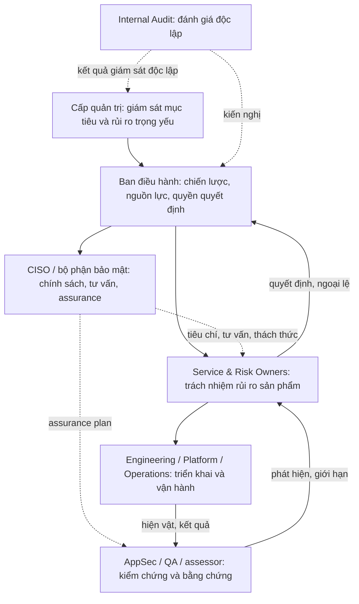
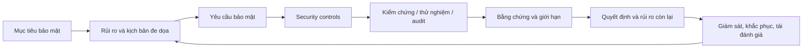
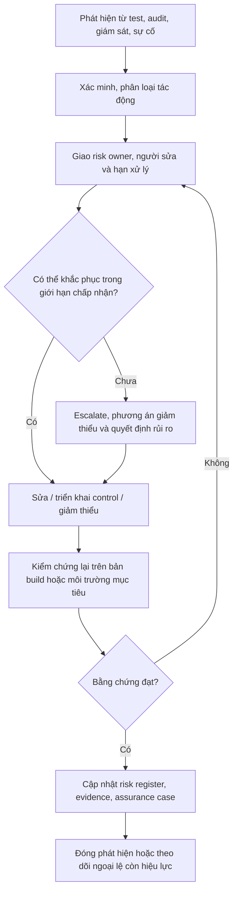

# Vai trò lãnh đạo trong quản trị bảo mật và security assurance

## 1. Mục tiêu học tập

Sau bài học, người học có thể:

1. Giải thích vì sao lãnh đạo chịu trách nhiệm định hướng, giám sát và quyết định rủi ro bảo mật, ngay cả khi hoạt động triển khai được giao cho đội kỹ thuật.
2. Phân biệt trách nhiệm của hội đồng quản trị/ban điều hành, lãnh đạo công nghệ, người phụ trách bảo mật, chủ sở hữu rủi ro, kiểm toán và các nhóm thực thi.
3. Thiết lập mục tiêu bảo mật, mức chấp nhận rủi ro, ưu tiên đầu tư và cơ chế ra quyết định dựa trên bằng chứng.
4. Hiểu cách lãnh đạo bảo trợ chương trình **security assurance liên tục**: từ phân tích rủi ro, yêu cầu và security controls đến kiểm thử, audit, xử lý phát hiện và đánh giá lại.
5. Áp dụng cơ chế phân quyền quyết định, báo cáo, xử lý ngoại lệ và giám sát vào một tình huống triển khai hệ thống thực tế.

Trong module **SECURITY_SECURITY_ASSURANCE**, security assurance là hoạt động tạo lập và đánh giá bằng chứng để có cơ sở tin cậy rằng hệ thống đáp ứng các mục tiêu bảo mật trong **phạm vi và điều kiện đã xác định**. Để hoạt động này có giá trị, lãnh đạo phải trả lời được: *Hệ thống cần được bảo vệ đến mức nào? Ai chịu trách nhiệm? Bằng chứng thế nào được xem là đủ? Ai có quyền chấp nhận rủi ro còn lại? Khi điều kiện thay đổi, ai bảo đảm kết luận được xem xét lại?*

Đó là cốt lõi của **vai trò lãnh đạo trong quản trị bảo mật** (*security governance leadership*).

## 2. Lãnh đạo là một phần của hệ thống kiểm soát bảo mật

Một công ty có thể sở hữu công cụ quét lỗ hổng, hệ thống giám sát, cơ chế mã hóa và đội bảo mật giỏi nhưng vẫn thất bại nếu:

- Lãnh đạo không quyết định mức rủi ro nào được chấp nhận và mức nào phải xử lý.
- Nhóm phát triển được thúc đẩy phát hành nhanh nhưng không có thời gian sửa lỗ hổng nghiêm trọng.
- Không ai được giao quyền yêu cầu ngừng phát hành khi bằng chứng assurance không đạt.
- Rủi ro được nêu trong báo cáo nhưng không có người chịu trách nhiệm, thời hạn và ngân sách.
- Nhóm kiểm thử bị yêu cầu tự phê duyệt chính hệ thống mình đã xây dựng khi mức rủi ro vượt quá thẩm quyền.
- Một ngoại lệ bảo mật được chấp nhận vô thời hạn mà không được tái đánh giá.

Đây là những điểm yếu về **quản trị và quyết định**, không chỉ về kỹ thuật.

Cần phân biệt ba tầng hoạt động:

| Tầng | Trả lời câu hỏi | Ví dụ |
| --- | --- | --- |
| **Governance — quản trị** | Vì sao phải bảo vệ, mục tiêu là gì, ai chịu trách nhiệm, rủi ro nào chấp nhận được? | Phê duyệt định hướng bảo mật, khẩu vị rủi ro, cơ chế giám sát |
| **Management — quản lý** | Biến định hướng thành chương trình, nguồn lực, trách nhiệm và quy trình như thế nào? | Lập kế hoạch assurance, ưu tiên dự án, chọn chỉ số, quản lý phát hiện |
| **Execution — thực thi** | Controls hoạt động thế nào và có bằng chứng gì? | Thiết kế phân quyền, code review, kiểm thử, giám sát, khắc phục |

Các tầng này liên thông. Lãnh đạo không nhất thiết trực tiếp viết rule firewall hoặc chạy pentest, nhưng phải bảo đảm những hoạt động cần thiết **được thực hiện, có bằng chứng và được dùng để ra quyết định**.

Một nguyên tắc nền tảng: **Có thể giao việc và phân quyền thực hiện; trách nhiệm giải trình ở cấp được giao quyền quản trị không vì thế mà biến mất.** Quyền quyết định cụ thể vẫn phải tuân theo cơ cấu tổ chức và chính sách đã phê duyệt.

## 3. Các vai trò lãnh đạo và ranh giới trách nhiệm

Cùng một công ty có thể có tên chức danh khác nhau. Bảng sau mô tả **chức năng**, không áp đặt một sơ đồ tổ chức cố định:

| Vai trò | Trách nhiệm đối với security assurance | Quyền quyết định hoặc giới hạn |
| --- | --- | --- |
| **Hội đồng quản trị/cơ quan quản trị**, nếu có | Giám sát mức rủi ro tổng thể, đặt kỳ vọng về quản trị, yêu cầu báo cáo các rủi ro trọng yếu | Giám sát và phê duyệt theo điều lệ; thường không duyệt từng test case |
| **Ban điều hành/CEO và lãnh đạo đơn vị** | Chuyển mục tiêu kinh doanh thành ưu tiên bảo mật, cấp nguồn lực, thiết lập cơ chế chịu trách nhiệm | Quyết định ưu tiên và việc xử lý rủi ro trong thẩm quyền |
| **CISO/Head of Security** | Đề xuất chiến lược và chính sách, thiết kế chương trình assurance, tư vấn rủi ro, theo dõi chất lượng bằng chứng | Có thể khuyến nghị chặn release hoặc escalations; quyền phê duyệt rủi ro phụ thuộc chính sách |
| **CTO/CIO/Head of Engineering** | Bảo đảm kiến trúc, sản phẩm, hạ tầng và quy trình phát triển thực hiện các yêu cầu kiểm soát | Chịu trách nhiệm năng lực triển khai, bảo trì và khắc phục thuộc phạm vi công nghệ |
| **Product/Service Owner** | Xác định mức tác động nghiệp vụ, phạm vi, yêu cầu, thời điểm phát hành; phối hợp xử lý rủi ro | Có thể là risk owner nếu được chỉ định và đủ thẩm quyền |
| **Risk Owner** | Sở hữu một rủi ro cụ thể: quyết định phương án xử lý, theo dõi rủi ro còn lại, trình phê duyệt ngoại lệ | Chỉ chấp nhận rủi ro khi nằm trong quyền hạn được tổ chức giao |
| **Engineering Lead/Platform Lead** | Triển khai controls, lưu dấu vết thay đổi, khắc phục phát hiện, bảo đảm vận hành | Quyết định kỹ thuật trong phạm vi tiêu chuẩn và ngân sách đã duyệt |
| **Security Assessor/QA/AppSec** | Xác minh yêu cầu và hiệu lực controls, đánh giá bằng chứng, nêu phát hiện và giới hạn kiểm thử | Đưa kết luận kiểm chứng; không tự động là người chấp nhận rủi ro kinh doanh |
| **Internal Audit/đơn vị đánh giá độc lập** | Kiểm tra độc lập hiệu quả quản trị, quy trình và một phần hiệu lực controls theo kế hoạch audit | Báo cáo phát hiện và kiến nghị; không sở hữu việc sửa thay nhóm được kiểm toán |

**CISO không đồng nghĩa với “người chịu mọi rủi ro bảo mật”.** Một rủi ro có thể thuộc chủ sở hữu dịch vụ, nghiệp vụ thanh toán hoặc đơn vị dữ liệu; CISO tư vấn về bản chất kỹ thuật, mức phơi nhiễm và năng lực kiểm soát. Quyền chấp nhận rủi ro phải được giao rõ ràng, kèm giới hạn thẩm quyền.

**Audit không thay công việc quản lý.** Người đánh giá độc lập cần đủ khách quan để nêu ra phát hiện, còn ban điều hành và các risk owner phải bảo đảm phát hiện được xử lý.

### 3.1. Sơ đồ trách nhiệm trong một tổ chức có nhiều bộ phận



Sơ đồ chỉ là ví dụ. Ở công ty nhỏ, một người có thể kiêm nhiều vai trò. Khi đó cần **bù đắp xung đột lợi ích**: phân quyền phê duyệt rõ hơn, review chéo, tư vấn bên ngoài cho rủi ro cao hoặc đưa quyết định vượt ngưỡng lên cấp cao hơn.

## 4. Trách nhiệm thứ nhất: Đặt định hướng và mục tiêu bảo mật

Lãnh đạo bắt đầu từ **mục tiêu kinh doanh và nghĩa vụ phải đáp ứng**: bảo vệ tài sản nào, mất mát nào gây hậu quả lớn, hoạt động nào phải tiếp tục khi có sự cố, loại dữ liệu nào cần kiểm soát nghiêm ngặt.

Ví dụ với nền tảng xử lý thanh toán:

- Mục tiêu kinh doanh: thực hiện thanh toán đúng và cung cấp dịch vụ ổn định.
- Mục tiêu bảo mật: chỉ chủ thể được ủy quyền thực hiện giao dịch; giao dịch không bị sửa trái phép; khóa bí mật và dữ liệu nhạy cảm được bảo vệ; sự cố có thể phát hiện và điều tra.
- Rủi ro cần lãnh đạo quan tâm: truy cập trái quyền, gian lận giao dịch, lộ khóa, lỗi tích hợp nhà cung cấp, thời gian gián đoạn kéo dài.
- Nhu cầu bằng chứng: kiểm thử phân quyền, integrity, khôi phục, giám sát và hiệu lực kiểm soát trong bản phát hành thực tế.

Mục tiêu phải được thể hiện bằng **yêu cầu có thể kiểm chứng**, ví dụ:

| Câu nói chung chung | Yêu cầu có thể đánh giá |
| --- | --- |
| “Ứng dụng phải an toàn” | Các endpoint giao dịch phải xác thực và kiểm tra quyền trên từng đối tượng ở phía server |
| “Không bị mất dữ liệu” | Sao lưu và khôi phục phải đáp ứng mục tiêu phục hồi do tổ chức phê duyệt, được diễn tập và lưu kết quả |
| “Có giám sát bảo mật” | Các hành vi nhạy cảm được ghi nhận theo chính sách và có kịch bản thử khả năng phát hiện/cảnh báo |
| “Nhà cung cấp đáng tin” | Các phụ thuộc quan trọng có đánh giá rủi ro, nghĩa vụ kiểm soát, phương án dự phòng và lịch tái đánh giá |

Vai trò của lãnh đạo là phê duyệt ưu tiên, phân bổ trách nhiệm và yêu cầu bằng chứng cho những mục tiêu đó. **Mọi mục tiêu không có chủ sở hữu và tiêu chí kiểm chứng dễ trở thành khẩu hiệu.**

## 5. Trách nhiệm thứ hai: Xác lập khẩu vị và giới hạn rủi ro

**Khẩu vị rủi ro (*risk appetite*)** là mức và loại rủi ro tổ chức sẵn sàng chấp nhận để đạt mục tiêu. **Giới hạn/khả năng chịu rủi ro (*risk tolerance*)** cụ thể hóa ranh giới vận hành hoặc ngưỡng cần hành động, phù hợp với khẩu vị rủi ro đã xác định.

Lãnh đạo cần chuyển các phát biểu định hướng thành cơ chế vận hành. Các ví dụ sau chỉ mang tính minh họa, không phải ngưỡng chuẩn áp dụng cho mọi doanh nghiệp:

| Tuyên bố lãnh đạo | Cách chuyển thành quyết định assurance |
| --- | --- |
| Không chấp nhận giao dịch trái quyền đối với tài sản tiền tệ | Bắt buộc kiểm thử authorization trên đối tượng, kiểm thử âm tính và xem xét phát hiện trọng yếu trước release |
| Không chấp nhận mất khả năng khôi phục dịch vụ trọng yếu kéo dài ngoài mục tiêu đã duyệt | Xác lập RTO/RPO theo phân tích tác động nghiệp vụ; diễn tập khôi phục và đối chiếu kết quả |
| Chấp nhận rủi ro có giới hạn cho một tính năng thử nghiệm | Khoanh vùng người dùng, dữ liệu, thời hạn thử nghiệm và quyền phê duyệt; đo mức phơi nhiễm thực tế |
| Không duy trì vô thời hạn ngoại lệ chưa xử lý | Mọi ngoại lệ có chủ sở hữu, nguyên nhân, biện pháp giảm thiểu, thời hạn và mốc tái duyệt |

Lãnh đạo phải giải quyết những điểm khó: **rủi ro nào cần tránh, giảm thiểu, chuyển giao một phần hoặc chấp nhận**. Mua bảo hiểm hoặc thuê bên cung cấp dịch vụ có thể chuyển một phần tổn thất hay nghĩa vụ theo hợp đồng nhưng không tự loại bỏ rủi ro và trách nhiệm giám sát của tổ chức.

Khi mô tả rủi ro, tránh chỉ dựa vào điểm CVSS hoặc một nhãn “High”. Mức độ ưu tiên cần xem cả tính khai thác được, tài sản bị tác động, khả năng phơi nhiễm, controls hiện có, tác động nghiệp vụ và các nghĩa vụ bắt buộc.

### 5.1. Đặt ranh giới quyền chấp nhận rủi ro

Một chính sách phân quyền nên trả lời rõ:

1. Ai được phê duyệt ngoại lệ theo từng loại và mức độ rủi ro?
2. Khi nào bắt buộc có tư vấn từ CISO, bảo mật, pháp chế hoặc đơn vị liên quan?
3. Khi nào phải báo cáo hoặc trình ban điều hành/cấp quản trị?
4. Phương án khắc phục, biện pháp bù trừ, thời hạn và điều kiện thu hồi ngoại lệ là gì?
5. Ai kiểm tra mức rủi ro còn lại và việc thực hiện cam kết sau phê duyệt?

**Không dùng chữ ký chấp nhận rủi ro như cách xóa phát hiện khỏi hệ thống theo dõi.** Ngoại lệ vẫn phải xuất hiện trong hồ sơ assurance, có thời hạn và được giám sát.

## 6. Trách nhiệm thứ ba: Cấp nguồn lực và xác lập ưu tiên

Không thể yêu cầu bảo mật nghiêm ngặt nếu đội ngũ không có ngân sách, công cụ, năng lực hoặc thời gian cần thiết. Lãnh đạo phải quyết định cách phân bổ nguồn lực theo **tác động của rủi ro** thay vì chỉ theo số lượng phát hiện.

Các hạng mục thường cần đầu tư:

- Năng lực thiết kế bảo mật, threat modeling và review kiến trúc trước khi code.
- Kiểm thử tự động trong CI/CD, kiểm thử tích hợp, DAST, kiểm tra phụ thuộc và cấu hình, đánh giá độc lập khi cần.
- Khả năng quản lý danh tính, phân quyền, secrets, khóa, bản vá và tài sản.
- Hệ thống logging, giám sát, xử lý sự cố và diễn tập khôi phục.
- Năng lực thu thập, bảo vệ, lưu giữ và truy xuất bằng chứng assurance.
- Thời gian xử lý technical debt bảo mật và nâng cấp controls đã lạc hậu.
- Đào tạo phù hợp với vai trò: kỹ sư, owner nghiệp vụ, người phê duyệt, vận hành và người đánh giá.

Ví dụ, nếu nhóm sản phẩm có 10 ngày để phát hành nhưng còn phát hiện về truy cập trái quyền trên API, lãnh đạo không chỉ hỏi “có thể bỏ qua lần này không?”. Các lựa chọn đáng cân nhắc gồm dời ngày phát hành, giảm phạm vi tính năng, bổ sung người sửa lỗi, đặt biện pháp giảm thiểu được xác minh hoặc trình rủi ro lên đúng cấp phê duyệt. Quyết định phải gắn với bằng chứng và giới hạn thực tế.

## 7. Trách nhiệm thứ tư: Bảo trợ chương trình security assurance

Một chương trình assurance có hiệu quả khi lãnh đạo bảo đảm **chuỗi truy vết từ mục tiêu đến quyết định**:



Điều mà lãnh đạo cần yêu cầu **không phải** hàng trăm trang kết quả công cụ, mà là những kết luận rõ ràng và có thể kiểm chứng:

- **Claim:** Chúng ta khẳng định điều gì về mức độ an toàn của hệ thống?
- **Argument:** Tại sao các controls và phương pháp đánh giá hỗ trợ khẳng định đó?
- **Evidence:** Báo cáo kiểm thử, review, cấu hình, log, diễn tập và hồ sơ nào chứng minh?
- **Scope/limits:** Đã đánh giá phiên bản, môi trường, luồng nghiệp vụ nào; điều gì chưa đánh giá?
- **Findings:** Vấn đề tồn đọng ảnh hưởng claim và rủi ro còn lại ra sao?
- **Decision:** Ai cho phép phát hành/tiếp tục vận hành và trong điều kiện nào?
- **Reassessment trigger:** Thay đổi nào khiến phải đánh giá lại?

### 7.1. Mẫu báo cáo ngắn lãnh đạo có thể sử dụng

| Nội dung lãnh đạo cần biết | Ví dụ minh họa với hệ thống chuyển tiền |
| --- | --- |
| Mục tiêu và phạm vi | Bản phát hành API chuyển tiền, build X, môi trường staging tương đương production theo các điểm đã xác minh |
| Rủi ro trọng yếu | R-01: truy cập trái quyền; R-02: xử lý trùng giao dịch |
| Controls đã triển khai | CTRL-01: object-level authorization; CTRL-02: idempotency |
| Bằng chứng | Review thiết kế, test người dùng đúng/sai quyền, test retry đồng thời, kết quả kiểm tra cấu hình |
| Giới hạn | Chưa diễn tập sự cố mất message broker cùng lúc với database failover |
| Phát hiện cần xử lý | Trường hợp retry có thể tạo bản ghi đôi trong một nhánh lỗi |
| Hành động và owner | Engineering sửa nhánh lỗi; QA/AppSec kiểm chứng; owner cập nhật rủi ro |
| Quyết định cần xin | Chặn tính năng mới, giảm phạm vi phát hành hoặc xem xét phương án giảm rủi ro phù hợp |

Một lãnh đạo không cần đọc từng log để giám sát, nhưng phải có cơ chế **truy xuống bằng chứng gốc** nếu phát hiện trọng yếu gây tranh luận. Báo cáo tổng hợp không nên che mất giả định và phạm vi chưa được thử.

## 8. Trách nhiệm thứ năm: Thiết lập cấu trúc trách nhiệm và tính độc lập

Một vấn đề assurance phổ biến là người xây hệ thống đồng thời viết test, tự chấm đạt và tự chấp nhận mọi phát hiện. Điều này làm suy yếu tính khách quan, đặc biệt với hệ thống rủi ro cao.

Một cách tổ chức tham khảo là phân biệt:

- **Tuyến thực thi và sở hữu rủi ro:** quản lý nghiệp vụ, product, engineering, vận hành; xây, chạy và duy trì controls.
- **Tuyến hỗ trợ/challenge rủi ro:** security, risk, compliance; ban hành khung kiểm soát, hỗ trợ và giám sát việc đánh giá rủi ro.
- **Đánh giá độc lập:** internal audit hoặc assessor độc lập đánh giá hiệu quả quản trị và controls theo phạm vi được giao.

Mô hình này thường được gọi là **Three Lines Model**; việc bố trí cụ thể tùy cơ cấu, quy mô và mức độc lập cần thiết. Điểm quan trọng là tránh để **một người vừa sở hữu rủi ro vượt thẩm quyền, vừa là người duy nhất kết luận bằng chứng đạt và phê duyệt chấp nhận**.

### 8.1. Ví dụ ma trận RACI

Trong bảng, **R** là người thực hiện, **A** là người chịu trách nhiệm cuối cho công việc/quyết định trong phạm vi được giao, **C** là người được tham vấn, **I** là người nhận thông tin. Một hoạt động nên có **một đầu mối A rõ ràng**. Bảng sau chỉ là mô hình tham khảo; quyền thực tế phải tuân theo phân quyền của tổ chức.

| Hoạt động | Ban điều hành | Risk/Service Owner | CISO/Security | Engineering | Assessor/QA | Audit |
| --- | --- | --- | --- | --- | --- | --- |
| Phê duyệt định hướng và khung phân quyền | **A** | C | **R** | C | I | I |
| Đánh giá rủi ro một dịch vụ | I | **A/R** | C | C | C | I |
| Xây dựng controls trong code/hạ tầng | I | **A** | C | **R** | C | I |
| Thực hiện kiểm thử và lập evidence | I | **A** | C | C | **R** | I |
| Xử lý phát hiện thuộc dịch vụ | I | **A** | C | **R** | C | I |
| Chấp nhận rủi ro vượt ngưỡng của service owner | **A** | R | C | C | C | I |
| Audit độc lập theo nhiệm vụ được giao | I | C | C | C | C | **A/R** |

**Lưu ý về hàng audit:** theo mô hình tổ chức, bộ phận audit có thể báo cáo trực tiếp lên cơ quan quản trị; tính độc lập và quyền ban hành ý kiến không nên bị phụ thuộc vào người sở hữu control đang được kiểm tra.

RACI giúp tránh khoảng trống trách nhiệm, nhưng không thay được **chính sách quyền hạn**. Nếu quy định yêu cầu cấp phê duyệt khác, ma trận phải cập nhật cho phù hợp.

## 9. Trách nhiệm thứ sáu: Bảo đảm quyết định phát hành có bằng chứng

Một quyết định “go/no-go” liên quan bảo mật cần dựa vào rủi ro còn lại, mức quan trọng của hệ thống, độ tin cậy của bằng chứng và chính sách của tổ chức. Lãnh đạo phải thiết lập trước **tiêu chí kiểm soát phát hành** (*release gates*), tránh thay đổi tiêu chí theo áp lực tiến độ.

Các câu hỏi cần được trả lời trước quyết định:

1. Release candidate cụ thể là phiên bản nào, cấu hình nào, môi trường nào?
2. Các mục tiêu bảo mật bắt buộc và yêu cầu ưu tiên cao đã được kiểm chứng chưa?
3. Các phát hiện quan trọng còn mở có ảnh hưởng đến mục tiêu nào?
4. Đã xác minh bản sửa và kết quả kiểm thử lại trên phiên bản mục tiêu chưa?
5. Mức rủi ro còn lại có nằm trong giới hạn đã được phê duyệt không?
6. Có biện pháp giảm thiểu và giám sát phù hợp khi phát hành có điều kiện không?
7. Ai đưa ra khuyến nghị chuyên môn, ai là người ra quyết định và ai chịu trách nhiệm theo dõi?

Các kết quả khả dĩ:

| Quyết định | Điều kiện điển hình | Điều lãnh đạo phải lưu |
| --- | --- | --- |
| **Cho phép phát hành** | Bằng chứng đáp ứng tiêu chí, rủi ro còn lại trong giới hạn | Scope, version, evidence, người phê duyệt |
| **Phát hành có điều kiện** | Ngoại lệ hợp lệ được cấp có thẩm quyền chấp nhận, có giảm thiểu và thời hạn | Lý do, tác động, compensating controls, owner, ngày tái đánh giá |
| **Chặn phát hành** | Bằng chứng chưa đủ, control trọng yếu thất bại hoặc rủi ro ngoài thẩm quyền/ngưỡng | Phát hiện, việc cần làm, tiêu chí để xem xét lại |

Một phát hiện có thể là *false positive*; cần xác minh và lưu lý do phân loại. Ngược lại, việc công cụ không tìm thấy lỗi không chứng minh hệ thống an toàn trong mọi kịch bản.

## 10. Trách nhiệm thứ bảy: Chỉ đạo khắc phục và ngoại lệ

Lãnh đạo chịu trách nhiệm xây dựng cơ chế để phát hiện bảo mật dẫn tới **thay đổi thực tế**, thay vì chỉ xuất hiện trong báo cáo.



Một phát hiện nên có tối thiểu: ID, mô tả kịch bản và tác động, risk/requirement/control liên quan, mức độ ưu tiên, người chịu trách nhiệm, hướng xử lý, thời hạn, trạng thái, bằng chứng sửa và retest, kết luận về rủi ro còn lại.

Một **ngoại lệ bảo mật** có thể hợp lệ khi không thể sửa ngay nhưng đủ điều kiện xử lý theo chính sách. Hồ sơ ngoại lệ cần:

- Tài sản, phiên bản, nhóm người dùng và thời hạn áp dụng.
- Mức rủi ro còn lại cùng căn cứ đánh giá; các nghĩa vụ không thể miễn trừ.
- Lý do trì hoãn, lựa chọn thay thế, tác động của việc không phát hành.
- Controls bù trừ, cách đo hiệu lực và cơ chế giám sát.
- Người đề xuất, người đánh giá chuyên môn, người có thẩm quyền phê duyệt.
- Ngày hết hạn, điều kiện thu hồi, việc phải làm và ngày tái đánh giá.

**Chấp nhận rủi ro không đồng nghĩa khẳng định control đã đạt.** Bản ghi assurance vẫn phải nói rõ phần nào chưa được chứng minh hoặc chưa đạt.

## 11. Trách nhiệm thứ tám: Giám sát chương trình liên tục

Lãnh đạo cần đảm bảo security assurance được vận hành như một chương trình **liên tục trong phát triển và vận hành**, với nhịp kiểm soát gắn từng loại quyết định.

| Nhịp/tình huống | Người chủ trì gợi ý | Đầu vào | Quyết định và đầu ra |
| --- | --- | --- | --- |
| Pull request / thay đổi hằng ngày | Tech lead / Engineering | Review code, security tests, thay đổi control | Yêu cầu sửa, kiểm thử bổ sung hoặc cho phép merge |
| Chu kỳ release | Service owner + assessor | Claim, evidence, các phát hiện và ngoại lệ | Release gate và quyết định rõ người chịu trách nhiệm |
| Định kỳ theo mức rủi ro | CISO/Security + risk owners | Risk register, xu hướng lỗ hổng, control health | Điều chỉnh ưu tiên và kế hoạch khắc phục |
| Họp điều hành | Ban điều hành | Các rủi ro trọng yếu, nhu cầu nguồn lực, ngoại lệ vượt thẩm quyền | Đầu tư, xử lý xung đột ưu tiên, escalations |
| Báo cáo cấp quản trị | Cơ quan quản trị | Tình hình rủi ro chiến lược, sự cố lớn, hiệu quả chương trình | Chỉ đạo giám sát và điều chỉnh định hướng |
| Sau sự cố hoặc thay đổi lớn | Incident lead, service/risk owner | Điều tra, nguyên nhân gốc, controls thất bại | Kế hoạch sửa, kiểm chứng lại, cập nhật risk appetite nếu cần |
| Theo kế hoạch audit | Audit/assessor độc lập | Bằng chứng mẫu, chính sách, hiệu lực controls | Phát hiện độc lập và yêu cầu khắc phục |

Tần suất và đối tượng tham gia phải phù hợp quy mô doanh nghiệp. Với dịch vụ rủi ro cao, một tuần có thể chứa nhiều quyết định phát hành; với một hoạt động ít thay đổi, các mốc định kỳ có thể thưa hơn. **Không sử dụng một lịch cố định để thay thế trigger theo sự kiện**: lỗ hổng mới có khả năng khai thác hoặc sự cố lớn có thể đòi hỏi đánh giá ngay.

### 11.1. Lãnh đạo cần nhìn thấy thay đổi nào làm kết luận assurance hết hiệu lực?

- Thay đổi cấu hình production ngoài quy trình, quyền truy cập đặc quyền hoặc chính sách phân quyền.
- Cập nhật dependency, image container, nhà cung cấp xác thực hoặc cơ chế quản lý secret.
- API/luồng nghiệp vụ mới đi qua trust boundary hay xử lý dữ liệu nhạy cảm.
- Có bằng chứng control không hoạt động: alert không phát, backup không phục hồi, test security regression thất bại.
- Xuất hiện mối đe dọa hoặc kỹ thuật khai thác liên quan trực tiếp tới phạm vi đã đánh giá.
- Chuyển dữ liệu/hệ thống sang môi trường khác hoặc ngừng dịch vụ.

Khi một trigger xuất hiện, người sở hữu hệ thống phối hợp với security xác định **claim nào bị ảnh hưởng, bằng chứng nào cần cập nhật và quyền quyết định nào phải kích hoạt lại**.

## 12. Đo hiệu quả lãnh đạo bằng kết quả, không phải số báo cáo

KPI/KRI phục vụ giám sát nếu có định nghĩa nhất quán và tạo ra **quyết định tiếp theo**. Một số chỉ số có ích:

| Chỉ số hoặc tín hiệu | Câu hỏi lãnh đạo cần đặt | Giới hạn khi diễn giải |
| --- | --- | --- |
| Độ bao phủ rủi ro có owner, control và evidence | Bao nhiêu rủi ro trọng yếu được quản lý và kiểm chứng? | Một liên kết tồn tại không có nghĩa evidence đạt chất lượng |
| Bằng chứng còn hiệu lực với bản production hiện tại | Có đang quyết định dựa trên kiểm thử của phiên bản cũ không? | “Mới” chưa chắc phù hợp phạm vi hoặc thiết kế |
| Số và tuổi phát hiện tồn đọng theo mức tác động | Các rủi ro lớn có bị bỏ qua không? | Số lượng tăng đôi khi do phát hiện tốt hơn |
| Tỷ lệ phát hiện được kiểm thử lại trước khi đóng | Quy trình remediation có thực sự xác nhận hiệu quả không? | Cần đối chiếu cả chất lượng và độ phủ retest |
| Ngoại lệ quá hạn, vượt thẩm quyền | Có rủi ro nào mất kiểm soát quyết định không? | Giảm số ngoại lệ bằng cách bỏ ghi nhận là tín hiệu sai |
| Kết quả diễn tập phát hiện, ứng phó, khôi phục | Controls vận hành có hoạt động khi bị thử không? | Thời gian phản ứng nhanh không chứng minh kiểm soát được toàn bộ tác động |
| Xu hướng thay đổi rủi ro còn lại | Đầu tư có thực sự giảm phơi nhiễm không? | Cần xem cả thay đổi hệ thống và đe dọa |

Đặt chỉ tiêu cứng, thiếu bối cảnh có thể tạo hành vi sai: hạ severity để “đạt KPI”, không ghi nhận rủi ro hoặc đóng ticket khi chưa retest. Lãnh đạo phải khuyến khích **báo cáo trung thực và phát hiện sớm**, kể cả khi số lỗi được ghi nhận tăng trong giai đoạn cải thiện kiểm thử.

### 12.1. Câu hỏi tại mỗi kỳ review

1. Rủi ro nào đang tăng và vì sao?
2. Control nào đã mất hiệu lực hoặc có bằng chứng quá hạn?
3. Các findings trọng yếu đang bị chặn bởi quyết định, nguồn lực hay phụ thuộc nào?
4. Ngoại lệ nào sắp hết hạn hoặc có điều kiện cần xác minh lại?
5. Phát hiện nào lặp lại do nguyên nhân hệ thống trong thiết kế hoặc quy trình?
6. Chúng ta cần thay đổi chính sách, năng lực con người hay kiến trúc ở đâu?

Chất lượng chương trình assurance được phản ánh qua khả năng **ra quyết định tốt hơn và sửa những điểm yếu có ảnh hưởng**, không phải độ dày của báo cáo.

## 13. Văn hóa bảo mật và hành vi của lãnh đạo

Lãnh đạo tạo văn hóa bằng hành vi thực tế:

- **Làm gương:** sử dụng các quy trình xác thực, phê duyệt và quản lý dữ liệu đúng chuẩn, kể cả khi bận.
- **Khuyến khích báo cáo sớm:** nhóm phát triển không bị trừng phạt chỉ vì phát hiện lỗi sớm hoặc báo đúng về rủi ro.
- **Bảo vệ quyền nêu ý kiến chuyên môn:** assessor có thể nói “chưa đủ bằng chứng” mà không bị yêu cầu sửa kết luận để phù hợp mục tiêu tiến độ.
- **Cân bằng tốc độ và rủi ro:** ưu tiên loại bỏ lỗi trọng yếu từ thiết kế; có lộ trình xử lý nợ kỹ thuật.
- **Đầu tư kỹ năng:** hỗ trợ nhóm học secure coding, threat modeling, điều tra sự cố và cách đọc bằng chứng.
- **Phối hợp liên chức năng:** kỹ thuật, pháp chế, dữ liệu, procurement, bảo mật, vận hành và nghiệp vụ cùng tham gia khi rủi ro vượt biên giới bộ phận.
- **Học sau sự cố:** tập trung phân tích điều kiện và cơ chế thất bại, sau đó giao hành động cụ thể thay vì chỉ tìm cá nhân để quy trách nhiệm.

Cũng cần phân biệt **an toàn tâm lý để báo cáo lỗi** với việc bỏ qua trách nhiệm nghề nghiệp hoặc cố tình vi phạm quy định. Một nền văn hóa tốt có cả minh bạch, quyền phản biện và quy tắc xử lý trách nhiệm rõ ràng.

## 14. Lãnh đạo với bên thứ ba và hệ sinh thái

Nhiều hệ thống phụ thuộc cloud, thư viện, nhà cung cấp xác thực, thanh toán hoặc đơn vị vận hành thuê ngoài. Lãnh đạo phải đưa các phụ thuộc này vào phạm vi quản trị rủi ro và assurance.

Những câu hỏi điển hình:

- Dịch vụ bên ngoài hỗ trợ luồng nghiệp vụ nào và có thể gây ra tác động gì nếu bị gián đoạn hoặc lộ dữ liệu?
- Ai đánh giá an toàn nhà cung cấp trước khi ký hợp đồng và khi thay đổi phạm vi sử dụng?
- Có bằng chứng nào về controls mà nhà cung cấp vận hành, và bằng chứng đó có giới hạn gì?
- Ai sở hữu controls ở phía khách hàng, ví dụ cấu hình IAM, logging, mạng và quản lý khóa?
- Khi có sự cố, nhà cung cấp phải thông báo, phối hợp, bảo toàn bằng chứng và hỗ trợ khắc phục theo thỏa thuận nào?
- Có phương án dự phòng hoặc chấm dứt sử dụng an toàn khi rủi ro không còn chấp nhận được không?

Báo cáo chứng nhận hoặc audit của nhà cung cấp có thể hữu ích, nhưng phải xem **phạm vi, kỳ đánh giá, hệ thống nằm ngoài phạm vi và trách nhiệm còn lại của tổ chức**. Không thể chuyển giao hoàn toàn công tác quản trị bảo mật chỉ bằng việc mua dịch vụ.

## 15. Tình huống xuyên suốt: Phát hành tính năng chuyển tiền định kỳ

### 15.1. Bối cảnh

Một nhóm Java/Spring Boot dự kiến phát hành chức năng chuyển tiền định kỳ. Ban điều hành đặt mục tiêu tăng số lượng người sử dụng. Dịch vụ có API, database giao dịch, message broker và hệ thống xác thực tập trung.

Rủi ro quan trọng của phiên bản mới:

- **R-01:** API cho phép người dùng thay đổi lịch chuyển tiền của tài khoản khác nếu chỉ đoán được ID.
- **R-02:** khi message broker gửi lại event, tác vụ có thể chuyển tiền hai lần.
- **R-03:** log không có đủ dấu vết để xác định người khởi tạo hoặc phê duyệt thay đổi lịch chuyển tiền.

Risk owner và lãnh đạo công nghệ thống nhất phải kiểm chứng object-level authorization, idempotency và audit trail trước release; bộ phận bảo mật tư vấn phương pháp và yêu cầu evidence.

### 15.2. Nhóm kiểm thử gửi phát hiện

Assessor cung cấp bằng chứng: kịch bản Bob sửa lịch của Alice bị từ chối đúng, nhưng một trường hợp retry đồng thời tạo giao dịch trùng. Báo cáo ghi build, môi trường, bước tái hiện, tác động và kết quả; mức ưu tiên được đánh giá theo rủi ro thực tế.

**Vai trò lãnh đạo ở đây không phải bảo kỹ sư “cố gắng sửa sớm”.** Cần đưa ra quyết định cụ thể về phạm vi phát hành, thời hạn và nguồn lực:

1. Service/Risk Owner xác định tác động nghiệp vụ và cùng Engineering xác nhận kịch bản.
2. Engineering Lead đề xuất sửa idempotency, bổ sung integration tests và đánh giá ảnh hưởng tới lịch triển khai.
3. CISO/Security làm rõ mức rủi ro còn lại, độ tin cậy của evidence và đề xuất điều kiện đảm bảo.
4. Người có thẩm quyền xét các phương án: dời phát hành, chỉ phát hành phần không phụ thuộc tính năng mới hoặc phương án kiểm soát rủi ro khác được phê duyệt.
5. QA/AppSec **kiểm thử lại** trên release candidate mới. Chỉ sau đó mới đánh giá việc đóng phát hiện.
6. Quyết định được lưu cùng phiên bản, bằng chứng, người phê duyệt, ngoại lệ (nếu có) và điều kiện theo dõi.

Không thể lấy thành công của test phân quyền R-01 để kết luận R-02 đã đạt. Nếu rủi ro R-02 vượt thẩm quyền hoặc mức chấp nhận, phải **escalate** và tuân thủ cơ chế release gate đã định.

### 15.3. Mẫu biên bản quyết định có thể kiểm chứng

Ví dụ cấu trúc YAML dưới đây chỉ là **mẫu hồ sơ minh họa**; những ô đặt trong dấu ngoặc nhọn cần được điền bằng dữ liệu và bằng chứng thực của hệ thống:

```yaml
decision_id: SEC-DEC-EXAMPLE
service: scheduled-transfer-api
release: "<release-candidate-id>"
environment: "<tested-environment>"
business_owner: "<role-or-id>"
risk_owner: "<role-or-id>"
security_reviewer: "<role-or-id>"
claims:
  - id: CLAIM-AUTHZ
    result: "<supported-or-not-supported>"
    evidence: ["<test-report-or-review-link>"]
  - id: CLAIM-IDEMPOTENCY
    result: "<supported-or-not-supported>"
    evidence: ["<retry-test-report-link>"]
open_findings:
  - id: R-02-FINDING
    risk: "<impact-and-likelihood-assessment>"
    action: "<fix-or-approved-mitigation>"
    action_owner: "<role-or-id>"
    due_date: "<date>"
    retest_evidence: "<artifact-or-pending>"
decision:
  outcome: "<approve-conditional-approve-block>"
  rationale: "<why-evidence-supports-this-outcome>"
  approver: "<authorized-role-or-id>"
  approved_at: "<timestamp-or-pending>"
  expires_at: "<date-if-conditional>"
reassessment_triggers:
  - "<relevant-system-or-risk-change>"
```

Một quyết định có điều kiện cần thêm kiểm soát hạn xử lý và ngày đánh giá lại. Dấu phê duyệt chỉ có giá trị khi người ký **thực sự có thẩm quyền** và bằng chứng tương ứng với chính bản phát hành được xét.

### 15.4. Khi đã lên production

Nếu hệ thống nhận cảnh báo giao dịch trùng hoặc có thay đổi retry behavior từ message broker, service owner phải kích hoạt đánh giá lại. Lãnh đạo giám sát thời gian phát hiện và xử lý, xem xét có cần rollback hoặc tạm vô hiệu hóa tính năng theo phương án ứng phó được phê duyệt. Chương trình assurance tiếp tục cho tới khi phát hiện được xác minh xử lý và claim được cập nhật.

## 16. Những sai lầm lãnh đạo cần tránh

| Sai lầm | Hệ quả | Hành động đúng hướng |
| --- | --- | --- |
| “CISO chịu trách nhiệm tất cả” | Đơn vị sở hữu sản phẩm không nhận trách nhiệm rủi ro | Gán risk owner ở đúng nghiệp vụ và quy định vai trò CISO tư vấn/challenge |
| Chỉ yêu cầu giấy chứng nhận tuân thủ | Có thể bỏ sót lỗi nghiệp vụ và tình huống kỹ thuật cụ thể | Gắn yêu cầu với risk scenarios, controls và bằng chứng thực nghiệm |
| Coi việc mua công cụ là chương trình assurance | Báo cáo nhiều nhưng không ai kết luận hoặc xử lý | Thiết lập mục tiêu, scope, owner, gate và quy trình remediation |
| Phát hành theo deadline bất kể evidence | Vượt mức chấp nhận rủi ro đã duyệt | Thực thi release gate và cơ chế escalation rõ ràng |
| Dùng một kết quả pentest cũ cho mọi release | Bằng chứng không còn phù hợp phiên bản và cấu hình | Xác định tác động thay đổi và kiểm chứng lại claims liên quan |
| Chấp nhận ngoại lệ không thời hạn | Rủi ro tồn tại lâu dài và không ai giám sát | Hạn xử lý, compensating control, thời điểm tái duyệt và quyền thu hồi |
| Đánh giá đội ngũ bằng số lượng lỗi bằng 0 | Che giấu vấn đề hoặc điều chỉnh severity cho đẹp số | Ưu tiên đo mức giảm rủi ro, độ tin cậy evidence và hiệu quả xử lý |
| Để chính người tạo control duyệt mọi ngoại lệ | Thiếu tính độc lập khi mức tác động cao | Review chéo hoặc độc lập theo mức rủi ro |
| Không đầu tư vận hành sau release | Controls có thể hỏng mà không được nhận biết | Giám sát control health, diễn tập, patching, reassessment |

## 17. Checklist dành cho người lãnh đạo

Trước một quyết định quan trọng, người lãnh đạo có thể sử dụng các câu hỏi sau như **điểm kiểm tra**, không phải thay thế cho kế hoạch đánh giá chuyên môn:

- [ ] Đã xác định dịch vụ, dữ liệu, phiên bản, môi trường và các phụ thuộc nằm trong phạm vi chưa?
- [ ] Mục tiêu bảo mật quan trọng có liên kết với rủi ro và yêu cầu có thể kiểm chứng không?
- [ ] Mỗi rủi ro trọng yếu có owner và thẩm quyền quyết định rõ không?
- [ ] Đã xác định khẩu vị rủi ro, tiêu chí kiểm chứng và điều kiện phát hành trước khi đánh giá chưa?
- [ ] Controls quan trọng đã có bằng chứng thực thi và kiểm thử có giới hạn được mô tả rõ chưa?
- [ ] Người đánh giá có đủ năng lực và mức độc lập phù hợp với rủi ro chưa?
- [ ] Các phát hiện còn mở, rủi ro còn lại và phương án giảm thiểu đã được tổng hợp trung thực chưa?
- [ ] Những phát hiện được khai báo đã sửa có bằng chứng retest trên bản phù hợp chưa?
- [ ] Quyết định chấp nhận/ngoại lệ có người phê duyệt đúng quyền, thời hạn và trigger đánh giá lại chưa?
- [ ] Có ngân sách, lịch, telemetry và chủ sở hữu cho giám sát, khắc phục, audit sau phát hành chưa?

## 18. Câu hỏi và bài tập vận dụng

1. **Quyền quyết định:** Một tech lead muốn phát hành API dù có phát hiện truy cập trái quyền. CTO cho rằng “CISO sẽ chịu trách nhiệm”. Hãy chỉ rõ các trách nhiệm và thông tin phải có trước quyết định.
2. **RACI:** Lập ma trận RACI cho một hệ thống lưu thông tin cá nhân. Chỉ rõ người sở hữu rủi ro, người triển khai mã hóa/phân quyền, người đánh giá hiệu lực và người chấp nhận rủi ro còn lại.
3. **Bằng chứng:** Báo cáo cho thấy “100% security scan pass” nhưng không chỉ ra release candidate và phạm vi. Người lãnh đạo nên yêu cầu thêm những dữ liệu nào?
4. **Ưu tiên đầu tư:** Một đội có thể đầu tư thêm vào công cụ SAST hoặc bổ sung bài kiểm thử phân quyền theo đối tượng. Những yếu tố rủi ro nào giúp lựa chọn?
5. **Ngoại lệ:** Xây một hồ sơ xin ngoại lệ cho một control chưa triển khai: mô tả tác động, phương án bù trừ, hạn, owner, cấp phê duyệt, bằng chứng còn thiếu và điều kiện thu hồi.
6. **Vận hành:** Một nhà cung cấp xác thực thay đổi quy trình xác nhận token. Nêu những claim và controls có thể bị ảnh hưởng, người cần được thông báo và điều kiện phải retest.
7. **Văn hóa:** Một nhóm không báo cáo lỗi sớm vì sợ bị phạt KPI. Hãy đề xuất thay đổi trong cách lãnh đạo đánh giá hiệu quả mà vẫn duy trì trách nhiệm sửa lỗi.

## 19. Tổng kết

Trong quản trị bảo mật, **lãnh đạo định nghĩa mục tiêu và giới hạn rủi ro, giao trách nhiệm, cung cấp nguồn lực, yêu cầu bằng chứng, phê duyệt đúng thẩm quyền và giám sát kết quả**. Đội kỹ thuật xây controls và đánh giá, nhưng chất lượng assurance phụ thuộc vào việc tổ chức có biến kết quả đó thành quyết định và hành động nhất quán hay không.

Một chương trình security assurance trưởng thành giúp lãnh đạo trả lời được ở từng thời điểm: **Chúng ta đã chứng minh điều gì, bằng chứng còn giá trị không, phần nào chưa được chứng minh, rủi ro còn lại do ai sở hữu, và cần làm gì tiếp theo?**
