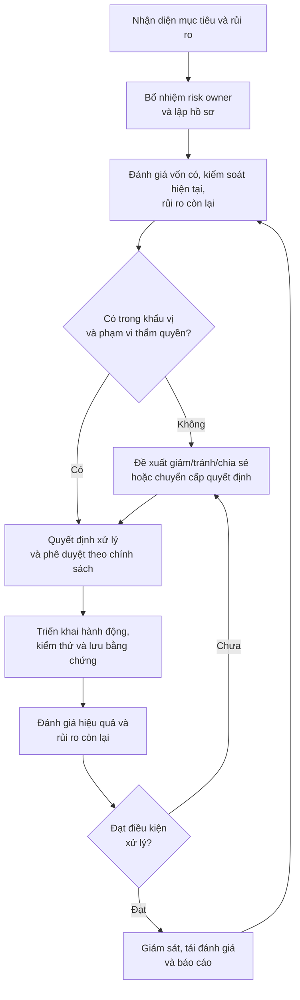

# Chủ sở hữu rủi ro trong quản trị bảo mật và security assurance

## Mục tiêu học tập

Sau bài này, người học có thể:

1. Giải thích **chủ sở hữu rủi ro (risk owner)** chịu trách nhiệm về điều gì và vì sao vai trò này phải gắn với mục tiêu kinh doanh hoặc mục tiêu vận hành.
2. Phân biệt chủ sở hữu rủi ro với người sở hữu tài sản, hệ thống, biện pháp kiểm soát, người thực hiện xử lý và bộ phận kiểm toán.
3. Xác định người chịu trách nhiệm cho một rủi ro cụ thể, kể cả rủi ro liên phòng ban, rủi ro từ nhà cung cấp và rủi ro thay đổi theo thời gian.
4. Lập hồ sơ rủi ro, lựa chọn cách xử lý, đánh giá rủi ro còn lại và tổ chức quyết định chấp nhận rủi ro đúng thẩm quyền.
5. Thiết kế luồng bằng chứng để chứng minh quyết định quản trị có cơ sở, các **security controls** được thực hiện và phát hiện được theo dõi đến khi khắc phục.

Trong module **SECURITY_SECURITY_ASSURANCE**, quản trị bảo mật là phần nối giữa mục tiêu bảo vệ hệ thống và việc chứng minh các mục tiêu ấy được đáp ứng. Chủ sở hữu rủi ro phải bảo đảm rằng rủi ro có người chịu trách nhiệm, có quyết định xử lý rõ ràng, có bằng chứng kiểm tra và được xem xét lại trong suốt quá trình phát triển, triển khai và vận hành.

## 1. Chủ sở hữu rủi ro là ai?

**Chủ sở hữu rủi ro** là cá nhân hoặc chức danh được tổ chức giao **trách nhiệm giải trình về một rủi ro** ảnh hưởng đến mục tiêu mà họ phụ trách. Người này chịu trách nhiệm bảo đảm rủi ro được hiểu, được đánh giá, có phương án xử lý phù hợp, được theo dõi và được báo cáo hoặc chuyển cấp khi vượt thẩm quyền.

Một rủi ro bảo mật có thể được mô tả dưới dạng:

> Do **[nguồn đe dọa hoặc điều kiện yếu]**, **[sự kiện có thể xảy ra]**, dẫn đến **[hệ quả đối với mục tiêu nghiệp vụ]**.

Ví dụ:

> Do cơ chế phê duyệt hoàn tiền không gắn với phiên bản dữ liệu đã được duyệt, người có quyền chỉnh sửa có thể thay người nhận sau khi phê duyệt, dẫn đến chuyển tiền sai và mất uy tín của dịch vụ thanh toán.

Rủi ro này cần một chủ thể chịu trách nhiệm về **kết quả kinh doanh và vận hành của quy trình hoàn tiền**. Trưởng bộ phận thanh toán có thể là chủ sở hữu phù hợp nếu có trách nhiệm về quy trình, quyền ưu tiên ngân sách và quyền đưa vấn đề lên cấp có thẩm quyền. Nhóm bảo mật có thể phát hiện rủi ro, nhóm kỹ thuật có thể sửa lỗi, nhưng điều đó **không tự động** khiến họ trở thành chủ sở hữu rủi ro.

### 1.1. “Sở hữu” không đồng nghĩa với tự làm mọi việc

Chủ sở hữu rủi ro thường không trực tiếp triển khai MFA, sửa API, thiết lập SIEM hay chạy kiểm thử. Họ cần:

- **Hiểu hệ quả:** Rủi ro đe dọa mục tiêu, tài sản, khách hàng, nghĩa vụ hoặc mức dịch vụ nào?
- **Chịu trách nhiệm quyết định:** Ưu tiên xử lý, đề xuất nguồn lực, thời hạn và xác định người thực hiện.
- **Nắm trạng thái thực tế:** Biện pháp đã được triển khai đến đâu, có hoạt động đúng và đủ hay chưa?
- **Xem xét bằng chứng:** Có kết quả kiểm thử, đánh giá, vận hành và đối soát đáng tin cậy không?
- **Quản lý rủi ro còn lại:** Sau khi áp dụng kiểm soát vẫn còn khả năng và tác động nào? Có nằm trong ngưỡng được phép hay cần chuyển cấp?
- **Duy trì trách nhiệm:** Theo dõi đến khi rủi ro được xử lý, đóng hợp lệ hoặc chuyển giao chính thức cho người kế nhiệm.

**Nguyên tắc:** Có thể giao việc thực hiện cho người khác nhưng không thể mặc nhiên chuyển trách nhiệm giải trình bằng cách tạo ticket hoặc thêm tên người khác vào bảng công việc.

### 1.2. Các khái niệm liên quan

| Thuật ngữ | Ý nghĩa trong quản trị rủi ro |
|---|---|
| **Risk owner – Chủ sở hữu rủi ro** | Chịu trách nhiệm giải trình về việc quản lý một rủi ro ảnh hưởng đến mục tiêu được giao. |
| **Risk source / threat – Nguồn rủi ro / mối đe dọa** | Điều kiện hoặc tác nhân có khả năng dẫn đến sự kiện gây hại. |
| **Inherent risk – Rủi ro vốn có** | Mức rủi ro ước lượng trước khi xem xét hiệu quả của các biện pháp kiểm soát thuộc phạm vi đánh giá. |
| **Residual risk – Rủi ro còn lại** | Mức rủi ro ước lượng sau khi xét đến các biện pháp kiểm soát đang hoạt động và hiệu quả được xác minh. |
| **Risk appetite – Khẩu vị rủi ro** | Loại và mức rủi ro tổ chức sẵn sàng theo đuổi hoặc duy trì để đạt mục tiêu, do cấp quản trị phù hợp xác lập. |
| **Risk tolerance – Ngưỡng chịu đựng rủi ro** | Mức dao động hoặc giới hạn cho phép đối với một rủi ro/chỉ số cụ thể trong phạm vi khẩu vị rủi ro. |
| **Risk treatment – Xử lý rủi ro** | Lựa chọn và thực hiện hành động như tránh, giảm, chia sẻ/chuyển giao một phần hệ quả hoặc chấp nhận rủi ro. |
| **Risk acceptance – Chấp nhận rủi ro** | Quyết định có thẩm quyền, có ghi nhận căn cứ, đồng ý giữ mức rủi ro còn lại xác định trong điều kiện và thời hạn cụ thể. |

Không nên lấy việc “đã triển khai kiểm soát” làm bằng chứng rằng rủi ro còn lại đã giảm. Mức rủi ro còn lại phải xét đến **phạm vi áp dụng và hiệu quả thực tế của kiểm soát**, kể cả điểm yếu chưa được xử lý.

## 2. Phân biệt các vai trò dễ nhầm lẫn

Một hệ thống thường có nhiều người cùng tham gia quản trị rủi ro; cần xác định rõ ai chịu trách nhiệm cuối cùng và ai cung cấp chuyên môn hay thực hiện công việc.

| Vai trò | Trách nhiệm chính | Ví dụ trong dịch vụ hoàn tiền |
|---|---|---|
| **Risk owner** | Đánh giá tác động đến mục tiêu, ưu tiên và theo dõi xử lý, chịu trách nhiệm giải trình về rủi ro còn lại và chuyển cấp đúng thẩm quyền | Trưởng bộ phận Thanh toán |
| **Asset / information owner** | Xác định giá trị, phân loại, nhu cầu bảo vệ và quyền sử dụng thông tin/tài sản | Chủ sở hữu dữ liệu giao dịch |
| **System / service owner** | Chịu trách nhiệm vận hành, vòng đời và yêu cầu đối với một hệ thống/dịch vụ | Người quản lý dịch vụ Payment API |
| **Control owner** | Chịu trách nhiệm thiết kế, vận hành và cung cấp bằng chứng về một kiểm soát cụ thể | Trưởng nhóm nền tảng phụ trách phân quyền API |
| **Action owner** | Thực hiện một hành động khắc phục cụ thể theo hạn đã giao | Lập trình viên sửa kiểm tra trạng thái phê duyệt |
| **Security / Risk / Compliance** | Tư vấn phương pháp, hỗ trợ đánh giá, kiểm tra tuân thủ, giám sát và chất vấn độc lập theo chức năng | Nhóm security assurance đánh giá kết quả kiểm thử |
| **Người có thẩm quyền chấp nhận rủi ro** | Phê duyệt giữ rủi ro còn lại theo phạm vi ủy quyền; có thể là risk owner hoặc cấp cao hơn | Giám đốc phụ trách khối nghiệp vụ nếu mức rủi ro vượt hạn mức của trưởng bộ phận |
| **Internal audit / bộ phận bảo đảm độc lập** | Kiểm tra thiết kế và tính hiệu lực của quản trị/kiểm soát theo nhiệm vụ độc lập | Kiểm toán đánh giá dấu vết phê duyệt và bằng chứng xử lý |

Một người có thể kiêm nhiều vai trò khi quy mô tổ chức nhỏ, nhưng phải xem xét **xung đột lợi ích**. Chẳng hạn, nếu cùng một người thiết kế kiểm soát, tự đánh giá kiểm soát và tự phê duyệt ngoại lệ, kết luận assurance sẽ yếu vì thiếu sự chất vấn độc lập. Không nên gọi kiểm toán viên là “chủ sở hữu” của rủi ro họ đang kiểm toán.

### 2.1. Phân biệt trách nhiệm giải trình và quyền phê duyệt

**Accountability** (trách nhiệm giải trình) nghĩa là một chủ thể phải trả lời được: “Rủi ro này có được quản lý và chuyển cấp thích hợp không?”. **Authority** (thẩm quyền) nghĩa là chủ thể có quyền quyết định đến mức nào.

Risk owner có thể **chịu trách nhiệm theo dõi rủi ro cao** nhưng **không có thẩm quyền chấp nhận rủi ro cao đó**. Khi vượt giới hạn được ủy quyền, họ cần lập hồ sơ, đề xuất phương án và gửi đến cấp phê duyệt phù hợp; không tự cho phép kéo dài ngoại lệ.

Ví dụ minh họa về phân quyền nội bộ (tổ chức phải tự quy định theo mức rủi ro và pháp lý của mình):

| Mức rủi ro còn lại | Vai trò đề xuất | Người có thể chấp nhận |
|---|---|---|
| Thấp, trong ngưỡng đã được ban hành | Risk owner | Risk owner theo ủy quyền |
| Trung bình, có ảnh hưởng đến nhiều nhóm | Risk owner và bộ phận bảo mật cùng đánh giá | Người quản lý khối nghiệp vụ được ủy quyền |
| Cao, vượt khẩu vị hoặc có tác động nghiêm trọng | Risk owner chuẩn bị hồ sơ và chuyển cấp | Hội đồng rủi ro/lãnh đạo có thẩm quyền theo chính sách; có thể yêu cầu giảm rủi ro thay vì chấp nhận |
| Liên quan yêu cầu pháp luật hoặc nghĩa vụ bắt buộc không được phép miễn trừ | Risk owner phối hợp pháp chế/compliance | Không thể hợp thức hóa việc vi phạm chỉ bằng một quyết định chấp nhận nội bộ |

Đây là **ví dụ về cơ chế quản trị**, không phải khung thẩm quyền bắt buộc áp dụng cho mọi doanh nghiệp.

## 3. Chọn đúng người sở hữu rủi ro

### 3.1. Bắt đầu từ mục tiêu chịu tác động

Để chọn risk owner, đặt các câu hỏi theo thứ tự:

1. **Điều gì bị đe dọa?** Ví dụ: tính chính xác của thanh toán, bảo mật hồ sơ khách hàng, tính sẵn sàng của dịch vụ.
2. **Mục tiêu nào chịu hậu quả?** Doanh thu, trải nghiệm khách hàng, nghĩa vụ hợp đồng, an toàn người dùng, mức dịch vụ, nghĩa vụ pháp lý.
3. **Ai chịu trách nhiệm về mục tiêu đó?** Xác định chức danh quản lý quy trình/đơn vị nghiệp vụ, không suy từ người phát hiện lỗ hổng.
4. **Người ấy có thể huy động nguồn lực và ra quyết định trong hạn mức không?** Nếu không, cấp quản trị cần ủy quyền hoặc bổ nhiệm người phù hợp.
5. **Ai cần phối hợp?** Asset owner, service owner, control owner, nhà cung cấp, security, pháp chế và người phê duyệt ngoại lệ.

Một risk owner phù hợp thường có đủ bốn điều kiện: **chịu tác động trực tiếp từ kết quả**, **hiểu quy trình và hậu quả**, **có khả năng điều phối hành động**, và **có kênh chuyển cấp rõ ràng**. Không nên gán rủi ro cho cá nhân chỉ vì họ lập báo cáo, là người tạo ticket đầu tiên hoặc đang trực ca.

### 3.2. Rủi ro liên phòng ban và bên thứ ba

**Rủi ro liên phòng ban:** Giả sử một sự cố có thể đồng thời ảnh hưởng thanh toán, vận hành hạ tầng và chăm sóc khách hàng. Các nhóm có thể đồng sở hữu **nhiều hành động**, nhưng một mục rủi ro nên có **một đầu mối chịu trách nhiệm giải trình rõ ràng**. Nếu tác động thuộc nhiều mục tiêu độc lập, tổ chức có thể lập các mục rủi ro liên kết, mỗi mục có một chủ sở hữu và một cấp điều phối chung.

**Rủi ro nhà cung cấp:** Việc thuê dịch vụ cloud, cổng thanh toán hay đơn vị vận hành **không tự chuyển toàn bộ trách nhiệm với khách hàng và mục tiêu kinh doanh** sang nhà cung cấp. Chủ sở hữu rủi ro nội bộ cần theo dõi hợp đồng, báo cáo bảo đảm, SLA, quyền kiểm tra, sự cố, kiểm soát bù trừ và kế hoạch thoát dịch vụ. Nhà cung cấp có thể là control owner của phần họ vận hành, trong khi doanh nghiệp vẫn có risk owner nội bộ.

**Rủi ro trong dự án:** Product owner hoặc project manager không mặc nhiên là risk owner dài hạn. Khi dịch vụ bàn giao sang vận hành, phải xác định ai kế nhiệm và chuyển kèm hồ sơ rủi ro, ngoại lệ, bằng chứng kiểm thử và thời hạn đánh giá lại.

**Khi chưa xác định được chủ sở hữu:** Rủi ro phải được chuyển tới người quản lý chịu trách nhiệm điều phối danh mục hoặc cấp bảo trợ có quyền phân công. Không để rủi ro tồn tại với tên “TBD”, “Security team” hoặc tên một nhóm quá rộng mà thiếu người chịu trách nhiệm cụ thể quá thời hạn quy định.

### 3.3. Ví dụ RACI cho một rủi ro

RACI giúp tránh nhập nhằng khi nhiều nhóm cùng tham gia: **R** = thực hiện (Responsible), **A** = chịu trách nhiệm cuối cùng cho hoạt động (Accountable), **C** = được tham vấn (Consulted), **I** = được thông báo (Informed).

| Hoạt động | Risk owner nghiệp vụ | Control owner kỹ thuật | Security / GRC | Cấp phê duyệt ngoại lệ |
|---|---|---|---|---|
| Xác định tác động và mức ưu tiên nghiệp vụ | **A/R** | C | C | I |
| Đánh giá nguyên nhân kỹ thuật, khả năng khai thác | A | R | R | I |
| Lựa chọn kế hoạch giảm rủi ro và nguồn lực | **A/R** | R | C | I |
| Triển khai biện pháp kiểm soát | A | **R** | C | I |
| Kiểm tra hiệu quả và cung cấp bằng chứng | A | R | **R** | I |
| Ra quyết định chấp nhận rủi ro vượt ủy quyền | R (đề xuất) | C | C | **A** |
| Theo dõi hạn, chuyển cấp và tái đánh giá | **A/R** | R | C | I |

Ma trận trên là một **mẫu minh họa** và cần tinh chỉnh theo quy trình nội bộ. Trong từng hoạt động nên xác định một chủ thể **A** thực sự có quyền; không có nghĩa mọi hoạt động đều phải để risk owner làm A nếu tổ chức phân tách trách nhiệm kiểm thử độc lập hoặc phê duyệt.

## 4. Hồ sơ rủi ro: nguồn thông tin để ra quyết định có bằng chứng

Chủ sở hữu rủi ro cần một hồ sơ đủ rõ để người khác có thể hiểu được **rủi ro là gì, hiện ở mức nào, ai đang làm gì, và căn cứ nào hỗ trợ nhận định**.

### 4.1. Thông tin tối thiểu cần quản lý

| Nhóm thông tin | Nội dung cần ghi nhận |
|---|---|
| Định danh và phạm vi | Risk ID duy nhất, tên rủi ro, hệ thống/quy trình/tài sản, mục tiêu chịu ảnh hưởng |
| Mô tả và nguyên nhân | Tác nhân/điều kiện, sự kiện rủi ro, hệ quả; giả định và phụ thuộc quan trọng |
| Phân vai | Risk owner theo chức danh và người đang đảm nhiệm, nhóm tham gia, control owner, người phê duyệt nếu khác |
| Đánh giá | Khả năng xảy ra, tác động, phương pháp đánh giá, rủi ro vốn có, rủi ro còn lại, độ tin cậy và ngày đánh giá |
| Kiểm soát | Kiểm soát đang có, phạm vi, tình trạng vận hành, điểm yếu và bằng chứng hiệu lực |
| Kế hoạch xử lý | Phương án, action owner, mốc hoàn thành, nguồn lực, phụ thuộc, điều kiện thành công |
| Quyết định | Phê duyệt/chấp nhận/chuyển cấp, người có thẩm quyền, điều kiện, thời hạn hiệu lực |
| Bằng chứng | Link đến threat model, yêu cầu, test, audit, log, monitoring, báo cáo nhà cung cấp, ticket |
| Vòng đời | Trạng thái mở/đang xử lý/chờ xác minh/chấp nhận có thời hạn/đóng; lần xem xét cuối và lần xem xét tiếp theo |

**Mô tả rủi ro tốt:** “Do kiểm tra quyền ở API hoàn tiền chỉ dựa vào vai trò mà không kiểm tra người thụ hưởng của lệnh đã duyệt, nhân viên có quyền sửa hồ sơ có thể thay đích nhận tiền, gây chi trả sai.”

**Mô tả chưa đủ:** “API nguy hiểm”, “Thiếu security”, “Cần thêm phân quyền”. Các mô tả này chưa cho thấy *tình huống gây hại, mục tiêu chịu tác động và lý do cần xử lý*.

### 4.2. Một hồ sơ minh họa

```json
{
  "riskId": "RSK-PAY-017",
  "title": "Thay người nhận tiền sau khi hoàn tiền đã được duyệt",
  "businessObjective": "Chi đúng người thụ hưởng đã phê duyệt",
  "affectedService": "Refund Service",
  "riskOwnerRole": "Truong bo phan Thanh toan",
  "controlOwnerRole": "Truong nhom Payment Platform",
  "riskStatement": "Du lieu nguoi thu huong co the bi sua sau khi duyet, dan den chuyen tien sai",
  "inherentRating": "HIGH",
  "currentControls": [
    "Phan quyen cap API",
    "Ghi nhat ky phe duyet"
  ],
  "controlGaps": [
    "Chua khoa phien ban noi dung da duyet",
    "Chua tai xac minh nguoi nhan truoc khi chi"
  ],
  "residualRating": "HIGH",
  "treatment": "MITIGATE",
  "actionOwnerRole": "Tech Lead Payment Platform",
  "targetDate": "2026-12-18",
  "evidenceRefs": [
    "THREAT-REFUND-03",
    "TEST-REFUND-INVALID-BENEFICIARY-01",
    "AUDIT-LOG-REVIEW-2026-11"
  ],
  "status": "IN_PROGRESS",
  "nextReview": "2026-12-04"
}
```

Các giá trị là **dữ liệu giả lập để học**, không biểu thị hồ sơ của hệ thống có thật. Ví dụ dùng tên vai trò để dễ nhận biết; hệ thống quản lý thực tế cần ánh xạ đến **người đảm nhiệm cụ thể**, người thay thế và lịch sử thay đổi chủ sở hữu.

### 4.3. Đánh giá mức rủi ro với độ tin cậy phù hợp

Có thể sử dụng thang định tính **Thấp / Trung bình / Cao** hoặc thang nhiều mức hơn, miễn tổ chức quy định rõ tiêu chí. Ví dụ, tác động “Cao” có thể liên quan đến chuyển tiền sai, mất dữ liệu quan trọng hoặc ngừng dịch vụ vượt ngưỡng chấp nhận. Xác suất nên xét **khả năng khai thác, mức phơi bày, lịch sử sự cố và hiệu quả kiểm soát**, không chỉ dựa vào cảm giác.

Ví dụ cho RSK-PAY-017:

- **Trước khi xem xét kiểm soát:** Khả năng xảy ra cao, tác động cao → mức rủi ro vốn có cao.
- **Hiện tại:** Có xác thực và log nhưng thiếu ràng buộc phê duyệt với nội dung cuối cùng → mức rủi ro còn lại vẫn cao.
- **Sau khi khắc phục và xác minh:** Nếu kiểm thử chứng minh mọi thay đổi người nhận đều buộc duyệt lại, kiểm soát quyền đang hoạt động và đối soát phát hiện sai lệch, risk owner có thể **đề xuất** đánh giá lại khả năng xảy ra. Tác động tiềm tàng của một lần sai sót không nhất thiết giảm theo.

Điểm số trong ma trận chỉ giúp **ưu tiên và giao tiếp nhất quán**; không phải một phép đo chính xác tuyệt đối. Cần ghi nhận giả định, bất định và việc thiếu bằng chứng, đặc biệt với rủi ro có tác động nghiêm trọng nhưng ít dữ liệu lịch sử.

## 5. Quy trình quyết định và xử lý rủi ro



### 5.1. Bốn nhóm phương án xử lý

| Phương án | Khi nào phù hợp | Điều risk owner phải làm |
|---|---|---|
| **Tránh (avoid)** | Dừng hoặc thay đổi hoạt động tạo rủi ro khi hệ quả không thể chấp nhận | Đánh giá hệ quả kinh doanh, đề nghị thay đổi phạm vi hoặc ngừng tính năng |
| **Giảm (mitigate/reduce)** | Có thể giảm khả năng xảy ra hoặc tác động bằng kiểm soát | Giao hành động, cấp nguồn lực, đặt hạn, kiểm tra hiệu quả và đánh giá lại |
| **Chia sẻ/chuyển giao một phần (share/transfer)** | Có cơ chế hợp đồng, bảo hiểm hoặc đối tác gánh một phần tổn thất/hoạt động | Kiểm tra giới hạn hợp đồng, rủi ro phụ thuộc và trách nhiệm vẫn còn của tổ chức |
| **Chấp nhận (accept/retain)** | Rủi ro còn lại nằm trong phạm vi được cấp quyền hoặc có phê duyệt ngoại lệ hợp lệ | Lưu căn cứ, người phê duyệt, điều kiện, thời hạn và tín hiệu cần xem xét lại |

Việc **không sửa một điểm yếu vì thiếu ngân sách** không tự động tương đương với một quyết định chấp nhận rủi ro hợp lệ. Nếu không đủ nguồn lực, risk owner phải nêu rõ hệ quả, phương án tạm thời và chuyển cấp quyết định.

### 5.2. Chấp nhận rủi ro cần căn cứ gì?

Một yêu cầu chấp nhận rủi ro nên trả lời:

1. **Phạm vi chính xác:** Hệ thống, môi trường, dữ liệu, tính năng và thời gian áp dụng; không dùng ngoại lệ mơ hồ cho toàn tổ chức.
2. **Hậu quả dự kiến:** Tác động tới khách hàng, nghiệp vụ, tuân thủ và các rủi ro liên kết.
3. **Đánh giá rủi ro còn lại:** Giả định, kiểm soát đang hoạt động, hạn chế của bằng chứng và người thẩm định.
4. **Lựa chọn thay thế:** Vì sao không tránh hoặc giảm thêm ngay? Các phương án nào đã cân nhắc?
5. **Điều kiện an toàn tạm thời:** Giám sát tăng cường, hạn mức nghiệp vụ, yêu cầu duyệt tay, giảm phạm vi truy cập, phương án dừng/khôi phục.
6. **Người quyết định và thẩm quyền:** Ai ký, theo quy chế nào, có vượt khẩu vị rủi ro hoặc ràng buộc pháp lý không?
7. **Ngày hết hạn và điều kiện tái mở:** Thay đổi kiến trúc, sự cố, lỗ hổng mới, chỉ báo vượt ngưỡng hoặc hết hiệu lực ngoại lệ.

**Minh họa:** Tổ chức cần chạy thử tính năng hoàn tiền với giới hạn tối đa **200.000 VND mỗi giao dịch** trước khi hoàn tất kiểm soát tự động đối soát. Risk owner đề xuất chỉ cho phép nhóm thử nghiệm nội bộ, duyệt thủ công hai cấp, cảnh báo theo ngày và tắt tính năng nếu xuất hiện một giao dịch lệch. Người có thẩm quyền có thể cho phép ngoại lệ **đến ngày cụ thể** nếu đánh giá phù hợp chính sách. Sau thời hạn đó, ngoại lệ **không tự gia hạn** và không thay thế yêu cầu khắc phục.

### 5.3. Rủi ro còn lại và quyết định đóng hồ sơ

Chỉ nên kết luận “rủi ro đã giảm xuống mức X” khi có bằng chứng rằng kiểm soát tương ứng **đã được triển khai trên đúng phiên bản/môi trường**, **phủ đúng đối tượng cần bảo vệ** và **vận hành hiệu quả**. Cần phân biệt:

- **Action completed:** Lập trình viên báo đã sửa code.
- **Control implemented:** Bản sửa đã được tích hợp và triển khai đúng phạm vi.
- **Control effective:** Kiểm thử hoặc quan sát vận hành cho thấy kiểm soát thực sự ngăn chặn/phát hiện trường hợp đe dọa đã định nghĩa.
- **Risk reassessed:** Risk owner cập nhật mức rủi ro còn lại dựa trên bằng chứng, được rà soát theo cơ chế áp dụng.
- **Risk closed/retired:** Rủi ro không còn áp dụng hoặc đã xử lý đủ điều kiện đóng theo chính sách; nếu vẫn còn rủi ro được chấp nhận, cần trạng thái và lịch giám sát phù hợp.

Đóng ticket kỹ thuật không đồng nghĩa đóng rủi ro; tự đánh dấu “đã giải quyết” khi chưa kiểm chứng có thể làm mất dấu vết quản trị.

## 6. Risk owner trong chương trình security assurance

Security assurance cần chứng minh **mục tiêu bảo mật được chuyển thành yêu cầu, kiểm soát, kiểm thử, audit và khắc phục phát hiện**. Chủ sở hữu rủi ro không nhất thiết tự tạo bằng chứng, nhưng phải bảo đảm có đường truy vết từ vấn đề nghiệp vụ đến kết luận.

### 6.1. Truy vết từ rủi ro đến bằng chứng

| Bước | Điều cần khẳng định | Loại bằng chứng phù hợp | Vai trò đóng góp |
|---|---|---|---|
| Mục tiêu | Hoàn tiền được chi đúng người đã duyệt | Mô tả quy trình, yêu cầu nghiệp vụ, bất biến phê duyệt | Business/risk owner |
| Rủi ro | Người nhận có thể bị sửa sau duyệt | Threat model, sơ đồ luồng dữ liệu, báo cáo đánh giá rủi ro | Security + service owner |
| Yêu cầu bảo mật | Mọi thay đổi sau duyệt phải được phê duyệt lại | Yêu cầu có mã định danh, tiêu chí chấp nhận | Risk owner + phân tích nghiệp vụ |
| Kiểm soát | Server đối chiếu phiên bản nội dung được duyệt và quyền người thực thi | Thiết kế API, chính sách phân quyền, cấu hình triển khai | Control owner |
| Xác minh | Không thể chi theo nội dung bị sửa hoặc xử lý trùng | Kết quả integration/security test, kiểm thử đồng thời/replay | QA + security assurance |
| Vận hành | Bất thường bị phát hiện và xử lý trong thời hạn quy định | Dashboard, log truy vết, cảnh báo, báo cáo đối soát | Operations + control owner |
| Khắc phục | Phát hiện sai được sửa và tái kiểm chứng | Ticket, nguyên nhân gốc, commit, bản triển khai, retest | Action owner + kiểm định |
| Kết luận | Rủi ro còn lại được đánh giá đúng và có quyết định hợp lệ | Hồ sơ risk register, biên bản quyết định, liên kết bằng chứng | **Risk owner** + cấp có thẩm quyền |

Ví dụ một **assurance argument** đơn giản:

- **Claim:** Trong phạm vi cổng hoàn tiền, người có quyền sửa hồ sơ không thể làm lệnh đã duyệt chuyển tiền sang người nhận khác mà không được duyệt lại.
- **Argument:** Server khóa phiên bản nội dung phê duyệt, kiểm tra lại ở thời điểm thực thi và có nhật ký độc lập.
- **Evidence:** Test thay đổi người nhận sau phê duyệt, test vượt quyền, review quy tắc chuyển trạng thái, kết quả triển khai của phiên bản đang chạy và báo cáo đối soát.
- **Limitation:** Nếu một đường tích hợp cũ chưa chạy bộ kiểm thử tương ứng, kết luận trên **chưa bao phủ** đường đó; risk owner phải ghi nhận và xử lý khoảng trống.

Bằng chứng cần có mã yêu cầu/kiểm soát, phiên bản, phạm vi môi trường, thời điểm, người chịu trách nhiệm và kết quả. Một thông báo chung “All tests passed” hoặc một ảnh chụp dashboard không rõ hệ thống/phiên bản không đủ cơ sở kết luận cho toàn bộ rủi ro.

### 6.2. Trách nhiệm trong các đợt audit

Khi được audit, risk owner cần có khả năng:

- Giải thích vì sao rủi ro liên quan mục tiêu đơn vị và được ưu tiên ở mức hiện tại.
- Chỉ ra kiểm soát nào đang giảm rủi ro, người sở hữu kiểm soát, giới hạn áp dụng và bằng chứng hiệu quả.
- Giải thích những phát hiện chưa khắc phục, nguồn lực, mốc xử lý, ngoại lệ và người có thẩm quyền quyết định.
- Cung cấp lịch sử thay đổi mức rủi ro, chủ sở hữu, quyết định xử lý và bằng chứng tái kiểm chứng.
- Phối hợp điều tra phát hiện mới, nhưng vẫn để bên đánh giá độc lập **thử thách kết luận** khi cần.

Không nên để chính người có trách nhiệm đóng rủi ro tự ý chỉnh sửa báo cáo audit hoặc loại bỏ phát hiện không thuận lợi. Hệ thống chứng cứ cần có phân quyền, lịch sử phiên bản và retention phù hợp.

## 7. Vòng quản trị liên tục: ai làm gì và khi nào?

Một chương trình hiệu quả kết hợp đánh giá **theo lịch** với đánh giá lại **do sự kiện kích hoạt**.

### 7.1. Nhịp hoạt động gợi ý

| Thời điểm | Việc cần thực hiện | Đầu ra có thể kiểm chứng |
|---|---|---|
| Khi thiết kế tính năng hoặc bắt đầu dự án | Nhận diện tài sản/mục tiêu, đánh giá rủi ro sơ bộ, bổ nhiệm chủ sở hữu | Risk register, bản phân vai, yêu cầu bảo mật |
| Khi chốt kiến trúc hoặc trước triển khai | Rà soát thay đổi ranh giới tin cậy, kiểm soát, tiêu chí kiểm thử | Threat model, thiết kế kiểm soát, test plan |
| Trước khi phát hành | Đánh giá rủi ro còn lại, phát hiện còn mở, thẩm quyền ngoại lệ | Bản kiểm chứng, quyết định phát hành/ngoại lệ có điều kiện |
| Trong vận hành | Xem KRI, sai lệch, sự cố, hiệu quả kiểm soát, hạn hành động | Dashboard, log, ticket, biên bản xem xét |
| Khi có thay đổi lớn hoặc sự cố | Đánh giá lại tác động/xác suất, cập nhật người chịu trách nhiệm và kế hoạch | Bản cập nhật risk register, thay đổi kiểm soát |
| Theo chu kỳ được quy định | Soát chất lượng hồ sơ, bằng chứng, quyền chấp nhận, ngoại lệ sắp hết hạn | Báo cáo quản trị, danh sách quyết định cần gia hạn/chấm dứt |

Nhịp xem xét có thể khác nhau theo mức độ rủi ro. Rủi ro trọng yếu cần xem xét nhanh hơn rủi ro thấp. Tần suất cụ thể phải do tổ chức quy định theo nghiệp vụ và quy định áp dụng.

### 7.2. Sự kiện kích hoạt tái đánh giá

Chủ sở hữu rủi ro cần xem xét lại khi xảy ra một trong các điều kiện sau:

- Có lỗ hổng nghiêm trọng, khai thác thực tế hoặc sự cố ảnh hưởng đến tài sản liên quan.
- Thay đổi mã, kiến trúc, mô hình quyền, cấu hình, nhà cung cấp hoặc nơi lưu dữ liệu.
- Số lượng người dùng, giao dịch, độ nhạy dữ liệu hoặc phạm vi kinh doanh tăng đáng kể.
- Kiểm thử phát hiện biện pháp kiểm soát không còn hiệu lực hoặc không bao phủ hệ thống mới.
- Chỉ số vận hành vượt ngưỡng, đối soát xuất hiện sai lệch hoặc cảnh báo mất log.
- Ngoại lệ sắp hết hạn, hành động khắc phục trễ mốc hoặc người sở hữu chuyển vị trí.
- Có yêu cầu pháp lý, hợp đồng hoặc chính sách quản trị mới ảnh hưởng quyết định trước đó.

### 7.3. Các chỉ số dùng cho giám sát và báo cáo

| Chỉ số | Cách diễn giải / hành động của risk owner |
|---|---|
| **Tỷ lệ rủi ro có chủ sở hữu hợp lệ** | Rủi ro thiếu người chịu trách nhiệm phải được phân công/chuyển cấp |
| **Rủi ro cao quá hạn xử lý** | Yêu cầu giải trình nguyên nhân, hỗ trợ nguồn lực và quyết định lại |
| **Ngoại lệ sắp hết hạn hoặc đã quá hạn** | Đánh giá lại trước ngày hết hạn; không để gia hạn ngầm |
| **Tỷ lệ kiểm soát trọng yếu có bằng chứng kiểm thử trên bản đang chạy** | Phát hiện khoảng trống giữa thiết kế và thực tế triển khai |
| **Phát hiện audit chưa tái kiểm chứng sau sửa** | Không coi sửa code là khắc phục hoàn tất khi chưa retest |
| **Số lần lệch đối soát, giao dịch trùng, chuyển trạng thái sai** | Chỉ báo gần với mục tiêu toàn vẹn của quy trình thanh toán |
| **Thời gian phát hiện và xử lý bất thường** | Đánh giá khả năng phát hiện, phản ứng và giảm tác động |

Chỉ số phải đi kèm **ngữ cảnh và mức độ bao phủ**. Số cảnh báo giảm có thể là dấu hiệu tốt hoặc là hệ thống giám sát bị lỗi. Số rủi ro “đã đóng” tăng không chứng minh chương trình tiến bộ nếu hồ sơ bị đóng thiếu bằng chứng.

## 8. Tình huống thực hành: xử lý rủi ro hoàn tiền sai người

Một doanh nghiệp vận hành API hoàn tiền. Trong đợt đánh giá, nhóm security phát hiện nhân viên hỗ trợ có thể đổi trường `beneficiaryAccount` sau khi quản lý đã duyệt lệnh hoàn tiền. Dịch vụ chạy trên cloud của nhà cung cấp; đội Payment Platform chịu trách nhiệm API, đội kế toán thực hiện đối soát và trưởng bộ phận Thanh toán chịu trách nhiệm số tiền chi trả.

### Bước 1 — Chỉ định chủ sở hữu phù hợp

Risk owner nên là **người quản lý chịu trách nhiệm về tính đúng đắn của hoạt động hoàn tiền** và có quyền điều phối thay đổi trong quy trình. Tùy sơ đồ tổ chức, đó có thể là trưởng bộ phận Thanh toán hoặc chức danh được giao trách nhiệm tương đương.

Nhóm security là bên phát hiện và đánh giá. Payment Platform là control owner các kiểm tra API. Kế toán chịu trách nhiệm đối soát. Cloud provider vận hành phần hạ tầng đã cam kết; doanh nghiệp **vẫn phải có risk owner nội bộ** cho rủi ro hoàn tiền sai.

### Bước 2 — Xác định mức rủi ro và mục tiêu

- **Mục tiêu:** Chỉ hoàn tiền đúng người nhận, số tiền và nội dung đã được duyệt.
- **Điều kiện yếu:** Quyết định phê duyệt không ràng buộc với phiên bản dữ liệu được thực thi.
- **Sự kiện có thể xảy ra:** Người có quyền chỉnh sửa đổi đích nhận tiền sau duyệt.
- **Hệ quả:** Chi sai, tổn thất tài chính, khiếu nại khách hàng, công tác đối soát và điều tra.
- **Đánh giá hiện tại:** Rủi ro còn lại cao trong tình huống minh họa vì kiểm soát phân quyền hiện tại chưa ngăn sửa sau duyệt.

Risk owner không được giảm mức rủi ro chỉ nhờ lời hứa “sprint sau sẽ sửa”; chỉ có thể ghi nhận **kế hoạch giảm rủi ro dự kiến** và tiếp tục quản lý mức rủi ro hiện tại.

### Bước 3 — Giao hành động và tiêu chí đạt

| Hành động | Người thực hiện | Bằng chứng cần có |
|---|---|---|
| Ràng buộc quyết định phê duyệt với bản dữ liệu hoàn tiền đã xem | Payment Platform | Thiết kế, commit, review, test sửa trường sau duyệt |
| Kiểm tra lại quyền và phiên bản trước khi thực thi | Payment Platform | Integration test, kết quả đồng thời/replay |
| Thêm đối soát người nhận thực tế với người nhận đã duyệt | Kế toán + platform | Báo cáo đối soát, thử nghiệm sai lệch mẫu |
| Bổ sung log độc lập về thay đổi và phê duyệt | Platform/Operations | Mẫu log, cấu hình quyền và retention, kết quả thử xóa/sửa |
| Đánh giá lại rủi ro sau triển khai | **Risk owner**, có tư vấn security | Bản ghi risk register, bằng chứng review và quyết định còn lại |

### Bước 4 — Quyết định nếu chưa sửa kịp trước ngày ra mắt

Risk owner cần trình rõ các lựa chọn: **lùi ra mắt**, **giảm phạm vi**, **tạm vô hiệu hóa hoàn tiền tự động**, hoặc **xin chấp nhận rủi ro có thời hạn với kiểm soát bù trừ**, nếu chính sách cho phép. Ví dụ chỉ xử lý hoàn tiền bằng quy trình duyệt thủ công hai người với hạn mức thấp và đối soát hằng ngày. Không thể xem việc trưởng bộ phận tự nói “đồng ý ra mắt” là quyết định hợp lệ nếu mức rủi ro vượt phạm vi thẩm quyền.

### Bước 5 — Tái kiểm chứng và cập nhật hồ sơ

Sau triển khai, nhóm kiểm thử xác minh rằng sửa người nhận làm vô hiệu phê duyệt, API từ chối thực thi khi phiên bản đã đổi và hệ thống xử lý yêu cầu lặp đúng quy tắc. Risk owner đọc bằng chứng, đánh giá phần rủi ro còn lại, cập nhật trạng thái và lịch theo dõi. Nếu vẫn còn luồng xử lý batch cũ chưa được kiểm thử, cần giữ rủi ro tương ứng mở hoặc tạo mục liên kết phù hợp; không kết luận kiểm soát đã bao phủ toàn bộ dịch vụ.

## 9. Những sai lầm thường gặp

| Sai lầm | Vì sao nguy hiểm | Cách khắc phục |
|---|---|---|
| Mọi rủi ro bảo mật đều được gán cho CISO/security team | Trách nhiệm đối với hệ quả nghiệp vụ bị tách khỏi người quyết định mục tiêu | Gán risk owner theo mục tiêu bị ảnh hưởng; security tư vấn và giám sát |
| Gán rủi ro cho tên nhóm, không có người chịu trách nhiệm cụ thể | Khó điều phối, chuyển cấp và truy cứu quyết định | Ghi rõ chức danh, người đang giữ vai trò và người kế nhiệm |
| Risk owner có trách nhiệm nhưng không có kênh quyết định | Hành động bị tắc ở ngân sách và thẩm quyền | Thiết kế phân cấp ủy quyền, chuyển cấp và thời hạn phản hồi |
| Giao ticket cho kỹ thuật rồi xem như đã chuyển quyền sở hữu rủi ro | Khắc phục kỹ thuật không giải quyết hết đánh giá tác động và chấp nhận còn lại | Tách risk owner, control owner và action owner |
| Chấp nhận rủi ro không có ngày hết hạn hoặc phạm vi | Ngoại lệ tạm thời biến thành trạng thái mặc định | Yêu cầu hạn, điều kiện và trigger tái đánh giá |
| Chỉ thu bằng chứng triển khai mà không kiểm tra hiệu quả | Có cấu hình nhưng không biết kiểm soát thực sự chặn được rủi ro không | Kiểm thử hành vi, giám sát vận hành, đối soát và kiểm chứng độc lập |
| Giảm mức rủi ro dựa trên kế hoạch tương lai | Báo cáo đánh giá mức rủi ro thấp hơn thực tế | Tách trạng thái *current* và *target*; chỉ đánh giá lại sau bằng chứng |
| Chuyển hết trách nhiệm cho nhà cung cấp | Không ai nội bộ quản lý mục tiêu và rủi ro phụ thuộc | Duy trì internal risk owner, đánh giá cam kết và bằng chứng của nhà cung cấp |

## 10. Bài tập tự đánh giá

### Bài tập 1 — Chọn chủ sở hữu

Một hệ thống nhân sự lưu thông tin lương trên cloud. Nhóm cloud quản lý mã hóa lưu trữ, nhóm HR định nghĩa ai được xem/sửa lương, bộ phận bảo mật chạy kiểm thử, và nhà cung cấp cloud vận hành hạ tầng.

**Câu hỏi:** Ai nên là risk owner cho rủi ro “nhân viên có thể xem hoặc sửa bảng lương ngoài phạm vi được phép”? Ai là control owner cho IAM và mã hóa? Nếu rủi ro cao hơn ngưỡng HR được chấp nhận, ai phải làm gì?

**Gợi ý:** Hãy gắn risk owner với người chịu trách nhiệm về quy trình/dữ liệu lương, phân công control owner cho từng biện pháp và thiết lập việc chuyển cấp đến người có quyền phê duyệt cao hơn. Security và kiểm toán cung cấp đánh giá, không thay thế trách nhiệm nghiệp vụ.

### Bài tập 2 — Đánh giá quyết định chấp nhận

Đội dự án phát hiện thiếu kiểm tra quyền ở một API quan trọng. Ticket ghi “Accepted by developer, fix next quarter”, nhưng không có mức rủi ro còn lại, người phê duyệt, phạm vi sử dụng hay ngày xem lại.

**Câu hỏi:** Hồ sơ thiếu những thông tin nào? Có thể coi đây là quyết định chấp nhận hợp lệ chưa? Cần đưa ra những lựa chọn xử lý nào trước khi hệ thống đi vào vận hành?

**Gợi ý:** Lập mô tả rủi ro theo nguyên nhân–sự kiện–hệ quả, xác nhận risk owner, đánh giá tác động, nêu giải pháp giảm rủi ro hoặc dừng tính năng và trình người có thẩm quyền; nếu có ngoại lệ phải giới hạn thời gian/phạm vi, lưu điều kiện và bằng chứng.

### Bài tập 3 — Thiết kế bằng chứng assurance

Một bản vá đã được merge, nhưng chưa rõ chạy trên môi trường production hay chưa. Control owner đã đóng ticket, còn audit yêu cầu chứng minh lỗ hổng không khai thác được nữa.

**Câu hỏi:** Risk owner cần yêu cầu ít nhất năm loại bằng chứng nào để quyết định đánh giá lại rủi ro?

**Gợi ý:** Có thể dùng liên kết yêu cầu và test case, review mã, định danh artifact, bản ghi triển khai production, kết quả kiểm thử trên phiên bản đang chạy, trạng thái giám sát và kết quả retest bởi bên có đủ độc lập.

## 11. Checklist ngắn dành cho risk owner

Trước mỗi lần chấp thuận kế hoạch hoặc báo cáo trạng thái, hãy kiểm tra:

- **Tôi có sở hữu đúng mục tiêu chịu hậu quả không?** Nếu không, đã chuyển giao cho đúng chủ thể chưa?
- **Rủi ro được mô tả rõ nguyên nhân, sự kiện và tác động chưa?**
- **Các kiểm soát đang có và rủi ro còn lại đã được xác minh bằng bằng chứng cập nhật chưa?**
- **Mỗi hành động có người thực hiện, hạn, tiêu chí đạt và nguồn lực rõ ràng chưa?**
- **Ngoại lệ hoặc quyết định chấp nhận có đúng thẩm quyền, phạm vi và thời hạn chưa?**
- **Có tín hiệu giám sát, lịch tái đánh giá và quy trình chuyển cấp khi điều kiện thay đổi chưa?**
- **Tôi có thể truy từ mục tiêu → rủi ro → yêu cầu → security control → kiểm thử/audit → khắc phục → quyết định còn lại hay chưa?**

Khi những câu hỏi này đều có câu trả lời và bằng chứng kiểm chứng được, vai trò chủ sở hữu rủi ro mới thực sự đóng góp vào một chương trình **security assurance liên tục**, thay vì chỉ là một tên người trong danh sách rủi ro.
