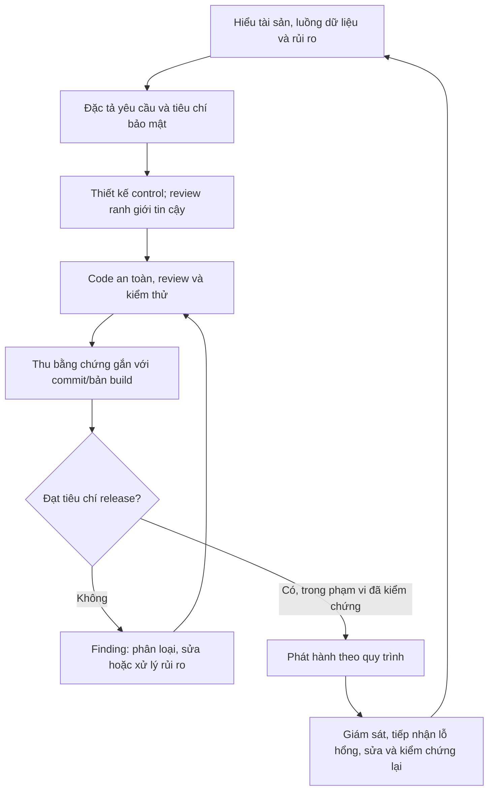
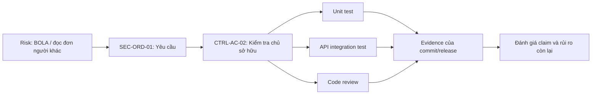

# Trách nhiệm nhóm phát triển trong quản trị security assurance

Một tính năng có thể chạy đúng nghiệp vụ, vượt qua hàng trăm bài unit test và được triển khai thành công nhưng vẫn tạo ra lỗ hổng bảo mật nghiêm trọng. Ví dụ, API `GET /api/orders/{id}` trả về đơn hàng theo mã mà không xác minh người gọi có quyền xem đơn đó. Nhóm phát triển nói “đã có đăng nhập”, nhóm vận hành nói “đã bật TLS”, trong khi nhóm bảo mật chỉ nhận được thông tin sau khi sự cố xảy ra. Không ai có thể chỉ ra **ai chịu trách nhiệm triển khai kiểm soát quyền, ai kiểm tra, bằng chứng nằm ở đâu và phát hiện sẽ được xử lý như thế nào**.

Đây là một vấn đề **quản trị bảo mật (security governance)**. Trong chương trình `SECURITY_SECURITY_ASSURANCE`, nhóm phát triển chịu trách nhiệm trực tiếp biến rủi ro và mục tiêu bảo mật thành yêu cầu có thể kiểm tra, thiết kế và triển khai security controls, thu thập bằng chứng kiểm chứng và khắc phục phát hiện theo quy trình. Kết quả cần đạt không chỉ là “có code bảo mật”, mà là **có căn cứ đáng tin để đánh giá hệ thống đáp ứng mục tiêu bảo mật ở mức nào và với các giới hạn nào**.

> **Nguyên tắc cốt lõi:** Nhóm phát triển sở hữu chất lượng bảo mật của phần mềm mà mình xây dựng và duy trì. Việc **chấp nhận rủi ro còn lại** và **đánh giá bảo đảm độc lập** phải có vai trò, thẩm quyền và bằng chứng được xác định rõ; không mặc định một lập trình viên vừa tự triển khai, tự phê duyệt ngoại lệ, vừa tuyên bố hệ thống đã an toàn.

## 1. Phân định “chịu trách nhiệm” trong phát triển phần mềm

Bảo mật là trách nhiệm phối hợp, nhưng phối hợp chỉ hiệu quả khi mỗi hoạt động có **người thực hiện**, **người chịu trách nhiệm cuối cùng**, **người tư vấn** và **người được thông báo**. Trong một tổ chức nhỏ, một người có thể kiêm nhiều vai trò; khi đó cần ghi rõ vai trò nào đang được thực hiện và áp dụng kiểm tra chéo phù hợp với mức rủi ro.

| Vai trò | Trách nhiệm chính liên quan đến assurance |
|---|---|
| **Nhóm phát triển / Tech Lead** | Hiểu rủi ro của chức năng; đề xuất và triển khai control; viết kiểm thử; review code; sửa lỗi; duy trì bằng chứng gắn với phiên bản |
| **Product Owner / chủ sở hữu rủi ro** | Xác định tác động nghiệp vụ, ưu tiên yêu cầu, cân đối rủi ro với mục tiêu kinh doanh; phê duyệt hoặc trình phê duyệt chấp nhận rủi ro theo thẩm quyền |
| **Security / AppSec** | Cung cấp chính sách và tiêu chí; hỗ trợ threat modeling, rà soát thiết kế, kiểm thử bảo mật chuyên sâu; tư vấn mức độ nghiêm trọng và đánh giá khoảng trống |
| **Platform / DevOps / Operations** | Vận hành hạ tầng, secret management, CI/CD, phân quyền môi trường, giám sát và cơ chế triển khai; cung cấp bằng chứng vận hành |
| **Security assurance / kiểm toán độc lập** | Xác minh tính đầy đủ, độ tin cậy của bằng chứng và sự tuân thủ tiêu chí trong phạm vi đánh giá; báo cáo điểm chưa được chứng minh |
| **Incident Response / SOC** | Điều tra cảnh báo và sự cố, phối hợp khoanh vùng, lưu chứng cứ; nhóm phát triển hỗ trợ phân tích và xử lý nguyên nhân ở ứng dụng |

**Ownership không đồng nghĩa với quyền tự chấp nhận mọi rủi ro.** Nhóm phát triển có thể đề xuất ưu tiên xử lý, thời gian và biện pháp giảm thiểu, nhưng ngoại lệ ảnh hưởng đáng kể tới tổ chức phải được chủ sở hữu rủi ro hoặc người được ủy quyền phê duyệt theo chính sách.

### Ma trận RACI tham khảo

Trong ma trận dưới đây: **R (Responsible)** là người làm; **A (Accountable)** là người chịu trách nhiệm cuối cùng về quyết định/kết quả; **C (Consulted)** là người được tham vấn; **I (Informed)** là người được thông báo. Mỗi hoạt động có một vai trò A chính để tránh bỏ trống thẩm quyền.

| Hoạt động | Phát triển | Product / Risk Owner | AppSec / Assurance | Platform / Ops |
|---|:---:|:---:|:---:|:---:|
| Xác định tác động nghiệp vụ và ưu tiên rủi ro | R | **A** | C | C |
| Đặc tả yêu cầu bảo mật cho một tính năng | **A/R** | C | C | C |
| Thiết kế và triển khai control trong ứng dụng | **A/R** | I | C | C |
| Code review và kiểm thử bảo mật của thay đổi | **A/R** | I | C | C |
| Xây dựng chính sách/tiêu chí kiểm tra bảo mật chung | C | C | **A/R** | C |
| Cấu hình và bảo vệ hạ tầng chạy ứng dụng | C | I | C | **A/R** |
| Chuẩn bị bằng chứng về tính năng/bản phát hành | **A/R** | I | C | R |
| Đánh giá độc lập sự phù hợp của bằng chứng | C | I | **A/R** | C |
| Phê duyệt chấp nhận rủi ro còn lại theo thẩm quyền | R | **A** | C | C |
| Sửa lỗi ứng dụng và chạy kiểm thử hồi quy | **A/R** | I | C | C |
| Xử lý sự cố vận hành, phối hợp khắc phục | R | I | C | **A** |

Đây là **ví dụ tổ chức trách nhiệm**, không phải sơ đồ bắt buộc cho mọi doanh nghiệp. Với trường hợp bảo mật nghiêm trọng, người đánh giá hoặc phê duyệt có thể cần độc lập với người trực tiếp tạo control; trách nhiệm xử lý sự cố thực tế cũng có thể thuộc Incident Response thay vì Ops.

## 2. Trách nhiệm xuyên suốt vòng đời phát triển

Nhóm phát triển góp phần tạo ra bằng chứng assurance ở **mọi giai đoạn**, không đợi đến đợt pentest hay audit cuối kỳ.



| Giai đoạn | Nhóm phát triển cần làm | Bằng chứng/đầu ra có thể truy xuất |
|---|---|---|
| **Khởi tạo yêu cầu** | Làm rõ tài sản nhạy cảm, luồng dữ liệu, người dùng, trường hợp lạm dụng; cùng Product và Security xác định rủi ro | User story, threat model, risk ID và quyết định ưu tiên |
| **Thiết kế** | Làm rõ trust boundary, kiến trúc, các điểm kiểm tra authentication/authorization, chính sách logging và failure handling | Design review, sơ đồ luồng dữ liệu, danh sách security controls |
| **Lập trình** | Code an toàn, quản trị dependency và secret, viết kiểm thử trường hợp tích cực/tiêu cực, cập nhật tài liệu cần thiết | Commit, pull request, review, test cases và bản ghi thay đổi |
| **Tích hợp / CI** | Thiết lập hoặc duy trì SAST, dependency scanning, secret scanning và kiểm thử tự động phù hợp; triage kết quả | Kết quả scan và test gắn với build, danh sách finding và disposition |
| **Trước phát hành** | Xác minh tiêu chí bảo mật của bản release; phối hợp kiểm tra cấu hình, quyền, rollback và rủi ro tồn đọng | Release checklist, test report, phê duyệt ngoại lệ nếu có |
| **Vận hành** | Hỗ trợ quan sát hệ thống, phân tích sự cố ứng dụng, cập nhật threat model và sửa lỗ hổng được báo cáo | Bản vá, kết quả hồi quy, nhật ký xử lý sự cố, đánh giá lại claim |

Nguyên tắc **shift left** đưa phân tích rủi ro và kiểm chứng vào sớm để giảm lỗi khi đã triển khai. Tuy nhiên, **shift left không loại bỏ kiểm chứng khi vận hành**: cấu hình, thành phần phụ thuộc, quyền truy cập và mô hình đe dọa có thể thay đổi sau release.

## 3. Biến rủi ro thành yêu cầu và security controls

Nếu chỉ giao ticket “bổ sung bảo mật”, người thực hiện khó biết thế nào là xong và người đánh giá không có tiêu chí khách quan để kết luận. Nhóm phát triển cần phối hợp xác định rõ:

1. **Tài sản cần bảo vệ:** dữ liệu người dùng, đơn hàng, token, hệ thống thanh toán, tính sẵn sàng của API.
2. **Tác nhân và điểm vào:** người dùng thông thường, quản trị viên, tài khoản dịch vụ, Internet, queue, job, API nội bộ.
3. **Kịch bản rủi ro:** truy cập dữ liệu tenant khác, giả mạo webhook, sửa giá, chèn câu lệnh, lộ secret.
4. **Yêu cầu bảo mật có thể kiểm thử:** “Người dùng không thể đọc đơn hàng của người khác”, kèm tiêu chí rõ.
5. **Control dự định giảm rủi ro:** kiểm tra quyền ở tầng nghiệp vụ, giới hạn quyền, xác minh chữ ký, validation, mã hóa, giám sát.
6. **Phương pháp kiểm chứng:** test cases, code review, kiểm tra cấu hình triển khai, đánh giá độc lập.
7. **Rủi ro còn lại và người sở hữu:** giới hạn kiểm thử, vấn đề chưa sửa, thời điểm đánh giá lại.

Ví dụ chuyển một rủi ro thành yêu cầu có thể đo:

| Thành phần | Minh họa |
|---|---|
| **Risk ID** | `RISK-ORD-01`: người dùng xem đơn hàng của người khác bằng cách thay `orderId` |
| **Security objective** | Bảo vệ bí mật dữ liệu và giới hạn quyền truy cập theo chủ sở hữu |
| **Requirement** | `SEC-ORD-01`: mọi đường đọc đơn hàng chỉ trả thông tin của chủ thể có quyền |
| **Control** | Xác minh danh tính từ cơ chế tin cậy; so khớp owner/tenant trong service hoặc policy; từ chối mặc định |
| **Acceptance criteria** | Đúng chủ sở hữu được truy cập; sai chủ sở hữu bị từ chối, không lộ dữ liệu; không có đường truy cập phụ bypass |
| **Assessment** | Unit test chính sách, API/integration test, rà soát tất cả endpoint đọc đơn, thử cross-tenant |
| **Evidence** | PR review, kết quả test gắn commit, cấu hình IAM liên quan, báo cáo kiểm thử trên release |
| **Residual risk** | Endpoint xuất báo cáo mới chưa nằm trong phạm vi; phải bổ sung trước khi mở rộng kết luận |

Điều kiện đạt phải đi cùng **tác dụng của hệ thống**, không chỉ mã trạng thái HTTP. Một API trả `403` nhưng đã thực hiện thao tác cập nhật dữ liệu trước khi kiểm tra quyền vẫn không đáp ứng yêu cầu.

## 4. Trách nhiệm về thiết kế an toàn và ranh giới tin cậy

Trong thiết kế, nhóm phát triển cần chỉ ra **dữ liệu đi qua đâu, ai kiểm soát từng điểm, lớp nào có quyền quyết định** và những giả định được dùng để tin một danh tính.

Các câu hỏi nên được review ngay khi thiết kế:

- Danh tính người dùng/dịch vụ được xác minh ở đâu? Claims nào đến từ nguồn tin cậy, claims nào do client tự cung cấp?
- Trước mỗi thao tác đọc/ghi, hệ thống có kiểm tra quyền với **đúng đối tượng dữ liệu và tenant** không?
- Những luồng ít được chú ý như batch, cron job, queue consumer, export, cache hoặc admin endpoint có cùng chính sách không?
- Tham số và dữ liệu từ bên ngoài có được validate, xử lý theo cấu trúc và mã hóa đầu ra đúng ngữ cảnh không?
- Secret và khóa mã hóa nằm ở đâu; ai có quyền xem, thay, xoay vòng, thu hồi?
- Lỗi xác thực, lỗi quyền, mất kết nối hoặc timeout sẽ **fail closed** ở ranh giới nào?
- Khi lỗi xảy ra, log có đủ thông tin điều tra mà không tiết lộ token, mật khẩu hay dữ liệu nhạy cảm không?
- Có điểm lỗi đơn lẻ ảnh hưởng tính sẵn sàng và có phương án degrade/rollback hợp lý không?

**Nhóm phát triển phải làm rõ control thuộc về lớp nào**. Một quy tắc authorization đặt ở API gateway có thể cần kiểm tra thêm trong service nếu service cũng được gọi qua queue hoặc đường nội bộ; việc “đã có gateway” chỉ là một phần của luận cứ assurance.

Ở các quyết định có tác động lớn (đổi mô hình xác thực, phân vùng tenant, cơ chế mã hóa, lưu dữ liệu nhạy cảm), nhóm nên mời AppSec hoặc người đánh giá tham gia sớm và lưu quyết định thiết kế cùng giả định còn mở.

## 5. Trách nhiệm khi viết code: mặc định an toàn và kiểm chứng được

Secure coding không chỉ là làm theo checklist. Mỗi lập trình viên phải hiểu **giả định tin cậy của đoạn code mình viết**, chọn API an toàn và chứng minh hành vi của các đường thành công lẫn đường thất bại.

Một số thực hành nền tảng:

| Nhóm vấn đề | Việc nhóm phát triển cần kiểm soát |
|---|---|
| **Authentication / session** | Không tự tạo hệ xác thực khi có giải pháp đã được kiểm chứng; bảo vệ token, phiên, thời hạn và đăng xuất |
| **Authorization** | Kiểm tra quyền tại đối tượng/tác vụ; áp dụng nguyên tắc quyền tối thiểu, từ chối mặc định, cách ly tenant |
| **Input/output** | Validation đúng ranh giới; parameterized query chống SQL injection; output encoding đúng bối cảnh để chống XSS |
| **Gọi dịch vụ ngoài** | Xác minh chứng chỉ/danh tính dịch vụ; kiểm soát URL đích, redirect, timeout và quyền để giảm SSRF |
| **Secret / encryption** | Không hardcode hoặc commit secret; dùng kho bí mật, quy trình key rotation và thuật toán/thư viện phù hợp |
| **Lỗi và log** | Không lộ stack trace hay dữ liệu nhạy cảm qua response; log đủ điều tra theo chính sách |
| **Dependencies** | Chọn thư viện từ nguồn tin cậy; theo dõi lỗ hổng, bản vá và tác động của nâng cấp |
| **Concurrency / data integrity** | Kiểm tra giao dịch, idempotency, xử lý race condition và cập nhật trạng thái nguyên tử khi cần |

### Ví dụ Java: quyền truy cập theo chủ sở hữu đơn hàng

Một chính sách nhỏ có thể được đặt ở tầng nghiệp vụ; danh tính `actor` phải đến từ **ngữ cảnh xác thực đáng tin**, tuyệt đối không tin `ownerId` do client tự gửi.

```java
import java.util.Objects;

record Order(String id, String ownerId) {}
record Actor(String userId) {}

final class OrderAccessPolicy {
    private OrderAccessPolicy() {}

    static void requireOwner(Order order, Actor actor) {
        if (order == null || actor == null
                || actor.userId() == null
                || !Objects.equals(order.ownerId(), actor.userId())) {
            throw new SecurityException("Access denied");
        }
    }
}
```

Kiểm thử chính sách bằng JUnit 5:

```java
import static org.junit.jupiter.api.Assertions.assertDoesNotThrow;
import static org.junit.jupiter.api.Assertions.assertThrows;
import org.junit.jupiter.api.Test;

class OrderAccessPolicyTest {
    private final Order order = new Order("ORD-42", "user-B");

    @Test
    void ownerCanAccess() {
        assertDoesNotThrow(() ->
            OrderAccessPolicy.requireOwner(order, new Actor("user-B")));
    }

    @Test
    void anotherUserCannotAccess() {
        assertThrows(SecurityException.class, () ->
            OrderAccessPolicy.requireOwner(order, new Actor("user-A")));
    }

    @Test
    void anonymousActorCannotAccess() {
        assertThrows(SecurityException.class, () ->
            OrderAccessPolicy.requireOwner(order, null));
    }
}
```

Đây là **ví dụ minh họa chính sách**, chưa phải kết luận bảo mật cho ứng dụng thực tế. Nhóm phải tích hợp chính sách vào **mọi đường đọc dữ liệu**, xác minh mapping của principal, kiểm tra hành vi HTTP và kiểm tra kết quả khi có nhiều tenant. Unit test có thể xanh trong khi controller khác quên gọi `requireOwner`. Vì thế nhóm phát triển cần thêm integration test, kiểm tra đường truy cập gián tiếp và xem xét mã nguồn theo threat model.

Trong dự án thật, nên chọn cách biểu diễn quyền, status HTTP và xử lý lỗi nhất quán với hợp đồng API. Một API có thể trả `403` hoặc chủ đích dùng `404` để không tiết lộ tài nguyên; tiêu chí assurance phải quy định hành vi mong đợi.

## 6. Pull request và code review là một phần bằng chứng

Người mở PR chịu trách nhiệm mô tả **vì sao thay đổi có liên quan tới bảo mật**, yêu cầu nào bị ảnh hưởng và kiểm thử nào bảo vệ yêu cầu đó. Reviewer cần đọc theo luồng dữ liệu và tác động thực tế, không chỉ tìm xem có hàm `checkPermission` hay không.

Một mẫu nội dung PR có thể tái sử dụng:

```markdown
## Tác động bảo mật
- Risk/Requirement: RISK-ORD-01 / SEC-ORD-01
- Thay đổi trust boundary: Bổ sung kiểm tra chủ sở hữu trong order service
- Control liên quan: CTRL-AC-02

## Bằng chứng kiểm chứng
- Unit: OrderAccessPolicyTest (owner / cross-owner / anonymous)
- Integration: GET /api/orders/{id} với hai danh tính khác nhau
- Security checks: SAST, dependency, secret scan tại commit của PR
- Kết quả gốc: <CI-run-link>

## Rủi ro và giới hạn
- Đã rà soát API đọc đơn hàng và export liên quan
- Còn thiếu: <ghi rõ hoặc "không có vấn đề đã biết">
- Finding cần theo dõi: <ticket-id hoặc "không có">

## Review
- Người review: <reviewer>
- Kết luận: <approved / request-changes>
```

Việc lưu **link đến CI run, commit hash, phiên bản cấu hình, kết quả test và quyết định review** khiến bằng chứng có thể truy xuất khi audit. Không nên dùng văn bản “đã test rồi” thay cho kết quả có thể kiểm tra; cũng không nên đưa secret, credential hoặc dữ liệu cá nhân chưa được xử lý thích hợp vào PR/log/báo cáo.

Review nên xét cả **các trường hợp âm tính**, như sai vai trò, tài nguyên của tenant khác, timeout, lỗi phụ thuộc, token hết hạn, input bị sửa, request lặp và cạnh tranh đồng thời. Đối với thay đổi rủi ro cao, có thể yêu cầu reviewer độc lập hoặc đánh giá chuyên sâu theo chính sách.

## 7. Tích hợp security assurance vào CI/CD

Pipeline là nơi nhóm phát triển có thể làm cho nhiều tiêu chí bảo mật được kiểm tra **cùng cách, theo mỗi thay đổi**. Tuy nhiên, một pipeline đầy kiểm tra không hữu ích nếu kết quả không được triage hoặc không liên quan đến rủi ro cần bảo vệ.

Các nhóm kiểm soát thường được cân nhắc:

| Lớp kiểm tra | Mục đích | Đầu ra cần giữ |
|---|---|---|
| **Static analysis / SAST** | Phát hiện mẫu code rủi ro theo khả năng công cụ | Phiên bản rule/tool, kết quả, finding, quyết định triage |
| **Dependency / SCA** | Xác định package và lỗ hổng đã biết có thể ảnh hưởng build | Lockfile/SBOM khi phù hợp, danh sách dependency, bản scan |
| **Secret scanning** | Phát hiện secret lộ trong code hoặc artefact | Kết quả quét và hồ sơ thu hồi/rotation nếu lộ |
| **Unit / integration security tests** | Kiểm tra chính sách bảo mật và đường đi thực tế của chức năng | Test report, phiên bản môi trường, log không chứa secret |
| **DAST / API tests** | Khảo sát hành vi ứng dụng đang chạy trong phạm vi phù hợp | Phạm vi scan, kết quả, giới hạn và phát hiện |
| **Build and artifact checks** | Kiểm soát provenance, integrity và quyền phát hành | Artefact ID/hash, build metadata, kết quả xác minh nếu có |
| **Deployment configuration checks** | Kiểm tra policy, IAM, secret, cấu hình môi trường | Bản cấu hình được kiểm tra, thời điểm và kết quả |

Nhóm phát triển chịu trách nhiệm **sửa các phát hiện thuộc ứng dụng**, phản hồi false positive có bằng chứng và cập nhật test để lỗi không tái diễn. Security/AppSec thường cung cấp chuẩn, quy tắc và hỗ trợ đánh giá; Platform vận hành nền tảng pipeline, tài khoản và môi trường theo phân công.

**Chính sách chặn phát hành** cần dựa trên rủi ro và quyền phê duyệt đã định. Ví dụ: lỗi phân quyền có thể khai thác ở đường chính có thể cần được sửa trước release, trong khi một cảnh báo ở thư viện không được sử dụng có thể cần phân tích khả năng ảnh hưởng. Không nên biến mọi cảnh báo thành lỗi bắt buộc chặn, cũng không nên tắt scanner để pipeline chuyển xanh.

Một số điều kiện hữu ích: reviewer có quyền phù hợp đã duyệt; test bảo mật quan trọng chạy và đạt; không có finding vượt ngưỡng chưa được xử lý/ngoại lệ hóa; release artefact có nguồn gốc truy vết; cấu hình production đã được đối chiếu trong phạm vi liên quan.

## 8. Cung cấp bằng chứng theo mô hình Claim – Argument – Evidence

Trong security assurance, lập trình viên không chỉ triển khai control mà còn cung cấp bằng chứng về **control có đang hoạt động đúng trong phạm vi khẳng định không**.

- **Claim:** phát biểu mục tiêu có thể kiểm tra, ví dụ “người dùng không đọc được đơn hàng thuộc tài khoản khác”.
- **Argument:** giải thích luồng request nào áp dụng kiểm tra quyền, trust boundary ở đâu, những giả định nào cần đúng.
- **Evidence:** test report, review, cấu hình triển khai, log giám sát, kết quả pentest, hồ sơ sửa lỗi và bản release tương ứng.



Một bản ghi bằng chứng mẫu (giá trị là chỗ điền minh họa, **không phải kết quả đánh giá thật**):

```yaml
claim_id: CLAIM-ORDER-AUTHZ-01
risk_id: RISK-ORD-01
requirement_id: SEC-ORD-01
control_id: CTRL-AC-02
system_scope: "order-service / GET /api/orders/{id}"
revision: "<git-commit-or-release-id>"
environment: "<integration-or-staging>"
assessment:
  method: "API integration tests + code review"
  criteria: "Cross-owner requests return no order data"
  result: "<PASS | FAIL | INCONCLUSIVE>"
  evidence_refs:
    - "<ci-run-url>"
    - "<code-review-url>"
assessed_at: "<ISO-8601-date-time>"
developer_owner: "<team-id>"
known_limitations:
  - "Chưa kiểm tra luồng export đơn hàng"
reassessment_triggers:
  - "Thay đổi phân quyền, principal, endpoint hoặc tenant mapping"
```

Nhóm phát triển nên chịu trách nhiệm **độ đúng của thông tin kỹ thuật và khả năng truy vết bằng chứng**, còn người đánh giá có trách nhiệm xem bằng chứng có đủ hỗ trợ kết luận hay không. Với bằng chứng rủi ro cao, nên có cơ chế xác minh độc lập phù hợp; không lấy kết quả tự đánh giá của nhóm làm bằng chứng duy nhất nếu chính sách yêu cầu mức đảm bảo cao hơn.

### Bằng chứng thế nào là có giá trị?

Có thể đánh giá theo sáu tiêu chí:

1. **Phù hợp:** kiểm tra đúng claim, không thay một test không liên quan bằng kết luận rộng.
2. **Có phạm vi:** nêu rõ API, code, cấu hình, môi trường và kịch bản đã kiểm tra.
3. **Có nguồn gốc:** gắn với commit/build/release, thời gian, người/công cụ thực hiện.
4. **Tái kiểm tra được:** có cách chạy lại hoặc đối chiếu hồ sơ gốc.
5. **Đủ mới:** vẫn có hiệu lực sau thay đổi mã, dependency hoặc cấu hình.
6. **Bảo vệ thông tin:** không làm lộ secret, token và dữ liệu cá nhân trong hồ sơ.

Ví dụ, `100% unit tests passed` **không** chứng minh mọi API đã phân quyền đúng. Trái lại, một nhóm nhỏ các integration test được thiết kế từ threat model có thể hỗ trợ một claim cụ thể mạnh hơn, dù số lượng test ít hơn.

## 9. Phát hiện lỗ hổng: trách nhiệm từ tiếp nhận đến kiểm chứng lại

Khi nhận finding từ scanner, pentest, bug bounty, audit hoặc vận hành, nhóm phát triển nên thực hiện **vulnerability management** theo quy trình có chủ sở hữu rõ ràng.

| Bước | Việc cần làm | Kết quả kỳ vọng |
|---|---|---|
| **Tiếp nhận** | Ghi mã finding, nguồn phát hiện, tài sản, phiên bản, cách tái hiện và ảnh hưởng | Không mất thông tin hoặc nhầm phạm vi |
| **Triage** | Xác minh finding; đánh giá exploitability, mức ảnh hưởng, điều kiện khai thác, sự phơi lộ | Phân loại mức ưu tiên có căn cứ |
| **Chỉ định owner** | Xác định nhóm sửa ứng dụng, người hỗ trợ hạ tầng và người chịu trách nhiệm tiến độ | Có người nhận việc và mốc xử lý theo chính sách |
| **Khắc phục** | Sửa nguyên nhân gốc, áp dụng control bổ sung và hạn chế tác động nếu cần | Patch/PR với review và test phù hợp |
| **Re-test** | Tái hiện tình huống ban đầu trên phiên bản đã sửa, kiểm tra hồi quy và đường bypass | Có bằng chứng lỗi đã được xử lý |
| **Closure / Review** | Cập nhật hồ sơ, bằng chứng, nguyên nhân và rủi ro còn lại; theo dõi tái phát | Finding được đóng dựa trên tiêu chí, không chỉ dựa vào trạng thái ticket |

Lưu ý sự khác biệt:

- `FIXED`: nhóm đã triển khai thay đổi, nhưng chưa nhất thiết được kiểm tra lại.
- `VERIFIED`: đã có bằng chứng kiểm chứng theo tiêu chí được đặt ra trên phiên bản phù hợp.
- `ACCEPTED RISK`: có thẩm quyền quyết định tạm chấp nhận rủi ro với phạm vi/điều kiện/thời hạn; **không có nghĩa control đã đạt**.
- `FALSE POSITIVE`: không có vấn đề theo phương pháp và bằng chứng đã xem xét; cần nêu lý do thay vì xóa cảnh báo.

Với lỗ hổng nghiêm trọng đang bị khai thác, nhóm phát triển cần phối hợp Incident Response/Operations để cô lập tác động, rollback, tắt tính năng hoặc áp dụng biện pháp tạm thời tùy phương án đã phê duyệt. Không đợi release thường kỳ nếu mức rủi ro yêu cầu ứng phó khẩn cấp.

### Ngoại lệ và rủi ro còn lại

Khi cần phát hành dù còn finding, nhóm phát triển có thể **đề xuất** ngoại lệ, nhưng hồ sơ phải có tối thiểu: finding/requirement, phạm vi và tác động, lý do chưa sửa được, biện pháp bù đắp, thời hạn, người chịu trách nhiệm, kế hoạch khắc phục và người phê duyệt có thẩm quyền. Quyết định ngoại lệ không thay thế việc thông báo và theo dõi cho đến khi xử lý hoặc đánh giá lại.

Đối với công cụ quét tạo false positive, nhóm phát triển có thể ghi luận cứ, bằng chứng không thể khai thác trong bối cảnh hiện tại và yêu cầu review thích hợp; không tắt toàn bộ rule hay gắn `ignore` vô hạn để che kết quả.

## 10. Release readiness: nhóm phát triển phải bàn giao điều gì?

Trước khi phát hành, câu hỏi không chỉ là “build có thành công không?” mà là “có đủ bằng chứng cho các mục tiêu bảo mật quan trọng của phiên bản này không?”.

Một bộ bàn giao phù hợp gồm:

- **Danh sách yêu cầu/claim bị ảnh hưởng:** nêu rõ thay đổi nào làm thay đổi ranh giới bảo mật.
- **Mã nguồn và build có thể truy vết:** commit/release, artefact và phiên bản dependency.
- **Kết quả kiểm chứng:** unit, integration, security tests, scan, review và đánh giá sâu khi cần.
- **Trạng thái finding:** lỗi đã xác minh khắc phục, lỗi còn mở, ngoại lệ đã phê duyệt và hạn xem lại.
- **Cấu hình cần phối hợp triển khai:** quyền service, secret, feature flag, network policy hoặc thay đổi dữ liệu.
- **Kế hoạch vận hành:** log, metric, cảnh báo, rollback, người trực hỗ trợ và cách phản ứng khi hành vi bất thường xảy ra.

Trách nhiệm của nhóm phát triển là **làm rõ cơ sở kỹ thuật, giới hạn và rủi ro**, hỗ trợ người có thẩm quyền đưa ra quyết định release. Nếu không đủ bằng chứng, trạng thái phù hợp có thể là `INCONCLUSIVE` hoặc `NOT VERIFIED`; không ghi `PASS` chỉ vì có deadline.

Trong mô hình triển khai liên tục, các bước này có thể được tự động hóa và thực hiện theo chính sách thay đổi: bằng chứng gắn với pipeline, gate được cấu hình, người phê duyệt chỉ cần can thiệp khi phát hiện vượt ngưỡng hoặc yêu cầu ngoại lệ.

## 11. Sau release: trách nhiệm không kết thúc ở merge

Bằng chứng trước release có thể lỗi thời nếu production đổi cấu hình, khóa bị lộ, dependency xuất hiện lỗ hổng mới hoặc một luồng API mới được thêm vào.

Nhóm phát triển cần phối hợp vận hành để:

1. **Hiểu hành vi production:** lỗi authorization, số request bị từ chối, bất thường API, lỗi downstream và chất lượng dữ liệu.
2. **Hỗ trợ giám sát phù hợp:** log có correlation ID, audit event cho thao tác quan trọng, metric không để lộ dữ liệu nhạy cảm.
3. **Tiếp nhận tín hiệu lỗ hổng:** alert, CVE liên quan dependency, báo cáo khách hàng, pentest hoặc incident.
4. **Thực hiện thay đổi có kiểm soát:** hotfix, nâng cấp dependency, thay control, thay schema hoặc khóa.
5. **Tái đánh giá claim bị ảnh hưởng:** chạy lại kiểm thử, xem xét trust boundary và bổ sung bằng chứng tương ứng bản đã triển khai.
6. **Tham gia post-incident review:** phân tích nguyên nhân gốc, cập nhật tài liệu, test và quy trình để giảm nguy cơ lặp lại.

Một code change đơn giản có thể ảnh hưởng nhiều claim. Ví dụ, sửa cách lấy user ID từ token có thể tác động đồng thời authentication, authorization, kiểm toán, phân vùng tenant và quản lý phiên. Nhóm phát triển cần nhận diện **phạm vi ảnh hưởng**, tránh chỉ chạy lại những test gắn trực tiếp với dòng code đã sửa.

## 12. Chỉ số đo lường trách nhiệm và chất lượng assurance

Chỉ số giúp đội ngũ nhìn được tiến độ cải thiện, nhưng rất dễ bị dùng sai nếu chỉ đếm số công cụ hay số test.

| Chỉ số | Gợi ý cách đo | Điều không thể kết luận trực tiếp |
|---|---|---|
| **Tỷ lệ yêu cầu rủi ro cao có bằng chứng còn hiệu lực** | Số requirement rủi ro cao có evidence hợp lệ / tổng số requirement rủi ro cao trong phạm vi | Không suy ra tỷ lệ phần trăm “an toàn” |
| **Thời gian xử lý finding** | Từ lúc ghi nhận/triage đến lúc đã kiểm chứng khắc phục, theo nhóm mức rủi ro | Thời gian ngắn không bảo đảm bản vá đúng |
| **Tỷ lệ finding mở quá hạn** | Số finding quá hạn theo chính sách / số finding cần xử lý | Không thay thế đánh giá tác động thực |
| **Tỷ lệ change có security review phù hợp** | Số thay đổi thuộc phạm vi chính sách đã review / tổng thay đổi thuộc phạm vi | Review có thể hình thức nếu thiếu tiêu chí |
| **Coverage của negative tests theo claim** | Claim có test kiểm tra từ chối, nhầm tenant, input sai / claim cần các test đó | Không chứng minh bao phủ mọi kiểu tấn công |
| **Tỷ lệ ngoại lệ quá hạn** | Số ngoại lệ hết hạn chưa đánh giá lại / tổng ngoại lệ đang quản lý | Ít ngoại lệ không bảo đảm ít rủi ro |

Ví dụ công thức:

```text
Assurance evidence coverage (%) =
  Số yêu cầu rủi ro cao có bằng chứng được chấp nhận và còn hiệu lực
  ---------------------------------------------------------------- x 100
         Tổng số yêu cầu rủi ro cao trong phạm vi
```

Chỉ số này cần đi cùng tiêu chí **chất lượng bằng chứng**, mức ảnh hưởng của finding và các trường hợp chưa được kiểm tra. Nếu nhóm chỉ tăng lượng test xanh bằng cách bỏ test thất bại hoặc bỏ vùng rủi ro cao khỏi phạm vi, chỉ số đẹp lên nhưng assurance kém đi.

## 13. Tình huống xuyên suốt: từ phát hiện BOLA đến kết luận bảo mật

Xét hệ thống bán hàng có API xem đơn hàng. Trong một đợt kiểm thử, tester dùng tài khoản A truy cập ID của đơn hàng B và nhận được dữ liệu. Đây là dạng **Broken Object Level Authorization (BOLA)**.

**Bước 1 — Nhận diện và sở hữu.** Nhóm phát triển xác minh tình huống, xác định mọi endpoint cùng service đang sử dụng cách truy xuất dữ liệu theo ID. AppSec hỗ trợ đánh giá phạm vi lộ dữ liệu; Product/Risk Owner xác định tác động đến khách hàng và mức ưu tiên. Finding được lưu kèm môi trường, phiên bản và yêu cầu bảo mật bị ảnh hưởng.

**Bước 2 — Thiết kế khắc phục.** Nhóm bổ sung kiểm tra quyền của chủ thể đã xác thực đối với đơn hàng; kiểm tra cả quyền xuất hóa đơn và tra cứu lịch sử liên quan. Review kiến trúc xác định nơi áp dụng policy, cách xác định tenant và các bypass có thể có qua batch/API nội bộ.

**Bước 3 — Viết và kiểm thử.** Nhóm thêm unit test chính sách, API test cho chủ sở hữu/khác chủ sở hữu/chưa xác thực, test cho endpoint phụ, và xác minh response không chứa dữ liệu khi bị từ chối. Reviewer kiểm tra nguồn danh tính, cách xử lý lỗi và nguy cơ lặp lại.

**Bước 4 — Đánh giá và bàn giao.** CI tạo báo cáo gắn commit. Nhóm cung cấp hồ sơ chứng minh control đã được triển khai và các test đã chạy; người đánh giá xác minh phạm vi bằng chứng. Quyết định release dựa trên tiêu chí và rủi ro còn lại, không chỉ trên việc PR đã merge.

**Bước 5 — Theo dõi.** Sau release, nhóm kiểm tra việc triển khai đúng phiên bản, theo dõi các lỗi authorization phù hợp, xử lý sự cố nếu có và đánh giá lại khi thêm endpoint mới. Nếu phát hiện luồng export chưa được sửa, claim tổng quát “mọi đường đọc đơn hàng đều được bảo vệ” vẫn **không đạt** cho đến khi xử lý hoặc thu hẹp phạm vi kết luận minh bạch.

Ví dụ một kết luận assurance phù hợp:

> Trong phạm vi `GET /api/orders/{id}` của phiên bản đã đánh giá, các kiểm thử trường hợp cùng chủ sở hữu, khác chủ sở hữu và chưa xác thực đều đạt; kiểm tra code và cấu hình xác nhận chính sách đang được áp dụng. Phạm vi kiểm chứng chưa bao gồm chức năng xuất báo cáo, nên không mở rộng kết luận sang chức năng đó.

Kết luận này hữu ích vì cho phép truy ngược về **rủi ro, yêu cầu, control, bằng chứng, thời điểm và phần chưa chứng minh**.

## 14. Sai lầm phổ biến và cách sửa

| Sai lầm | Hậu quả | Cách làm phù hợp |
|---|---|---|
| “Security team chịu trách nhiệm bảo mật, developer chỉ code theo ticket” | Thiếu ownership trong thiết kế và sửa lỗi | Developer sở hữu bảo mật của chức năng; Security hỗ trợ chuẩn và đánh giá |
| Chỉ kiểm thử happy path | Thiếu bằng chứng về từ chối truy cập, nhập liệu sai, lỗi phụ thuộc | Test cả đường thất bại và trường hợp lạm dụng |
| Chỉ chạy công cụ scan rồi coi như hoàn thành | Scan không bao phủ mọi lỗi logic/authorization | Liên kết scanner với threat model, test nghiệp vụ và review |
| Đóng ticket ngay khi merge fix | Không rõ lỗi được sửa trên môi trường cần thiết chưa | Re-test, gắn commit/release và bằng chứng triển khai |
| Dùng `ignore`/exception vô thời hạn | Rủi ro bị che khuất qua các bản phát hành | Ngoại lệ có lý do, owner, phê duyệt, thời hạn và xem xét lại |
| Mất dấu bằng chứng | Khó chứng minh tính phù hợp khi audit hoặc điều tra | Lưu link gốc theo risk/requirement/commit/build |
| Review thiếu người phù hợp cho thay đổi nhạy cảm | Những giả định kiến trúc quan trọng không được thách thức | Xác định thay đổi cần AppSec/independent review |
| Cho rằng release xong là hết trách nhiệm | Bằng chứng lỗi thời khi đổi cấu hình, khóa, dependency | Theo dõi vận hành và trigger đánh giá lại |

## 15. Checklist để nhóm phát triển tự áp dụng

Trước khi hoàn thành một thay đổi có tác động bảo mật, nhóm có thể rà soát:

- [ ] Đã nhận diện tài sản, trust boundary, rủi ro và yêu cầu bảo mật liên quan.
- [ ] Đã xác định rõ ai chịu trách nhiệm triển khai, review, vận hành và quyết định rủi ro còn lại.
- [ ] Yêu cầu có tiêu chí kiểm chứng, kể cả hành vi khi người dùng không có quyền hoặc dữ liệu không hợp lệ.
- [ ] Security controls được đặt ở vị trí thực sự bảo vệ **mọi đường xử lý trong phạm vi**.
- [ ] Code review xem xét ngữ cảnh bảo mật, các giả định và đường có thể bypass.
- [ ] Đã có test/scan phù hợp; kết quả được triage, không ẩn finding chỉ để đạt pipeline.
- [ ] Evidence gắn với commit/build, môi trường, thời điểm, tiêu chí và người chịu trách nhiệm.
- [ ] Finding và ngoại lệ có owner, thời hạn, quyết định có thẩm quyền và cách kiểm chứng lại.
- [ ] Release có kế hoạch rollback, log/metric cần thiết và cách phối hợp xử lý sự cố.
- [ ] Những thay đổi cần trigger đánh giá lại đã được ghi nhận.

**Ghi nhớ:** Trong quản trị bảo mật, nhóm phát triển không phải là người duy nhất quyết định mức rủi ro tổ chức chấp nhận, nhưng là lực lượng trực tiếp biến yêu cầu bảo mật thành **hành vi hệ thống có thể kiểm chứng**. Trách nhiệm của nhóm kéo dài từ phân tích rủi ro, thiết kế security controls, coding, testing, review và evidence đến khắc phục finding và đánh giá lại trong vận hành. Một chương trình security assurance hiệu quả cần cả **ownership rõ ràng**, **bằng chứng truy vết được** và **cơ chế phê duyệt rủi ro đúng thẩm quyền**.
