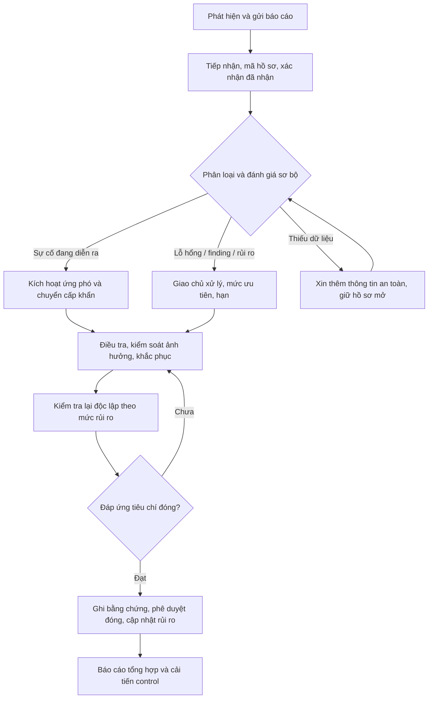

# Đường dây báo cáo

## Mục tiêu học tập

Sau bài học này, bạn có thể:

- Giải thích **đường dây báo cáo** trong quản trị bảo mật, phân biệt **kênh tiếp nhận**, **tuyến trách nhiệm** và **cơ chế chuyển cấp (escalation)**.
- Xác định đúng nơi báo cáo sự cố, lỗ hổng, sai lệch security control, phát hiện audit và rủi ro chưa được xử lý.
- Thiết kế luồng tiếp nhận, phân loại, chuyển cấp, khắc phục, xác minh và đóng phát hiện với trách nhiệm rõ ràng.
- Lập ma trận vai trò, mức độ ưu tiên, tiêu chí chuyển cấp và nhịp báo cáo phù hợp cho chương trình **security assurance**.
- Chứng minh đường dây báo cáo hoạt động hiệu quả bằng **bằng chứng có thể truy vết**, đồng thời bảo vệ tính bí mật và sự an toàn của người báo cáo.

## 1. Đường dây báo cáo là gì và vì sao quan trọng?

Trong **quản trị bảo mật (security governance)**, *đường dây báo cáo* là tập hợp các **tuyến liên lạc và tuyến trách nhiệm đã được định nghĩa** để thông tin liên quan đến security được đưa đến đúng người có thể đánh giá, ra quyết định và tổ chức hành động. Đường dây này kết nối nhân viên phát triển, vận hành, nhóm bảo mật, bộ phận quản trị rủi ro, kiểm toán và cấp lãnh đạo.

Đường dây báo cáo cần giải quyết năm câu hỏi cơ bản:

1. **Ai** có thể hoặc có trách nhiệm báo cáo?
2. **Báo cáo điều gì**, theo tiêu chí nhận biết và mức độ khẩn cấp nào?
3. **Báo cho ai**, bằng kênh nào khi đang làm việc hoặc ngoài giờ?
4. **Ai quyết định và thực hiện hành động** khi phát hiện được xác nhận?
5. **Bằng chứng nào chứng minh** việc báo cáo, xử lý và chuyển cấp đã diễn ra đúng?

Ví dụ, công cụ CI phát hiện một bí mật truy cập có thể đã bị đưa vào Git. Nếu kết quả chỉ nằm trong dashboard của CI mà không có ai nhận trách nhiệm, phát hiện có thể bị bỏ qua trong nhiều ngày. Khi đường dây báo cáo được xác định, cảnh báo được đưa tới người trực bảo mật hoặc chủ dịch vụ; họ đánh giá ảnh hưởng, yêu cầu thu hồi và thay khóa, theo dõi xử lý và lưu bằng chứng đã kiểm tra lại.

Một hệ thống có nhiều security controls nhưng thiếu đường dây báo cáo sẽ khó bảo đảm rằng **phát hiện biến thành hành động**. Vì vậy, đường dây báo cáo là một thành phần của chương trình **security assurance liên tục**: kết quả kiểm thử, audit hoặc giám sát phải được nhận diện, sở hữu, xử lý và đối chiếu với mục tiêu bảo mật.

### 1.1. Phân biệt các khái niệm dễ nhầm

| Khái niệm | Ý nghĩa | Ví dụ |
| --- | --- | --- |
| **Kênh tiếp nhận (reporting channel)** | Nơi hoặc phương tiện gửi thông tin. | Hệ thống ticket, email bảo mật, số điện thoại trực sự cố, biểu mẫu báo cáo riêng tư. |
| **Tuyến báo cáo (reporting line)** | Quan hệ trách nhiệm: ai báo cáo cho ai và ai có quyền đưa ra quyết định. | Chủ dịch vụ báo cáo rủi ro còn lại cho người sở hữu rủi ro; lãnh đạo bảo mật báo cáo tình trạng chương trình cho ban điều hành. |
| **Chuyển cấp (escalation)** | Đưa một vấn đề lên cấp có thẩm quyền hoặc sang nhóm chuyên trách khi có điều kiện kích hoạt. | Sự cố nghiêm trọng chuyển ngay tới người chỉ huy xử lý sự cố và lãnh đạo phụ trách. |
| **Thông báo (notification)** | Phát tín hiệu để người liên quan biết một sự kiện. | Công cụ SCA gửi cảnh báo về thư viện có lỗ hổng. |
| **Báo cáo assurance** | Trình bày có bằng chứng về việc yêu cầu/control được đáp ứng, chưa đủ bằng chứng hay có sai lệch. | Báo cáo theo quý: các yêu cầu security trọng yếu, phát hiện mở, biện pháp khắc phục và rủi ro còn lại. |

Một **notification** không tự động bảo đảm có người đã nhận trách nhiệm. Một **ticket đã đóng** không đủ để kết luận control đã được khắc phục nếu không có bằng chứng kiểm chứng. Cũng cần phân biệt việc **cập nhật tiến độ định kỳ** với **chuyển cấp khẩn cấp** khi đang xảy ra rủi ro cao.

## 2. Những loại vấn đề cần có đường báo cáo

Không nên gom mọi thông tin liên quan đến security vào một trạng thái “incident”. Các loại vấn đề có mục tiêu xử lý và yêu cầu bằng chứng khác nhau.

| Loại thông tin | Ví dụ trong nền tảng học tập | Hướng xử lý chính |
| --- | --- | --- |
| **Sự kiện đáng ngờ (security event)** | Có nhiều lần đăng nhập thất bại bất thường. | Ghi nhận, tương quan tín hiệu, đánh giá xem có cần điều tra. |
| **Sự cố bảo mật (security incident)** | Tài khoản giáo viên bị chiếm và dữ liệu điểm số đã bị truy cập trái phép. | Kích hoạt quy trình ứng phó, giới hạn thiệt hại, điều tra, phục hồi, xem xét nghĩa vụ thông báo. |
| **Lỗ hổng (vulnerability)** | Endpoint cho phép người học thay ID để đọc tiến độ của người khác. | Đánh giá khả năng khai thác, ưu tiên sửa, test xác minh và kiểm tra hồi quy. |
| **Control không hiệu quả** | Chính sách chỉ cho phép TLS nhưng một endpoint vẫn chấp nhận kết nối không an toàn. | Xác minh sai lệch so với yêu cầu, sửa cấu hình hoặc thiết kế, kiểm tra lại. |
| **Phát hiện kiểm thử/audit (finding)** | Bài test cho yêu cầu phân quyền thất bại; audit thiếu hồ sơ review quyền định kỳ. | Tạo hồ sơ phát hiện, giao chủ xử lý, thời hạn, bằng chứng khắc phục, xác minh đóng. |
| **Rủi ro hoặc ngoại lệ** | Phải tiếp tục dùng một thư viện chưa nâng cấp do phụ thuộc nghiệp vụ. | Đánh giá rủi ro, biện pháp giảm thiểu tạm thời, quyết định chấp nhận có thẩm quyền và thời hạn xét lại. |
| **Nghi ngờ vi phạm quy trình** | Có người yêu cầu bỏ qua kiểm soát hoặc che giấu kết quả đánh giá. | Kênh bảo mật, tuân thủ hoặc tố giác độc lập có bảo vệ người báo cáo. |
| **Thay đổi ảnh hưởng assurance** | Thay đổi nhà cung cấp SSO, thêm API export hoặc thay mô hình quyền. | Đánh giá ảnh hưởng tới claim, cập nhật bằng chứng kiểm thử và phê duyệt liên quan. |

Một sự kiện có thể được phân loại lại: cảnh báo ban đầu chỉ là **event**, nhưng điều tra xác nhận rò rỉ dữ liệu thì phải nâng thành **incident**. Phát hiện kiểm thử có thể trở thành sự cố nếu có bằng chứng đang bị khai thác. Đường dây báo cáo cần hỗ trợ nâng cấp loại và mức độ ưu tiên mà vẫn giữ được lịch sử.

## 3. Thiết kế tuyến trách nhiệm: người báo cáo, người xử lý, người quyết định

Mô hình quản trị phải cho phép mọi người **báo cáo dễ dàng**, nhưng quyền quyết định và thực hiện cần được phân công rành mạch. Có thể tham khảo tư duy về **các tuyến trách nhiệm (lines of defense)**: đội vận hành và chủ dịch vụ kiểm soát rủi ro trong công việc hằng ngày; chức năng bảo mật/rủi ro hỗ trợ đặt quy tắc và giám sát; kiểm toán nội bộ hoặc chức năng đánh giá độc lập cung cấp góc nhìn bảo đảm cho lãnh đạo. Đây là cách tổ chức tham khảo, không bắt buộc mọi đơn vị phải có ba phòng ban riêng.

### 3.1. Các vai trò thường gặp

| Vai trò | Trách nhiệm trong đường dây báo cáo | Giới hạn hoặc lưu ý |
| --- | --- | --- |
| **Người phát hiện/người báo cáo** | Cung cấp dấu hiệu, thời điểm, hệ thống ảnh hưởng và đường liên hệ an toàn nếu có. | Không bắt buộc tự điều tra hay chứng minh đầy đủ mới được báo. |
| **Điểm tiếp nhận (security desk/on-call)** | Xác nhận đã nhận, tạo mã hồ sơ, phân loại sơ bộ, định tuyến và chuyển cấp theo chính sách. | Không được tự đóng phát hiện vì chưa kịp điều tra. |
| **Chủ hệ thống/chủ control (control owner)** | Phân tích ảnh hưởng đến hệ thống, đề xuất giải pháp, thực thi sửa và cung cấp bằng chứng. | Trách nhiệm xử lý kỹ thuật không mặc nhiên bao gồm quyền chấp nhận rủi ro tổ chức. |
| **Người điều phối ứng phó sự cố (incident commander)** | Điều phối khi có incident, thống nhất ưu tiên, cập nhật tình hình và phân công việc. | Chức danh này được kích hoạt theo quy trình incident, không áp dụng cho mọi ticket thông thường. |
| **Chức năng Security/Risk/Compliance** | Xác định yêu cầu, rà soát mức rủi ro, giám sát phát hiện, yêu cầu kiểm tra lại, tư vấn nghĩa vụ áp dụng. | Cần có khả năng đưa vấn đề đáng kể tới cấp quyết định phù hợp. |
| **Người sở hữu rủi ro (risk owner)** | Quyết định và chịu trách nhiệm về phương án xử lý rủi ro trong thẩm quyền, kể cả chấp nhận rủi ro còn lại. | Không được chấp nhận thay các nghĩa vụ bắt buộc hoặc vượt mức phân quyền. |
| **Đánh giá độc lập/internal audit** | Xem xét thiết kế và hiệu lực kiểm soát, kiểm tra chứng cứ và báo cáo kết luận độc lập. | Nên tránh vừa tự tạo và vận hành control vừa tự xác nhận độc lập hiệu quả của control đó. |
| **Lãnh đạo/ủy ban rủi ro** | Quyết định ưu tiên, nguồn lực, mức rủi ro vượt ngưỡng, theo dõi xu hướng và trách nhiệm giải trình. | Cần nhận thông tin đủ rõ để ra quyết định, không chỉ số lượng cảnh báo thô. |

**Tuyến báo cáo nghiệp vụ** và **tuyến bảo đảm/giám sát** có thể cùng tồn tại. Chẳng hạn, kỹ sư báo cho trưởng nhóm để sửa API, đồng thời phát hiện nghiêm trọng được ghi nhận trong hệ thống security và đưa tới risk owner. Nhờ vậy, tiến độ khắc phục không chỉ phụ thuộc người trực tiếp triển khai.

### 3.2. Minh họa RACI

**RACI** là công cụ chỉ rõ: **R – Responsible** (thực hiện), **A – Accountable** (chịu trách nhiệm cuối cùng), **C – Consulted** (được tham vấn), **I – Informed** (được thông báo). Mỗi hoạt động nên có một vai trò chịu trách nhiệm cuối cùng được xác định rõ. Ma trận dưới đây là **ví dụ tổ chức giả định**, cần điều chỉnh theo quy mô và quy chế thực tế.

| Hoạt động | Security desk | Chủ dịch vụ | Risk owner | Kiểm toán độc lập | Lãnh đạo |
| --- | --- | --- | --- | --- | --- |
| Tiếp nhận, gán mã và định tuyến | **A/R** | I | I (khi cần) | I (nếu thuộc audit) | — |
| Sửa lỗ hổng ứng dụng | C | **A/R** | I | I (nếu liên quan phát hiện audit) | I (khi vượt ngưỡng) |
| Đánh giá mức rủi ro còn lại | R | C | **A** | C (nếu liên quan) | I |
| Quyết định chấp nhận rủi ro trong thẩm quyền | C | C | **A/R** | I | I hoặc A khi vượt thẩm quyền |
| Kiểm tra độc lập phát hiện audit | C | R (cung cấp chứng cứ) | I | **A/R** | I |
| Báo cáo tổng hợp assurance định kỳ | **R** | C | C | C | **A** (theo mô hình giả định) |

Dấu “—” nghĩa là không có trách nhiệm thường trực ở hoạt động đó, **không** có nghĩa là người liên quan bị cấm nhận thông báo. Với sự cố lớn, tổ chức nên dùng RACI riêng có incident commander, đầu mối truyền thông và pháp chế.

## 4. Các kênh tiếp nhận cần thiết

Một tổ chức có thể dùng chung hệ thống ticket để theo dõi nhưng vẫn cần **nhiều kênh vào** để xử lý tình huống khác nhau. Kênh phải được công bố rõ, có người theo dõi và có phương án dự phòng khi hệ thống chính gặp sự cố.

| Kênh | Khi nào sử dụng | Yêu cầu vận hành tối thiểu |
| --- | --- | --- |
| **Ticket/portal nội bộ** | Phát hiện từ kiểm thử, audit, điểm yếu thông thường, yêu cầu exception. | Mã hồ sơ, phân quyền, trạng thái, chủ xử lý, thời gian và bằng chứng. |
| **Liên hệ bảo mật trực ngoài giờ** | Dấu hiệu tấn công đang diễn ra, lộ bí mật, mất dịch vụ nghiêm trọng. | Người trực và người dự phòng, cơ chế xác nhận đã nhận, lộ trình chuyển cấp. |
| **Kênh báo cáo lỗ hổng từ bên ngoài** | Nhà nghiên cứu, khách hàng hoặc đối tác phát hiện lỗ hổng. | Hướng dẫn phạm vi báo cáo, phương thức trao đổi an toàn, chính sách phản hồi và điều phối khắc phục. |
| **Kênh độc lập, có bảo mật thông tin** | Nghi ngờ che giấu vi phạm, xung đột lợi ích, trả đũa người báo cáo. | Người tiếp nhận không phụ thuộc đối tượng bị phản ánh, hạn chế danh tính, quy trình giải quyết thích hợp. |
| **Báo cáo quản trị định kỳ** | Tổng hợp mức đáp ứng security requirements, risk, audit finding và hiệu quả xử lý. | Số liệu có nguồn gốc, xu hướng, vấn đề trọng yếu, quyết định cần được phê duyệt. |

Nếu hệ thống quản lý ticket, SSO hoặc mạng nội bộ đang bị tấn công, nhân viên cần biết **kênh ngoài băng (out-of-band)** được chấp nhận, chẳng hạn số điện thoại ứng cứu đã đăng ký. Không nên đặt số liên hệ dự phòng duy nhất trong một hệ thống có thể đang bị gián đoạn.

### 4.1. An toàn của người báo cáo và bảo vệ dữ liệu

Đường dây báo cáo chỉ hiệu quả khi người dùng tin rằng họ có thể lên tiếng mà không bị ngăn cản. Tùy loại vấn đề và chính sách, cần hỗ trợ **báo cáo bảo mật danh tính**, và khi phù hợp, **báo cáo ẩn danh**. Người tiếp nhận phải áp dụng nguyên tắc cần biết, tránh chia sẻ danh tính hoặc chi tiết nhạy cảm rộng rãi; quy trình xử lý phản ánh liên quan đến người quản lý cần có tuyến độc lập để tránh xung đột lợi ích.

Báo cáo security có thể chứa dữ liệu rất nhạy cảm: địa chỉ IP nội bộ, thông tin khách hàng, ảnh chụp có dữ liệu cá nhân, đường khai thác hoặc khóa truy cập. Vì vậy:

- **Không** yêu cầu người báo cáo dán mật khẩu, token, private key hoặc dữ liệu khách hàng thô vào email công khai.
- Sử dụng kho chứng cứ có kiểm soát truy cập; trong ticket chỉ nên ghi **tham chiếu tới artifact** thay vì đính kèm dữ liệu nhạy cảm không cần thiết.
- Ghi lại các lần xem, tải, sửa và chuyển giao chứng cứ khi phù hợp với mức rủi ro.
- Hướng dẫn người tiếp nhận **không tùy tiện thử khai thác** trên hệ thống production chỉ để xác minh khi thiếu thẩm quyền hoặc có nguy cơ phá hoại.
- Thống nhất thời hạn lưu giữ và quy trình xóa các hồ sơ điều tra theo chính sách, nghĩa vụ và nhu cầu bảo toàn chứng cứ.

## 5. Quy trình xử lý một báo cáo từ đầu đến cuối

Đường dây báo cáo không hoàn tất ở thời điểm một người gửi ticket. Một phát hiện chỉ thực sự đi hết chu trình assurance khi có **kết quả xác minh** và quyết định về rủi ro còn lại.



### 5.1. Các bước thực hành

**Bước 1 – Phát hiện và ghi nhận.** Người báo cáo ghi rõ hệ thống, triệu chứng, thời điểm, cách tái hiện an toàn (nếu có), ảnh hưởng nghi ngờ và đầu mối liên hệ. Người tiếp nhận tạo mã hồ sơ ngay cả khi thông tin chưa đủ để khẳng định có sự cố.

**Bước 2 – Xác nhận đã nhận và phân loại.** Điểm tiếp nhận xác nhận báo cáo, nhận diện báo cáo trùng, kiểm tra có hoạt động tấn công đang diễn ra hay không, phân loại sơ bộ và xác định mức ưu tiên. Không thể xác định severity chỉ từ số lượng cảnh báo: cần xét tài sản, độ nhạy dữ liệu, mức ảnh hưởng, khả năng khai thác và các biện pháp bảo vệ hiện hữu.

**Bước 3 – Chuyển cấp.** Khi vượt thẩm quyền, quá hạn xử lý, chủ hệ thống không phản hồi, phát hiện lặp nhiều lần hoặc có dấu hiệu che giấu, vấn đề phải được chuyển lên vai trò được chỉ định. Với sự cố khẩn cấp, chuyển cấp ngay theo quy trình ứng cứu, không chờ phiên họp định kỳ.

**Bước 4 – Xử lý và cập nhật.** Chủ dịch vụ khắc phục nguyên nhân, bảo toàn chứng cứ cần thiết, theo dõi tác động và cập nhật tiến độ. Với phát hiện audit, hồ sơ phải liên kết tới requirement và control bị ảnh hưởng; với incident, cần có nhật ký hoạt động ứng phó riêng và kênh cập nhật tình hình.

**Bước 5 – Kiểm chứng khắc phục.** Người hoặc chức năng có thẩm quyền kiểm tra lại: test tái hiện lỗi cũ không còn thất bại, có regression test, cấu hình production tương ứng và không phát sinh đường bypass. Đối với phát hiện trọng yếu, nên có người review đủ độc lập với người thực hiện sửa.

**Bước 6 – Đóng hoặc quyết định về rủi ro.** Hồ sơ chỉ được chuyển sang `Closed – Verified` khi có bằng chứng đáp ứng tiêu chí. Nếu chưa thể sửa, cần đưa vào quy trình **chấp nhận rủi ro có thời hạn và đúng thẩm quyền**, ghi biện pháp tạm thời và lịch xem xét. Không đổi “chấp nhận rủi ro” thành “đã khắc phục”.

**Bước 7 – Phản hồi và học hỏi.** Gửi kết quả phù hợp cho người báo cáo, ghi lại nguyên nhân gốc, hành động phòng ngừa, cập nhật playbook, test và báo cáo quản trị.

### 5.2. Vòng đời trạng thái nên tường minh

```text
New → Acknowledged → Triaged → Assigned → In Progress
                                  ↓
                             Awaiting Evidence
                                  ↓
                           Ready for Verification
                                  ↓
                   Verified/Closed hoặc Reopened
```

Các trạng thái ngoại lệ cần được định nghĩa riêng: `Duplicate` (có liên kết hồ sơ gốc), `Not Reproducible` (nêu điều kiện thử và giới hạn), `False Positive` (có lý do và chứng cứ), `Risk Accepted` (có quyết định đúng thẩm quyền) và `Deferred` (có hạn đánh giá lại). Không nên xóa lịch sử phân loại khi thay đổi trạng thái.

## 6. Quy tắc chuyển cấp và mức ưu tiên

Chuyển cấp cần dựa trên **điều kiện quan sát được**, thay vì một nhận xét chung như “khi thấy nghiêm trọng”. Nhóm nên công bố trước ai được quyền thay đổi mức ưu tiên và cách giải quyết trường hợp các bên không đồng ý.

### 6.1. Ma trận chuyển cấp minh họa

**Các thời gian dưới đây chỉ là ví dụ để thiết kế quy trình nội bộ**, không phải SLA phổ quát hoặc thời hạn thông báo do pháp luật quy định. Tổ chức phải điều chỉnh theo nhân lực trực, rủi ro, cam kết và nghĩa vụ cụ thể.

| Mức | Điều kiện gợi ý | Mục tiêu xác nhận đã nhận (ví dụ) | Chuyển tới |
| --- | --- | --- | --- |
| **Critical** | Đang có truy cập trái phép trên diện rộng, lộ dữ liệu nhạy cảm quy mô lớn, dịch vụ cốt lõi bị chiếm quyền. | Trong **15 phút**, trực liên tục. | On-call bảo mật, incident commander, chủ dịch vụ, lãnh đạo theo playbook. |
| **High** | Lỗ hổng khả thi với tác động lớn, control trọng yếu thất bại, chưa xác nhận bị khai thác. | Trong **1 giờ**, theo lịch trực được công bố. | Security lead và chủ dịch vụ, risk owner khi vượt ngưỡng. |
| **Medium** | Phát hiện ảnh hưởng giới hạn, có biện pháp giảm thiểu đáng tin, chưa có dấu hiệu khai thác. | Trong **1 ngày làm việc**. | Chủ dịch vụ và người theo dõi security finding. |
| **Low** | Sai lệch nhỏ hoặc cải tiến được ghi nhận, không có chỉ dấu nguy cấp. | Trong **3 ngày làm việc**. | Chủ control và hàng đợi cải tiến có người theo dõi. |

**Xác nhận đã nhận ≠ khắc phục xong.** Thời gian điều tra, xử lý tạm thời, khắc phục đầy đủ, kiểm chứng và cập nhật các bên cần được định nghĩa riêng. Một báo cáo Critical cần xử lý ưu tiên cả khi người tiếp nhận chưa có đủ bằng chứng để xác nhận toàn bộ phạm vi tác động.

Những điều kiện có thể kích hoạt chuyển cấp tự động:

- Không có người xác nhận đã nhận trong thời hạn quy định.
- Chủ xử lý vắng mặt hoặc không phản hồi; hệ thống phải có chủ dự phòng.
- Rủi ro vượt mức chấp nhận của chủ dịch vụ hoặc có tác động nhiều bộ phận.
- Sự cố lan rộng, phát hiện mới làm thay đổi mức độ nghiêm trọng, hoặc tác động tới bên thứ ba.
- Khắc phục đã quá hạn, có nguy cơ lặp lại, hoặc security control nhiều lần bị bỏ qua.
- Xuất hiện xung đột lợi ích, bị yêu cầu che giấu báo cáo hoặc có dấu hiệu trả đũa.
- Có khả năng phát sinh nghĩa vụ thông báo cho cá nhân, khách hàng, cơ quan quản lý hoặc đối tác theo quy định/thoả thuận áp dụng.

Đối với **nghĩa vụ pháp lý và hợp đồng**, điểm tiếp nhận cần mời đầu mối pháp chế/tuân thủ được chỉ định để xác định tính áp dụng, thời điểm tính hạn, nội dung và người có thẩm quyền gửi. Không nên áp dụng một thời hạn thông báo cố định cho mọi quốc gia và mọi loại sự cố.

## 7. Nội dung tối thiểu của một báo cáo có thể kiểm chứng

Để hỗ trợ xử lý và assurance, mỗi hồ sơ nên có các trường đủ **truy vết yêu cầu → phát hiện → hành động → bằng chứng → quyết định**:

| Nhóm dữ liệu | Trường cần ghi | Vì sao cần |
| --- | --- | --- |
| Định danh | Mã báo cáo, loại báo cáo, nguồn phát hiện, thời gian phát hiện và tiếp nhận. | Truy vết, loại trùng và đánh giá độ trễ. |
| Phạm vi | Tên hệ thống, môi trường, bản build/commit, dữ liệu/tài sản ảnh hưởng. | Xác định claim và phiên bản chịu tác động. |
| Mức độ | Mức ưu tiên, cách đánh giá tác động/khả năng xảy ra, giả định, tình trạng khai thác nếu biết. | Chuyển cấp và ưu tiên nguồn lực có căn cứ. |
| Trách nhiệm | Người tiếp nhận, chủ xử lý, chủ rủi ro, người xác minh, người phê duyệt. | Tránh “không ai sở hữu”. |
| Liên kết assurance | Mã requirement, control, test/audit finding, risk register, incident nếu liên quan. | Đánh giá hệ quả của sai lệch đối với mục tiêu security. |
| Bằng chứng | Tham chiếu artifact được bảo vệ, cách tái hiện an toàn, kết quả test/review. | Cho phép người khác kiểm chứng kết luận. |
| Quyết định | Hành động, thời hạn, chuyển cấp, ngoại lệ, phương án khắc phục hoặc chấp nhận rủi ro. | Ghi rõ trách nhiệm và thẩm quyền. |
| Kết quả | Bằng chứng re-test, ngày đóng, người xác minh, rủi ro còn lại và lần xem xét tiếp theo. | Phân biệt đã sửa với chỉ mới hứa sửa. |

Ví dụ hồ sơ **giả định** cho phát hiện phân quyền trong API Java/Spring Boot:

```yaml
report_id: "SEC-FIND-024"
type: "security_control_failure"
source: "integration_security_test"
detected_at: "2026-11-28T02:00:00Z"
acknowledged_at: "2026-11-28T02:12:00Z"
asset: "learning-progress-api"
environment: "staging"
build: "build-example-184"
requirement_id: "SEC-AUTHZ-01"
control: "Object-level authorization for learning progress"
finding: "Một tài khoản được xác thực có thể đọc tiến độ của tài khoản khác"
severity: "HIGH" # Giá trị ví dụ; thực tế phải qua đánh giá rủi ro
status: "Ready for Verification"
assigned_to_role: "learning-service-owner"
risk_owner_role: "product-service-risk-owner"
reviewer_role: "security-assurance-reviewer"
evidence_refs:
  - "secure-artifacts/test-run-184/authorization-case-07"
remediation:
  description: "Kiểm tra quyền theo chủ sở hữu/phân công tại service"
  change_ref: "review-example-52"
  regression_test_ref: "secure-artifacts/test-run-191/authz-regression"
open_questions:
  - "Xác minh toàn bộ endpoint export dùng cùng control"
next_review: "Sau khi reviewer kiểm chứng đủ phạm vi"
```

Đây là mẫu minh họa, **không phải** kết quả kiểm thử thực tế. Chỉ ghi `Verified/Closed` sau khi reviewer có bằng chứng xác nhận phạm vi khắc phục. Nếu phát hiện tồn tại trên production, cần phân loại lại ảnh hưởng và cân nhắc kích hoạt quy trình incident, thay vì chỉ xử lý ticket ở staging.

### 7.1. Chất lượng bằng chứng và tính toàn vẹn

Các hồ sơ assurance có thể phục vụ kiểm tra sau nhiều tháng. Nên lưu **mã bản build, kết quả kiểm thử nguyên gốc, ngày giờ, môi trường, phiên bản rule, thay đổi cấu hình, người duyệt và lịch sử quyết định**. Chứng cứ nhạy cảm cần có kiểm soát truy cập và cơ chế phát hiện sửa đổi; nếu phải bảo toàn bằng chứng điều tra, tuân thủ quy trình bảo quản và chuyển giao tương ứng.

Đừng tạo báo cáo tự động kiểu “mọi test đều đạt” rồi suy ra không có rủi ro. Kết quả kiểm thử chỉ hỗ trợ **các claim đã được kiểm chứng**. Những yêu cầu chưa có test, các phát hiện bị hoãn và ngoại lệ đang hiệu lực cần xuất hiện minh bạch trong báo cáo quản trị.

## 8. Đường dây báo cáo trong chương trình security assurance

Assurance đánh giá mức độ tin cậy rằng **mục tiêu security, security requirements và controls** đang được đáp ứng. Vì vậy, ngoài cảnh báo từ công cụ và báo cáo sự cố, đường dây quản trị phải thu nhận cả **bằng chứng đạt**, **khoảng trống bằng chứng** và **phát hiện cần khắc phục**.

Một luồng truy vết điển hình:

```text
Rủi ro: người học đọc trái phép tiến độ của người khác
    ↓
Yêu cầu SEC-AUTHZ-01: API phân quyền theo từng tài nguyên
    ↓
Control: kiểm tra quyền phía server ở service
    ↓
Kiểm thử: owner được phép, người khác bị từ chối
    ↓
Test thất bại → SEC-FIND-024 → phân loại/chuyển cấp
    ↓
Chủ dịch vụ sửa → security reviewer chạy lại test
    ↓
Kết quả: đạt / thiếu bằng chứng / còn sai lệch
    ↓
Risk owner và quản trị nhận báo cáo theo ngưỡng phù hợp
```

Ở đây, **claim** là “endpoint bảo vệ được thông tin tiến độ khỏi chủ thể không có quyền”. **Argument** cho rằng mọi đường truy cập dữ liệu đã thực hiện kiểm tra quan hệ chủ sở hữu và quyền của giáo viên tại server. **Evidence** gồm review design, code, integration test và cấu hình triển khai.

Nếu test thất bại, đường dây báo cáo có nhiệm vụ đưa **sự phản chứng** đó tới đúng người. Nếu sau khi sửa test thành công nhưng đường export chưa được kiểm tra, kết luận cần ghi **chưa đủ bằng chứng cho toàn bộ claim**; không nên ghi chung “security pass”.

### 8.1. Hai nhịp báo cáo bổ trợ nhau

**Nhịp vận hành:** phát hiện → tiếp nhận → chuyển cấp → khắc phục gần thời gian thực hoặc theo mục tiêu được thống nhất. Người nhận cần dữ liệu kỹ thuật chi tiết trong phạm vi xử lý.

**Nhịp quản trị:** báo cáo theo tuần/tháng/quý hoặc theo sự kiện trọng yếu, tùy chính sách và mức rủi ro. Lãnh đạo cần xu hướng, rủi ro còn lại, phát hiện quá hạn, control trọng yếu chưa đủ bằng chứng và quyết định cần phân bổ nguồn lực. Không nhất thiết gửi toàn bộ payload kỹ thuật hoặc dữ liệu cá nhân.

Nếu phát hiện vượt mức chịu đựng rủi ro, nhịp quản trị định kỳ **không thay thế** yêu cầu chuyển cấp khẩn. Ngược lại, việc đã ứng cứu xong sự cố không loại bỏ nhu cầu đưa nguyên nhân và cải tiến vào báo cáo tổng hợp.

## 9. Đo lường hiệu quả đường dây báo cáo

Đừng chỉ đo số ticket được tạo hoặc số cảnh báo được gửi. Cần biết **thông tin có đến đúng người và dẫn tới quyết định đúng hay không**.

| Chỉ số | Cách hiểu hữu ích | Nguy cơ diễn giải sai |
| --- | --- | --- |
| **Time to acknowledge** | Thời gian từ khi nhận báo cáo đến khi có người xác nhận chịu tiếp nhận. | Xác nhận nhanh không chứng minh đã đánh giá đúng. |
| **Time to triage / assign** | Thời gian xác định loại, mức độ và chủ xử lý. | Phân loại “thấp” hàng loạt có thể làm KPI đẹp nhưng che rủi ro. |
| **Số phát hiện quá hạn theo mức rủi ro** | Chỗ cần bổ sung năng lực hoặc chuyển cấp. | Không thể so sánh đội nhóm nếu không xét độ phức tạp và mức rủi ro. |
| **Tỷ lệ khắc phục được xác minh** | Phần phát hiện đã có bằng chứng re-test hợp lệ. | Trạng thái ticket “Closed” tự khai chưa đủ. |
| **Số ngoại lệ/rủi ro được chấp nhận còn hiệu lực** | Quyết định quản trị cần được xem xét theo hạn. | Tỷ lệ thấp không nhất thiết tốt nếu tổ chức không ghi nhận ngoại lệ. |
| **Tỷ lệ phát hiện bị mở lại** | Có thể phản ánh khắc phục chưa triệt để hoặc kiểm chứng chưa đầy đủ. | Cũng có thể tăng khi khả năng phát hiện lỗi tốt hơn. |
| **Tỷ lệ yêu cầu quan trọng có evidence còn hiệu lực** | Độ bao phủ của assurance đối với rủi ro ưu tiên. | Cần đánh giá chất lượng bằng chứng, không chỉ sự tồn tại của artifact. |
| **Số lần chuyển cấp quá hạn/không có người nhận** | Điểm yếu ở cơ chế báo động và trách nhiệm dự phòng. | Đo được khi hệ thống lưu mốc thời gian và lịch trực đáng tin. |

Một dashboard quản trị hữu ích trả lời: **Control/rủi ro nào đang ngoài ngưỡng? Ai chịu trách nhiệm? Hạn quyết định là khi nào? Bằng chứng hiện có đến đâu?** Cần cho phép xem chi tiết theo yêu cầu, hệ thống và mức ưu tiên, trong phạm vi phân quyền.

## 10. Tình huống thực hành: lỗ hổng phân quyền trên nền tảng học tập

Nhóm bảo mật chạy integration test và phát hiện tài khoản `student-A` gọi `GET /api/students/812/progress` để lấy tiến độ của `student-B`. Test cho thấy endpoint chấp nhận bất kỳ tài khoản đã đăng nhập. Tính năng đang được dùng ở production, chưa rõ có ai từng khai thác.

**Một cách triển khai đường dây báo cáo hợp lý:**

1. **Ghi nhận:** Kỹ sư gửi báo cáo `SEC-FIND-024` qua kênh bảo mật, ghi endpoint, cách tái hiện trên môi trường kiểm thử, bản build và tham chiếu kết quả test đã được bảo vệ.
2. **Phân loại:** Security desk đánh giá khả năng bị khai thác, độ nhạy và số lượng bản ghi có thể truy xuất. Vì production có thể bị ảnh hưởng, chuyển tới đội ứng phó để xác định có dấu hiệu truy cập trái phép thực tế hay không; không được giả định đã có rò rỉ khi chưa điều tra.
3. **Chuyển cấp và giao việc:** Chủ dịch vụ sửa kiểm tra phân quyền; người trực bảo mật theo dõi tiến độ; incident commander tham gia nếu xác nhận hoặc nghi ngờ hợp lý sự cố theo playbook. Risk owner nhận thông tin nếu mức rủi ro vượt ngưỡng.
4. **Giới hạn ảnh hưởng:** Theo đánh giá tác động, đội vận hành có thể tạm hạn chế endpoint hoặc áp dụng biện pháp giảm thiểu phù hợp trước khi hoàn tất bản sửa.
5. **Khắc phục:** Đặt kiểm tra quyền theo từng tài nguyên tại tầng service; kiểm tra các endpoint tải xuống, export, truy vấn theo ID liên quan; bổ sung test chặn truy cập chéo.
6. **Xác minh:** Reviewer kiểm tra kết quả test từ bản build mới và xác nhận cấu hình deploy. Nếu có bản production bị ảnh hưởng, cần xác minh bản sửa đã triển khai và đánh giá hậu kiểm, không chỉ nhìn vào test staging.
7. **Đóng và báo cáo quản trị:** Chỉ đóng finding khi đáp ứng tiêu chí; ghi rủi ro còn lại, thời điểm, bằng chứng và người phê duyệt. Cập nhật bộ security assurance về phạm vi đã chứng minh và bài học phòng ngừa.

### Nếu người báo cáo là nhân viên và người quản lý yêu cầu “đừng tạo ticket”?

Đây là trường hợp đường dây báo cáo thường gặp **xung đột lợi ích**. Người báo cáo cần có kênh thay thế tới security, quản trị rủi ro hoặc bộ phận được ủy quyền độc lập; đơn vị tiếp nhận phải xử lý bảo mật danh tính và ngăn việc chặn thông tin theo chính sách. Người báo cáo nên cung cấp sự kiện và bằng chứng có được hợp lệ, tránh tự ý trích xuất dữ liệu hoặc tấn công hệ thống ngoài phạm vi được phép.

### Nếu bản sửa đã được merge nhưng test regression chưa chạy?

Trạng thái đúng là **đang chờ xác minh**, không phải “đã khắc phục”. Bằng chứng merge/PR chỉ xác nhận đã có thay đổi mã nguồn; cần chứng minh nó giải quyết yêu cầu bảo mật và đã tới đúng môi trường triển khai.

## 11. Những sai lầm thường gặp

| Sai lầm | Hậu quả | Cách cải thiện |
| --- | --- | --- |
| Chỉ định một email chung nhưng không có người trực. | Báo cáo nằm trong hộp thư, thiếu xác nhận và xử lý. | Chỉ rõ owner, backup, lịch trực và quy tắc quá hạn. |
| Chỉ quản lý finding qua tin nhắn riêng. | Không có mã hồ sơ, khó kiểm chứng và truy vết. | Tạo ticket chính thức, liên kết chứng cứ; dùng chat để điều phối khi cần. |
| Gửi mọi vấn đề lên lãnh đạo cao nhất. | Quá tải, làm chậm xử lý tác nghiệp. | Có tiêu chí severity và tuyến báo cáo theo quyền quyết định. |
| Đánh đồng finding với incident. | Sai đối tượng xử lý, quy trình và nhịp thông tin. | Phân loại, cho phép nâng/giảm mức sau triage kèm lý do. |
| Người sửa tự đóng finding trọng yếu mà không kiểm chứng. | Rủi ro sửa chưa đủ, thiếu độc lập. | Thiết lập tiêu chí re-test và reviewer phù hợp. |
| Ghi “risk accepted” mà không có người có thẩm quyền duyệt. | Rủi ro bị giấu trong backlog. | Ghi chủ rủi ro, phạm vi, lý do, biện pháp giảm thiểu và hạn xem lại. |
| Gửi nguyên mật khẩu/token và dữ liệu cá nhân trong báo cáo. | Báo cáo làm tăng bề mặt rò rỉ. | Giảm thiểu dữ liệu, dùng kho chứng cứ có phân quyền và dấu vết truy cập. |
| Chỉ xem KPI số ticket đã đóng. | Có thể đóng nhanh nhưng không giải quyết control thất bại. | Đo bằng chứng khắc phục, thời gian chuyển cấp, rủi ro còn lại và tỷ lệ mở lại. |
| Không cập nhật đường dây báo cáo sau thay đổi tổ chức. | Người nhận nghỉ việc, hotline hết hiệu lực. | Kiểm tra định kỳ danh sách liên hệ, diễn tập chuyển cấp và quyền dự phòng. |

## 12. Bài tập tự luyện

**Tình huống:** Đội phát triển phát hành API trả chứng chỉ học tập. Công cụ DAST báo một URL tải chứng chỉ có thể truy cập mà không cần phiên đăng nhập. Hai ngày sau, audit phát hiện ticket có trạng thái `Closed` do trưởng nhóm bấm đóng, nhưng không có kết quả test hoặc quyết định chấp nhận rủi ro. Nhóm trực ngoài giờ không nhận được cảnh báo vì số điện thoại liên hệ đã thay đổi.

Hãy thực hiện:

1. Phân biệt **lỗ hổng**, **phát hiện audit** và **sự cố** trong tình huống; nêu thông tin còn cần để kết luận có sự cố thực tế.
2. Vẽ tuyến báo cáo và người có trách nhiệm từ DAST → security desk → chủ dịch vụ → reviewer → risk owner/lãnh đạo khi vượt ngưỡng.
3. Đề xuất tiêu chí kích hoạt chuyển cấp nếu không có người nhận hoặc ticket bị đóng khi thiếu bằng chứng.
4. Liệt kê tối thiểu **sáu trường** bắt buộc của hồ sơ finding để người khác kiểm chứng kết luận.
5. Viết một **claim**, lập luận hỗ trợ và các **evidence** cần có trước khi đóng finding.
6. Nêu ba cải tiến để kênh ngoài giờ hoạt động tin cậy và không phụ thuộc duy nhất một người.

**Gợi ý đối chiếu:** Kết quả DAST là bằng chứng về một nguy cơ cần xác minh; chưa chứng minh đã có kẻ truy cập dữ liệu. Audit cho thấy lỗi trong quy trình xác minh/đóng finding. Claim có thể là “URL tải chứng chỉ chỉ phục vụ người được phép trên build phát hành X”. Bằng chứng cần bao gồm test chưa đăng nhập, test quyền trên từng chứng chỉ, review đường đi xử lý, kết quả trên build và môi trường đã triển khai. Kênh ngoài giờ cần danh sách trực được cập nhật, chủ dự phòng và diễn tập/kiểm tra xác nhận cảnh báo; ticket đóng thiếu bằng chứng phải được mở lại và chuyển cấp theo chính sách.

## Tổng kết

**Đường dây báo cáo** là cơ chế kết nối người phát hiện vấn đề với đúng người **tiếp nhận, chịu trách nhiệm, có thẩm quyền quyết định và kiểm chứng kết quả**. Trong security assurance, giá trị của đường dây báo cáo nằm ở khả năng chuyển **rủi ro, kết quả kiểm thử và phát hiện audit** thành hành động có bằng chứng: báo cáo → phân loại → chuyển cấp → khắc phục → xác minh → cập nhật rủi ro → cải tiến liên tục. Một đường dây hiệu quả phải dễ sử dụng, an toàn cho người báo cáo, có phương án dự phòng và đủ truy vết để lãnh đạo đánh giá được các mục tiêu bảo mật đang thực sự được đáp ứng đến mức nào.
