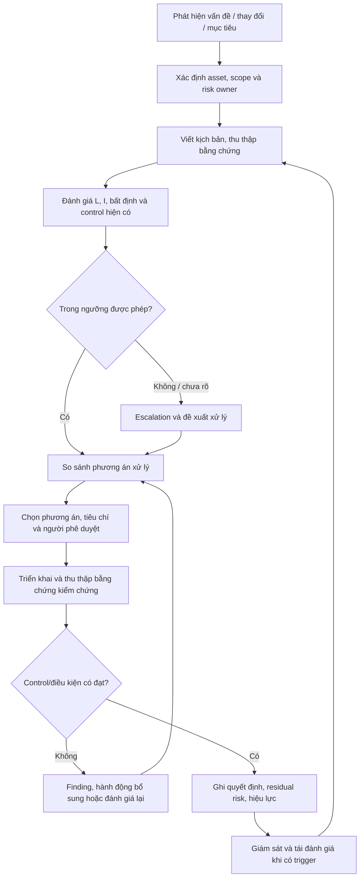

# Quyết định dựa trên rủi ro trong quản trị bảo mật

## 1. Vì sao quản trị bảo mật cần ra quyết định dựa trên rủi ro?

Trong chương **Quản trị bảo mật** của module **SECURITY_SECURITY_ASSURANCE**, “**quyết định dựa trên rủi ro**” (risk-based decision-making) là cách tổ chức lựa chọn, ưu tiên, phê duyệt và theo dõi hành động bảo mật dựa trên **mục tiêu cần bảo vệ, kịch bản rủi ro, bằng chứng và mức rủi ro tổ chức có thể chịu đựng**.

Một hệ thống có thể tồn tại hàng trăm cảnh báo từ scanner, nhiều yêu cầu bảo mật và vô số phương án sửa chữa. Nguồn lực, thời gian kiểm thử và mức gián đoạn chấp nhận được luôn hữu hạn. Quản trị bảo mật phải trả lời những câu hỏi cụ thể:

- Tài sản và hoạt động nào cần bảo vệ trước tiên?
- Finding nào cần chặn phát hành, xử lý ngay, lên kế hoạch, hoặc chấp nhận có điều kiện?
- Control nào thực sự làm giảm rủi ro quan trọng, và **bằng chứng nào** đủ cho kết luận đó?
- Ai có quyền quyết định khi tính an toàn, thời hạn phát hành và chi phí xung đột?
- Khi nào một quyết định cũ phải được xem xét lại?

Ví dụ: trong nền tảng học tập Java/Spring Boot, phát hiện “API cập nhật điểm thi thiếu kiểm tra quyền theo lớp” và “trang giới thiệu khóa học có header bảo mật chưa tối ưu” đều là vấn đề cần đánh giá. Tuy nhiên, chúng khác nhau về **tác động nghiệp vụ**, đường khai thác, độ phơi lộ và quyền lợi người dùng. Không thể chỉ dựa vào việc công cụ gắn cùng nhãn `High` để đưa ra cùng quyết định.

**Security assurance** bổ sung một yêu cầu quan trọng: quyết định phải có **căn cứ có thể kiểm chứng**. Không đủ để ghi “nguy cơ thấp” hoặc “đã được kiểm soát”; phải biết căn cứ là gì, còn thiếu bằng chứng nào, ai chịu trách nhiệm và kết luận có hiệu lực cho phạm vi, phiên bản, khoảng thời gian nào.

### Kết quả học tập

Sau bài này, người học có thể:

1. Phân biệt **quản trị rủi ro**, **đánh giá kỹ thuật**, **chấp nhận rủi ro** và **assurance**.
2. Xây dựng một kịch bản rủi ro và nhận diện bằng chứng đủ/thiếu để quyết định.
3. Chọn phương án **tránh, giảm thiểu, chia sẻ/chuyển một phần hoặc chấp nhận** rủi ro theo tiêu chí rõ ràng.
4. Phân công đúng trách nhiệm giữa risk owner, system owner, security, đội kỹ thuật và người đánh giá.
5. Viết decision record liên kết rủi ro, control, finding, bằng chứng, ngoại lệ và mốc đánh giá lại.

## 2. Phân biệt quyết định rủi ro với kết quả đánh giá bảo mật

Các khái niệm sau liên quan nhưng không thay thế nhau:

| Khái niệm | Câu hỏi chính | Sản phẩm đầu ra |
| --- | --- | --- |
| **Security objective** – mục tiêu bảo mật | Điều gì phải được bảo vệ để nghiệp vụ vận hành đúng? | Mục tiêu rõ ràng: chỉ người được phân công mới sửa điểm thi. |
| **Security requirement** – yêu cầu bảo mật | Hệ thống phải đáp ứng điều kiện nào có thể kiểm chứng? | Quy tắc ủy quyền theo người dùng, lớp và loại thao tác. |
| **Risk assessment** – đánh giá rủi ro | Điều gì có thể xảy ra, xác suất/khả năng, hậu quả và mức độ bất định? | Kịch bản, mức rủi ro, giả định, nguồn dữ liệu. |
| **Security control** – biện pháp kiểm soát | Cách nào ngăn ngừa, phát hiện hoặc hạn chế hậu quả? | Kiểm tra quyền backend, giám sát, khôi phục. |
| **Security assessment/assurance** | Có bằng chứng đáng tin rằng control đáp ứng yêu cầu trong phạm vi không? | Kết quả test, review, audit, finding, giới hạn và kết luận. |
| **Risk treatment decision** – quyết định xử lý | Phải làm gì với rủi ro và đánh đổi nào được chấp nhận? | Quyết định sửa, ngừng chức năng, bổ sung control, chấp nhận có hạn. |
| **Risk acceptance** – chấp nhận rủi ro | Ai có thẩm quyền chấp nhận rủi ro còn lại, trong điều kiện và thời hạn nào? | Hồ sơ phê duyệt, trách nhiệm giám sát và mốc xem lại. |
| **Risk monitoring** – giám sát rủi ro | Quyết định còn phù hợp khi hệ thống hoặc bối cảnh thay đổi không? | Chỉ số, cảnh báo, reassessment, cập nhật hồ sơ. |

Một số phân biệt cần giữ xuyên suốt:

- **Mức nghiêm trọng kỹ thuật ≠ rủi ro nghiệp vụ.** Điểm CVSS, báo cáo SAST/DAST hoặc danh sách CVE có thể giúp ưu tiên điều tra, nhưng rủi ro còn phụ thuộc cách thành phần được sử dụng, khả năng tiếp cận, giá trị tài sản và control hiện tại.
- **Kết quả kiểm thử `PASS` ≠ chấp nhận rủi ro.** Test có thể chứng minh một control hoạt động trong phạm vi; quyết định có tiếp tục vận hành khi còn rủi ro phải do chủ thể có thẩm quyền đưa ra.
- **Chấp nhận rủi ro ≠ đã khắc phục lỗ hổng.** Quyết định chấp nhận phải ghi nhận tình trạng chưa sửa, thời hạn, điều kiện, mức giám sát và trách nhiệm.
- **Có chứng nhận/đạt checklist ≠ không còn rủi ro.** Mọi đánh giá có phạm vi, thời điểm và giới hạn; rủi ro đặc thù hệ thống cần tiếp tục được quản lý.
- **Không phát hiện bằng chứng khai thác ≠ không thể bị khai thác.** Thiếu log hoặc thiếu test làm tăng sự bất định, không tự làm giảm rủi ro.

## 3. Những thành phần bắt buộc của một quyết định có căn cứ

Một quyết định nên liên kết được ít nhất tám thành phần:

| Thành phần | Nội dung cần ghi rõ | Ví dụ |
| --- | --- | --- |
| **Asset & business context** | Tài sản, giá trị, hoạt động phụ thuộc, người bị ảnh hưởng. | Điểm thi và uy tín kết quả đào tạo. |
| **Risk scenario** | Tình huống đe dọa, điểm yếu, đường tác động, hậu quả. | Giáo viên lớp A sửa điểm học viên lớp B qua API. |
| **Likelihood & impact** | Ước lượng theo phương pháp xác định; giả định và độ tin cậy của dữ liệu. | Endpoint nội bộ nhưng nhiều người dùng, thay đổi có tác động nghiêm trọng. |
| **Existing controls** | Control hiện có và bằng chứng về hiệu quả thực tế. | Có role-based access, thiếu kiểm tra phân công lớp. |
| **Risk criteria** | Khẩu vị rủi ro, ngưỡng chịu đựng, chính sách, nghĩa vụ áp dụng. | Không chấp nhận đường sửa điểm trái quyền trong production. |
| **Treatment options** | Các cách xử lý khả thi, lợi ích, chi phí, giới hạn. | Bổ sung object authorization, tắt endpoint, hạn chế mạng. |
| **Decision authority** | Người đề xuất, người đánh giá, người quyết định, người thực hiện. | Risk owner phê duyệt phương án; đội backend sửa; security xác minh. |
| **Evidence & review** | Test/audit/retest, rủi ro còn lại, hạn phê duyệt, trigger đánh giá lại. | Báo cáo integration test, review độc lập, theo dõi quyền. |

### Kịch bản rủi ro thay cho một nhãn chung chung

Một finding như “thiếu authorization” chưa đủ để quyết định. Hãy diễn đạt:

> **RISK-GRADE-07:** Khi tài khoản giáo viên hợp lệ gọi API `PATCH /api/grades/{id}`, backend chỉ kiểm tra role `TEACHER` mà không xác thực quan hệ giáo viên–lớp. Tài khoản thuộc lớp A có thể thay điểm của học viên lớp B, dẫn đến sai lệch kết quả học tập và tranh chấp. API hiện nằm trong phạm vi người dùng nội bộ đăng nhập; chưa có bằng chứng kiểm tra mọi đường cập nhật điểm khác.

Câu mô tả này cho thấy **đường tác động**, điều kiện khai thác và **điều chưa biết**. Nó hỗ trợ lựa chọn đúng test, control, người chịu trách nhiệm và ưu tiên xử lý.

## 4. Vai trò và quyền hạn quyết định

Governance xác định **ai được đưa ra loại quyết định nào**, cùng cơ chế tránh xung đột lợi ích. Cơ cấu thật phải theo ủy quyền của tổ chức; ma trận dưới đây là ví dụ cho một dự án phần mềm.

| Vai trò | Trách nhiệm chính | Không nên tự ý làm |
| --- | --- | --- |
| **Business/risk owner** | Hiểu hậu quả nghiệp vụ, phê duyệt phương án xử lý/chấp nhận rủi ro trong giới hạn được ủy quyền; chịu trách nhiệm theo dõi. | Dùng việc ký phê duyệt để thay thế kiểm thử hoặc bỏ qua nghĩa vụ bắt buộc. |
| **System/product owner** | Xác định ưu tiên sản phẩm, phạm vi hệ thống, tác động của phát hành và kế hoạch thực hiện. | Đơn phương miễn trừ rủi ro vượt thẩm quyền hoặc nghĩa vụ tổ chức. |
| **Security/GRC** | Xây dựng tiêu chí rủi ro, kiểm tra hồ sơ, tư vấn control, điều phối policy, báo cáo và escalation. | Tự coi tư vấn kỹ thuật là quyền chấp nhận mọi rủi ro nghiệp vụ. |
| **Engineering/control owner** | Thiết kế, triển khai, vận hành control; đánh giá phương án kỹ thuật và cung cấp bằng chứng. | Tự tuyên bố control đã được xác minh đầy đủ nếu thiếu đánh giá theo tiêu chí. |
| **Security assessor/tester** | Xác định phương pháp, kiểm tra control, ghi kết quả và giới hạn; xác nhận retest khi phù hợp. | Che hoặc đổi severity để hợp thức hóa quyết định release. |
| **Internal audit/assurance độc lập** | Đánh giá mức tuân thủ, thiết kế và hiệu lực kiểm soát theo nhiệm vụ được giao, báo cáo phát hiện. | Tự vận hành control mình cần đánh giá nếu làm suy yếu tính độc lập. |
| **Lãnh đạo/hội đồng rủi ro** | Phê duyệt ngoại lệ vượt ngưỡng thông thường, phân xử xung đột, chấp thuận phân bổ nguồn lực lớn. | Cho rằng rủi ro đã biến mất chỉ vì có quyết định lãnh đạo. |

Trong các tổ chức nhỏ, một người có thể kiêm nhiều vai trò. Khi đó cần ghi rõ **điểm xung đột lợi ích** và biện pháp bù trừ, như review chéo hoặc phê duyệt ở cấp cao hơn.

### RACI minh họa cho quyết định release có finding

Trong bảng dưới, **R** = Responsible (thực hiện), **A** = Accountable (chịu trách nhiệm cuối cùng theo phân quyền), **C** = Consulted (được tham vấn), **I** = Informed (được thông tin). Đây là ví dụ, không phải phân công bắt buộc của chuẩn nào.

| Công việc | Risk owner | Product owner | Engineering | Security assessor |
| --- | :---: | :---: | :---: | :---: |
| Xác định tác động nghiệp vụ | A | R | C | C |
| Đánh giá kịch bản và hiệu lực control | C | C | R | A |
| Thực hiện sửa lỗi | I | A | R | C |
| Kiểm tra lại finding | I | I | C | A/R |
| Chấp nhận rủi ro trong thẩm quyền | A/R | C | C | C |
| Tổ chức release theo quyết định đã duyệt | C | A | R | C |
| Theo dõi điều kiện ngoại lệ | A | R | R | C |

**RACI phải ăn khớp thẩm quyền thực tế.** Một số công việc có thể có nhiều người thực hiện, nhưng cần xác định rõ người chịu trách nhiệm phê duyệt cuối cùng. Nếu risk owner và product owner bất đồng với security assessment, quy trình phải chỉ ra cấp **escalation**, không để quyền lực quyết định bị ẩn trong tin nhắn cá nhân.

## 5. Thiết lập tiêu chí rủi ro trước khi đánh giá

**Risk appetite (khẩu vị rủi ro)** là mức và loại rủi ro tổ chức sẵn sàng gánh chịu để đạt mục tiêu. **Risk tolerance (ngưỡng chịu đựng)** cụ thể hóa biên giới hạn đối với một loại rủi ro, hoạt động hoặc kết quả. **Risk criteria (tiêu chí rủi ro)** quy định cách tổ chức đánh giá, phân loại và quyết định liệu một rủi ro có thể chấp nhận.

Ví dụ minh họa cho nền tảng học tập:

- Không chấp nhận khả năng sửa điểm của lớp khác bằng tài khoản giáo viên thông thường trong môi trường production.
- Với dịch vụ cung cấp tài liệu công khai, một phần gián đoạn ngắn có thể được quản lý theo ngưỡng thời gian khôi phục đã phê duyệt.
- Mọi ngoại lệ đối với control bảo vệ dữ liệu cá nhân cần lý do, owner, biện pháp tạm thời, ngày hết hiệu lực và cơ chế escalation.
- Các yêu cầu bắt buộc theo pháp luật, hợp đồng hoặc quy định nội bộ không thể bị đơn phương bỏ qua bằng cách gán “low risk”.

Những câu này phải được **định nghĩa chính thức bởi tổ chức**; không thể suy diễn chúng chỉ từ công cụ scan hoặc sự thuận tiện của đội phát triển.

### Ước lượng định tính/bán định lượng

Một phương pháp nội bộ thường dùng **Likelihood (L)** và **Impact (I)** trên thang 1–5. Ví dụ:

| Điểm | Khả năng xảy ra – L | Tác động – I |
| ---: | --- | --- |
| 1 | Rất khó xảy ra trong bối cảnh xét | Tác động rất hạn chế, dễ phục hồi |
| 2 | Ít khả năng, cần điều kiện khó đạt | Tác động nhỏ, phục hồi trong phạm vi thông thường |
| 3 | Có khả năng khi một số điều kiện hội tụ | Tác động đáng kể tới một nhóm người dùng/quy trình |
| 4 | Dễ xảy ra hoặc đã có chỉ dấu mạnh | Tác động lớn tới nghiệp vụ, dữ liệu hoặc vận hành |
| 5 | Rất dễ xảy ra/đang bị khai thác theo bằng chứng hiện có | Tác động nghiêm trọng, lan rộng, khó phục hồi |

Ví dụ phương pháp **tự đặt cho bài học**, lấy `riskScore = L × I` và quy ước:

| Khoảng điểm ví dụ | Tên nhóm nội bộ | Hướng xử lý minh họa |
| ---: | --- | --- |
| 1–4 | Thấp | Theo dõi và xử lý theo quy trình định kỳ |
| 5–9 | Trung bình | Lập kế hoạch giảm thiểu và theo dõi hạn |
| 10–16 | Cao | Ưu tiên khắc phục; cân nhắc hạn chế triển khai và phê duyệt quản trị |
| 17–25 | Rất cao | Escalate ngay; xem xét chặn release, cô lập hoặc dừng hoạt động có rủi ro |

**Các ngưỡng trên chỉ là ví dụ giảng dạy, không phải quy định phổ quát.** Điểm số thứ bậc không thể diễn giải là xác suất phần trăm, thiệt hại tiền tệ hoặc tỷ lệ “an toàn”. Hai kịch bản cùng điểm có thể có khả năng xảy ra và hậu quả khác nhau, chẳng hạn `L=4, I=3` và `L=3, I=4` đều cho điểm 12; tổ chức nên đánh giá **tính nghiêm trọng của hậu quả** và ngưỡng bất khả chấp nhận riêng thay vì chỉ nhân điểm.

Ví dụ khác, hai trường hợp cùng điểm `12`:

| Kịch bản | L | I | Điểm | Hàm ý |
| --- | ---: | ---: | ---: | --- |
| Lỗi thao tác sửa nội dung công khai, dễ phát hiện và phục hồi | 4 | 3 | 12 | Ưu tiên control ngăn lỗi và rollback. |
| Nguy cơ thay đổi trái phép hồ sơ học viên, xác suất thấp hơn nhưng hậu quả lớn | 3 | 4 | 12 | Cần xem xét quyền, giám sát và hậu quả pháp lý/uy tín; có thể cần escalation riêng. |

Do đó, **ma trận hỗ trợ ra quyết định**, không thay thế lập luận nghiệp vụ. Nếu không đủ số liệu để ước lượng chính xác, ghi dải giá trị, mức **confidence** hoặc giả định và chọn hướng thận trọng khi hậu quả đặc biệt lớn.

### Những nguồn dữ liệu có thể sử dụng

Kết quả threat modeling, inventory tài sản, sơ đồ luồng dữ liệu, nhật ký truy cập, incident, vulnerability assessment, kết quả red-team/pentest, test quyền nghiệp vụ, tần suất thay đổi, cấu hình production và thông tin đe dọa phù hợp. **CVSS** hỗ trợ mô tả tính nghiêm trọng của lỗ hổng kỹ thuật; **dữ liệu khai thác thực tế, mức phơi lộ và tác động nghiệp vụ** mới giúp đưa ra ưu tiên hợp lý. Không biến một đầu vào thành phán quyết tự động.

## 6. Bốn hướng xử lý rủi ro và đánh đổi

Khi đã hiểu kịch bản, cần **so sánh các phương án**, không bắt đầu bằng câu “phải sửa theo cách X” trước khi kiểm tra khả năng và tác dụng của X.

| Hướng xử lý | Ý nghĩa | Ví dụ | Điều kiện quản trị cần lưu ý |
| --- | --- | --- | --- |
| **Avoid – tránh** | Không thực hiện hoặc dừng hoạt động tạo ra rủi ro. | Tạm tắt API nhập điểm hàng loạt khi chưa kiểm soát được quyền ghi. | Có thể ảnh hưởng nghiệp vụ; cần thống nhất phương án thay thế. |
| **Mitigate/modify – giảm thiểu/thay đổi** | Thêm hoặc sửa control làm giảm khả năng xảy ra hoặc tác động. | Kiểm tra quyền theo lớp, test âm tính, giới hạn truy cập và alert. | Phải **đo/kiểm tra** hiệu quả thay vì chỉ ghi “đã triển khai”. |
| **Share/transfer – chia sẻ/chuyển một phần** | Chia sẻ tổn thất hoặc trách nhiệm theo hợp đồng/bảo hiểm/nhà cung cấp. | Hợp đồng phân định nghĩa vụ ứng cứu với đối tác vận hành. | Rủi ro pháp lý, uy tín và trách nhiệm tổ chức có thể vẫn còn. |
| **Accept – chấp nhận** | Chủ thể có thẩm quyền quyết định chịu rủi ro còn lại. | Chấp nhận có hạn một rủi ro nhỏ vì thay đổi ngay gây gián đoạn lớn hơn. | Phải đáp ứng tiêu chí chấp nhận, ghi nhận, theo dõi và hết hạn/đánh giá lại. |

Một phương án có thể **kết hợp** nhiều hướng, ví dụ giảm thiểu trước rồi chấp nhận phần rủi ro còn lại. “Chuyển rủi ro” không làm biến mất trách nhiệm đối với dữ liệu khách hàng hoặc những nghĩa vụ không được phép chuyển.

### Đừng nhầm control bù trừ với sửa nguyên nhân

Nếu API có lỗ hổng kiểm tra quyền, việc giới hạn IP truy cập và bật cảnh báo có thể **giảm phơi lộ** nhưng không sửa thiếu sót authorization. Những biện pháp đó có thể là **compensating controls** tạm thời khi được chứng minh có tác dụng đối với kịch bản rủi ro. Hồ sơ phải chỉ ra tác động giảm thiểu, điều kiện hiệu lực và kế hoạch khắc phục nguyên nhân.

### Cân nhắc chi phí và hệ quả thay đổi

Rủi ro có thể tăng nếu sửa lỗi một cách vội vàng làm ngừng dịch vụ thi cử. Vì vậy quyết định cần xét **thời gian khắc phục**, khả năng rollback, ảnh hưởng tới phiên thi, mức giảm rủi ro kỳ vọng, phương án tạm thời và rủi ro do chính hành động thay đổi gây ra.

Tuy nhiên, không thể dùng lý do chi phí hay thời hạn để hợp thức hóa mọi sai lệch: những điều kiện **cấm vượt ngưỡng**, nghĩa vụ bắt buộc và tác động nghiêm trọng tới người học phải được escalation theo chính sách.

## 7. Quy trình ra quyết định có bằng chứng

Quy trình sau dành cho finding kỹ thuật, ngoại lệ security control, release gate, thay đổi kiến trúc hoặc kế hoạch đánh giá assurance.



### Bước 1 – Xác định quyết định cần đưa ra

Viết rõ câu hỏi: “Có cho phép triển khai phiên bản X với finding F không?”, “Có cần tăng tần suất kiểm tra quyền đặc quyền?”, “Có thể dùng control bù trừ trong 14 ngày?” Quyết định khác nhau có **thẩm quyền và ngưỡng** khác nhau.

### Bước 2 – Đặt phạm vi và tiêu chí

Xác định asset, service, môi trường, role, hệ thống tích hợp, thời điểm, điều kiện release. Lấy risk criteria và nghĩa vụ bắt buộc **trước** khi xem kết quả; tránh đổi ngưỡng tùy ý sau khi thấy một lỗi khó sửa.

### Bước 3 – Đánh giá kịch bản và bằng chứng

Xác định ai/cái gì có thể gây hại, khai thác điểm yếu nào, control hiện có làm gì, tác động nếu control thất bại. Đánh giá **chất lượng bằng chứng**: test ở production hay staging, đúng build không, test đủ đường nghiệp vụ chưa, log có thể tin cậy không, rủi ro chưa biết là gì.

### Bước 4 – Xếp ưu tiên và chọn phương án

So sánh tránh/giảm thiểu/chia sẻ/chấp nhận cùng chi phí, mức giảm rủi ro, thời hạn, tác động vận hành và tính khả thi. Nếu một vấn đề vượt risk tolerance, **ưu tiên lên cấp** theo quy trình trước khi thực hiện. Sử dụng phán đoán chuyên môn có ghi lý do, không phụ thuộc duy nhất điểm số.

### Bước 5 – Phê duyệt có trách nhiệm

Người được ủy quyền phải thấy:

- Kịch bản rủi ro và mức rủi ro ban đầu, hiện tại, dự kiến sau xử lý.
- Bằng chứng, giả định, giới hạn, và những lựa chọn đã cân nhắc.
- Hành động, owner, thời hạn, tiêu chí thành công, hậu quả nếu không thực hiện.
- Rủi ro còn lại, phương án dự phòng, điều kiện đánh giá lại hoặc hủy phê duyệt.

Đối với một ngoại lệ, ghi **thời hạn**, không để trạng thái “tạm thời” trở thành vô hạn.

### Bước 6 – Triển khai và kiểm chứng

Đội thực hiện phải cung cấp evidence gắn đúng commit/build, version, environment. Người đánh giá kiểm tra control theo yêu cầu và ca âm tính. Nếu bằng chứng chưa đủ, ghi “chưa thể xác nhận” thay vì “đã xử lý”.

### Bước 7 – Theo dõi và xem lại quyết định

Theo dõi lỗ hổng mới, incident, drift cấu hình, thay đổi người dùng/quyền, thay đổi nhà cung cấp và hết hạn ngoại lệ. Thay đổi có thể khiến **giả định cũ mất hiệu lực**, buộc tái đánh giá rủi ro, chọn control và thu thập bằng chứng mới.

## 8. Ví dụ xuyên suốt: có phát hành chức năng sửa điểm thi không?

### Bối cảnh và finding

Đội backend của nền tảng học tập chuẩn bị phát hành chức năng sửa điểm trên Java/Spring Boot. Trong integration test, tester dùng tài khoản giáo viên A (được phân công lớp A) gọi:

```http
PATCH /api/grades/6cbd6a1d-46b8-4769-96a5-5ad53e7bd8ab
Authorization: Bearer <token-of-teacher-A>
Content-Type: application/json

{"score": 9.5}
```

ID thuộc bài thi của học viên lớp B. Endpoint chỉ kiểm tra `hasRole("TEACHER")` và cho phép cập nhật, thay vì xác thực quyền chỉnh sửa theo quan hệ giáo viên–lớp. Đây là một **lỗi authorization theo đối tượng/thuộc tính** với hậu quả có thể là sửa trái phép điểm thi.

**Lưu ý:** Ví dụ sử dụng dữ liệu giả, không phản ánh hệ thống cụ thể hay một sự cố đã xảy ra.

### Mô hình rủi ro trước xử lý

| Trường | Đánh giá minh họa |
| --- | --- |
| Asset | Bảng điểm và bản ghi kết quả đào tạo. |
| Security objective | Chỉ giáo viên có quyền hợp lệ mới được thay điểm; mọi thay đổi có thể truy vết. |
| Threat scenario | Giáo viên A thay ID trong request để sửa điểm lớp B. |
| Vulnerability | Có kiểm tra role nhưng thiếu authorization theo đối tượng. |
| Exposure | Endpoint chỉ dành cho tài khoản đăng nhập, song nhiều giáo viên có thể truy cập. |
| Existing control | Authentication, TLS, RBAC; thiếu kiểm tra phạm vi lớp. |
| Evidence | Test âm tính trả `200` và xác nhận giá trị điểm thay đổi trái phép trong DB của môi trường test. |
| Impact | Sai lệch điểm, tranh chấp, ảnh hưởng quyền lợi học viên và uy tín tổ chức. |
| Giả định | Chưa kết luận liệu có đường batch/import khác; chưa có bằng chứng production bị khai thác. |

Đội đánh giá giả định **L=4, I=5 ⇒ 20/25** theo ma trận nội bộ ở mục 5. Điểm này chỉ minh họa cách xác định **ưu tiên**, không phải một kết quả đo xác suất thực tế. Nếu chính sách đã cấm sửa điểm trái quyền, finding cũng **vi phạm tiêu chí bắt buộc** ngay cả trước khi nhìn vào điểm.

### Các phương án được so sánh

| Phương án | Lợi ích | Rủi ro/giới hạn | Hướng quyết định |
| --- | --- | --- | --- |
| Phát hành nguyên trạng, ghi finding | Đáp ứng tiến độ ban đầu. | Không đáp ứng mục tiêu toàn vẹn điểm; tác động cao. | **Không chấp nhận** theo tiêu chí minh họa. |
| Tạm vô hiệu hóa chức năng cập nhật điểm | Loại bỏ đường tấn công qua tính năng mới trong thời gian sửa. | Ảnh hưởng công việc giáo viên, cần quy trình thay thế. | **Khả thi** như phương án tránh ngắn hạn. |
| Chặn IP hoặc chỉ cho phép mạng nội bộ | Giảm khả năng tiếp cận. | Tài khoản giáo viên trong mạng vẫn có thể sửa trái lớp. | Có thể **bù trừ tạm**, chưa giải quyết gốc. |
| Kiểm tra authorization theo lớp ở backend và thêm test | Xử lý nguyên nhân trực tiếp, giảm khả năng sửa trái quyền. | Cần rà soát tất cả đường ghi, cache quyền và nghiệp vụ đặc biệt. | **Ưu tiên khắc phục**. |
| Bật audit log và cảnh báo sửa điểm bất thường | Hỗ trợ phát hiện, điều tra, ứng cứu. | Không ngăn hành vi xảy ra trước khi cảnh báo. | **Bổ sung** cho control phòng ngừa. |

**Quyết định đề xuất:** Chặn phát hành chức năng ghi điểm cho đến khi có kiểm tra quyền theo đối tượng và retest đạt. Nếu hạn vận hành bắt buộc, có thể xem xét **tắt riêng tính năng cập nhật** và cung cấp quy trình đã kiểm soát thay thế; mọi ngoại lệ phải theo thẩm quyền và tiêu chí tổ chức.

### Điều kiện đóng finding có thể kiểm chứng

Đội phát triển sửa nghiệp vụ để mỗi request thay đổi điểm xác định quyền **từ principal đã xác thực ở backend**, đối chiếu quan hệ với lớp/học viên và từ chối nếu không hợp lệ. Đội đánh giá không chỉ kiểm tra HTTP `403`; phải xác nhận **điểm trong DB không đổi**, audit đúng và không có đường bypass khác.

| ID kiểm chứng | Hành vi cần thử | Tiêu chí chấp nhận |
| --- | --- | --- |
| `TC-AUTHZ-01` | Giáo viên được phân công thay điểm lớp mình. | Hợp lệ, thay đổi đúng và có dấu vết. |
| `TC-AUTHZ-02` | Giáo viên A cố sửa điểm lớp B. | Từ chối, dữ liệu lớp B không đổi. |
| `TC-AUTHZ-03` | Học viên hoặc người chưa xác thực gọi API. | Từ chối, dữ liệu không đổi. |
| `TC-AUTHZ-04` | Thu hồi phân công giáo viên rồi gọi lại endpoint. | Quyền hết hiệu lực theo chính sách; cache không giữ quyền quá hạn. |
| `TC-AUTHZ-05` | Import/batch update và endpoint khác có cùng quyền ghi. | Không vượt qua kiểm tra quyền. |
| `TC-AUTHZ-06` | Thao tác bị từ chối và thao tác thành công. | Audit bảo đảm tính truy vết, bảo vệ dữ liệu nhạy cảm. |

### Rủi ro còn lại sau xử lý

Giả sử retest, code review và rà soát đường ghi đều đạt; nhóm tạm **ước lượng** khả năng xuống `L=2`, tác động giả định vẫn `I=5`, nên `riskScore=10`. Đây **không** phải chứng minh rủi ro đã giảm đúng tỷ lệ 50%; cần kiểm tra độ chắc chắn của mô hình, các đường bypass chưa biết và chính sách chấp nhận. Việc giữ `I=5` phản ánh: nếu lỗi phân quyền tương tự lại xảy ra, hậu quả của sửa điểm trái phép vẫn lớn.

Nếu rủi ro còn lại vẫn vượt ngưỡng, phải **bổ sung control hoặc escalation**, kể cả khi test cho bản sửa đều xanh. Chỉ sau khi người có thẩm quyền xem xét và điều kiện được đáp ứng mới có quyết định phát hành hợp lệ.

## 9. Từ phát hiện đến hồ sơ quyết định: dữ liệu và bằng chứng

Một hồ sơ tốt cho phép người khác trả lời: **“Vì sao lúc đó quyết định như vậy, bằng chứng nào ủng hộ, ai phê duyệt và điều gì có thể làm quyết định hết hiệu lực?”**

### Mẫu quyết định rủi ro dạng YAML

Đây là **mẫu minh họa**, có thể ánh xạ sang risk register, ticket hoặc GRC platform; không phải cấu trúc YAML bắt buộc của module.

```yaml
decisionId: DEC-GRADE-2026-021
title: "Chưa phát hành cập nhật điểm cho đến khi sửa quyền"
service: assessment-service
environment: production
scope:
  interfaces:
    - "PATCH /api/grades/{id}"
    - "POST /api/grades/batch"
  assets:
    - "grade-records"
  versionCandidate: "<release-build-id>"

risk:
  id: RISK-GRADE-07
  scenario: >-
    Giáo viên được xác thực có thể thay điểm lớp khác
    do backend không kiểm tra phân công theo đối tượng.
  method: "INTERNAL_5X5_EXAMPLE"
  inherent:
    likelihood: 4
    impact: 5
    score: 20
  residualEstimateAfterFix:
    likelihood: 2
    impact: 5
    score: 10
  assumptions:
    - "Chưa có bằng chứng production đã bị khai thác."
    - "Ước lượng residual sẽ cập nhật sau khi kiểm chứng."

requirements:
  - "REQ-GRADE-AUTHZ-01"
controls:
  - "CTRL-OBJECT-AUTHZ-01"
  - "CTRL-AUDIT-02"
findingIds:
  - "FIND-AUTHZ-17"

optionsConsidered:
  - "Phát hành nguyên trạng: không chấp nhận"
  - "Tắt tạm chức năng: dự phòng"
  - "Sửa authorization và retest: lựa chọn chính"

decision:
  outcome: "BLOCK_RELEASE_UNTIL_RETEST"
  rationale: >-
    Vi phạm chính sách toàn vẹn điểm thi; finding tái hiện được;
    chưa có bằng chứng xác minh hiệu lực control sửa lỗi.
  riskOwnerRole: "academic-system-risk-owner"
  approverRole: "authorized-release-approver"
  decidedAt: "<ISO-8601-timestamp>"
  approvalReference: "<approval-record-id>"

actions:
  - ownerRole: "backend-team"
    action: "Sửa object-level authorization trên tất cả đường ghi"
    dueAt: "<ISO-8601-timestamp>"
  - ownerRole: "security-assessor"
    action: "Retest và kiểm tra bằng chứng không đổi dữ liệu"
    dueAt: "<ISO-8601-timestamp>"

evidence:
  - "EVD-GRADE-NEGATIVE-TEST"
  - "EVD-AUTHZ-CODE-REVIEW"
  - "EVD-RETEST-BUILD"
releaseConditions:
  - "Không còn lỗi sửa điểm trái quyền trong scope."
  - "Retest đạt trên đúng build dự kiến triển khai."
  - "Rủi ro còn lại được đánh giá và phê duyệt theo ngưỡng."
reassessmentTriggers:
  - "Thêm API hoặc cơ chế batch sửa điểm"
  - "Thay đổi role, phân công giáo viên-lớp, cache quyền"
  - "Phát hiện bypass hoặc sự cố toàn vẹn điểm"
reviewDueAt: "<ISO-8601-timestamp>"
```

### Chất lượng bằng chứng hỗ trợ quyết định

| Evidence | Chứng minh điều gì | Không tự chứng minh điều gì |
| --- | --- | --- |
| Kết quả test âm tính trước sửa | Lỗi có thể tái hiện trong điều kiện test. | Đã xảy ra khai thác ở production. |
| Review thiết kế quyền | Control dự kiến đúng với chính sách và các luồng đã xét. | Code/production chắc chắn hoạt động đúng. |
| Test report CI của bản sửa | Các ca thử đã chạy và kết quả trên build cụ thể. | Không còn mọi đường tấn công hoặc config production không khác biệt. |
| Review độc lập và test các đường batch/import | Tăng mức tin cậy vào độ bao phủ và logic nghiệp vụ. | Không thể bỏ sót bất cứ lỗ hổng nào. |
| Audit log, giám sát và cấu hình production | Control có dấu hiệu hoạt động trên môi trường thực trong khoảng quan sát. | Mọi sự kiện đều đã được ghi nhận nếu coverage log chưa được kiểm chứng. |
| Risk owner approval | Tổ chức đưa ra quyết định có thẩm quyền. | Risk owner đã xác minh thay tester hoặc đã loại bỏ rủi ro. |

Bằng chứng cần được liên kết **risk ID → requirement ID → control ID → assessment/test ID → finding ID → remediation/retest → decision ID**. Lưu nguồn, thời điểm, phạm vi, commit/build, người/công cụ thực hiện, tiêu chí, kết quả và giới hạn. Với dữ liệu nhạy cảm, dùng tham chiếu artifact có kiểm soát và **ẩn token, tên học viên, điểm thật** trong báo cáo chia sẻ.

## 10. Ngoại lệ, chấp nhận rủi ro và quyền quyết định

Không phải mọi finding đều được khắc phục ngay, nhưng **ngoại lệ phải là quyết định có kiểm soát**. Các điều kiện tối thiểu:

1. **Rõ đối tượng:** yêu cầu/control và rủi ro chưa xử lý; asset, service, phiên bản, môi trường.
2. **Rõ lý do:** vì sao chưa sửa hoặc chưa kiểm chứng được; lựa chọn đã xem xét; hệ quả khi trì hoãn.
3. **Rõ bằng chứng:** kết quả đánh giá, mức rủi ro theo phương pháp, giới hạn dữ liệu và độ chắc chắn.
4. **Rõ trách nhiệm:** risk owner và người phê duyệt hợp thẩm quyền; người triển khai biện pháp tạm; người kiểm tra.
5. **Rõ thời hạn:** ngày hết hạn, mốc sửa, điều kiện đánh giá lại hoặc thu hồi ngoại lệ.
6. **Rõ biện pháp tạm:** giám sát, hạn chế chức năng/đường truy cập và cách đo hiệu quả.
7. **Rõ trạng thái:** finding vẫn mở hoặc ở trạng thái accepted/exception theo quy trình; không gắn nhãn `FIXED`.

### Điều kiện không phù hợp để chỉ “ký chấp nhận”

- Người ký không có quyền đối với hậu quả nghiệp vụ hoặc mức rủi ro vượt thẩm quyền.
- Có ràng buộc pháp luật/hợp đồng/chính sách bắt buộc không cho phép ngoại lệ theo cách đó.
- Không biết phạm vi ảnh hưởng, chưa xác định asset và không có bằng chứng tối thiểu để hiểu rủi ro.
- Không có owner, ngày hết hạn, biện pháp theo dõi hoặc kế hoạch đánh giá lại.
- Quyết định được dùng để che finding hoặc báo cáo assurance trái với bằng chứng.

Nếu một phần rủi ro không thể định lượng hoặc chưa đủ bằng chứng, vẫn có thể quyết định **tạm ngưng**, cô lập, thu thập thêm dữ liệu hoặc escalation. “Không chắc chắn” là một kết quả quản trị hợp lệ, không phải lý do mặc nhiên chấp nhận.

## 11. Ưu tiên danh mục rủi ro và phân bổ nguồn lực

Khi có hàng chục finding, quản trị bảo mật cần ưu tiên **theo tổn thất kỳ vọng, tác động không thể chấp nhận, khả năng khai thác và hiệu quả xử lý**, thay vì chỉ sắp xếp theo tên công cụ.

Ví dụ danh mục giả định:

| ID | Vấn đề | Thông tin rủi ro quan trọng | Ưu tiên gợi ý |
| --- | --- | --- | --- |
| `F-101` | API sửa điểm thiếu authorization theo đối tượng | Đã có test khai thác trong môi trường đánh giá, tác động toàn vẹn lớn, đường gọi người dùng thường | Chặn hoặc cô lập chức năng, sửa ngay theo chính sách |
| `F-102` | Thư viện có CVE kỹ thuật mức cao | Thành phần sử dụng ở đường code nào, có đạt điều kiện khai thác, đã có bản vá, control hiện tại ra sao? | Điều tra nhanh và ưu tiên theo mức phơi lộ thực |
| `F-103` | Header trên trang tài liệu công khai chưa đạt baseline | Tác động theo cấu hình thực, có khả năng dẫn tới chuỗi tấn công khác không? | Khắc phục theo backlog chính sách nếu rủi ro cho phép |
| `F-104` | Audit log ghi token truy cập | Token có thể bị người khác đọc trong hệ thống log, thời hạn token và quyền truy cập log | Ưu tiên cao nếu có nguy cơ chiếm phiên; thu hồi và sửa log |
| `F-105` | Backup chưa từng kiểm tra restore | Không chứng minh được khả năng khôi phục kết quả bài thi khi hỏng dữ liệu | Đặt kế hoạch kiểm thử phục hồi theo RTO/RPO đã phê duyệt |

Mỗi mục cần có **owner, target date, risk rating, source evidence, treatment plan, residual risk và status**. Những yếu tố làm thay đổi ưu tiên gồm: thông tin đang bị khai thác, mức phơi lộ thay đổi, thời điểm thi cử, khả năng lan truyền qua hệ thống khác, deadline pháp lý hoặc việc mất một control bù trừ.

### KPI và KRI phục vụ quyết định

| Chỉ số | Mục đích quản trị | Điểm cần thận trọng |
| --- | --- | --- |
| **Finding quá hạn theo nhóm rủi ro** | Tìm nơi thiếu nguồn lực hoặc control không được ưu tiên. | Không chỉ đếm số lỗi; cần trọng số tác động. |
| **Thời gian sửa/kiểm tra lại finding** | Đo hiệu quả xử lý, phát hiện nút thắt. | “Đã sửa” khác “đã retest/đóng”. |
| **Tỷ lệ ngoại lệ còn hiệu lực và quá hạn** | Kiểm soát rủi ro được chấp nhận và lịch đánh giá lại. | Chấp nhận rủi ro không đồng nghĩa giảm rủi ro. |
| **Tỷ lệ control trọng yếu có evidence mới** | Đo mức assurance có thể bảo vệ kết luận hiện tại. | Evidence phải đúng scope và chất lượng. |
| **Số sự cố hoặc bypass trên control trọng yếu** | Tìm tín hiệu control đang thất bại. | Số lượng ít có thể do thiếu khả năng phát hiện. |
| **Tỷ lệ thay đổi được đánh giá tác động rủi ro** | Kiểm tra quy trình continuous assurance. | Phải định nghĩa loại thay đổi cần đánh giá. |

**KPI** hỗ trợ theo dõi hiệu quả chương trình, **KRI** phản ánh mức phơi lộ hoặc xu hướng rủi ro. Một chỉ số có thể được dùng theo hai cách tùy mục đích, nhưng phải định nghĩa rõ. Dashboard đẹp không thay thế phân tích kịch bản và bằng chứng.

## 12. Quyết định dựa trên rủi ro trong SDLC và vận hành

Security assurance diễn ra liên tục từ phát triển đến vận hành; do đó quyết định rủi ro cũng cần tích hợp vào công việc hằng ngày.

| Điểm trong vòng đời | Quyết định tiêu biểu | Evidence/đầu ra |
| --- | --- | --- |
| **Discovery/architecture** | Mục tiêu nào trọng yếu? Chọn threat model, mức đánh giá và security requirements ra sao? | Asset inventory, risk scenarios, acceptance criteria, decision log. |
| **Thiết kế control** | Sử dụng RBAC, ABAC, object authorization, encryption hoặc mô hình kiểm soát nào? | Architecture review, control mapping, tradeoff record. |
| **Pull request** | Thay đổi này ảnh hưởng control gì? Có cần reviewer độc lập hoặc test âm tính? | Code review, test report, change impact assessment. |
| **Pipeline/build** | Bằng chứng từ SAST/SCA/test có đủ để tiếp tục release gate? | Scan report đã triage, build metadata, route/test coverage. |
| **Trước release** | Finding nào chặn triển khai? Có ngoại lệ hợp lệ không? | Risk register, test/retest evidence, release approval. |
| **Production** | Có drift, thay đổi quyền, hành vi tấn công, sự cố hoặc mức phơi lộ mới? | Log, alert, incident review, config assessment. |
| **Đánh giá định kỳ** | Khẩu vị rủi ro và control còn phù hợp với bối cảnh mới không? | Periodic risk review, audit, exception recertification. |

### Trigger buộc xem lại quyết định

- Sửa logic quyền, thay cấu trúc vai trò hoặc phân quyền theo dữ liệu.
- Thêm endpoint, tính năng import/batch, public integration hoặc luồng quản trị.
- Deploy sang môi trường khác, đổi IAM, network policy, secret store hoặc feature flag.
- Phát hiện lỗ hổng mới có khả năng áp dụng hoặc evidence khai thác thực.
- Thay đổi tần suất sử dụng, nhóm người dùng, độ nhạy tài sản hoặc tác động nghiệp vụ.
- Control bị tắt, log bị mất, test coverage giảm hoặc restore thất bại.
- Có incident, finding audit, hết hạn ngoại lệ hoặc vượt chỉ số KRI định trước.

Việc đánh giá lại không nhất thiết chạy mọi test của toàn hệ thống; phải **xác định claim/control nào bị ảnh hưởng** và thu thập evidence phù hợp. Nếu không đủ căn cứ, đánh dấu rủi ro cần đánh giá tiếp, không giữ nguyên kết luận cũ một cách im lặng.

## 13. Các lỗi lập luận thường gặp

| Lỗi lập luận | Tại sao nguy hiểm? | Cách xử lý |
| --- | --- | --- |
| **“Scanner báo Critical nên chắc chắn rủi ro kinh doanh lớn nhất.”** | Severity của một lỗ hổng không thể hiện đầy đủ asset, exposure, control, hậu quả. | Đánh giá kịch bản cụ thể, khả năng khai thác và rủi ro nghiệp vụ. |
| **“Không thấy attack trong log nên khả năng xảy ra bằng 0.”** | Log có thể thiếu sự kiện, không bảo đảm phát hiện đủ. | Đánh giá coverage của quan sát, threat scenario và giả định. |
| **“Điểm rủi ro thấp thì mọi nghĩa vụ đều bỏ qua được.”** | Luật, hợp đồng, policy hoặc ngưỡng không chấp nhận có thể ràng buộc. | Đánh giá nghĩa vụ song song với risk scoring. |
| **“Đã bổ sung audit log nên API phân quyền an toàn.”** | Detective control không thay thế preventive authorization. | Test quyền backend; log để phát hiện và điều tra. |
| **“Risk owner đã ký nên finding được đóng như FIXED.”** | Acceptance không sửa nguyên nhân và có thể có thời hạn. | Giữ hồ sơ finding và trạng thái ngoại lệ trung thực. |
| **“Sửa code xong có thể bỏ retest.”** | Không chứng minh hiệu quả bản sửa và nguy cơ hồi quy. | Retest đúng build, lưu bằng chứng và đối chiếu yêu cầu. |
| **“Mức rủi ro thấp trong staging nên production cũng thấp.”** | Exposure, dữ liệu thật, network, role và vận hành khác nhau. | Xác minh scope và sự tương đương môi trường. |
| **“Tất cả bên liên quan đều chịu trách nhiệm.”** | Không rõ ai thực thi/ai phê duyệt, dễ quá hạn. | Xác định owner và authority rõ ràng, escalation khi vượt ngưỡng. |
| **“Đặt mọi rủi ro vào backlog là đủ.”** | Backlog không tự quyết định thứ tự, deadline, điều kiện release. | Dùng tiêu chí ưu tiên, gate, owner, theo dõi và review. |

Một biểu hiện khác là **false precision**: ghi chính xác “rủi ro giảm 73,4%” khi điểm đầu vào chỉ là ước lượng chủ quan. Khi bằng chứng hạn chế, công bố **mức bất định, khoảng ước lượng hoặc kịch bản biên** sẽ hữu ích hơn con số giả chính xác.

## 14. Thực hành: bài tập tình huống và đáp án định hướng

### Tình huống 1: Hai finding cùng mức “High”

Scanner báo một lỗ hổng thư viện mức cao trên dịch vụ batch offline không nhận dữ liệu từ bên ngoài. Tester đồng thời phát hiện phân quyền sai cho API đọc hồ sơ học viên qua Internet. Không đủ người xử lý cả hai trong ngày.

**Câu hỏi:** Nên ưu tiên theo nhãn severity hay theo kịch bản?

**Đáp án định hướng:** Ưu tiên điều tra và xử lý theo rủi ro thực. API đọc hồ sơ có khả năng tiếp cận trực tiếp và tác động bí mật dữ liệu; thường cần xử lý/cô lập khẩn theo tiêu chí tổ chức. Vẫn phải xác minh liệu lỗ hổng thư viện có thể bị khai thác qua dữ liệu batch, ảnh hưởng lan truyền và có bằng chứng khai thác thực hay không; không kết luận nó vô hại chỉ vì không mở Internet.

### Tình huống 2: Bản sửa “PASS” nhưng thiếu phạm vi

API cập nhật điểm đã retest đạt trên staging, nhưng tính năng import điểm mới không nằm trong test matrix. Product owner muốn chốt phát hành.

**Câu hỏi:** Cần quyết định gì?

**Đáp án định hướng:** Yêu cầu cập nhật inventory đường ghi, đánh giá nguy cơ import bypass kiểm tra quyền, bổ sung test/đánh giá theo mức rủi ro và yêu cầu release gate. Không tuyên bố đã xử lý mọi đường sửa điểm khi bằng chứng chỉ có một API.

### Tình huống 3: Ngoại lệ không có ngày hết hạn

Đội kỹ thuật không thể nâng phiên bản thư viện trong đợt phát hành này, đã bật network isolation, và risk owner ký “chấp nhận rủi ro”. Hồ sơ không có owner theo dõi, ngày hết hạn hoặc bằng chứng kiểm tra isolation.

**Câu hỏi:** Hồ sơ có đủ để quản trị không?

**Đáp án định hướng:** Chưa. Cần ghi chính xác phạm vi, control bù trừ và bằng chứng hiệu lực, residual risk, thẩm quyền phê duyệt, người phụ trách, kế hoạch sửa, ngày hết hạn, trigger đánh giá lại. Nếu vượt nghĩa vụ/ngưỡng tổ chức thì phải escalation hoặc dừng hoạt động.

### Tình huống 4: Sự cố mới làm thay đổi đánh giá

Trước đây một endpoint được đánh giá “khả năng khai thác thấp”. Sau đó xuất hiện log và incident cho thấy token của tài khoản dịch vụ đã lộ qua hệ thống log.

**Câu hỏi:** Có nên giữ đánh giá cũ vì mã ứng dụng chưa đổi?

**Đáp án định hướng:** Không. Tác nhân, điều kiện khai thác và control liên quan đã thay đổi. Cần ứng cứu phù hợp (thu hồi/luân chuyển token, điều tra phạm vi), đánh giá lại likelihood/impact, rà soát quyền tài khoản dịch vụ và bằng chứng giám sát, cập nhật quyết định rủi ro.

### Tình huống 5: Không đủ thông tin để định lượng

Một dịch vụ bên thứ ba có vai trò quan trọng nhưng nhóm chưa có bằng chứng về khả năng phục hồi hoặc thời gian khôi phục thực tế.

**Câu hỏi:** Có thể để likelihood=1 vì “chưa thấy nhà cung cấp ngừng dịch vụ” không?

**Đáp án định hướng:** Không có cơ sở. Ghi **uncertainty** và giả định, xin tài liệu/phép kiểm chứng phù hợp, đặt yêu cầu service level/RTO/RPO và phương án fallback theo rủi ro. Nếu hậu quả nghiêm trọng và thiếu bằng chứng, người có thẩm quyền có thể yêu cầu control bổ sung hoặc giới hạn phạm vi hoạt động.

## 15. Checklist để viết một quyết định rủi ro đáng tin

Trước khi phê duyệt, nên tự hỏi:

1. **Câu hỏi quyết định** đã cụ thể (release, ngoại lệ, ưu tiên, đổi control) chưa?
2. **Risk scenario** diễn tả rõ tác nhân, điểm yếu, tài sản, hậu quả và điều kiện khai thác chưa?
3. **Phạm vi** gồm môi trường, build, hệ thống, vai trò và đường nghiệp vụ được xác định chưa?
4. **Risk criteria** và các nghĩa vụ bắt buộc được xác định trước khi chọn phương án chưa?
5. **Bằng chứng** có nguồn gốc, thời điểm, phương pháp, giới hạn và độ tin cậy không?
6. **Các phương án** tránh/giảm thiểu/chia sẻ/chấp nhận đã được so sánh về mức giảm rủi ro và ảnh hưởng nghiệp vụ chưa?
7. **Người quyết định** có đúng thẩm quyền, có hồ sơ giải thích và escalation khi vượt ngưỡng không?
8. **Việc khắc phục** có owner, hạn, tiêu chí kiểm thử lại và điều kiện đóng finding không?
9. **Residual risk** và phần chưa biết được ghi rõ, ngoại lệ có thời hạn và biện pháp bù trừ không?
10. **Trigger đánh giá lại** đã gắn với thay đổi mã, cấu hình, lỗ hổng mới, incident và kết quả assurance chưa?

Quyết định dựa trên rủi ro **không có nghĩa luôn chọn cách sửa ít tốn kém nhất**. Ý nghĩa của nó là tổ chức có thể giải thích vì sao chọn hành động nào đó, chứng minh control có hiệu quả đến đâu, ghi nhận rủi ro còn lại và xem lại quyết định khi điều kiện thay đổi. Đây là cầu nối giữa **quản trị**, **triển khai security controls**, **kiểm thử/audit có bằng chứng** và **khắc phục liên tục**.

### Tài liệu nền tảng để đọc thêm

- **ISO 31000:** các nguyên tắc và hướng dẫn quản trị rủi ro; hỗ trợ tư duy về bối cảnh, tiêu chí và xử lý.
- **ISO/IEC 27001 và ISO/IEC 27005:** hệ thống quản lý an toàn thông tin và quản lý rủi ro bảo mật thông tin.
- **NIST SP 800-30:** hướng dẫn thực hiện đánh giá rủi ro; chú trọng nguy cơ, khả năng và tác động.
- **NIST SP 800-37:** Risk Management Framework cho quản lý, ủy quyền và giám sát bảo mật liên tục theo phạm vi áp dụng.
- **NIST SP 800-53 / SP 800-53A:** security/privacy controls và phương pháp đánh giá control.
- **NIST Cybersecurity Framework (CSF):** giúp gắn quản trị, đánh giá rủi ro và các năng lực bảo mật vào kết quả mong muốn của tổ chức.
- **OWASP ASVS và OWASP Web Security Testing Guide:** hỗ trợ kiểm chứng yêu cầu và control bảo mật ứng dụng web.

Khi áp dụng vào audit hoặc hồ sơ phê duyệt chính thức, hãy ghi **phiên bản chuẩn, phạm vi, tiêu chí và cách tổ chức nội bộ triển khai**; các điểm số, mức ưu tiên, ví dụ RACI trong bài là **minh họa phương pháp**, không thay thế quy định đã được phê duyệt.
