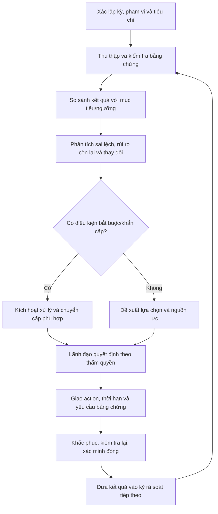

# Rà soát quản trị trong Security Assurance

## 1. Rà soát quản trị là gì và nhằm quyết định điều gì?

**Rà soát quản trị (management review)** là hoạt động có tổ chức, trong đó cấp quản lý có thẩm quyền xem xét **mức phù hợp, mức đầy đủ và hiệu lực** của cơ chế quản trị bảo mật dựa trên bằng chứng, rồi đưa ra những quyết định cụ thể về rủi ro, mục tiêu, nguồn lực, ưu tiên và cải tiến. Rà soát không chỉ là một cuộc họp nghe báo cáo tình hình: đầu ra của nó phải làm rõ *điều gì cần thay đổi, ai chịu trách nhiệm, thời hạn nào, bằng chứng nào chứng minh đã xử lý*.

Trong chương **Quản trị bảo mật**, rà soát quản trị là điểm nối giữa định hướng của lãnh đạo và thực tế kỹ thuật/vận hành. Với module **SECURITY_SECURITY_ASSURANCE**, hoạt động này là một phần quan trọng của việc **đánh giá có bằng chứng rằng hệ thống đáp ứng mục tiêu bảo mật**: từ phân tích rủi ro, xác lập yêu cầu và security controls, đến kiểm thử, audit, phát hiện sai lệch, khắc phục và đánh giá lại liên tục trong phát triển và vận hành.

Ví dụ, báo cáo cho biết 94% các API nhạy cảm đã có kiểm thử phân quyền. Cấp quản lý không nên chỉ ghi nhận “94% là tốt”. Họ cần biết **6% còn lại là endpoint nào, bảo vệ dữ liệu gì, rủi ro ra sao, ai có thể khắc phục, hệ thống có đủ điều kiện phát hành hay không**. Rà soát quản trị biến số liệu kỹ thuật thành quyết định chịu trách nhiệm.

Sau bài này, người học có thể:

1. Phân biệt rà soát quản trị với đánh giá rủi ro, kiểm thử, audit, vận hành hằng ngày và giám sát lãnh đạo.
2. Chuẩn bị đầu vào đáng tin cậy cho một phiên rà soát: mục tiêu, rủi ro, kiểm soát, kết quả kiểm thử/audit, nghĩa vụ, sự cố, biến động và hành động kỳ trước.
3. Thiết kế lịch, phạm vi, thành phần tham gia, tiêu chí đánh giá và quyền quyết định phù hợp với loại hệ thống.
4. Lập biên bản và sổ theo dõi quyết định có liên kết đến bằng chứng, người phụ trách, hạn hoàn thành, trạng thái kiểm chứng và rủi ro còn lại.
5. Theo dõi hiệu quả của chính quá trình rà soát để duy trì chương trình security assurance liên tục.

## 2. Vai trò và ranh giới của hoạt động rà soát

### 2.1. Phân biệt các hoạt động dễ bị nhầm lẫn

| Hoạt động | Câu hỏi chính | Người thực hiện thường gặp | Đầu ra điển hình |
| --- | --- | --- | --- |
| **Kiểm thử bảo mật** | Một yêu cầu/kiểm soát cụ thể có hoạt động đúng trong trường hợp đã kiểm tra không? | QA, kỹ sư, security testing | Kết quả pass/fail, bằng chứng tái hiện, test report. |
| **Kiểm toán (audit)** | Hoạt động và kiểm soát có phù hợp với tiêu chí được xác định không? | Kiểm toán nội bộ/độc lập theo phạm vi | Phát hiện, sự không phù hợp, kiến nghị, kết luận có giới hạn phạm vi. |
| **Đánh giá rủi ro** | Kịch bản nào có thể gây hại, tác động và khả năng ra sao? | Chủ sở hữu rủi ro cùng security và nghiệp vụ | Risk register, mức rủi ro, phương án xử lý. |
| **Giám sát vận hành** | Điều kiện hệ thống, tín hiệu bất thường và sự cố hiện tại là gì? | SRE, SOC, nhóm vận hành | Cảnh báo, incident, số liệu dịch vụ, hoạt động ứng phó. |
| **Rà soát quản trị** | Với các bằng chứng trên, mục tiêu và chương trình bảo mật có còn phù hợp, đủ và hiệu quả; cần quyết định gì? | Lãnh đạo có thẩm quyền, chủ sở hữu hệ thống/rủi ro, chức năng bảo mật | Quyết định, phân bổ nguồn lực, thay đổi ưu tiên, chấp nhận/xử lý rủi ro, hành động và thời hạn. |
| **Giám sát cấp cao** | Khẩu vị rủi ro và định hướng có còn phù hợp với chiến lược và trách nhiệm tổ chức? | Ban điều hành, hội đồng hoặc cấp giám sát theo cơ cấu | Chỉ đạo, giới hạn, trách nhiệm giải trình và giám sát thực hiện. |

Một phiên rà soát quản trị có thể sử dụng kết quả audit và kiểm thử làm đầu vào; nó **không thay thế** việc thực hiện audit/kiểm thử. Việc lãnh đạo phê duyệt một báo cáo cũng **không tự chứng minh** rằng các kiểm soát đã hoạt động hiệu quả.

### 2.2. Ba câu hỏi cốt lõi

1. **Phù hợp (suitability):** Mục tiêu, chính sách, phạm vi và mức chấp nhận rủi ro hiện tại có phù hợp với hoạt động kinh doanh, nghĩa vụ và môi trường đe dọa không?
2. **Đầy đủ (adequacy):** Tổ chức đã có đủ chính sách, cơ chế kiểm soát, vai trò, kỹ năng, nguồn lực và phạm vi bao phủ cần thiết chưa? Có tài sản hoặc kênh dữ liệu nào bị bỏ sót?
3. **Hiệu lực (effectiveness):** Kiểm soát thực tế có đạt kết quả mong đợi, theo bằng chứng kiểm thử, audit, diễn tập, vận hành và kết quả khắc phục hay không?

**Hiệu lực không đồng nhất với việc “đã triển khai”**. Chẳng hạn, có backup không chứng minh khả năng khôi phục; có chính sách phân quyền không chứng minh API ngăn được truy cập chéo tenant; đã có khóa đào tạo không chứng minh nhân viên đang thực hiện đúng quy trình.

## 3. Thiết kế cơ chế rà soát quản trị

### 3.1. Xác lập phạm vi và cấp quyết định

Một phiên rà soát cần nêu rõ:

- **Đối tượng:** toàn bộ hệ thống quản lý bảo mật, một đơn vị kinh doanh, một sản phẩm, một chương trình hoặc một nhóm rủi ro.
- **Kỳ đánh giá:** dữ liệu và sự kiện từ thời điểm nào đến thời điểm nào; thời điểm khóa số liệu.
- **Môi trường:** sản xuất, thử nghiệm, cloud, dịch vụ đối tác và đường dữ liệu liên quan.
- **Tiêu chí:** mục tiêu bảo mật, ngưỡng rủi ro, nghĩa vụ bắt buộc, cam kết SLA, yêu cầu hệ thống và các quyết định đã được phê duyệt.
- **Quyền quyết định:** ai có quyền duyệt nguồn lực, điều chỉnh chính sách, chấp nhận rủi ro, hạn chế hoặc dừng hoạt động, chuyển cấp khi vượt thẩm quyền.

Không nhất thiết mọi nhóm đều tổ chức họp giống nhau. Rà soát cấp sản phẩm có thể tập trung vào backlog kiểm soát, chấp nhận phát hành và nợ bảo mật; rà soát cấp doanh nghiệp có thể tập trung vào xu hướng rủi ro, hiệu quả đầu tư, năng lực ứng phó và thay đổi chính sách.

### 3.2. Chu kỳ và cơ chế kích hoạt

Tổ chức tự xác lập tần suất theo mức rủi ro, quy mô, tốc độ thay đổi và các nghĩa vụ áp dụng. Một ví dụ vận hành:

| Loại rà soát | Tần suất minh họa | Mục đích |
| --- | --- | --- |
| Rà soát hoạt động | Hằng tuần hoặc hằng tháng | Theo dõi phát hiện trọng yếu, hành động quá hạn, biến động cấu hình và quyết định sắp đến hạn. |
| Rà soát quản trị định kỳ | Hằng quý | Đánh giá xu hướng, mức đạt mục tiêu, rủi ro còn lại và nhu cầu nguồn lực. |
| Rà soát chiến lược | Hằng năm hoặc theo chu kỳ chiến lược | Xem lại phạm vi, mục tiêu, khẩu vị rủi ro, chính sách và năng lực chương trình. |
| Rà soát bất thường | Sau sự kiện tác động lớn | Quyết định khi có sự cố nghiêm trọng, audit không đạt, thay đổi dịch vụ, quy định hoặc nhà cung cấp. |

Đây là lịch **tham khảo**, không phải tần suất bắt buộc cho mọi tổ chức. Quan trọng là quy tắc **khi nào phải rà soát lại ngay**: ví dụ phát hiện rò rỉ dữ liệu, kiểm thử khôi phục thất bại, rủi ro mới vượt ngưỡng, hoặc thay đổi lớn phạm vi xử lý dữ liệu.

### 3.3. Vai trò và trách nhiệm

| Vai trò | Trách nhiệm chính khi rà soát |
| --- | --- |
| **Người chủ trì có thẩm quyền** (ví dụ lãnh đạo khối/sản phẩm) | Xác nhận mục tiêu phiên họp, ra quyết định thuộc thẩm quyền, điều phối nguồn lực, yêu cầu giải trình. |
| **Chủ sở hữu rủi ro** | Giải thích tác động nghiệp vụ, đề xuất cách xử lý/chấp nhận rủi ro, chịu trách nhiệm quyết định được giao. |
| **Đại diện security/GRC** | Xây dựng khung đánh giá, tổng hợp risk register, đối chiếu yêu cầu và bằng chứng, theo dõi ngoại lệ. |
| **Chủ sở hữu dịch vụ/engineering** | Giải thích kiến trúc, hiệu lực kiểm soát, khả năng khắc phục và ảnh hưởng vận hành. |
| **SOC/SRE/vận hành** | Cung cấp bằng chứng sự cố, cảnh báo, gián đoạn, diễn tập, số liệu giám sát có nguồn gốc. |
| **Kiểm toán/chức năng đánh giá độc lập khi phù hợp** | Cung cấp phát hiện và xác minh theo nhiệm vụ; giữ tính độc lập của kết luận đánh giá. |
| **Pháp chế, tuân thủ, quyền riêng tư và mua sắm** | Xác định nghĩa vụ, hạn chế chấp nhận rủi ro và vấn đề hợp đồng/đối tác. |
| **Thư ký/người quản lý quyết định** | Ghi biên bản, mã quyết định, chủ sở hữu hành động, hạn, liên kết bằng chứng và trạng thái. |

Một người có thể đảm nhiệm nhiều vai trò trong đội nhỏ, nhưng không được vì vậy mà bỏ qua việc phân định **người đề xuất, người phê duyệt và người xác minh** ở các quyết định quan trọng. Với phát hiện nghiêm trọng, nên có sự đánh giá đủ độc lập để tránh tình trạng người sửa lỗi tự tuyên bố đã khắc phục thành công mà không có kiểm chứng.

## 4. Đầu vào bắt buộc nên chuẩn bị

Nội dung đầu vào phải trả lời được “trong kỳ này điều gì đã thay đổi và bằng chứng ở đâu?”.

| Nhóm đầu vào | Nội dung cần xem | Ví dụ bằng chứng và điểm cần kiểm tra |
| --- | --- | --- |
| **Kết quả kỳ trước** | Quyết định cũ, action còn mở, quá hạn, hiệu quả hành động đã hoàn thành | Sổ quyết định, ticket, kết quả retest. |
| **Thay đổi bối cảnh** | Kinh doanh, hệ thống, tenant, nhà cung cấp, pháp lý, mối đe dọa | Sơ đồ luồng dữ liệu mới, change log, quyết định tích hợp, rà soát nghĩa vụ. |
| **Mục tiêu và hiệu năng bảo mật** | Mức đạt các chỉ tiêu, xu hướng và nguyên nhân lệch mục tiêu | Scorecard có định nghĩa, nguồn dữ liệu, phạm vi và so sánh kỳ trước. |
| **Rủi ro và ngoại lệ** | Rủi ro mới, thay đổi mức độ, phần rủi ro còn lại, ngoại lệ sắp hết hạn | Risk register có chủ sở hữu, đánh giá gần nhất và quyết định chấp nhận. |
| **Kiểm soát và kiểm chứng** | Mức bao phủ kiểm soát, kiểm thử an toàn, tình trạng cấu hình, evidence còn hiệu lực | Test report theo build, kiểm tra IAM/KMS/backup, kết quả diễn tập. |
| **Audit và đánh giá bên ngoài** | Phát hiện, không phù hợp, kiến nghị, phạm vi chưa được đánh giá | Audit report và bằng chứng đóng phát hiện, chỉ rõ giới hạn audit. |
| **Sự cố, gần-sự-cố và bất thường** | Tần suất, mức thiệt hại, đường lộ lọt, phản ứng, bài học rút ra | Incident record, timeline, postmortem, bằng chứng cải tiến. |
| **Nhà cung cấp và phụ thuộc** | Dịch vụ bên ngoài, rủi ro thứ ba, thay đổi hợp đồng và bảo đảm nhà cung cấp | Kết quả đánh giá nhà cung cấp, SLA, báo cáo sự cố, kế hoạch thay thế. |
| **Nguồn lực và năng lực** | Nhân sự, ngân sách, công cụ, kỹ năng, thời gian xử lý phát hiện | Backlog, xu hướng quá hạn, năng lực ứng cứu, kế hoạch đầu tư. |
| **Phản hồi của bên liên quan** | Vấn đề do khách hàng, đối tác, kiểm toán, nhân viên hoặc cơ quan liên quan nêu | Ticket, phản hồi, kết quả điều tra và trạng thái xử lý. |

Không cần sao chép toàn bộ hồ sơ nhạy cảm vào tài liệu phiên họp. Ưu tiên **mã tham chiếu, kết quả tổng hợp, bản đã che dữ liệu** và đường dẫn đến kho bằng chứng có kiểm soát truy cập.

### 4.1. Định nghĩa dữ liệu chỉ số trước khi đưa lên dashboard

Các chỉ số cần có **định nghĩa, tử số, mẫu số, chủ sở hữu, nguồn và thời điểm đo**. Ví dụ:

| Chỉ số minh họa | Cách tính | Cạm bẫy |
| --- | --- | --- |
| Độ bao phủ test phân quyền API nhạy cảm | API nhạy cảm có ca test yêu cầu trong kỳ / tổng API nhạy cảm thuộc phạm vi | API không kiểm kê có thể làm mẫu số nhỏ giả tạo. |
| Tỷ lệ phát hiện nghiêm trọng quá hạn | Số phát hiện nghiêm trọng còn mở quá hạn / tổng phát hiện nghiêm trọng còn mở | Có thể “đẹp lên” nếu đổi phân loại, đóng ticket trước retest. |
| Tỷ lệ yêu cầu kiểm soát có bằng chứng hợp lệ | Số yêu cầu có evidence còn hiệu lực và đúng môi trường / tổng yêu cầu phải xác minh | Có tài liệu thiết kế không đồng nghĩa bằng chứng hành vi. |
| Tỷ lệ diễn tập khôi phục đạt | Số lần diễn tập đạt tiêu chí phê duyệt / số lần diễn tập thực hiện | Nếu không thử đường khôi phục quan trọng thì kết quả gây hiểu lầm. |
| Tỷ lệ action kỳ trước đã xác minh đóng | Action có retest/evidence đóng được chấp nhận / action đến hạn | “Đã sửa trong code” chưa chứng minh hiệu lực ở production. |

Ví dụ: **47/50 API = 94%** bao phủ kiểm thử. Nếu ba API chưa kiểm thử bao gồm chức năng xuất toàn bộ dữ liệu khách hàng, đánh giá rủi ro có thể vẫn ở mức rất cao. Cấp quản lý phải xem cả **mẫu số, vùng bị bỏ sót và hậu quả của phần còn thiếu**.

Đối với số liệu xu hướng, cần lưu phạm vi so sánh: tỷ lệ giảm có thể đến từ một endpoint mới chưa được kiểm kê, hoặc do thay đổi cách định nghĩa “đã kiểm thử”. Khi dữ liệu thiếu, ghi “chưa đủ bằng chứng” thay cho kết luận “đạt”.

### 4.2. Đánh giá chất lượng bằng chứng

Bằng chứng đưa vào phiên rà soát cần có thể trả lời:

1. **Nguồn gốc:** Ai tạo, hệ thống nào phát sinh, thu thập theo cách nào?
2. **Phạm vi:** Môi trường, tenant, phiên bản, kênh dữ liệu, điều kiện test nào được bao phủ?
3. **Thời điểm:** Dữ liệu có còn phản ánh tình trạng hiện tại không?
4. **Tính toàn vẹn:** Có cơ chế hạn chế sửa/xóa, lưu lịch sử và truy xuất lại không?
5. **Tính độc lập:** Có kiểm tra chéo hoặc thẩm tra đối với điểm rủi ro quan trọng không?
6. **Tính an toàn:** Bằng chứng có vô tình làm lộ mật khẩu, khóa, token, thông tin cá nhân không?

Một báo cáo “zero findings” không có ý nghĩa nếu phạm vi audit quá hẹp. Một báo cáo test pass trên staging cũng chưa đương nhiên phản ánh cấu hình production. **Đánh giá tính phù hợp của bằng chứng là bước bắt buộc trước khi ra quyết định**.

## 5. Quy trình thực hiện một phiên rà soát



### 5.1. Trước phiên họp: chuẩn bị quyết định, không chỉ slide

- Công bố phạm vi, tiêu chí và kỳ dữ liệu; xác nhận danh sách chủ sở hữu phải tham gia.
- Đối chiếu risk register với các tài sản/dịch vụ thực tế, tránh bỏ sót thay đổi gần đây.
- Chuẩn bị scorecard có nguồn, xu hướng và giới hạn chất lượng; gắn link bằng chứng cho mọi kết luận trọng yếu.
- Nhận diện **điểm cần quyết định**: rủi ro vượt ngưỡng, action quá hạn, phát hiện chưa khắc phục, nguồn lực thiếu, ngoại lệ cần phê duyệt.
- Đưa trước cho người có thẩm quyền các phương án và hệ quả: khắc phục ngay, giảm phơi nhiễm, bổ sung kiểm soát tạm thời, hoãn phát hành, tăng ngân sách hoặc chấp nhận rủi ro trong phạm vi được phép.
- Với sự cố đang diễn ra, kích hoạt quy trình ứng phó kịp thời; không trì hoãn hành động khẩn cấp chỉ để chờ cuộc họp định kỳ.

**Mẫu một dòng đề xuất:**

| Mục | Minh họa |
| --- | --- |
| Vấn đề | Xuất CSV toàn tenant chưa được kiểm thử chéo tenant. |
| Tài sản/mục tiêu | Dữ liệu khách hàng, tính bí mật. |
| Rủi ro | Có thể lộ dữ liệu qua API xuất; mức hiện tại cao, chưa đủ bằng chứng kiểm soát. |
| Phương án A | Tạm khóa xuất CSV đến khi hoàn thành kiểm soát và test; ảnh hưởng hoạt động báo cáo. |
| Phương án B | Giới hạn tính năng ở một nhóm đã được kiểm soát; thêm giám sát và thời hạn sửa. |
| Kiến nghị | Chọn theo đánh giá rủi ro, nghĩa vụ và khả năng giảm phơi nhiễm; quyết định bởi người có thẩm quyền. |
| Điều kiện hoàn tất | Test phân quyền âm đạt ở đúng phiên bản triển khai; evidence review được lưu. |

### 5.2. Trong phiên họp: tập trung vào sai lệch và quyết định

Một agenda minh họa:

1. Xác nhận phạm vi, những thay đổi đáng kể kể từ kỳ trước và tình trạng action cũ.
2. Đối chiếu mục tiêu bảo mật, khẩu vị rủi ro, nghĩa vụ và xu hướng chỉ số.
3. Xem các kịch bản rủi ro/vấn đề mới, phát hiện từ kiểm thử, audit và sự cố.
4. Xác minh mức hiệu lực của kiểm soát và nêu rõ **điểm chưa đủ bằng chứng**.
5. Thảo luận phương án xử lý, chi phí/tác động và rủi ro còn lại.
6. Ra quyết định theo thẩm quyền, xác định người thực hiện, người kiểm chứng, hạn và điều kiện hoàn tất.
7. Ghi các vấn đề không đạt đồng thuận và yêu cầu chuyển cấp.

Người chủ trì cần chủ động hỏi “Bằng chứng nào khiến chúng ta tin kết luận này?”, “Nếu giả định sai thì hậu quả là gì?”, “Ai có quyền chấp nhận rủi ro này?” và “Làm sao kỳ sau biết hành động có tác dụng?”.

### 5.3. Sau phiên họp: biến quyết định thành hành động theo dõi được

Kết quả tối thiểu nên gồm:

- **Quyết định:** duy trì hay cập nhật chính sách, mục tiêu, kiểm soát, ngưỡng, phạm vi và tiêu chí chấp nhận.
- **Rủi ro:** chấp nhận trong thẩm quyền hoặc yêu cầu xử lý; phê duyệt ngoại lệ có thời hạn và điều kiện giám sát nếu được phép.
- **Nguồn lực:** thay đổi ưu tiên, năng lực nhân sự/công cụ, đầu tư và phụ thuộc.
- **Hành động khắc phục/cải tiến:** mô tả rõ nguyên nhân hoặc vấn đề, người chịu trách nhiệm, deadline, tiêu chí kiểm tra lại.
- **Lịch theo dõi:** mốc cập nhật tiến độ, điều kiện chuyển cấp và kỳ rà soát tiếp theo.

Mỗi action phải xuất hiện trong hệ thống theo dõi có quản lý phiên bản. Không nên đánh dấu “đã đóng” chỉ vì người thực hiện báo hoàn thành; cần bằng chứng hoạt động và người xác minh phù hợp.

## 6. Ra quyết định có trách nhiệm và quản lý rủi ro còn lại

### 6.1. Chọn hành động xử lý rủi ro

Khi phát hiện mục tiêu bảo mật không đạt, những hướng thường gặp là:

| Quyết định | Khi nào cân nhắc | Yêu cầu chứng minh |
| --- | --- | --- |
| **Giảm rủi ro** | Có thể tăng cường kiểm soát hoặc sửa nguyên nhân | Kế hoạch sửa, biện pháp tạm thời, test/đánh giá lại theo tiêu chí. |
| **Tránh rủi ro** | Dừng hoặc giới hạn hoạt động gây rủi ro quá mức | Bằng chứng giảm phạm vi phơi nhiễm; tác động vận hành và kế hoạch khôi phục hoạt động. |
| **Chia sẻ/chuyển giao một phần rủi ro** | Hợp đồng, bảo hiểm hoặc nhà cung cấp có thể gánh một phần hậu quả | Điều khoản và năng lực thực tế; vẫn làm rõ trách nhiệm còn lại của tổ chức. |
| **Chấp nhận rủi ro còn lại** | Rủi ro nằm trong giới hạn cho phép và không trái nghĩa vụ bắt buộc | Chủ sở hữu, thẩm quyền, căn cứ, thời hạn, giám sát và trigger rà soát. |

Không thể “chấp nhận rủi ro” để hợp thức hóa việc cố ý bỏ một nghĩa vụ pháp lý hoặc hợp đồng đang áp dụng. Nếu một quyết định vượt thẩm quyền, phải được **chuyển cấp** thay vì ghi nhận phê duyệt mặc định.

### 6.2. Phân biệt khắc phục, xác minh và đóng phát hiện

Ví dụ phát hiện: API cho phép người thuộc tenant A truy cập file thuộc tenant B.

- **Khắc phục kỹ thuật:** bổ sung kiểm tra ownership ở backend, rà soát mọi endpoint tương tự và đường dẫn tải file.
- **Xác minh:** test bằng hai tenant với dữ liệu giả định; test endpoint chi tiết/danh sách/xuất; xác nhận response không rò rỉ dữ liệu, bằng chứng gắn build triển khai.
- **Đánh giá rủi ro còn lại:** xem tài khoản dịch vụ, cache, URL chia sẻ và đường vận hành có còn nguy cơ lộ lọt không.
- **Đóng phát hiện:** người được giao xác minh chấp thuận bằng chứng, cập nhật trạng thái và kỳ rà soát theo dõi kết quả.

Đóng ticket sau khi merge code là **bước quản lý công việc**, không tương đương bằng chứng lỗi đã hết. Nếu bằng chứng chưa đủ, trạng thái phù hợp là “đang chờ xác minh” hoặc “chưa đạt điều kiện đóng”.

### 6.3. Cách xử lý khác biệt ý kiến

Đội vận hành có thể muốn phát hành đúng hạn, security muốn hoãn vì test chưa đủ, kinh doanh lo ngại tổn thất do gián đoạn. Cơ chế rà soát tốt phải ghi rõ các lựa chọn, tác động và bằng chứng của từng bên; quyết định cuối cùng thuộc **vai trò có thẩm quyền theo chính sách**, với nghĩa vụ chuyển cấp nếu vượt ngưỡng. Các bất đồng quan trọng nên được ghi nhận để người đánh giá sau hiểu được bối cảnh.

## 7. Ví dụ thực hành: rà soát quản trị một nền tảng SaaS

Giả sử tổ chức vận hành một **nền tảng SaaS quản lý đơn hàng đa tenant**. Dữ liệu gồm hồ sơ khách hàng, đơn hàng, phiếu giao hàng, bản xuất CSV và bản backup. Quý này hệ thống bổ sung chức năng xuất dữ liệu và tích hợp đối tác logistics.

Mục tiêu bảo mật trong phạm vi rà soát:

- **Bí mật:** khách hàng tenant A không xem được dữ liệu tenant B.
- **Toàn vẹn:** chỉ chủ thể có quyền mới được điều chỉnh địa chỉ giao hàng, trạng thái và số tiền đơn.
- **Sẵn sàng:** tiến trình xử lý đơn có mục tiêu khôi phục được phê duyệt từ yêu cầu nghiệp vụ.
- **Truy vết:** những thay đổi quan trọng có dấu vết đủ điều tra, không làm lộ bí mật trong log.

### 7.1. Scorecard kỳ này (số liệu minh họa)

| Chỉ báo | Mục tiêu kỳ này | Quan sát | Đánh giá và câu hỏi quản trị |
| --- | --- | --- | --- |
| API dữ liệu nhạy cảm có test phân quyền âm | 100% trong phạm vi kiểm kê | **47/50 = 94%** | Chưa đạt; ba API thiếu test gồm đường xuất mới, cần xác định rủi ro thực tế. |
| Phát hiện nghiêm trọng quá hạn | 0 | **2** | Chưa đạt; cần chủ sở hữu, mức ảnh hưởng và kế hoạch giảm phơi nhiễm. |
| Bài diễn tập khôi phục đạt mục tiêu đã phê duyệt | Tất cả bài diễn tập theo kế hoạch đạt | **1/2 đạt** | Chưa đạt; cần phân tích lần thất bại, xác định ảnh hưởng tới khả năng xử lý đơn. |
| Hành động kỳ trước đã được xác minh đóng | 100% action đến hạn | **7/10** | Chưa đạt; ba action cần làm rõ nguyên nhân và thời hạn. |
| Trường dữ liệu nhạy cảm trong log được rà soát | Toàn bộ các nguồn log thuộc phạm vi kỳ | **Có một luồng log mới chưa đánh giá** | Chưa đủ bằng chứng để kết luận không lộ dữ liệu. |

Điểm quan trọng: đây là **đầu vào cho việc ra quyết định**, không phải chỉ một báo cáo số đẹp/xấu. Mức độ rủi ro của ba API chưa test cần được đánh giá theo dữ liệu và khả năng khai thác. Một lần diễn tập khôi phục thất bại có thể quan trọng hơn nhiều lần thử đạt nếu đó là con đường phục hồi duy nhất cho dịch vụ quan trọng.

### 7.2. Quyết định được ghi nhận

Sau khi xem báo cáo kỹ thuật, thông tin rủi ro và nghĩa vụ hợp đồng, lãnh đạo có thẩm quyền đưa ra các **quyết định minh họa**:

| Mã | Quyết định | Chủ sở hữu hành động | Bằng chứng hoàn tất |
| --- | --- | --- | --- |
| GOV-001 | Giới hạn chức năng xuất CSV mới cho đến khi kiểm tra quyền truy cập xuyên tenant và dữ liệu theo trường đạt. | Product owner và backend lead | Ca test âm trên API export/list/detail, báo cáo retest ở bản phát hành. |
| GOV-002 | Ưu tiên xử lý hai phát hiện nghiêm trọng quá hạn, lập biện pháp giảm phơi nhiễm tức thời cho từng phát hiện. | Chủ sở hữu rủi ro và security lead | Ticket nêu mức độ, fix, bản triển khai, bằng chứng kiểm chứng độc lập. |
| GOV-003 | Phân tích nguyên nhân diễn tập restore thất bại; sửa và tổ chức diễn tập lại theo tiêu chí được duyệt. | SRE lead | Báo cáo restore thử thực tế, thời gian đo và mức mất dữ liệu quan sát. |
| GOV-004 | Rà soát log của luồng tích hợp logistics, loại bỏ dữ liệu nhạy cảm không cần thiết và hạn chế quyền đọc log. | Engineering lead/SOC | Kết quả test dữ liệu dấu mốc, cấu hình lọc/redaction và quyền log. |
| GOV-005 | Báo cáo tiến độ ba action cũ quá hạn tại phiên theo dõi gần nhất; chuyển cấp nếu không có kế hoạch xử lý khả thi. | Security governance lead | Biên bản cập nhật, quyết định về nguồn lực và kết quả xác minh đóng. |

Với mỗi quyết định thực tế cần bổ sung **ngày chốt, deadline, người phê duyệt, điều kiện chuyển cấp, trạng thái và nơi lưu bằng chứng**. Bảng ví dụ lược bỏ các trường này để tập trung vào logic quyết định.

### 7.3. Mẫu biên bản rà soát có thể truy vết

Đây là mẫu cấu trúc nội dung; các tên và giá trị chỉ mang tính minh họa:

```yaml
review_id: GOV-REVIEW-2026-Q4
scope: "SaaS quản lý đơn hàng - môi trường production"
period: "Quý IV/2026"
chair_role: "Lãnh đạo đơn vị có thẩm quyền"
participants_roles:
  - "Chủ sở hữu rủi ro"
  - "Security/GRC"
  - "Engineering"
  - "Vận hành"
evidence_refs:
  - "REPORT-AUTH-TEST-2026-Q4"
  - "REPORT-RESTORE-2026-Q4"
  - "RISK-REGISTER-Q4"
decisions:
  - id: GOV-001
    finding: "API export chưa có bằng chứng kiểm thử truy cập xuyên tenant"
    risk_ref: R-CROSS-TENANT-01
    decision: "Giới hạn chức năng và kiểm thử lại trước mở rộng"
    action_owner_role: "Product owner và backend lead"
    verifier_role: "Security testing"
    due_date: "Theo thời hạn được phê duyệt tại phiên họp"
    acceptance_criteria: "Test âm đạt với các vai trò và tenant thuộc phạm vi"
    evidence_required: "Test report gắn commit/build và môi trường"
    status: "Open"
next_review_trigger: "Kết quả retest, phát hiện nghiêm trọng mới hoặc kỳ rà soát kế tiếp"
```

Trong hệ thống thực, biên bản nên gắn **người phê duyệt thực tế**, chữ ký/xác nhận thích hợp và quyền truy cập theo độ nhạy cảm. Đường dẫn bằng chứng phải truy xuất được, nhưng không nên tự chép token, khóa sản xuất hoặc dữ liệu khách hàng vào biên bản.

## 8. Giữ bằng chứng và quyết định đủ tin cậy để kiểm toán lại

Một sổ quyết định chất lượng cần thể hiện mối liên kết:

**Mục tiêu bảo mật → Rủi ro → Yêu cầu → Kiểm soát → Kết quả kiểm thử/audit → Nhận định quản trị → Quyết định → Hành động → Xác minh đóng → Rà soát lại.**

Ví dụ:

| Trường hồ sơ | Câu hỏi giúp kiểm tra |
| --- | --- |
| Mục tiêu và tiêu chí | Tại sao việc này quan trọng; thành công đo bằng gì? |
| Phạm vi và mức rủi ro | Dịch vụ, tenant, dữ liệu và hậu quả nào được xét? |
| Bằng chứng | Báo cáo nào, phiên bản nào, khoảng thời gian nào, nguồn có đáng tin cậy không? |
| Khoảng trống | Điều gì không đạt; điều gì chưa được thử hoặc chưa được xác minh? |
| Quyết định và lý do | Ai có thẩm quyền, lựa chọn nào được cân nhắc, vì sao chấp thuận? |
| Hành động | Ai thực hiện, hạn, ưu tiên, phụ thuộc, biện pháp tạm thời? |
| Kiểm chứng | Ai kiểm tra lại, trong môi trường nào, kết quả có đạt điều kiện đóng không? |
| Rủi ro còn lại | Có phần nào chưa khắc phục, được giám sát và rà soát khi nào? |

### 8.1. Bảo vệ dữ liệu trong hồ sơ rà soát

Rà soát quản trị có thể tạo ra tài liệu nhạy cảm: danh sách lỗ hổng nghiêm trọng, mô tả đường tấn công, sơ đồ hệ thống, tài khoản đặc quyền và thông tin khách hàng bị ảnh hưởng. Do đó:

- Phân loại tài liệu và hạn chế quyền xem theo nhu cầu công việc.
- Dùng tham chiếu đến kho bằng chứng được quản lý quyền thay vì đính kèm dữ liệu gốc khắp nơi.
- Làm mờ/ẩn dữ liệu cá nhân, bí mật và thông tin khai thác không cần thiết trong dashboard, biên bản và bản phổ biến cho nhiều đối tượng.
- Lưu lịch sử sửa đổi, quyết định/phê duyệt và trạng thái; bảo đảm hồ sơ vẫn truy xuất được trong thời hạn lưu theo chính sách.
- Kiểm soát việc chia sẻ với bên thứ ba, bên kiểm toán và nhà cung cấp theo nghĩa vụ áp dụng.

Việc có evidence đầy đủ không có nghĩa phải mở rộng quyền đọc evidence cho mọi người dự họp. Có thể chia sẻ **kết quả được xác minh và tham chiếu**, còn dữ liệu gốc giữ tại nơi có quyền truy cập giới hạn.

### 8.2. Tính đầy đủ của hồ sơ

Nếu kết luận “đạt”, nên lưu cả **tiêu chí đạt, bằng chứng và giới hạn phạm vi**. Nếu kết luận “không đạt”, cần có độ nghiêm trọng, phương án xử lý và điểm kiểm tra lại. Nếu kết luận “chưa đủ bằng chứng”, bắt buộc ghi rõ hoạt động thu thập và người phụ trách, không biến im lặng thành mặc định đạt.

## 9. Đo hiệu quả của chính quy trình rà soát

Chương trình assurance cần thường xuyên đánh giá *quy trình rà soát có thực sự giúp quản trị rủi ro tốt hơn hay không*. Một số thước đo khả dụng:

| Góc nhìn | Chỉ số gợi ý | Cách diễn giải |
| --- | --- | --- |
| **Khả năng ra quyết định** | Tỷ lệ vấn đề trọng yếu được đưa đến đúng người có thẩm quyền trong kỳ | Thấp có thể nghĩa là rủi ro không được chuyển cấp kịp thời. |
| **Chất lượng bằng chứng** | Tỷ lệ kết luận có evidence đúng phiên bản, môi trường, thời điểm | Báo cáo nhiều số liệu nhưng thiếu nguồn là yếu. |
| **Khả năng hoàn tất** | Tỷ lệ action đến hạn có bằng chứng xác minh đóng | Không tính chỉ số “đã merge” như hoàn thành assurance. |
| **Hiệu lực khắc phục** | Tỷ lệ phát hiện tái diễn trên cùng nguyên nhân hoặc kiểm soát | Tăng có thể báo hiệu sửa triệu chứng, chưa sửa nguyên nhân gốc. |
| **Tính kịp thời** | Thời gian từ phát hiện nghiêm trọng đến quyết định có thẩm quyền | Thời gian dài có thể làm kéo dài phơi nhiễm. |
| **Mức phù hợp** | Tỷ lệ thay đổi lớn được đánh giá lại trước khi vận hành | Thiếu rà soát có thể khiến chính sách/bằng chứng cũ không còn đúng. |

Chỉ số cần được diễn giải có ngữ cảnh. Ví dụ số lượng phát hiện tăng sau khi mở rộng kiểm thử **có thể là tín hiệu năng lực phát hiện tốt hơn**, chưa đủ để kết luận tình trạng bảo mật xấu đi. Cũng không nên giảm số lượng phát hiện bằng cách hạ mức độ nghiêm trọng hoặc ngừng ghi nhận lỗi.

### 9.1. Các thất bại thường gặp

| Sai lầm | Hậu quả | Cách cải thiện |
| --- | --- | --- |
| Phiên họp chỉ đọc dashboard, không chốt quyết định | Không thay đổi được rủi ro thực tế | Yêu cầu mỗi vấn đề có phương án, người quyết định và action. |
| Chỉ báo “xanh” nhưng không có mẫu số hoặc phạm vi | Che khuất endpoint/tài sản chưa kiểm kê | Gắn nguồn, phạm vi, ngày chốt, vùng thiếu bằng chứng. |
| Tự đánh giá “đạt” dựa trên triển khai control | Không chứng minh hiệu lực vận hành | Dùng test, diễn tập và audit phù hợp; kiểm tra độc lập khi cần. |
| Chấp nhận rủi ro vô thời hạn | Ngoại lệ tồn tại không kiểm soát | Có thẩm quyền, thời hạn, điều kiện và trigger tái đánh giá. |
| Action không có người kiểm chứng | Sửa lỗi nhưng không biết đã hết lỗi hay chưa | Phân vai thực hiện và xác minh, định nghĩa tiêu chí đóng. |
| Đợi đến họp định kỳ mới xử lý sự cố | Phơi nhiễm và thiệt hại tăng | Kích hoạt quy trình sự cố/chuyển cấp theo ngưỡng ngay khi cần. |
| Biên bản chứa dữ liệu nhạy cảm thật | Cuộc họp hoặc kho tài liệu thành kênh rò rỉ | Chia sẻ phần tổng hợp, che dữ liệu, kiểm soát quyền evidence. |
| Không cập nhật risk register sau quyết định | Kỳ sau thiếu lịch sử và giả định | Liên kết mã quyết định, phiên bản rủi ro, trạng thái action. |

## 10. Tình huống luyện tập

Một công ty vận hành cổng đặt lịch khám có dữ liệu cá nhân và lịch hẹn. Trong quý gần nhất, đội kỹ thuật đưa vào hệ thống công cụ phân tích hành vi người dùng, mở endpoint xuất dữ liệu cho đối tác và chuyển dịch vụ sao lưu sang nhà cung cấp mới. Ba phát hiện đang mở: endpoint export chưa kiểm thử quyền theo đối tượng, thử khôi phục backup một lần thất bại, và nhật ký của công cụ phân tích có chứa dữ liệu nhạy cảm thử nghiệm.

Ban điều hành yêu cầu tổ chức **rà soát quản trị** để quyết định có thể tiếp tục mở rộng dịch vụ theo kế hoạch không.

**Nhiệm vụ:**

1. Xác định phạm vi, thành phần cần tham gia, chủ sở hữu rủi ro và người có thẩm quyền quyết định; giải thích trường hợp phải chuyển cấp.
2. Lập một bảng đầu vào tối thiểu gồm mục tiêu bảo mật, các thay đổi hệ thống, risk register, test/audit, nghĩa vụ và ba action kỳ trước. Đánh dấu nội dung nào chưa có evidence đáng tin cậy.
3. Đề xuất ít nhất năm chỉ số và định nghĩa rõ mẫu số, nguồn dữ liệu, kỳ đo, ngưỡng và giới hạn diễn giải.
4. Soạn ba điểm cần quyết định kèm phương án, ảnh hưởng kinh doanh, biện pháp tạm thời và điều kiện đóng có thể kiểm chứng.
5. Lập một biên bản gồm ít nhất ba quyết định, người phụ trách, thời hạn, người xác minh và đường tham chiếu bằng chứng.
6. Mô tả một sự kiện khiến không thể chờ phiên rà soát quý tới, và quy trình chuyển cấp/ứng phó phù hợp.
7. Xây dựng cách kiểm tra ở kỳ tiếp theo rằng quyết định đã thực sự giảm rủi ro, không chỉ làm đẹp dashboard.

**Tiêu chí tự đánh giá:** người đọc không tham dự cuộc họp vẫn có thể xác định vì sao một quyết định được đưa ra, bằng chứng nào hỗ trợ hoặc thiếu, ai có thẩm quyền, cách xử lý và kết quả kiểm chứng cuối cùng. Tài liệu giả định sử dụng dữ liệu thử hoặc dữ liệu đã che thông tin nhạy cảm.

## 11. Câu hỏi tự kiểm tra

**1. Rà soát quản trị có thay thế kiểm toán nội bộ không?**  
Không. Rà soát sử dụng kết quả kiểm toán như một đầu vào để ra quyết định; kiểm toán có mục tiêu, tiêu chí, phương pháp và yêu cầu độc lập riêng theo phạm vi đánh giá.

**2. Tại sao 100% control có tài liệu thiết kế chưa đủ để kết luận bảo mật hiệu quả?**  
Tài liệu cho thấy ý định thiết kế; hiệu lực cần được chứng minh trong điều kiện thực tế bằng kiểm thử, quan sát cấu hình, diễn tập, giám sát hoặc hình thức đánh giá tương ứng.

**3. Khi nào action có thể được coi là đóng?**  
Khi đã thực hiện hành động, có bằng chứng phù hợp với điều kiện chấp nhận và người có nhiệm vụ xác minh chấp nhận; phần rủi ro còn lại được ghi nhận và xử lý đúng thẩm quyền.

**4. Có thể trì hoãn xử lý lỗi bảo mật nghiêm trọng đến cuộc họp quản trị định kỳ không?**  
Không, nếu lỗi đạt điều kiện kích hoạt xử lý khẩn hoặc vượt ngưỡng phơi nhiễm cho phép. Phải theo quy trình ứng phó và chuyển cấp ngay; phiên rà soát sau đánh giá quyết định và hiệu quả khắc phục.

**5. Tại sao nên rà soát cả những chỉ số đã đạt?**  
Vì phạm vi, định nghĩa, chất lượng nguồn số liệu hoặc bối cảnh rủi ro có thể thay đổi. Một chỉ số đạt mục tiêu nhưng thiếu bao phủ tài sản trọng yếu vẫn có thể che giấu rủi ro lớn.

## 12. Ghi nhớ

**Rà soát quản trị là cơ chế biến bằng chứng bảo mật thành quyết định có trách nhiệm.** Phiên rà soát có hiệu quả cần xác nhận các mục tiêu và chính sách còn phù hợp, các kiểm soát có đủ và hoạt động đúng, các rủi ro còn lại có được xử lý trong thẩm quyền, nguồn lực có tương xứng và các hành động kỳ trước đã được kiểm chứng.

Trong chương trình **Security Assurance liên tục**, giá trị của rà soát thể hiện ở một chuỗi truy vết rõ ràng: **mục tiêu → rủi ro → yêu cầu → kiểm soát → bằng chứng → quyết định quản trị → hành động → kiểm chứng → rà soát lại**. Không có chuỗi này, cuộc họp dễ trở thành báo cáo trạng thái; có chuỗi này, tổ chức có thể giải thích, kiểm toán và cải tiến thực chất các quyết định bảo mật.
