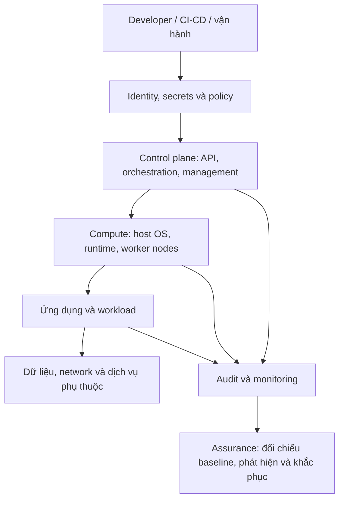
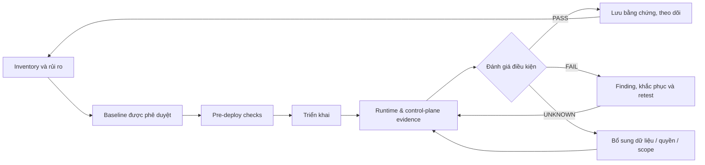

# Platform security: Nền tảng an toàn và cách chứng minh bằng bằng chứng

## 1. Platform security là gì?

**Platform security** là tập hợp các biện pháp bảo vệ lớp nền tảng dùng để xây dựng, triển khai và vận hành ứng dụng. Tùy kiến trúc, lớp này có thể gồm phần cứng, firmware, hypervisor, hệ điều hành, container runtime, Kubernetes, cloud services, mạng, lưu trữ, hệ thống danh tính, công cụ triển khai, quản lý bí mật và hệ thống quan sát.

Một ứng dụng có mã nguồn tốt vẫn có thể bị xâm phạm nếu máy chủ chạy với cấu hình yếu, cluster cho phép tạo container đặc quyền, dịch vụ quản lý secret cấp quyền quá rộng hoặc pipeline có thể thay đổi production mà không được phê duyệt. Vì thế, an toàn nền tảng là điều kiện quan trọng để các security controls ở lớp ứng dụng hoạt động đúng kỳ vọng.

Trong module **SECURITY_SECURITY_ASSURANCE**, mục tiêu không chỉ là chọn các tính năng bảo mật cho nền tảng. Người học cần biết cách **xây dựng cơ sở đánh giá có bằng chứng** rằng hệ thống đạt mục tiêu bảo mật: xuất phát từ rủi ro và yêu cầu, chuyển thành các control có thể kiểm tra, thu thập trạng thái thực tế, ghi nhận phát hiện và xác minh khắc phục liên tục trong phát triển và vận hành.

Một nhận định như “cluster đã được harden” chỉ đáng tin cậy khi trả lời được:

1. Cluster và các thành phần nào nằm trong phạm vi khẳng định?
2. Baseline bảo mật nào được phê duyệt, dành cho phiên bản và môi trường nào?
3. Kiểm soát nào có hiệu lực tại thời điểm kiểm tra, và nguồn bằng chứng là gì?
4. Có tài sản chưa kiểm tra, kiểm soát thất bại hoặc ngoại lệ đang tồn tại không?
5. Nếu cấu hình thay đổi hoặc phát hiện lỗ hổng, ai chịu trách nhiệm xử lý và bằng chứng nào xác nhận đã sửa?

### Platform security, platform assurance và application security

| Khái niệm | Trọng tâm | Câu hỏi tiêu biểu |
| --- | --- | --- |
| **Platform security** | Thiết kế và vận hành nền tảng an toàn | Làm sao giới hạn quyền, cô lập workload và bảo vệ control plane? |
| **Platform assurance** | Kiểm chứng các yêu cầu bảo mật của nền tảng bằng bằng chứng | Ta chứng minh được những control nào đang hoạt động và ở phạm vi nào? |
| **Application security** | Bảo vệ logic, mã nguồn, dữ liệu và giao diện ứng dụng | Ứng dụng có lỗi injection, phân quyền nghiệp vụ hoặc xử lý input không? |
| **Configuration management** | Quản lý phiên bản, thay đổi và trạng thái cấu hình | Cấu hình thực tế có phù hợp với baseline được duyệt không? |

Các lĩnh vực liên quan chặt chẽ nhưng không thay thế nhau. Một nền tảng có network isolation không chứng minh ứng dụng không có lỗi phân quyền; ngược lại, ứng dụng vượt qua kiểm thử mã nguồn cũng không chứng minh hạ tầng triển khai đã an toàn.

## 2. Xác định ranh giới và mô hình trách nhiệm

Không có một danh sách thành phần thống nhất cho mọi nền tảng. Cùng là dịch vụ web nhưng ba mô hình triển khai có ranh giới khác nhau:

| Mô hình | Thành phần tổ chức thường trực tiếp quản lý | Thành phần có thể do nhà cung cấp quản lý |
| --- | --- | --- |
| Bare metal/on-premises | Firmware, OS, network, storage, runtime, orchestration, danh tính và backup | Phần hỗ trợ theo hợp đồng, nếu có |
| IaaS + self-managed Kubernetes | VM OS, container runtime, Kubernetes control plane và worker, networking, IAM tích hợp | Phần cứng, hạ tầng vật lý, dịch vụ nền IaaS |
| Managed Kubernetes/PaaS | Workload, RBAC, admission/policy, workload identity, network/data settings và cấu hình được mở cho khách hàng | Một phần control plane, host management hoặc runtime theo dịch vụ |

**Trách nhiệm chia sẻ** phải được xác định cho từng dịch vụ cụ thể. “Managed” không có nghĩa mọi control tự động đạt. Ví dụ, nhà cung cấp có thể vá control plane của managed Kubernetes, trong khi khách hàng vẫn chịu trách nhiệm cấu hình quyền workload, network policy, namespace và image được triển khai. Ngược lại, khách hàng không nên tự nhận đã kiểm chứng một thành phần nội bộ mà nhà cung cấp không công khai dữ liệu; cần dùng bằng chứng bảo đảm tương ứng từ provider và xác định rõ giới hạn.

### Bản đồ các miền tin cậy



Sơ đồ mô tả luồng quản trị và kiểm chứng ở mức khái niệm. Trên thực tế, **control plane** có thể điều phối hạ tầng và cấp quyền, còn **data plane** là nơi ứng dụng xử lý lưu lượng và dữ liệu. Quyền quản trị control plane có thể ảnh hưởng đồng thời đến nhiều workload; vì vậy phải đánh giá riêng đường truy cập, xác thực, khả năng sửa policy, cập nhật và nhật ký của lớp này.

### Câu hỏi xác định ranh giới

- Ai có thể tạo, sửa hoặc xóa máy ảo, node, cluster, policy, storage volume và secret?
- Thành phần nào kiểm tra chữ ký, nguồn gốc và mức tin cậy của artifact trước khi triển khai?
- Những cơ chế nào chặn một workload chiếm quyền node, truy cập workload khác hoặc gọi API quản trị?
- Những hệ thống nào kiểm soát dữ liệu, khóa, log và bản sao lưu?
- Nếu IdP, control plane, network hoặc nhà cung cấp cloud bị gián đoạn, hệ thống tiếp tục hoạt động và phục hồi như thế nào?

Những câu hỏi này giúp xác định cả **đường tấn công**, **rủi ro tập trung** và nơi cần lấy bằng chứng.

## 3. Mục tiêu bảo mật và threat model cho nền tảng

Từ góc độ security assurance, các mục tiêu thông dụng gồm:

| Mục tiêu | Kịch bản đe dọa | Kiểm soát cần xem xét |
| --- | --- | --- |
| **Confidentiality** | Một Pod đọc secret hoặc volume của ứng dụng khác | Isolation, service account và RBAC, secret access, network segmentation |
| **Integrity** | Kẻ tấn công sửa image/tag, manifest hoặc admission policy để chạy mã trái phép | Artifact integrity, signing/provenance, change control, admission guardrails |
| **Availability** | Workload độc hại tiêu thụ tài nguyên node hoặc làm ngừng control plane | Quota, resource limits, HA, rate limiting, backup và recovery |
| **Identity assurance** | CI runner giả danh pipeline được phê duyệt để lấy quyền deploy | Federation conditions, workload identity, quyền tối thiểu và audit |
| **Auditability** | Người có quyền cao tắt logging hoặc sửa bằng chứng | Log forwarding độc lập, bảo vệ log, giám sát thay đổi policy |
| **Isolation** | Container sử dụng hostPath, hostNetwork hoặc privileged mode ngoài nhu cầu | Admission policy, runtime hardening, workload sandboxing |

Một cách lập threat model:

1. **Chỉ ra tài sản cần bảo vệ:** image registry, secrets, control plane, compute nodes, API endpoint, storage, log và backup.
2. **Xác định chủ thể:** người vận hành, pipeline, workloads, nhà cung cấp và đối tượng bên ngoài.
3. **Vẽ trust boundaries:** từ Git tới CI, từ CI tới cluster, từ workload tới cloud IAM, giữa các namespace, từ node tới control plane.
4. **Nêu đường tấn công cụ thể:** lộ credential, sửa policy, image giả, escape runtime, lateral movement, xóa dấu vết.
5. **Gắn control và bằng chứng:** ai sở hữu, kiểm tra bằng gì, khi nào kiểm tra và điều kiện PASS/FAIL.
6. **Ghi rủi ro còn lại:** rủi ro được chấp nhận, kiểm soát bù trừ, hạn ngoại lệ và người phê duyệt.

Ví dụ, yêu cầu “workload không thể đọc Kubernetes API nếu không cần” phải được chuyển thành các kiểm tra service account token mount, role binding, quyền hiệu lực, luồng mạng tới API và bằng chứng quan sát ở Pod thực tế; chỉ có một manifest mong muốn chưa đủ.

## 4. Lập danh mục platform assets và độ bao phủ

Một chương trình kiểm chứng không thể kết luận “toàn bộ nền tảng tuân thủ” nếu chưa xác định **toàn bộ là những gì**. Danh mục cần bao gồm:

- **Hệ thống:** organization/account/project, datacenter/region, môi trường, cluster, host, node pool, namespace, image registry, storage, network và pipeline.
- **Công nghệ và phiên bản:** OS/kernel, hypervisor, Kubernetes/API version, runtime, CNI/CSI, ingress/controller, agent và phần mềm quản trị.
- **Chủ sở hữu:** platform owner, application owner, security control owner, on-call team và người phê duyệt.
- **Độ quan trọng:** dữ liệu được xử lý, môi trường production, rủi ro gián đoạn, quyền truy cập đặc biệt.
- **Nguồn trạng thái:** IaC repository, CMDB/service catalog, cloud API, orchestration API, host agent, runtime telemetry và audit trail.
- **Phiên bản chính sách:** baseline nào áp dụng cho loại asset, thời điểm có hiệu lực và lịch ngoại lệ.

**Inventory phải đối chiếu nhiều nguồn:** tài sản có trên cloud API nhưng chưa có trong CMDB, node đã được tạo thủ công, namespace mới chưa gắn nhãn hoặc workload không thuộc GitOps đều có thể bị bỏ sót nếu chỉ đọc một nguồn.

Nên phân loại đối tượng thành `IN_SCOPE`, `OUT_OF_SCOPE` có lý do và `UNKNOWN_SCOPE` cần rà soát. Việc không quan sát được tài sản thuộc phạm vi là vấn đề coverage, không phải bằng chứng tuân thủ.

## 5. Hardening lớp host, kernel và runtime

**Host hardening** làm giảm khả năng một lỗ hổng trong ứng dụng dẫn đến chiếm quyền máy chủ, lây lan qua mạng hoặc làm mất khả năng quan sát.

### 5.1. Cấu hình hệ điều hành và firmware

Nhóm kiểm soát thường xem xét:

- **Boot và firmware trust:** trạng thái Secure Boot/measured boot nếu nền tảng hỗ trợ, thay đổi firmware và quyền truy cập quản trị ngoài băng.
- **Patch management:** phiên bản OS/kernel, danh sách lỗ hổng áp dụng, hạn xử lý và kế hoạch cập nhật theo mức độ rủi ro.
- **Attack surface:** dịch vụ và port không dùng, SSH/remote administration, tài khoản cục bộ, nhóm đặc quyền và quyền file.
- **Security mechanisms:** chính sách thực thi bắt buộc (SELinux/AppArmor khi phù hợp), audit system, firewall, protection của host agent.
- **Resource/availability:** đồng bộ thời gian, ổ đĩa, cạn inode, cấu hình logging, bảo vệ backup và cơ chế recovery.

Không có một baseline hardening chung cho tất cả kernel, OS và ứng dụng. Ví dụ, tắt một kernel module có thể giảm bề mặt tấn công nhưng cũng làm hỏng storage/network driver bắt buộc; phải kiểm tra tương thích và có rollback trước khi thực thi trên production.

### 5.2. Container runtime và đặc quyền host

Container dùng chung kernel với host (trong mô hình container Linux thông dụng). Một số cấu hình tăng rủi ro nếu cho workload vượt qua lớp cách ly:

- Chạy privileged hoặc có quyền quản trị host rộng.
- Mount socket quản lý container runtime vào workload.
- Sử dụng hostPath tùy ý, đặc biệt với đường dẫn chứa credential của node.
- Chạy root khi không cần, cho phép privilege escalation hoặc giữ nhiều Linux capabilities.
- Dùng `hostNetwork`, `hostPID`, `hostIPC` không có lý do.
- Thiếu seccomp/AppArmor/SELinux policy phù hợp.

**Không chỉ kiểm tra container image.** Phải quan sát PodSpec và cấu hình runtime thực tế; image không đặc quyền vẫn có thể bị chạy với security context quá rộng. Đồng thời cần đánh giá init containers, ephemeral containers và các thành phần quản trị hệ thống nếu thuộc phạm vi policy.

### 5.3. Isolation mạnh hơn khi cần

Các workload đa thuê hoặc xử lý mã không tin cậy có thể cần isolation bổ sung: VM riêng, sandboxed runtime, gVisor/Kata Containers hay công nghệ tương đương tùy yêu cầu và khả năng hỗ trợ. Không nên mặc định rằng namespace, container hoặc một NetworkPolicy riêng lẻ cung cấp mức cách ly tương đương VM; phải xác định mô hình đe dọa và chứng cứ thực nghiệm cho kiến trúc được chọn.

## 6. Bảo vệ control plane và các đường quản trị

Control plane là nơi tạo/sửa tài nguyên và phân phối cấu hình. Nếu kẻ tấn công có quyền sửa admission policy, RBAC hoặc secrets, những kiểm soát khác có thể bị vượt qua.

### Những yêu cầu thiết yếu

| Nhóm | Câu hỏi cần kiểm chứng | Bằng chứng phù hợp |
| --- | --- | --- |
| Management API exposure | API quản trị có mở ra nguồn không tin cậy không? | Endpoint, firewall, private access, reachability test |
| Human admin access | Ai có quyền quản trị và MFA/SSO/just-in-time access được áp dụng ra sao? | IAM, groups, RBAC, session và approval logs |
| Workload identity | Node, pod và automation có đúng role và scope? | ServiceAccount, cloud role binding, token/audience, grants |
| RBAC/authorization | Có role quá rộng hoặc quyền cấp thêm đặc quyền? | RoleBinding/ClusterRoleBinding, policy analysis, negative tests |
| Admission/guardrails | Các chính sách chống cấu hình nguy hiểm có được thực thi không? | Policy object, admission result, controlled denial test |
| Secrets and keys | Ai đọc, sửa, tạo hoặc thay secret/key? | KMS/secret policy, audit logs, rotation/recovery record |
| Change and audit | Thay đổi control plane có phê duyệt và log độc lập? | Git/CI record, API audit, alert và immutable/controlled log retention |

**RBAC hiệu lực** quan trọng hơn tên role. Một account không trực tiếp thuộc `cluster-admin` vẫn có thể tăng quyền nếu được sửa ClusterRoleBinding, tạo workload với service account mạnh hơn, sửa admission policy hoặc truy cập thông tin xác thực của node.

Với managed platform, không phải mọi thành phần control plane đều truy cập được. Nên ghi rõ control thuộc trách nhiệm provider, lấy bằng chứng cấu hình mà khách hàng có thể kiểm soát và tham chiếu tài liệu bảo đảm dịch vụ khi cần. Không được đánh dấu PASS cho control mà chưa có bằng chứng phù hợp.

## 7. Workload isolation, network và data protection

### 7.1. Admission security và workload policy

Với Kubernetes, **Pod Security Standards (PSS)** mô tả các mức `Privileged`, `Baseline` và `Restricted`. **Pod Security Admission (PSA)** có thể áp dụng theo namespace với chế độ `enforce`, `warn` và `audit`. Đây là các cơ chế quan trọng nhưng không bao quát mọi loại rủi ro: policy network, IAM, image provenance, vulnerabilities và tài nguyên cloud cần kiểm tra riêng.

Ví dụ namespace được gắn nhãn để yêu cầu mức Restricted (chỉ minh họa, cần xác minh tương thích với workload trước khi áp dụng):

```yaml
apiVersion: v1
kind: Namespace
metadata:
  name: payments
  labels:
    pod-security.kubernetes.io/enforce: restricted
    pod-security.kubernetes.io/warn: restricted
    pod-security.kubernetes.io/audit: restricted
```

Các nhãn ở trên chỉ định **chính sách mong đợi đối với admission**. Kết luận assurance còn cần xác nhận cơ chế Pod Security Admission đang hoạt động trên cluster, phiên bản policy được dùng, phạm vi exemptions, kết quả thử tạo Pod vi phạm và trạng thái các Pod đã tồn tại. Cơ chế admission không tự thay đổi mọi Pod đã chạy trước khi policy được bật.

Một ví dụ về container security context cho workload thông thường (cần điều chỉnh với image và chức năng thực tế):

```yaml
apiVersion: v1
kind: Pod
metadata:
  name: payments-example
  namespace: payments
spec:
  automountServiceAccountToken: false
  securityContext:
    runAsNonRoot: true
    seccompProfile:
      type: RuntimeDefault
  containers:
    - name: app
      image: registry.example.test/payments@sha256:<APPROVED_IMAGE_DIGEST>
      securityContext:
        allowPrivilegeEscalation: false
        readOnlyRootFilesystem: true
        capabilities:
          drop: ["ALL"]
```

Đây là **manifest minh họa**, có placeholder image digest và chưa chứa các thông số ứng dụng cần để chạy thành công. Root filesystem chỉ đọc có thể cần mount volume riêng cho thư mục tạm; `runAsNonRoot` cần tương thích với user trong image; workload cần truy cập API phải có cơ chế nhận danh tính giới hạn phù hợp. Một policy kiểm tra tự động phải bao gồm các trường hợp kế thừa/ghi đè securityContext và các loại container áp dụng.

### 7.2. Network segmentation và egress control

Giới hạn luồng truy cập theo nhu cầu thực tế: ingress từ cổng/API được duyệt, east-west traffic giữa service cần thiết, egress đến external API và cloud metadata endpoints khi được phép. Với Kubernetes, **NetworkPolicy** chỉ phát huy tác dụng nếu network plugin thực sự hỗ trợ enforcement. Một policy tồn tại trong API không tự chứng minh gói tin đã bị chặn.

Một network baseline nên ghi rõ:

- Workload selector/namespace selector và chiều lưu lượng ingress/egress.
- DNS, health checks, monitoring, service mesh và các luồng quản trị cần thiết.
- Quy tắc mặc định đối với kết nối ngoài phạm vi.
- Cách thử kết nối thành công và bị từ chối từ nguồn đại diện.
- Quyền sửa policy và bằng chứng thay đổi.

Mạng có phân đoạn vẫn cần bảo vệ identity và authorization. Việc một service ở subnet nội bộ không khiến nó tự động được phép truy cập mọi secret hay database.

### 7.3. Secrets, storage và dữ liệu

Xác định nơi tạo, lưu, phân phối và sử dụng secret; giới hạn quyền xem và thời gian sử dụng; kiểm tra cơ chế rotation/revocation. Kubernetes Secret không nên bị xem là “đã được mã hóa an toàn” chỉ vì dùng loại tài nguyên `Secret`: phải kiểm tra encryption at rest theo cấu hình nền tảng, quyền đọc qua API, quyền truy cập etcd/storage, bản sao lưu và đường truyền secret vào workload.

Với dữ liệu lưu trữ, cần xác minh quyền truy cập volume, mã hóa disk/snapshot/backup, quản trị khóa, chính sách retention và khả năng phục hồi. Bảo vệ dữ liệu phải đi xuyên các lớp platform, workload và external dependencies.

## 8. Software supply chain: từ mã nguồn đến artifact đang chạy

Một chuỗi triển khai điển hình gồm `source → build → artifact registry → promotion → deploy → runtime`. Kẻ tấn công có thể nhắm đến repository, token CI, dependency, build runner, image registry hoặc policy điều phối triển khai.

| Bước | Rủi ro | Kiểm soát | Bằng chứng |
| --- | --- | --- | --- |
| Source | Sửa mã hoặc build script không được review | Branch protection, review, signed/verified commits khi phù hợp | PR, approver, revision |
| Build | Runner lộ secret, dependency bị thay thế | Quyền tối thiểu, build isolation, dependency pinning, secret hygiene | Build provenance, runner config, logs |
| Artifact | Image bị thay đổi hoặc tag trỏ đến digest mới | Artifact digest, registry permissions, signing/provenance verification | Digest, signature/attestation, registry event |
| Deployment | Manifest vượt guardrail hoặc không đi qua quy trình | Policy-as-code, admission, GitOps/release approvals | Pipeline result, admission decision, deployment revision |
| Runtime | Image cũ/lỗ hổng vẫn chạy sau khi repository đã được sửa | Inventory image digest thực tế và vulnerability correlation | Pod/image digest, SBOM tham chiếu, remediation status |

**SBOM** hỗ trợ nhận diện thành phần và đối chiếu lỗ hổng; **provenance/attestation** hỗ trợ truy vết cách artifact được tạo; **signature verification** hỗ trợ kiểm tra integrity và nguồn tin cậy. Các khái niệm có vai trò khác nhau. Việc image “được ký” không tự chứng minh image sạch lỗ hổng hoặc người ký có quyền phát hành production.

Chính sách cho image digest, signers, provenance và khả năng chặn artifact phải gắn với các môi trường cụ thể. Với lỗ hổng, đánh giá cả khả năng khai thác trong thực tế, exposure, mức nhạy cảm và biện pháp giảm thiểu, thay vì chỉ dựa trên điểm số chung.

## 9. Logging, runtime detection và ứng phó

Assurance đòi hỏi có khả năng **quan sát và kiểm chứng**, không chỉ cấu hình chuẩn ở thời điểm triển khai.

### Những nguồn log/telemetry thường cần

- **Cloud/control-plane audit:** ai tạo/sửa/xóa resource, đổi IAM, admission policy, firewall hoặc logging.
- **Kubernetes audit:** yêu cầu quan trọng tới API server, chủ thể, resource, thao tác và kết quả; mức chi tiết phụ thuộc audit policy và dịch vụ.
- **Host/runtime signals:** thay đổi tiến trình, tác động đến file hệ thống, container chạy khác image dự kiến, runtime behavior bất thường.
- **Network flows:** kết nối trái kỳ vọng giữa workload, egress bất thường, metadata/API access.
- **Identity and secret access:** hoạt động cấp token, assume role, đọc secret hoặc thao tác khóa.
- **Build/deploy telemetry:** ai phê duyệt và triển khai phiên bản nào, thời điểm rollout, rollback và thay đổi ngoài pipeline.

Lưu ý dữ liệu log có thể chứa thông tin cá nhân, đường dẫn nội bộ, câu lệnh hoặc secret. Vì vậy phải phân loại, lọc/redact, giới hạn quyền đọc, bảo vệ integrity, đặt retention và kiểm tra khả năng truy xuất. Bật mọi loại log ở mức tối đa có thể gây rủi ro bảo mật, chi phí và gián đoạn vận hành.

### Một câu hỏi assurance cụ thể

Nếu yêu cầu là “mọi thay đổi ClusterRoleBinding trong production đều được audit”, bằng chứng đủ phải gồm:

1. Chính sách audit và log sink đang có hiệu lực tại cluster production.
2. Một thay đổi thử nghiệm có kiểm soát (hoặc sự kiện hợp lệ có thể kiểm chứng) tạo bản ghi ở điểm thu thập.
3. Bản ghi chứa identity thực hiện, tài nguyên, động tác, thời điểm và kết quả thích hợp.
4. Kiểm tra khả năng truy xuất theo retention, quyền truy cập log và cơ chế chống sửa đổi trái phép.
5. Trường hợp pipeline/log sink mất kết nối được giám sát và không bị báo như PASS.

Nếu chỉ thấy cấu hình logging trong Git mà không xác minh log thực sự đến được hệ thống tập trung, kết luận nên là **chưa đủ bằng chứng**.

## 10. Availability, resilience và nền tảng có thể phục hồi

Platform security còn bảo vệ tính sẵn sàng trước lỗi vận hành, tấn công từ chối dịch vụ và sự cố vùng hạ tầng. Các control có thể gồm:

- Phân vùng lỗi, cấu hình multi-zone/HA và kiểm soát quá tải.
- Resource requests/limits, quota, ưu tiên workload, rate limiting và autoscaling phù hợp.
- Backup của stateful components, cấu hình điều phối, secrets/key recovery và kịch bản khôi phục.
- Mục tiêu **RTO/RPO** được phê duyệt, thủ tục khôi phục có kiểm thử và người chịu trách nhiệm.
- Hệ thống monitoring, alerting, on-call và runbook xử lý sự cố.

**Có backup không đồng nghĩa chắc chắn khôi phục được.** Bằng chứng tốt gồm kiểm tra snapshot đúng phạm vi, quyền truy xuất và giải mã phù hợp, báo cáo restore, thời gian phục hồi thực tế và dữ liệu mất mát trong kịch bản thử. Với managed platform, phạm vi khôi phục của provider và phần khách hàng phải tự khôi phục cần được phân biệt.

Các thay đổi hardening phải được kiểm thử cùng yêu cầu vận hành: chặn egress quá rộng có thể làm health check lỗi; read-only filesystem có thể khiến ứng dụng không ghi log hoặc file tạm. Assurance cần kiểm soát cả rủi ro do bảo mật và rủi ro do triển khai bảo mật không phù hợp.

## 11. Thiết kế security baseline cho platform

**Platform security baseline** là tập hợp các điều kiện bảo mật được định nghĩa, có chủ sở hữu, được phê duyệt và quản lý phiên bản để áp dụng cho một nhóm tài sản.

Một baseline tốt tối thiểu phải có:

- **ID, version, effective date, state:** tránh đánh giá một cluster theo baseline đã bị thay thế hoặc chưa được phê duyệt.
- **Scope và applicability:** model triển khai, cluster/node/workload class, môi trường, phiên bản và ngoại lệ.
- **Rule ID, security rationale và severity:** vì sao yêu cầu tồn tại, rủi ro nào được xử lý.
- **Expected state và nguồn quan sát:** trường cấu hình hay hành vi cần xác minh, cùng logic PASS/FAIL/UNKNOWN.
- **Control owner và approver:** người triển khai, người xác nhận thay đổi và người chấp nhận rủi ro.
- **Evidence, cadence, remediation:** bằng chứng gốc, chu kỳ kiểm tra, cách xử lý và thời hạn.

Ví dụ hồ sơ YAML sau là **mô hình baseline minh họa cho công cụ assurance**, không phải một tài nguyên Kubernetes có thể dùng với `kubectl apply`:

```yaml
baseline:
  id: PLATFORM-K8S-PROD
  version: "1.0.0"
  state: approved
  scope:
    environment: production
    platform: kubernetes
    workloadTier: critical
  owner: Platform Security
  approvedBy: Security and Operations
  sourceRevision: "<approved-git-revision>"

checks:
  - id: PLAT-01
    requirement: "Administrative control-plane access is restricted"
    severity: critical
    evidence:
      - api-exposure
      - effective-rbac
      - access-denial-test
  - id: PLAT-02
    requirement: "Restricted workload admission policy is enforced"
    severity: high
    evidence:
      - namespace-policy
      - admission-configuration
      - negative-deployment-test
  - id: PLAT-03
    requirement: "Workloads cannot use unapproved privileged settings"
    severity: high
    evidence:
      - runtime-pod-spec
      - policy-evaluation
  - id: PLAT-04
    requirement: "Production artifacts match approved release digests"
    severity: high
    evidence:
      - release-record
      - runtime-image-digests
      - provenance-policy-result
  - id: PLAT-05
    requirement: "Critical control-plane changes are audited"
    severity: high
    evidence:
      - audit-policy
      - protected-log-event
      - log-pipeline-health
```

Những chuỗi `api-exposure`, `negative-deployment-test` hoặc `runtime-pod-spec` là **nhãn nguồn bằng chứng do tổ chức tự định nghĩa**. Cần có evaluator thực sự đọc API phù hợp, xét policy exemptions và so sánh đúng trạng thái; chỉ định nghĩa YAML chưa tạo ra khả năng enforcement.

### Truy vết từ rủi ro tới evidence

| Rủi ro / mục tiêu | Rule ID | Bằng chứng cấu hình | Bằng chứng hoạt động |
| --- | --- | --- | --- |
| Không để tài khoản ngoài phạm vi quản trị cluster | PLAT-01 | RBAC, IAM, API exposure, trust policy | Access-denial test, audit events |
| Không deploy workload có cấu hình đặc quyền không được duyệt | PLAT-02/03 | PSA/admission policy, PodSpecs | Thử tạo workload vi phạm, trạng thái Pod đã chạy |
| Chỉ chạy artifact được phê duyệt | PLAT-04 | CI policy, registry/image digest, policy admission | Digest quan sát trên workloads |
| Có thể truy vết thay đổi control plane | PLAT-05 | Audit/logging policy, sink permissions | Thử sinh event, xác minh sự kiện ở đích |

Một rule có thể cần **nhiều nguồn bằng chứng độc lập** để đạt độ tin cậy mong muốn. Những tình huống bị giới hạn quyền hoặc thiếu dữ liệu phải được báo cáo như vậy, không suy luận PASS.

## 12. Ví dụ kiểm tra trạng thái Kubernetes theo hướng chỉ đọc

Giả sử một tổ chức dùng Kubernetes để chạy dịch vụ `payments` trong namespace `payments`. Mục tiêu là xác nhận nhãn PSA, identity, quyền, network controls và cấu hình Pod đang chạy.

Các lệnh sau **chỉ đọc dữ liệu** bằng `kubectl`; thực hiện bằng tài khoản có quyền đọc được phê duyệt. Không chạy trên cluster lạ hoặc lấy secrets về để làm bằng chứng:

```bash
# Xác định cluster context trước khi kiểm tra.
kubectl config current-context

# Xem chính sách Pod Security gắn trên namespace.
kubectl get namespace payments --show-labels

# Xem cấu hình Pod đang chạy trong namespace.
kubectl get pods -n payments -o yaml

# Xem các gắn quyền tại namespace (quyền hiệu lực còn phụ thuộc nhiều lớp).
kubectl get rolebindings -n payments -o yaml

# Xem các network policies, nếu có.
kubectl get networkpolicies -n payments -o yaml
```

**Giới hạn kết luận quan trọng:**

1. **Nhìn thấy PSA label chưa chứng minh enforcement:** phải kiểm tra admission config/exemptions và phép thử bị từ chối phù hợp.
2. **PodSpec chưa chứng minh đầy đủ isolation:** một số cơ chế nằm ở runtime, host, CNI và cloud IAM. Cần kiểm tra cả init/ephemeral containers nếu áp dụng.
3. **RoleBinding ở namespace chưa cho biết toàn bộ quyền:** có ClusterRoleBindings, các chính sách IAM/cloud khác và đường tăng quyền gián tiếp.
4. **NetworkPolicy tồn tại chưa chứng minh traffic bị chặn:** cần xác nhận CNI hỗ trợ enforcement và kiểm thử lưu lượng từ nguồn/đích đại diện.
5. **Kết quả được chụp tại một thời điểm:** không chứng minh an toàn liên tục nếu không có monitoring/audit và cơ chế phát hiện thay đổi.
6. **Quyền đọc có thể thiếu:** nếu tài khoản kiểm tra không thấy toàn bộ tài nguyên, phải ghi giới hạn coverage thay vì coi phần không thấy là không tồn tại.

Đối với managed Kubernetes, có thể cần API hoặc tài liệu provider để chứng minh các kiểm soát control plane mà `kubectl` không truy cập được. Với nền tảng VM hay PaaS, cần thay thế bằng các nguồn quan sát đặc thù.

## 13. Cách thu thập, đánh giá và lưu bằng chứng

### 13.1. Chuỗi đánh giá liên tục



Kiểm tra trước triển khai giúp giảm cấu hình nguy hiểm đi vào môi trường chạy. Kiểm tra sau triển khai và trong runtime phát hiện cấu hình bị ghi đè, thay đổi trực tiếp hoặc cơ chế enforcement không hoạt động như dự kiến. Hai thời điểm phục vụ các mục tiêu khác nhau và nên được kết nối bằng release ID, asset ID và baseline version.

### 13.2. Trạng thái đánh giá

| Kết quả | Điều kiện | Cách báo cáo |
| --- | --- | --- |
| **PASS** | Quy tắc áp dụng và dữ liệu kiểm tra đủ chứng minh đạt yêu cầu | Lưu thời điểm, phạm vi và bằng chứng gốc |
| **FAIL** | Quan sát được cấu hình hoặc hành vi vi phạm | Tạo finding với mức độ rủi ro, owner, thời hạn |
| **UNKNOWN** | Thiếu quyền, lỗi thu thập, không biết phạm vi hoặc evaluator chưa đủ dữ liệu | Ghi riêng, bổ sung coverage/kiểm tra |
| **EXCEPTION** | Có sai khác được chấp thuận theo phạm vi và thời hạn cụ thể | Ghi risk owner, biện pháp bù trừ và hạn; không tính là PASS |
| **NOT_APPLICABLE** | Quy tắc không áp dụng theo điều kiện baseline đã xác định | Lưu điều kiện và lý do loại trừ |

Ví dụ, một cluster chưa bật audit log không thể có PASS cho rule “có thể truy vết thay đổi RBAC” chỉ vì không tìm thấy sự kiện đáng ngờ. Cần chứng minh audit policy, sink và kết quả sự kiện thử nghiệm hoạt động.

### 13.3. Hồ sơ bằng chứng mẫu

```json
{
  "assetId": "production/k8s-cluster-a/namespace/payments",
  "assetType": "kubernetes-namespace",
  "baselineId": "PLATFORM-K8S-PROD",
  "baselineVersion": "1.0.0",
  "ruleId": "PLAT-02",
  "observedAt": "2026-11-28T05:00:00Z",
  "result": "FAIL",
  "expected": "Restricted admission enforced for in-scope workloads",
  "observed": "Restricted label absent in namespace",
  "source": "kubernetes-api-and-admission-policy-review",
  "findingId": "PLAT-FIND-014",
  "evidenceRef": "evidence://platform/PLAT-FIND-014"
}
```

*Đây là dữ liệu giả định nhằm minh họa cấu trúc, không phải kết quả kiểm tra từ cluster thật.* Khi quan sát thiếu nhãn, cần tiếp tục xác minh các cơ chế enforcement khác trước khi kết luận chính sách tổng thể có bị vô hiệu hóa hay không. Finding ở đây phản ánh **điều kiện của baseline ví dụ**, chưa tự động chứng minh workload nguy hiểm đã được triển khai.

Hồ sơ thực tế nên chứa hoặc liên kết thêm: công cụ và phiên bản evaluator, nguồn dữ liệu/ID truy vấn, quyền thu thập, checksum của bằng chứng gốc, thời điểm và múi giờ, chính sách retention, người kiểm tra, đối tượng phê duyệt, phiên bản release và kết quả retest. Cần loại bỏ dữ liệu nhạy cảm, token và private key ra khỏi bản ghi công khai.

## 14. Configuration drift, vulnerability và quản lý thay đổi

**Configuration drift** là sai khác giữa actual state và trạng thái baseline/desired state đang áp dụng. Trên platform, drift có thể xuất hiện khi:

- Nhân viên sửa RoleBinding hoặc network rule trực tiếp qua console/API.
- Một namespace mới được tạo mà không có nhãn/policy mong muốn.
- Node pool mới dùng image OS, runtime hoặc cấu hình hardening khác.
- Thay đổi admission policy làm bỏ qua một số workload.
- Hệ thống quản lý cấu hình đẩy bản mới nhưng triển khai thất bại ở một phần tài sản.
- Plugin, dependency hoặc runtime nâng phiên bản và thay đổi mặc định.

**Vulnerability** khác **drift**: một node có thể tuân thủ baseline phiên bản cũ nhưng đang chạy phần mềm có lỗ hổng mới được công bố. Assurance cần liên kết inventory và version với nguồn thông tin lỗ hổng, khả năng khai thác và kế hoạch khắc phục; khi rủi ro thay đổi, baseline cũng có thể phải được cập nhật qua phê duyệt.

### Xử lý phát hiện

1. **Xác nhận:** rule đang áp dụng cho asset nào, baseline version nào, kết quả có phải lỗi thu thập không.
2. **Đánh giá:** rủi ro đối với quyền, dữ liệu, khả năng lateral movement và availability; quy mô workload/node bị ảnh hưởng.
3. **Ưu tiên:** xác định cần chặn deploy, rollback, áp dụng fix khẩn cấp hoặc lên lịch theo SLA.
4. **Khắc phục:** thay policy, IaC, image hoặc cấu hình qua quy trình được duyệt; thử tương thích và chuẩn bị rollback.
5. **Retest:** kiểm tra lại trạng thái thực tế và hành vi enforcement, không chỉ xác nhận PR đã merge.
6. **Lưu dấu vết:** finding, change request, bản cấu hình trước/sau, owner, thời gian và kết quả.
7. **Ngăn lặp lại:** cập nhật gate, phát hiện drift, quyền quản trị hoặc quy trình cấp phát resource.

Không nên thay baseline để hợp thức hóa sai lệch đã xảy ra. Khi cần ngoại lệ vì nghiệp vụ, cần mã rule, asset scope, đánh giá rủi ro còn lại, người chấp thuận, kiểm soát bù trừ, thời hạn và kế hoạch kết thúc ngoại lệ.

## 15. Tình huống thực tế: workload đặc quyền lọt vào production

Một nền tảng Kubernetes production phục vụ thanh toán sử dụng GitOps. Baseline `PLATFORM-K8S-PROD@1.0.0` yêu cầu admission chặn workload đặc quyền thông thường. Trong một lần xử lý sự cố, kỹ sư tạo namespace mới `payment-jobs` bằng lệnh trực tiếp nhưng không thêm cấu hình policy. Một workload có cấu hình privileged được tạo tại namespace này.

### Diễn biến đánh giá

| Giai đoạn | Việc cần làm | Bằng chứng |
| --- | --- | --- |
| Phát hiện | Inventory thấy namespace mới và không có rule áp dụng như mong đợi | Namespace ID, labels, thời điểm tạo |
| Xác minh | Kiểm tra admission config/exemptions, PodSpec/runtime và quyền tạo workload | Policy readback, API audit, Pod hiện có |
| Đánh giá tác động | Xác định workload có quyền host nào, node liên quan, dữ liệu và secret có thể truy cập | Effective RBAC, Pod security context, host exposure |
| Khắc phục | Ngăn triển khai tiếp, xử lý workload hiện có, áp dụng chính sách phù hợp và sửa IaC template | Ticket, patch/release, deployment record |
| Retest | Thử tạo workload không phù hợp trong namespace và xác nhận bị chặn; kiểm tra workloads hiện còn | Negative test, runtime inventory |
| Phòng ngừa | Đưa kiểm tra namespace/policy vào quy trình tạo resource và theo dõi drift | Gate rule, owner, alert test |

Điểm quan trọng: **thêm nhãn admission sau đó không nhất thiết tự sửa hoặc xóa một Pod đặc quyền đã chạy**. Phải kiểm tra hiện trạng runtime, có kế hoạch thay thế/khắc phục workload và đo lường khoảng thời gian phơi lộ.

Vì không có bằng chứng về việc đặc quyền đã bị lạm dụng, báo cáo phải phân biệt rõ **khả năng bị khai thác** với **hoạt động tấn công đã được chứng minh**. Nếu log thiếu, ghi nhận giới hạn điều tra thay vì kết luận chắc chắn không xảy ra truy cập trái phép.

## 16. Tích hợp assurance vào vòng đời phát triển và vận hành

| Thời điểm | Hoạt động platform assurance | Đầu ra kiểm chứng |
| --- | --- | --- |
| Thiết kế | Threat model, xác định shared responsibility, baseline và yêu cầu resilience | Control mapping, architecture decision, owner |
| Pull request | Review IaC, policy-as-code, manifests, trust và cấu hình pipeline | Policy test, review approval, commit/diff |
| Build và release | Kiểm tra artifact provenance, vulnerability và image digest | Attestation/signature result, release record |
| Admission/deploy | Chặn cấu hình vi phạm rule, kiểm soát exceptions | Admission decision, deploy event |
| Sau triển khai | Đọc lại trạng thái thực tế, thử control quan trọng | Runtime evidence, baseline comparison |
| Vận hành liên tục | Theo dõi drift, vulnerability, audit, anomaly và platform availability | Findings, alerts, remediation tickets |
| Định kỳ | Review access, ngoại lệ, backup/restore, phiên bản baseline | Access review, restore report, baseline approval |
| Sau sự cố | Điều tra bằng chứng, khắc phục, nâng control và retest | Timeline, root cause, verified fix |

### Đo lường năng lực assurance

| Chỉ số | Định nghĩa và giới hạn |
| --- | --- |
| **Asset coverage** | Tỷ lệ assets trong phạm vi có dữ liệu đánh giá hợp lệ; các assets không quan sát được vẫn thuộc mẫu số |
| **Control coverage** | Tỷ lệ cặp asset–rule áp dụng đã được kiểm tra; báo riêng thiếu công cụ/không đủ quyền |
| **Compliance rate** | Số cặp đạt PASS trên tập đánh giá hợp lệ theo cách tính công bố; trình bày FAIL/UNKNOWN/EXCEPTION riêng |
| **Drift detection latency** | Thời gian từ sai lệch xảy ra đến khi được phát hiện, khi có đủ timestamp đáng tin |
| **Time to verified remediation** | Thời gian từ finding đến khi kiểm tra lại thấy control đạt |
| **Critical vulnerability exposure** | Số lượng và thời gian tồn tại lỗ hổng có rủi ro cao trên assets quan trọng |
| **Exception aging** | Tuổi và số lượng ngoại lệ đã hết hạn hoặc chưa được review lại |
| **Recovery test success** | Tỷ lệ bài thử phục hồi thành công, kèm RTO/RPO quan sát được |

Dashboard phải thể hiện **tính mới của bằng chứng**. Một kết quả PASS hai tháng trước không đủ đại diện cho trạng thái hôm nay nếu platform đã thay phiên bản hoặc policy.

## 17. Sai lầm thường gặp khi đánh giá platform security

1. **Chỉ kiểm tra IaC hoặc manifest:** bỏ sót thay đổi trực tiếp và cấu hình runtime khác desired state.
2. **Dùng trạng thái “managed” làm bằng chứng:** không xác định responsibility và control khách hàng phải thiết lập.
3. **Đồng nhất nhãn PSA với enforcement đầy đủ:** quên audit/warn modes, exemptions và workloads đã tồn tại.
4. **Chỉ xem role tên “admin”:** bỏ qua đường nâng quyền qua token, impersonation, role binding hoặc quyền sửa policy.
5. **Cho rằng namespace tự tạo network isolation:** chưa có policy thực thi hoặc CNI chưa hỗ trợ.
6. **Tin image ký số đồng nghĩa image an toàn:** bỏ qua provenance, signer authorization, lỗ hổng và digest thực tế.
7. **Tin rằng bật logging là đủ:** sự kiện không tới sink, bị rơi hoặc không truy xuất được.
8. **Coi thu thập thất bại là PASS:** làm sai coverage và che tài sản chưa có bằng chứng.
9. **Có backup nhưng không thử restore:** không xác minh được khả năng phục hồi.
10. **Đóng finding khi PR merge:** chưa chứng minh thay đổi đã áp dụng và kiểm soát đạt trong môi trường chạy.
11. **Áp dụng hardening máy móc:** gây lỗi ứng dụng, mất log, network outage hoặc ảnh hưởng backup vì không kiểm tra tương thích.
12. **Ngoại lệ không có hạn:** rủi ro tồn tại mãi mà không được review hoặc khắc phục.

## 18. Bài tập và câu hỏi tự kiểm tra

1. Một cluster có nhãn `pod-security.kubernetes.io/enforce=restricted` ở các namespace production. Tại sao chưa thể kết luận mọi workload đang chạy đều tuân thủ? Hãy liệt kê nguồn bằng chứng bổ sung.
2. Nhóm triển khai cho rằng có image signature là đủ để chặn mã độc. Hãy phân biệt integrity, provenance, vulnerability scanning, signer authorization và runtime verification.
3. Một tài khoản có thể tạo ClusterRoleBinding nhưng không mang tên `cluster-admin`. Vì sao vẫn có rủi ro leo thang đặc quyền, và nên thử nghiệm, ghi nhận bằng chứng như thế nào?
4. NetworkPolicy đã tồn tại nhưng workload vẫn gọi được service ngoài phạm vi. Hãy nêu các giả thuyết cần kiểm tra trước khi kết luận policy không hiệu quả.
5. Security dashboard báo 98% PASS, nhưng 20% node chưa có agent và một số cluster không truy xuất được API. Tỷ lệ này có đại diện cho toàn bộ platform không? Hãy thiết kế lại báo cáo coverage và UNKNOWN.
6. Một workload đặc quyền đã chạy trước khi nhóm bật admission policy. Quy trình xử lý nào giúp đưa hệ thống về baseline mà không làm hỏng dịch vụ?
7. Provider quản lý control plane nhưng không cung cấp dữ liệu host-level. Tổ chức nên xác định ranh giới, loại bằng chứng provider và giới hạn kết luận ra sao?

**Tiêu chí tự đánh giá:** mỗi câu trả lời nên theo chuỗi **rủi ro → mục tiêu bảo mật → asset và trust boundary → control/baseline → trạng thái quan sát → bằng chứng → quyết định xử lý/retest**. Nếu thiếu một mắt xích quan trọng, hãy diễn đạt giới hạn kết luận.

## 19. Tài liệu tham khảo

- **NIST SP 800-53** – các họ kiểm soát AC (Access Control), CM (Configuration Management), AU (Audit and Accountability), SI (System and Information Integrity), SC (System and Communications Protection), CP (Contingency Planning).
- **NIST SP 800-128** – *Guide for Security-Focused Configuration Management of Information Systems*: baseline, thay đổi và đối chiếu cấu hình theo rủi ro.
- **NIST SP 800-190** – *Application Container Security Guide*: rủi ro và kiểm soát ở image, registry, orchestrator, container và host.
- **NIST SP 800-207** – *Zero Trust Architecture*: cách suy nghĩ về identity, trust boundary và quyết định truy cập dựa trên ngữ cảnh.
- **CIS Benchmarks** theo đúng OS, Kubernetes, runtime, cloud service và phiên bản: nguồn tham khảo hardening cần đánh giá mức áp dụng.
- **Kubernetes Documentation** – *Pod Security Standards*, *Pod Security Admission*, *RBAC*, *Network Policies*, *Secrets* và *Auditing*: xác minh ngữ nghĩa và giới hạn kỹ thuật.
- **SLSA framework** và tài liệu về software supply chain security: xác định kiểm soát provenance, build integrity và mức tin cậy artifact.
- **Tài liệu bảo mật của nhà cung cấp cloud/platform**: xác nhận responsibility, tính năng cấu hình, telemetry, lịch cập nhật và cơ chế phục hồi theo đúng dịch vụ đang dùng.

Platform security có giá trị bền vững khi mọi kiểm soát quan trọng được chuyển thành **yêu cầu cụ thể, baseline có phiên bản, trạng thái thực tế có thể quan sát, bằng chứng có nguồn gốc và hành động khắc phục được xác minh**. Cách tiếp cận này giúp triển khai security assurance liên tục thay vì chỉ dựa vào một đợt kiểm tra cấu hình tại thời điểm triển khai.
