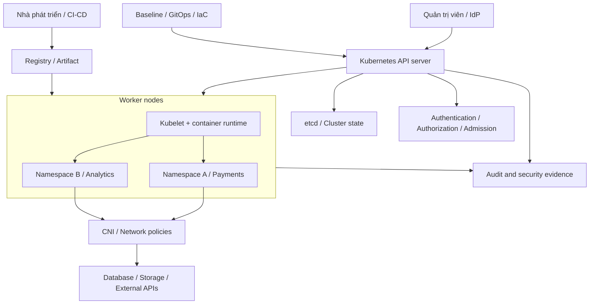
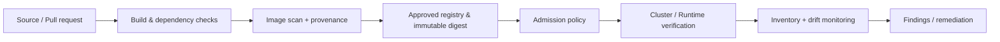

# Cluster security: Bảo vệ cụm hạ tầng và chứng minh các kiểm soát đang hiệu lực

## 1. Mục tiêu học tập

Sau bài này, người học có thể:

- Giải thích **cluster security** là gì; nhận diện tài sản, ranh giới tin cậy và các lớp bảo vệ của một cụm hạ tầng, đặc biệt là **Kubernetes cluster**.
- Phân tích rủi ro ở **control plane**, **worker nodes**, **container/workload**, **network**, **identity**, **secrets** và **chuỗi cung ứng phần mềm**.
- Thiết kế baseline có thể kiểm chứng cho authentication, authorization, RBAC, admission control, Pod hardening, network segmentation, encryption, logging và vận hành cluster.
- Triển khai các ví dụ Kubernetes có kiểm soát, hiểu giới hạn của Pod Security Admission, NetworkPolicy và các cấu hình mặc định.
- Phân biệt kết quả rà soát thiết kế, manifest/IaC, cấu hình API và **trạng thái hiệu lực lúc chạy** để hình thành kết luận **platform assurance** có bằng chứng.
- Xây dựng quy trình đánh giá, phát hiện sai lệch, xử lý rủi ro, quản lý ngoại lệ và kiểm chứng sau khắc phục.

Bài thuộc chương **Platform assurance** của dịch vụ `SECURITY_SECURITY_ASSURANCE`. Mục tiêu là đánh giá **có bằng chứng** rằng hệ thống đáp ứng yêu cầu bảo mật, từ phân tích rủi ro và security controls đến kiểm thử, audit và khắc phục phát hiện. Nội dung tập trung vào Kubernetes vì đây là ví dụ tiêu biểu của cụm điều phối workload; các nguyên tắc về tài sản, quyền, phân đoạn, kiểm soát thay đổi và bằng chứng còn áp dụng cho cụm máy chủ, hệ thống xử lý dữ liệu phân tán và nền tảng dịch vụ khác.

## 2. Khái niệm cluster security và phạm vi trách nhiệm

**Cluster** là tập hợp các máy hoặc thành phần được quản lý như một hệ thống để cung cấp tài nguyên tính toán, lưu trữ, mạng hoặc dịch vụ. Trong Kubernetes, cluster thường gồm:

- **Control plane**: API server, cơ chế quản lý trạng thái mong muốn, scheduler và các controller; dữ liệu cấu hình quan trọng được lưu trong etcd hoặc hệ thống lưu trữ do nền tảng quản lý.
- **Worker nodes**: các máy chạy kubelet, container runtime, thành phần mạng và workload.
- **Workloads**: Pods, containers, Jobs, Deployments, StatefulSets và các đối tượng ứng dụng.
- **Shared services**: DNS, ingress, CNI, CSI, registry, giám sát, logging, admission webhooks và các controller của bên thứ ba.
- **External integrations**: IAM/IdP, KMS, secret manager, CI/CD, cloud APIs, mạng kết nối bên ngoài và kho backup.

Bảo mật cluster nhằm giảm khả năng một bên không được phép **điều khiển nền tảng**, **chiếm đặc quyền**, **đọc dữ liệu**, **di chuyển ngang** giữa workload hoặc **vô hiệu hóa các kiểm soát bảo mật**.

**Cluster assurance** đặt câu hỏi sâu hơn: *bằng chứng nào cho thấy các kiểm soát đang được áp dụng đúng trên toàn bộ cluster, vào thời điểm nào, cho đối tượng nào và còn lỗ hổng quan sát nào?*

Ví dụ, manifest của một Pod có `runAsNonRoot: true` chỉ chứng minh điều đã khai báo trong tài liệu. Để kết luận workload đang tuân thủ, cần xác minh Pod thực sự chạy, chính sách admission có hiệu lực, các container liên quan đều phù hợp và không còn Pod cũ hoặc workload ngoài phạm vi được quét.

### 2.1. Cluster security khác với container security như thế nào?

| Phạm vi | Câu hỏi điển hình | Bằng chứng cần thu |
|---|---|---|
| **Container image** | Image có nguồn đáng tin và không chứa thành phần nguy hiểm đã biết? | Digest, provenance/signature, kết quả quét |
| **Workload runtime** | Tiến trình có quyền tối thiểu, không chạy privileged? | PodSpec hiệu lực, admission, runtime telemetry |
| **Node** | Host được harden, vá lỗi, bảo vệ kubelet và container runtime? | Baseline node, phiên bản, agent/OS evidence |
| **Control plane** | Ai có thể thay đổi cluster, đọc Secrets hay cấp quyền mới? | RBAC, IAM, audit log, API/admission config |
| **Network** | Pod nào được kết nối với Pod hoặc dịch vụ nào? | NetworkPolicy, CNI, cloud firewall, phép kiểm luồng |
| **Cluster assurance** | Bằng chứng có đầy đủ, mới, đúng đối tượng và có thể tái lập? | Control mapping, kết quả PASS/FAIL/UNKNOWN, finding và kiểm chứng khắc phục |

Một cụm có image sạch nhưng ServiceAccount quá quyền vẫn có thể bị chiếm quyền. Một cụm có RBAC tốt nhưng cho phép chạy container privileged trên node trọng yếu vẫn có rủi ro cao.

## 3. Kiến trúc và ranh giới tin cậy



*Sơ đồ khái niệm*: các mũi tên cho biết quan hệ quản lý hoặc phụ thuộc; không hàm ý mọi kết nối đều đi trực tiếp qua API server hay toàn bộ thành phần được đặt trong một máy.

Các **trust boundaries** cần đánh giá gồm:

1. **Người dùng và automation → API server:** ai được xác thực, quyền nào có hiệu lực, có kiểm soát phiên và audit?
2. **Control plane → worker:** danh tính node/kubelet, chứng chỉ và đường điều khiển có được bảo vệ?
3. **Container → node:** process isolation, Linux namespaces/cgroups, capabilities, volume/hostPath và quyền truy cập container runtime.
4. **Pod → Pod / dịch vụ ngoài:** phân đoạn mạng, xác thực workload và luồng egress.
5. **Workload → cloud APIs / secrets:** workload identity, quyền cloud IAM và khả năng truy cập token/metadata.
6. **CI/CD và controller → cluster:** quyền triển khai, image được tin cậy, xác thực webhook và quản lý thay đổi.
7. **Cluster → hệ thống quan sát:** audit/metrics/log có toàn vẹn, đủ phạm vi và được bảo vệ khỏi sự sửa/xóa của workload?

### 3.1. Shared responsibility với cluster tự vận hành và cluster được quản lý

| Lớp | Cluster tự vận hành | Managed Kubernetes |
|---|---|---|
| API server/etcd | Nhóm vận hành chịu trách nhiệm cấu hình, bảo vệ và cập nhật trực tiếp | Nhà cung cấp quản lý nhiều thành phần; khách hàng vẫn phải kiểm IAM, API access, audit và tùy chọn được cung cấp |
| Node | Quản trị OS, runtime, kubelet, patches, network | Tùy loại node: managed node, self-managed node hoặc serverless có phạm vi trách nhiệm khác nhau |
| Workload | Khách hàng xây image, cấu hình Pod, secrets, ServiceAccount và phân đoạn | Phần lớn vẫn thuộc trách nhiệm khách hàng |
| IAM, RBAC và admission | Thiết lập và kiểm chứng bởi tổ chức | Khách hàng vẫn phải cấu hình quyền và chính sách phù hợp sản phẩm |
| Evidence | Thu thập từ cả control plane, node, workload và log | Kết hợp dữ liệu khách hàng thu được với log, trạng thái và báo cáo provider cung cấp |

Không nên giả định “managed cluster” đồng nghĩa “cluster mặc nhiên an toàn”. Đặc biệt, báo cáo bảo mật của nhà cung cấp không chứng minh rằng namespace, workload, IAM hoặc NetworkPolicy của tenant đang đúng.

## 4. Threat modeling cho cluster

Đánh giá cluster cần xuất phát từ **tài sản**, **đường tấn công** và **mức tác động**. Tài sản trọng yếu có thể là API credentials, workload identity, dữ liệu cá nhân, Secrets, khóa mã hóa, log kiểm toán, khả năng triển khai ứng dụng và quyền quản trị control plane.

| Kịch bản tấn công | Sai cấu hình/điểm yếu thường gặp | Tác động tiềm tàng | Kiểm soát cần xem |
|---|---|---|---|
| Tài khoản triển khai bị lộ | RoleBinding cấp `cluster-admin` quá rộng | Sửa workload, đọc Secret, cấp thêm quyền | IdP/IAM, RBAC, token lifetime, audit |
| Workload bị RCE rồi leo quyền | Container privileged, hostPath nhạy cảm, capabilities rộng | Chiếm node, lạm dụng tài nguyên cluster | Pod Security, runtime isolation, admission |
| Di chuyển ngang giữa namespace | Thiếu network segmentation và workload auth | Tiếp cận database/service khác | CNI, NetworkPolicy, mTLS, app authorization |
| Đọc Secrets qua Kubernetes API | Quyền `list/get/watch secrets` cấp quá rộng | Lộ credential và dữ liệu | RBAC, Secret access, audit, encryption at rest |
| Image độc hại được đưa vào cluster | Registry/image/tag không kiểm soát | Chạy mã trái phép, lấy dữ liệu | Supply chain, digest, provenance, admission |
| Node cũ có lỗ hổng | OS/runtime/kubelet chưa được vá | Chiếm node và ảnh hưởng workload | Patch/upgrade, hardening, node inventory |
| Audit bị tắt hoặc thiếu | Không bật/đẩy log, log retention không phù hợp | Không điều tra được thay đổi hoặc sự cố | Audit config, log pipeline, retention và quyền |
| Controller bị cấp quyền lớn | Operator/webhook có ClusterRole rộng | Điều khiển nhiều namespace, thay policy | Inventory controller, RBAC, image, webhook security |

**Mức nghiêm trọng** phụ thuộc vào việc workload có xử lý dữ liệu nhạy cảm không, có lộ Internet không, có khả năng thay đổi control plane không và có kiểm soát bù trừ gì. Không thể chỉ lấy số lượng rule thất bại để xếp hạng rủi ro.

## 5. Bảo vệ control plane

Control plane là nơi đưa ra quyết định quản lý cluster. Một principal có quyền tạo workload đặc quyền, sửa RBAC hoặc thay admission policy có thể tác động nhiều workload cùng lúc.

### 5.1. Kubernetes API server

Các yêu cầu cần xem:

- **Giới hạn API exposure** theo kiến trúc: private endpoint, CIDR quản trị được duyệt, firewall và lớp truy cập có danh tính; nếu API endpoint phải public, áp dụng biện pháp hạn chế thích hợp.
- **Xác thực danh tính** qua cơ chế được hỗ trợ như OIDC/enterprise IdP, short-lived credentials; hạn chế credential tĩnh và tránh chia sẻ kubeconfig.
- **Authorization** dùng RBAC hoặc cơ chế phù hợp, từ chối quyền không cần thiết.
- **TLS** và quản lý chứng chỉ đúng: xác thực certificate, rotation, kiểm thời hạn và giới hạn quyền đối với khóa.
- **Audit logging** có chính sách phù hợp để theo dõi thay đổi RBAC, Secrets, admission, workload và hoạt động quản trị; giảm ghi dữ liệu nhạy cảm không cần thiết.
- **Admission controls** để kiểm tra hoặc từ chối đối tượng có rủi ro trước khi lưu trong cluster.
- **Control plane availability** và backup/recovery phù hợp, vì mất khả năng điều khiển làm giảm khả năng phòng vệ và khắc phục.

Một endpoint API chỉ có HTTPS không đảm bảo bảo mật nếu người dùng có kubeconfig quyền quá rộng hoặc một access token có thể dùng lâu dài.

### 5.2. Bảo vệ etcd và cluster state

Trong các kiến trúc tự quản, etcd chứa trạng thái quan trọng của cluster. Nguyên tắc chính:

- Không mở endpoint quản trị/peer của etcd ngoài phạm vi cần thiết.
- Xác thực và mã hóa kênh etcd tương ứng với kiến trúc.
- Giới hạn danh tính có quyền đọc/ghi dữ liệu etcd và file backup.
- Bảo vệ mã hóa dữ liệu nhạy cảm **ở trạng thái lưu trữ** theo cơ chế được Kubernetes/provider hỗ trợ; đối với Kubernetes Secrets, cần xem cấu hình encryption at rest thực tế thay vì giả định đã bật.
- Quản lý khóa mã hóa, backup, restore test, retention và quyền xem snapshot.

**Lưu ý:** Base64 trong manifest Secret chỉ là mã hóa biểu diễn, không phải encryption. KMS hoặc cơ chế encryption at rest không tự hạn chế principal có quyền đọc Secret qua API. Phải kết hợp **RBAC** và kiểm soát đường truy cập.

### 5.3. Controllers và admission webhooks

Scheduler/controller, custom operator và admission webhook thường có khả năng sửa nhiều đối tượng. Cần:

- Kiểm RBAC và danh tính của controller; đặc biệt với ClusterRole có tác dụng xuyên namespace.
- Quản lý nguồn image, patch và dependency của operator/webhook.
- Giám sát thay đổi `ValidatingWebhookConfiguration`, `MutatingWebhookConfiguration`, CRDs và admission policy.
- Bảo vệ TLS/service endpoint của webhook và xác định hành vi khi webhook lỗi theo mục tiêu rủi ro, khả năng sẵn sàng.
- Kiểm thử quy tắc admission trước khi triển khai diện rộng để tránh làm dừng workload hợp lệ.

Đối với managed cluster, một số thiết lập control plane là do nhà cung cấp kiểm soát; bằng chứng phải chỉ rõ phần nào được API khách hàng quan sát và phần nào dựa trên cam kết provider.

## 6. Identity, Authentication và RBAC

### 6.1. Quy tắc quyền tối thiểu

Trong Kubernetes, **Role** và **RoleBinding** thường giới hạn quyền trong namespace; **ClusterRole** có thể cung cấp quyền cluster-wide hoặc dùng làm nguồn quyền được gán trong namespace. **ClusterRoleBinding** gán quyền ở phạm vi toàn cluster.

Cần đặc biệt chú ý:

- Quyền `create pods`, `patch deployments`, `create rolebindings`, `escalate`, `bind`, `impersonate` và `pods/exec` có thể mang tác động lớn tùy đối tượng và chính sách admission.
- Quyền `get/list/watch secrets` trực tiếp làm tăng nguy cơ lộ credential.
- Không chỉ xem tên Role; phải tính **effective permissions** từ toàn bộ binding và các quyền kế thừa.
- Định kỳ xem lại tài khoản người dùng không còn cần quyền và ServiceAccount không còn được dùng.
- Tách quyền đọc/kiểm toán với quyền sửa runtime hoặc cấp quyền cao hơn.

### 6.2. Ví dụ Role chỉ đọc Pod của một namespace

```yaml
apiVersion: v1
kind: ServiceAccount
metadata:
  name: pod-observer
  namespace: payments
---
apiVersion: rbac.authorization.k8s.io/v1
kind: Role
metadata:
  name: pod-reader
  namespace: payments
rules:
  - apiGroups: [""]
    resources: ["pods"]
    verbs: ["get", "list", "watch"]
---
apiVersion: rbac.authorization.k8s.io/v1
kind: RoleBinding
metadata:
  name: pod-observer-binding
  namespace: payments
subjects:
  - kind: ServiceAccount
    name: pod-observer
    namespace: payments
roleRef:
  kind: Role
  name: pod-reader
  apiGroup: rbac.authorization.k8s.io
```

Ví dụ chỉ cấp quyền đọc Pod; không có quyền đọc Secrets, sửa workload hoặc quản trị cluster. Tuy nhiên, **được gán Role không có nghĩa mọi Pod đều cần token API**. Chỉ Pod thực sự gọi Kubernetes API mới cần cơ chế xác thực phù hợp; các workload khác nên tắt tự gắn ServiceAccount token.

Có thể kiểm tra quyền theo một định danh khi người đánh giá **được phép impersonate**:

```bash
kubectl auth can-i list pods \
  --namespace payments \
  --as system:serviceaccount:payments:pod-observer

kubectl auth can-i get secrets \
  --namespace payments \
  --as system:serviceaccount:payments:pod-observer
```

Kỳ vọng theo manifest minh họa, nếu không có quyền nào khác gán cho cùng principal: câu đầu là `yes`, câu sau là `no`. Quyền `--as` (impersonation) thường chỉ dành cho người được cấp phép; công cụ có thể báo lỗi `Forbidden` nếu tài khoản kiểm tra không đủ quyền. Một kết quả `no` cũng phải được diễn giải theo danh tính và phạm vi đang xét, không suy rộng ra toàn cluster.

### 6.3. ServiceAccount token và workload identity

- Tránh dùng ServiceAccount mặc định cho nhiều ứng dụng không liên quan.
- Tắt `automountServiceAccountToken` khi ứng dụng không cần Kubernetes API.
- Nếu cần gọi API, dùng danh tính riêng, token có thời hạn và audience/phạm vi phù hợp với môi trường.
- Với cloud resources, ưu tiên cơ chế **workload identity** được nền tảng hỗ trợ thay cho access key dài hạn nhúng trong Pod.
- Hạn chế quyền của danh tính cloud: quyền của Pod có thể bắt nguồn cả từ IAM bên ngoài Kubernetes; chỉ xem Kubernetes RBAC là chưa đủ.

Việc gắn tài khoản dịch vụ sai hoặc ánh xạ cloud IAM sai có thể khiến một Pod không có ClusterRole cao vẫn đọc được dữ liệu cloud nhạy cảm.

## 7. Bảo vệ worker nodes và container runtime

Node là ranh giới quan trọng vì nhiều Pod có thể chia sẻ kernel và tài nguyên host. Nếu attacker chiếm node, họ có thể tác động các workload đặt trên đó.

### 7.1. Node hardening

- Dùng image/OS được quản lý có baseline bảo mật; loại các dịch vụ và tài khoản không cần.
- Vá OS, kernel, kubelet, container runtime và plugin theo phiên bản tương thích đã kiểm thử.
- Hạn chế SSH/RDP, cổng quản trị, metadata service và truy cập từ mạng không tin cậy.
- Bảo vệ container runtime socket, kubelet configuration/credentials và file cấu hình node.
- Cấu hình logging, đồng bộ thời gian, giám sát node health và thay đổi ngoài quy trình.
- Đặt cơ chế encryption của disk/volume khi phù hợp, bảo vệ backup và thông tin xác thực bootstrap.
- Cách ly các workload có mức tin cậy rất khác nhau bằng node pool riêng hoặc ranh giới hạ tầng mạnh hơn nếu rủi ro yêu cầu.

### 7.2. Kubelet và runtime

Kubelet nhận chỉ thị để quản lý Pod trên node. Cần kiểm chứng:

- Kubelet API không cho phép truy cập ẩn danh hoặc quyền quản trị quá rộng ngoài thiết kế.
- AuthN/AuthZ và certificate rotation được cấu hình phù hợp phiên bản/nền tảng.
- Bất kỳ endpoint đọc/ghi runtime hoặc node nào đều được giới hạn theo mạng và danh tính.
- Runtime class, sandboxing, kernel hardening, seccomp và các cơ chế cô lập được áp dụng cho workload có mức tin cậy yêu cầu.

Trên managed platform, có thể không truy cập trực tiếp cấu hình kubelet; lúc đó cần dùng cấu hình node pool, provider API, tài liệu trách nhiệm và kết quả kiểm thử có thể thu thập. Một lệnh kiểm không thực hiện được phải được báo **UNKNOWN/NOT_ASSESSED** cho phần chưa xác minh, không tự đánh dấu PASS.

## 8. Workload hardening và Pod Security

Một container bị khai thác có thể lợi dụng quyền kernel, quyền ghi file hoặc token được gắn để mở rộng phạm vi ảnh hưởng. Baseline workload nên mô tả yêu cầu có thể kiểm tra được.

| Control | Giá trị thường mong đợi | Vì sao cần |
|---|---|---|
| Không chạy root | `runAsNonRoot: true` với UID phù hợp image | Giảm quyền của tiến trình |
| Không tăng quyền | `allowPrivilegeEscalation: false` | Hạn chế một nhóm đường leo quyền |
| Không chạy privileged | `privileged` không bật | Tránh quyền thiết bị/kernel rất rộng |
| Linux capabilities | `drop: ["ALL"]`, chỉ thêm lại nếu thực sự cần | Giảm bề mặt đặc quyền |
| Seccomp | `RuntimeDefault` hoặc profile được phê duyệt | Giới hạn một số system calls |
| Filesystem | `readOnlyRootFilesystem: true` nếu ứng dụng tương thích | Hạn chế ghi thay đổi trong image filesystem |
| Host access | Không dùng `hostNetwork`, `hostPID`, `hostIPC`, `hostPath` tùy tiện | Giảm tiếp xúc tới host |
| Kubernetes API token | `automountServiceAccountToken: false` nếu không dùng API | Giảm nguy cơ lấy token |
| Image | Image có nguồn đáng tin, digest cố định, scan/provenance | Giảm thay đổi artifact ngoài ý muốn |

### 8.1. Ví dụ Deployment được harden

```yaml
apiVersion: apps/v1
kind: Deployment
metadata:
  name: payments-api
  namespace: payments
spec:
  replicas: 2
  selector:
    matchLabels:
      app: payments-api
  template:
    metadata:
      labels:
        app: payments-api
    spec:
      automountServiceAccountToken: false
      securityContext:
        runAsNonRoot: true
        runAsUser: 10001
        seccompProfile:
          type: RuntimeDefault
      containers:
        - name: api
          image: registry.example.com/payments-api@sha256:aaaaaaaaaaaaaaaaaaaaaaaaaaaaaaaaaaaaaaaaaaaaaaaaaaaaaaaaaaaaaaaa
          ports:
            - name: http
              containerPort: 8080
          securityContext:
            allowPrivilegeEscalation: false
            readOnlyRootFilesystem: true
            capabilities:
              drop: ["ALL"]
          resources:
            requests:
              cpu: 100m
              memory: 128Mi
            limits:
              cpu: 500m
              memory: 512Mi
          volumeMounts:
            - name: tmp
              mountPath: /tmp
      volumes:
        - name: tmp
          emptyDir:
            sizeLimit: 64Mi
```

Đây là **mẫu học tập**, digest image là giá trị giả để minh họa cách pin digest; phải thay bằng artifact thực tế đã được build/kiểm tra. Image phải hỗ trợ chạy bằng UID 10001 và chỉ ghi vào vị trí được cấp quyền, ví dụ volume `/tmp`. Cần thêm security context hay volume phù hợp nếu ứng dụng có yêu cầu chính đáng khác, sau khi đánh giá rủi ro.

**Đừng kết luận “Pod đã an toàn” chỉ từ các field này.** Phải xem cả service identity, kết nối mạng, secrets, image provenance, admission policies và các Pod đang thực sự chạy.

### 8.2. Admission guardrails

Kubernetes cung cấp **Pod Security Admission (PSA)** để áp dụng các mức **privileged**, **baseline** và **restricted** thông qua nhãn namespace. Đây là cơ chế chính sách hiện đại thay cho PodSecurityPolicy đã bị loại khỏi Kubernetes từ phiên bản 1.25.

Ví dụ bắt đầu bằng **warn** và **audit** để thấy vi phạm trước khi chặn deploy:

```yaml
apiVersion: v1
kind: Namespace
metadata:
  name: payments
  labels:
    pod-security.kubernetes.io/warn: restricted
    pod-security.kubernetes.io/audit: restricted
```

Sau khi kiểm tra tương thích và xử lý Pod vi phạm, tổ chức có thể dùng `pod-security.kubernetes.io/enforce: restricted` trong namespace phù hợp. Các mode có ý nghĩa khác nhau:

- **warn:** trả cảnh báo cho người tạo/cập nhật đối tượng liên quan.
- **audit:** thêm tín hiệu đánh giá vào audit log theo hành vi cấu hình.
- **enforce:** từ chối các thao tác tạo/cập nhật Pod không đáp ứng chính sách áp dụng.

Phiên bản rule của PSA có thể được ghim qua nhãn tương ứng (`enforce-version`, `warn-version`, `audit-version`) nếu tổ chức cần tính ổn định khi upgrade. Không nên bật chế độ enforce ngay trên toàn cluster mà chưa kiểm thử DaemonSet, các workload hạ tầng và trường hợp ngoại lệ cần quyền đặc biệt.

PSA không giải quyết mọi chính sách như pin image digest, vùng registry cho phép, quyền IAM cloud hoặc NetworkPolicy. Cần kết hợp cơ chế admission/policy-as-code khác khi các yêu cầu này thuộc baseline.

## 9. Cluster networking và cô lập giữa workload

### 9.1. North–south và east–west

- **North–south:** traffic từ bên ngoài vào cluster và từ cluster ra dịch vụ ngoài, thường qua load balancer, ingress/gateway, firewall và egress proxy.
- **East–west:** kết nối giữa các Pod, namespace, node, service và các cụm khác nhau.

Với ứng dụng đa tenant hoặc dữ liệu nhạy cảm, cần giới hạn ingress/egress theo dependency map. Một Pod không nên tự do kết nối mọi Pod trong cluster chỉ vì ở cùng môi trường vận hành.

### 9.2. NetworkPolicy mặc định từ chối

Ví dụ sau chỉ chọn tất cả Pod ở namespace `payments` và đặt isolation cho cả ingress và egress:

```yaml
apiVersion: networking.k8s.io/v1
kind: NetworkPolicy
metadata:
  name: default-deny
  namespace: payments
spec:
  podSelector: {}
  policyTypes:
    - Ingress
    - Egress
```

Chính sách này có thể làm mất kết nối ứng dụng nếu chưa có allow rules phù hợp. Nên triển khai trong môi trường kiểm thử và thêm các luồng DNS, telemetry, app/database, health check và external dependency cần thiết trước khi áp dụng diện rộng.

Ví dụ chỉ cho phép Pod `payments-api` nhận TCP/8080 từ Pod gắn nhãn `app: gateway` **trong cùng namespace**:

```yaml
apiVersion: networking.k8s.io/v1
kind: NetworkPolicy
metadata:
  name: allow-gateway-to-api
  namespace: payments
spec:
  podSelector:
    matchLabels:
      app: payments-api
  policyTypes:
    - Ingress
  ingress:
    - from:
        - podSelector:
            matchLabels:
              app: gateway
      ports:
        - protocol: TCP
          port: 8080
```

Khi có nhiều NetworkPolicy chọn cùng Pod, lưu lượng được phép là **hợp** của các rule cho phép, không phải giao của các giới hạn. Vì thế, phải đánh giá **toàn bộ policy hiệu lực** cho Pod và không kết luận chỉ từ một file.

Cần đặc biệt chú ý:

- NetworkPolicy chỉ có hiệu lực khi **CNI/network plugin** hỗ trợ thực thi.
- Đường traffic liên quan `hostNetwork`, node, service mesh hay một số tính năng plugin có thể cần chính sách bổ sung.
- NetworkPolicy tiêu chuẩn kiểm soát L3/L4, **không xác thực người dùng hoặc quyền nghiệp vụ**.
- Rule DNS/egress phải được thiết kế theo DNS topology thực, ví dụ CoreDNS hoặc NodeLocal DNS; không sao chép selector một cách máy móc.
- Một cluster multi-tenant có thể cần isolation ở mức network, node pool, RBAC, admission, quota, KMS và tài khoản cloud riêng; namespace **không phải ranh giới an ninh tuyệt đối**.

### 9.3. Kiểm tra cả trường hợp bị chặn

Khi kiểm thử, nên đo:

| Ca kiểm thử | Luồng | Kết quả kỳ vọng |
|---|---|---|
| NP-01 | Gateway được duyệt → API:8080 | Cho phép |
| NP-02 | Pod chưa được duyệt → API:8080 | Từ chối |
| NP-03 | API → database được phép | Cho phép khi đã có egress rule thích hợp |
| NP-04 | API → đích outbound không được duyệt | Từ chối |
| NP-05 | API → DNS resolver hợp lệ | Cho phép khi đã cấu hình DNS egress |
| NP-06 | Workload vùng ít tin cậy → workload nhạy cảm | Từ chối |

Kết quả test chỉ phản ánh **nguồn, đích, giao thức, thời điểm và trạng thái cluster khi đo**. Cần kết hợp với config snapshot, reachability analysis, flow log và kiểm tra quyền workload để có kết luận assurance đáng tin.

## 10. Secrets, lưu trữ và bảo vệ dữ liệu trong cluster

Kubernetes Secret có thể chứa thông tin xác thực nhạy cảm; storage của cluster có thể gồm PersistentVolumes, snapshots và backup. Security assurance cần đánh giá cả **chính sách quản lý dữ liệu** lẫn trạng thái hiện hành.

### 10.1. Nguyên tắc xử lý Secrets

- Không commit giá trị bí mật vào Git, container image, ConfigMap không bảo vệ hoặc log.
- Dùng secret manager/KMS phù hợp và cơ chế cấp phát có thể thu hồi; kiểm tra quyền đọc secret gắn với đúng danh tính workload.
- Nếu dùng Kubernetes Secret, xác minh encryption at rest theo cấu hình nhà cung cấp/cluster và **RBAC thực tế**.
- Cấu hình phạm vi đọc tối thiểu; tránh tự gắn token API cho Pod không cần.
- Có cơ chế rotation, revocation và quy trình ứng phó khi nghi ngờ secret đã lộ.
- Tránh thu thập nội dung secret trong bằng chứng quét. Chỉ dùng metadata, quyền, trạng thái mã hóa hoặc bằng chứng kiểm chứng cần thiết.

### 10.2. Lưu trữ, volume và backup

- Kiểm soát namespace, StorageClass, mount permission, snapshot và quyền truy cập PVC.
- Ngăn Pod gắn đường dẫn host nhạy cảm (`hostPath`) nếu không có lý do và biện pháp bù trừ được duyệt.
- Xác minh mã hóa lưu trữ, backup, quyền restore và khả năng phục hồi với dữ liệu quan trọng.
- Xem xét **data remanence**, cơ chế xóa, chính sách retention và quyền đối với snapshot/backup.
- Lưu ý workload có thể đọc dữ liệu qua ứng dụng/DB dù volume đã mã hóa; encryption at rest không thay thế authorization.

## 11. Supply chain, lifecycle và khả năng phục hồi

### 11.1. Từ source code đến Pod đang chạy

Một pipeline cần có các điểm kiểm:



Các bằng chứng liên quan có thể gồm commit, build ID, SBOM khi phù hợp, digest, kết quả quét vulnerability, ký/provenance và image digest thực sự chạy. Quét image ở thời điểm build không chứng minh rằng runtime đã cập nhật hoặc không phát sinh lỗ hổng mới.

### 11.2. Nâng cấp cluster và quản lý lỗ hổng

Kiểm kê phiên bản control plane, node, CNI, CSI, ingress controller, operator và các add-on. Khi có bản vá:

1. Đánh giá CVE, mức lộ và ảnh hưởng của thành phần.
2. Kiểm tra tương thích phiên bản và khả năng rollback.
3. Nâng cấp theo thứ tự phù hợp nền tảng, hạn chế mất khả năng sẵn sàng.
4. Kiểm chứng sau triển khai: node readiness, workload health, network policy, admission và audit.
5. Cập nhật inventory, bằng chứng và findings còn tồn đọng.

Đối với control plane managed, nhiều thông tin được cung cấp qua API hoặc báo cáo của nhà cung cấp; phải chỉ rõ giới hạn khả năng quan sát.

### 11.3. Backup và khôi phục

Các bài kiểm tra phải bao gồm khôi phục trạng thái cluster theo phương pháp được hỗ trợ, workload secrets, cấu hình network, RBAC và policy. Bản backup tạo thành công không đồng nghĩa khôi phục thành công; cần **restore drill** trong môi trường được kiểm soát và ghi thời gian/độ toàn vẹn kết quả.

## 12. Từ risk → security controls → bằng chứng assurance

Để tránh đánh giá theo checklist rời rạc, mỗi rule nên gắn với một **security objective**, lý do rủi ro, phạm vi áp dụng và phép kiểm.

| Control ID | Mục tiêu | Baseline/tiêu chí | Bằng chứng dự kiến |
|---|---|---|---|
| CL-AUTH-01 | Hạn chế quyền thay đổi cluster | Không có principal ngoài danh sách duyệt có quyền `cluster-admin` | Effective RBAC/IAM, binding inventory, approval và audit |
| CL-API-02 | Bảo vệ control plane endpoint | API truy cập theo chính sách network/identity | Endpoint settings, ingress control, test truy cập có phép |
| CL-NODE-03 | Giảm rủi ro node | Node thuộc baseline OS/runtime và patch window | Node image/version, agent scan, hồ sơ nâng cấp |
| CL-POD-04 | Giới hạn đặc quyền workload | Không privileged; không tăng quyền; seccomp theo chuẩn | PodSpec hiệu lực, admission result, runtime inventory |
| CL-NET-05 | Ngăn lateral movement | Chỉ các luồng được duyệt qua CNI/policy | NetworkPolicy toàn cluster, plugin config, luồng test |
| CL-DATA-06 | Bảo vệ Secrets | Quyền đọc tối thiểu, encryption at rest nếu yêu cầu | RBAC, provider config, key metadata, audit |
| CL-LOG-07 | Theo dõi thay đổi nhạy cảm | Audit log có mặt và đến kho lưu trữ đúng hạn | Pipeline health, event test, retention config |
| CL-SUP-08 | Chỉ chạy artifact được duyệt | Image theo digest/provenance policy | Registry metadata, admission log, runtime imageIDs |

Mỗi rule cần có **owner**, **severity**, **cách xác định N/A**, **baseline version** và **frequency** theo rủi ro.

### 12.1. Một bằng chứng chứng minh điều gì?

Phân biệt bốn lớp:

1. **Design evidence**: baseline, threat model, quy tắc truy cập được duyệt.
2. **Declared evidence**: Git/IaC, manifest, policy-as-code.
3. **Deployed evidence**: cluster API cho biết các object và thành phần đã tồn tại.
4. **Effective/runtime evidence**: Pod/node đang chạy, quyền có hiệu lực, network reachability và audit được quan sát.

Bằng chứng ở lớp trước là cần thiết nhưng không thay thế lớp sau. Ví dụ, quay lại đúng manifest Deployment chưa chứng minh những Pod cũ với quyền nguy hiểm đã bị thay thế.

### 12.2. Trạng thái kết luận

| Trạng thái | Ý nghĩa |
|---|---|
| `PASS` | Control đạt trong phạm vi đã kiểm tra và tại thời điểm thu thập |
| `FAIL` | Có bằng chứng vi phạm quy tắc đang áp dụng |
| `UNKNOWN / NOT_ASSESSED` | Chưa đủ dữ liệu đáng tin hoặc nguồn kiểm tra không hoạt động |
| `NOT_APPLICABLE` | Rule không áp dụng, có lý do và phạm vi rõ |
| `EXCEPTION_APPROVED` | Có sai lệch nhưng rủi ro đã được phê duyệt có thời hạn |
| `PENDING_ROLLOUT` | Chưa hết cửa sổ thay đổi đã duyệt; cần kiểm lại khi kết thúc |

Một ngoại lệ có phê duyệt không được biến thành PASS. Một công cụ kiểm tra bị lỗi hoặc không đủ quyền đọc cũng không thể suy ra PASS.

## 13. Quy trình đánh giá cluster security trong thực tế

### 13.1. Bước 1 — Inventory và phân loại

Xác định cluster ID, environment, owner, provider/region, control plane version, node pools, namespaces, workloads, service accounts, network plugins, operators và các nguồn dữ liệu/Secrets quan trọng. Đối chiếu inventory với cloud APIs, cluster API và hệ thống triển khai để tìm tài sản ngoài quản lý.

### 13.2. Bước 2 — Chọn baseline và điều kiện áp dụng

Kết hợp threat model, tiêu chuẩn cấu hình và chính sách tổ chức. Có thể tham khảo **CIS Kubernetes Benchmark** phù hợp phiên bản/nền tảng, hướng dẫn hardening Kubernetes, tài liệu nhà cung cấp và NIST SP 800-190 (*Application Container Security Guide*). Không áp dụng benchmark máy móc cho thành phần managed mà khách hàng không điều chỉnh được.

### 13.3. Bước 3 — Kiểm tra trước triển khai

- Lint schema, kiểm manifest/IaC, policy-as-code và các hardening controls.
- Quét secret lộ trong repository; kiểm image digest/provenance theo chính sách.
- Kiểm RBAC mới, ClusterRoleBinding và controller có quyền sửa admission.
- Thử policy bằng cả mẫu đạt và vi phạm; kiểm tương thích với ứng dụng.
- Ghi commit, baseline version, rule version và kết quả CI.

### 13.4. Bước 4 — Thu trạng thái cluster

Các lệnh đọc phù hợp cho người được cấp quyền, có thể dùng trong môi trường thực hành:

```bash
kubectl get nodes -o wide
kubectl get namespaces --show-labels
kubectl get serviceaccounts -A
kubectl get rolebindings -A
kubectl get clusterrolebindings
kubectl get networkpolicies -A
kubectl get pods -A -o wide
```

Những lệnh này cho biết inventory và một phần cấu hình. Không thể chỉ dựa vào chúng để kết luận effective RBAC, seccomp đang thực thi hoặc policy mạng có thật sự chặn traffic.

Để kiểm một Deployment cụ thể:

```bash
kubectl -n payments get deployment payments-api -o yaml
kubectl -n payments get pods -l app=payments-api -o json
```

Cần xem cả Pod thực chạy, bao gồm Pod cũ trong quá trình rolling update và các container liên quan. Chỉ lưu trích xuất trường cần đánh giá; metadata hoặc environment có thể chứa thông tin nhạy cảm.

### 13.5. Bước 5 — Phân tích hiệu lực và kiểm thử có kiểm soát

- **RBAC:** kiểm quyền theo user/ServiceAccount và phạm vi; tính cả binding, Role/ClusterRole, quyền cloud IAM.
- **Pod security:** kiểm admission, PodSpec đang chạy và tín hiệu runtime.
- **Network:** kiểm CNI hỗ trợ policy, toàn bộ NetworkPolicy cùng áp dụng, cloud firewall và các luồng cho phép/từ chối.
- **Secrets:** kiểm quyền và cơ chế bảo vệ storage mà không trích xuất plaintext.
- **Audit:** tạo một sự kiện thay đổi thử nghiệm an toàn trên đối tượng được cho phép rồi đối chiếu nó xuất hiện ở pipeline theo thiết kế.
- **Node:** xác minh phiên bản/patch, kubelet và runtime theo phương thức nền tảng cho phép.

Phép thử cần phạm vi cho phép, không làm gián đoạn service và ghi rõ nguồn/đích/điều kiện. Tránh lệnh sửa cluster chỉ nhằm tạo “bằng chứng” khi đã có cách đọc hoặc môi trường test tương đương.

### 13.6. Bước 6 — Đối chiếu, phản ứng và theo dõi

Sau khi đánh giá, liên kết finding với owner, asset, rule, severity, thay đổi gần đây và thời hạn xử lý. Khi sửa, đối chiếu lại trạng thái runtime và ghi bằng chứng **sau khắc phục**. Nếu việc sửa có rủi ro gián đoạn, dùng quy trình change/exception được phê duyệt có thời hạn và biện pháp bù trừ.

## 14. Phát hiện configuration drift và giám sát liên tục

Cluster thay đổi liên tục: Deployment rollout, autoscaling, controllers cập nhật object, người vận hành sửa trực tiếp qua `kubectl` hoặc một automation khác cùng chỉnh tài nguyên. Drift detection so sánh **baseline được phê duyệt**, **desired state trong IaC/GitOps** và **observed/effective state**.

Các điểm giám sát có ý nghĩa:

- ClusterRoleBinding mới cấp quyền rộng.
- Thay đổi namespace Pod Security labels, admission webhook hoặc rule.
- Pod mới chạy privileged, host networking hoặc mount hostPath.
- Tạo ServiceAccount hoặc workload cloud IAM có quyền cao.
- NetworkPolicy bị xóa; egress bị mở rộng.
- Node image/OS lệch baseline hoặc bản vá bị chậm.
- API audit bị tắt, mất dòng log hoặc secret storage không còn trạng thái bảo vệ yêu cầu.

**Event-driven detection** giúp phản ứng sớm với API audit/CI-CD events; **periodic reconciliation** giúp phát hiện thay đổi bỏ lọt sự kiện và kiểm tra lại toàn bộ inventory. Một GitOps controller báo “in sync” vẫn cần đánh giá bản desired state có đáp ứng chính sách hay không, đồng thời phải kiểm tra tài sản ngoài phạm vi quản lý GitOps.

### 14.1. Tránh false positive

- IP Pod, Pod UID, resourceVersion, replica do autoscaler và các trường runtime được tự sinh có thể biến đổi hợp lệ.
- Admission defaulting có thể bổ sung trường không xuất hiện trong YAML.
- Trong rollout được duyệt, Pod cũ và mới có thể cùng tồn tại trong một khoảng thời gian giới hạn.
- Không phải mọi namespace cùng cần baseline identical; workload hạ tầng có thể cần ngoại lệ được duyệt.

Phép kiểm cần so **ngữ nghĩa bảo mật**, không chỉ diff văn bản. Mỗi ngoại lệ phải gắn với rule/asset, lý do, chủ rủi ro, ngày hết hạn và kế hoạch đóng.

## 15. Mẫu bản ghi bằng chứng cluster assurance

Ví dụ bản ghi kết quả **minh họa**, chưa phải kiểm tra cluster thực:

```yaml
assessment_id: CLUSTER-ASMT-2026-011
cluster_id: production-k8s-cluster
environment: production
scope:
  namespace: payments
  workload: payments-api
  container: api
baseline_id: PLATFORM-CLUSTER-2026-01
rule_id: CL-POD-04
requirement: "Workload không được tăng quyền"
expected:
  allowPrivilegeEscalation: false
observed:
  allowPrivilegeEscalation: false
status: PASS
observed_at: "2026-11-28T04:00:00Z"
collector: "cluster-assurance-scanner/1.2"
evidence_ref: "evidence://cluster/CLUSTER-ASMT-2026-011"
owner: platform-security
```

Ở hệ thống thực, cần bổ sung cluster UID/định danh có thẩm quyền, Pod UID, phiên bản rule, cách thu thập, quyền collector, cách tính điều kiện áp dụng và liên kết change/ticket. Khi kết luận áp dụng cho nhiều replicas, phải kiểm **tất cả Pod thuộc phạm vi**, không suy rộng từ một Pod được chọn thuận tiện.

### 15.1. Tiêu chí chất lượng bằng chứng

| Tiêu chí | Câu hỏi cần trả lời |
|---|---|
| **Đúng danh tính** | Có cluster ID, namespace, workload và Pod/node ID cụ thể không? |
| **Đủ bao phủ** | Có đối chiếu inventory, rollout cũ, Pod ngoài GitOps và node pool? |
| **Đúng thời điểm** | Dữ liệu được thu khi nào, có độ trễ và còn phù hợp runtime không? |
| **Đúng phương pháp** | Đã kiểm declared state, deployed state hay effective behavior? |
| **Đúng rule** | Có baseline version, rule ID, điều kiện N/A và exception? |
| **Tái lập được** | Có collector version, lệnh/truy vấn, chính sách, tham số và nguồn? |
| **Đảm bảo toàn vẹn** | Có phân quyền sửa/xóa evidence, checksum/chữ ký khi cần và audit trail? |
| **Đóng được finding** | Có owner, SLA, bằng chứng trước/sau và người xác minh độc lập phù hợp? |

## 16. Các chỉ số theo dõi platform assurance

| Chỉ số | Ý nghĩa | Nguy cơ hiểu sai |
|---|---|---|
| Cluster inventory coverage | Cluster đã kiểm kê/có owner và baseline / tổng cluster thuộc phạm vi | Cluster ngoài quản lý bị bỏ khỏi mẫu số |
| Workload assessment coverage | Workload cần kiểm đã được đánh giá thành công / tổng workload cần đánh giá | Đếm lỗi collector là PASS |
| Privileged workload rate | Tỷ lệ workload có quyền đặc biệt, phân theo ngoại lệ/rủi ro | Không phân biệt workload hạ tầng đã được duyệt |
| Excessive permission findings | Số danh tính có quyền vượt baseline | Chỉ nhìn một Role, bỏ quyền kế thừa và cloud IAM |
| Network isolation coverage | Tỷ lệ workload/namespace có isolation đã kiểm hiệu lực | Đếm NetworkPolicy tồn tại là đủ |
| Drift detection latency | Thời gian từ sai lệch có tác động đến khi phát hiện | Dùng thời gian tạo ticket thay cho thời gian drift |
| Time to verified remediation | Từ phát hiện đến lúc sửa xong và recheck đạt | Đóng ticket trước khi workload thay đổi |
| Evidence freshness | Thời gian từ lần đo mới nhất đến lúc báo cáo | Hiển thị số liệu cũ như trạng thái hiện tại |
| Exception aging | Ngoại lệ mở/quá hạn, phân theo control và severity | Coi ngoại lệ phê duyệt là PASS |

Ví dụ, hệ thống có 120 workloads thuộc phạm vi kiểm tra, nhưng collector chỉ kiểm thành công 96 và phát hiện 9 workload FAIL. Báo cáo đúng: **80% assessment coverage** và **9/96 workload được kiểm có FAIL**, đồng thời nêu rõ 24 workload chưa đánh giá. Không kết luận “92,5% toàn cluster an toàn” khi vẫn có khoảng trống thu thập.

## 17. Case study: Quyền ServiceAccount dẫn đến mở rộng phạm vi tấn công

**Tình huống:** Một API trong namespace `payments` bị khai thác lỗ hổng ứng dụng. Pod của API có token Kubernetes API và ServiceAccount vô tình được gắn ClusterRoleBinding quyền quá rộng. NetworkPolicy giữa các namespace được cấu hình khá chặt, nhưng điều đó không ngăn ứng dụng sử dụng quyền Kubernetes API nếu API endpoint vẫn truy cập được từ Pod.

**Chuỗi rủi ro giả định:**

```text
Input không tin cậy đến ứng dụng
      ↓
Lỗ hổng ứng dụng cho phép thực thi mã
      ↓
Quyền truy cập token ServiceAccount trong Pod
      ↓
Kubernetes API xác thực ServiceAccount
      ↓
RBAC quá rộng cho phép sửa/đọc tài nguyên nhạy cảm
      ↓
Tăng tác động đến workload và dữ liệu ngoài phạm vi API ban đầu
```

Đây là mô hình phân tích rủi ro, không phải hướng dẫn khai thác. Điểm cần kiểm:

1. Ứng dụng có thật sự cần gọi Kubernetes API không? Nếu không, vô hiệu tự mount token.
2. Nếu cần, ServiceAccount có quyền tối thiểu và token phù hợp không?
3. RoleBinding/ClusterRoleBinding nào đang cấp quyền, có quyền leo thang hoặc sửa workload không?
4. NetworkPolicy và firewall có bảo vệ các kênh quản trị cần thiết không, nhưng vẫn cho phép luồng nghiệp vụ hợp lệ?
5. API audit có ghi sự kiện dùng ServiceAccount và thay đổi RBAC/workload không?
6. Có dấu vết thay đổi bất thường và khả năng xác định phạm vi ảnh hưởng không?

### 17.1. Kế hoạch khắc phục và xác minh

- Thu hồi hoặc hạ quyền bất thường của ServiceAccount theo playbook được duyệt; khi nghi ngờ token lộ, áp dụng quy trình thu hồi/đổi credential phù hợp.
- Vá lỗ hổng ứng dụng, cải thiện kiểm soát đầu vào và giám sát runtime.
- Tách danh tính của ứng dụng khỏi danh tính dùng cho automation quản lý cluster.
- Thêm policy/gate phát hiện ClusterRoleBinding rủi ro và workload không cần token.
- Kiểm chứng từ runtime: Pod mới chạy đúng service account, token handling đúng nhu cầu, effective RBAC không còn quyền vượt baseline.
- Giữ log và bằng chứng trước/sau; kiểm tra xem có thay đổi nào xảy ra qua API trong thời gian rủi ro tồn tại.

Một network policy được sửa xong không có nghĩa rủi ro đã khép lại nếu quyền ServiceAccount vẫn rộng; tương tự, sửa RBAC chưa đủ nếu lỗ hổng application và credential đã lộ còn hiện hữu.

## 18. Bài tập vận dụng

Một doanh nghiệp có hai Kubernetes clusters: `prod-a` chạy ứng dụng chứa dữ liệu khách hàng, `dev-b` phục vụ thử nghiệm. Quá trình đánh giá phát hiện:

| Phát hiện | Quan sát |
|---|---|
| A | Trong `prod-a` có ClusterRoleBinding cấp `cluster-admin` cho tài khoản CI/CD lâu không sử dụng |
| B | Namespace xử lý thanh toán có Pod privileged với hostPath mount, nhưng không có ngoại lệ |
| C | Namespace chỉ có một NetworkPolicy default-deny, nhưng một policy khác cho phép kết nối từ mọi Pod |
| D | Cluster managed báo kubelet version compliant; không có thông tin agent trên node serverless |
| E | Container image được pin digest trong Git nhưng một số Pod production còn chạy image cũ sau rollout |
| F | Audit collector mất kết nối 36 giờ; dashboard vẫn hiển thị trạng thái cluster PASS |

**Yêu cầu:**

1. Với A–F, xác định **control**, **mức rủi ro**, **nguồn dữ liệu cần kiểm** và **trạng thái đánh giá** (PASS/FAIL/UNKNOWN/ngoại lệ nếu phù hợp).
2. Viết ba rule baseline có ID, phạm vi áp dụng, expected value, phương thức kiểm chứng và owner.
3. Thiết kế ma trận test cho Pod Security, RBAC và network segmentation, gồm cả trường hợp **được phép** và **phải bị chặn**.
4. Tạo mẫu bản ghi finding có asset ID, observed, expected, source, thời điểm, baseline version, hành động và bằng chứng khắc phục.
5. Đề xuất cách giảm quyền CI/CD mà vẫn triển khai ứng dụng được; nêu rõ cách tách tài khoản deploy và tài khoản platform admin.
6. Đề xuất chỉ số coverage để không che khuất các Pod không được quét và khoảng thời gian audit collector bị gián đoạn.

**Gợi ý tự kiểm tra:**

- **A:** quyền quá rộng, cần xác minh effective RBAC và chủ tài khoản; nếu không dùng thì thu hồi phù hợp.
- **B:** có thể là FAIL nghiêm trọng; kiểm Pod thực và khả năng leo quyền qua hostPath.
- **C:** NetworkPolicy áp dụng theo phép hợp các luồng cho phép; phải xem cả tập policy trước khi kết luận có cô lập.
- **D:** phạm vi provider chịu trách nhiệm và giới hạn quan sát phải được ghi rõ. Đừng tự kết luận node bảo mật chỉ vì thiếu quyền kiểm trực tiếp.
- **E:** xác minh toàn bộ Pod đang chạy, rollout status, imageID/digest và cửa sổ triển khai. Có thể là PENDING_ROLLOUT hoặc FAIL tùy điều kiện đã duyệt.
- **F:** đây là assessment gap; audit pipeline cần được phục hồi, phát hiện đã mất phải được đánh giá lại. Trạng thái phù hợp cho phần chưa quan sát là UNKNOWN.

Bài tập hoàn thành khi người học trình bày được **chính sách**, **cách kiểm chứng tại runtime**, **bằng chứng**, **owner**, **thời hạn khắc phục** và **điều kiện đóng finding** cho mỗi rủi ro quan trọng.

## 19. Sai lầm thường gặp và cách tránh

1. **Chỉ tin cấu hình trong Git:** Pod, ServiceAccount hoặc controller có thể bị thay đổi ngoài quy trình; kiểm runtime và audit.
2. **Đồng nhất namespace với ranh giới cô lập mạnh:** phải xem network, IAM, node, storage và các plugin.
3. **Chỉ đếm NetworkPolicy:** cần chứng minh plugin thực thi và các luồng hiệu lực đáp ứng baseline.
4. **Chỉ cấm container privileged:** còn hostPath, hostNetwork, ServiceAccount token, capabilities, seccomp và image provenance.
5. **Cho rằng managed cluster tự động PASS:** nhiều rủi ro thuộc tenant, và một số controls chỉ có bằng chứng provider.
6. **Không kiểm quyền kế thừa:** Role trông tối thiểu nhưng bindings/ClusterRoles hoặc cloud IAM cấp quyền rộng.
7. **Xem Secret base64 là đã mã hóa:** cần encryption at rest phù hợp, RBAC và kiểm soát truy cập bên ngoài.
8. **Không giám sát audit pipeline:** không có log không đồng nghĩa không có sự kiện vi phạm.
9. **Đóng finding ngay khi merge manifest:** phải recheck workload thực, node và luồng kết nối có liên quan.
10. **Chặn mọi workload bằng policy mới mà không thử:** có thể gây outage, đặc biệt DNS, DaemonSets, controller và luồng health.
11. **Đánh dấu PASS khi scanner bị lỗi:** mất quyền đọc, timeout hoặc thiếu inventory phải thành UNKNOWN.
12. **Không đưa exception vào chu kỳ rà soát:** ngoại lệ hết hạn khiến rủi ro tồn tại lâu nhưng báo cáo không phản ánh.

## 20. Kết luận

**Cluster security** đòi hỏi các lớp bảo vệ liên kết từ identity/control plane, node, Pod và supply chain tới network, Secrets, logging và quy trình vận hành. Trong chương trình **Platform assurance**, nhiệm vụ không dừng ở việc cấu hình các lớp đó; phải **đánh giá có bằng chứng** rằng các security controls đáp ứng mục tiêu bảo mật đang áp dụng.

Một kết luận tin cậy luôn trả lời được: **cluster/workload nào**, **rủi ro và baseline nào**, **phép kiểm nào**, **dữ liệu thực tế thu khi nào**, **trạng thái và giới hạn của kết quả là gì**, cùng với **ai chịu trách nhiệm xử lý sai lệch**. Khi kết nối kiểm thử trước triển khai, quan sát runtime, audit và khắc phục có xác minh, tổ chức mới có thể duy trì security assurance liên tục trong phát triển và vận hành.
