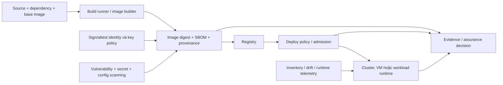

# Image Security trong Platform Assurance: bảo đảm an toàn image từ lúc xây dựng đến khi chạy

## 1. Image Security là gì?

Trong **Platform Assurance**, *image* chủ yếu là **hiện vật có thể được dùng để tạo hoặc chạy một môi trường tính toán**: container image theo chuẩn OCI, image máy ảo (VM image), golden image của máy chủ hoặc image dùng cho node/workload. Đây không phải hình ảnh đồ họa. Một image thường chứa hệ điều hành hoặc các thành phần runtime, thư viện, dependency và ứng dụng; những thành phần này trở thành một phần của bề mặt tấn công khi image được triển khai.

**Image Security** là tập các hoạt động kiểm soát để biết **image được tạo từ đâu, chứa những gì, do ai tạo/phê duyệt, có lỗ hổng hoặc dữ liệu bí mật không, có bị thay thế trên đường phân phối không, được cấu hình để chạy với quyền nào và image đang chạy có đúng là phiên bản đã được kiểm tra không**.

Trong module **SECURITY_SECURITY_ASSURANCE**, mục tiêu không chỉ là chạy một lần quét vulnerability. Chương trình phải cung cấp **bằng chứng có thể truy vết** rằng các mục tiêu bảo mật và security controls đã được đánh giá, gắn với phân tích rủi ro, yêu cầu, kiểm thử, audit, khắc phục phát hiện và tái xác minh trong phát triển/vận hành.

Một image quét “không có Critical” vẫn có thể không an toàn nếu:

- Bị kéo từ nguồn registry không đáng tin, chữ ký không được xác minh hoặc digest bị thay đổi.
- Chứa token, private key hoặc tệp cấu hình chứa dữ liệu nhạy cảm trong một layer cũ.
- Sử dụng dependency độc hại hoặc build process bị chiếm quyền dù scanner không biết CVE.
- Chạy với quyền root và quyền host quá rộng, hoặc được khởi chạy với cấu hình runtime thiếu an toàn.
- Image thực tế trên cluster khác digest đã scan/phê duyệt.
- Không được cập nhật khi xuất hiện lỗ hổng mới sau ngày build.

**Kết quả học tập:** người học có thể thiết kế baseline, kiểm tra nguồn gốc và nội dung image, đánh giá lỗ hổng theo ngữ cảnh, thiết lập chính sách registry/admission, thu bằng chứng lúc build và runtime, quản lý ngoại lệ và lập kế hoạch sửa hoặc thay image.

## 2. Các loại image cần đưa vào phạm vi

| Loại hiện vật | Thành phần chính | Bề mặt rủi ro đặc trưng | Cách kiểm chứng |
|---|---|---|---|
| **OCI/container image** | Layers filesystem, manifest, config, entrypoint | Base image, package, secrets trong layers, privilege, nguồn registry | Image scan, SBOM, digest, signature, provenance, workload/runtime check |
| **Golden VM image** | OS, packages, agent, cấu hình nền, đôi khi ứng dụng | Tài khoản mặc định, SSH key, dịch vụ thừa, kernel, hardening, bản vá | Image build log, OS inventory, CIS-like baseline, VM boot test |
| **Node image** cho cluster | OS, container runtime, agent, node bootstrap | Cấu hình host, runtime version, quyền node, cấp phát credential | Kiểm tra pipeline build và node đang chạy, rollout/replacement |
| **Machine snapshot/template** | Trạng thái disk từ hệ thống có sẵn | Credential tồn dư, dữ liệu nhạy cảm, drift từ image chuẩn | Scan artifact và kiểm tra nội dung/metadata snapshot |
| **Image cho serverless hoặc job** | Container hoặc package runtime theo dịch vụ | Dependency, quyền thực thi, nguồn registry/artifact | Verify image, service identity, runtime policy |

Giới hạn trách nhiệm cũng thay đổi: cloud provider có thể quản lý phần host của một nền tảng serverless nhưng **người dùng vẫn kiểm soát source/dependency, quyền ứng dụng, image và cấu hình trong phạm vi họ triển khai**. Với node image do provider quản lý, bằng chứng có thể là phiên bản/patch policy và trạng thái node, thay vì tự sửa nội dung image.

### Image, registry và workload không phải một đối tượng

- **Image** là nội dung và metadata của artifact.
- **Registry/repository** là hệ thống lưu trữ, phân phối, quản lý quyền đẩy/kéo và có thể có chính sách lưu trữ.
- **Workload** là nơi image được chạy với identity, quyền, filesystem, network, secret và tài nguyên thực tế.

Vì vậy, bảo đảm image chỉ là **một phần của platform security**. Phải kết hợp kiểm tra artifact với chính sách triển khai và runtime. Một image được xây sạch vẫn có thể tạo workload nguy hiểm nếu container được cấp quyền truy cập host filesystem hoặc service account quá mạnh.

## 3. Threat model và các ranh giới tin cậy

Một chuỗi cung ứng phần mềm có thể bị tấn công trước khi ứng dụng chạy. Image phải đi qua nhiều hệ thống, mỗi điểm có một **trust boundary**.



| Rủi ro | Điểm có thể sai | Điều cần chứng minh |
|---|---|---|
| **Image không đáng tin** | Registry hoặc base image bị thay thế | Nguồn được phê duyệt, digest và chữ ký/provenance hợp lệ theo chính sách |
| **Dependency dễ bị khai thác** | Package OS, framework, thư viện ứng dụng | Scan/SBOM, phiên bản, triage theo tác động và kế hoạch xử lý |
| **Secret bị nhúng** | Dockerfile, build args, layer, file đã xóa ở layer sau | Build secret đúng cách, image không chứa secret/credential |
| **Build pipeline bị chiếm** | CI token, runner, job không cô lập | Build identity, permissions, immutable artifact và provenance từ nguồn đáng tin |
| **Artifact bị thay trên đường phân phối** | Mutable tag, registry misconfiguration | Deploy bằng digest được phê duyệt; verify trước khi chạy |
| **Runtime quyền quá rộng** | Container root/privileged, capability, mount host | Policy, deployment spec và trạng thái Pod/VM thực tế |
| **Mất cập nhật sau ngày scan** | CVE mới, base image cũ, workload không được rollout | Tái đánh giá, lịch rebuild, inventory digest đang chạy |
| **Xóa/mất bằng chứng** | Registry GC, log không lưu, build không truy vết | Lưu metadata, digests, artifacts, retention và quyền truy cập |

Trước khi viết rule, cần xác định asset, attacker capability, điểm vào, hậu quả và control owner. Chẳng hạn một image dùng cho công cụ build có thể chứa credential tải dependency; một image runtime của API lại cần bảo đảm không mang theo các credential hoặc công cụ build đó.

## 4. Baseline an toàn cho image

Baseline là tập tiêu chí có thể kiểm tra đối với từng **loại image + mức độ rủi ro + môi trường**. Các control ID dưới đây chỉ là ví dụ cho bài học.

| Control ID | Yêu cầu | Bằng chứng tối thiểu |
|---|---|---|
| `IMG-SRC-01` | Base image và registry nguồn được phê duyệt | Registry/repository, digest, quyết định cho phép, lịch sử thay đổi |
| `IMG-BUILD-02` | Build theo quy trình kiểm soát, không nhúng credential | Source commit, build identity, Dockerfile/recipe, log, secret scan |
| `IMG-INVENTORY-03` | Có SBOM hoặc inventory gói phù hợp, gắn chính xác image | SBOM + digest, tool version, thời điểm, coverage/giới hạn |
| `IMG-VULN-04` | Vulnerability được triage và xử lý theo policy | Scan report gắn digest, trạng thái finding, owner, SLA/ngoại lệ |
| `IMG-INTEGRITY-05` | Image được định danh bất biến và xác minh nguồn gốc | Manifest digest, signature/attestation và policy verify |
| `IMG-RUNTIME-06` | Workload được chạy với quyền tối thiểu | Deployment spec, admission result, running state, runtime policy |
| `IMG-REGISTRY-07` | Quyền push/pull/delete và retention được quản trị | IAM registry, audit events, policy và inventory |
| `IMG-LIFECYCLE-08` | Image đang chạy được cập nhật khi có rủi ro mới | Rebuild/retest, rollout digest, runtime inventory và aging report |

Để tránh “pass trên giấy”, mỗi control nên được diễn đạt thành **điều kiện áp dụng + quan sát + quyết định**. Ví dụ, `IMG-INTEGRITY-05` có thể yêu cầu: “Mọi image production trong namespace đặt hàng phải có digest và xác minh được signature do identity CI được phê duyệt tạo cho repository tương ứng.” Một image ký bởi bất cứ ai không đáp ứng điều kiện đó.

### Baseline không phải một rule cho mọi workload

Image phát triển có thể có debugger và compiler; image production thường không nên chứa các công cụ không cần thiết. Mức yêu cầu cho container chạy dữ liệu nhạy cảm cần khác image demo cô lập. Tuy nhiên, môi trường dev cũng không được nhúng secret thật hoặc tạo lỗ hổng lan sang production thông qua registry/pipeline dùng chung.

## 5. Nguồn gốc và quản lý base image

**Base image** mang theo OS packages, runtime, CA trust store, timezone, shell và một số công cụ. Việc chọn base ảnh hưởng bề mặt tấn công và khả năng vá.

Các tiêu chí lựa chọn:

1. **Nguồn:** nhà phát hành, repository, registry hoặc bản phân phối được tổ chức chấp thuận; có kênh thông tin về bản vá và vòng đời hỗ trợ.
2. **Độ tối giản:** chỉ có thành phần runtime cần thiết, nhưng không làm mất khả năng vá/quan sát bắt buộc.
3. **Khả năng cập nhật:** biết version, ngày rebuild và cách nhận bản vá; tránh base image hết hỗ trợ.
4. **Kiến trúc:** `amd64`, `arm64` hoặc các biến thể cần deploy; kiểm tra đúng manifest cho kiến trúc chạy thực tế.
5. **Danh tính artifact:** giữ digest và thông tin nguồn thay vì chỉ một tag có thể được đổi trỏ.
6. **Bản quyền và compliance:** kiểm kê license/dependency nếu policy yêu cầu.

**Tag và digest:**

```text
registry.example.test/team/order-api:1.8.0
registry.example.test/team/order-api@sha256:<sha256-digest>
```

Tag như `:1.8.0` dễ đọc nhưng thường **có thể được gán lại**. Digest chỉ nội dung manifest hoặc index cụ thể và là định danh phù hợp cho xác minh bất biến. Với image đa kiến trúc, digest có thể chỉ tới **OCI image index**; runtime chọn manifest theo kiến trúc. Cần ghi rõ đã quét những kiến trúc nào và digest nào đang chạy.

**Digest không chứng minh image an toàn.** Nó chỉ giúp xác định nội dung và tránh thay đổi âm thầm so với digest đã chọn. Muốn tin vào nguồn phát hành cần thêm xác minh chữ ký/provenance, build policy và quy trình phê duyệt.

### Quy tắc để tránh phụ thuộc “latest”

Trong production, tránh dùng `latest` làm định danh duy nhất của bản phát hành. Một quy trình hợp lý:

- Resolve base image sang digest được phê duyệt ở thời điểm build.
- Scan base và output image; giữ SBOM/source revision.
- Xây lại định kỳ khi có bản vá (ngay cả khi code ứng dụng không thay đổi).
- Cập nhật digest mới sau khi kiểm thử và review; deploy theo digest.

Không nên pin digest rồi bỏ mặc nhiều tháng: **pinning tăng tính xác định**, không thay thế chiến lược cập nhật.

## 6. Dockerfile an toàn: ví dụ multi-stage Java

Ví dụ sau xây một ứng dụng Java thành JAR bằng Maven rồi dùng image runtime riêng. Nó minh họa một số thực hành, không phải Dockerfile áp dụng nguyên trạng cho mọi dự án.

```dockerfile
# Ví dụ học tập; trong production hãy thay base bằng digest đã duyệt.
FROM maven:3.9-eclipse-temurin-21 AS build
WORKDIR /src
COPY pom.xml ./
COPY src ./src
RUN mvn -B -DskipTests package

FROM eclipse-temurin:21-jre AS runtime
WORKDIR /app

# Không chạy ứng dụng với root nếu không có nhu cầu thực tế.
RUN groupadd --system appgroup \
    && useradd --system --gid appgroup --home-dir /app appuser

COPY --from=build --chown=appuser:appgroup \
    /src/target/app.jar /app/app.jar

USER appuser
EXPOSE 8080
ENTRYPOINT ["java", "-jar", "/app/app.jar"]
```

**Giả định cần biết:** ví dụ giả định `mvn package` tạo `target/app.jar` và runtime base có `groupadd/useradd`. Tên JAR, hành vi plugin đóng gói, cách tạo user và filesystem có thể khác theo dự án/base. `-DskipTests` chỉ được dùng ở **bước package minh họa**; trong pipeline thực tế test phải được chạy tại job bắt buộc khác và có evidence, không dùng tham số này để bỏ qua kiểm thử. Không coi `EXPOSE 8080` là cổng đã được firewall giới hạn.

### Vì sao multi-stage giúp bảo mật?

- Build image có compiler, Maven và cache; runtime image không cần mang toàn bộ công cụ build đó.
- Image runtime nhỏ hơn thường giảm số thành phần phải vá và phạm vi scanner cảnh báo, nhưng **nhỏ hơn không đồng nghĩa chắc chắn an toàn hơn**.
- Không chạy root trong container giảm một phần tác động của compromise, nhưng chưa giải quyết quyền service account, Linux capabilities, privileged mode hoặc lỗ hổng kernel/container runtime.
- Kết quả build được copy từ stage trước; cần đảm bảo build stage không bị chèn artifact độc hại và dependency được quản lý.

### Checklist thực hành Dockerfile

| Thực hành | Vì sao | Điều phải kiểm chứng |
|---|---|---|
| Dùng base đã duyệt, pin digest | Giảm nguy cơ base bị thay không kiểm soát | Manifest digest, nguồn, policy phê duyệt |
| Multi-stage, tối thiểu công cụ | Giảm bề mặt tấn công runtime | Runtime filesystem không có tool/credential build |
| Chạy non-root | Giảm quyền tiến trình | Image `USER` và actual runtime UID/GID |
| Không lưu secret trong `ARG`/`ENV` hoặc `COPY` | Secret có thể còn trong layer/history/metadata | Secret scan trên **toàn bộ image và build output** |
| Giới hạn file đưa vào build context | Tránh copy `.git`, key, cấu hình local | `.dockerignore`, source tree và image layer inspection |
| Kiểm tra dependency và OS packages | Giảm vulnerable components | SBOM, scanner, triage, rebuild |
| Không cài package không cần | Giảm attack surface và gánh bảo trì | Package inventory và quy trình update |
| Thiết lập quyền file thích hợp | Hạn chế sửa trái phép và lỗi runtime | Permission thực tế, `readOnlyRootFilesystem` nếu áp dụng |

Ví dụ `.dockerignore` phù hợp cần tùy cấu trúc dự án:

```gitignore
.git
.idea
.vscode
.env
*.pem
*.key
target/
node_modules/
secrets/
```

`.dockerignore` giúp giảm dữ liệu có thể lọt vào build context, **không** thay thế kiểm tra secret và quy trình quản lý build credential. Không đặt secret trong file của repository rồi coi việc exclude ở Docker build là đủ an toàn.

### Build secret đúng cách

Nếu builder cần token để tải dependency private, ưu tiên **secret mount/credential injection có kiểm soát, thời hạn ngắn** được hệ thống build hỗ trợ; không truyền password vào Dockerfile `ENV` hoặc `ARG`, không copy credential rồi xóa ở layer sau. Dữ liệu đã nằm trong layer cũ hoặc build log có thể vẫn khôi phục được dù file không xuất hiện ở filesystem cuối.

Đối với image VM/golden image, nguyên tắc tương tự: không bake SSH private key, API token, user password hay machine identity tái sử dụng vào template. Bootstrap nên cấp identity/secret lúc triển khai theo policy, và image phải được làm sạch dấu vết nhạy cảm trước khi publish.

## 7. Software Bill of Materials (SBOM) và kiểm kê thành phần

**SBOM** là danh sách có cấu trúc về các thành phần phần mềm của một artifact: package OS, thư viện ứng dụng, dependency, phiên bản, quan hệ và các metadata liên quan. Các định dạng phổ biến bao gồm SPDX và CycloneDX; lựa chọn định dạng cần phù hợp với công cụ, yêu cầu trao đổi và mức chi tiết cần kiểm chứng.

SBOM có ích để trả lời:

- Image này có phiên bản Java, OpenSSL, glibc hoặc thư viện ứng dụng nào?
- Có package nào đang hết hỗ trợ hoặc phụ thuộc vào thành phần có CVE đã công bố?
- Khi một dependency mới bị phát hiện có vấn đề, những digest nào chịu ảnh hưởng?
- Sau khi rebuild, thành phần cần vá đã được thay thế ở **image xuất ra thực tế** chưa?

**SBOM không phải chứng nhận “không có lỗ hổng”.** Inventory có thể thiếu dependency được tải lúc runtime, mã đóng gói tĩnh, binary không được nhận diện hoặc thành phần bên ngoài image. Cần ghi tool/version, chiến lược phân tích, phạm vi và những thành phần chưa xác định.

### 7.1. Tạo SBOM trên artifact cuối cùng

Ví dụ lệnh trong môi trường được phép, giả sử đã cài công cụ và được cấp quyền đọc image:

```bash
# Placeholder <digest> phải thay bằng digest thật của manifest/image.
syft registry.example.test/team/order-api@sha256:<digest> \
  -o spdx-json=sbom.spdx.json
```

Đây là **ví dụ cú pháp định hướng**, không phải lệnh chạy nguyên văn với `<digest>`. Phiên bản công cụ cần được kiểm tra theo tài liệu đang triển khai. Nếu dùng PowerShell, shell escape và cách redirect có thể khác. SBOM nên được tạo/đối chiếu trên **image đã build và push**, không chỉ trên source repository, vì runtime image có thể khác dependency trong source.

Một bản ghi evidence có thể giữ:

```yaml
sbom:
  artifact_digest: "sha256:<actual-manifest-digest>"
  format: SPDX-JSON
  generated_by: "syft/<recorded-version>"
  generated_at: "<timestamp-in-UTC>"
  file: sbom.spdx.json
  inventory_limitations:
    - "Runtime-downloaded plugins not included"
```

Giá trị trong ví dụ là placeholder. Nếu ứng dụng tải plugin hoặc model động sau khi chạy, phải quản lý chúng như một thành phần khác trong inventory; SBOM của image tại build không tự bao gồm nội dung phát sinh sau triển khai.

### 7.2. Ràng buộc SBOM với digest

Một SBOM được tạo cho tag `order-api:1.8.0` hôm trước có thể không còn đúng nếu tag được gán lại hôm nay. Vì vậy cần lưu **subject digest**, kiến trúc image, build ID và nguồn gốc SBOM; có thể đính kèm hoặc ký attestation theo quy trình chuỗi cung ứng. SBOM ở một digest không được dùng mặc nhiên làm chứng cứ cho image cùng tag nhưng digest khác.

## 8. Quét lỗ hổng và đánh giá phát hiện theo ngữ cảnh

**Vulnerability scanner** so sánh package/version, metadata và các nguồn lỗ hổng để phát hiện thành phần có khả năng bị ảnh hưởng. Scanner cũng có thể kiểm tra cấu hình hoặc secret tùy sản phẩm. Kết quả phải được coi là **tín hiệu cần xác minh**, không là kết luận duy nhất về khả năng khai thác.

### 8.1. Quét đúng artifact và đúng thời điểm

| Thời điểm | Câu hỏi | Lý do |
|---|---|---|
| Khi chọn base image | Base có issue nghiêm trọng hoặc hết hỗ trợ không? | Tránh kế thừa rủi ro ngay từ đầu |
| Trong PR/build | Thay đổi code/dependency làm xuất hiện issue mới không? | Phản hồi sớm cho developer |
| Sau build cuối/push | Artifact thực tế chứa gì? | Không phụ thuộc chỉ vào source hoặc intermediate stage |
| Trước deploy | Digest dự định triển khai có đạt policy hiện hành không? | Tag hoặc image có thể thay sau scan |
| Theo lịch sau deploy | Có CVE mới hoặc threat intelligence mới ảnh hưởng digest đang chạy không? | Trạng thái rủi ro thay đổi theo thời gian |
| Sau rebuild/retest | Image mới đã loại bỏ thành phần bị lỗi và đang chạy thật chưa? | “Đã sửa source” chưa chứng minh runtime đã thay |

Ví dụ lệnh quét registry artifact bằng một công cụ vulnerability:

```bash
grype registry.example.test/team/order-api@sha256:<digest> \
  -o json > vulnerabilities.json
```

Lệnh minh họa phụ thuộc công cụ và quyền registry đang dùng. **Đọc báo cáo bằng chứng phải kèm database cập nhật đến thời điểm nào**: kết quả một lần quét có thể đổi khi nguồn dữ liệu CVE hoặc thông tin ảnh hưởng package thay đổi.

### 8.2. Severity, reachability và exploitability

Một vulnerability record có thể gồm CVE, package, installed version, fixed version, nguồn advisory và mức severity. Nhưng severity trong feed khác **mức ưu tiên khắc phục của workload**.

Khi triage, xét:

1. **Đúng thành phần không?** Phiên bản, distro, packaging, kiến trúc, bản vá backport có được scanner nhận diện đúng?
2. **Thành phần có nằm trong image chạy không?** Đôi khi finding chỉ thuộc build stage, cache hoặc thành phần không được đưa vào runtime image.
3. **Vulnerable code có được sử dụng không?** Reachability evidence có thể giúp ưu tiên nhưng thiếu chứng minh reachability không có nghĩa rủi ro bằng 0.
4. **Điều kiện khai thác?** Cần mạng, xác thực, quyền tương tác, cấu hình dễ bị ảnh hưởng hay dữ liệu không tin cậy?
5. **Bề mặt phơi bày?** Internet-facing, nội bộ, worker cô lập, chạy với quyền nào?
6. **Có bản vá và phương án cập nhật không?** Update package, base image, runtime, loại dependency hoặc giảm thiểu tạm thời.
7. **Có thông tin bị khai thác thực tế?** Nếu tổ chức có nguồn threat intelligence đáng tin, ghi nguồn và thời điểm để hỗ trợ ưu tiên.

**Không xóa finding chỉ vì chưa có exploit công khai hoặc image đang chạy non-root.** Ngược lại, không nhất thiết chặn mọi CVE có điểm số cao nếu cần đánh giá tính áp dụng và có quy trình ngoại lệ rủi ro được phê duyệt.

### 8.3. Phân biệt TP, FP, inconclusive và accepted risk

| Trạng thái | Nội dung kết luận | Hành động |
|---|---|---|
| **True positive** | Package/binary bị ảnh hưởng thực sự xuất hiện trong artifact được kiểm tra | Đánh giá rủi ro, fix/rebuild hoặc biện pháp bù trừ |
| **False positive** | Bằng chứng cụ thể cho thấy scanner ghép sai phiên bản/ảnh hưởng theo advisory | Lưu link chứng cứ, rule/source, người review |
| **Inconclusive** | Không đủ thông tin để xác nhận package/version hoặc đường dẫn image | Bổ sung SBOM, metadata, image layer hoặc nguồn advisory |
| **Not applicable** | Control không áp dụng với loại artifact/tài sản xác định | Ghi rationale theo baseline |
| **Accepted risk** | Rủi ro còn tồn tại nhưng được người có thẩm quyền chấp nhận có điều kiện | Owner, compensating controls, expiry và review trigger |
| **Verified fixed** | Rebuild và scan image mới; không còn điều kiện lỗi, rollout được xác nhận | Giữ digest cũ/mới và bằng chứng runtime |

**False positive không phải “không có cách sửa”**. Một image vẫn chứa thư viện dễ bị ảnh hưởng nhưng chưa có bản vá phải đi theo quy trình xử lý/chấp nhận rủi ro, không đổi nhãn thành FP.

### 8.4. Đừng quên secret, malware và license

Vulnerability scan dựa trên CVE thường **không phát hiện** credential đã bị copy vào layer, mã độc tùy biến hoặc một số vấn đề license. Cần kiểm tra tách biệt, chẳng hạn secret scanning trong source/build/image, chính sách nguồn dependency, đánh giá package bất thường và kiểm tra license khi có yêu cầu. Quét thiếu quyền hoặc không hỗ trợ định dạng không thể được ghi thành “pass”.

## 9. Image signing, provenance và attestation

**Image signature** giúp chứng minh một chủ thể ký đã phê chuẩn hoặc xác nhận một **digest** theo một cơ chế mật mã cụ thể. **Provenance/attestation** ghi các tuyên bố về quá trình build: source revision, builder identity, materials, parameters, thời điểm và artifact output. Các tiêu chuẩn/hệ sinh thái như OCI, in-toto và SLSA cung cấp khái niệm hoặc định dạng liên quan, nhưng việc sử dụng đúng phải dựa vào chính sách kiểm chứng cụ thể của tổ chức.

### 9.1. Signature không tự chứng minh “an toàn”

Giả sử một image bị chèn thư viện độc hại trước khi build, sau đó pipeline hợp lệ ký digest. Signature có thể xác thực **ai đã ký artifact nào**, nhưng không thể tự cho biết thư viện đó an toàn. Tương tự, provenance đáng tin chứng minh quy trình được khai báo và identity builder theo mức đảm bảo của hệ thống, nhưng không tự chứng minh code không có bug.

Một chính sách thường cần kiểm tra đồng thời:

- **Artifact identity:** digest đúng là đối tượng đang được deploy.
- **Signer/builder identity:** thuộc tổ chức hoặc nguồn được phê duyệt.
- **Repository/source:** đúng repo, nhánh/ref và commit theo deployment policy.
- **Build workflow:** từ builder/phương pháp được chấp nhận, không từ runner tùy ý.
- **Attestation claims:** subject digest, materials và bước kiểm tra cần thiết khi có.
- **Verification material:** chứng chỉ/khóa/tín nhiệm và thông tin hết hạn, thu hồi, sự kiện audit theo cơ chế dùng.

### 9.2. Ví dụ xác minh chữ ký với key-based policy

Trong hệ thống đã cấu hình `cosign` và phân phối **public key đáng tin cậy qua kênh được kiểm soát**, một ví dụ:

```bash
cosign verify \
  --key trusted-image-signing.pub \
  registry.example.test/team/order-api@sha256:<digest>
```

Lệnh chỉ minh họa: thay `<digest>` bằng digest thật và xác minh cách dùng CLI theo phiên bản triển khai. Chỉ dùng public key tải từ **nguồn đã được xác thực**; nếu kẻ tấn công có thể thay cả image và public key đối chiếu, phép kiểm chữ ký không thiết lập được nguồn tin cậy. Nếu dùng keyless signing, policy còn phải kiểm tra identity/issuer được phép và dữ liệu transparency/certificate theo cơ chế triển khai.

### 9.3. Provenance và SBOM attestation

Một pipeline có thể lưu ba loại chứng cứ gắn cùng digest:

```text
registry.example.test/team/order-api@sha256:<digest>
  ├─ vulnerability-scan.json    (scanner/database/time)
  ├─ sbom.spdx.json             (package inventory)
  ├─ provenance.attestation     (source commit + builder + materials)
  └─ image signature            (approved signer / certificate identity)
```

Các tệp hoặc attestation phải gắn với **đúng subject digest**. Cần biết artifact được ký **bởi chủ thể nào**, có được tạo từ builder đã duyệt và có bị thay thế sau khi policy pass hay không. Nếu một người có quyền push tag nhưng không có quyền ký bằng identity đã duyệt, admission policy có thể chặn artifact không đạt điều kiện.

## 10. Bảo mật registry và phân phối image

Registry không chỉ là nơi lưu file. Nó là **điểm tin cậy trung gian** giữa build và runtime, có quyền upload, pull, retag, xóa và quản lý metadata/attestation.

### 10.1. Các kiểm soát nên đánh giá

| Kiểm soát | Câu hỏi | Bằng chứng |
|---|---|---|
| **Repository allowlist** | Image được phép đến từ registry/namespace nào? | Admission policy, build config, repo list |
| **Authentication/authorization** | Ai có quyền pull/push/delete/retag? | IAM, service identity, RBAC registry |
| **Credential lifecycle** | CI và cluster có dùng credential thời hạn ngắn hoặc cơ chế an toàn? | Auth method, scope, rotation/revocation policy |
| **Transport security** | Registry được truy cập qua TLS và trust store đã kiểm soát? | Endpoint configuration, client settings |
| **Tag immutability** | Tag release có bị ghi đè được không? | Registry policy và event audit |
| **Image retention** | Digest/attestation cần cho rollback, audit, incident có còn truy xuất được? | Retention rule, artifact inventory |
| **Audit** | Có nhận diện push/delete/change policy và principal không? | Registry events, log destination, retention |
| **Replication/mirror** | Mirror có giữ đúng digest và metadata cần verify không? | Digest đối chiếu, quy trình đồng bộ, kiểm tra signature |

Các registry có thể có cơ chế bảo vệ khác nhau. Nếu tag đã bị thay, chỉ log “đã deploy version 1.8” không đủ tái lập chính xác artifact; **digest trong deployment record** mới có khả năng liên kết tới bản đã scan.

### 10.2. Tránh lộ pull/push credential

Không nhúng registry password vào Dockerfile, image config, biến môi trường ghi log hoặc manifest public. Ưu tiên workload identity/CI identity có scope hẹp. Credential cho pull ở cluster không cần quyền push; quyền xóa image cần phân tách khỏi quyền đọc. Với multi-tenant registry, kiểm tra isolation giữa repository của các đội.

### 10.3. Image retention và điều tra

Garbage collection có thể xóa image cũ sau khi tag bị chuyển, trong khi incident response hoặc rollback còn cần digest đó. Retention nên cân bằng chi phí với yêu cầu audit, phục hồi và pháp lý. Nếu không thể giữ image cũ, ít nhất phải lưu metadata/manifest, SBOM, provenance và scan report đúng nguồn; nhưng **metadata không hoàn toàn thay được artifact gốc** khi cần tái dựng hoặc phân tích forensic.

## 11. Triển khai an toàn: policy, admission và runtime

Một image có nguồn gốc hợp lệ vẫn có thể được sử dụng sai. Trước khi workload chạy, nền tảng cần kiểm tra **artifact identity và security posture của deployment**.

### 11.1. Kiểm tra tại admission

Đối với Kubernetes, admission controller hoặc policy engine có thể kiểm tra yêu cầu trước khi workload được tạo/cập nhật:

1. Image đến từ registry/repository được cho phép.
2. Image được định danh bằng **digest**, không chỉ một tag có thể thay đổi.
3. Chữ ký hoặc attestation hợp lệ và gắn đúng digest.
4. Source/builder/signer identity phù hợp quy định, không chỉ “có chữ ký”.
5. Scan/risk decision còn hiệu lực theo policy, gồm ngoại lệ được duyệt.
6. Pod/deployment không yêu cầu cấu hình bị cấm như `privileged: true` hoặc hostPath nguy hiểm.

**Chú ý ranh giới thời điểm kiểm tra:** admission chỉ đánh giá request được gửi vào API server và dữ liệu policy tại thời điểm đó. Nó không tự bảo đảm image đã được scan sau khi có CVE mới, không phát hiện mọi hành vi runtime và không luôn ngăn image đã chạy trước khi policy được bật. Cần cơ chế tái đánh giá và kiểm kê các workload hiện hữu.

### 11.2. Ví dụ Deployment theo nguyên tắc quyền tối thiểu

Ví dụ sau minh họa một phần cấu hình. Chuỗi `<verified-64-hex-digest>` phải được thay bằng digest thật trước khi dùng; các tham số Kubernetes, filesystem và cơ chế đăng nhập registry phải phù hợp ứng dụng và cluster:

```yaml
apiVersion: apps/v1
kind: Deployment
metadata:
  name: order-api
  namespace: orders
spec:
  replicas: 2
  selector:
    matchLabels:
      app: order-api
  template:
    metadata:
      labels:
        app: order-api
    spec:
      securityContext:
        seccompProfile:
          type: RuntimeDefault
      containers:
        - name: app
          image: registry.example.test/team/order-api@sha256:<verified-64-hex-digest>
          securityContext:
            runAsNonRoot: true
            allowPrivilegeEscalation: false
            readOnlyRootFilesystem: true
            capabilities:
              drop: ["ALL"]
          ports:
            - containerPort: 8080
          volumeMounts:
            - name: temporary
              mountPath: /tmp
      volumes:
        - name: temporary
          emptyDir: {}
```

**Đây không phải cấu hình production đầy đủ.** Ứng dụng cần được kiểm tra khả năng chạy với read-only root filesystem và thư mục `/tmp`, có thể cần `runAsUser/runAsGroup` cụ thể, resource requests/limits, probes, NetworkPolicy và `serviceAccountName` hạn chế quyền. `emptyDir` ghi được và có vòng đời theo Pod; ứng dụng có nhu cầu lưu trữ bền vững phải thiết kế volume và quyền phù hợp. Admission rule về image và runtime là các control bổ sung, không thay thế nhau.

### 11.3. Phân biệt image được khai báo với image đang chạy

Đối với Kubernetes, cần so sánh:

- **Desired image:** deployment/pod template dùng repository/tag/digest nào?
- **Resolved/running image:** container runtime báo image ID và digest nào sau khi pull?
- **Policy evaluation:** digest đó có trong evidence scan/signature/approval không?
- **Runtime settings:** effective UID, capability, mount, seccomp, service account và quyền network có phù hợp baseline không?

Ví dụ lệnh quan sát trên namespace được phép:

```bash
kubectl -n orders get deploy order-api -o yaml
kubectl -n orders get pods -l app=order-api -o json
```

Trong JSON Pod, thường có trường `spec.containers[].image` và `status.containerStatuses[].imageID`. Định dạng `imageID` phụ thuộc container runtime; không nên giả định chuỗi này luôn giống hệt digest OCI index trong manifest source. Với multi-architecture image, registry index digest và manifest digest của từng platform có thể khác; cần đối chiếu đúng mối quan hệ.

**Điểm cốt lõi:** chạy `kubectl get deploy` cho thấy ý định rollout, nhưng không chứng minh mọi Pod đã chuyển sang image mới. Phải kiểm tra trạng thái rollout, Pod thực tế, ReplicaSet cũ và những workload/job khác thuộc scope.

## 12. VM và golden image: những điều container scan không bao phủ

Với VM/golden image, image có thể bao gồm **toàn bộ filesystem của hệ điều hành, package, systemd services, network configuration, local accounts và agent**. Vì thế kiểm soát cần mở rộng ngoài CVE.

### 12.1. Quá trình tạo golden image

1. Chọn **base OS image đáng tin**, ghi publisher, version, image ID và thời điểm.
2. Áp dụng hardening baseline theo hệ điều hành và mục đích của máy.
3. Cài đúng agent/workload cần thiết, loại bỏ service/package không dùng.
4. Áp dụng security updates, kiểm tra cấu hình SSH/RDP, host firewall, audit, logging.
5. Xóa credential, machine identity và dữ liệu build không được phép tồn tại trong template.
6. Scan vulnerability/secret/config; ghi bằng chứng và ngoại lệ.
7. **Khởi động VM thử nghiệm từ image** để xác minh bootstrap, quyền, agent và kết nối.
8. Publish image version/ID bất biến theo cơ chế dịch vụ; triển khai bằng version đã duyệt.
9. Theo dõi instance đang chạy có dùng đúng image hay không, và thay thế/patch khi cần.

Một image đạt scan tại thời điểm tạo nhưng các VM đã khởi chạy nhiều tháng trước có thể có **runtime drift** khác image gốc: package được nâng cấp riêng, credential thay đổi hoặc agent không hoạt động. Kiểm chứng golden image phải được nối với **fleet patch/compliance monitoring**.

### 12.2. Hardening không phải quét CVE

| Nhóm | Câu hỏi thực tế |
|---|---|
| Accounts / authentication | Có user mặc định, mật khẩu dùng chung, SSH key còn sót? |
| OS services | Có service không cần thiết đang bật/listen? |
| Access control | SSH/RDP, sudo, local policy và host firewall có phù hợp? |
| Logging / audit | Sự kiện quản trị, xác thực và thay đổi cấu hình có được ghi? |
| Updates | Kernel/agent/runtime có bản vá, có kế hoạch reboot hoặc restart cần thiết? |
| Image cleanliness | Có dữ liệu người dùng, secret, cache token hoặc file dump để lại? |
| Boot/restore | Instance mới khởi chạy ổn định từ image và đăng ký đúng quản lý cấu hình? |

Nếu cloud provider quản lý node image, cần xác minh **release/version, lịch update và trạng thái node pool**, không suy đoán người sử dụng có thể sửa trực tiếp image do provider duy trì.

## 13. Minh họa quy trình bảo đảm một image Java API

### 13.1. Tình huống

Nhóm phát triển `order-api` từ commit giả lập `abc123`. Image dùng một JRE base được duyệt, build trong CI, đẩy lên registry nội bộ rồi triển khai ở namespace `orders`. Security requirement:

> **`IMG-PROD-01`:** Workload production chỉ được chạy image có digest thuộc repository được duyệt, được build và ký bởi workflow CI đáng tin, đã được scan và triage theo policy hiện hành.

Yêu cầu thứ hai:

> **`IMG-RUNTIME-02`:** Workload API chạy non-root, không privileged, không được mount host filesystem ngoài ngoại lệ có phép, và sử dụng service identity có quyền tối thiểu.

Hai yêu cầu này có **nguồn bằng chứng khác nhau**: yêu cầu thứ nhất cần chứng cứ chuỗi cung ứng; yêu cầu thứ hai cần kiểm tra cấu hình và trạng thái runtime.

### 13.2. Các bước kiểm tra có đối chứng

| Bước | Expected | Bằng chứng |
|---|---|---|
| Build | Từ source commit và base đã duyệt | Commit ID, runner/builder identity, build log |
| Package/SBOM | Inventory cho image cuối đúng digest | SBOM, package inventory và tool version |
| Scan | Không còn finding vượt ngưỡng mà chưa được xử lý | Scan report, policy, decision/exception |
| Sign/attest | Subject đúng digest và identity CI được phép | Signature verification và provenance |
| Push | Registry/repository hợp lệ, digest không bị thay | Registry event, manifest digest |
| Deploy | Deployment trỏ digest được duyệt | Manifest/PR/deploy event |
| Admission | Policy từ chối image không đạt tiêu chí | Admission result, policy revision |
| Runtime | Running image ID khớp artifact đã xác minh qua quan hệ manifest đúng | Pod status, rollout, runtime security settings |
| Recheck | Digest đang chạy được đánh giá lại khi có thông tin CVE mới | Scheduled scan, inventory, triage |

Không kiểm thử admission bằng cách đưa image không đáng tin lên production. Tạo **namespace hoặc cluster thử được ủy quyền**, dùng artifact vô hại không có chữ ký phù hợp, xác minh policy chặn và quan sát event; tránh làm gián đoạn workload thật.

### 13.3. Một ca lỗi: image ký đúng nhưng không đúng build

Giả sử registry có hai manifest:

```text
order-api:1.8.0 → sha256:AAAA...   (build đã kiểm tra)
order-api:1.8.0 → sha256:BBBB...   (tag bị gán lại về sau)
```

Các chuỗi `AAAA...`/`BBBB...` chỉ minh họa hai digest khác nhau, không phải SHA-256 thực. Nếu deployment chỉ giữ `:1.8.0`, nhóm có nguy cơ rollout image B trong khi báo cáo scan/chữ ký của build A được đưa vào hồ sơ. Bài kiểm tra phải so sánh digest thực tế và policy; chữ ký hợp lệ của **A** không chứng minh **B** đạt yêu cầu.

**Tương tự:** một signer đáng tin có thể ký cả image B. Nếu policy quy định B phải đến từ commit/branch/workflow được duyệt nhưng provenance không khớp, image vẫn phải bị chặn hoặc chờ review. Vì vậy **verify signer + provenance + digest + policy** tốt hơn “có chữ ký là pass”.

### 13.4. Xử lý sau phát hiện

Giả sử B chứa một dependency nghiêm trọng theo policy. Nhóm cần:

1. Xác minh finding đúng package/version và digest, có dữ liệu về bản sửa.
2. Đánh giá có image B thực sự chạy trong workload nào không; xác định thời điểm và phạm vi.
3. Cập nhật dependency hoặc base rồi rebuild; không sửa thủ công filesystem của container đang chạy rồi gọi đó là đã fix image.
4. Quét lại image mới `sha256:CCCC...`, tạo SBOM và chứng cứ nguồn gốc mới.
5. Ký/attest digest mới theo pipeline được phép, triển khai rollout và kiểm tra Pod đã chuyển sang digest mới.
6. Lưu ticket, commit, run IDs, bằng chứng scan trước/sau và điều kiện retest.

Nếu không có bản vá, áp dụng quyết định xử lý rủi ro có thẩm quyền: giảm quyền, cô lập mạng, tắt chức năng dễ bị ảnh hưởng hoặc hạn chế exposure theo tình huống; ghi hạn xem lại. Không thay đổi nhãn finding thành FP chỉ vì chưa có fix.

## 14. Evidence package: chứng minh chuỗi image đến runtime

Một bằng chứng tốt không phải một ảnh dashboard scanner. Nó là **hồ sơ có nguồn gốc, đối tượng và phép thử xác định**, đủ để reviewer đối chiếu từ code đến artifact và runtime.

### 14.1. Những thành phần nên có

| Thành phần | Trường quan trọng | Vai trò |
|---|---|---|
| **Image identity** | Registry, repository, digest, kiến trúc, tag ở thời điểm build | Định danh artifact được đánh giá |
| **Build metadata** | Commit, CI job, builder identity, base digest, tool versions, timestamp | Truy vết nguồn và điều kiện tạo |
| **SBOM** | Subject digest, format, generator, output | Thấy package inventory và giới hạn |
| **Scan report** | Subject digest, scanner/database timestamp, findings, verdict | Đánh giá rủi ro thành phần |
| **Signature/provenance** | Subject digest, signer/builder identity, verification result | Xác minh nguồn gốc theo trust policy |
| **Registry metadata** | Push event, permissions, retention, revision | Chứng minh phân phối và kiểm soát artifact |
| **Deployment evidence** | GitOps/manifest, desired digest, approval, policy revision | Chứng minh quyết định triển khai |
| **Runtime evidence** | Pod/VM ID, resolved image identity, security context, thời điểm | Chứng minh thứ thực sự chạy |
| **Triage/remediation** | Finding ID, owner, classification, exception, fix, retest | Khép vòng kiểm soát và quyết định |
| **Coverage** | Cluster, namespace, architecture, environment không được quét | Giới hạn kết luận |

### 14.2. Manifest ví dụ

```yaml
evidence_id: IMG-EV-DEMO-006
service: SECURITY_SECURITY_ASSURANCE
control_ids:
  - IMG-PROD-01
  - IMG-RUNTIME-02
collected_at: "2026-11-28T04:30:00Z"
artifact:
  repository: registry.example.test/team/order-api
  digest: "sha256:<actual-sha256-digest>"
  architecture: linux/amd64
  source_commit: example-commit-abc123
build:
  workflow: approved-image-build
  run_id: CI-EXAMPLE-204
  builder_identity: approved-builder-identity
  base_digest: "sha256:<approved-base-digest>"
checks:
  sbom: artifacts/sbom.spdx.json
  vulnerability_scan: artifacts/vulnerability-scan.json
  secret_scan: artifacts/secret-scan.json
  signature_verification: artifacts/verify-signature.json
  provenance_verification: artifacts/verify-provenance.json
deployment:
  environment: staging
  namespace: orders
  workload: order-api
  desired_digest: "sha256:<actual-sha256-digest>"
  observed_image_ref: artifacts/pod-images-redacted.json
  admission_result: approved-by-policy
  admission_policy_revision: policy-example-r6
assessment:
  classification: passed_for_tested_scope
  reviewer: security-assurance-reviewer
limits:
  - "Only selected staging namespace and linux/amd64 checked"
```

Mẫu trên là **minh họa, không phải chứng cứ thực tế**. Trạng thái `approved-by-policy` và `passed_for_tested_scope` chỉ được dùng khi kết quả kiểm tra thực sự hỗ trợ. Mọi digest placeholder, thời điểm và danh tính phải được thay bằng dữ liệu được thu thập; không ký một manifest với giá trị giả để làm evidence.

### 14.3. Cấu trúc lưu trữ gợi ý

```text
image-assurance/
  run-manifest.yml
  image-identity.json
  build-provenance.json
  sbom.spdx.json
  vulnerability-scan.json
  secret-scan.json
  signature-verification.json
  admission-policy-result.json
  deployed-workloads-redacted.json
  findings-and-decisions.md
  retest-summary.md
  checksums.sha256
```

Nếu tính checksum, phải ghi rõ **file nào đã được hash và bản nào được khử nhạy cảm**. Hash chỉ chứng minh bản file so với giá trị đối chiếu, không tự xác nhận người tạo hay toàn bộ dữ liệu bên trong là đúng. Kho bằng chứng cần phân quyền, audit và retention phù hợp; tránh công khai registry credentials, token CI, key ký riêng, các chi tiết nội bộ nhạy cảm hoặc log chứa secret.

## 15. CI/CD quality gate và quản lý chính sách

Một pipeline hợp lý cần chặn việc đẩy hoặc triển khai image không đủ bằng chứng **mà không che giấu trạng thái kiểm tra thất bại**.

### 15.1. Quy trình tham khảo

```text
1. Checkout commit đã chọn; xác định repo và build identity.
2. Kiểm tra source, dependency và cấu hình Dockerfile/VM recipe.
3. Build artifact trong môi trường được kiểm soát, không nhúng secret.
4. Xác định digest của image cuối, ghi base và architecture.
5. Tạo SBOM, secret scan, vulnerability scan và đánh giá policy.
6. Triage finding mới; xử lý hoặc có quyết định ngoại lệ hợp lệ.
7. Tạo provenance/attestation và ký digest bằng identity được phê duyệt.
8. Publish registry; xác minh signature và subject digest sau push.
9. Deploy bằng digest, áp dụng admission và runtime policy.
10. Đối chiếu image đang chạy, coverage, rollout và runtime settings.
11. Lưu evidence package, lập lịch rescan và theo dõi image aging.
```

### 15.2. Các trạng thái quality gate

| Trạng thái | Ý nghĩa | Cách xử lý |
|---|---|---|
| **PASS** | Các control bắt buộc có bằng chứng hợp lệ trong phạm vi | Có thể tiếp tục theo change policy |
| **FAIL** | Có vi phạm policy được xác nhận và chưa xử lý | Chặn hoặc escalate theo quy định |
| **PENDING_REVIEW** | Finding chưa triage hoặc đang chờ phê duyệt | Không tự động chuyển thành PASS |
| **INCOMPLETE** | Scanner, registry, attestation hoặc runtime check không chạy được | Báo lỗi thực thi, khắc phục việc thiếu bằng chứng |
| **EXCEPTION_APPROVED** | Vi phạm có thật được chấp nhận có điều kiện, còn hiệu lực | Theo dõi scope, owner, expiry và điều kiện rà soát |

**Không đánh đồng scanner lỗi với “0 lỗ hổng”.** Ví dụ job hết quyền pull image hoặc database của scanner không được tải về: đây là trạng thái **INCOMPLETE**, không phải image an toàn.

### 15.3. Policy revision và hiệu lực đánh giá

Mỗi báo cáo cần ghi **phiên bản policy** và thời điểm quyết định. Một image từng đạt gate có thể không còn đạt khi vulnerability database, yêu cầu signer hoặc security baseline thay đổi. Điều đó không có nghĩa artifact tự biến đổi; **ngữ cảnh đánh giá đã đổi**. Cần có lịch tái đánh giá theo mức rủi ro và cơ chế cập nhật/rút quyền triển khai khi cần.

## 16. Image lifecycle: bản vá, ngoại lệ, rebuild và rollback

Image không tồn tại độc lập với runtime: khi OS package hoặc framework phát sinh lỗ hổng mới, image cũ vẫn có rủi ro dù không ai thay đổi source code. Vì thế phải có quy trình **continuous image assurance**.

### 16.1. Rebuild khác update trực tiếp trong container

- **Rebuild image:** lấy base/dependency đã được cập nhật, build artifact mới, scan, ký và phát hành digest mới.
- **Rollout:** chuyển workload sang digest mới, kiểm tra behavior và chính sách runtime.
- **Patch trực tiếp trong container đang chạy:** có thể làm trạng thái runtime khác artifact đã ký, khó tái lập và có thể bị mất khi container khởi tạo lại. Không nên coi là quy trình sửa lỗi chuẩn cho immutable container.
- **Rollback:** quay về digest đã kiểm tra trước đó khi phát sinh lỗi vận hành, nhưng phải cân nhắc CVE/rủi ro của image cũ; rollback sang image dễ bị khai thác có thể cần quyết định rủi ro tạm thời.

Với VM, in-place patch có thể là một phần chiến lược vận hành hợp lệ tùy tổ chức; song image baseline và fleet instance phải được kiểm tra riêng để tránh chỉ image template được vá còn máy chạy thực tế thì không.

### 16.2. Ví dụ xử lý khi có CVE mới

Giả sử một feed đáng tin cập nhật advisory ảnh hưởng package trong base image. Quy trình:

1. Tìm **mọi digest** chứa package/version theo SBOM/inventory; không chỉ image mới nhất.
2. Ánh xạ digest tới namespace/cluster, VM/node hoặc môi trường đang sử dụng.
3. Xác minh mức độ áp dụng của advisory, điều kiện khai thác và phạm vi exposure.
4. Xác định bản vá/base mới, rebuild và chạy test/scan lại.
5. Xác minh signer/provenance và triển khai bản sửa bằng digest.
6. Kiểm tra rollout, không còn workload mục tiêu đang chạy digest rủi ro, hoặc ghi rõ lý do còn tồn tại.
7. Lưu evidence trước/sau và lịch rà soát cho các instance không thể sửa ngay.

Đây là lý do **SBOM phải liên kết được với runtime inventory**. Một báo cáo “đã sửa CVE trong repo” không chứng minh tất cả Pod và VM của hệ thống đã cập nhật.

### 16.3. Ngoại lệ có trách nhiệm

Một finding không thể sửa ngay có thể cần **risk acceptance** hoặc biện pháp bù trừ. Hồ sơ ngoại lệ nên ghi:

```yaml
exception_id: IMG-EXAMPLE-EX-042
finding_id: IMG-EXAMPLE-VULN-017
affected_image_digest: "sha256:<actual-digest>"
scope:
  environment: staging
  workload: order-api
reason: "No compatible patched dependency available"
risk_owner: example-risk-owner
approved_by: authorized-security-approver
compensating_controls:
  - "Restricted ingress and service identity"
  - "Additional runtime monitoring"
expires_at: "2026-12-15T00:00:00Z"
review_triggers:
  - "Patched dependency released"
  - "Exposure or privilege changes"
  - "Evidence of exploitation becomes available"
```

Các giá trị đều giả lập. Ngoại lệ nên được gắn với **digest, finding, environment và workload** thay vì tắt vĩnh viễn rule cho cả registry. Một phiên bản image mới hoặc thay đổi đường truy cập có thể cần review lại ngay cả trước ngày hết hạn.

## 17. Vai trò, KPI và phát hiện khoảng trống assurance

Image assurance đòi hỏi nhiều nhóm cùng duy trì:

| Vai trò | Trách nhiệm trọng tâm |
|---|---|
| **Developer / application owner** | Dependency ứng dụng, Dockerfile, test, nhu cầu runtime và khắc phục issue |
| **Platform team** | Base image catalog, VM golden images, registry, admission policy, runtime baseline |
| **DevSecOps / CI owner** | Build runner, secret handling, ký/provenance, scan, quản lý artifacts và quality gate |
| **Security Assurance / AppSec** | Security controls, triage quan trọng, evidence completeness, kiểm tra chính sách và ngoại lệ |
| **Risk owner** | Chấp nhận rủi ro còn lại trong thẩm quyền, điều kiện bù trừ, hạn xem lại |
| **Operations / SRE** | Runtime inventory, rollout, incident response, patch và xác nhận đang chạy digest đúng |
| **Audit / compliance** | Kiểm tra tính truy vết và phạm vi của bằng chứng/quyết định |

### 17.1. Các chỉ số nên theo dõi

| KPI | Cách tính/đọc | Sai lầm cần tránh |
|---|---|---|
| **Image inventory coverage** | Tỷ lệ digest/image đang chạy đã được inventory nhận diện | Nhầm số tag với số image thực tế |
| **Attestation verification coverage** | Tỷ lệ artifact thuộc scope có xác minh signer/provenance đúng policy | “Có chữ ký” không đồng nghĩa đúng identity |
| **Scan freshness** | Tuổi của lần scan so với chu kỳ yêu cầu | Scan mới nhưng vulnerability database cũ vẫn có thể thiếu |
| **Critical finding backlog** | Finding được xác nhận chưa khắc phục theo ngưỡng rủi ro | Đếm duplicate giữa các image như các lỗ hổng độc lập |
| **Time to remediate** | Từ khi vấn đề được xác nhận tới khi image mới đã chạy và retest | Chỉ đo thời điểm merge PR |
| **Outdated running images** | Workload chạy digest đã superseded hoặc hết hỗ trợ | Một digest cũ có thể có ngoại lệ hợp lệ, cần owner |
| **Policy exceptions overdue** | Ngoại lệ đã hết hạn hoặc cần review | Không đánh đồng risk accepted với false positive |
| **Running digest mismatch** | Workload đang chạy digest ngoài danh sách đã được phê duyệt | Không chỉ kiểm tra desired deployment spec |
| **Evidence completeness** | Run/finding có đủ source, digest, scan, signer, deploy, owner và retest | Có đủ trường nhưng dữ liệu không chính xác vẫn không đạt |

### 17.2. Ví dụ tính coverage

Giả sử inventory ghi nhận **120 container đang chạy** trong các namespace được quản lý. Có 105 container được gắn đúng digest và có bằng chứng đánh giá image theo policy hiện hành; 10 container chưa xác định được digest do quyền telemetry, 5 container có digest nhưng chưa được đánh giá.

\[
\text{Coverage theo instance}=\frac{105}{120}\times100\%=87.5\%
\]

Kết quả nên trình bày: **105/120 running containers có bằng chứng phù hợp, 10 thiếu dữ liệu, 5 chưa có đánh giá**. Đừng gọi 87,5% là “mức an toàn của cluster”; nó là **tỷ lệ bao phủ bằng chứng** trong tập đã định nghĩa. Nếu cần đo theo **unique digest**, phải ghi mẫu số riêng vì nhiều Pod có thể dùng chung một image.

### 17.3. Coverage gaps thường bị bỏ sót

- Container chạy bằng digest đã kéo từ trước khi chính sách admission có hiệu lực.
- Job ngắn hạn, CronJob, init container, sidecar và ephemeral workload không nằm trong bộ inventory thường trực.
- Node pool khác kiến trúc CPU nên chọn manifest khác khi deploy image đa kiến trúc.
- VM/golden image nằm ngoài registry container nên không được scanner OCI kiểm tra.
- Cluster, namespace, region hoặc registry mirror chưa được onboarding.
- Công cụ mất quyền đọc manifest/SBOM hoặc xác minh signature không chạy được.
- Workload kéo artifact lúc runtime, nên SBOM image không bao phủ toàn bộ thành phần đang chạy.

Với mỗi khoảng trống, ghi **owner, tác động, kế hoạch mở rộng coverage và trạng thái kiểm tra**. Không được tính các trường hợp chưa đánh giá là PASS.

## 18. Bài thực hành: xây bằng chứng bảo đảm image Java API

**Bối cảnh:** nhóm được cấp một repository ứng dụng Java thử nghiệm, Dockerfile, CI test pipeline, registry staging và namespace Kubernetes staging có quyền quan sát. Mục tiêu là chuẩn bị image để có thể triển khai theo `IMG-PROD-01` và `IMG-RUNTIME-02`. Không dùng credential thật hay can thiệp production.

### 18.1. Nhiệm vụ

1. **Lập threat model:** chỉ ra các trust boundary từ source, builder, registry đến runtime, và ba rủi ro quan trọng nhất.
2. **Xác định base:** ghi registry, publisher, version, digest, vòng đời hỗ trợ và giả định kiến trúc CPU.
3. **Xem Dockerfile:** xác định công cụ thừa, quyền chạy, layer có thể chứa secret, build context và cách giảm attack surface.
4. **Build với dữ liệu an toàn:** dùng base được phép, chạy test ứng dụng ở pipeline tương ứng; ghi commit, CI run và digest artifact cuối.
5. **Tạo SBOM:** liên kết package inventory với digest, ghi tool và giới hạn phát hiện.
6. **Quét lỗ hổng và secret:** phân loại một finding theo `TP/FP/inconclusive`, mô tả mức độ ảnh hưởng và hành động.
7. **Xác minh nguồn gốc:** tạo hoặc kiểm tra chữ ký/attestation bằng cơ chế được cấp quyền; nêu ai được phép ký và các claim cần kiểm.
8. **Triển khai bằng digest:** dùng staging admission policy, không tự ý bypass rule nếu test bị chặn.
9. **Kiểm tra workload:** so sánh desired image, running image identity, UID, capability, filesystem và service identity.
10. **Gây một tình huống kiểm thử an toàn:** trong cluster thử, gửi Deployment với image không đủ chứng cứ và xác minh policy từ chối; không đưa image nguy hiểm vào production.
11. **Giả lập lỗ hổng mới:** đánh dấu một package cần nâng phiên bản, trình bày quy trình rebuild–rescan–sign–rollout–retest.
12. **Lưu evidence package:** manifest, scan, SBOM, signature/provenance verification, admission result, pod state, ticket và limits.

### 18.2. Worksheet

```markdown
# Image Assurance Worksheet

Service / owner / environment:
Source repository / commit:
Approved builder identity / CI run:
Base image source / digest / architecture:
Final image repository / tag / digest:

Control IDs / policy revision:
SBOM format / tool version / subject digest:
Vulnerability findings / scan database timestamp:
Secret scanning result and limitations:
Signature / provenance policy:
Verification results and signer identity:
Registry permissions and retention:

Desired deployment image:
Observed running image identity:
Workload security context / service identity:
Admission result / policy revision:
Test cases and negative controls:

Assessment (PASS / FAIL / INCOMPLETE / exception):
Finding / risk assumptions:
Remediation and rebuild digest:
Retest and rollout evidence:
Coverage gaps / exceptions:
Reviewer and approval:
```

**Tiêu chí đạt:** bằng chứng phải gắn **đúng digest** xuyên suốt build, SBOM, scan, verify, deploy và runtime; phân biệt nguồn đã duyệt với nội dung an toàn; không lưu secret; có negative control được phép; phân loại kết quả chưa đủ dữ liệu trung thực; và thể hiện vòng khắc phục–retest.

### 18.3. Tự đánh giá tình huống

| Quan sát | Kết luận hoặc hành động đúng |
|---|---|
| SBOM có cho tag nhưng image đang chạy digest khác | Chưa có bằng chứng SBOM cho artifact đang chạy; cần resolve lại |
| Signature hợp lệ nhưng signer không được policy chấp nhận | Không đạt yêu cầu provenance/identity; không tự động pass |
| Scan không có Critical nhưng job secret scanning không chạy | Quality gate thiếu bằng chứng; không gọi toàn bộ kiểm tra đã đạt |
| Base đã được pin digest từ năm trước và không rebuild | Có thể lỗi thời; cần rescan/rebuild theo rủi ro |
| Deployment khai báo `:1.8.0` nhưng tag đã bị gán lại | Cần xác nhận actual digest và kiểm soát immutable deploy |
| Workload chạy image đúng digest nhưng `privileged: true` | Image integrity không thay thế runtime hardening |
| CVE trong build-stage tool không nằm trong runtime image | Phải đánh giá riêng rủi ro build chain và runtime, không tự coi ảnh hưởng ngang nhau |
| Artifact ký bởi builder đáng tin nhưng source commit không khớp release | Provenance không đạt policy; kiểm tra build source và phê duyệt |
| VM được tạo từ golden image mới nhưng instance cũ chưa thay | Image template đã cập nhật, fleet chưa chắc đã an toàn |

## 19. Những sai lầm phổ biến

| Sai lầm | Hệ quả | Cách cải thiện |
|---|---|---|
| Chỉ xem tag, không lưu digest | Không chứng minh artifact nào đã được kiểm tra | Gắn mọi evidence với manifest digest |
| Cho rằng digest = hình thức xác thực nguồn | Nội dung có thể bất biến nhưng độc hại | Verify signer, provenance và trust policy |
| Có chữ ký là coi image sạch | Artifact bị lỗi vẫn có thể được ký | Kết hợp scan, review, build control và policy |
| Scan source nhưng không scan final image | Bỏ qua package/runtime thực tế | Scan sau build/push, ghi digest và kiến trúc |
| Bỏ qua SBOM hoặc dùng SBOM của tag cũ | Không biết thành phần đang chạy | Tạo SBOM đúng subject digest và công bố giới hạn |
| Chỉ đo số lượng CVE theo severity | Thiếu thông tin exploitability, reachability và exposure | Triage theo asset, quyền, context và risk owner |
| Dùng `latest` làm release identity | Tag chuyển có thể gây sai lệch so với bằng chứng | Pin/verify digest và quản lý rollout |
| Copy secret rồi xóa trong layer sau | Secret có thể còn trong layer/history | Build secret mechanism, secret scanning, credential rotation |
| Chạy non-root rồi bỏ qua runtime policy | Vẫn có thể bị cấp quyền rộng qua host, service account | Admission và runtime control riêng |
| Merge bản sửa dependency nhưng không rollout | Workload vẫn chạy image có lỗ hổng | Rebuild, ký digest mới, xác minh actual runtime image |
| Bật policy mới rồi tin toàn bộ cluster tuân thủ | Workload cũ hoặc cluster khác chưa được đánh giá | Continuous inventory và tái kiểm tra |
| Chấp nhận rủi ro bằng cách gọi finding là FP | Sai hồ sơ và che rủi ro còn lại | Tách triage kỹ thuật với phê duyệt rủi ro |
| Xóa image cũ và evidence quá sớm | Mất khả năng điều tra, rollback, audit | Retention theo yêu cầu và chính sách artifact |
| Scan bị lỗi nhưng ghi “0 finding” | Tạo kết luận assurance sai | Quản lý trạng thái INCOMPLETE và coverage gap |

## 20. Tổng kết

**Image Security** trong **Platform Assurance** là việc bảo đảm có căn cứ rằng **image được tạo từ nguồn phù hợp, có nội dung và cấu hình đạt chính sách, được phân phối không bị tráo đổi, và được triển khai/chạy đúng như artifact đã đánh giá**. Điều này đòi hỏi sự phối hợp giữa kiểm soát Dockerfile/VM recipe, base image, dependency và SBOM, vulnerability/secret scanning, signing và provenance, registry permissions, admission, runtime hardening và quản lý bản vá liên tục.

Giá trị quan trọng nhất đối với **SECURITY_SECURITY_ASSURANCE** là chuỗi truy vết **rủi ro → security control → source/build → image digest → SBOM/scan → signature/provenance → registry → deployment/runtime → quyết định → khắc phục → retest**. Mọi kết luận phải nêu rõ digest, kiến trúc, build, môi trường, policy revision, thời điểm và phạm vi đã xác minh. Những điều chưa được quan sát hoặc chưa kiểm tra phải được báo cáo thành khoảng trống bằng chứng, thay vì coi là đã an toàn.
