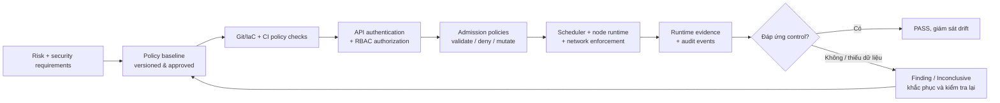

# Orchestration policy trong Platform Assurance

## 1. Orchestration policy là gì và vì sao cần assurance?

Trong nền tảng điều phối workload (orchestration platform), các hệ thống như Kubernetes tự động lập lịch, tạo, thay thế, mở rộng và kết nối các workload. Cơ chế tự động hóa này giúp vận hành ở quy mô lớn, nhưng cũng khiến một thay đổi nhỏ ở policy, namespace, vai trò hoặc template có thể ảnh hưởng nhiều dịch vụ. Một container chạy bằng quyền root, một service account có đặc quyền quá rộng hoặc một namespace thiếu giới hạn mạng có thể trở thành đường tấn công lan rộng trong cluster.

**Orchestration policy** là tập quy tắc xác định *ai được phép triển khai gì, ở đâu, dưới những điều kiện nào, được kết nối và truy cập tài nguyên nào, và cách hệ thống xử lý những thay đổi vi phạm*. Policy có thể được thực thi ở nhiều điểm: CI/CD, API admission, cơ chế phân quyền, network data plane, scheduler, node runtime và công cụ giám sát.

Đối với module **SECURITY_SECURITY_ASSURANCE**, trong chủ đề **Platform assurance**, mục tiêu không dừng ở việc “đã bật policy engine”. Người học phải biết thiết kế và **đánh giá có bằng chứng** rằng nền tảng đáp ứng mục tiêu bảo mật từ phân tích rủi ro, định nghĩa yêu cầu và security controls, triển khai, kiểm thử đến audit, xử lý finding và giám sát liên tục.

Ví dụ: yêu cầu *“Workload ứng dụng production không được chạy privileged container”* đòi hỏi nhiều hơn một đoạn YAML có `privileged: false`. Cần chứng minh:

1. Control áp dụng đúng namespace, cluster, API resource và đường triển khai.
2. Có cơ chế thực thi/deny khi workload đề nghị `privileged: true`.
3. Workload đang chạy không có ngoại lệ trái phép hoặc quyền bị nâng lên qua đường khác.
4. Policy, cấu hình engine và kết quả thử nghiệm có bằng chứng gắn với thời điểm, phiên bản và tài sản.

**Orchestration policy assurance** là quá trình chứng minh các điều kiện đó và phát hiện khi trạng thái thay đổi. Không được diễn giải sự tồn tại của một policy object thành bằng chứng rằng mọi workload đều tuân thủ.

### Kết quả học tập

Sau bài học, người học có thể:

- Xác định các lớp policy quan trọng của nền tảng điều phối và trách nhiệm của mỗi lớp.
- Thiết kế baseline và tiêu chí kiểm tra cho admission, workload security, RBAC, network isolation, scheduling và rollout.
- Phân biệt **policy khai báo**, **policy đang có hiệu lực** và **hành vi thực tế** khi workload được triển khai.
- Thu thập bằng chứng có thể tái lập, xử lý `PASS`/`FAIL`/`INCONCLUSIVE` và theo dõi configuration drift.
- Đánh giá ngoại lệ, chính sách ở chế độ audit/warn và các nguy cơ khi fail-open hoặc fail-closed.

## 2. Phạm vi: không phải chỉ có Kubernetes admission policy

Một orchestration platform thường gồm **control plane**, **data plane**, hạ tầng node, hệ thống identity và pipeline triển khai. Kubernetes là ví dụ xuyên suốt bài học; các nguyên tắc tương tự áp dụng cho các nền tảng điều phối khác nếu đối chiếu đúng khả năng cung cấp policy của từng sản phẩm.

| Thành phần | Trách nhiệm | Ví dụ chính sách cần đánh giá |
|---|---|---|
| **CI/CD và GitOps** | Chuẩn bị manifest và đưa desired state lên cluster | Policy-as-code, kiểm tra image/digest, review/approval |
| **API authorization** | Quyết định danh tính nào được thao tác API resource nào | RBAC, service account, impersonation, quyền quản trị |
| **Admission** | Kiểm tra/mutate object trước khi Kubernetes lưu/áp dụng | Pod Security Admission, ValidatingAdmissionPolicy, admission webhooks |
| **Scheduling** | Chọn node hợp lệ, phân bổ placement | Node selector/affinity, taints/tolerations, topology, ưu tiên |
| **Workload runtime** | Chạy container với giới hạn quyền và tài nguyên | Security context, seccomp, capabilities, runtime policy |
| **Network data plane** | Cho phép/chặn lưu lượng giữa pod, namespace và mạng ngoài | NetworkPolicy/CNI policy, ingress, egress, mesh policy |
| **Secrets/identity** | Cung cấp danh tính và dữ liệu bí mật cho workload | ServiceAccount, secret volume, workload identity, secret rotation |
| **Observability và audit** | Ghi nhận policy decision, thay đổi, drift, sự kiện bất thường | Kubernetes audit log, policy report, alert, finding |

**Ranh giới trách nhiệm phải rõ.** Với managed Kubernetes, cloud provider có thể quản lý một phần control plane nhưng khách hàng vẫn chịu trách nhiệm cấu hình RBAC, namespace, workload, network policy, admission và các tài nguyên họ có quyền kiểm soát. Với cluster tự quản lý, còn phải xem cấu hình kube-apiserver, etcd, controller, node/kubelet, CNI, runtime và cơ chế sao lưu. Không suy từ báo cáo compliance của cloud provider rằng mọi policy ở tenant của khách hàng đã được triển khai.

Orchestration policy cũng không thay thế các security controls bên ngoài cluster. Tường lửa cloud/VPC, IAM của cloud, bảo vệ registry, encryption keys, host hardening và cơ chế giám sát vẫn có thể quyết định hiệu quả thực tế của control.

## 3. Mối đe dọa và mục tiêu bảo mật

Policy phải được lựa chọn từ các mối đe dọa và mục tiêu đo được, thay vì áp một bộ rule giống nhau cho mọi workload.

| Kịch bản rủi ro | Mục tiêu | Nhóm policy và bằng chứng cần có |
|---|---|---|
| Container được cấp quyền root/privileged hoặc host namespace không cần thiết | Giảm khả năng vượt ranh giới container và can thiệp host | Pod Security Standards, admission deny, runtime security context |
| Service account có quyền tạo pod, đọc secret hoặc sửa role quá rộng | Chặn leo thang đặc quyền qua API | RBAC, danh sách binding, kiểm tra quyền hiệu lực bằng danh tính đại diện |
| Workload truy cập ngang sang dịch vụ/dữ liệu không liên quan | Giảm lateral movement | NetworkPolicy, CNI enforcement, phép thử kết nối |
| Image không kiểm soát nguồn gốc được triển khai | Giảm nguy cơ supply-chain compromise | Registry allowlist, digest/signature/attestation theo policy và xác minh triển khai |
| Pod bí mật được lập lịch lên node chung với workload không tin cậy | Cách ly theo mức độ nhạy cảm | Placement policy, node labels được bảo vệ, taints/tolerations, node isolation |
| Deployment không có giới hạn tài nguyên, làm cạn node | Bảo vệ tính sẵn sàng | LimitRange/ResourceQuota, requests/limits, quota usage, load test |
| Admission webhook ngừng hoạt động hoặc bị bỏ qua | Duy trì enforcement và khả năng triển khai | Webhook config, failurePolicy, availability, alert, negative test |
| Policy thay đổi ngoài Git hoặc ngoại lệ tồn tại quá hạn | Hạn chế configuration drift | Audit API, GitOps reconciliation, policy diff, exception register |
| Một controller có đặc quyền rộng hoặc CRD tạo workload qua đường khác | Tránh bypass qua controller/đường gián tiếp | Phạm vi API resources, controller permissions, generated pod spec, runtime inventory |

Ví dụ, với một dịch vụ thanh toán production, mục tiêu **PLAT-ORCH-01** có thể là: “Mọi pod ứng dụng thuộc namespace `payments` phải được kiểm tra theo Pod Security Standards mức Restricted, trừ ngoại lệ được phê duyệt theo quy trình và có thời hạn”. Đây mới là *control statement*. Mức độ Restricted có phù hợp với toàn bộ thành phần hệ thống hay không cần xem thiết kế và khả năng tương thích của workload.

## 4. Các lớp policy và nguyên tắc defense in depth

Không có một lớp policy duy nhất bảo đảm toàn bộ platform. Một cấu hình đúng ở CI có thể không được áp dụng ở production nếu người quản trị triển khai trực tiếp qua API; một webhook từ chối pod mới không sửa được pod không tuân thủ đã tồn tại trước đó.



Ba lớp bằng chứng phải được phân biệt:

- **Declared:** repository, policy template, Helm chart/Kustomize, cấu hình namespace, tài liệu baseline định nghĩa điều gì?
- **Effective:** policy object đã được áp dụng vào cluster nào, có selector/namespace nào, chế độ `enforce` hay `audit`, có webhook hoạt động và CNI hỗ trợ rule hay không?
- **Behavioral:** yêu cầu tạo workload vi phạm có bị từ chối không? Pod được tạo thực sự có security context đúng không? Một luồng mạng không được phép có bị chặn không?

**Nguyên tắc:** việc một cơ chế xuất hiện trong cluster chưa đủ để kết luận control đạt. Chỉ `audit` hoặc `warn` thường giúp phát hiện và thông báo vi phạm; chúng không nhất thiết **ngăn** workload không phù hợp được tạo. Ngoài ra, control được admission thực thi trên đường tạo/cập nhật object có thể không sửa lại các đối tượng đã tồn tại. Cần đo thêm trạng thái runtime và lịch sử triển khai.

## 5. Thiết kế một orchestration policy baseline có thể kiểm chứng

Baseline nên được chia theo môi trường và nhóm workload như `prod-app`, `prod-system`, `sandbox`, `batch` hoặc `sensitive-data`. Một policy áp dụng cho pod ứng dụng thông thường có thể không phù hợp với CNI, CSI driver, node agent hay thành phần cần quyền host; ngoại lệ phải có quản trị thay vì tắt policy toàn cluster.

| Control ID | Tiêu chí ví dụ | Đối tượng và kiểm tra |
|---|---|---|
| `ORCH-01 Admission enforcement` | Namespace production có mức Pod Security Admission được phê duyệt ở chế độ chặn vi phạm | Namespace labels/config; thử tạo pod vi phạm trong môi trường an toàn |
| `ORCH-02 Workload privilege` | App containers không privileged, không nâng quyền, không dùng host namespace tùy tiện | Template/pod spec thực tế; admission test |
| `ORCH-03 Image trust` | Production workload chỉ triển khai image nguồn được phép và digest/signature được xác minh theo chính sách | Registry/digest, admission result, provenance/attestation |
| `ORCH-04 API least privilege` | ServiceAccount ứng dụng chỉ có quyền Kubernetes API cần thiết | Role/RoleBinding/ClusterRoleBinding; đánh giá quyền hiệu lực |
| `ORCH-05 Network isolation` | Luồng ingress/egress tuân thủ danh sách nguồn/đích được duyệt | NetworkPolicy/CNI, nhãn pod/namespace, thử kết nối |
| `ORCH-06 Resource governance` | Mỗi workload có requests/limits phù hợp; quota áp dụng theo namespace | LimitRange, ResourceQuota, PodSpec và quan sát sử dụng |
| `ORCH-07 Scheduling isolation` | Workload nhạy cảm chạy trên node pool đúng chuẩn; ràng buộc placement không bị tự ý thay | Node/Pod affinity, node labels, admission, danh sách node thực tế |
| `ORCH-08 Secret and identity` | Workload không nhận API token nếu không cần; secret không nằm trong image/manifest; workload identity đúng phạm vi | ServiceAccount, automount, secret usage, IAM/federation config |
| `ORCH-09 Policy continuity` | Policy engine hoạt động; các lỗi admission có cảnh báo và cách xử lý được phê duyệt | Webhook availability/failurePolicy, audit, monitoring và thử nghiệm |
| `ORCH-10 Change and exception` | Thay đổi policy qua review; ngoại lệ có owner, lý do, phạm vi và hạn | Git history, approval, admission exceptions, findings và retest |

Một bản ghi mô tả control minh họa:

```yaml
control_id: ORCH-01
baseline_version: platform-prod-v3
claim: "Production application namespaces enforce approved pod-security restrictions"
scope:
  cluster_class: production
  namespaces:
    - payments
    - orders
expected:
  enforcement_mode: enforce
  minimum_profile: restricted
evidence_methods:
  - "Read namespace pod-security admission labels"
  - "Test admission with an intentionally non-compliant pod in a safe test scope"
  - "Inspect existing workload security contexts"
owner: platform-security
review_cycle: "After policy changes and on a risk-based schedule"
```

Đây là mẫu **control specification**, chưa phải bằng chứng đã tuân thủ. Khi đánh giá thực tế cần lưu thông tin cluster ID, thời điểm UTC, dữ liệu gốc, công cụ thu, kết quả kiểm thử và giới hạn phạm vi.

## 6. Kubernetes admission: nhận diện policy thực sự đang chặn

Kubernetes có nhiều điểm xử lý trước khi API object được lưu:

1. **Authentication** xác định danh tính gửi yêu cầu.
2. **Authorization** xác định danh tính có quyền thao tác API đó hay không, thường qua RBAC.
3. **Admission** có thể thay đổi (mutate), kiểm tra (validate) hoặc từ chối request tùy cơ chế được cấu hình.
4. Sau khi object được tạo/cập nhật, controller và scheduler biến desired state thành pod thực tế. Runtime và network data plane áp dụng các hạn chế tương ứng.

Thứ tự và cơ chế admission chi tiết phụ thuộc phiên bản/cấu hình cluster. Các công cụ như **Pod Security Admission (PSA)**, **ValidatingAdmissionPolicy** (dựa trên CEL, tùy API/version) và admission webhooks của Gatekeeper, Kyverno hoặc giải pháp khác có khả năng, quy tắc chọn đối tượng và chế độ enforce khác nhau. Cần xem tài liệu phiên bản đang sử dụng thay vì giả định các công cụ tương đương.

### 6.1. Pod Security Standards và Pod Security Admission

Pod Security Standards (PSS) định nghĩa các mức **Privileged**, **Baseline** và **Restricted**. Pod Security Admission có các chế độ **enforce**, **audit** và **warn**; chế độ audit/warn không tự ngăn yêu cầu vi phạm.

Ví dụ namespace ứng dụng cần bắt đầu bằng Baseline enforcement và theo dõi khả năng đạt Restricted:

```yaml
apiVersion: v1
kind: Namespace
metadata:
  name: payments
  labels:
    pod-security.kubernetes.io/enforce: baseline
    pod-security.kubernetes.io/audit: restricted
    pod-security.kubernetes.io/warn: restricted
```

Với cấu hình minh họa này, **enforce Baseline** không đồng nghĩa **enforce Restricted**. Nếu control yêu cầu `Restricted` nhưng giá trị thực tế chỉ là `baseline`, phải đánh giá `FAIL` cho tiêu chí đó, dù audit/warn đều ghi `restricted`.

Khi chuyển lên Restricted, cần kiểm tra pod spec, container init/ephemeral containers, controller templates, các thành phần hệ thống đặc biệt và môi trường triển khai. Có thể chốt phiên bản PSS bằng nhãn version được hỗ trợ để tránh thay đổi hành vi bất ngờ khi nâng cấp Kubernetes, nhưng phải chọn phiên bản có thật và tương thích với cluster. Không tự sao chép một giá trị version minh họa vào production.

**Giới hạn quan trọng:** PSA tập trung vào các yêu cầu liên quan pod; nó không thay thế image signature verification, RBAC least privilege, network isolation, cloud IAM hoặc kiểm soát mọi tài nguyên tùy biến (CRD). Cơ chế exemption cấu hình ở cấp phù hợp có thể làm mất enforcement cho một số danh tính/namespace/runtime class và phải được kiểm kê. Pod đang chạy trước khi policy được bật không tự động được sửa lại.

### 6.2. Admission webhook: fail-open và fail-closed

Đối với validating admission webhook, `failurePolicy` chi phối cách API server xử lý một số lỗi gọi webhook như timeout hoặc không liên hệ được backend; đây không phải cờ quyết định cho mọi trường hợp “deny”. Ở mức cơ bản:

- **Fail-closed** (thường tương ứng `Fail`): khi webhook không thể xử lý yêu cầu, nhiều request nằm trong phạm vi của webhook bị từ chối. An toàn trước bypass nhưng có thể ảnh hưởng triển khai/khôi phục khi backend lỗi.
- **Fail-open** (thường tương ứng `Ignore`): một số lỗi gọi webhook được bỏ qua, hỗ trợ tính sẵn sàng của API nhưng có thể cho phép resource vi phạm lọt vào nếu không có kiểm soát bù trừ.

Lựa chọn phải dựa trên rủi ro, loại resource, tính trọng yếu của policy, khả năng hoạt động cao của webhook và phương án phục hồi. Ngoài `failurePolicy`, phải kiểm tra `namespaceSelector`, `objectSelector`, loại API/operation áp dụng, timeout, chứng chỉ TLS, webhook service và tình trạng backend. Một policy có rule đúng nhưng selector loại toàn bộ namespace production sẽ không thực thi như mong đợi.

Đối với engine xử lý policy, cần chứng minh **quy tắc đã tải, đang áp dụng ở chế độ nào và có đường nào bypass**. Quyết định cho phép/deny cũng nên có audit event hoặc report được giới hạn truy cập; log có thể chứa thông tin nhạy cảm về tên namespace, identity và workload.

## 7. Workload security policy: từ manifest đến pod runtime

Ví dụ sau minh họa các thiết lập hardening trong `Deployment`. Đây là ví dụ học tập; image/ports và tài nguyên phải điều chỉnh theo ứng dụng thật, và một baseline production có thể yêu cầu pin image bằng digest đã được xác minh.

```yaml
apiVersion: apps/v1
kind: Deployment
metadata:
  name: payments-api
  namespace: payments
spec:
  replicas: 2
  selector:
    matchLabels:
      app: payments-api
  template:
    metadata:
      labels:
        app: payments-api
    spec:
      automountServiceAccountToken: false
      securityContext:
        runAsNonRoot: true
        runAsUser: 10001
        seccompProfile:
          type: RuntimeDefault
      containers:
        - name: api
          image: registry.example.internal/payments-api:1.2.3
          securityContext:
            allowPrivilegeEscalation: false
            privileged: false
            readOnlyRootFilesystem: true
            capabilities:
              drop: ["ALL"]
          resources:
            requests:
              cpu: "100m"
              memory: "128Mi"
            limits:
              cpu: "500m"
              memory: "512Mi"
```

Một số điểm cần giải thích khi đánh giá:

- `runAsNonRoot` và `runAsUser` làm rõ ý định chạy không phải root; cần xác minh image, entrypoint và permission thực tế cho tài khoản đó.
- `allowPrivilegeEscalation: false`, `capabilities.drop: ["ALL"]` và `seccompProfile` góp phần giảm bề mặt tấn công. Chúng không biến container thành sandbox bảo mật tuyệt đối.
- `readOnlyRootFilesystem: true` có thể buộc ứng dụng dùng volume tạm có kiểm soát cho thư mục cần ghi; bản thân PSS Restricted không đòi mọi workload phải có trường này.
- `automountServiceAccountToken: false` giảm việc tự gắn token Kubernetes API khi ứng dụng không cần gọi API. Với workload cần API hoặc workload identity, phải thiết kế quyền, thời hạn token và cách cấp token phù hợp.
- Requests/limits hỗ trợ ổn định tài nguyên nhưng không bảo đảm khả năng phục hồi nếu thiếu replica, topology hoặc kiểm thử tải.
- Image được pin bằng tag trong ví dụ chỉ để minh họa cấu trúc; nếu control yêu cầu **immutable digest và xác minh nguồn gốc**, phải sửa đúng digest và thu evidence về policy image trust.

**Điều phải chứng minh:** deployment template trong Git không đủ. Controller có thể tạo replica từ revision khác; mutation webhook có thể thay đổi pod spec; runtime và node có thể có hành vi khác ý định. Cần thu cả template **và các pod thực tế**, đối chiếu revision và kết quả admission.

## 8. RBAC và workload identity trong orchestration policy

RBAC kiểm soát quyền Kubernetes API theo subject, role và binding. Những quyền như tạo pod, sửa role binding, đọc secret, cập nhật workload hoặc impersonate service account có thể kết hợp thành đường leo thang đặc quyền. Policy assurance nên đánh giá **quyền thực tế của danh tính**, cả role trực tiếp và khả năng gián tiếp.

Ví dụ một Role chỉ đọc thông tin pod trong namespace cụ thể:

```yaml
apiVersion: rbac.authorization.k8s.io/v1
kind: Role
metadata:
  name: pod-status-reader
  namespace: payments
rules:
  - apiGroups: [""]
    resources: ["pods"]
    verbs: ["get", "list", "watch"]
---
apiVersion: rbac.authorization.k8s.io/v1
kind: RoleBinding
metadata:
  name: pod-status-reader-binding
  namespace: payments
subjects:
  - kind: ServiceAccount
    name: diagnostics
    namespace: payments
roleRef:
  apiGroup: rbac.authorization.k8s.io
  kind: Role
  name: pod-status-reader
```

Role này không cấp trực tiếp quyền đọc secret. Tuy vậy, để kết luận service account `diagnostics` **thực sự không thể đọc secret**, phải xét thêm RoleBinding và ClusterRoleBinding khác, quyền kế thừa, tài khoản đang sử dụng, khả năng impersonation và các đường truy cập ngoài Kubernetes API.

Để thử quyền bằng `kubectl auth can-i` cho một subject khác, người chạy lệnh cần quyền **impersonate** tương ứng và phải kiểm tra trong đúng cluster/namespace. Kết quả API authorization không thay thế đánh giá quyền đọc dữ liệu thông qua application endpoint hoặc cloud IAM.

**Tách biệt policy:** workload identity trên cloud (ví dụ gắn role truy cập object storage cho service account) là một lớp khác với Kubernetes RBAC. Một service account có quyền `get pods` hạn chế vẫn có thể truy cập dịch vụ cloud rộng nếu role cloud được gán sai; cả hai lớp phải được kiểm chứng.

## 9. Network orchestration policy: phạm vi và kiểm thử thực tế

Kubernetes `NetworkPolicy` thường biểu diễn nhóm pod áp dụng cùng các luồng ingress/egress được cho phép. Enforcement phụ thuộc plugin mạng/CNI và tính năng được hỗ trợ. Chỉ tạo object NetworkPolicy **không bảo đảm** gói tin bị chặn nếu data plane không thực thi chính sách tương ứng.

Ví dụ default-deny ingress và egress trong namespace `payments`:

```yaml
apiVersion: networking.k8s.io/v1
kind: NetworkPolicy
metadata:
  name: default-deny
  namespace: payments
spec:
  podSelector: {}
  policyTypes:
    - Ingress
    - Egress
```

Policy trên chọn mọi pod trong namespace và không khai báo luồng allow. Nếu CNI thực thi đúng NetworkPolicy, đây là điểm khởi đầu cho thiết kế **deny-by-default**. Những policy allow khác có thể bổ sung luồng hợp lệ; chính sách cơ bản thường có tính **cộng gộp quyền cho phép**, nên không được nhìn một object rồi kết luận toàn bộ mạng đã bị khóa. Cần liệt kê tập NetworkPolicy hiệu lực, pod labels, namespace selectors, port/protocol và plugin mạng.

**Tác động vận hành:** default-deny egress có thể chặn DNS, telemetry, dịch vụ đăng nhập, cơ sở dữ liệu hoặc API cloud. Một rollout hợp lệ phải xác định các dependency cần thiết, thêm policy cho luồng hợp lệ, thử từ nguồn đại diện và có rollback. Không mặc định DNS sẽ tự hoạt động sau khi chặn toàn bộ egress.

Các câu hỏi assurance gồm:

- CNI có hỗ trợ enforcement của policy đang khai báo không? Cơ chế cloud firewall, mesh hoặc CNI extension có thay đổi kết quả không?
- Policy selector thực sự chọn bao nhiêu pod, namespace nào, nhãn đó có được kiểm soát không?
- Luồng bị hạn chế ở lớp pod network nào? Có đường truy cập node/host network/ingress gateway cần đánh giá riêng không?
- Đã thử negative path (nguồn không được phép bị chặn) **và** positive path (nguồn hợp lệ kết nối thành công) chưa?
- NetworkPolicy đang đo là bản cũ, có bị cập nhật ngoài quy trình hoặc sau lần kiểm thử không?

NetworkPolicy không thay thế mã hóa trong truyền tải, authorization ở cấp ứng dụng hoặc chính sách mạng ngoài cluster.

## 10. Scheduling, tenancy và resource policy

Orchestrator quyết định pod chạy trên node nào, dịch vụ nào được ưu tiên và cách chúng tiêu thụ tài nguyên. Đối với hệ thống nhiều tenant hoặc dữ liệu nhạy cảm, đây cũng là vấn đề bảo mật.

| Loại policy | Mục tiêu kiểm chứng | Bằng chứng thực tế |
|---|---|---|
| **Node placement** | Pod nhạy cảm chỉ chạy trên node pool được phê duyệt | Node affinity/selector, nhãn node, `spec.nodeName` của pod |
| **Taints/tolerations** | Hạn chế các workload không phù hợp vào node chuyên dụng | Taints/tolerations và kết quả schedule thực tế |
| **Topology spread** | Giảm rủi ro cùng một sự cố node/zone làm mất toàn bộ replica | Topology constraints, phân bố pod, bài thử failover |
| **Pod priority/preemption** | Workload quan trọng được ưu tiên phù hợp; tránh lạm dụng priority | PriorityClass, PodSpec, event và impact test |
| **ResourceQuota/LimitRange** | Một namespace không tiêu thụ tài nguyên vượt mức kiểm soát | Quota/limit object và usage/thực nghiệm tạo resource |
| **Node admission/labels** | Chỉ admin hoặc controller được tin cậy điều chỉnh nhãn dùng cho bảo mật | RBAC/NodeRestriction hoặc cơ chế tương ứng, audit API |
| **Namespace isolation** | Mỗi tenant có policy network/RBAC/quota và secret handling phù hợp | Inventory namespace, effective policy, kiểm thử hai chiều |

**Taint không tự bảo đảm cách ly bảo mật**: taint/toleration tác động tới lựa chọn lịch chạy, còn các workload có quyền tạo pod hoặc thêm toleration vẫn cần được hạn chế bởi admission/RBAC. Nếu dùng node label để bắt buộc đặt workload lên host được tin cậy, phải kiểm soát ai có quyền chỉnh nhãn; một node hoặc danh tính không tin cậy không được tự gán nhãn “secure”.

Đối với policy về số replica và rollout, hãy xác minh cấu hình `Deployment`, `PodDisruptionBudget`, topology, health probes và kết quả thử nghiệm. Một cấu hình `replicas: 3` không tự chứng minh ba replica đang chạy trên ba failure domains độc lập.

## 11. Policy-as-code và quy trình thay đổi có kiểm soát

Policy có thể được viết thành rule, manifest, template hoặc điều kiện kiểm tra trong CI, nhưng phải vận hành như **một artifact bảo mật có vòng đời**:

1. **Yêu cầu và owner:** mỗi control có phạm vi, mức rủi ro, tiêu chí đo và người chịu trách nhiệm phê duyệt.
2. **Version control:** lưu policy, phiên bản engine, tập test cases và tài liệu mapping trong nguồn quản lý được kiểm soát.
3. **Pre-merge verification:** kiểm tra syntax/schema, unit tests cho cả trường hợp hợp lệ và vi phạm, mô phỏng tác động lên workload hiện có.
4. **Staged rollout:** dùng audit/warn để quan sát khi cần, sau đó chuyển enforce theo kế hoạch; không để policy quan trọng mãi ở chế độ chỉ cảnh báo mà vẫn ghi đạt.
5. **Approval + rollback:** áp dụng theo cluster/env, có change ID, lịch, owner, phương án rollback và cảnh báo khi admission bất thường.
6. **Runtime reconciliation:** đối chiếu Git desired state với object thực tế, phát hiện drift/override và đánh giá ngoài quy trình.
7. **Retest:** xác minh cả workload hợp lệ vẫn được triển khai và workload không phù hợp bị từ chối theo phạm vi đã định.

Với GitOps, một commit merge thành công chỉ chứng minh cấu hình mong muốn đã được duyệt; cần xem trạng thái đồng bộ của controller, phiên bản revision đang được áp dụng, policy engine và kết quả hành vi. Một cluster có thể tạm thời out-of-sync hoặc bị thay đổi ngoài Git.

### Ví dụ ma trận kiểm thử policy

| Case | Manifest/yêu cầu mẫu | Kỳ vọng khi control áp dụng | Điều phải ghi nhận |
|---|---|---|---|
| T01 — Positive | Pod không root, không privileged, security context phù hợp | `ALLOW` | API status, UID/timestamp, policy revision |
| T02 — Privileged | Pod yêu cầu `privileged: true` | `DENY` | Lý do deny, danh tính/namespace, rule ID |
| T03 — Escalation | Pod yêu cầu `allowPrivilegeEscalation: true` | `DENY` nếu policy cấm | Admission response và điều kiện test |
| T04 — Wrong namespace | Pod vi phạm trong namespace production khác | `DENY` theo phạm vi control | Chứng minh selector không bỏ sót namespace |
| T05 — Exemption | Workload hệ thống có ngoại lệ hợp lệ | Theo quyết định được phê duyệt | Exception ID, người duyệt, thời hạn, scope |
| T06 — Engine outage | Admission backend không sẵn có | Theo `failurePolicy` và rủi ro đã duyệt | Event, alert và ảnh hưởng availability |
| T07 — Existing workload | Pod cũ không tuân thủ tồn tại trước policy | Được phát hiện bởi runtime scan | Inventory + finding, không chỉ admission |

Những phép thử có khả năng gây gián đoạn chỉ được thực hiện trên môi trường thử hoặc trong cửa sổ đã phê duyệt. Đối với test deny, có thể dùng server-side dry-run nếu API/webhook hỗ trợ, nhưng cần xác minh kết quả từ đường admission tương ứng; không tự coi lệnh dry-run nào cũng đầy đủ hoặc không có tác động ở mọi hệ thống.

## 12. Thu thập bằng chứng trên Kubernetes

Các lệnh sau là **ví dụ quan sát** bằng `kubectl` trên cluster được ủy quyền. Chúng không tự thay đổi object. Cần xác định rõ `current-context`, cluster UID, namespace, thời điểm UTC, user/role thu thập và phiên bản công cụ để tránh trộn bằng chứng từ các môi trường khác nhau.

```bash
# Xác định context và endpoint cluster của phiên làm việc
kubectl config current-context
kubectl cluster-info

# Namespace labels liên quan Pod Security Admission
kubectl get namespace payments -o yaml

# Role/RoleBinding trong namespace; kiểm tra thêm ClusterRoleBinding
kubectl get role,rolebinding -n payments -o yaml
kubectl get clusterrolebinding -o yaml

# Các policy mạng khai báo trong namespace
kubectl get networkpolicy -n payments -o yaml

# Quota và default resources
kubectl get resourcequota,limitrange -n payments -o yaml

# Pod runtime inventory ở namespace đích
kubectl get pods -n payments -o wide

# Admission webhook configurations, nếu cluster sử dụng
kubectl get validatingwebhookconfigurations,mutatingwebhookconfigurations -o yaml
```

Khi kiểm tra quyền một service account, ví dụ:

```bash
# Chỉ hoạt động nếu người kiểm tra có quyền impersonate phù hợp.
kubectl auth can-i get secrets \
  --as=system:serviceaccount:payments:diagnostics -n payments
```

Kết quả `no` ở đây là một mảnh bằng chứng: danh tính thử không được quyền đọc secret theo đường request đang kiểm tra; nó chưa chứng minh danh tính đó không có quyền bằng cơ chế khác, không thể assume role, không được cấp quyền từ binding khác ở thời điểm khác hoặc không truy cập secret qua ứng dụng.

**Chú ý khi thu evidence:** bản export `-o yaml` có thể chứa cấu hình nhạy cảm, nhãn nội bộ, đường dẫn, environment variable và dữ liệu secret khi truy vấn loại resource không phù hợp. Chỉ thu những object/trường cần cho control, lưu ở kho hạn chế truy cập và tránh sao chép vào log công khai. Không đưa token, private key hoặc plaintext secret vào bộ bằng chứng.

### Không chỉ đọc trạng thái khai báo

- Namespace labels chỉ hỗ trợ đánh giá PSA configuration; còn phải kiểm tra hành vi reject/allow và các exemptions.
- NetworkPolicy manifest chỉ là khai báo; cần xác nhận CNI thực thi và kiểm thử kết nối.
- RoleBinding hiện có cho thấy binding được lưu; kiểm tra hiệu lực phải tính các binding khác và danh tính thực sự.
- Pod securityContext trong template có thể khác pod thực tế hoặc bị mutation; kiểm tra pod runtime và rollout revision.
- Admission webhook có thể tồn tại nhưng backend unavailable, selector không chọn target hoặc đang chế độ chỉ audit.

Nếu một lệnh trả lỗi permission denied/timeout/unsupported API, phải ghi `INCONCLUSIVE` và tiếp tục xác định cách thu phù hợp; không suy ra control đã đạt.

## 13. Thiết kế evidence package cho orchestration assurance

Bằng chứng phải cho phép người khác dựng lại *vì sao* một policy được coi là hiệu lực trong một cluster, đối với một workload và một thời điểm.

| Nhóm dữ liệu | Trường gợi ý | Ý nghĩa |
|---|---|---|
| **Định danh** | `cluster_id`, provider, region, namespace, workload name/UID | Ngăn trộn dữ liệu giữa cluster hoặc lần tạo lại object |
| **Tiêu chí** | `control_id`, `baseline_version`, policy engine/revision, scope selector | Biết chuẩn và đối tượng áp dụng |
| **Người thu** | `collector_id`, `kubectl_version`, identity, permissions | Truy vết phương pháp và quyền |
| **Thời điểm** | `collected_at_utc`, resourceVersion/generation khi có, event timestamp | Đánh giá tính mới và thứ tự thay đổi |
| **Quan sát** | declared config, effective scope, runtime object, decision test | Phân biệt các lớp bằng chứng |
| **Kết luận** | `PASS`/`FAIL`/`INCONCLUSIVE`/`NOT_APPLICABLE`, lý do, giới hạn | Tái tạo logic đánh giá |
| **Lưu trữ** | raw reference, checksum, retention, quyền truy cập | Bảo toàn tính toàn vẹn và bảo mật |
| **Theo dõi** | finding/exception ID, owner, remediation, retest reference | Chứng minh đã xử lý sai lệch |

Ví dụ một bản ghi **mô phỏng** cho control admission:

```yaml
assessment_id: orch-20261128-007
cluster_id: prod-cluster-a
namespace: payments
workload_class: production-app
control_id: ORCH-01
baseline_version: platform-prod-v3
expected:
  pod_security_enforce: restricted
observed:
  pod_security_enforce: baseline
  pod_security_audit: restricted
  pod_security_warn: restricted
  admission_test:
    requested_privileged_pod: denied
collection:
  collector: platform-assurance-reader
  method: "Namespace read + approved admission test"
  collected_at_utc: "2026-11-28T05:00:00Z"
assessment:
  result: FAIL
  reason: "Enforcement is baseline, below required restricted profile"
  limitations: "Runtime pod inventory checked separately"
evidence_refs:
  namespace_labels: "evidence/ORCH-01/namespace.json"
  admission_result: "evidence/ORCH-01/test-result.json"
tracking:
  finding_id: PLAT-342
  owner: platform-operations
```

Ở đây, phép thử deny cho `privileged` có thể thành công vì Baseline cũng chặn privileged container, nhưng **không chứng minh Restricted đã được enforce**. Kết luận `FAIL` được rút ra từ chính tiêu chí cần đo. Đây là ví dụ quan trọng về tránh diễn giải một phép kiểm tra đơn lẻ vượt quá phạm vi chứng minh của nó.

## 14. Quy tắc kết luận, độ phủ và độ mới bằng chứng

Các trạng thái đánh giá nên được định nghĩa nhất quán:

| Trạng thái | Dùng khi | Cách xử lý |
|---|---|---|
| `PASS` | Control áp dụng, dữ liệu tin cậy và đủ mới, trạng thái/behavior đạt đúng tiêu chí | Lưu raw evidence, tiếp tục giám sát |
| `FAIL` | Control áp dụng, kiểm tra thành công nhưng có lệch so với tiêu chí | Tạo finding, ưu tiên, owner, deadline và retest |
| `INCONCLUSIVE` | Không có quyền, scanner lỗi, thiếu resource, hết hạn evidence hoặc không đánh giá được enforcement | Ghi nguyên nhân, bổ sung phép đo; không mặc định PASS |
| `NOT_APPLICABLE` | Workload/namespace nằm ngoài scope theo điều kiện được duyệt | Lưu lý do và phiên bản điều kiện |
| **Exception accepted** | Có ngoại lệ/risk acceptance với phạm vi, owner, thời hạn và bù trừ | Giữ trạng thái kiểm tra thực tế, theo dõi exception riêng |

Đo **độ phủ** và **tỷ lệ tuân thủ** trên mẫu số rõ ràng. Ví dụ nền tảng có 80 namespace production phải kiểm tra ORCH-01; thu được kết quả hợp lệ ở 60 namespace, trong đó 54 đạt. Khi đó:

- Độ phủ kết luận hợp lệ: **60/80 = 75%**.
- Tỷ lệ đạt trong tập kiểm tra hợp lệ: **54/60 = 90%**.
- 20 namespace thiếu bằng chứng vẫn là khoảng trống; không được báo “90% production đã đạt” mà không nêu phạm vi.

Với control có nhiều workload trên mỗi namespace, cần nêu đơn vị là namespace, workload hay cặp control/workload. Một namespace có nhãn PSA đúng chưa đủ để tuyên bố mọi pod trong đó tuân thủ, đặc biệt khi có workload cũ hoặc bypass/exemption.

## 15. Phát hiện drift và quản lý ngoại lệ

Orchestration drift phát sinh khi trạng thái thực tế khác baseline đã duyệt: namespace bị đổi nhãn từ `restricted` thành `baseline`; webhook selector loại production; policy engine bị tắt; workload đẩy lên bằng tag không bất biến; ai đó thêm ClusterRoleBinding hoặc cập nhật NetworkPolicy ngoài Git.

Để điều tra, cần lưu:

1. **Expected:** policy/revision được duyệt, scope, người phê duyệt và thời điểm hiệu lực.
2. **Observed:** trạng thái thực tế, API resource UID/resourceVersion, timestamp và raw output.
3. **Change trace:** commit, deployment/reconciliation, Kubernetes audit event và chủ thể thay đổi (nếu có).
4. **Impact:** workload/tenant đang chịu tác động, loại policy bị yếu đi và nguy cơ thực tế.
5. **Decision:** rollback, sửa nguồn cấu hình, ngoại lệ có phê duyệt hay điều tra tiếp.
6. **Retest:** kết quả mới và đường dẫn evidence để xác nhận khắc phục.

Ngoại lệ phải có **ID, owner, justification, rủi ro còn lại, phạm vi hẹp nhất, biện pháp bù trừ, người duyệt và ngày hết hạn**. Tránh dùng `namespaceSelector` loại trừ toàn bộ team chỉ để một service đặc biệt chạy; nếu có thể hãy tách scope và kiểm soát riêng. Hệ thống phải cảnh báo khi ngoại lệ hết hạn hoặc bị mở rộng.

**Auto-remediation** có rủi ro: siết admission, RBAC hoặc NetworkPolicy quá nhanh có thể làm đứt pipeline, khiến controller không tạo được pod, cắt DNS hoặc phá luồng hồi phục hệ thống. Cần có môi trường test, canary, phương án truy cập khẩn cấp, rollback và giám sát tác động sau thay đổi.

## 16. Tình huống thực hành: policy tồn tại nhưng không enforce đúng

**Bối cảnh:** nhóm vận hành tuyên bố toàn bộ namespace ứng dụng production đáp ứng Pod Security Restricted. Repository có manifest policy chặt chẽ; dashboard cho biết policy engine được cài đặt. Sau một đợt triển khai, phát hiện pod trong namespace `payments` chạy với cấu hình được Baseline cho phép nhưng Restricted từ chối.

**Các nguồn bằng chứng:**

| Nguồn | Quan sát | Kết luận đúng |
|---|---|---|
| Repository | File namespace dự kiến `enforce: restricted` | Chỉ thể hiện desired state |
| Cluster hiện tại | Namespace `payments` có `enforce: baseline`, `audit/warn: restricted` | Enforcement hiện tại thấp hơn yêu cầu |
| Kết quả dry-run một pod privileged | Request bị deny | Chứng minh phần kiểm soát chống privileged; chưa chứng minh Restricted |
| Pod đang chạy | Có cấu hình vi phạm Restricted | Runtime không đáp ứng baseline |
| Audit log | Có event đổi nhãn namespace sau lần đồng bộ GitOps | Dấu vết thay đổi cần điều tra, chưa đủ kết luận nguyên nhân |

**Đánh giá:** ORCH-01 `FAIL` do mức enforcement hiện hành chỉ là Baseline. Nếu engine riêng chỉ audit với toàn bộ pod thì cũng không thỏa tiêu chí chặn. Báo cáo “policy installed” hoặc “deny privileged pod” đã suy diễn quá mức.

**Khắc phục có kiểm soát:** tạo finding gắn cluster/namespace/control, xác định ai thay label, trạng thái GitOps sync và các workload không tương thích. Sửa nguồn cấu hình được quản lý, điều chỉnh các pod vi phạm theo kế hoạch, kiểm tra compatibility trên cluster test, nâng lên `enforce: restricted` trong cửa sổ được duyệt và lưu khả năng rollback.

**Xác minh:** đọc lại namespace labels và các exemption; kiểm thử một mẫu pod vi phạm Restricted bị từ chối, đồng thời workload hợp lệ tạo/cập nhật được; kiểm tra pod đang chạy và policy decision log; lưu tất cả với timestamp, policy revision, test ID và liên kết ticket. Chỉ đóng finding khi phạm vi yêu cầu đạt và không gây gián đoạn ngoài dự kiến.

Kết quả kiểm tra sau khắc phục chỉ phản ánh các cluster/namespace và thời điểm đã đo. Cần tiếp tục phát hiện drift do controller, người vận hành hoặc pipeline làm thay đổi trạng thái lần sau.

## 17. Những lỗi đánh giá thường gặp

| Sai lầm | Hậu quả | Cách khắc phục |
|---|---|---|
| Coi policy object có tồn tại là đã enforce | Bỏ qua `warn`/`audit`, selector và webhook outage | Kiểm tra effective scope/mode và phép thử deny |
| Dùng một negative test để suy ra toàn profile | Bỏ sót rule khác hoặc exemption | Thiết kế ma trận test cho control cụ thể |
| Chỉ đánh giá manifest từ Git | Bỏ qua drift, mutation và rollout cũ | Đối chiếu API thực tế, pod runtime và Git revision |
| Chỉ xem RBAC role của một namespace | Bỏ qua ClusterRoleBinding và quyền impersonation | Đánh giá quyền hiệu lực theo danh tính, scope, đường gián tiếp |
| Coi NetworkPolicy tồn tại là mạng đã cách ly | CNI có thể không enforce, policy allow khác cộng gộp | Kiểm tra data plane và thử positive/negative connection |
| Cho rằng taints/tolerations là bảo mật tuyệt đối | Workload vẫn có thể được schedule nếu được cấp toleration | Kết hợp RBAC/admission và bảo vệ node labels |
| Không lưu lỗi scanner hoặc tuổi evidence | Tỉ lệ tuân thủ bị thổi phồng | Dùng `INCONCLUSIVE`, công bố coverage và stale evidence |
| Mở ngoại lệ vô hạn hoặc không owner | Đường bypass trở thành mặc định | Giới hạn scope và expiry, ghi phê duyệt, review định kỳ |
| Siết policy đồng loạt mà không thử | Có thể làm ngừng deploy và DR | Audit giai đoạn đầu khi cần, canary, rollback |
| Lưu YAML chứa secret vào ticket công khai | Lộ dữ liệu nhạy cảm từ chính hoạt động assurance | Thu trường tối thiểu và lưu evidence có kiểm soát |

## 18. Bài tập thiết kế một bộ policy assurance

Giả sử tổ chức có hai cluster Kubernetes: `staging` và `production`. Production gồm namespace `payments`, `orders` và `analytics`. Baseline yêu cầu:

- Workload ứng dụng phải tuân thủ **Pod Security Restricted** ở chế độ enforce.
- ServiceAccount ứng dụng không được đọc Kubernetes Secrets ngoài nhu cầu đã phê duyệt.
- Ingress và egress bị hạn chế theo luồng mạng được duyệt, có kiểm thử deny/allow.
- Image chỉ được triển khai từ registry có kiểm soát với digest và bằng chứng nguồn gốc được phê duyệt.
- Policy engine, các thay đổi role/network/namespace và denial events được ghi nhận.

Ở đợt kiểm tra gần nhất, `payments` có nhãn `enforce: baseline`; `orders` áp dụng Restricted nhưng thiếu bằng chứng kiểm tra CNI; `analytics` chưa được quét do collector thiếu quyền.

**Yêu cầu học viên:**

1. Xác định phạm vi cluster/namespace/workload và gán các control ID, owner, baseline version tương ứng.
2. Chỉ rõ bằng chứng **declared**, **effective** và **behavioral** cần lấy cho năm nhóm yêu cầu.
3. Viết ma trận positive/negative test cho PSA, RBAC và network; tách phép thử an toàn tại staging và quan sát ở production.
4. Phân loại `payments` là `FAIL` đối với điều kiện Restricted enforce; `orders` cần kết luận từng control riêng và đánh dấu thiếu kiểm chứng network là `INCONCLUSIVE` nếu tiêu chí yêu cầu hành vi; `analytics` là `INCONCLUSIVE` cho các control chưa đo được.
5. Đề xuất cách khắc phục cho từng namespace, kế hoạch theo dõi drift và bộ evidence cần để đóng finding.
6. Thiết kế báo cáo thể hiện tổng scope, phần đo được, phần không đo được, ngoại lệ và tuổi evidence.

### Câu hỏi tự kiểm tra

- Vì sao `audit: restricted` không tương đương `enforce: restricted`?
- Admission deny một pod `privileged` có đủ chứng minh toàn bộ PSS Restricted được áp dụng không?
- RBAC và workload identity trên cloud kiểm soát các loại quyền nào khác nhau?
- Khi object NetworkPolicy tồn tại nhưng không có thử nghiệm kết nối, còn thiếu bằng chứng nào?
- Tại sao phải kiểm tra pod runtime sau khi cập nhật policy?
- Chỉ số “96% PASS” cần đi kèm những thông tin nào để kết luận không bị hiểu sai?

## 19. Tiêu chí hoàn thành Orchestration policy assurance

Một lượt đánh giá đáng tin cậy phải trả lời được: **policy nào**, đang áp dụng cho **cluster, namespace, workload và identity nào**, theo **baseline phiên bản nào**, kiểm tra bằng **phương pháp và kết quả gì**, ghi nhận ở **thời điểm nào**, và có đường bypass/ngoại lệ nào ảnh hưởng kết luận. Bằng chứng phải bao gồm phạm vi kiểm tra, raw data, decision logs, kết quả runtime/network khi cần, người sở hữu finding và kết quả retest sau khắc phục.

Khi policy chỉ ở chế độ cảnh báo, khi công cụ quét không đủ quyền hoặc khi data plane chưa được kiểm tra, báo cáo phải thể hiện đúng **giới hạn của chứng cứ**. Assurance liên tục đòi hỏi đo lại sau thay đổi, nhận diện drift, quản lý ngoại lệ có thời hạn và xử lý finding đến khi có bằng chứng mới chứng minh control đạt. Đây là cách orchestration policy đóng góp trực tiếp vào mục tiêu security assurance trong phát triển và vận hành nền tảng.
