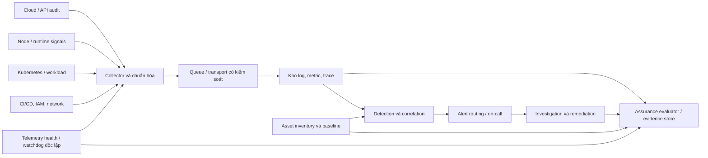

# Platform monitoring: Giám sát nền tảng để bảo đảm an toàn liên tục

## 1. Platform monitoring là gì?

**Platform monitoring** là hoạt động quan sát có hệ thống tình trạng, cấu hình, hành vi và các sự kiện của nền tảng đang phục vụ ứng dụng. Phạm vi có thể trải từ máy chủ, máy ảo, hệ điều hành, container runtime, Kubernetes, cloud control plane, mạng, lưu trữ, IAM, CI/CD đến hệ thống thu thập log và cảnh báo.

Trong chương **Platform assurance** của module **SECURITY_SECURITY_ASSURANCE**, giám sát là một nguồn đầu vào cho **security assurance liên tục**: tổ chức phải có căn cứ để đánh giá rằng các yêu cầu bảo mật và security controls được thực thi, phát hiện khi chúng bị vô hiệu hóa hoặc sai lệch, rồi xác minh việc khắc phục.

Ví dụ, một cluster production có baseline yêu cầu mọi thay đổi quyền quản trị Kubernetes đều được ghi nhận. Chỉ thấy cấu hình audit logging trong repository là chưa đủ. Cần kiểm chứng log thực sự phát sinh tại API server, được chuyển đến nơi lưu trữ an toàn, đủ trường dữ liệu để điều tra và có cơ chế phát hiện khi luồng log ngừng hoạt động.

Một chương trình platform monitoring hữu ích trả lời được năm câu hỏi:

1. **Quan sát cái gì?** Những tài sản, control và đường truy cập nào quan trọng đối với rủi ro bảo mật?
2. **Đo bằng gì?** Nguồn log, metric, trace, audit event hoặc trạng thái cấu hình nào phản ánh trực tiếp yêu cầu?
3. **Tin được đến đâu?** Dữ liệu có đủ phạm vi, mới, đúng thời gian, nguyên vẹn và được thu thập bằng quyền phù hợp không?
4. **Phản ứng ra sao?** Phát hiện nào phải cảnh báo, ai nhận, ưu tiên và điều tra theo runbook nào?
5. **Chứng minh bằng gì?** Có lưu được bằng chứng về trạng thái, phát hiện, quyết định xử lý và kết quả kiểm tra lại không?

**Monitoring không tự động đồng nghĩa với assurance.** Dashboard có màu xanh có thể chỉ phản ánh các thành phần đã được cấu hình gửi dữ liệu. Những node không có agent, account chưa bật audit hoặc pipeline đã ngừng chuyển sự kiện vẫn có thể đang gặp rủi ro mà dashboard không hiển thị.

## 2. Phân biệt monitoring, observability, detection và assurance

| Khái niệm | Vai trò chính | Ví dụ | Giới hạn |
| --- | --- | --- | --- |
| **Monitoring** | Theo dõi tín hiệu đã chọn và phát hiện điều kiện bất thường | Alert khi node mất heartbeat hoặc IAM policy thay đổi | Không tự chứng minh tất cả các nguồn đã được theo dõi |
| **Observability** | Hiểu trạng thái/hành vi hệ thống thông qua telemetry | Dùng log, metric và trace để xác định chuỗi lỗi | Có dữ liệu không có nghĩa đã có quy tắc bảo mật phù hợp |
| **Security detection** | Nhận diện dấu hiệu xâm phạm hoặc vi phạm control | Cảnh báo workload đặc quyền xuất hiện ngoài allowlist | Phát hiện vẫn có false positive và false negative |
| **Audit logging** | Ghi lại sự kiện phục vụ kiểm tra và truy vết | Người gọi API, hành động, đối tượng, kết quả | Bật audit chưa chứng minh dữ liệu đã được chuyển và lưu an toàn |
| **Security assurance** | Đánh giá có bằng chứng mức đáp ứng yêu cầu bảo mật | Đối chiếu baseline, kết quả test, coverage, finding, retest | Kết luận luôn gắn với phạm vi và thời điểm đánh giá |

Monitoring hỗ trợ cả **an toàn** (security) lẫn **độ tin cậy vận hành** (reliability). Ví dụ, CPU tăng đột biến có thể do tải hợp lệ, lỗi lập trình hoặc một hành vi bất thường; tín hiệu này tự nó chưa đủ để kết luận có tấn công. Ngược lại, thay đổi quyền trên một role nhạy cảm có thể không làm CPU hay latency tăng nhưng lại là sự kiện bảo mật quan trọng.

Do đó, cần xây dựng hai lớp logic liên kết: **health monitoring** để biết nền tảng còn hoạt động và có khả năng quan sát; **security monitoring** để nhận biết sự kiện liên quan đến yêu cầu, quyền, thay đổi cấu hình và hành vi vượt phạm vi cho phép.

## 3. Xác định phạm vi tài sản và ranh giới giám sát

Trước khi thiết lập alert, cần có **inventory** của đối tượng đáng lẽ phải được quan sát:

- **Cloud và hạ tầng:** organization/account/subscription/project, region, VPC/VNet, firewall, load balancer, VM, disk, KMS/key service và storage.
- **Nền tảng container:** cluster, control plane, node pool, node, namespace, workload, image digest, service account, admission policy và network policy.
- **Danh tính:** human admin, root/break-glass identity, workload identity, automation, external principal và quan hệ federation.
- **Đường triển khai:** repository, CI/CD runner, artifact registry, IaC pipeline, deployment controller, quyền phê duyệt và change ticket.
- **Luồng dữ liệu:** DB, queue, secret manager, backup, snapshot, hệ thống tổng hợp log và các đường kết nối giữa môi trường.
- **Hệ thống monitoring:** collectors, agents, pipelines, message queues, SIEM, metric store, rule engine, alert router và kho bằng chứng.

Mỗi tài sản nên có **asset ID ổn định**, môi trường, chủ sở hữu, mức độ quan trọng, phiên bản công nghệ, nguồn inventory và các monitoring controls áp dụng. Danh mục phải được đối chiếu giữa cloud API, CMDB/service catalog, orchestration API và nguồn triển khai: một máy ảo xuất hiện trong cloud nhưng chưa có agent vẫn phải được đưa vào mẫu số coverage.

### Ranh giới trách nhiệm

Với hệ thống self-managed, nhóm vận hành có thể kiểm soát OS, audit agent, Kubernetes API server và log pipeline. Với managed Kubernetes hoặc PaaS, nhà cung cấp có thể vận hành một phần control plane; khách hàng phải xác định **loại log và quyền cấu hình mà dịch vụ thực sự cung cấp**, trách nhiệm kích hoạt log, nơi lưu, retention và phạm vi bằng chứng của provider.

Đánh giá cần chỉ rõ:

1. Control nằm dưới quyền cấu hình của ai?
2. Nhóm có thể đọc trạng thái nào trực tiếp qua API?
3. Phần nào phải dựa trên tài liệu, báo cáo bảo đảm hoặc cam kết dịch vụ của nhà cung cấp?
4. Nếu nguồn quan sát không tồn tại, kết luận nào là hợp lệ và điểm mù nào phải ghi vào risk register?

Không nên tự đánh dấu PASS cho những control chưa có bằng chứng chỉ vì nền tảng được cung cấp dưới dạng dịch vụ quản lý.

## 4. Từ rủi ro đến tín hiệu giám sát

Giám sát có ích khi bắt đầu bằng **rủi ro và mục tiêu bảo mật**, sau đó xác định tín hiệu phù hợp với mỗi quyết định cần đưa ra.

| Rủi ro / mục tiêu | Control kỳ vọng | Tín hiệu cần quan sát | Bằng chứng đánh giá |
| --- | --- | --- | --- |
| Tài khoản không được duyệt thay quyền production | Chỉ identity được cấp phép mới sửa IAM/RBAC | Audit event thay policy, role, group hoặc binding | Event gốc + identity + phê duyệt + policy trước/sau |
| Workload có thể tăng quyền lên host | Admission và runtime security context giới hạn đặc quyền | Pod creation/admission decision, PodSpec thực tế, runtime event | Policy, phép thử từ chối, danh sách Pod đang chạy |
| Dữ liệu thoát ra mạng không được phép | Egress policy, segmentation và kiểm soát identity | Network flow, DNS/proxy event, policy changes | Rule hiệu lực, traffic test, flow record với phạm vi rõ |
| Artifact production bị thay ngoài pipeline | Deploy theo release đã duyệt | Image digest runtime khác release digest; registry/deploy change | Release record, runtime inventory, thay đổi và approver |
| Secret hoặc khóa bị đọc trái phép | IAM least privilege và logging truy cập nhạy cảm | API event truy cập secret/key, token issuance, bất thường identity | Quyền hiệu lực, event source và context |
| Mất khả năng truy vết thay đổi | Audit/logging pipeline hoạt động và được bảo vệ | Collector heartbeat, ingestion delay, dropped events, config changes | Health checks, thử sinh sự kiện, kiểm tra log tại đích |
| Mất khả năng phục hồi | Backup được bảo vệ và kiểm tra restore | Backup failures, snapshot status, restore test, storage capacity | Report restore, RPO/RTO thực tế, quyền truy xuất backup |

Chẳng hạn, yêu cầu **“mọi thay đổi quyền quản trị cluster đều được audit”** nên được định nghĩa thành những điều kiện có thể kiểm tra: loại sự kiện cần ghi, cluster áp dụng, nguồn phát sinh, trường dữ liệu bắt buộc, nơi lưu, khoảng trễ cho phép, retention và phép thử kiểm chứng. Chỉ đo số lượng log hoặc tổng byte ingest không thể bảo đảm yêu cầu đó.

### Chuỗi truy vết assurance

```text
Rủi ro / mục tiêu bảo mật
    -> Control và baseline đã phê duyệt
    -> Đối tượng, nguồn tín hiệu và luật đánh giá
    -> Bằng chứng về cấu hình + bằng chứng hoạt động
    -> PASS / FAIL / UNKNOWN / EXCEPTION
    -> Phát hiện, khắc phục, retest
```

Một detection rule có thể gắn với nhiều controls; một control cũng có thể cần nhiều nguồn tín hiệu khác nhau. Ví dụ, việc xác thực rằng NetworkPolicy chặn egress cần **đọc policy hiện tại**, **xác minh CNI hỗ trợ enforcement** và **thực hiện phép thử kết nối từ nguồn đại diện**. Chỉ nhìn thấy NetworkPolicy object hoặc flow log riêng lẻ chưa đủ.

## 5. Các loại telemetry trên nền tảng

### 5.1. Logs và audit events

Logs thường ghi sự kiện hoặc thông điệp theo thời gian: đăng nhập, thay quyền, deploy, thay đổi firewall, thông báo lỗi, hoạt động đọc secret, sự kiện của container runtime và thao tác trên control plane.

Các thuộc tính quan trọng:

- **Ai:** user/service principal, workload identity, role, session hoặc service account.
- **Làm gì:** action/API verb, loại thay đổi, kết quả được phép hay từ chối.
- **Ở đâu:** account/project/cluster/namespace/resource, nguồn kết nối và destination.
- **Khi nào:** thời điểm phát sinh và thời điểm hệ thống nhận log, timezone.
- **Ngữ cảnh:** correlation/request ID, release, policy version, source IP khi được phép thu thập.

Khả năng ghi chi tiết phụ thuộc loại log. Ví dụ, Kubernetes audit log có thể được cấu hình ở nhiều mức chi tiết; ghi toàn bộ request/response bodies một cách máy móc có nguy cơ thu thập secret và dữ liệu nhạy cảm. Cần chọn mức đủ phục vụ mục tiêu kiểm soát, lọc dữ liệu nhạy cảm và đánh giá chi phí lưu trữ.

### 5.2. Metrics

Metrics là các phép đo định lượng theo thời gian: CPU, bộ nhớ, disk, network throughput, số phiên, tỷ lệ lỗi, độ trễ, số collector không hoạt động, độ trễ ingest và lượng dữ liệu bị bỏ.

Metrics phù hợp với health, xu hướng, capacity và giám sát **sự hiện diện của telemetry**. Một metric như `up=1` của exporter cho biết mục tiêu scrape đang được quan sát ở phạm vi thiết lập, không chứng minh bản thân các security controls đều đạt.

Khi xây metrics, cần chú ý cardinality: nhãn chứa user ID, token, request ID hoặc đường dẫn duy nhất có thể gây nổ số series, tăng chi phí và vô tình lộ thông tin nhạy cảm.

### 5.3. Traces

Traces liên kết các bước xử lý của một request qua nhiều service, hữu ích khi điều tra chuỗi gọi, latency và các lỗi phân tán. Tuy nhiên, traces không mặc nhiên bao gồm mọi quyết định IAM hoặc hoạt động control plane. Sampling có thể bỏ qua request liên quan; việc ghi header và payload thô có thể làm lộ token hoặc dữ liệu cá nhân. Trace phù hợp để bổ sung ngữ cảnh cho security investigation, không nên là nguồn duy nhất xác nhận một sự kiện bảo mật bắt buộc.

### 5.4. Configuration snapshots và control-state evidence

Nhiều trạng thái bảo mật phải được lấy **trực tiếp từ API cấu hình**: IAM bindings, cloud security groups, audit policy, admission settings, TLS policy, encryption settings, backup retention, effective RBAC và image digest runtime.

Snapshot cho biết trạng thái ở thời điểm đọc; event log giúp truy vết thay đổi giữa các lần chụp. Kết hợp cả hai cho kết luận đáng tin cậy hơn. **Không có sự kiện thay đổi** không chứng minh cấu hình đã đúng nếu logging không được bao phủ hoặc bị gián đoạn.

## 6. Kiến trúc hệ thống monitoring có khả năng kiểm chứng



Mỗi tầng phải có người sở hữu, quyền truy cập, mức độ bảo vệ và tiêu chí kiểm tra:

| Tầng | Rủi ro mất bằng chứng | Biện pháp cần xem xét |
| --- | --- | --- |
| Nguồn phát sinh | Audit bị tắt hoặc policy bỏ qua event quan trọng | Kiểm tra cấu hình hiệu lực, quyền sửa và event test |
| Collector/agent | Agent bị gỡ, hết quyền, crash hoặc không có trên tài sản mới | Inventory reconciliation, heartbeat, health alert |
| Transport | Lỗi mạng, queue đầy, retry thất bại, bị loại bỏ log | Buffering, delivery metrics, dead-letter, dropped-event monitoring |
| Normalize/parse | Thay schema khiến rule không nhận ra sự kiện | Schema validation, parser tests, theo dõi sự kiện không parse được |
| Store | Retention thiếu, truy cập trái phép, xóa/sửa dữ liệu | RBAC, mã hóa, backup, integrity controls, retention test |
| Detection | Rule lỗi, bị disable, whitelist quá rộng | Versioned rules, positive/negative tests, change approval |
| Alert | Sai routing, on-call không nhận, bị suppression quá lâu | Test delivery, escalation, monitoring mute/silence lifecycle |
| Evidence | Không truy vết được quy tắc và nguồn gốc dữ liệu | Asset ID, timestamps, baseline version, hash/reference và audit trail |

### Bảo vệ chính hệ thống monitoring

Nếu cùng một tài khoản vừa có quyền thay IAM production vừa có quyền xóa log production, kẻ tấn công chiếm được tài khoản đó có thể gây hại và che giấu dấu vết. Tùy kiến trúc, nên tách quyền quản trị tài nguyên khỏi quyền sửa/xóa kho bằng chứng, sử dụng log sink độc lập, quyền ghi có giới hạn và lưu trữ bất biến theo chính sách.

**“Immutable” không có nghĩa bằng chứng tuyệt đối không thể mất.** Vẫn phải xem xét quyền thay retention, quyền quản trị nhà cung cấp, khóa mã hóa, replication, thay đổi thời gian, lỗi pipeline và khả năng khôi phục. Những bảo đảm về integrity phải mô tả điều kiện giả định và quyền của đối tượng có thể can thiệp.

## 7. Data quality: thu thập được chưa đủ, phải đánh giá độ tin cậy

Security monitoring chỉ có giá trị nếu dữ liệu đủ tốt để đưa ra kết luận.

### 7.1. Completeness và coverage

Phân biệt:

- **Asset coverage:** bao nhiêu tài sản trong phạm vi đang có hệ thống thu thập phù hợp?
- **Control coverage:** bao nhiêu cặp tài sản–quy tắc được hỗ trợ bằng các nguồn tín hiệu bắt buộc?
- **Event coverage:** loại sự kiện nào thực sự được thu thập, với mức chi tiết nào?
- **Time coverage:** trong khoảng thời gian đánh giá, có đoạn bị mất log hoặc gap ingestion nào không?

Ví dụ, 90/100 node có agent là **90% agent coverage**; không thể gọi đó là 100% platform monitoring chỉ vì 90 node đang gửi telemetry liên tục. Mười node còn lại phải được ghi rõ để xử lý.

### 7.2. Freshness và timestamps

Cần lưu cả **event time** (thời điểm sự kiện xảy ra) và **ingest time** (thời điểm hệ thống nhận được). Độ trễ có thể xảy ra do buffer, mạng, gửi lại dữ liệu hoặc xử lý batch. Đồng bộ thời gian hỗ trợ tương quan, nhưng đồng hồ của nguồn vẫn có thể lệch hoặc event đến không đúng thứ tự.

Một cuộc điều tra cần biết “sự kiện đã xảy ra khi nào?” và “hệ thống biết sự kiện đó khi nào?”. Hai thời điểm khác nhau ảnh hưởng trực tiếp đến cách đo detection latency và đánh giá khoảng phơi lộ.

### 7.3. Accuracy và schema

Đảm bảo các trường định danh có thể liên kết giữa hệ thống: account, cluster, namespace, resource UID, principal, request/correlation ID. Việc đổi tên label hoặc schema sau nâng cấp có thể khiến rule bỏ sót sự kiện. Cần quản lý phiên bản parser, kiểm thử với sự kiện mẫu và báo lỗi khi tỷ lệ parse thất bại vượt ngưỡng.

### 7.4. Confidentiality và retention

Log, trace và bằng chứng có thể chứa IP, tài khoản, tên nội bộ, thông tin định danh và dữ liệu khách hàng. Chỉ ghi những trường cần cho mục tiêu kiểm soát; thực hiện masking hoặc redaction khi thích hợp, phân quyền người xem, quy định retention và thủ tục xóa an toàn. Không ghi password, access token, private key hay payload chứa dữ liệu bí mật chỉ để tạo bằng chứng monitoring.

## 8. Xây dựng monitoring baseline và điều kiện chấp nhận

Một **monitoring baseline** mô tả những tài sản phải được giám sát, nguồn dữ liệu cần thiết, yêu cầu sức khỏe pipeline, detection rules và tiêu chí bằng chứng. Baseline phải có phiên bản, phạm vi, owner và phê duyệt, giống các baseline bảo mật khác.

| Rule ID | Yêu cầu kiểm soát | Điều kiện cần xác minh | Tần suất gợi ý |
| --- | --- | --- | --- |
| MON-01 | Mọi cluster production thuộc inventory có cloud/Kubernetes audit theo phạm vi | Cấu hình audit + thử sinh sự kiện + dữ liệu tại sink | Sau thay đổi, định kỳ |
| MON-02 | Các node production thuộc phạm vi đều gửi health/runtime signals | Inventory đối chiếu collector/agent + sample mới | Liên tục, đối soát định kỳ |
| MON-03 | Thay đổi quyền đặc quyền có thể phát hiện và truy vết | Audit events + rule + alert delivery test | Khi thay đổi policy/rule |
| MON-04 | Bất thường về container privilege được nhận diện | Admission/runtime event + PodSpec actual state | Khi deploy, runtime |
| MON-05 | Mất telemetry phải tạo cảnh báo riêng | Heartbeat, ingestion delay, log pipeline health | Liên tục |
| MON-06 | Bằng chứng được bảo vệ và truy xuất theo retention | Access control, integrity controls, retrieval test | Định kỳ, sau thay đổi |
| MON-07 | Phát hiện quan trọng có owner, runbook và retest | Alert route, on-call test, ticket/finding history | Định kỳ và sau incident |

Tần suất và ngưỡng phải được xác định theo mức rủi ro, lượng sự kiện, thời gian trễ và khả năng vận hành của tổ chức. Bảng này là **ví dụ thiết kế**, không quy định chung cho mọi ngành hoặc mọi nền tảng.

Ví dụ một định dạng YAML **mang tính khái niệm**, không phải policy dùng trực tiếp cho Prometheus, SIEM hay cloud:

```yaml
baseline:
  id: PLATFORM-MONITORING-PROD
  version: "1.0.0"
  state: approved
  scope:
    environment: production
    assetKinds: [kubernetes-cluster, worker-node]
  owner: Platform Security
  approvedBy: Security and Operations
  sourceRevision: "<approved-git-revision>"

checks:
  - id: MON-01
    requirement: "Control-plane security events are auditable"
    severity: critical
    requiredEvidence:
      - audit-policy-effective-state
      - controlled-event-at-source
      - controlled-event-at-protected-sink
    outcomeOnMissingData: UNKNOWN
  - id: MON-02
    requirement: "Every in-scope node has fresh runtime telemetry"
    severity: high
    requiredEvidence:
      - inventory-reconciliation
      - collector-health
      - recent-sample-per-asset
    outcomeOnMissingData: UNKNOWN
  - id: MON-05
    requirement: "Telemetry interruptions are detected and routed"
    severity: high
    requiredEvidence:
      - pipeline-health-check
      - controlled-alert-delivery-test
      - oncall-route
    outcomeOnMissingData: UNKNOWN
```

Các khóa `requiredEvidence` và `outcomeOnMissingData` chỉ biểu đạt **quy ước của một hệ thống assurance giả định**. Để vận hành thật cần evaluator xác định cách đọc dữ liệu, ngữ nghĩa PASS/FAIL/UNKNOWN, mốc thời gian đánh giá, ngoại lệ và cách đối soát inventory.

## 9. Tín hiệu cụ thể trên Kubernetes và cloud

### 9.1. Kubernetes control plane

Đối với Kubernetes, các sự kiện cần quan sát theo rủi ro gồm:

- Thay đổi `RoleBinding`, `ClusterRoleBinding`, `Role`, `ClusterRole` hoặc quyền sửa policy.
- Tạo hoặc cập nhật `Pod`/workload có quyền nhạy cảm: `privileged`, `hostPath`, `hostNetwork`, `hostPID`, capabilities.
- Thay đổi admission policy, namespace security labels, webhook configuration hoặc các exemptions liên quan.
- Thao tác đọc/ghi tài nguyên nhạy cảm như Secret và các thay đổi service account/binding.
- Thay đổi node, workload image, network policy, storage hoặc các thành phần logging.

**Kubernetes Events không thay thế Kubernetes audit logs.** Events phục vụ ghi nhận nhiều tình huống vận hành, nhưng không cung cấp đầy đủ lịch sử các API calls. Muốn kết luận về thao tác trên control plane, phải xác nhận cấu hình và nguồn audit phù hợp. Trong managed Kubernetes, khả năng bật, xem và định tuyến audit có thể phụ thuộc dịch vụ.

### 9.2. Node và container runtime

Ở node cần giám sát tình trạng hệ điều hành, phiên bản kernel, agent heartbeat, những thao tác quản trị nhạy cảm, thay đổi file hệ thống và sự kiện runtime phù hợp mô hình đe dọa. Một container bị restart liên tục có thể là lỗi ứng dụng hoặc dấu hiệu cần điều tra; không tự động là sự cố xâm nhập.

Nếu cần runtime detection sâu hơn, có thể dùng cơ chế giám sát syscall/tiến trình/file/network theo khả năng hệ thống. Tuy nhiên phải đánh giá quyền cần cấp cho agent, mức độ ảnh hưởng hiệu năng và độ bao phủ thực tế của nó. Công cụ an ninh chạy đặc quyền cũng là tài sản cần hardening, quản lý update và audit.

### 9.3. IAM, cloud management và hạ tầng

Các sự kiện có mức ưu tiên cao thường liên quan:

- Cấp hoặc mở rộng role, thay đổi trust policy, service account impersonation, tạo credential dài hạn.
- Thay đổi firewall/network access, mở public endpoint, cấp quyền trên storage bucket hoặc encryption key.
- Tắt audit log, giảm retention, sửa log sink, thay khả năng ghi log của service.
- Thay đổi backup policy, snapshot access, quyền khôi phục hoặc thao tác phá hủy dữ liệu.
- Bất thường của identity đặc quyền và phiên đăng nhập theo policy đã được phê duyệt.

Tên dịch vụ, sự kiện, mức độ ghi log mặc định và giới hạn thông tin khác nhau theo AWS, Azure và Google Cloud. Không được giả định rằng mỗi provider tự ghi lại mọi loại hành động hoặc lưu log vô thời hạn. Cần xem đúng tài liệu dịch vụ, kiểm tra quyền cấu hình, kết quả log thực tế và chu kỳ lưu.

## 10. Ví dụ kiểm tra giám sát bằng công cụ chỉ đọc

Giả sử nhóm platform cần xác nhận namespace `payments` trên một cluster production đang được quan sát và các workload của namespace có thông tin runtime. Các lệnh sau chỉ đọc, dành cho tài khoản có quyền phù hợp:

```bash
# Xác nhận đang kết nối đúng cluster context.
kubectl config current-context

# Danh sách node và trạng thái ở thời điểm truy vấn.
kubectl get nodes -o wide

# Workloads thực tế, kể cả trạng thái và vị trí node.
kubectl get pods -n payments -o wide

# Sự kiện vận hành hiện còn được API cung cấp.
kubectl get events -n payments --sort-by=.lastTimestamp

# Tham chiếu policy và quyền trong namespace.
kubectl get rolebindings -n payments -o yaml
kubectl get networkpolicies -n payments -o yaml
```

**Giới hạn:** những kết quả này không tự chứng minh Kubernetes API audit đang bật, log đã đến kho tập trung, agent trên node đang hoạt động hoặc traffic thực tế bị NetworkPolicy chặn. Cần kết hợp nguồn quan sát về collector, audit sink, thời gian ingest, inventory và các bài thử cho phép/từ chối phù hợp.

Khi cần kiểm tra audit, nên thực hiện sự kiện thử nghiệm được phê duyệt trên môi trường thử hoặc tài nguyên thử có kiểm soát, rồi truy tìm **cùng một event/correlation ID** từ nguồn đến nơi lưu cuối. Không tạo thao tác phá hủy hay thay đổi quyền production chỉ để kích hoạt một detection rule.

## 11. Giám sát sức khỏe của chính telemetry pipeline

Một vấn đề nghiêm trọng là **monitoring có thể thất bại một cách im lặng**. Ví dụ, collector trên 50 node ngừng gửi log nhưng SIEM vẫn hiển thị bình thường vì 200 node khác tiếp tục hoạt động. Vì vậy cần giám sát riêng khả năng quan sát.

Những signal quan trọng:

- **Collector heartbeat:** tần suất check-in, phiên bản agent và tài sản nguồn.
- **Expected source coverage:** số nguồn phải có dữ liệu theo inventory, không chỉ số nguồn đã xuất hiện.
- **Ingestion lag:** khoảng cách từ event time đến ingest time theo nguồn và loại event.
- **Delivery failure:** retry, queue lag, dropped events, dead-letter count hoặc permission denied.
- **Parser health:** số event bị loại, không map được schema hoặc thiếu trường bắt buộc.
- **Detection health:** trạng thái rule, lỗi truy vấn, lịch chạy cuối và thời điểm thực thi thành công.
- **Alert delivery:** thông báo đến đúng kênh/on-call, test escalation và tình trạng mute/suppression.
- **Evidence retrieval:** đọc lại bản ghi lưu trữ theo thời hạn và khả năng kiểm tra tính toàn vẹn.

### Ví dụ Prometheus cho health của metric exporter

Đây là **hai biểu thức minh họa** trong PromQL:

```promql
# Target vẫn tồn tại trong scrape configuration nhưng đang scrape thất bại.
up{job="node-exporter"} == 0

# Không còn bất kỳ chuỗi "up" nào của job này trong 10 phút.
absent_over_time(up{job="node-exporter"}[10m])
```

Biểu thức thứ hai chỉ phát hiện trường hợp **toàn bộ job không có mẫu**, không xác định được một node bị mất khi vẫn còn nhiều node khác. Biểu thức thứ nhất cũng có thể bỏ sót một node bị gỡ khỏi service discovery vì target không còn xuất hiện. Vì vậy, muốn phát hiện **mất coverage theo từng node**, phải đối chiếu từ hệ thống monitoring với danh sách node kỳ vọng độc lập.

Các biểu thức này theo dõi **metric scrape**, không chứng minh log/audit pipeline đã đủ hoặc policy bảo mật đạt yêu cầu. Hơn nữa, nếu chính Prometheus hoặc alert router ngừng hoạt động, chúng có thể không gửi được cảnh báo. Với control quan trọng, nên bổ sung phép kiểm từ ngoài hệ thống hoặc watchdog độc lập.

## 12. Thiết kế detection rule và cảnh báo có ý nghĩa

Một detection rule cần có:

1. **Use case và rủi ro:** tại sao hành vi cần được phát hiện?
2. **Event source và schema:** sự kiện đến từ đâu, trường nào là bắt buộc?
3. **Scope:** account/cluster/workload/identity nào được áp dụng, có ngoại lệ được phê duyệt không?
4. **Logic:** điều kiện tạo alert, tương quan với inventory, baseline, lịch thay đổi và role.
5. **Severity và response:** mức độ ưu tiên theo tác động, owner, runbook, thời hạn phản hồi.
6. **Evidence:** raw event reference, rule version, thời gian, context và kết quả phân tích.
7. **Test:** trường hợp phải phát hiện, trường hợp không được phát hiện và tình huống nguồn dữ liệu mất.

Ví dụ một rule kiểm tra thay đổi quyền nhạy cảm trên cluster production (đây là **pseudocode minh họa**, không phải cấu hình có thể đưa trực tiếp vào SIEM):

```yaml
rule:
  id: DET-PLAT-PRIV-01
  description: "Phát hiện thay đổi quyền đặc quyền ngoài quy trình"
  scope:
    environment: production
    resourceKinds: [ClusterRoleBinding, ClusterRole]
  event:
    source: kubernetes-audit
    verbs: [create, update, patch, delete]
    decision: completed
  correlation:
    requireChangeApproval: true
    joinBy:
      - clusterId
      - resourceUid
      - eventTimeWindow
  onMatch:
    severity: high
    owner: Platform Security
    createFinding: true
    attachRawEventReference: true
  onMissingSource:
    result: UNKNOWN
    notify: Telemetry Platform
```

Trong triển khai thật, cần định nghĩa rõ “completed”, cách phân biệt `request` với kết quả API, cách liên kết approval có thể thay đổi theo thời gian và cơ chế tránh báo trùng khi log được gửi lại. Một change ticket tồn tại cũng không bảo đảm thay đổi phù hợp; phải kiểm tra người phê duyệt, phạm vi và thời hạn được phép.

### Chọn severity có ngữ cảnh

Không nên mặc định mọi hành động `patch` trên `ClusterRoleBinding` đều là tấn công. Nếu được phê duyệt, thực thi đúng pipeline và nằm trong maintenance window, sự kiện có thể cần được ghi nhận mà không phải báo động khẩn cấp. Ngược lại, việc mở quyền cho principal ngoài tổ chức hoặc vô hiệu hóa logging cần có mức ưu tiên cao hơn.

**Tuning alert** phải có bằng chứng về lý do và quyền phê duyệt; whitelist vĩnh viễn theo tên user hoặc namespace có thể che giấu lạm dụng thực tế. Hãy dùng điều kiện ngoại lệ cụ thể, có thời hạn và tái đánh giá.

## 13. Kiểm thử detection và xác nhận end-to-end

Viết rule và nhận thấy nó “enabled” chưa chứng minh rule hoạt động. Một quy trình kiểm thử có kiểm soát nên gồm:

| Kịch bản | Mục tiêu | Kết quả cần quan sát |
| --- | --- | --- |
| Positive test | Tạo một sự kiện được phép để mô phỏng tình huống vi phạm | Log đến sink, rule khớp và alert đến owner |
| Negative test | Tạo hành vi hợp lệ không vi phạm baseline | Không tạo cảnh báo sai hoặc cảnh báo được phân loại phù hợp |
| Missing telemetry test | Giả lập mất nguồn dữ liệu trong môi trường test | Pipeline health alert và trạng thái UNKNOWN |
| Parser/schema test | Sự kiện mẫu đổi trường/phiên bản | Phát hiện parse error hoặc tương thích schema |
| Delay/replay test | Log đến muộn hoặc được gửi lại | Có khả năng tương quan, deduplicate hoặc nêu giới hạn |
| Suppression/approval test | Thay đổi đã duyệt hoặc ngoại lệ có hạn | Ghi nhận sự kiện nhưng xử lý theo policy, không bị che hoàn toàn |
| Retrieval test | Truy xuất event cũ theo retention | Bản ghi có thể đọc, truy vết và kiểm tra integrity |

Đo **detection latency** từ lúc sự kiện xảy ra đến lúc alert có thể hành động, khi cả hai timestamp đủ tin cậy. Phân biệt độ trễ ingest, thời gian xử lý rule và độ trễ định tuyến. Một alert nhanh không có ích nếu thiếu context để người trực xác nhận hoặc không bao giờ đến đúng nơi.

Để tránh tác động production, có thể sử dụng staging, sandbox, synthetic events hoặc tài nguyên thử được cho phép; ghi rõ điều gì đã kiểm thử thực sự và điều gì mới chỉ mô phỏng. Không suy rộng kết quả test staging thành bảo đảm tuyệt đối cho production.

## 14. Chuyển monitoring thành bằng chứng security assurance

Mỗi kết quả nên liên kết:

`Baseline phiên bản X + tài sản Y + control Z + dữ liệu quan sát + phương pháp đánh giá + thời gian → kết luận`

Một bản ghi minh họa (giả định, không phải kết quả quét thực tế):

```json
{
  "assetId": "prod/cluster-a/control-plane",
  "assetType": "kubernetes-control-plane",
  "baselineId": "PLATFORM-MONITORING-PROD",
  "baselineVersion": "1.0.0",
  "ruleId": "MON-01",
  "observedAt": "2026-11-28T04:20:00Z",
  "assessmentWindow": {
    "from": "2026-11-28T04:05:00Z",
    "to": "2026-11-28T04:20:00Z"
  },
  "result": "FAIL",
  "expected": "Controlled audit event reaches protected log sink",
  "observed": "Event found at source but absent at destination",
  "source": ["cluster-audit-check", "log-sink-query"],
  "findingId": "PLAT-MON-042",
  "evidenceRef": "evidence://platform-monitoring/PLAT-MON-042"
}
```

Để phục vụ audit, thông thường phải bổ sung quyền của collector, tool/evaluator version, policy revision, correlation ID, nguồn thời gian, truy vấn được sử dụng, hash hoặc liên kết tới bằng chứng gốc, người đánh giá và hạn sử dụng của kết quả.

### Đánh giá kết quả đúng ngữ nghĩa

| Trạng thái | Khi nào dùng |
| --- | --- |
| **PASS** | Control áp dụng và có bằng chứng đủ mới, đủ phạm vi, đáng tin cậy rằng yêu cầu đạt |
| **FAIL** | Có bằng chứng xác nhận một điều kiện bắt buộc không đạt |
| **UNKNOWN** | Không đủ quyền, không có dữ liệu, pipeline lỗi hoặc thiếu khả năng chứng minh |
| **EXCEPTION** | Sai khác đã được chấp thuận chấp nhận rủi ro theo phạm vi và thời hạn |
| **NOT_APPLICABLE** | Điều kiện baseline xác nhận control không áp dụng cho tài sản này |

Một ví dụ về khác biệt: **không nhận được audit event tại sink** có thể là FAIL nếu có bằng chứng rằng event thử đã phát sinh và thời gian chờ đã vượt ngưỡng; nhưng một truy vấn thất bại vì thiếu quyền chỉ nên là **UNKNOWN** cho phép thử đó. Cần lưu rõ nguyên nhân để không biến mất telemetry thành một kết luận sai.

**Không được gộp EXCEPTION hoặc UNKNOWN vào PASS.** Nếu bị thiếu dữ liệu trong một phần thời gian, kết luận phải ghi rõ khoảng trống, không viết “tuân thủ liên tục” chỉ từ những khoảng đã quan sát được.

## 15. Đo lường hiệu quả monitoring

| Chỉ số | Gợi ý định nghĩa | Lưu ý khi diễn giải |
| --- | --- | --- |
| **Asset monitoring coverage** | Tài sản thuộc phạm vi có nguồn tín hiệu bắt buộc và sample hợp lệ / tổng tài sản thuộc phạm vi | Tài sản bị thiếu vẫn phải nằm trong mẫu số |
| **Control evidence coverage** | Cặp tài sản–control có bộ bằng chứng yêu cầu / tổng cặp bắt buộc | Có telemetry chưa đủ nghĩa là control PASS |
| **Telemetry freshness** | Tuổi của sự kiện/mẫu mới nhất, tính theo nguồn | Mỗi loại event có chu kỳ phát sinh khác nhau; thiếu sự kiện có thể hợp lệ |
| **Ingestion delay** | Chênh lệch giữa ingest time và event time | Phải xử lý clock skew, gửi batch và late arrivals |
| **Detection latency** | Thời gian từ sự kiện có ý nghĩa đến khi alert sẵn sàng xử lý | Nêu rõ điểm bắt đầu/kết thúc và coverage |
| **Alert precision** | Tỷ lệ alert được xác nhận hữu ích trên tập đã review | Cần quy trình xác nhận và sampling nhất quán |
| **Detection test pass rate** | Số kịch bản test đạt / tổng kịch bản bắt buộc | Test ở staging không tự bảo đảm production |
| **Missing source duration** | Thời gian telemetry source không còn kiểm chứng được | Phân loại theo tài sản và severity |
| **Mean time to verified remediation** | Từ finding đến retest chứng minh đã khắc phục | Đóng ticket không đồng nghĩa đã đạt control |
| **Evidence retrieval success** | Tỷ lệ phép thử truy xuất bằng chứng đúng yêu cầu retention | Nên kiểm tra cả quyền và integrity |

Ví dụ: hệ thống có 120 node trong inventory nhưng chỉ 108 node gửi heartbeat đủ mới. Coverage là **108/120 = 90%** theo tiêu chí đã định; không thể chỉ đếm 108 node mà hệ thống đang thấy rồi báo 100%. Với 12 node còn lại, cần hiển thị owner, nguyên nhân, thời gian thiếu tín hiệu và kế hoạch xử lý.

**Security outcomes** không thể suy ra chỉ từ số alert. Alert giảm có thể do hệ thống an toàn hơn, do tuning tốt hơn hoặc do pipeline bị tắt. Để hiểu xu hướng, phải đối chiếu cùng độ bao phủ, chất lượng dữ liệu, thay đổi rule và kết quả diễn tập.

## 16. Quy trình xử lý phát hiện và quản lý ngoại lệ

Khi monitoring tạo một finding, quá trình security assurance nên nối từ **phát hiện** đến **quyết định có thể kiểm chứng**:

1. **Triage:** kiểm tra asset, baseline, rule, nguồn dữ liệu, timestamp, mức nhạy cảm và độ tin cậy.
2. **Xác nhận:** phân biệt vi phạm thực, thay đổi được duyệt, lỗi parser, cảnh báo trùng hoặc dữ liệu thiếu.
3. **Phân loại rủi ro:** quyền có thể bị lạm dụng, dữ liệu bị ảnh hưởng, phạm vi phơi lộ, khả năng phục hồi và mức độ khẩn cấp.
4. **Giao owner và hành động:** mở ticket/incident, quy định SLA, phối hợp platform, security, ứng dụng và bên cung cấp khi cần.
5. **Khắc phục:** sửa qua change process, triển khai có kiểm soát và đánh giá tác động vận hành; xử lý các phiên, tài sản hoặc dữ liệu đã bị ảnh hưởng nếu có.
6. **Retest:** kiểm tra **trạng thái thực tế** và đường telemetry từ đầu đến cuối; xác nhận alert/detection đã trở lại bình thường.
7. **Lưu dấu vết:** bằng chứng trước/sau, người quyết định, thời gian, root cause và hành động ngăn tái diễn.

Không nên xóa raw event hoặc đóng finding chỉ vì trạng thái hiện tại đã xanh. Lịch sử thất bại có ý nghĩa để xác định khoảng thời gian rủi ro tồn tại. Nếu cần chấp nhận rủi ro tạm thời, ngoại lệ phải có rule, tài sản/phạm vi, lý do, risk owner, kiểm soát bù trừ, phê duyệt và ngày hết hạn.

**Auto-remediation** có thể giảm thời gian phơi lộ nhưng cũng có thể gây downtime. Những phản ứng như cô lập node, thu hồi quyền hoặc hủy workload cần điều kiện kích hoạt an toàn, kiểm thử rollback và quyền phê duyệt phù hợp với mức rủi ro.

## 17. Tình huống thực tế: mất log audit nhưng dashboard vẫn xanh

Một cluster Kubernetes production triển khai dịch vụ thanh toán và gửi audit logs về nền tảng logging tập trung. Baseline `PLATFORM-MONITORING-PROD@1.0.0` yêu cầu thay đổi IAM/RBAC có thể được truy vết. Một đợt nâng cấp làm thay đổi quyền ghi của log collector. Kể từ đó, logs mới bị từ chối ở nơi nhận, nhưng metric CPU/node health vẫn hoạt động nên dashboard vận hành tổng thể tiếp tục xanh.

### Diễn biến và bằng chứng cần tìm

| Bước | Hành động | Bằng chứng |
| --- | --- | --- |
| 1. Phát hiện | So sánh thời gian event mới nhất theo cluster với kỳ vọng; kiểm tra pipeline errors | Last-seen, delivery failures, quyền log sink |
| 2. Phân định phạm vi | Xác định cluster, loại log và khoảng thời gian bị ảnh hưởng; đối chiếu inventory | Source list, event time, ingest time, gaps |
| 3. Xác minh nguyên nhân | Kiểm tra policy sink, collector revision và logs lỗi gửi | Change diff, error logs, collector config |
| 4. Đánh giá rủi ro | Xác định không thể truy vết những thay đổi RBAC nào, giới hạn điều tra | Audit coverage timeline, related API/config snapshots |
| 5. Khắc phục | Khôi phục quyền ghi tối thiểu cho collector qua quy trình được duyệt | Ticket, policy diff, triển khai |
| 6. Retest | Tạo sự kiện thử được phê duyệt; đối chiếu event tại nguồn và đích, test alert | Event ID, source-to-sink correlation, alert receipt |
| 7. Phòng ngừa | Thêm pipeline heartbeat, ingestion-lag alert và retrieval test | Rule version, test record, owner và lịch kiểm thử |

Trong thời gian mất log, nhóm vẫn có thể dùng IaC, snapshot API hoặc nguồn độc lập để đánh giá một số thay đổi cấu hình. Nhưng **không được kết luận rằng đã không có sự kiện trái phép chỉ vì không tìm thấy log**; phải ghi khoảng trống evidence và áp dụng đánh giá rủi ro tương ứng.

Sau khi sửa, chỉ khi luồng dữ liệu và cảnh báo đã được xác minh end-to-end mới có thể kết luận control giám sát được phục hồi. Một phép thử thành công hiện tại **không khôi phục được những sự kiện quá khứ chưa từng được lưu**.

## 18. Tích hợp platform monitoring vào SDLC và vận hành

| Giai đoạn | Hoạt động giám sát/assurance | Đầu ra cần lưu |
| --- | --- | --- |
| Thiết kế | Threat modeling, xác định telemetry/control coverage, retention, alert routing | Monitoring baseline, sơ đồ nguồn dữ liệu, RACI |
| Build/PR | Review log schema, instrumentation, detection-as-code, quyền collector | Rule diff, test results, approval |
| Trước deploy | Kiểm thử collector, rule, parser, pipeline và rollback trong môi trường đại diện | Test report và release decision |
| Sau deploy | Kiểm tra health, đối soát inventory, thử event end-to-end với scope phù hợp | Snapshot, synthetic test, baseline comparison |
| Vận hành | Phát hiện drift, signal loss, lỗ hổng/identity changes, triage alerts | Findings, incident tickets, remediation status |
| Định kỳ | Access review hệ thống monitoring, retention/retrieval test, cập nhật rule | Audit log, review decisions, test record |
| Sau sự cố | Correlate evidence, kiểm tra điểm mù, bổ sung use case và bài thử | Incident timeline, root cause, verified improvements |

Nên phân tách trách nhiệm: **platform owners** vận hành telemetry collection, **security detection team** thiết kế use cases và xác thực rule, **service owners** chịu trách nhiệm sửa asset bị phát hiện, **audit/assurance owners** đánh giá bằng chứng và phạm vi kết luận. Tên nhóm có thể khác, nhưng phải xác định rõ ai có quyền phê duyệt baseline và ngoại lệ.

## 19. Những sai lầm thường gặp

1. **Có dashboard nhưng không có inventory:** asset mới chưa được onboard không tạo alert vì monitoring chưa từng biết nó tồn tại.
2. **Đếm số log thay cho coverage:** tổng ingest cao có thể che một nguồn quan trọng hoàn toàn mất dữ liệu.
3. **Nhầm health metrics với security evidence:** node `Ready` không chứng minh quyền IAM, network policy hay audit log đúng.
4. **Bật logging rồi không thử nhận tại đích:** log bị từ chối bởi quyền sink, lỗi parser hoặc queue đã đầy.
5. **Tin vào alert rule mà không test:** rule bị lỗi schema, không có dữ liệu, threshold sai hoặc route mất người nhận.
6. **Không giám sát monitoring system:** hỏng collector/SIEM/alert router có thể biến vi phạm thành khoảng im lặng.
7. **Coi “không có sự kiện đáng ngờ” là an toàn:** không có bằng chứng có thể là thiếu quan sát, sự kiện chưa xảy ra hoặc nguồn không tạo log.
8. **Lấy log làm bằng chứng duy nhất cho cấu hình hiệu lực:** phải kiểm tra API/runtime state và các control bị áp dụng/ghi đè.
9. **Lưu quá nhiều dữ liệu nhạy cảm:** tokens, secret hoặc payload khách hàng xuất hiện trong log/trace.
10. **Đặt suppression không thời hạn:** che mất sự kiện thật sau một lần tuning giảm false positive.
11. **Đóng finding khi đã sửa cấu hình:** chưa retest event nguồn–đích hoặc chưa xác nhận các dữ liệu/khoảng thời gian bị ảnh hưởng.
12. **Bỏ qua event time và ingest time:** điều tra sai trình tự hoặc đánh giá sai detection latency.
13. **Dùng một ngưỡng cho mọi môi trường:** sản xuất có yêu cầu khác staging; cần mức độ rủi ro và SLO rõ.
14. **Không cập nhật baseline khi công nghệ thay đổi:** nâng cấp cloud/Kubernetes, đổi log schema hay pipeline khiến rule cũ mất hiệu lực.

## 20. Bài tập thực hành và câu hỏi tự đánh giá

1. Một hệ thống có 80 cluster production nhưng SIEM chỉ nhận được log từ 72 cluster. Hãy tính coverage, mô tả trạng thái của 8 cluster còn lại và đề xuất cách tìm nguyên nhân.
2. Một rule cảnh báo thay đổi `ClusterRoleBinding` đã bật nhưng không tạo alert suốt ba tháng. Những bằng chứng nào cần thu thập để phân biệt “không có vi phạm” với “rule không hoạt động”?
3. Một node bị xóa khỏi service discovery nên không còn xuất hiện trong biểu thức `up == 0`. Vì sao đây là lỗ hổng monitoring coverage? Thiết kế phép đối soát inventory như thế nào?
4. Một alert cho biết có Pod đặc quyền được triển khai. Hãy liên kết audit event, admission policy, PodSpec runtime, change approval và quyền service account để đánh giá tác động.
5. Collector gửi logs tới SIEM nhưng ingest bị trễ 30 phút do queue quá tải. Tác động đến detection latency, bằng chứng kiểm toán và hành động vận hành là gì?
6. Nhóm muốn lưu toàn bộ HTTP headers và SQL statements để điều tra nhanh hơn. Những rủi ro bảo mật và quyền riêng tư cần kiểm soát là gì? Có cách thu thập ít dữ liệu hơn mà vẫn đạt mục tiêu không?
7. Một sự cố làm audit logs mất trong hai giờ. Sau khi fix, event test hoạt động. Nhóm nên ghi kết luận assurance như thế nào cho hai giờ bị mất, và cần retest điều gì?
8. Hãy thiết kế ba kịch bản positive, negative và missing-source test cho monitoring control yêu cầu phát hiện thay đổi IAM đặc quyền.

Một bài trả lời tốt phải liên kết được **mục tiêu bảo mật → asset và control → tín hiệu cần có → trạng thái thực tế → bằng chứng → kết luận có giới hạn → xử lý/retest**. Nếu một nguồn dữ liệu không đủ, hãy nêu rõ nó chưa chứng minh được điều gì.

## 21. Tài liệu tham khảo

- **NIST SP 800-53**, đặc biệt các nhóm **AU** (Audit and Accountability), **SI** (System and Information Integrity), **CM** (Configuration Management), **AC** (Access Control) và **IR** (Incident Response): tham khảo mục tiêu kiểm soát, logging, giám sát và xử lý.
- **NIST SP 800-137 – Information Security Continuous Monitoring (ISCM) for Federal Information Systems and Organizations**: khung tư duy về giám sát bảo mật liên tục có liên hệ với quản trị rủi ro.
- **NIST SP 800-61 – Computer Security Incident Handling Guide** và các tài liệu kế tiếp của NIST về incident response: tham khảo tích hợp phát hiện với phân tích, ứng phó và cải tiến sau sự cố.
- **Kubernetes Documentation – Auditing, Events, RBAC, Pod Security Standards, Network Policies**: xác nhận nguồn dữ liệu và ngữ nghĩa kiểm soát của cluster.
- **OpenTelemetry Documentation**: khái niệm logs, metrics, traces, context propagation và telemetry pipelines.
- **Prometheus Documentation – Querying, Alerting và Service Discovery**: tìm hiểu ngữ nghĩa của `up`, `absent_over_time` và giới hạn cảnh báo khi nguồn dữ liệu biến mất.
- **Cloud provider security logging documentation** của AWS, Microsoft Azure và Google Cloud: xác minh loại audit, coverage, cấu hình retention, quyền truy cập và shared responsibility theo dịch vụ thực tế.
- **OWASP Logging Cheat Sheet**: tham khảo cách chọn dữ liệu log có ích cho an ninh và hạn chế ghi thông tin nhạy cảm.

Giám sát nền tảng tạo giá trị cho **security assurance** khi tổ chức có thể chứng minh **đúng đối tượng được giám sát, dữ liệu còn đáng tin, control được đánh giá theo baseline và phát hiện được xử lý đến khi kiểm tra lại thành công**. Một hệ thống monitoring tốt phải nhìn thấy cả các vi phạm lẫn sự suy giảm khả năng quan sát của chính nó.
