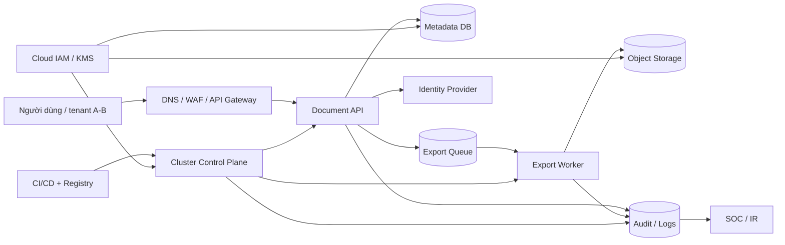
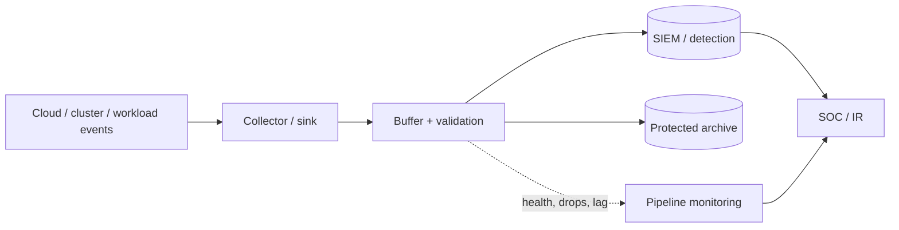
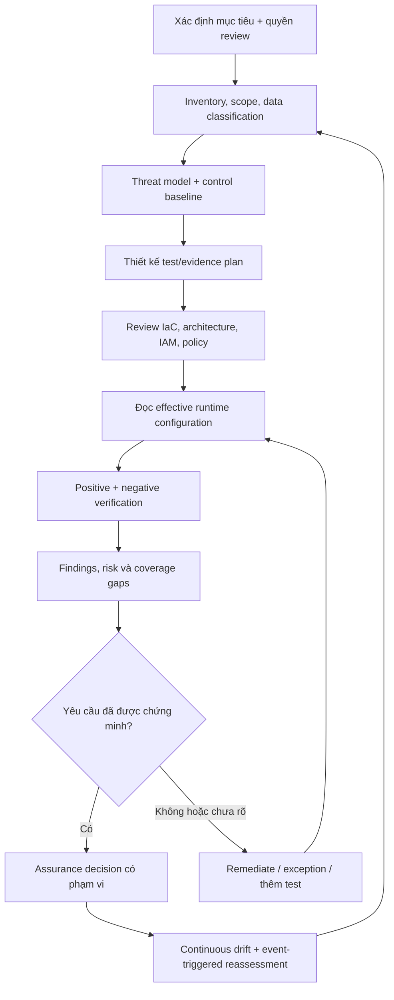

# Rà soát platform

Một nhóm phát triển chuẩn bị phát hành phiên bản mới của nền tảng SaaS xử lý tài liệu trên Kubernetes. Code review và kiểm thử API đều đạt. Dashboard cloud cho thấy cluster khỏe, các ứng dụng chạy đủ replica, hệ thống giám sát có dữ liệu và quy trình triển khai bằng CI/CD đã tự động hóa. Nhìn từ chức năng, mọi thứ có vẻ sẵn sàng.

Khi nhóm security assurance rà soát **platform**, họ phát hiện một service account có quyền đọc Secret ở phạm vi không cần thiết; một worker dùng container image chưa được kiểm chứng nguồn gốc; một network policy tồn tại trong repository nhưng không áp dụng trên namespace mới; tài khoản quản trị khẩn cấp chưa được kiểm tra quy trình thu hồi quyền; và bản backup gần nhất chưa có bằng chứng phục hồi. Các vấn đề này không nhất thiết lộ ra trong unit test hay DAST của API, nhưng có thể làm thay đổi đáng kể **mức độ tin cậy vào bảo mật của hệ thống được triển khai**.

**Rà soát platform (platform security review / platform assurance review)** là hoạt động kiểm tra có hệ thống **thiết kế, cấu hình, quyền truy cập, các biện pháp kiểm soát, trạng thái thực thi, quy trình vận hành và bằng chứng** của nền tảng chạy ứng dụng. Mục tiêu không phải tìm thật nhiều cấu hình sai bằng mọi giá, mà xác định **nền tảng có đáp ứng các security requirements trong phạm vi hay không; bằng chứng nào hỗ trợ kết luận; khoảng trống và rủi ro còn lại là gì; ai chịu trách nhiệm khắc phục**.

Trong module **SECURITY_SECURITY_ASSURANCE**, bài này sử dụng cách tiếp cận **evidence-based security assurance**: từ rủi ro, mục tiêu và yêu cầu bảo mật đến controls, cách xác minh, findings, remediation và quyết định có căn cứ. Review platform có thể là một phần của kiến trúc, onboarding môi trường, đánh giá trước production, hậu kiểm incident, kiểm toán định kỳ hoặc chương trình assurance liên tục.

## 1. Platform trong phạm vi review là gì?

**Platform** là lớp cung cấp năng lực để ứng dụng được **build, deploy, chạy, kết nối, lưu trữ, quan sát, quản trị và phục hồi**. Tùy hệ thống, nó gồm một số hoặc toàn bộ các thành phần:

- Tài khoản cloud, organization, project/subscription, vùng triển khai và network.
- Virtual machines, operating systems, container hosts và images.
- Kubernetes clusters, namespaces, admission controls, workload controllers và service networking.
- Container registries, artifact repositories, build runners, CI/CD và cơ chế ký/kiểm tra artifact.
- Identity providers, cloud IAM, Kubernetes RBAC, service accounts và workload identity.
- Secret stores, certificate authorities, KMS, key/secret lifecycle.
- API gateways, ingress, load balancers, DNS, TLS/mTLS, proxies, firewalls và egress.
- Database, queue, object storage, cache và managed services.
- Audit logging, metrics, tracing, alerting, SOC integrations và incident-response workflows.
- Backup, restore, disaster recovery, configuration drift detection và change management.

**Review platform không đồng nghĩa chỉ review Kubernetes**. Một hệ thống không dùng container vẫn cần kiểm tra OS, IAM, network, storage và vận hành. Một SaaS managed có thể không cho phép khách hàng kiểm tra host nội bộ, nhưng vẫn có các controls thuộc trách nhiệm khách hàng và bằng chứng từ nhà cung cấp cần xem xét.

### 1.1. Rà soát platform khác rà soát application như thế nào?

| Góc nhìn | Application security review | Platform security review |
| --- | --- | --- |
| **Đối tượng** | Business logic, API, xử lý dữ liệu, session, authorization | Hạ tầng chạy ứng dụng, identity, policy, cấu hình và vận hành |
| **Ví dụ rủi ro** | User B đọc tài liệu của tenant A | Worker identity có quyền truy cập nhiều bucket hơn nhu cầu |
| **Nguồn bằng chứng** | Code review, SAST/DAST, test API, threat model | IaC, runtime config, IAM graph, audit logs, verification tests |
| **Mẫu control** | Kiểm tra object-level authorization | Network segmentation, runtime isolation, least-privilege workload identity |
| **Giới hạn** | Không tự chứng minh nền tảng không có quyền vượt mức | Không tự chứng minh logic authorization ở từng tài liệu đúng |

Hai lớp bổ trợ nhau. **Một hệ thống platform được harden tốt vẫn có thể có IDOR/BOLA**; ngược lại, code ứng dụng an toàn không bù được việc CI token có thể triển khai vào production hoặc một storage bucket nhạy cảm bị cấu hình public.

### 1.2. Platform review khác audit checklist đơn thuần

Checklist hữu ích để giảm bỏ sót, nhưng review đạt chất lượng phải trả lời:

1. **Control nhằm chống rủi ro nào?**
2. **Nó áp dụng cho tài sản, môi trường và data flow nào?**
3. **Cấu hình mong muốn và cấu hình thực tế có khớp không?**
4. **Control có thực sự hoạt động khi xảy ra tình huống cần bảo vệ không?**
5. **Evidence nào đủ tin cậy để xác nhận điều đó?**
6. **Nếu chưa đủ, kết luận là FAIL, UNKNOWN hay ngoại lệ đã được phê duyệt?**

Một cờ `enabled=true` chỉ là **một phần của bằng chứng**. Nó có thể bị giới hạn ở một region, không bao phủ workload mới, hoặc chưa từng được thử trong điều kiện có lỗi.

## 2. Các nguyên tắc của platform assurance

- **Risk-driven:** chọn nội dung kiểm tra từ tài sản, threat model, sự cố và yêu cầu.
- **Scope-aware:** không kết luận vượt quá môi trường, tài khoản, cluster và thời điểm đã đánh giá.
- **Shared responsibility:** hiểu ai kiểm soát từng lớp, nhất là managed cloud services.
- **Least privilege:** mọi quyền vào data plane/control plane cần lý do và giới hạn.
- **Defense in depth:** tránh phụ thuộc một control đơn lẻ để bảo vệ mọi boundary.
- **Effective-state verification:** kiểm tra trạng thái đang vận hành, không chỉ manifest.
- **Positive and negative testing:** chứng minh cả đường cần thiết hoạt động và đường bị cấm được chặn.
- **Fail visibly:** scan/test lỗi, thiếu logging hoặc thiếu evidence không tự thành PASS.
- **Traceability:** nối finding với requirement, owner, artifact/config và retest.
- **Continuous reassessment:** kiểm soát drift và đánh giá lại khi thay đổi kiến trúc, quyền hoặc threat.

### 2.1. Phân biệt các mức độ chắc chắn

| Mức | Câu hỏi | Ví dụ |
| --- | --- | --- |
| **Designed** | Thiết kế bảo mật có xác định control không? | Sơ đồ yêu cầu database chỉ nhận từ API |
| **Declared** | Control được khai báo trong source/policy không? | Có NetworkPolicy trong Git |
| **Deployed** | Artifact/policy đã áp vào môi trường đúng chưa? | Object NetworkPolicy xuất hiện ở namespace production |
| **Enforced** | Runtime thực sự thực thi được không? | CNI hỗ trợ và áp policy vào pod được chọn |
| **Verified** | Bài test xác nhận đúng hành vi chưa? | Pod trái quyền không thể kết nối, pod hợp lệ kết nối được |
| **Monitored** | Thay đổi và lỗi của control có được phát hiện không? | Drift alert có owner, lịch sử và phản hồi |
| **Assured** | Tập bằng chứng có đủ cho claim có giới hạn không? | Review record và quyết định rủi ro |

**Có manifest** không bằng **control đang hoạt động**; **test pass** ở staging không tự chứng minh production được bảo vệ tương tự. Trong báo cáo cần phân biệt các mức này.

## 3. Xác định phạm vi và đối tượng đánh giá

Trước khi chạy công cụ, review team cần biết **tài sản nào nằm trong phạm vi, tác nhân nào sử dụng chúng và lớp nào thuộc quyền kiểm soát của tổ chức**.

### 3.1. Các chiều của scope

- **Environment:** development, test, staging, production, disaster-recovery.
- **Cloud/account/project/subscription:** bao gồm account phụ, sandbox và tổ chức quản trị.
- **Region/zone:** active, standby, backup, data residency.
- **Cluster/namespace/node pool:** cả workloads tạm thời và hệ thống chung.
- **Service/workload:** API, worker, batch, jobs, admin tools, third-party connectors.
- **Data classification:** public, internal, confidential, regulated hoặc phân loại nội bộ.
- **Identity boundary:** human admin, CI/CD, service account, managed identity.
- **Control plane/data plane:** tài nguyên quản trị so với đường xử lý dữ liệu.
- **Release/configuration version:** commit, artifact digest, IaC version và timestamp.
- **Provider/vender responsibility:** phần nào cần bằng chứng từ nhà cung cấp thay vì kiểm tra trực tiếp.

Nếu chỉ kiểm tra namespace `document-api` nhưng không xem runner có quyền deploy, kết luận không thể bao gồm mọi đường thay đổi production.

### 3.2. Inventory tham chiếu cho nền tảng SaaS

| Asset ID | Tài sản | Mức quan trọng | Owner | Ranh giới quan tâm |
| --- | --- | --- | --- | --- |
| `PLAT-ORG-01` | Cloud organization và các production accounts | Rất cao | Cloud platform | Quyền quản trị, audit, policy |
| `PLAT-K8S-01` | Kubernetes cluster production | Rất cao | Platform | Control plane, nodes, admission, RBAC |
| `PLAT-API-01` | Document API workloads | Cao | Service owner | Runtime identity, ingress, secrets |
| `PLAT-WRK-01` | Export workers và queues | Cao | Backend/platform | Authorization context, egress, data access |
| `PLAT-DATA-01` | Metadata DB, object storage, KMS | Rất cao | Data platform | Identity, encryption, backup |
| `PLAT-CI-01` | Build runners, registry, deployment identities | Rất cao | DevSecOps | Supply-chain integrity, release rights |
| `PLAT-OBS-01` | Log pipeline, SIEM, audit archive | Cao | SRE/SOC | Integrity, retention, visibility |
| `PLAT-REC-01` | Backup/restore và DR environment | Rất cao | SRE/BCP | Recovery, isolation, proof of restore |

Đây là **mẫu inventory**, không phải dữ liệu của một hệ thống thật. Bản review phải ghi resource ID/cloud account, region, owner và nguồn xác minh phù hợp.

### 3.3. Source of truth không phải danh sách duy nhất

Tổ chức có thể quản lý inventory bằng CMDB, IaC, cloud resource inventory, Kubernetes API và registry. Không nên tin một nguồn đơn lẻ: resource tạo thủ công có thể không nằm trong IaC; asset bị xóa có thể vẫn nằm trong CMDB; cluster tự sinh node/pod liên tục.

Cần **reconcile** các nguồn và phân loại:
- Managed và đã có owner.
- Discovered nhưng chưa có owner.
- Declared nhưng chưa được triển khai.
- Running nhưng không có trong baseline.
- Decommissioned nhưng còn quyền/token/backup.
- Third-party hoặc shared service cần bổ sung trách nhiệm.

## 4. Ranh giới kiến trúc và threat model của platform

Một platform review chất lượng bắt đầu từ các đường **ai có thể điều khiển ai**, **ai có thể đọc/ghi dữ liệu nào** và **việc xâm phạm một thành phần lan rộng tới đâu**.



Đường mũi tên ở đây là **mô hình logic cần kiểm chứng**, không thay thế bản đồ mạng chính thức. Quan trọng nhất là những trust boundaries:

1. **Internet → edge → workload:** nhận input không tin cậy.
2. **Tenant identity → dữ liệu nghiệp vụ:** quyết định quyền theo object/tenant.
3. **Workload → cloud resources:** service identity, secrets và IAM.
4. **Build/release → production runtime:** ai được thay code/config.
5. **Human admin → control plane:** quyền đặc biệt và accountability.
6. **Workload → external/vendor:** network egress và data protection.
7. **Platform → audit/archive:** bằng chứng cần chống sửa và chống mất.
8. **Production → backup/DR:** phạm vi tác động của quyền và sự cố.

### 4.1. Những câu hỏi threat model phải trả lời

- Nếu một pod bị xâm phạm, attacker có thể đọc Secret, gọi Kubernetes API hoặc truy cập storage ở phạm vi nào?
- Một developer có thể sửa admission policy, image registry, release gate hoặc quyền deploy của chính mình không?
- Một quyền admin bị lộ có thể xóa audit logs hoặc backup trước khi SOC phản ứng không?
- Nếu node bị compromise, có thể truy cập credential của workload khác không?
- Một worker có thể gửi dữ liệu ra Internet hoặc tới vendor ngoài danh sách không?
- Một backup chứa dữ liệu production có bị sao chép sang staging với quyền yếu hơn không?
- Có đường quản trị dự phòng, break-glass hoặc emergency access chưa được ghi nhận không?
- Nếu log pipeline chết, có ai biết và bằng chứng nào thay thế?
- Nếu cloud provider hoặc region gặp sự cố, hệ thống phục hồi dữ liệu và quyền như thế nào?

## 5. Shared responsibility và inherited controls

Đối với cloud hoặc managed platform, tổ chức **không kiểm soát hoàn toàn mọi lớp**. Điều này không loại bỏ nhu cầu assurance mà thay đổi loại evidence cần thu thập.

| Lớp | Provider thường có thể chịu trách nhiệm | Bên sử dụng thường cần xác minh |
| --- | --- | --- |
| Physical datacenter | Vật lý, facility, một số hạ tầng nền | Hợp đồng, attestations, phạm vi và thời hạn |
| Managed control plane | Vận hành control-plane service theo sản phẩm | API access, cấu hình được phép, audit, SLA và boundaries |
| Compute/node | Tùy IaaS/PaaS/managed nodes | OS images, patching, bootstrap, quyền workload khi thuộc trách nhiệm |
| Kubernetes workloads | Khả năng scheduling/primitive | Pod security, RBAC, admission, network, secrets, deployment |
| Managed database | Hạ tầng DB theo shared responsibility | Auth, network exposure, encryption, audit, backup và DB privileges |
| Object storage | Độ bền dịch vụ và một số control nền | Bucket/container policy, data access, retention, key và public access |
| Identity integration | Nền tảng IdP cung cấp chức năng | MFA, role mappings, accounts, lifecycle và audit export |
| Logging / backup managed | Dịch vụ thu thập/lưu trữ theo tính năng | Coverage, retention, access, recoverability, event verification |

**Inherited control** là control mà tổ chức dựa vào bằng chứng từ provider hoặc một platform team khác. Phải ghi **bên cung cấp, tài sản/phạm vi, control cụ thể, bằng chứng, ngày hiệu lực và phần trách nhiệm chưa được bao phủ**. Một chứng nhận chung của provider không tự chứng minh cấu hình IAM, tenant isolation hoặc backup của ứng dụng khách hàng.

## 6. Xây dựng control baseline theo rủi ro

Review cần một **baseline có phê duyệt** chứ không chỉ so sánh với tập default của nền tảng.

### 6.1. Các nhóm control tối thiểu cần cân nhắc

| Control domain | Security objective | Ví dụ kiểm tra |
| --- | --- | --- |
| Governance và asset inventory | Mọi tài sản có owner và phạm vi kiểm soát | Inventory, account/cluster ownership |
| Control-plane identity | Chỉ principal phù hợp được thay đổi platform | MFA, role mapping, break-glass, admin audit |
| Workload identity | Quyền của service theo nhu cầu tối thiểu | IAM policies, service account bindings |
| Compute/runtime hardening | Giảm khả năng leo quyền và escape | OS baseline, container sandbox, pod security |
| Network isolation | Hạn chế đường truy cập và egress | Flow matrix, SG/ACL, NetworkPolicy, proxy |
| Secrets/keys | Bảo vệ credential và key lifecycle | Secret store, access audit, rotation |
| Supply chain | Chỉ artifact có nguồn gốc/chất lượng hợp lệ được deploy | Signed/provenanced build, registry policy |
| Patch/vulnerability management | Giảm rủi ro từ thành phần lỗi thời | Inventory, scan, patch SLA, retest |
| Logging/detection | Có thể truy vết thay đổi và nghi vấn xâm nhập | Audit, delivery, alerts, retention |
| Data protection | Dữ liệu và backup được mã hóa/phân quyền phù hợp | IAM, KMS, storage access, privacy controls |
| Resilience/recovery | Phục hồi sau lỗi, xâm phạm hoặc mất vùng | Backup restore test, RPO/RTO evidence |
| Change/configuration management | Baseline được duy trì, drift phát hiện | IaC plan, review, effective readback |
| Incident readiness | Có thể dừng, cô lập, điều tra và phục hồi | Runbooks, drill, emergency credentials |

### 6.2. Baseline theo tài sản và mức độ quan trọng

Không phải mọi preview namespace cần đúng cùng mức kiểm soát như production chứa dữ liệu nhạy cảm. Tuy nhiên, **non-production cũng có thể chứa credentials, source code hoặc kết nối tới production**, nên không được tự xếp tất cả vào “rủi ro thấp”.

Phân tầng có thể dựa trên:
- Data classification và phạm vi tenant.
- Internet exposure.
- Quyền tới production control plane hoặc deployment pipeline.
- Khả năng ảnh hưởng nhiều dịch vụ.
- Ràng buộc pháp lý/hợp đồng.
- Độ nhạy cảm của artifacts, backups và secrets.
- Mức ảnh hưởng khi không sẵn sàng hoặc dữ liệu không toàn vẹn.

### 6.3. Tiêu chuẩn là đầu vào, không thay thế điều kiện hệ thống

CIS Benchmarks, vendor security baselines và các control frameworks có thể giúp tạo checklist. Nhưng phải xác định phiên bản, profile, applicability và exceptions. Một control khuyến nghị chung có thể không áp dụng nguyên văn cho managed service; ngược lại, một threat đặc thù như cross-tenant export có thể không được bao phủ bởi checklist hardening tổng quát.

**Không nên tuyên bố đạt chuẩn chỉ vì tool đánh giá ra điểm cao**, nếu chưa có scope, version, rule coverage và bằng chứng khắc phục.

## 7. Rà soát IAM và privileged access

**Identity và quyền quản trị platform** thường tạo blast radius lớn hơn lỗ hổng ở một endpoint riêng lẻ.

### 7.1. Human access

Cần đánh giá:
- Quy trình cấp, thay và thu hồi tài khoản nhân sự;
- MFA/phishing-resistant authentication khi chính sách yêu cầu;
- Role-based access và số principal có quyền admin;
- Phân tách quyền đọc log, deploy, thay policy và quản lý key;
- Just-in-time/just-enough access hoặc phê duyệt đặc quyền nếu áp dụng;
- Break-glass accounts, điều kiện dùng, lưu credential, kiểm tra/thu hồi;
- Service vendor/admin access có thời hạn và kiểm toán;
- Dormant accounts, shared accounts và key lâu không sử dụng;
- Audit sự kiện thay role/policy, login thất bại và truy cập nhạy cảm.

**Một tài khoản có MFA** không tự chứng minh được least privilege nếu role gắn với tài khoản vẫn quá rộng.

### 7.2. Workload identity

API, worker, queue consumer, cronjob và CI runner không nên dùng chung một identity quyền cao chỉ vì tiện triển khai.

| Identity | Nhu cầu hợp lệ | Quyền phải đặt câu hỏi |
| --- | --- | --- |
| Document API | Đọc/ghi metadata trong phạm vi yêu cầu | Quyền quản lý toàn cluster hoặc xóa backup |
| Export worker | Nhận job, truy cập object cần export | Quyền liệt kê/tải mọi bucket hoặc sửa IAM |
| CI build runner | Đọc source, build và đẩy artifact đã duyệt | Quyền đọc production secrets |
| Deployment controller | Triển khai artifact vào target đã định | Quyền tạo global admin hoặc thay logging archive |
| Observability collector | Đọc/ship log cần thiết | Quyền sửa workload, xóa audit archive |
| Backup agent | Đọc/sao lưu nguồn được duyệt và ghi kho backup | Quyền xóa tất cả bản backup và retention lock |

### 7.3. IAM effective permissions khác policy file

Một identity có thể có quyền từ:
- identity policy;
- resource policy;
- role/group membership;
- trust policy/assume-role;
- permission boundary hoặc organization policy;
- temporary session privileges;
- Kubernetes RBAC;
- service-specific ACL hoặc database role.

Phải đánh giá **effective access path**, không chỉ một tệp Terraform. Ví dụ bucket policy có thể cho phép principal từ account khác dù identity policy nội bộ trông chặt chẽ.

### 7.4. Positive và negative access tests

Có thể kiểm chứng:
1. Service identity hợp lệ đọc đúng tài nguyên giả lập đã cấp.
2. Cùng identity bị từ chối khi truy cập tài nguyên ngoài scope.
3. Principal đã thu hồi role không còn quyền theo policy và thời hạn đã định.
4. Người không thuộc nhóm admin không sửa được security controls.
5. Break-glass action được audit và cảnh báo như thiết kế.

Không dùng test thất bại do secret hết hạn để kết luận authorization đúng; cần **principal hợp lệ, resource có thật và đường gọi hoạt động**.

## 8. Rà soát control plane cloud và Kubernetes

### 8.1. Cloud organization / account guardrails

Những câu hỏi trọng tâm:
- Mọi production account/project/subscription có owner, policy và audit không?
- Có cơ chế hạn chế quyền ngoài baseline theo khả năng provider?
- Có tài khoản bảo mật hoặc destination tập trung bảo vệ log và backup?
- Các tài khoản mới được onboarding vào baseline bằng cách nào?
- Có tài nguyên public ngoài thiết kế hoặc resources chưa gắn owner không?
- Thay IAM, network, logging, KMS có đi qua review/audit không?
- Có chính sách giới hạn sử dụng service/region khi cần?
- Các quyền break-glass và root-level access có được quản lý theo threat model?

Một guardrail ở organization level có thể giảm một số rủi ro, nhưng **cần xác minh tài khoản đang thuộc đúng organization, policy áp dụng đúng và có ngoại lệ hay không**.

### 8.2. Kubernetes control plane và API access

Các điểm review gồm:
- API endpoint exposure và đường quản trị.
- Authentication, RBAC, nhóm quyền cluster-admin và impersonation.
- Admission policies và cách cấu hình được thực thi.
- Quyền của controllers/operators, đặc biệt controllers có phạm vi cluster.
- Audit logs, retention và alert về privileged changes.
- Network access từ pods/node tới API server.
- Cách nâng cấp phiên bản và xử lý phiên bản unsupported.
- Khả năng backup/restore những cấu hình và trạng thái quan trọng.
- Quản trị CRDs, webhooks và third-party operators.

**Kubernetes RBAC không tự cấp quyền cloud IAM**; đồng thời quyền cloud IAM không tự đại diện toàn bộ quyền trong Kubernetes. Cần đánh giá cả hai và cầu nối workload identity.

### 8.3. Pod Security Admission và admission policy

Pod Security Admission có các profile và modes như `privileged`, `baseline`, `restricted` với semantics phụ thuộc phiên bản Kubernetes. Mỗi namespace có thể được cấu hình để enforce/audit/warn. Review phải biết policy **đang thực thi ở namespace nào**, exemptions của hệ thống và liệu có đường khác tạo workload ngoài scope.

Admission control giúp ngăn một số cấu hình pod nguy hiểm tại thời điểm tạo/cập nhật, nhưng không thay thế network segmentation, secret policy, runtime detection hoặc giới hạn các permissions cloud.

### 8.4. RBAC quá rộng là finding quan trọng

Ví dụ service account ứng dụng không cần quyền `secrets.list` trên namespace, càng không cần cluster-admin. Một role có wildcard verbs/resources có thể tạo rủi ro leo quyền tùy cách sử dụng. Cần so sánh **quyền có hiệu lực** với API operations thực sự cần, bao gồm admission webhook/controller permissions.

Không sửa RBAC production bằng cách xóa tất cả quyền ngay lập tức; cần kiểm kê nhu cầu, rollout có kiểm soát và negative tests để tránh làm hỏng vận hành.

## 9. Rà soát node, host OS và container runtime

### 9.1. Host OS baseline

Một workload có thể bị ảnh hưởng bởi host:
- Hệ điều hành/kernel và security patch status.
- SSH/remote admin, local accounts, sudo/privileged commands.
- Disk encryption, secure boot hoặc attestation khi cần.
- File permissions, logging và audit của hệ điều hành.
- Host firewall, listening ports, unnecessary services.
- Time synchronization, certificate trust store.
- Vulnerability/EDR/runtime telemetry theo môi trường.
- Quyền node-to-cloud metadata, instance profiles và service endpoints.
- Quy trình thay/rotate node images và xử lý node không tương thích.

Với managed node/service, trách nhiệm và mức nhìn thấy có thể bị giới hạn; khi đó cần provider assurances, cấu hình mà khách hàng kiểm soát và **test ở boundary quan sát được**.

### 9.2. Container images

Review nên phân biệt:
- **Image provenance:** đến từ build pipeline nào, source commit nào?
- **Image integrity:** digest hoặc signature có được xác minh?
- **Known vulnerabilities:** package/dependency nào bị ảnh hưởng, có fix?
- **Runtime configuration:** container có chạy đặc quyền, mount nhạy cảm hoặc quyền không cần không?
- **Registry permissions:** ai có thể push, thay tag hoặc xóa artifact?
- **Admission enforcement:** cluster có chặn image không đáp ứng chính sách không?

**Image scan “0 critical” không chứng minh image an toàn tuyệt đối**, vì advisory có thể thiếu, package không được nhận diện hoặc lỗi logic không thuộc phạm vi quét. Tương tự, signature xác minh nguồn gốc/chuỗi kiểm soát đã thiết kế, không tự chứng minh code không có lỗ hổng.

### 9.3. Ví dụ Pod securityContext an toàn hơn mặc định

Mẫu Kubernetes dưới đây minh họa **một số** guardrails cho một ứng dụng Java không cần truy cập Kubernetes API. Nó không tự bảo đảm đủ điều kiện production và phải được kiểm tra với runtime, port, storage, health checks và policies của cluster.

```yaml
apiVersion: apps/v1
kind: Deployment
metadata:
  name: document-api
  namespace: docs-test
spec:
  replicas: 2
  selector:
    matchLabels:
      app: document-api
  template:
    metadata:
      labels:
        app: document-api
    spec:
      automountServiceAccountToken: false
      securityContext:
        runAsNonRoot: true
        seccompProfile:
          type: RuntimeDefault
      containers:
        - name: api
          image: registry.example.test/document-api@sha256:REPLACE_WITH_REAL_DIGEST
          ports:
            - containerPort: 8080
          securityContext:
            allowPrivilegeEscalation: false
            readOnlyRootFilesystem: true
            capabilities:
              drop: ["ALL"]
          resources:
            requests:
              cpu: "100m"
              memory: "256Mi"
            limits:
              cpu: "500m"
              memory: "512Mi"
          volumeMounts:
            - name: tmp
              mountPath: /tmp
      volumes:
        - name: tmp
          emptyDir:
            sizeLimit: "128Mi"
```

**Cách đọc ví dụ:**
- `automountServiceAccountToken: false` hữu ích khi workload không gọi Kubernetes API; nếu cần API, phải dùng identity và quyền phù hợp thay vì tắt một cách máy móc.
- `runAsNonRoot` yêu cầu image/process tương thích, có user không phải root; ví dụ chưa xác định `runAsUser` cụ thể.
- `RuntimeDefault` phụ thuộc container runtime và hỗ trợ của node.
- `readOnlyRootFilesystem` cần chỗ ghi tạm riêng khi ứng dụng cần; trong ví dụ `/tmp` là `emptyDir` có giới hạn.
- `allowPrivilegeEscalation: false` và drop capabilities giảm một số đường leo quyền; không thay thế pod sandbox và kernel patching.
- Các resource limits là số minh họa cần đo thực tế; không nên dùng trực tiếp cho mọi ứng dụng.
- Image digest là **placeholder**, cần thay bằng digest hợp lệ; không dùng floating tag làm bằng chứng rằng release không đổi.
- Namespace/ServiceAccount, Pod Security policy, NetworkPolicy, secrets, probes và deployments còn cần thiết kế bổ sung.

### 9.4. Privileged pods và host access

Những cấu hình như `privileged: true`, hostPath nhạy cảm, hostPID, hostNetwork, thiết bị host hoặc cho phép chạy container root có thể cần thiết với một số agent hệ thống, nhưng phải có **owner, lý do, phạm vi, sandbox và review**. Không mặc định mọi DaemonSet được quyền vượt baseline vì “nó là agent của platform”.

### 9.5. Runtime isolation là lớp bổ trợ

Seccomp, Linux capabilities, LSM (khi có), sandbox runtime và việc tách node pools có thể giảm blast radius. Tuy nhiên, một control cấp container không tự bảo vệ khỏi quyền cloud quá rộng của workload hoặc bí mật đã mount vào container.

## 10. Rà soát Kubernetes workload identity và service accounts

Workload có thể giao tiếp với Kubernetes API, cloud storage, message queue hoặc database thông qua các identity khác nhau. Review phải **vẽ được chuỗi tin cậy**:
1. Pod được gán Kubernetes ServiceAccount nào?
2. Có projected token/credential được mount không?
3. Token có audience/expiry/phạm vi phù hợp không?
4. Cloud IAM role/managed identity gắn thế nào?
5. Resource policy và quyền thực tế có vượt nhu cầu không?
6. Khi pod bị xâm phạm, credential có thể dùng ở đâu?
7. Token/key/role bị thu hồi hoặc rotate ra sao?
8. Event sử dụng quyền được audit như thế nào?

### 10.1. Đừng dùng một identity cho cả namespace

Nếu API và worker cùng dùng ServiceAccount có quyền đọc secret và storage của tất cả dịch vụ, xâm phạm một workload có thể lan ra nhiều boundary. Nên tách identity theo công việc, giới hạn permissions và xác minh bằng negative tests.

### 10.2. Quyền cloud và quyền Kubernetes khác nhau

Một Pod có thể không có Kubernetes RBAC permissions nhưng vẫn truy cập được cloud object storage qua identity gắn với node hoặc workload nếu cấu hình cho phép. Ngược lại, một service account Kubernetes có quyền đọc secrets có thể lấy credential và mở rộng phạm vi ảnh hưởng. Cần kiểm tra cả **runtime metadata paths, token mounts, role bindings và resource permissions**.

## 11. Rà soát network, ingress, egress và service boundaries

### 11.1. Baseline kết nối

Một connectivity matrix hữu ích:

| Source | Destination | Mục đích | Control cần đánh giá |
| --- | --- | --- | --- |
| Internet | Public API Gateway | HTTPS ingress | TLS, WAF, gateway routing |
| Gateway | Document API | API traffic | Network rules, service identity |
| Document API | Metadata DB | Query metadata | Firewall/SG, DB identity |
| Document API | Export queue | Tạo job | Broker ACL, credentials, egress |
| Export worker | Object storage | Xử lý dữ liệu được cấp quyền | Workload IAM, private endpoint/egress |
| Export worker | Internet bất kỳ | Không có nhu cầu thường lệ | Egress default deny/allowlist |
| CI runner | Production control plane | Deploy theo policy | Identity, approval, artifact trust |
| Admin workstation | Management endpoint | Vận hành | MFA, VPN/ZTNA/bastion, audit |

**Network control chỉ là một lớp**. Cho phép API tới database không chứng minh query luôn có tenant constraint; cho phép worker gọi storage không chứng minh worker chỉ đọc object thuộc job hợp lệ.

### 11.2. Kiểm tra effective paths

- Public ingress có đi qua gateway/WAF bắt buộc?
- Backend/origin có IP/hostname khác bỏ qua gateway?
- Firewall/security group rules áp vào đúng interface/resource?
- Kubernetes NetworkPolicy có được CNI thực thi và chọn đúng pods?
- Có default-deny theo ingress **và** egress khi requirement yêu cầu?
- NAT, proxy, VPN, peering hoặc private endpoint có tạo đường ngoài dự kiến?
- Có đường IPv6 khác với IPv4?
- DNS, TLS termination và service mesh có tạo bypass?
- Cổng quản trị, metrics, debug và cloud metadata có bị expose?

### 11.3. NetworkPolicy object không phải enforcement proof

Kubernetes NetworkPolicy chuẩn dùng các **allow rules có tính cộng dồn**; khi pod bị cô lập theo một direction, nó chỉ nhận/gửi những luồng phù hợp chính sách cho phép. Tạo object thành công không chứng minh CNI có thực thi; các đường host networking/service networking có thể có đặc tính khác nhau theo nền tảng.

Phải kiểm tra **pod selector, namespace selector, ingress/egress isolation, CNI capabilities và positive/negative connectivity tests**. Nếu đích service đang down, một timeout từ pod không được phép không chứng minh policy đã chặn đúng.

### 11.4. Egress và SSRF

Worker hoặc API xử lý URL không tin cậy có thể cố kết nối tới nội bộ, metadata endpoints hoặc Internet. Rà soát egress nên kiểm tra destinations được phép, DNS/proxy/NAT, redirect behavior, private endpoints, logging và workload permissions. Không coi “pod không có public IP” là bằng chứng không thể kết nối ra ngoài.

## 12. Rà soát secrets, key management và certificates

### 12.1. Secret inventory

Nên kiểm kê:
- Cloud API credentials và service principals.
- Database users/passwords.
- JWT signing keys và session secrets.
- TLS/mTLS private keys và trust roots.
- Encryption keys/KMS grants.
- Webhook signing secrets, vendor API tokens.
- Backup/DR credentials.
- CI/CD access tokens, deploy credentials và registry tokens.

**Không đọc hoặc xuất giá trị secret để chứng minh secret được bảo vệ.** Đánh giá quyền, nguồn, vòng đời, audit và redaction; khi cần test, dùng credential giả hoặc identity được phép.

### 12.2. Những câu hỏi review

1. Secret được sinh/cấp phát bởi hệ thống có kiểm soát hay hard-code?
2. Có cấp theo service/environment và least privilege?
3. Có giới hạn thời hạn, rotation hoặc cách thu hồi?
4. Có bị đưa vào image, CI logs, Terraform state, crash dump hoặc observability logs?
5. Workload dùng secret có thể đọc secret của service khác không?
6. KMS keys/grants có được phân nhiệm, audit và bảo vệ lifecycle?
7. Có phương án xử lý nếu key mất hoặc bị nghi lộ?
8. Secret backup/replication có theo data residency và retention?
9. Chứng chỉ hết hạn hoặc trust root thay đổi có được phát hiện?
10. Có test fail-safe khi secret manager hoặc KMS bị gián đoạn?

### 12.3. Kubernetes Secret không tự đồng nghĩa bảo mật đầy đủ

Kubernetes Secret là primitive lưu/đưa dữ liệu cấu hình nhạy cảm vào workload; việc dữ liệu được thể hiện bằng Base64 trong manifest **không phải mã hóa để bảo vệ bí mật**. Cần xem encryption at rest trong control plane, RBAC, admission, mount/exposure, external secret integration và audit theo mô hình triển khai.

Với managed cluster, khả năng cấu hình encryption, KMS và cách provider xử lý secrets phải được xác minh trong phạm vi sản phẩm đang dùng.

### 12.4. Thay/thu hồi key là một bài kiểm thử

Một kế hoạch key rotation chỉ ở tài liệu chưa chứng minh hệ thống có thể rotation mà không làm mất dữ liệu hoặc duy trì credential cũ ngoài policy. Cần test trên môi trường có phép, với dữ liệu giả, kiểm tra authorization và khả năng phục hồi. Những key dùng để giải mã backup cần lifecycle phù hợp để tránh backup tồn tại nhưng không thể phục hồi.

## 13. Rà soát supply chain và CI/CD platform

Một platform có thể bị xâm phạm thông qua pipeline chứ không phải request người dùng.

### 13.1. Những đường thay đổi production

- Ai có quyền merge vào branch bảo vệ?
- Ai có quyền sửa workflow CI/CD hoặc rule security gate?
- Build runner có chạy code không tin cậy với token production không?
- Runner có dùng chung giữa dự án có mức tin cậy khác nhau không?
- Artifact có thể bị thay sau khi được kiểm thử không?
- Registry có kiểm soát push/delete/tag và retention không?
- Có bằng chứng source commit → build → image digest → deploy?
- Admission có xác minh nguồn artifact, policy và provenance theo thiết kế?
- Ai được deploy trực tiếp bypass pipeline?
- Có audit đối với đổi secrets, quyền triển khai và release approvals?

### 13.2. Build provenance, signing và vulnerability scan

Các thành phần bổ trợ:

| Control | Chứng minh điều gì? | Không tự chứng minh |
| --- | --- | --- |
| Source review / protected branches | Code thay đổi có quy trình kiểm soát | Code không có lỗi |
| Reproducible/build provenance | Quan hệ source–builder–artifact theo mức tin cậy của pipeline | Builder không bị xâm phạm nếu trust model yếu |
| Signing / signature verification | Artifact có chữ ký từ identity/key được chấp nhận | Artifact không có vulnerability |
| SBOM / SCA | Thành phần và advisory đã biết được quan sát | Code path thực tế có bị khai thác |
| Image scanning | Một số package/config findings | Business logic và runtime authorization |
| Admission policy | Chặn một số artifact/config không đạt điều kiện | Mọi đường deploy đều chịu policy nếu có bypass |
| Promotion by digest | Bản deploy khớp artifact đã kiểm tra | Cấu hình runtime không drift |

### 13.3. Không để cùng PR tự tắt gate

Nếu một contributor có thể sửa code ứng dụng, test, scanner configuration và chính sách `skip-security` mà không có review độc lập khi cần, gate dễ bị vô hiệu hóa. Đánh giá branch protection, review quyền sửa rule, CI credential scoping và đường deployment khẩn cấp.

Một “emergency release” có thể dùng quy trình phê duyệt đặc biệt, nhưng phải có owner, lý do, thời hạn và validation thay thế; không coi emergency là quyền tùy ý bỏ controls.

### 13.4. Managed runners và third-party actions

Các bước build phụ thuộc runner image, plugins/actions, registries, package repositories và dịch vụ ngoài. Cần kiểm soát nguồn, phiên bản/digest khi phù hợp, quyền token, cập nhật bảo mật và các dữ liệu có thể được gửi cho vendor. Không đồng nhất “đã pin một action version” với supply-chain assurance hoàn chỉnh.

## 14. Rà soát vulnerability và patch posture

### 14.1. Điều cần đánh giá

- Inventory OS, kernel, container base images, libraries và managed service versions.
- Những thành phần end-of-life hoặc ngoài hỗ trợ.
- Scanner coverage, phiên bản signatures/rules và thời điểm quét.
- Advisory severity và **business exploitability**.
- Owner, remediation SLA, bản vá, mitigation và exceptions.
- Khả năng restart/recreate workload sau thay image/node.
- Kiểm chứng effective deployed versions sau patch.
- Regression tests cho các control có nguy cơ bị ảnh hưởng.
- Vulnerability backlog theo tài sản, quyền và exposure.

### 14.2. Scanner báo zero không phải toàn hệ thống sạch

Có thể scanner chưa có quyền đọc registry, chỉ scan một tag cũ hoặc bỏ qua package không nhận diện được. Phải xem **target, scope, scan completeness, artifact digest, exception và đường deploy**.

### 14.3. Patch management và availability phải cùng được xét

Một bản cập nhật kernel/node hoặc cluster control plane có thể cải thiện bảo mật nhưng gây gián đoạn nếu thiếu capacity, drain policy hoặc compatibility tests. Quy trình review nên yêu cầu kế hoạch rollout, canary khi thích hợp, rollback/roll-forward, test phục hồi và evidence sau triển khai.

Với vulnerability nghiêm trọng, có thể cần containment tạm thời trước patch. Control bù phải được kiểm chứng và có hạn; không gọi “mitigated” là “verified fixed”.

## 15. Logging, detection và khả năng điều tra của platform

### 15.1. Log sources

Rà soát coverage của:
- Cloud IAM/management API và policy changes.
- Kubernetes audit/control-plane events.
- Node/OS security telemetry trong phạm vi tổ chức quản lý.
- Ingress, WAF, load balancer, flow/DNS/egress logs khi cần.
- Workload authentication/authorization decisions.
- Object storage/database data access cho dữ liệu nhạy cảm khi được yêu cầu.
- CI/CD, registry, admission và deployment changes.
- KMS/secret access, break-glass và logging configuration changes.
- Backup/restore, deletion, retention changes.

### 15.2. Đường log end-to-end



**Có câu lệnh log trong source** không chứng minh event đã tới archive. Cần test event có chủ đích từ nguồn, xác minh schema, delivery, latency, retention và quyền truy vấn.

### 15.3. Integrity, retention và privacy

- Giới hạn quyền sửa/xóa audit logs, tách từ quyền quản trị workload khi cần.
- Mã hóa khi truyền/lưu, quản lý KMS và quyền giải mã.
- Immutability/retention lock khi chính sách yêu cầu, kiểm chứng cơ chế thực tế.
- Không ghi token/password/key hay raw data cần bảo vệ.
- Retention và data residency theo nghĩa vụ áp dụng; không có số ngày cố định cho mọi loại log.
- SOC có khả năng điều tra, nhưng không được truy cập dữ liệu khách hàng không cần thiết.
- Phát hiện log pipeline ngừng, bị đổi sink hoặc collector thiếu trên node mới.

### 15.4. Detection phải được kiểm thử

Một rule alert về IAM privilege escalation, thay network policy hoặc tắt logging chỉ có giá trị khi **có nguồn event, parser đúng, detector hoạt động và thông báo đến người nhận**. Tạo sự kiện thử nghiệm được phê duyệt và xác nhận alert end-to-end; không chủ động phá các controls production để tạo event.

## 16. Data protection, storage và backup

### 16.1. Data protection ở platform

- Storage buckets/database không được public nếu requirement cấm.
- IAM/database privileges giới hạn đúng workload và tài nguyên.
- Encryption at rest/in transit theo classification/threat model.
- KMS grants, rotation và khả năng thu hồi.
- Private endpoints và network data paths khi cần.
- Lifecycle/retention/deletion được xác định.
- Data replica/copy/test fixtures không bị đưa sang môi trường quyền yếu hơn.
- Logging/tracing không làm lộ dữ liệu hoặc token.
- Tenant separation được kết hợp với application authorization.

### 16.2. Backup tồn tại khác backup có thể restore

Một dashboard “backup succeeded” chỉ chứng minh một tác vụ backup báo thành công theo điều kiện hệ thống. **Restore assurance** cần:
1. Backup inventory theo service/data classification.
2. Xác định RPO và RTO theo yêu cầu nghiệp vụ.
3. Bảo vệ backup khỏi sửa/xóa trái phép và credential compromise.
4. Có dữ liệu khóa/secret cần thiết để restore.
5. Thực hiện restore drill vào môi trường được phép, cô lập.
6. Kiểm tra tính toàn vẹn và khả năng khởi chạy ứng dụng.
7. Kiểm tra quyền truy cập và audit sau restore.
8. Ghi kết quả, thời gian và hạn chế so với RPO/RTO.
9. Có runbook và người thực hiện/duyệt phục hồi.

Với ransomware threat model, cần đánh giá **blast radius giữa production và backup**, quyền xóa backup, cơ chế immutability và quy trình khôi phục khi control plane bị mất quyền.

### 16.3. Retention và vùng dữ liệu

Nếu yêu cầu data residency hoặc hợp đồng hạn chế vùng lưu, backup, log archive và DR replica phải được tính vào scope. Chỉ kiểm tra vị trí database chính không đủ để khẳng định mọi bản sao đều phù hợp.

## 17. Reliability và security resilience

**Platform assurance** quan tâm availability như một thuộc tính bảo mật, đặc biệt với dịch vụ quan trọng.

### 17.1. Các yêu cầu cần đối chiếu

- Single point of failure được biết và chấp nhận?
- Quy trình failover có ảnh hưởng IAM, token validation hoặc logging không?
- Network policy vẫn có hiệu lực ở standby region/cluster?
- Autoscaling nodes/pods có áp baseline và audit như nodes hiện tại?
- Certificate/KMS/IdP outage có tạo fail-open không phù hợp yêu cầu?
- Quota/resource limits có bảo vệ khỏi một tenant chiếm tài nguyên?
- Pod disruption budgets và node maintenance có thể thực thi theo capacity?
- Retry/queue redelivery có gây nhân bản thao tác nhạy cảm?
- DR có khôi phục đúng role, network restrictions và secrets?
- Incident runbook có điểm dừng, containment và phương án phục hồi?

### 17.2. “Fail-safe” cần cân bằng mục tiêu

Không phải mọi control đều phải fail-closed bằng cách dừng toàn hệ thống khi phụ thuộc lỗi. Ví dụ lỗi log debug có thể được giám sát và xử lý khác lỗi của audit bắt buộc cho hành động quản trị cực nhạy. Quyết định phải xuất phát từ requirement, rủi ro confidentiality/integrity/availability và phương án giảm tác động.

### 17.3. Negative tests có giới hạn

Có thể dùng test environment để giả lập collector unavailable, secret expired, node restart hoặc queue delayed, sau đó kiểm tra:
- Control báo lỗi đúng và không lộ dữ liệu.
- Request/job quan trọng có trạng thái chính xác.
- Không mở quyền tạm ngoài policy.
- Audit/alert vẫn đủ để điều tra.
- Recovery và cleanup thành công.

Các bài chaos/failure test cần được phê duyệt, không tự chạy tải lớn hoặc gây gián đoạn trên production.

## 18. Quy trình review platform từ đầu đến cuối



### Bước 1 — Xác nhận authorization và review boundaries

Rà soát cấu hình đọc có thể được cho phép khác với kiểm thử active network, IAM negative tests, giả lập lỗi hoặc thử restore. Cần ROE/change window nếu kiểm thử có tác động; không dùng credential/secret production ngoài phạm vi. Ghi các hệ thống bên thứ ba cần chấp thuận riêng.

### Bước 2 — Chốt scope, version và owner

Liệt kê cloud accounts, regions, clusters, namespaces, workloads, build pipelines, data resources và DR. Gắn source commit, artifact digest, IaC revision và thời gian snapshot.

### Bước 3 — Hiểu kiến trúc và trust boundaries

Xác định các đường quản trị, dữ liệu, deployment, secrets, logging và backup. Đánh dấu tài sản high impact, đặc biệt workload có quyền truy cập cross-tenant, CI runner và KMS.

### Bước 4 — Xác lập baseline và review plan

Chọn requirements và controls cần kiểm, phương pháp validation, test IDs và người chịu trách nhiệm. Phân biệt những controls inherited từ provider với controls do nhóm trực tiếp quản lý.

### Bước 5 — Review design và declared configuration

Đọc kiến trúc/IaC/policy của đúng phạm vi; tìm wildcard permissions, public ingress, image không tin cậy, thiếu admission/NetworkPolicy, retention/backup chưa rõ, secrets bị lộ và exceptions hết hạn.

### Bước 6 — Thu effective-state evidence

Lấy state từ cloud/cluster APIs với quyền đọc tối thiểu khi có thể. Đối chiếu policy thực thi, resource attachments, workloads đang chạy, identity, route và phiên bản của các thành phần.

### Bước 7 — Xác minh hành vi

Chạy test an toàn có positive/negative controls, ví dụ service A có thể đọc bucket A nhưng không thể đọc bucket B; admin test role có thể thực hiện tác vụ được duyệt, non-admin không sửa policy; log canary đến archive; restore được kiểm chứng.

### Bước 8 — Triage và đánh giá tác động

Gắn findings với risk scenarios và security requirements. Phân biệt:
- Misconfiguration đã xác nhận.
- Control không hoạt động dù khai báo đúng.
- Scan/test chưa chạy hoặc không đủ evidence.
- False positive có căn cứ.
- Accepted risk có thẩm quyền, thời hạn và control bù.
- Inherited control cần evidence từ bên thứ ba.

### Bước 9 — Fix, kiểm chứng lại, quyết định release

Không đóng finding chỉ vì PR merged. Cần đối chiếu **deployment/effective config**, test lại trong phạm vi, ghi residual risk và quyết định PASS/BLOCK/NEEDS_REVIEW/CONDITIONAL theo chính sách.

### Bước 10 — Bàn giao sang assurance liên tục

Chuyển rule và test có giá trị thành CI/admission/drift monitoring. Khi kiến trúc, provider, phiên bản cluster, quyền hoặc data classification thay đổi, đánh giá lại phần claim bị ảnh hưởng.

## 19. Cách thu evidence không gây rủi ro mới

### 19.1. Ưu tiên read-only snapshots

Trong nhiều trường hợp, reviewer có thể dùng quyền đọc để lấy trạng thái của:
- IAM roles/bindings/policies;
- Kubernetes deployment/pods/namespaces/NetworkPolicy/RBAC;
- Cloud security groups/routes/log settings;
- Registry artifact digest/signatures;
- KMS key policy và secret metadata (không phải secret values);
- Backup inventory và restore test history;
- Pipeline/workflow permissions;
- Config change/audit logs.

Không chia sẻ raw credential, nội dung customer data hoặc key material trong báo cáo.

### 19.2. Ví dụ lệnh quan sát trên namespace được phép

Các lệnh sau **chỉ minh họa** cho môi trường Kubernetes được cấp quyền. Không chạy tự động vào cluster của người dùng trong bài học này.

```bash
# Kiểm kê workload và namespace trong phạm vi được phép.
kubectl -n docs-test get deployments,pods,serviceaccounts

# Xem network policies và kiểm tra policy thực tế trên namespace.
kubectl -n docs-test get networkpolicies
kubectl -n docs-test describe networkpolicy

# Kiểm tra quyền theo một service account test trong namespace.
# Kết quả chịu ảnh hưởng quyền impersonation của người chạy lệnh.
kubectl auth can-i get secrets \
  --as=system:serviceaccount:docs-test:document-api \
  -n docs-test

# Xem pod security contexts và cấu hình được áp.
kubectl -n docs-test get deployment document-api -o yaml
```

**Giới hạn:**
- Lệnh `can-i` là phép hỏi authorization theo context hiện tại; nó không thay thế test toàn bộ quyền và các đường cloud IAM.
- Nếu thiếu quyền impersonation, kết quả không đáng dùng làm kết luận cho service account.
- Manifest YAML có thể chứa environment values hoặc secret references; cần bảo vệ output trước khi đưa vào evidence.
- Việc một policy xuất hiện không chứng minh enforcement; cần test đường mạng tương ứng khi có quyền.
- API snapshots không tự thay thế log/traces và kết quả behavior của workload.

### 19.3. Test có tác động cần approval

Ví dụ rotate secret, chạy restore, đổi role, áp deny rule hoặc thử failover đều có thể làm gián đoạn dịch vụ. Những hoạt động này cần test plan, time window, người phê duyệt, stop conditions và cleanup. Với production, chỉ thực hiện phương án phù hợp risk policy, không dùng kiểm thử để chứng minh control bằng cách phá control ngoài quyền.

## 20. Thiết kế positive và negative verification

### 20.1. Ma trận test ví dụ

| Test ID | Objective | Positive control | Negative control |
| --- | --- | --- | --- |
| `PTF-IAM-01` | Workload least privilege | API đọc test metadata DB được phép | API không đọc được secret/backup ngoài scope |
| `PTF-NET-02` | Network segmentation | Gateway kết nối API cổng hợp lệ | Untrusted pod không kết nối được API backend |
| `PTF-IMG-03` | Artifact trust | Image có provenance/digest hợp lệ được deploy | Image không đạt policy bị chặn trong test |
| `PTF-POD-04` | Pod security guardrail | Workload non-root hợp lệ chạy | Cấu hình privileged không được phê duyệt bị từ chối |
| `PTF-LOG-05` | Auditability | Event test xuất hiện ở archive | Identity trái quyền không xóa/đọc được archive |
| `PTF-KEY-06` | Secret/key access | Workload đọc đúng secret được cấp | Role khác không truy cập được secret đó |
| `PTF-BKP-07` | Recoverability | Restore test thành công trên môi trường cô lập | Identity không có quyền không xóa được backup |
| `PTF-CI-08` | Release gate | Artifact đúng digest được promote | Bypass policy ở nhánh test không được chấp nhận |
| `PTF-DRIFT-09` | Detect configuration drift | Drift test được ghi và alert | Một thay đổi ngoài quyền không âm thầm bị coi compliant |

Những test nguy cơ cao phải dùng môi trường thử nghiệm. Với production, có thể thay negative test phá trạng thái bằng **evidence từ test môi trường tương đương + read-only effective verification**, nhưng phải nêu rõ giới hạn của suy luận đó.

### 20.2. Phân biệt fail security và fail environment

Nếu lệnh kết nối DB không thành công vì DB đang dừng, không thể kết luận firewall đang deny đúng. Nếu test log không có event do collector lỗi, không được suy ra không có hành động nguy hiểm. Test suite cần ghi **precondition, source/destination, principal, artifact/config, thời gian, điều kiện lỗi và phương pháp xác minh**.

### 20.3. Công cụ scan không đủ nếu chỉ chấm điểm

Một posture scanner có thể phát hiện wildcard IAM hoặc exposed ports, nhưng không tự chứng minh:
- Tài nguyên nhạy cảm nằm trong scope scan.
- Mọi đường truy cập bị chặn đúng.
- Logging/detection pipeline hoạt động.
- Application-level tenant authorization đúng.
- Backup có thể restore.
- Risk acceptance và exceptions hợp lệ.

**Tool output là evidence candidate, không phải toàn bộ assurance argument.**

## 21. Mẫu finding của platform review

Một finding nên giúp đội khắc phục **đúng control** và reviewer xác minh lại.

### 21.1. Ví dụ `PLAT-FIND-014`

**Tiêu đề:** Export worker có quyền truy cập storage vượt nhu cầu.

**Tài sản:** `PLAT-WRK-01` và `PLAT-DATA-01` trong production scope đã xác định.

**Security requirement:** `SR-PLAT-IAM-03` — workload chỉ được quyền trên tài nguyên cần cho nhiệm vụ và không được truy cập kho dữ liệu ngoài phạm vi.

**Expected control:** worker identity chỉ được truy cập những object/bucket theo mô hình được phê duyệt; không có quyền quản trị KMS/backup ngoài nhiệm vụ.

**Observed evidence:** runtime identity binding và resource policies cho thấy một permission có phạm vi rộng hơn baseline; phép kiểm tra có thẩm quyền bằng test identity xác nhận quyền vào một test resource ngoài nhu cầu.

**Risk:** nếu worker bị compromise, phạm vi truy cập dữ liệu có thể vượt nhiệm vụ. Mức rủi ro thực tế còn phụ thuộc dữ liệu, network, resource policy và control bù.

**Remediation:** thu hẹp IAM policies, tách identities nếu cần, review storage-side policies và triển khai có kế hoạch.

**Verification:** positive test export workload được phép; negative test từ chối tài nguyên ngoài phạm vi; audit và runtime policy snapshot sau thay.

**Closure:** chỉ xác nhận khi config đã thực thi đúng môi trường và test/evidence đủ. Nếu chưa thể sửa hết, có risk exception có hạn và owner.

### 21.2. Những trường tối thiểu

| Field | Mục đích |
| --- | --- |
| Finding ID và requirement ID | Traceability |
| Asset/region/cluster/release | Scope |
| Risk scenario và impact | Tại sao quan trọng |
| Intended control | Chuẩn để so sánh |
| Actual/effective condition | Sai lệch có căn cứ |
| Evidence references | Có thể kiểm tra lại |
| Confidence và limitations | Mức chắc chắn |
| Risk rating và owner | Quyết định ưu tiên |
| Fix/mitigation | Hành động |
| Due date / exception | Quản trị thời hạn |
| Retest/verification result | Điều kiện đóng |
| Residual risk | Phần chưa đạt |

Không nên chỉ viết “CIS fail” mà không cho biết resource nào, expected state nào, observed state nào và tác động nào.

## 22. Rủi ro, mức ưu tiên và ngoại lệ

### 22.1. Severity kỹ thuật khác business risk

Một wildcard IAM có thể nguy hiểm nếu gắn vào Internet-facing workload có dữ liệu nhạy cảm; trong một sandbox hoàn toàn cô lập, độ ưu tiên có thể khác. Tuy nhiên, **sandbox có đường tới CI secrets/production vẫn có blast radius lớn**. Đánh giá phải dựa trên đường quyền có thật và độ tin cậy của isolation.

### 22.2. Risk acceptance có phạm vi

Ngoại lệ cho một control nên ghi:
- Asset, environment, account/cluster và rule cụ thể;
- Lý do kỹ thuật/nghiệp vụ và threat scenario;
- Owner và approver có thẩm quyền;
- Control bù và evidence;
- Hiệu lực, ngày hết hạn và trigger review;
- Kế hoạch remediation/exit;
- Monitoring khi chưa khắc phục;
- Hạn chế với assurance claim.

**Accepted risk không biến finding thành fixed**. Dashboard không nên xóa dấu mọi tài sản đang dùng ngoại lệ quá hạn.

### 22.3. Ưu tiên theo đường tấn công, không chỉ số findings

Một service account có quyền sửa deployment, đọc production secrets và xóa audit logs có thể nghiêm trọng hơn mười findings về nhãn resource thiếu thống nhất. Các mục tiêu nên được ưu tiên theo confidentiality, integrity, availability, exposure, exploitability, detectability và khả năng hồi phục.

## 23. Mẫu hồ sơ platform review

Mẫu YAML bên dưới là **schema giảng dạy**, không phải định dạng bắt buộc của công cụ và **không chứng minh một review đã thực sự diễn ra**. Những giá trị trong dấu placeholder cần thay bằng evidence được xác minh.

```yaml
platform_assurance_review:
  review_id: "PLAT-REVIEW-<id>"
  service: "SECURITY_SECURITY_ASSURANCE"
  subject: "document-platform"
  review_type: "<pre-release|periodic|post-change|incident-followup>"
  performed_at: "<UTC-timestamp>"

  scope:
    environments: ["production"]
    cloud_accounts_or_projects: ["<approved-scope>"]
    regions: ["<approved-regions>"]
    clusters: ["<cluster-id>"]
    namespaces: ["document-api", "export-worker"]
    workloads: ["<workload-references>"]
    artifact_digests: ["sha256:<release-artifact>"]
    excluded_assets:
      - asset: "<out-of-scope>"
        reason: "<reason-and-owner>"

  context:
    asset_inventory_ref: "<inventory-snapshot>"
    architecture_ref: "<dataflow-and-trust-boundaries>"
    risk_register_ref: "<risk-register>"
    requirements_ref: "<security-requirements>"
    shared_responsibility_ref: "<responsibility-matrix>"

  baseline:
    version: "<approved-baseline>"
    sources:
      - "<internal-platform-policy>"
      - "<applicable-vendor-baseline>"
    owner: "<platform-security-owner>"

  configuration_evidence:
    iac_commit: "<git-commit>"
    plan_review_ref: "<iac-plan-and-approval>"
    cloud_effective_state_ref: "<cloud-api-snapshot>"
    kubernetes_effective_state_ref: "<cluster-snapshot>"
    iam_effective_permissions_ref: "<iam-review>"
    image_provenance_ref: "<build-provenance>"

  verification:
    test_plan_ref: "<approved-verification-plan>"
    positive_tests: ["PTF-IAM-01", "PTF-NET-02"]
    negative_tests: ["PTF-POD-04", "PTF-LOG-05"]
    results_ref: "<test-results>"
    log_delivery_ref: "<audit-canary-evidence>"
    backup_restore_ref: "<restore-drill-result>"
    coverage_gaps: ["<unknown-or-untested-path>"]

  findings:
    confirmed_open: ["<finding-id>"]
    remediation_in_progress: ["<finding-id>"]
    verified_fixed: ["<finding-id>"]
    approved_exceptions: ["<exception-id>"]
    untriaged: ["<finding-id>"]

  monitoring:
    drift_detection_ref: "<config-monitoring>"
    audit_health_ref: "<logging-health>"
    recheck_triggers:
      - "iam-policy-change"
      - "cluster-upgrade"
      - "network-change"
      - "new-production-account"
      - "security-incident"

  assurance_decision:
    outcome: "<pass|block|needs-review|conditional>"
    claims_supported: ["CLM-PLAT-01"]
    reviewer: "<authorized-reviewer>"
    decided_at: "<UTC-timestamp>"
    limitations: ["<scope-and-evidence-limits>"]
    residual_risks: ["<risk-ids>"]
    next_review_trigger: "<event-or-schedule>"
```

### 23.1. Tại sao cần snapshot và thời điểm?

Platform thay đổi liên tục. Một IAM role binding, một node image hoặc một Kubernetes NetworkPolicy có thể được thay ngay sau review. Vì vậy evidence phải gắn **thời điểm, môi trường, resource identifiers, config/version, quyền người thu thập và nguồn dữ liệu**.

### 23.2. Evidence có thể truy vấn nhưng không bất biến

Một URL dashboard có thể trỏ đến dữ liệu thay đổi theo thời gian hoặc đã bị xóa bởi retention. Nên lưu report snapshot/manifest được quản trị phù hợp, không chỉ một link không thể tái dựng. Khi log chứa dữ liệu nhạy cảm, cần bảo vệ và giảm thiểu chứ không tạo bản sao ngoài policy.

## 24. Claim – Argument – Evidence cho platform assurance

### 24.1. Claim có giới hạn

> **CLM-PLAT-01:** Đối với platform scope và release được xác định, các security controls bắt buộc về privileged access, workload isolation, network access, artifact integrity, secret handling, logging và recovery đã được rà soát trên cấu hình có hiệu lực, với các phép kiểm chứng được phê duyệt; những sai lệch và giới hạn còn lại được ghi nhận và xử lý theo risk policy.

Claim này **không** tuyên bố mọi cloud resource, mọi đường tấn công hoặc mọi bug logic ứng dụng đều đã được kiểm tra.

### 24.2. Argument

1. Asset inventory, architecture và data classification đại diện đúng phạm vi.
2. Security requirements và control baseline có căn cứ threat/risk.
3. Shared responsibility của managed services được xác định.
4. Những cấu hình quan trọng có owner, review và version.
5. Effective state khớp baseline hoặc có finding/exception rõ ràng.
6. IAM/workload/network/artifact/logging/recovery controls được test phù hợp.
7. Những bài test thiếu hoặc không chắc chắn không bị gọi là PASS.
8. Findings có remediation, retest hoặc risk owner chấp nhận có hạn.
9. Evidence gắn commit, artifact/config, environment và thời gian.
10. Có cơ chế phát hiện drift và trigger đánh giá lại.

### 24.3. Evidence matrix

| Evidence ID | Hiện vật | Hỗ trợ điều gì? | Giới hạn |
| --- | --- | --- | --- |
| `EV-PLAT-01` | Asset inventory và scope approval | Ranh giới đánh giá rõ | Inventory có thể chưa phát hiện mọi tài sản |
| `EV-PLAT-02` | Threat model, requirements, control baseline | Vì sao kiểm tra các controls đó | Không chứng minh controls hoạt động |
| `EV-PLAT-03` | IaC diff, reviews, policy-as-code | Thiết kế/cấu hình mong muốn được quản trị | Runtime có thể drift |
| `EV-PLAT-04` | Cloud IAM/Kubernetes RBAC effective snapshots | Quyền đã cấp tại thời điểm đánh giá | Có thể còn đường quyền gián tiếp |
| `EV-PLAT-05` | Runtime/pod/node admission evidence | Workload guardrails hiện hữu | Cần test enforcement, exceptions |
| `EV-PLAT-06` | Network allowed/denied tests | Một số trust boundaries được kiểm chứng | Không bao phủ mọi route |
| `EV-PLAT-07` | Artifact provenance, registry/admission checks | Source–build–deploy và policy artifact | Không chứng minh không có lỗi code |
| `EV-PLAT-08` | Secret/KMS access, rotation/drill | Lifecycle và quyền được kiểm tra | Không chứng minh mọi secret ngoài inventory |
| `EV-PLAT-09` | Audit logging canary + access tests | Có event và evidence integrity theo scope | Có thể thiếu sự kiện khác |
| `EV-PLAT-10` | Backup restore drill và DR test | Có khả năng phục hồi trong điều kiện test | RTO/RPO production có thể khác |
| `EV-PLAT-11` | Findings, exceptions và retest | Rủi ro được quản trị và khắc phục | Không bằng chứng mọi finding đã đóng |
| `EV-PLAT-12` | Release manifest + runtime deployment snapshot | Review gắn đúng release/môi trường | Cần xem config change sau review |

### 24.4. Traceability tới assurance decision

```mermaid
flowchart LR
    O["Security objective"] --> R["Threat / risk"]
    R --> SR["Security requirement"]
    SR --> C["Platform control"]
    C --> B["Approved baseline + IaC"]
    B --> E["Effective runtime configuration"]
    E --> T["Positive / negative validation"]
    T --> EV["Evidence + coverage"]
    EV --> F["Finding / remediation / exception"]
    F --> D["Scoped assurance decision"]
    D --> M["Drift / change-triggered reassessment"]
    M --> E
```



**Claim không được rộng hơn bằng chứng.** Nếu chỉ kiểm tra staging, ghi staging; nếu failover region chưa test restore, ghi là gap; nếu tenant isolation chỉ được kiểm tra tại gateway, không suy ra worker và storage đã được bảo vệ toàn diện.

## 25. Continuous platform assurance và configuration drift

Một đợt review có ích để đánh giá trạng thái tại thời điểm nhất định. Một chương trình **continuous assurance** cần phát hiện **khi kết luận cũ không còn áp dụng**.

### 25.1. Triggers đánh giá lại

- Tạo cloud account/project, cluster, node pool hoặc namespace mới.
- Thay privileged IAM role, Kubernetes RBAC hoặc service account.
- Mở ingress/egress, peering hoặc private endpoint mới.
- Thay identity provider, secret/KMS policies hoặc trust roots.
- Nâng Kubernetes, container runtime, OS hoặc managed database.
- Thay build pipeline, registry, admission hoặc artifact signing.
- Thay logging destination, retention, SIEM parser.
- Đổi backup/DR topology hoặc data residency.
- Thay classification, tenant boundary hoặc business architecture.
- Phát hiện vulnerability mới có ảnh hưởng tới platform.
- Incident, near miss hoặc finding tái xuất hiện.
- Ngoại lệ hết hạn hoặc control bù mất hiệu lực.

### 25.2. Các lớp monitoring

| Lớp | Có thể phát hiện gì? | Giới hạn |
| --- | --- | --- |
| IaC plan/policy check | Rule nguy hiểm trước deploy | Không thấy sửa thủ công ngoài pipeline |
| Admission policy | Workload/config không đạt khi được tạo | Không thay thế mọi runtime behavior |
| Cloud configuration inventory | Security group/IAM/storage drift | Có thể trễ hoặc chưa cover tất cả accounts |
| Runtime posture scan | Node/pod/image/control state | Phụ thuộc scanner permissions và coverage |
| Audit/security detections | Thay quyền hoặc hành động đáng ngờ | Phụ thuộc log delivery và detection |
| Active verification canaries | Một số đường được phép/bị cấm | Chỉ các test scenarios được lập |
| Backup/restore drills | Khả năng phục hồi được chứng minh | Không phải mọi tình huống sự cố |
| Human review | Context, architecture và các ngoại lệ | Tốn năng lực và cần cập nhật định kỳ |

### 25.3. Drift triage phải xét availability

Một security group rộng có thể do debug tạm thời, hoặc do lệnh sửa incident đang được phê duyệt. Không tự xóa mọi drift một cách không kiểm soát, nhất là các mạng quản trị và hệ thống phục hồi. Cần kiểm tra change record, owner, nguy cơ, thời hạn và kế hoạch rollout/rollback; sau đó xác minh effective behavior.

## 26. Release gate cho platform review

Đánh giá platform có thể tham gia quyết định phát hành, đặc biệt khi release đưa vào **môi trường mới** hoặc thay đổi quyền, hạ tầng và data plane.

| Điều kiện | Hành động minh họa |
| --- | --- |
| Required controls đã được kiểm chứng, không có blocking finding | Có thể `PASS` cho tiêu chí platform |
| IAM privilege escalation path chưa xử lý, high-risk exposure | `BLOCK` theo policy |
| Scanner lỗi, thiếu account/cluster scope hoặc chưa kiểm tra effective state | `INCOMPLETE / NEEDS_REVIEW` |
| Backup restore test bắt buộc chưa chạy | Không tự coi recoverability đã đạt |
| Emergency exception đã phê duyệt, hạn và control bù hợp lệ | `CONDITIONAL` nếu policy cho phép |
| Artifact hoặc environment khác bản đã kiểm chứng | Xác minh lại phần bị ảnh hưởng |
| Logging evidence bị mất hoặc không truy vấn được | Review gap, không tự kết luận các đường đã an toàn |

**Release gate không đồng nghĩa toàn hệ thống an toàn**: còn các kiểm soát ứng dụng, business logic, privacy, operational procedures và rủi ro chưa biết. Platform gate hỗ trợ đúng phần yêu cầu mà nó được thiết kế đánh giá.

### 26.1. Không làm đẹp tỷ lệ PASS

Nếu 99 controls đạt nhưng control thất bại duy nhất cho phép sửa IAM global hoặc xóa audit archive, không thể lấy trung bình 99% để chấp nhận release theo mặc định. Quyết định nên xét **risk-weighted requirements, blocking conditions và residual risk**, không chỉ số check xanh.

### 26.2. Phân biệt release gate với remediation SLA

Một finding có remediation SLA chưa tới hạn vẫn có thể **chặn release** nếu liên quan requirement bắt buộc. Ngược lại, một ngoại lệ có thẩm quyền có thể cho phép phát hành có điều kiện, nhưng không được đổi finding thành “fixed” hoặc “passed”.

## 27. Metrics cho chương trình platform review

| Metric | Điều muốn biết | Điều không được suy diễn |
| --- | --- | --- |
| **Critical asset inventory coverage** | Những assets trọng yếu có owner và baseline? | Inventory có thể chưa thấy shadow resources |
| **Effective control verification coverage** | Bao nhiêu controls có runtime evidence? | Có YAML không đồng nghĩa enforcement |
| **High-risk negative-test coverage** | Các trust boundaries nào đã được thử bị chặn? | Failure có thể do môi trường down |
| **Excess privilege exposure** | Có bao nhiêu identities vượt least privilege? | Phải xét effective permissions và use cases |
| **Unsupported component count** | Node/images/managed versions nào hết hỗ trợ? | Scanner version có thể thiếu |
| **Drift age / remediation time** | Sai lệch tồn tại bao lâu? | Detect time khác start time |
| **Expired exception count** | Có controls tạm mở quá hạn? | Ngoại lệ hợp lệ cũng còn risk |
| **Artifact provenance enforcement** | Những releases có verification chain? | Signed không đồng nghĩa secure |
| **Audit coverage/health** | Logging bắt buộc có đến sink và tìm được? | Volume logs lớn không chứng minh đủ |
| **Restore success + measured recovery** | Có khôi phục được theo kịch bản thử? | Một drill không chứng minh mọi sự cố |
| **Finding recurrence** | Lỗi đã sửa có quay lại sau thay đổi? | Cần mapping finding/root cause |
| **Evidence freshness** | Snapshot/test còn áp dụng cho phiên bản hiện hành? | Kết quả cũ không tự hợp lệ |
| **Platform control-plane admin changes** | Thay đổi đặc quyền có được review/audit? | Số thay đổi ít không chắc rủi ro thấp |

Một dashboard đáng tin cần trình bày **coverage, freshness, gaps, exceptions và confidence** song song với số PASS/FAIL.

## 28. Vai trò và trách nhiệm

| Vai trò | Phạm vi trách nhiệm | Ví dụ evidence |
| --- | --- | --- |
| **Platform owner** | Baseline, kiến trúc, các service nền tảng | Design review, control matrix |
| **Cloud/IAM team** | Accounts, policies, privileged identity, network | Cloud API snapshots, IAM review |
| **Kubernetes/infra team** | Cluster, nodes, admission, CNI, workload configs | Policies, runtime snapshots |
| **DevSecOps/supply-chain owner** | Build runners, registry, artifact provenance, release gate | CI run, SBOM, digest, admission |
| **Application/service owner** | Workload requirements và security regression tests | API tests, resource dependencies |
| **Security engineering** | Threat model, control verification và risk triage | Findings, verification plan |
| **SRE/Operations** | Availability, logs, incident, backup/restore và drift | Metrics, restore drill, runbooks |
| **Privacy/data owner** | Data classification, residency, retention và tenant isolation obligations | Data protection review |
| **Risk owner** | Quyết định chấp nhận rủi ro có thẩm quyền | Exceptions và deadlines |
| **Assurance/audit reviewer** | Kiểm tra claim, argument, evidence và giới hạn | Assurance decision |

Một nhóm có thể kiêm nhiều vai trò, nhưng quyền **tự sửa control, tự phê duyệt ngoại lệ và tự xác nhận đã khắc phục** cần được kiểm soát tương xứng với rủi ro; không mặc định một người có thể phê duyệt mọi thay đổi nhạy cảm.

## 29. Những anti-pattern thường gặp

| Sai lầm | Hậu quả | Hướng sửa |
| --- | --- | --- |
| “Kubernetes chạy ổn nên platform secure” | Availability không chứng minh confidentiality/integrity | Review control và behavior |
| Chỉ đọc IaC, không xem runtime | Drift và manual changes bị bỏ sót | Effective readback |
| Nhìn policy object và giả định enforcement | CNI/admission có thể không thực thi | Validate engine và negative tests |
| Chỉ scan một cluster/region | Bỏ scope phụ hoặc DR | Inventory/review theo scope |
| Dùng cùng admin/service identity cho nhiều workload | Blast radius lớn | Least privilege và tách identities |
| Để developer có quyền tắt gate không review | Bypass kiểm soát | Protected policy và approvals |
| Chỉ pin image tag, không gắn digest | Artifact thay đổi không nhận ra | Provenance + digest verification |
| Signed image được xem như “không có CVE” | Lẫn nguồn gốc và tính an toàn | SCA/SAST/runtime review |
| Cho rằng private subnet không thể egress | NAT/proxy/peering có thể tạo đường | Effective path verification |
| Chỉ test kết nối bị cấm | Service down cũng tạo false pass | Positive + negative controls |
| Tin mTLS sửa lỗi phân quyền dữ liệu | Service identity không là business authorization | Object/tenant tests |
| Ghi secret vào evidence để review | Tạo rủi ro lộ credential | Metadata-based checks/redaction |
| Backup success không có restore test | Có thể không phục hồi | Restore drill có kết quả |
| Có audit log nhưng không có canary | Không biết pipeline bị ngắt | End-to-end logging verification |
| Tắt detection để giảm alert mà không review | Blind spot | Tuning và acceptance rõ |
| Scan report “0 findings” là pass mọi controls | Coverage và false negatives chưa rõ | Claim theo scope |
| Đổi rule nhưng không chạy regression | Baseline drift và new blind spots | Versioned rule tests |
| Mở ngoại lệ “tạm” không có hạn | Lỗ hổng tồn tại lâu dài | Owner/expiry/control bù |
| Đóng finding khi PR merged | Runtime chưa chắc đã sửa | Verify deployed state/retest |
| Tự auto-remediate production không đánh giá impact | Có thể gây outage | Safe rollout/guardrails |
| Không quản lý inherited controls | Nghĩ provider chịu mọi trách nhiệm | Shared-responsibility evidence |
| Review một lần rồi không cập nhật | Kết luận lỗi thời | Change-triggered reassessment |

## 30. Checklist rà soát platform

- [ ] Có authorization, scope, thời điểm, owners và mục tiêu review.
- [ ] Inventory cloud accounts/projects, regions, clusters, namespaces, workloads và DR đầy đủ trong phạm vi.
- [ ] Đã phân loại dữ liệu, tài sản quan trọng và trust boundaries.
- [ ] Đã xác định shared responsibility và inherited controls từ provider/vendor.
- [ ] Requirements và control baseline có version, owner và phê duyệt.
- [ ] Phân biệt designed, declared, deployed, enforced, verified và monitored.
- [ ] Cloud organization/account guardrails, admin access, MFA và break-glass được review.
- [ ] IAM effective permissions của humans, workloads, CI và service accounts được kiểm chứng.
- [ ] Kubernetes RBAC, API access và admission được đánh giá theo scope.
- [ ] Pod security, container capabilities, user, filesystem và seccomp phù hợp workload.
- [ ] Nodes/OS/runtime có patch posture, vulnerability coverage và thay image có kiểm soát.
- [ ] Artifact có source/build provenance, registry rights và version/digest đáng tin.
- [ ] CI/CD và release gates được bảo vệ khỏi bypass trái phép.
- [ ] Ingress, egress, NetworkPolicy/CNI, DNS/TLS và control-plane routes được kiểm chứng.
- [ ] Đã kiểm tra cả đường IPv4 và IPv6 khi có dual-stack.
- [ ] Các secrets, KMS grants, certs và service credentials có least privilege, lifecycle và audit.
- [ ] Không xuất secret values, raw token hoặc dữ liệu khách hàng vào bằng chứng review.
- [ ] Logging cloud, Kubernetes, application và CI/CD đủ cho threat scenarios trong scope.
- [ ] Có canary xác minh log đến sink, searchable và được bảo vệ.
- [ ] Storage/database/network access, encryption và backup theo data classification.
- [ ] Có restore drill, RPO/RTO và kiểm tra quyền sau restore.
- [ ] Các paths làm việc quan trọng có positive tests.
- [ ] Các paths bị cấm có negative tests với preconditions hợp lệ.
- [ ] Error, NOT_RUN và INCONCLUSIVE không bị coi là PASS.
- [ ] IaC/policy-as-code/scan results được gắn config version và effective runtime state.
- [ ] Findings có risk/requirement, owner, evidence, remediation và test retest.
- [ ] Risk exceptions có approver, expiry, control bù và residual risk.
- [ ] Có drift detection, audit event và trigger đánh giá lại.
- [ ] Release decision gắn đúng source/artifact/config/environment và thời điểm.
- [ ] Assurance claim không vượt phạm vi evidence; những vùng chưa kiểm tra được công bố.
- [ ] Bàn giao checklist owner, deadline, recheck và incident-response readiness sau review.

## 31. Tình huống vận dụng

### Tình huống A — Pod non-root nhưng quyền cloud quá rộng

Một API pod chạy non-root, drop capabilities và có seccomp RuntimeDefault. Tuy nhiên workload identity có quyền xóa tất cả object trong một bucket dùng chung. Có thể kết luận least privilege đã đạt?

**Không.** Pod security chỉ giảm một số nguy cơ tại runtime. Cloud IAM/resource permissions là boundary khác. Cần thu hẹp identity, kiểm tra effective access và dùng positive/negative tests với test objects được phép.

### Tình huống B — NetworkPolicy đã deploy nhưng không chặn

NetworkPolicy khai báo default deny trong namespace test, nhưng pod không được phép vẫn kết nối được tới DB. Có thể ghi review PASS vì YAML đúng?

**Không.** Cần xem CNI enforcement, pod/namespace selectors, direction, các allow rules khác và datapath. YAML đúng chưa chứng minh điều kiện mạng thực tế.

### Tình huống C — Image đã ký nhưng dependency có lỗ hổng

Registry cho phép deploy image có chữ ký và provenance. SCA sau đó báo một dependency với advisory ảnh hưởng bản đang chạy. Chữ ký có giải quyết vấn đề không?

**Không.** Signature/provenance hỗ trợ tính toàn vẹn và nguồn gốc, không chứng minh không có vulnerability. Cần triage advisory, exposure, patch/mitigation và retest trên digest mới.

### Tình huống D — Scanner báo zero vì không quét được

Cloud posture scanner không có quyền đọc một account phụ. Dashboard aggregate vẫn hiển thị 0 high findings. Có thể coi account này đạt?

**Không.** Đó là coverage gap, không phải clean result. Phải phân biệt `NOT_SCANNED` với `PASS` và xử lý quyền, inventory hoặc evidence thay thế.

### Tình huống E — Mất log nhưng ứng dụng vẫn khỏe

Log collector trên một node pool lỗi sau nâng cấp. Các API health checks đều xanh. Platform assurance có đạt yêu cầu auditability không?

**Chưa đủ.** Cần xác minh nguồn event, đường delivery, archive/search và cảnh báo pipeline health. Availability tốt không chứng minh audit logging đầy đủ.

### Tình huống F — Backup hằng ngày nhưng không restore được

Một service có backup job báo thành công trong 30 ngày. Khi test restore, KMS key cần thiết đã bị thu hồi và dữ liệu không giải mã được. Requirement recoverability đạt chưa?

**Không.** Backup success không bằng restore assurance. Cần khắc phục key lifecycle, thử lại restore, kiểm tra dữ liệu/identity và cập nhật runbook.

### Tình huống G — Admin bằng tài khoản khẩn cấp

Break-glass account được dùng để sửa network policy production. Tài khoản có MFA nhưng không sinh alert, không có lý do sử dụng và quyền không được review sau sự kiện. Có vấn đề gì?

**Có.** MFA không thay thế accountability và quy trình quản trị quyền khẩn. Cần audit event, reason/ticket, notification và post-use review, thu hồi quyền/credential theo policy.

### Tình huống H — Staging đã kiểm tra, production khác vùng

Tất cả tests đạt trong cluster staging ở region A. Production chạy region B với IAM bindings và node images khác. Có được dùng kết quả staging như bằng chứng production đạt toàn bộ không?

**Không tự động.** Cần đối chiếu artifact/config/identity/region và kiểm chứng những controls còn có thể khác. Claim phải ghi rõ phạm vi mỗi evidence.

### Tình huống I — CI runner có token production

Một PR từ nguồn không tin cậy được chạy trên runner có token deploy production. Security gate SAST vẫn chạy đủ. Đã có supply-chain assurance chưa?

**Chưa.** Cần xem runner isolation, credential exposure, trigger conditions, quyền token và branch protection. Tool scanning không tự bảo vệ pipeline khỏi code không tin cậy.

### Tình huống J — Service account có quyền ở namespace khác

Một worker dùng Kubernetes ServiceAccount riêng, nhưng ClusterRoleBinding cho phép đọc Secrets ở nhiều namespaces. Người quản lý nói “chúng tôi đã tách service accounts”. Đủ chưa?

**Không.** Tách tên identity chưa chứng minh permissions tối thiểu. Cần kiểm tra effective RBAC, các role bindings, quyền cluster-wide và cloud IAM gắn liên quan.

### Tình huống K — Egress toàn Internet từ worker

Export worker nằm trong private subnet và không có inbound public listener, nhưng đi Internet qua NAT không giới hạn. Có thể coi network isolation đạt?

**Không đầy đủ.** Ingress và egress khác nhau. Cần xác định approved destinations, egress controls, service identity, data flows và kiểm chứng kết nối bị cấm có kiểm soát.

### Tình huống L — Quét mọi control được 98%

Báo cáo posture cho thấy 98% checks PASS, 2% FAIL. Các FAIL liên quan quyền xóa audit archive và khả năng mở public một bucket nhạy cảm. Có nên chấp nhận vì tỷ lệ cao không?

**Không dùng trung bình đơn giản.** Đây có thể là blocking conditions mức tác động cao. Quyết định theo risk, yêu cầu bắt buộc, control bù, thẩm quyền ngoại lệ và bằng chứng cụ thể.

### Tình huống M — Drift được tự động sửa giữa incident

Trong lúc SRE xử lý sự cố mạng, drift controller tự rollback một rule tạm có phê duyệt và làm đứt đường ứng cứu. Có nên tắt vĩnh viễn drift detection?

**Không nhất thiết.** Cần cải thiện change context, exception expiry, orchestration và guardrails để tự động hóa nhận biết hoạt động ứng cứu. Khắc phục drift không được đánh đổi availability không kiểm soát.

### Tình huống N — Pod nhận Secret trực tiếp trong environment

Một ứng dụng có token bên thứ ba trong environment variable. Người review yêu cầu chuyển sang file mount, rồi kết luận hết rủi ro. Có đủ không?

**Không.** Cần xem nguồn secret, quyền cấp/mount, log/dump exposure, lifecycle, rotation, network destination và ai có quyền exec/inspect workload. Đổi cách mount có thể giảm một số rủi ro nhưng không tự xử lý toàn bộ.

### Tình huống O — DR restore thành công nhưng quyền sai

Dữ liệu được phục hồi sang DR region và ứng dụng khởi động. Tuy nhiên storage trong DR có IAM rộng hơn production và audit logs chưa bật. Có thể đánh giá DR pass chỉ từ việc app chạy?

**Không.** Recoverability bao gồm cả integrity, confidentiality và tính phù hợp của controls trong môi trường phục hồi. Cần kiểm tra IAM, network, audit, key handling và giới hạn theo DR requirements.

### Tình huống P — Finding đã sửa ở IaC nhưng vẫn tồn tại

PR thu hẹp security group đã merge. Một automation khác vẫn tạo rule cũ trên runtime, khiến kết nối trái quyền còn hoạt động. Đóng finding được chưa?

**Chưa.** Cần xác minh effective rules/resource attachments, test positive/negative connections và nguồn drift. Closure dựa trên control đang hoạt động, không dựa vào PR merged.

## 32. Kết luận

**Rà soát platform** là hoạt động đánh giá có hệ thống các controls bảo vệ môi trường chạy và vận hành ứng dụng: từ inventory, governance, control plane/IAM đến OS, Kubernetes, container, network, secrets, supply chain, logging, data storage, backup, recovery và change management. Kết quả có giá trị khi reviewer đối chiếu **thiết kế và baseline** với **cấu hình thực thi và hành vi đã được kiểm chứng**.

Trong **SECURITY_SECURITY_ASSURANCE**, platform review cần tạo được chuỗi **objective → risk → requirement → control → baseline → effective state → test → evidence → finding/khắc phục → quyết định**. Bằng chứng phải gắn đúng môi trường, tài sản, phiên bản và thời điểm; những test không chạy, controls không thực thi và phần trách nhiệm của vendor chưa có evidence phải được công bố minh bạch.

Một chương trình platform assurance bền vững không kết thúc khi checklist đạt điểm cao. Nó duy trì **owner, policy-as-code, kiểm soát thay đổi, phát hiện drift, negative security tests, remediation và đánh giá lại theo sự kiện**, để những kết luận hôm nay không âm thầm mất hiệu lực sau thay đổi ngày mai.

**Rà soát platform đạt mục tiêu khi tổ chức có thể giải thích và chứng minh được các controls quan trọng đang bảo vệ đúng tài sản, trong đúng môi trường, theo đúng yêu cầu — đồng thời biết rõ phần nào chưa được kiểm chứng và rủi ro nào còn lại.**
