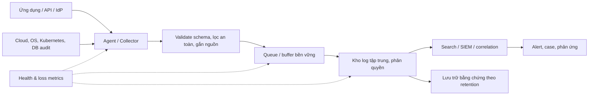
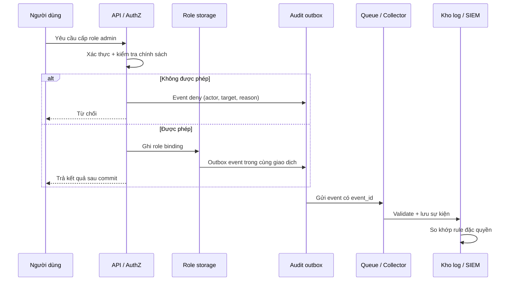

# Security logging: thiết kế nhật ký bảo mật có thể kiểm chứng

## 1. Security logging là gì?

**Security logging** là việc ghi nhận có chủ đích những sự kiện giúp trả lời các câu hỏi bảo mật: *Ai hoặc thành phần nào đã thực hiện hành động gì? Tác động đến tài nguyên nào? Vào thời điểm nào? Hệ thống đã cho phép, từ chối hay xử lý ra sao? Có bằng chứng đáng tin cậy để điều tra và chứng minh kiểm soát hoạt động không?*

Trong chương **Logging và monitoring** của module **SECURITY_SECURITY_ASSURANCE**, security logging là một phần của **security assurance**: biến yêu cầu, phân tích rủi ro và security controls thành bằng chứng quan sát được; từ đó kiểm tra, audit, phát hiện sai lệch và khắc phục. Hệ thống có log chưa chắc đã được bảo đảm an toàn: nhật ký phải đủ ngữ cảnh, đúng sự thật trong giới hạn nguồn phát, được vận chuyển và bảo vệ thích hợp, có thể tra cứu và kiểm chứng.

Phân biệt các khái niệm gần nhau:

| Khái niệm | Mục đích chính | Ví dụ |
| --- | --- | --- |
| Application/operational log | Tìm lỗi và hiểu hoạt động phần mềm | Thời gian xử lý request, lỗi kết nối cơ sở dữ liệu |
| **Security log** | Phát hiện, điều tra và chứng minh hành vi liên quan bảo mật | Đăng nhập thất bại, yêu cầu bị từ chối quyền, cấp quyền quản trị |
| Audit trail | Tái dựng chuỗi hành động gắn với trách nhiệm và thay đổi | Ai phê duyệt thay đổi quyền, trạng thái trước/sau, kết quả |
| Metric | Đo xu hướng dưới dạng số tổng hợp | Số lần xác thực thất bại mỗi phút |
| Trace | Theo dõi đường đi của một giao dịch qua các dịch vụ | Request đi qua gateway, identity và billing service |
| Monitoring/detection | Phân tích dữ liệu để tìm điều kiện cần xử lý | Cảnh báo tài khoản quản trị đăng nhập bất thường |

Một sự kiện có thể phục vụ nhiều mục đích, nhưng security logging có yêu cầu chặt chẽ hơn về **danh tính, kết quả quyết định bảo mật, tính toàn vẹn, quyền truy cập và khả năng truy vết**. Chỉ thấy HTTP 403 trong access log không đủ để biết chính sách nào đã từ chối hoặc hành động nào bị chặn.

### Kết quả học tập

Sau bài này, người học có thể:

1. Chuyển một rủi ro và một security control thành yêu cầu logging có thể kiểm thử.
2. Xác định sự kiện cần ghi, trường dữ liệu tối thiểu và những dữ liệu tuyệt đối không nên đưa vào log.
3. Thiết kế luồng thu thập, lưu giữ, kiểm soát truy cập và phát hiện mất/sửa log.
4. Tạo detection use case gắn với phản ứng và bằng chứng điều tra.
5. Kiểm chứng coverage, tính chính xác, độ trễ và độ tin cậy của nhật ký bằng phép thử cụ thể.

## 2. Bắt đầu từ rủi ro và câu hỏi cần trả lời

Đừng chọn sự kiện chỉ vì một thư viện có sẵn lệnh ghi log. Hãy bắt đầu từ **mục tiêu bảo mật → rủi ro → hành động cần quan sát → bằng chứng cần thu thập → phép thử**.

Ví dụ, mục tiêu là *chỉ người được ủy quyền mới được cấp vai trò quản trị*.

| Thành phần | Thiết kế |
| --- | --- |
| Tài sản | Quyền quản trị tenant và tài khoản người dùng |
| Rủi ro | Tài khoản bị chiếm đoạt hoặc một người tự nâng quyền |
| Control phòng ngừa | Kiểm tra quyền, xác thực mạnh, phê duyệt theo chính sách |
| Câu hỏi assurance | Mọi lần cấp quyền, kể cả thất bại, có được ghi đủ danh tính, đối tượng, vai trò và kết quả không? |
| Sự kiện cần ghi | `iam.role_grant` với `success`/`deny`/`error`; sự kiện phê duyệt liên quan nếu có |
| Kiểm tra | Cấp quyền hợp lệ, cấp quyền trái phép, lỗi dịch vụ và đối chiếu sự kiện với thay đổi thực tế |
| Phản ứng | Cảnh báo hành động đặc quyền bất thường; điều tra và thu hồi quyền nếu cần |

Một bản yêu cầu logging tốt cần nêu **phạm vi** (dịch vụ và môi trường), **điểm phát sự kiện** (sau quyết định hay sau giao dịch), **dữ liệu bắt buộc**, **đích thu thập**, **thời gian cho phép trễ**, **quy tắc lưu giữ**, **người sở hữu** và **cách kiểm chứng**. Nếu chỉ viết “bật audit log” thì không xác định được hoàn thành hay chưa.

### Nhóm sự kiện thường có giá trị cao

| Nhóm | Các sự kiện tiêu biểu | Điều cần nắm bắt |
| --- | --- | --- |
| Xác thực | Đăng nhập thành công/thất bại, MFA được kích hoạt/thất bại, đăng xuất, làm mới/thu hồi phiên | Danh tính được hệ thống xác minh, phương thức, kết quả, lý do chuẩn hóa |
| Phân quyền | Truy cập tài nguyên quan trọng được cho phép hoặc bị từ chối | Chủ thể, loại hành động, tài nguyên, policy/decision ID, kết quả |
| Tài khoản và đặc quyền | Tạo/vô hiệu tài khoản, thay đổi nhóm/vai trò, sử dụng tài khoản khẩn cấp | Người thực hiện, người bị tác động, quyền trước/sau, phê duyệt liên quan |
| Bí mật và khóa | Tạo/xoay vòng/vô hiệu hóa khóa, truy cập kho bí mật bất thường | ID tham chiếu, loại thao tác, kết quả; **không ghi giá trị bí mật** |
| Dữ liệu nhạy cảm | Export lượng lớn, thay đổi phân loại, xóa dữ liệu quan trọng | Đối tượng, phạm vi/tổng số bản ghi, mục đích nghiệp vụ nếu có |
| Cấu hình bảo mật | Đổi chính sách IAM, firewall, audit settings, tắt detection, thay đổi luồng CI/CD | Trạng thái trước/sau, phạm vi, actor và request/change ID |
| Hạ tầng và cloud | Thay đổi security group, cấp quyền service account, tạo public access, chỉnh logging | Resource ID, control-plane actor, kết quả và phạm vi tác động |
| Chính log pipeline | Collector ngừng gửi, backlog, lỗi xác thực nguồn, drop event, xóa/sửa retention | Nguồn sự cố, số lượng/độ trễ, người thay đổi và bằng chứng độc lập |

Các sự kiện có thể đến từ ứng dụng, identity provider, API gateway, hệ điều hành, container/Kubernetes, cloud control plane, database audit, endpoint hoặc hệ thống CI/CD. **Độ ưu tiên** dựa trên rủi ro, không dựa vào số lượng dòng log.

## 3. Thiết kế bản ghi sự kiện có cấu trúc

Security log phải dễ phân tích bởi người và máy. Dùng một **schema có phiên bản** thay vì chỉ ghi chuỗi tự do như “user updated something”.

### 3.1. Các trường cần cân nhắc

| Trường | Vai trò / lưu ý |
| --- | --- |
| `event_id`, `schema_version` | Định danh duy nhất để đối chiếu/chống xử lý trùng; quản lý thay đổi schema |
| `event_type`, `action` | Tên có quy ước thống nhất, ví dụ `iam.role_grant` |
| `event_time` | Thời điểm hành động xảy ra, chuẩn UTC có độ chính xác phù hợp |
| `observed_at`/`ingested_at` | Thời điểm nguồn/collector ghi nhận, giúp đánh giá độ trễ và clock skew |
| `source.service`, `source.environment`, `source.instance` | Dịch vụ, môi trường và instance sinh sự kiện |
| `actor.id`, `actor.type` | Danh tính từ ngữ cảnh xác thực đã được **server xác minh**, hoặc `anonymous` |
| `target.type`, `target.id` | Loại và định danh tài nguyên bị tác động |
| `action`, `outcome`, `reason_code` | Hành động và kết quả chuẩn hóa như `success`, `deny`, `failure`, `error` |
| `request_id`/`trace_id`/`correlation_id` | Liên kết các bản ghi của một luồng tác nghiệp; không dùng làm bằng chứng danh tính |
| `policy_id`, `approval_id`, `change_id` | Liên hệ quyết định bảo mật với chính sách/phê duyệt/đổi cấu hình khi có |
| `network_context` | IP/ASN/thiết bị nếu phục vụ use case và phù hợp chính sách dữ liệu |
| `classification`, `retention_class` | Phân lớp nhạy cảm và nhóm lưu giữ phục vụ kiểm soát downstream |

**Bản ghi mẫu** sau là dữ liệu minh họa, không chứa token hay danh tính thật:

```json
{
  "schema_version": "1.0",
  "event_id": "evt_7c4f",
  "event_type": "iam.role_grant",
  "event_time": "2026-11-28T03:12:14.500Z",
  "source": {
    "service": "identity-service",
    "environment": "prod",
    "instance": "idp-03"
  },
  "actor": {
    "id": "usr_82a",
    "type": "human",
    "auth_assurance": "mfa"
  },
  "target": {
    "type": "role_binding",
    "id": "bind_241",
    "subject_id": "usr_914"
  },
  "action": "grant_admin_role",
  "outcome": "success",
  "reason_code": "POLICY_ALLOWED",
  "change": {
    "role_before": "viewer",
    "role_after": "admin"
  },
  "approval_id": "apr_203",
  "request_id": "req_56e2",
  "classification": "internal-security",
  "retention_class": "privileged-action"
}
```

Lưu ý:

- `event_time` nên sinh tại nơi thực hiện hành động; thời điểm collector nhận sự kiện cần được giữ riêng để phát hiện sự kiện đến muộn.
- `actor.id` lấy từ **authentication context đáng tin cậy**; tuyệt đối không lấy nguyên giá trị `X-User-Id` do client tự gửi rồi coi là actor đã xác thực.
- Khi hoạt động thất bại trước bước xác thực, hãy phân biệt `claimed_identifier` (đã chuẩn hóa/giảm dữ liệu nếu cần) với `actor.id` thật. Không suy đoán người chịu trách nhiệm.
- Mã lý do cần đủ cụ thể để điều tra nhưng không tiết lộ thông tin nhạy cảm cho người dùng cuối.
- Khi không biết giá trị, biểu diễn **unknown** rõ ràng; đừng tự điền giá trị giả để đủ trường.
- `event_id` có thể dùng phát hiện trùng trong pipeline, nhưng UUID hay ID duy nhất **không tự bảo đảm** log không bị chỉnh sửa.

### 3.2. Ghi vào đúng thời điểm

Một yêu cầu thay đổi quyền có thể qua các bước: xác thực, kiểm tra quyền, phê duyệt, ghi dữ liệu và trả kết quả. Nếu ghi “cấp quyền thành công” ngay sau khi pass authorization nhưng trước khi commit database, log sẽ mô tả sai kết quả khi giao dịch rollback.

Quy ước:

- Ghi `attempt` và `deny` ở điểm xử lý tương ứng khi cần quan sát cả ý định và quyết định.
- Ghi `success` khi **thay đổi thực tế đã có hiệu lực** hoặc khi có sự kiện domain xác nhận commit.
- Ghi `error` với mã lỗi đã làm sạch nếu hệ thống không xác định được trạng thái; áp dụng đối soát bổ sung khi kết quả mơ hồ.
- Với thay đổi dữ liệu quan trọng, cân nhắc **transactional outbox** để ghi sự kiện bền vững cùng giao dịch, sau đó chuyển đến bus/collector. Thiết kế xử lý ít nhất một lần và khử trùng bằng `event_id`; tránh giả định delivery chính xác một lần ở mọi thành phần.

Đây là chỗ security logging gắn với **tính đúng đắn của bằng chứng**, không chỉ với câu lệnh logger trong mã nguồn.

### 3.3. Đặt tên và tương thích schema

Nên thống nhất một taxonomy: `authn.login`, `authn.mfa_challenge`, `authz.decision`, `iam.role_grant`, `secrets.key_rotate`, `security.logging_config_changed`. Dùng `schema_version`, hợp đồng các trường bắt buộc/tuỳ chọn, định nghĩa kiểu dữ liệu và enum `outcome`. Kiểm tra schema tại producer và collector; thay đổi phá vỡ tương thích phải có kế hoạch chuyển đổi và dashboard theo dõi bản ghi bị từ chối.

Không đổi tùy tiện ý nghĩa trường `actor`, `target` hoặc `success`, vì truy vấn điều tra và detection rule có thể diễn giải sai dù luồng log vẫn chạy.

## 4. Hạn chế dữ liệu nhạy cảm và log injection

Nhật ký bảo mật thường chứa thông tin nhạy cảm: định danh tài khoản, IP, đường dẫn tài nguyên, lịch sử hoạt động. Bản thân hệ thống log trở thành **tài sản cần bảo vệ**.

**Không ghi** mật khẩu, OTP, session cookie, access/refresh token, API key, private key, connection string có credentials, nội dung secret, số thẻ, payload chứa PII không cần thiết hay dữ liệu bệnh án/kinh doanh chỉ để “phòng khi điều tra”. Cũng không ghi nguyên toàn bộ HTTP headers, body, URL query và stack trace nếu chúng có thể chứa bí mật.

Áp dụng nguyên tắc:

1. **Data minimization tại nguồn:** tạo allowlist các trường cần thiết, tránh gửi toàn bộ request vào pipeline rồi mới lọc; bước lọc ở collector chỉ là lớp phòng vệ bổ sung.
2. **Pseudonymization khi phù hợp:** dùng ID nội bộ ổn định cho use case, tách hệ thống tra cứu danh tính thật và kiểm soát quyền giải mã/đối chiếu.
3. **Structured encoding:** serialize JSON bằng thư viện an toàn; chặn/control ký tự điều khiển trong giá trị đầu vào. Đừng ghép chuỗi do attacker kiểm soát thành dòng log thô.
4. **Gắn phân loại và quyền truy cập:** dữ liệu bảo mật nhạy cảm không đồng nghĩa mọi kỹ sư đều được xem.
5. **Xác định mục đích và thời hạn lưu giữ:** theo yêu cầu pháp lý, hợp đồng, chính sách và mô hình rủi ro; không có một mốc số ngày áp dụng cho mọi hệ thống.
6. **Kiểm tra redaction bằng testcase:** đưa token và dữ liệu mẫu giả vào các request thử nghiệm rồi tìm xuyên suốt application log, collector, SIEM và bản sao lưu.

Ví dụ log dễ bị tiêm ký tự xuống dòng:

```text
# Không an toàn: giá trị username đến từ client, nối trực tiếp thành chuỗi log
logger.info("Login failed for " + username);
```

Nếu `username` chứa xuống dòng và nội dung giả dạng sự kiện, công cụ đọc log dạng dòng có thể bị đánh lừa. Cách tốt hơn là sử dụng API ghi trường có cấu trúc, validate độ dài/kiểu dữ liệu, encoder đảm nhiệm escape và chỉ ghi định danh đã được xử lý phù hợp.

## 5. Kiến trúc thu thập: từ nguồn tới bằng chứng

Một pipeline đơn giản:



### 5.1. Các ranh giới tin cậy

| Điểm | Nguy cơ | Biện pháp phù hợp |
| --- | --- | --- |
| Producer | Attacker sửa/xóa event hoặc gửi dữ liệu giả | Tách chức năng audit, kiểm soát quyền, ký/định danh nguồn khi cần, đối chiếu với control plane độc lập |
| Đường truyền | Nghe lén, chèn/sửa log | Mã hóa truyền tải, xác thực hai chiều nếu phù hợp, phân đoạn mạng, giới hạn nguồn được phép gửi |
| Collector | Nguồn giả mạo, log injection, bùng nổ lưu lượng | Xác thực nguồn, validate schema, giới hạn kích thước/tốc độ, quarantine bản ghi lỗi |
| Queue/Buffer | Mất dữ liệu khi tắc nghẽn hoặc restart | Durable queue, retry có backoff, idempotency, theo dõi backlog, thông báo khi quá ngưỡng |
| Kho lưu trữ | Nhân viên/attacker xóa, thay đổi, đọc quá quyền | RBAC theo vai trò, mã hóa, bảo vệ khóa, retention lock/immutability khi cần, audit chính hoạt động trên log store |
| SIEM/Export | Lộ dữ liệu qua truy vấn, export hoặc dashboard | Quyền tối thiểu, lưu vết truy vấn/export, hạn chế tải xuống, che trường nhạy cảm |
| Thời gian | Host lệch giờ gây sai thứ tự sự kiện | Đồng bộ giờ, ghi `event_time` và `ingested_at`, giám sát clock skew |

**Tính toàn vẹn** có nhiều mức: checksum phát hiện lỗi truyền/lưu ngẫu nhiên; hash chain giúp phát hiện sửa thứ tự hoặc xóa bản ghi trong phạm vi chuỗi được kiểm tra; chữ ký số kết hợp nguồn khóa đáng tin cậy giúp kiểm tra nguồn gốc; lưu trữ bất biến giảm khả năng sửa/xóa trong thời hạn chính sách. Không biện pháp riêng lẻ nào chứng minh tuyệt đối rằng **sự kiện không tồn tại** nếu producer đã bị chiếm quyền và chưa từng phát log.

Với hành động đặc quyền hoặc rủi ro cao, nên có một nguồn kiểm chứng độc lập hơn, ví dụ **cloud control-plane audit** để đối chiếu với event do ứng dụng phát, cùng giám sát việc tắt logging.

### 5.2. Mất log và hành vi khi pipeline lỗi

Cần trả lời trước: collector offline thì producer làm gì, queue đầy thì gì bị bỏ, sự kiện nào được ưu tiên, ai được cảnh báo và dữ liệu nào được tái gửi?

- **Đừng âm thầm drop** event có giá trị assurance cao; đo số event được tạo/nhận/chấp nhận/từ chối và độ trễ.
- Với audit sự kiện gắn giao dịch nhạy cảm, chọn outbox/durable queue hoặc cơ chế bền vững tương đương. Phân tích rủi ro để quyết định khi nào nghiệp vụ cần chặn nếu không ghi được bằng chứng; chặn mọi thao tác vì log store gián đoạn cũng có thể tạo rủi ro availability.
- Xác định chính sách buffer, backpressure, retry, dead-letter/quarantine và cách khôi phục sau gián đoạn.
- Với debug/telemetry lưu lượng lớn, sampling có thể hợp lý. **Không áp dụng sampling mù** cho sự kiện đặc quyền, deny quan trọng hay thay đổi cấu hình giám sát.
- Metric “collector còn sống” chưa đủ: phải đo **độ đầy đủ của event quan trọng** qua kiểm tra từ đầu đến cuối.

### 5.3. Bảo vệ vòng đời bằng chứng

Vòng đời thông thường: **tạo → vận chuyển → chuẩn hóa → lưu nóng để tìm kiếm → lưu theo retention → xuất bằng chứng được kiểm soát → hết hạn/xóa có truy vết**.

Quy định retention theo lớp sự kiện, nhu cầu điều tra, yêu cầu audit, nghĩa vụ pháp lý và dung lượng. Có thể phân tách kho tìm kiếm nhanh và kho lưu dài hạn, nhưng cần kiểm tra khả năng truy xuất, phương thức giải mã, chứng minh tính toàn vẹn và quản lý thời hạn. Quyền xóa log, thay đổi retention, tắt collection phải là sự kiện được audit, phân quyền chặt và cảnh báo.

## 6. Security logging trong ứng dụng và hệ phân tán

Một ví dụ **mã giả theo phong cách Java** để thể hiện hợp đồng event tại nơi xảy ra quyết định:

```java
// Dữ liệu minh họa: triển khai thật cần AuditEvent/AuditSink cụ thể.
AuthorizationDecision decision =
    authorizationService.evaluate(principal, "invoice.export", invoice);

AuditEvent event = AuditEvent.builder()
    .eventType("authz.decision")
    .schemaVersion("1.0")
    .eventId(ids.newEventId())
    .eventTime(clock.instant())
    .actorId(principal.verifiedSubjectId())
    .targetType("invoice")
    .targetId(invoice.nonSensitiveId())
    .action("invoice.export")
    .outcome(decision.isAllowed() ? "success" : "deny")
    .reasonCode(decision.stableReasonCode())
    .correlationId(requestContext.serverGeneratedCorrelationId())
    .build();

auditSink.publish(event);
```

Đây mới là **event của quyết định phân quyền**, không tự động chứng minh việc export hoàn thành. Nếu muốn ghi thành công của thao tác export, cần một sự kiện riêng khi thao tác đã thật sự hoàn tất. Dữ liệu `principal` lấy từ middleware xác thực; `requestContext` có correlation ID do hệ thống kiểm soát. `auditSink.publish` nên có hợp đồng rõ về delivery, retry, lỗi và đo độ đầy đủ; logger ghi console đơn thuần không thay thế được các bảo đảm đó.

Trong kiến trúc microservices:

- Đặt `trace_id`/`request_id` xuyên qua gateway, application và downstream service, nhưng **không chấp nhận header từ client làm danh tính người dùng**.
- Log quyết định có trách nhiệm tại từng ranh giới, tránh mỗi dịch vụ tự gán “thành công toàn giao dịch”.
- Phân biệt human identity, workload/service identity và impersonation/delegation; nếu A thao tác “thay mặt” B, ghi rõ người khởi tạo và chủ thể được ủy quyền.
- Dùng `event_id` và `correlation_id` để nối chuỗi; chú ý các thao tác bất đồng bộ, retry, sự kiện đến không đúng thứ tự và duplicate.
- Với cloud/Kubernetes, đối chiếu application log với sự kiện control plane như thay đổi IAM policy, service account hoặc quyền trên cluster; có nguồn log từ chính nền tảng thay vì chỉ từ pod.

## 7. Từ nhật ký tới detection và response

**Log là dữ liệu đầu vào; detection là quy tắc phân tích dữ liệu đó.** Mỗi detection use case cần ít nhất nguồn dữ liệu, logic, mức độ ưu tiên, điều kiện ngoại lệ hợp lệ, ngưỡng/tuning, thời gian trễ chấp nhận được, người nhận cảnh báo và runbook xử lý.

Ví dụ phát hiện password spraying:

> Trong cửa sổ thời gian ngắn, nhiều lần đăng nhập thất bại từ cùng một nguồn tới nhiều tài khoản khác nhau có thể là dấu hiệu dò mật khẩu.

Quy tắc minh họa (cú pháp giả, phải chỉnh theo SIEM thực tế):

```text
FROM security_events
WHERE event_type = "authn.login"
  AND outcome = "failure"
WINDOW 5m
GROUP BY source.ip_or_privacy_safe_fingerprint
WHEN count_distinct(actor.claimed_identifier) >= tuned_account_threshold
 AND count(events) >= tuned_failure_threshold
ALERT "Possible password spraying"
```

**Không coi ngưỡng minh họa là chuẩn chung.** NAT, proxy, VPN doanh nghiệp, test tải hoặc lỗi IdP có thể gây false positive; attacker phân tán nguồn hoặc kéo dài thời gian để né quy tắc. Kiểm tra dữ liệu thực và review định kỳ. Nếu trường cần thiết bị thiếu hoặc source log bị gián đoạn, cần cảnh báo về **mất khả năng phát hiện**, không được ngầm suy diễn “không có tấn công”.

Một số use case khác:

| Detection use case | Tín hiệu chính | Kiểm tra thêm |
| --- | --- | --- |
| Cấp quyền quản trị trái quy trình | `iam.role_grant=success`, vai trò đặc quyền, không có approval hợp lệ | Phê duyệt, người thực hiện, thời điểm, thay đổi IAM thực tế |
| Tắt log hoặc giảm retention | Thay đổi `logging_config` hoặc stop collector | Change ticket, identity có quyền, nguồn audit độc lập |
| Khai thác quyền truy cập | Nhiều `authz.decision=deny`, sau đó có `success` với cùng target | Policy thay đổi hợp lệ? Lỗi cấu hình? |
| Truy xuất dữ liệu bất thường | Export nhiều lần/khối lượng lớn hoặc ngoài luồng thông thường | Quyền được cấp, công việc định kỳ, loại dữ liệu |
| Dùng tài khoản break-glass | Sự kiện xác thực/thao tác từ tài khoản khẩn cấp | Có tình huống khẩn cấp và hậu kiểm được phê duyệt? |

Mỗi cảnh báo nên liên kết **dữ liệu gốc + detection rule/version + thời gian + tài sản + mức tin cậy + case ID** để người điều tra tái dựng kết luận. Cảnh báo không phải bằng chứng kết tội; cần xác minh và lưu kết quả xử lý.

## 8. Chứng minh kiểm soát logging hoạt động

Với security assurance, cần chứng minh không chỉ “đã cấu hình” mà còn “**sinh đúng sự kiện, nhận đủ, lưu an toàn, truy xuất được và dùng được khi cần**”.

### 8.1. Ma trận yêu cầu – bằng chứng – phép thử

| Mã yêu cầu | Yêu cầu có thể kiểm chứng | Bằng chứng nên lưu | Phép thử và kết quả mong đợi |
| --- | --- | --- | --- |
| LOG-01 | Mỗi lần cấp vai trò quản trị đều có event gắn actor, target và outcome | Schema, log sample đã ẩn danh, request/change ID | Cấp quyền hợp lệ và từ chối trái quyền; tra được hai event đúng kết quả |
| LOG-02 | Sự kiện đến kho tập trung trong giới hạn độ trễ được phê duyệt | Dashboard ingest latency, event ID đối chiếu | Bắn event có ID duy nhất, đo time-to-ingest so với SLO nội bộ |
| LOG-03 | Sự kiện đặc quyền không bị mất âm thầm khi collector tạm ngừng | Queue/retry metric, incident/chaos log, event IDs | Ngắt collector có kiểm soát, phục hồi, đối chiếu số lượng và ID |
| LOG-04 | Người không có quyền không thể đọc/xóa log nhạy cảm | IAM policy, audit của kho log | Thử read/delete bằng tài khoản không có quyền và kiểm tra bị từ chối |
| LOG-05 | Không có token/password trong luồng log được quản lý | Quy tắc allowlist/redaction, kết quả quét kiểm thử | Gửi chuỗi bí mật giả vào request kiểm thử; không tìm thấy ở mọi điểm thu thập |
| LOG-06 | Thay đổi cấu hình logging bị giám sát | Cloud audit / config change logs, rule và alert | Thay đổi cấu hình trong môi trường test; có event/alert tương ứng |
| LOG-07 | Log có thể phục vụ điều tra trong thời hạn lưu giữ | Retention policy, bản export, biên bản restore | Truy xuất mẫu đúng retention và xác minh khả năng đọc, đối chiếu |

Giá trị SLO (ví dụ ngưỡng trễ, tỷ lệ đủ log) **phải do hệ thống tự xác lập theo rủi ro và năng lực**, không tự đặt con số rồi gọi là tuân thủ. Bằng chứng nên được gắn phiên bản deployment, môi trường, thời điểm kiểm thử và danh tính người thực hiện. Làm sạch định danh trong báo cáo chia sẻ.

### 8.2. Quy trình kiểm tra end-to-end

1. **Chuẩn bị:** xác định use case, sự kiện kỳ vọng, trường bắt buộc, nguồn và kho đích, quyền tra cứu, khoảng thời gian kiểm tra.
2. **Tạo sự kiện có kiểm soát:** thực hiện ca thành công, bị từ chối và lỗi; mỗi ca có `event_id`/`request_id` để đối chiếu.
3. **Đối soát nguồn–đích:** kiểm tra đúng loại sự kiện, thời gian, actor/target, outcome, payload không chứa bí mật, số event bị duplicate/missing.
4. **Thử lỗi đường truyền và lưu trữ:** tạm ngừng một thành phần trong môi trường thử; quan sát backlog, retry, cảnh báo gián đoạn và phục hồi.
5. **Thử tính bảo mật:** gửi giá trị độc hại có newline/control chars; kiểm tra encoding, truy cập trái phép, thao tác xóa/sửa và audit truy cập log.
6. **Thử detection/response:** kích hoạt điều kiện rule trong môi trường an toàn; xác nhận cảnh báo đến đúng người, có đủ ngữ cảnh và runbook thực hiện được.
7. **Lưu bằng chứng:** snapshot cấu hình, truy vấn/log sample đã che dữ liệu, kết quả kiểm tra, sai lệch, chủ sở hữu và ngày khắc phục.

Các bài test trên cần được **tự động hóa ở mức khả thi** trong CI/CD hoặc môi trường staging, kèm kiểm tra định kỳ trên production bằng canary event không chứa dữ liệu nhạy cảm. Production còn cần giám sát “độ tươi” log, mức trễ, tỷ lệ schema invalid và sự hiện diện của các nguồn trọng yếu.

### 8.3. Phân biệt các mức phát biểu assurance

| Khẳng định | Bằng chứng phù hợp | Giới hạn |
| --- | --- | --- |
| “Ứng dụng có gọi logger” | Code review, unit test | Chưa chứng minh sự kiện đã đến kho |
| “Pipeline đã nhận event thử nghiệm” | Event ID nguồn–đích, metric ingest | Chưa bảo đảm mọi sự kiện thật đều được ghi |
| “Người thường không xóa được log” | Policy + thử phân quyền | Quản trị cấp cao/compromised producer có thể có năng lực khác |
| “Kho có cơ chế chống sửa/xóa” | Cấu hình immutability, audit và thử với vai trò phù hợp | Không chứng minh nguồn phát đã ghi đủ sự kiện |
| “Detection hoạt động với tình huống được thử” | Rule version, alert, case, thời gian end-to-end | Có thể vẫn thiếu coverage hoặc có false negative khác |

Một security assurance report nghiêm túc phải ghi **phạm vi và giới hạn của kết luận**. Chỉ tìm thấy một dòng log thành công không đủ chứng minh toàn bộ hệ thống có audit trail đáng tin cậy.

## 9. Ví dụ xuyên suốt: phát hiện cấp quyền quản trị trái phép

Giả sử một nền tảng SaaS có tenant A. Yêu cầu: chỉ tenant owner đã xác thực mạnh và có phê duyệt hợp lệ mới được cấp role `admin`.

**Luồng thiết kế:**



Nếu nghiệp vụ xử lý outbox theo một giao dịch, event `success` gắn với commit có ý nghĩa rõ hơn. Với nhánh `deny`, thiết kế cần xác định cách lưu bền vững mà không tạo áp lực availability quá lớn; sơ đồ chỉ minh họa, không mặc định mọi lượt từ chối đều cần một giao dịch database.

**Tình huống kiểm thử:**

- Người có quyền cấp `admin`: log `success`, có actor, tenant, target, vai trò trước/sau và approval ID; hệ thống đối chiếu role thực tế.
- Người không có quyền yêu cầu cấp `admin`: log `deny` với reason chuẩn hóa; role không thay đổi.
- Audit outbox hoặc collector tạm lỗi: event vẫn được gửi lại hoặc có cảnh báo mất dữ liệu theo thiết kế; không báo “audit thành công” khi thực tế đã drop.
- Quản trị viên thay đổi cấu hình SIEM để bỏ rule: hành động đổi cấu hình được audit qua đường độc lập, review/alert phù hợp.
- Khi xuất bằng chứng cho auditor: cung cấp truy vấn/snapshot có thể tái hiện, phiên bản policy, approval, thời gian, kết quả kiểm thử và chứng minh quyền xem bị hạn chế.

**Điểm mấu chốt:** yêu cầu phân quyền, sự kiện `iam.role_grant`, rule cảnh báo, biện pháp giữ log và bài test đều quy về **cùng một rủi ro**. Chính sự liên kết này giúp chứng minh security control đang được giám sát một cách có hệ thống.

## 10. Lỗi triển khai thường gặp

| Sai lầm | Hậu quả | Điều chỉnh |
| --- | --- | --- |
| Chỉ log exception hoặc HTTP status | Thiếu ngữ cảnh về quyết định bảo mật | Thiết kế event theo use case và schema |
| Log `success` trước khi commit | Tạo audit trail sai thực tế | Gắn event với commit/outbox hoặc trạng thái đã xác nhận |
| Tin mọi giá trị từ header client | Actor bị giả mạo | Lấy identity từ ngữ cảnh xác thực tin cậy |
| Ghi toàn bộ request/response | Lộ secret và dữ liệu cá nhân | Allowlist trường, redaction tại nguồn |
| In chuỗi tự do có input không kiểm soát | Log injection, truy vấn sai | Structured logging, encoding, giới hạn độ dài |
| Có collector nhưng không giám sát backlog | Mất hoặc trễ log kéo dài không được phát hiện | Theo dõi freshness, queue lag, drop/error metrics |
| Log store cho phép sửa/xóa tự do | Bằng chứng dễ bị phá hủy | Least privilege, kiểm soát retention, immutability theo rủi ro |
| Chỉ kiểm tra “event có tồn tại” | Bỏ sót sai actor, outcome, độ trễ, duplicate | End-to-end tests và đối soát với trạng thái thật |
| Rule cảnh báo không có runbook/owner | Không có người xử lý hoặc cảnh báo gây nhiễu | Owner, phân mức, tuning và diễn tập |
| Cho rằng không có log nghĩa là không có sự kiện | Kết luận điều tra sai khi nguồn bị tắt | Giám sát coverage và integrity của pipeline |

## 11. Thực hành áp dụng

Hãy chọn một hành động rủi ro cao trong hệ thống của bạn, chẳng hạn **tạo API key, export dữ liệu cá nhân hoặc thay đổi policy IAM**, rồi lập một bản thiết kế ngắn có thể review:

1. Mô tả rủi ro, control phòng ngừa, câu hỏi điều tra và điều kiện được phép thực hiện.
2. Định nghĩa ít nhất ba trường hợp: `success`, `deny`, `error`; chốt điểm phát event và hợp đồng `outcome`.
3. Xây dựng schema gồm actor đã xác minh, target, action, outcome, thời gian, correlation ID, event ID và field theo nghiệp vụ.
4. Phân loại dữ liệu nhạy cảm; loại bỏ secret, xác định quyền tra cứu, retention và cách chứng minh chống sửa/xóa.
5. Mô tả đường đi từ ứng dụng tới kho log, cơ chế phục hồi sau sự cố, health metrics và điều kiện cảnh báo.
6. Viết **một** detection rule, các ngoại lệ hợp lệ và runbook phản ứng.
7. Đưa ra test case có ID, đầu vào, event mong đợi, truy vấn đối chiếu và bằng chứng lưu lại.

**Tiêu chí tự đánh giá:** một người không trực tiếp phát triển tính năng vẫn có thể đọc bản thiết kế để tái hiện ca kiểm thử, hiểu log mô tả điều gì và biết giới hạn chứng cứ nằm ở đâu.

## 12. Ghi nhớ

Security logging hiệu quả phải đạt đồng thời bốn mục tiêu: **đủ sự kiện để trả lời câu hỏi rủi ro; đúng ngữ nghĩa của hành động và kết quả; được bảo vệ trước mất/sửa/lộ; có thể đo và kiểm thử từ nguồn tới khâu điều tra**. Trong security assurance liên tục, mỗi yêu cầu logging nên có owner, test, metric, detection và bằng chứng kiểm chứng tương ứng. Nhật ký là nền tảng quan sát bảo mật; giá trị của nó phụ thuộc vào chất lượng sự kiện và độ tin cậy của toàn bộ chuỗi tạo, vận chuyển, lưu trữ và sử dụng.
