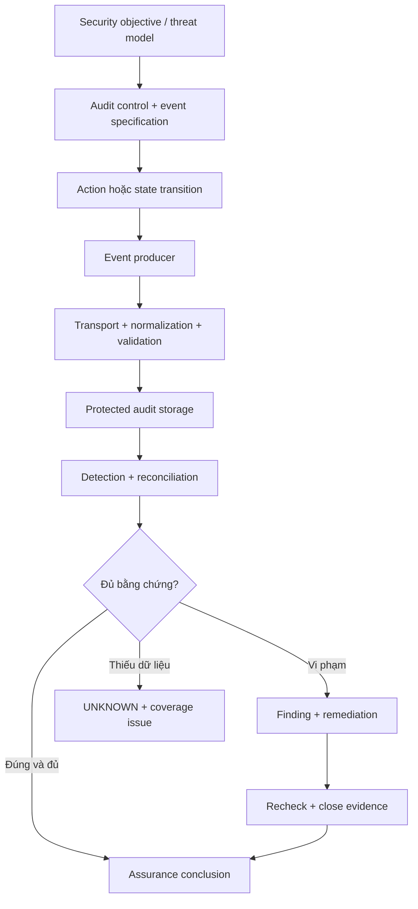
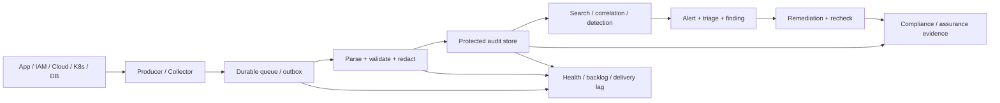

# Audit event: Thiết kế sự kiện kiểm toán và chứng minh hoạt động bảo mật có thể truy vết

## 1. Mục tiêu học tập

Sau bài này, người học có thể:

- Giải thích **audit event** và phân biệt sự kiện kiểm toán với log chẩn đoán, access log, metric, trace, cảnh báo và security finding.
- Chọn những hoạt động cần ghi nhận dựa trên rủi ro; xây dựng **audit event taxonomy**, định nghĩa ngữ nghĩa và hợp đồng dữ liệu nhất quán.
- Thiết kế bản ghi thể hiện **ai**, **đã làm gì**, **với đối tượng nào**, **ở đâu**, **khi nào**, **theo kết quả nào**, đồng thời tránh làm lộ bí mật và dữ liệu nhạy cảm.
- Hiểu các bảo đảm và giới hạn khi phát sinh, truyền, lưu trữ, đối soát, bảo vệ tính toàn vẹn và truy vấn sự kiện kiểm toán.
- Xây dựng **bằng chứng security assurance** từ audit event, kiểm tra độ bao phủ và tính đầy đủ của pipeline, liên kết sự kiện với phát hiện và việc khắc phục.
- Phân tích tình huống thực tế về thay đổi quyền quản trị, truy cập dữ liệu nhạy cảm, thay đổi cấu hình cloud/Kubernetes và sự cố mất luồng audit.

Bài học nằm trong chương **Logging và monitoring** của dịch vụ `SECURITY_SECURITY_ASSURANCE`. Mục tiêu của dịch vụ là xây dựng cách đánh giá **có bằng chứng** rằng hệ thống đáp ứng các mục tiêu bảo mật, từ phân tích rủi ro, yêu cầu và security controls đến kiểm thử, audit và khắc phục phát hiện; các hoạt động này phải tiếp diễn trong phát triển và vận hành.

## 2. Audit event là gì?

**Audit event** là bản ghi có cấu trúc về một hành động hoặc một thay đổi trạng thái có ý nghĩa đối với trách nhiệm giải trình, an ninh, tuân thủ hoặc điều tra. Event thường ghi lại **tác nhân**, **hành động**, **đối tượng chịu tác động**, **thời điểm**, **nguồn phát sinh**, **kết quả** và **ngữ cảnh đủ cần thiết** để kiểm chứng.

Ví dụ:

> Ngày 28/11/2026 lúc 10:20 (UTC+7), quản trị viên `admin-42` đã thay đổi quyền của tài khoản dịch vụ `svc-reports` trên môi trường production, từ vai trò đọc dữ liệu thành vai trò có quyền xuất dữ liệu. Yêu cầu đã được phê duyệt qua change ticket `CHG-1842`; thao tác lưu thành công.

Trong ví dụ, điều cần kiểm chứng không chỉ là “có thông báo thay đổi quyền” mà còn là **quyền hiệu lực có thực sự thay đổi**, thay đổi có được phép hay không và bản ghi có đủ độ tin cậy để truy vết sau này.

### 2.1. Phân biệt các dạng tín hiệu

| Tín hiệu | Trả lời câu hỏi | Ví dụ | Giới hạn |
|---|---|---|---|
| **Audit event** | Ai thực hiện hành động nào, vào đối tượng nào, kết quả ra sao? | `iam.role.binding.created` | Không tự chứng minh hành động hợp lệ nếu không đối chiếu policy |
| **Application/debug log** | Chương trình đang hoạt động thế nào, lỗi ở đâu? | “Không kết nối được DB” | Có thể không ghi actor/đối tượng theo chuẩn kiểm toán |
| **Access log** | Request nào đến endpoint và server phản hồi gì? | `POST /admin/roles 200` | HTTP 200 không tự chứng minh thay đổi nghiệp vụ đã commit |
| **Metric** | Tần suất hoặc trạng thái tổng hợp thế nào? | `audit_events_total`, ingest lag | Không thay thế chi tiết từng hành động |
| **Distributed trace** | Một request đi qua những dịch vụ nào? | `trace_id` nối API và worker | Có thể bị sampling, không phù hợp làm nguồn audit duy nhất |
| **Security alert** | Quy tắc phát hiện nghi vấn nào đã kích hoạt? | “Cấp quyền quản trị bất thường” | Là suy luận từ một hay nhiều event; có false positive |
| **Security finding** | Vi phạm/control gap nào cần xử lý? | “Privileged role thay đổi ngoài phê duyệt” | Cần bằng chứng và tiến trình khắc phục riêng |

Audit event là **dữ liệu đầu vào** cho monitoring, forensic investigation và control testing. Một cảnh báo có thể được tạo từ nhiều audit event; một audit event có thể hoàn toàn hợp lệ mà không sinh cảnh báo nào.

### 2.2. Sự kiện kiểm toán khác “hành động được phép” như thế nào?

Một event đáng tin cậy có thể ghi lại hành động **bị từ chối**, **thất bại**, **được yêu cầu** hoặc **đã hoàn tất**. Không được gộp các trạng thái này vào nhau.

- `identity.login.failed`: một lần đăng nhập thất bại, không có nghĩa kẻ tấn công đã vào được hệ thống.
- `iam.role.change.requested`: có yêu cầu thay đổi, chưa chắc đã được phê duyệt hoặc thực thi.
- `iam.role.change.denied`: chính sách từ chối yêu cầu, không phát sinh thay đổi quyền.
- `iam.role.change.completed`: hệ thống xác nhận thay đổi được áp dụng theo định nghĩa của event.
- `data.export.started` và `data.export.completed`: phân biệt tác vụ bắt đầu với việc xuất dữ liệu đã thành công.

Nếu tên event dùng từ `completed` hay `succeeded`, producer phải bảo đảm nó chỉ phát khi **điều kiện thành công đã xảy ra theo hợp đồng dữ liệu**. Không phát “success” ngay lúc mới nhận request rồi mong service khác sẽ hoàn thành sau.

## 3. Tại sao audit event là thành phần cốt lõi của security assurance?

Một security control không thể được đánh giá đầy đủ chỉ bằng chính sách trên giấy. Audit event hỗ trợ chứng minh **control đã hoạt động** và **sự kiện ảnh hưởng đến an toàn có thể được điều tra**.

Ví dụ có yêu cầu: “Mọi thay đổi RBAC cấp quản trị production phải có phê duyệt và được ghi dấu vết.” Để đánh giá cần ít nhất:

1. Quy tắc **quyền nào được phép thay đổi** và **ai được cấp quyền**.
2. Audit event ghi tác nhân, đối tượng, hành động, kết quả, thời gian.
3. Dữ liệu phê duyệt/change request để đối chiếu.
4. Snapshot trạng thái quyền **sau khi thay đổi** để kiểm chứng hiệu lực.
5. Cơ chế phát hiện **thay đổi không được ghi nhận** hoặc pipeline bị gián đoạn.
6. Finding và bằng chứng khắc phục nếu phát hiện vi phạm.

Chuỗi liên kết có thể mô tả như sau:



**Một event tồn tại không tự chứng minh rằng mọi hành động thuộc cùng loại đều được ghi nhận.** Cần kiểm thử coverage, phát hiện producer im lặng, xác nhận dữ liệu đến kho tập trung và đối soát với các nguồn có thẩm quyền.

## 4. Chọn những sự kiện cần kiểm toán theo rủi ro

Không phải mọi thao tác trên hệ thống đều cần audit ở mức chi tiết nhất. Thu thập tất cả nội dung request có thể làm tăng chi phí, lộ dữ liệu nhạy cảm và tạo nhiễu. Hãy bắt đầu từ **threat model**, yêu cầu pháp lý/hợp đồng áp dụng, tài sản quan trọng và các câu hỏi điều tra cần trả lời.

### 4.1. Các nhóm sự kiện thường có giá trị bảo mật

| Nhóm | Các sự kiện nên cân nhắc | Mục tiêu và rủi ro |
|---|---|---|
| Authentication | Đăng nhập thành công/thất bại, thay đổi MFA, thiết lập phiên, reset credential, thu hồi phiên | Phát hiện chiếm đoạt danh tính, thay đổi phương thức xác thực |
| Authorization và IAM | Gán/thu hồi role, sửa policy, tạo token kỹ thuật, đổi ServiceAccount, truy cập bị từ chối | Ngăn lạm quyền và leo thang đặc quyền |
| Quản trị người dùng | Khóa/mở tài khoản, tạo/xóa người dùng, thay đổi chủ sở hữu | Truy trách nhiệm khi quyền và vòng đời danh tính thay đổi |
| Dữ liệu nhạy cảm | Xem/xuất/xóa hàng loạt, thay đổi chia sẻ, tải backup, truy vấn đặc quyền | Điều tra lộ dữ liệu và đáp ứng nghĩa vụ kiểm soát |
| Cấu hình bảo mật | Tắt logging, thay firewall, đổi network ACL, thay admission, tắt encryption | Phát hiện vô hiệu hóa security controls |
| Secrets và khóa | Tạo/xoay vòng/thu hồi khóa, thay quyền secret, lỗi truy cập key | Theo dõi thay đổi có khả năng gây lộ credential |
| Cloud và Kubernetes | Thay IAM binding, API audit settings, ClusterRoleBinding, workload privileged | Kiểm tra tác động control plane |
| CI/CD và artifact | Thay pipeline permission, deployment production, đổi image digest, override gate | Truy vết phát hành và supply chain |
| Monitoring và audit pipeline | Collector mất kết nối, đổi retention, thay quyền xóa log, cấu hình rule detection | Bảo vệ khả năng quan sát và điều tra |

Khi cân nhắc **đọc dữ liệu nhạy cảm**, cần phân loại theo mục tiêu: không nhất thiết ghi từng truy vấn dữ liệu thông thường; nên nhận diện các nhóm đọc đặc biệt (xuất báo cáo, tải hàng loạt, đọc tài liệu hạn chế, truy cập từ admin). Tần suất và độ chi tiết cần tương xứng với yêu cầu bảo mật, quyền riêng tư và hiệu năng.

### 4.2. Event catalog: một phần của yêu cầu bảo mật

Mỗi loại event nên có một mục trong catalog với:

- **Event type ổn định**, ví dụ `iam.role_binding.created`, cùng `schema_version`.
- **Trigger chính xác**: ở bước nào, trước hay sau khi commit, ghi nhận cả trường hợp nào bị từ chối.
- **Subject/asset scope** và control/requirement được hỗ trợ.
- **Required fields**, kiểu dữ liệu, danh sách enum, cách xử lý thiếu thông tin.
- **Nguồn phát sự kiện** và người phụ trách producer.
- **Security classification**: mức nhạy cảm, nơi được phép gửi/lưu và retention.
- **Delivery contract**: tính bền vững, retry, deduplication và cách xử lý lỗi.
- **Verification procedure**: tạo tình huống kiểm thử, tìm event, đối chiếu trạng thái và xử lý khi event thiếu.

Ví dụ:

| Event type | Khi nào phát? | Kết quả cần phân biệt | Thông tin tối thiểu |
|---|---|---|---|
| `identity.login.failed` | Xác thực thất bại | Sai credential, tài khoản bị chặn, lỗi kỹ thuật (nếu chính sách cho phép phân loại) | actor/identifier đã giảm nhạy cảm, source, time, reason code |
| `iam.role_binding.created` | Binding mới đã được lưu thành công | success | actor, role, subject, scope, change ID |
| `iam.role_binding.create_denied` | Yêu cầu cấp quyền bị từ chối | denied | actor, requested role, target, policy reason code |
| `data.export.completed` | Tác vụ xuất dữ liệu đã hoàn tất theo hợp đồng | success/failure (nếu dùng chung type thì outcome bắt buộc) | actor, dataset, lượng dữ liệu ở mức thống kê, job ID |
| `audit.sink.delivery_failed` | Audit sink không nhận/ghi sự kiện theo ngưỡng | failed | producer, sink, interval, error class, backlog |

Một cách làm tốt là **event type nêu hành động rõ ràng**, còn outcome mô tả kết quả theo hợp đồng. Tránh tên `event.something` không có ý nghĩa nghiệp vụ hoặc dùng cùng `user.updated` cho mọi thay đổi có tác động bảo mật.

## 5. Thiết kế cấu trúc một audit event

Một bản ghi cần đủ để tái lập câu chuyện nhưng không thu thập nhiều hơn yêu cầu. Các trường nên nhất quán giữa các producer.

### 5.1. Những trường cần có

| Trường | Vai trò | Chú ý khi kiểm chứng |
|---|---|---|
| `event_id` | Định danh duy nhất cho event logic | Hỗ trợ deduplication, truy xuất và đối soát |
| `event_type` | Tên hành động/chuyển trạng thái | Có hợp đồng ngữ nghĩa rõ |
| `schema_version` | Phiên bản cấu trúc | Tránh parser diễn giải sai khi schema thay đổi |
| `occurred_at` | Thời điểm hoạt động xảy ra tại nguồn | UTC/ISO 8601, đồng bộ clock; có thể lệch |
| `recorded_at` / `ingested_at` | Thời gian producer ghi và collector nhận | Đo độ trễ, phân biệt event cũ chuyển đến muộn |
| `actor` | User, service, workload, job hay principal thực hiện | ID ổn định, nguồn xác thực và loại danh tính |
| `action` / `operation` | Hành động cụ thể | Ví dụ `role.bind`, `secret.rotate` |
| `target` / `subject` | Đối tượng bị tác động | Resource ID, tenant, account, namespace |
| `outcome` | success, denied, failed, pending... | Phải đúng với thời điểm phát event |
| `source` | Tên ứng dụng/dịch vụ/component phát | Có định danh instance khi cần |
| `request_id` / `correlation_id` | Liên kết nhiều event trong một quy trình | Không thay cho event_id; phân biệt trace ID |
| `auth_context` | Cách xác thực và quyền sử dụng | Chỉ metadata cần thiết, không chứa access token |
| `reason_code` | Mã nguyên nhân kiểm tra hoặc từ chối | Tránh chứa thông tin bí mật trong thông báo lỗi |
| `change_id` / `approval_ref` | Tham chiếu ticket/phê duyệt nếu có | Kiểm chứng qua nguồn có thẩm quyền |
| `metadata` | Thông số bổ sung đã được allowlist | Không đẩy toàn bộ request/body hoặc header |

**Actor** là chủ thể phát sinh hành động; **subject/target** là chủ thể hay tài nguyên bị tác động. Trong trường hợp một admin thay đổi quyền user khác, hai giá trị này phải khác nhau. Khi request đi qua API gateway hoặc service-to-service, cần bảo toàn **original actor** và **service actor** theo cách kiểm chứng được, tránh gán nhầm mọi thao tác cho một service account trung gian.

### 5.2. Ví dụ JSON chuẩn hóa

Đây là **dữ liệu giả lập để học cấu trúc**, không phải sự kiện thực tế từ hệ thống:

```json
{
  "event_id": "f02e1897-c903-4e43-82f0-b82adce70f58",
  "event_type": "iam.role_binding.created",
  "schema_version": "1.0",
  "occurred_at": "2026-11-28T03:20:13.246Z",
  "recorded_at": "2026-11-28T03:20:13.260Z",
  "ingested_at": "2026-11-28T03:20:13.495Z",
  "source": {
    "service": "identity-api",
    "environment": "production",
    "instance_id": "identity-api-3"
  },
  "actor": {
    "type": "human",
    "principal_id": "admin-42",
    "auth_method": "sso",
    "mfa_verified": true
  },
  "action": "role.bind",
  "target": {
    "type": "service_account",
    "resource_id": "svc-reports",
    "tenant_id": "tenant-example",
    "scope": "production-reports"
  },
  "outcome": "success",
  "change": {
    "role_added": "report-exporter",
    "previous_role": "report-viewer"
  },
  "request_id": "req-53182",
  "correlation_id": "corr-1842",
  "approval_ref": "CHG-1842"
}
```

Bản ghi không chứa access token, mật khẩu, tên khách hàng hay dữ liệu báo cáo. `approval_ref` chỉ thể hiện tham chiếu; muốn đánh giá “được phê duyệt hợp lệ” cần truy vấn hệ thống quản lý thay đổi và kiểm tra người phê duyệt, phạm vi, thời hạn của phê duyệt.

Trong hệ thống thật, các định danh `tenant_id`, `principal_id` và địa chỉ IP vẫn có thể là dữ liệu cá nhân hoặc dữ liệu nhạy cảm theo bối cảnh. Cần phân loại, hạn chế quyền xem và thời hạn lưu.

### 5.3. Thời gian và thứ tự sự kiện

Thường có ít nhất ba thời điểm đáng quan tâm:

1. **Event time / occurred_at**: thời điểm hoạt động được ghi nhận ở nguồn.
2. **Recorded time**: thời điểm producer ghi bền vững event vào hệ thống nguồn/outbox/log.
3. **Ingest time**: khi hệ thống tập trung nhận được bản ghi.

Nếu đồng hồ nguồn bị lệch, `occurred_at` có thể không hoàn toàn chính xác. Nên đồng bộ thời gian, giám sát **clock skew**, lưu cả thời điểm ingest và không giả định event đến theo đúng thứ tự toàn cục. Với các sự kiện của cùng tài sản hoặc cùng workflow, sequence number/version có thể giúp đối soát nhưng phải có quy tắc khi thiếu số hoặc phát lại.

## 6. Phân biệt audit ở mức request, decision và state transition

Một thao tác đổi quyền có thể đi qua nhiều bước:

```text
Client gửi yêu cầu
      ↓
Authentication: xác định actor
      ↓
Authorization: quyết định cho phép/từ chối
      ↓
Validation & business rules
      ↓
Transaction: ghi thay đổi vào nguồn dữ liệu
      ↓
Side effects / asynchronous jobs
      ↓
Audit event phát đi theo ngữ nghĩa đã định
```

Không phải mọi bước cần một event riêng, nhưng phải xác định rõ **đối tượng kiểm toán**:

- **Attempt event**: ai thử làm gì, kể cả khi bị từ chối trước commit.
- **Decision event**: chính sách nào cho phép/từ chối, actor và mục tiêu.
- **State transition event**: thay đổi đã được lưu hoặc áp dụng; cần gắn với trạng thái có thẩm quyền.
- **Completion event**: một tác vụ dài hạn đã hoàn tất, có thể khác thời điểm database nhận yêu cầu.

Ví dụ, trả về HTTP `202 Accepted` khi bắt đầu xuất dữ liệu không đồng nghĩa `data.export.completed`. Event `completed` chỉ nên xuất hiện khi job thực sự kết thúc theo định nghĩa, kể cả trường hợp không có file nào được tạo do lỗi.

### 6.1. Các yêu cầu thất bại cũng có giá trị bảo mật

Nếu chỉ ghi thành công, hệ thống có thể bỏ lỡ quét tài khoản, truy cập trái phép hay thử thay đổi quyền. Event thất bại nên có actor/định danh giảm nhạy cảm, target, action, timestamp và **reason code đã được kiểm soát**. Không ghi plaintext password, OTP, access token hay thông tin lỗi quá chi tiết giúp kẻ tấn công đoán cấu trúc nội bộ.

Lưu ý về **log injection**: dữ liệu người dùng có thể chứa ký tự xuống dòng, chuỗi JSON giả hoặc dấu điều khiển. Phải serialize bằng thư viện có escape và schema validation; không nối chuỗi user input vào “dòng audit” chưa được chuẩn hóa.

## 7. Phát sinh sự kiện đáng tin cậy từ ứng dụng

Thiết kế đơn giản “thực hiện cập nhật database, sau đó gọi API gửi log” có một khoảng trống: database đã commit nhưng tiến trình chết trước khi gửi audit event. Nếu bắt buộc có bằng chứng cho mọi thay đổi, cần cơ chế ghi bền vững phù hợp.

### 7.1. Transactional outbox cho thay đổi nằm trong cùng cơ sở dữ liệu

Một phương án thực tế là **transactional outbox**: ghi business state và bản ghi event dự định phát trong **cùng database transaction**. Khi transaction rollback, cả thay đổi và outbox record đều rollback. Khi commit thành công, worker/CDC có thể gửi event từ outbox tới audit pipeline.

Ví dụ SQL minh họa trên PostgreSQL (giả định bảng `app_user` và `audit_outbox` đã tồn tại với các trường tương ứng):

```sql
BEGIN;

WITH changed AS (
    UPDATE app_user
    SET mfa_required = TRUE,
        updated_at = NOW()
    WHERE user_id = 'user-17'
      AND mfa_required IS DISTINCT FROM TRUE
    RETURNING user_id
)
INSERT INTO audit_outbox (
    event_id,
    event_type,
    occurred_at,
    actor_id,
    target_id,
    outcome,
    payload
)
SELECT
    gen_random_uuid(),
    'identity.mfa_requirement.enabled',
    clock_timestamp(),
    'admin-42',
    user_id,
    'success',
    jsonb_build_object(
        'change_id', 'CHG-1842',
        'environment', 'production'
    )
FROM changed;

COMMIT;
```

Đây là ví dụ về việc **ghi event khi thay đổi thật sự xảy ra**: nếu không có hàng nào đáp ứng điều kiện `UPDATE`, CTE `changed` rỗng và không sinh event `enabled`. Ứng dụng vẫn cần xử lý rõ trường hợp không tìm thấy user hoặc yêu cầu bị từ chối, với những event tương ứng nếu chính sách yêu cầu audit. Khi có nhiều thao tác, cần ràng buộc quyền và quy tắc nghiệp vụ trước khi commit.

Một worker chuyển outbox sang nơi tập trung phải:

- Đọc những record chưa gửi và chuyển qua kênh xác thực/mã hóa.
- Retry khi lỗi tạm thời, dùng cơ chế backoff và hạn chế tốc độ.
- Gửi cùng `event_id` khi retry để consumer **deduplicate**.
- Đánh dấu đã gửi chỉ sau khi có tín hiệu thành công theo delivery contract.
- Theo dõi độ trễ backlog, số lần thất bại, mất kết nối và sự kiện không thể xử lý.
- Quản lý retention/cleanup outbox sau khi bảo đảm quy trình vận chuyển và đối soát.

**Giới hạn quan trọng:** outbox giải quyết tính nguyên tử giữa thay đổi database và ghi một event **trong cùng transaction**; nó không tự tạo giao dịch nguyên tử xuyên message broker, hệ thống audit đích hoặc dịch vụ cloud khác. Phát lại có thể sinh bản sao nên consumer phải idempotent. Nếu một thao tác xảy ra ngoài database này, cần cơ chế khác để lấy nguồn sự thật hoặc đối soát.

### 7.2. Sự kiện từ dịch vụ cloud, hệ điều hành và control plane

Không phải mọi audit event được sinh bởi ứng dụng. Nhiều sự kiện đến từ IdP, cloud control plane, Kubernetes audit, database audit hay OS. Cần hiểu từng nguồn:

- **Nguồn authoritative:** dịch vụ tạo ra quyết định/trạng thái được ghi nhận, ví dụ API server hoặc database engine.
- **Collector/forwarder:** công cụ thu và truyền event; collector có thể lỗi dù nguồn vẫn hoạt động.
- **Normalizer:** chuyển schema vendor sang contract chung; giữ raw reference khi cần để truy xét.
- **Sink/evidence store:** kho lưu trữ có quyền truy cập, tính toàn vẹn và retention được quản lý.

Với cloud control plane, một API event `UpdatePolicy` có thể cho biết yêu cầu đã được tiếp nhận; cần xác minh kết quả thành công theo định dạng provider và **trạng thái policy sau thay đổi** nếu mục tiêu là chứng minh quyền hiệu lực.

## 8. Kiến trúc pipeline audit event



Pipeline có thể được triển khai theo streaming, batch hoặc tổ hợp tùy yêu cầu. Quan trọng là xác định được **event được tiếp nhận ở đâu**, **đã được xác nhận lưu bền vững chưa** và **ai có thể sửa/xóa bản ghi**.

### 8.1. Kiểm tra chất lượng khi thu thập

1. **Schema validation:** required fields, kiểu timestamp, tên event type, outcome enum và schema version.
2. **Source verification:** chỉ nhận sự kiện từ producer/collector có danh tính được phép; tránh gửi event giả từ endpoint công khai.
3. **Deduplication:** dựa trên `event_id` và phạm vi định danh; không xóa nhầm hai hành động khác nhau chỉ vì actor/target trùng nhau.
4. **Time handling:** giữ event time và ingest time, đánh dấu clock skew hoặc late arrival.
5. **Safe enrichment:** thêm asset classification, owner, tenant, environment từ nguồn tin cậy; không ghi đè dữ liệu gốc tùy ý.
6. **Data minimization:** loại hoặc che thông tin bị cấm thu thập trước khi tới nơi xem/truy vấn; nếu lưu raw theo yêu cầu điều tra thì raw phải được bảo vệ nghiêm ngặt.
7. **Dead-letter/error handling:** record không hợp lệ cần được lưu theo chính sách và tạo tín hiệu vận hành; không âm thầm bỏ khi chưa biết ảnh hưởng coverage.

### 8.2. Giao hàng: at-least-once, ordering và ranh giới bảo đảm

Audit pipeline thường chọn cơ chế **at-least-once delivery** để giảm xác suất mất event, đồng thời chấp nhận có thể có bản sao khi retry. Do đó:

- Producer cần `event_id` đủ ổn định.
- Consumer cần idempotency.
- Không giả định ordering tuyệt đối giữa nhiều instance, partition hay dịch vụ.
- Nếu cần đúng thứ tự cho một đối tượng, dùng object version hoặc sequence được cấp ở nguồn cùng quy tắc đối soát.
- Mọi thành phần đều cần theo dõi backlog, queue retention, retry exhaustion và xác nhận giao nhận.

Một dashboard “đã nhận 10.000 events” không cho biết **có còn 500 events đang kẹt trong queue** hay không. Cần phân biệt số event phát sinh, ghi vào outbox/queue, chuyển thành công, được indexing và có thể truy vấn.

## 9. Tính toàn vẹn, tính sẵn có và bảo vệ audit evidence

Audit log thường chứa dấu vết có lợi cho điều tra, nên người có quyền cao hoặc kẻ tấn công có thể muốn sửa/xóa nó. Bảo vệ bản ghi không chỉ là “bật logging”.

### 9.1. Các kiểm soát bảo vệ

- **Tách quyền ghi và quyền quản trị kho log:** workload producer chỉ được gửi/append theo quyền cần thiết; không có quyền xóa toàn bộ.
- **Lưu trữ độc lập:** xuất log bảo mật sang account/project hoặc hệ thống kiểm soát riêng khi mô hình rủi ro yêu cầu.
- **Mã hóa đường truyền và lưu trữ:** kiểm danh tính đầu gửi/nhận, quản lý keys và backup phù hợp.
- **Append-only/WORM/retention lock:** áp dụng khi có nhu cầu chống sửa/xóa và nền tảng hỗ trợ, kèm cơ chế kiểm tra cấu hình hiệu lực.
- **Kiểm tra tính toàn vẹn:** hash, chữ ký, hash chaining hoặc cơ chế integrity verification được định nghĩa rõ; bảo vệ cả khóa và metadata xác minh.
- **Audit chính hệ thống audit:** theo dõi thay đổi retention, quyền xóa, khóa mã hóa, pipeline, collector và cảnh báo.
- **Khả năng sẵn có:** theo dõi log ingestion, queue backlog, dung lượng, index health, quota, failover và restore.
- **Quyền đọc theo nhu cầu:** các event có thể tiết lộ cấu trúc nội bộ, actor, IP và tên tài nguyên.

**Hash hoặc chữ ký không tự chứng minh mọi sự kiện cần có đều đã được ghi.** Chúng có thể giúp phát hiện việc chỉnh sửa đối với các bản ghi được bảo vệ; để phát hiện thiếu sự kiện, phải có coverage testing, heartbeat, sequence/đối soát và nguồn độc lập.

### 9.2. Chain of custody của bằng chứng

Khi dùng audit event làm bằng chứng trong kiểm toán hoặc điều tra, cần giữ:

- Nguồn xuất bản ghi, người xuất, thời điểm và phạm vi truy vấn.
- Bản gốc hoặc trích xuất có thể kiểm chứng, checksum/digest khi phù hợp.
- Lịch sử chuyển giao, quyền truy cập và các phép biến đổi/chuẩn hóa.
- Chuẩn thời gian, múi giờ và quy trình xử lý event đến trễ.
- Thời hạn lưu và vị trí lưu bản gốc/bản đã xử lý.

Không nên tự khẳng định một sự kiện cung cấp “non-repudiation tuyệt đối”: nhật ký có thể thiếu, principal có thể bị chiếm quyền và độ tin cậy phụ thuộc vào cơ chế xác thực, hệ thống phát sinh, bảo vệ log và chuỗi bằng chứng.

## 10. Quyền riêng tư và dữ liệu nhạy cảm trong audit event

Để phục vụ trách nhiệm giải trình, event thường cần ID người dùng, IP, tài sản hoặc mô tả hành động. Đây có thể là thông tin nhạy cảm. Phải thiết kế **data minimization**, access control và retention ngay trong event contract.

### 10.1. Thông tin thường không được ghi trực tiếp

- Password, OTP, recovery code, API key, bearer token, session cookie.
- Nội dung plaintext của Secret, private key hoặc chuỗi kết nối chứa credential.
- Authorization header hoặc request body toàn phần không được kiểm duyệt.
- Dữ liệu y tế, tài chính, định danh cá nhân hoặc payload xuất dữ liệu ngoài nhu cầu kiểm toán.
- Địa chỉ hoặc định danh nhạy cảm khi có thể thay bằng ID giả danh/phân loại phù hợp.

Thay vì ghi access token, ghi **token identifier** do hệ thống quản lý phát hành nếu được phép; không tạo hash đơn giản của bí mật có entropy thấp rồi xem là vô hại. Thay vì lưu toàn bộ dữ liệu xuất, có thể ghi dataset ID, loại dữ liệu, quy mô, destination category và job ID được phân quyền.

### 10.2. Log injection và nguồn không đáng tin

Những trường như user agent, resource name hoặc lý do nhập từ người dùng cần được xử lý như **untrusted input**. Dùng JSON serializer, schema validation, giới hạn độ dài, escaping và phân biệt trường do server xác thực với trường khách tự khai. Địa chỉ IP trong header `X-Forwarded-For` chỉ đáng tin khi được xử lý bởi reverse proxy đã cấu hình tin cậy; nếu nhận trực tiếp từ client, nó có thể bị giả mạo.

### 10.3. Retention, phân quyền và quyền tra cứu

Retention là kết quả cân bằng yêu cầu pháp lý/hợp đồng, nhu cầu điều tra và rủi ro lưu dữ liệu lâu ngày. Nên xác định:

- Nhóm event nào cần giữ bao lâu, ở vùng dữ liệu nào.
- Ai được truy vấn toàn bộ event, ai chỉ thấy metadata đã giảm nhạy cảm.
- Quy trình truy cập phục vụ điều tra có phê duyệt và dấu vết gì.
- Cách xử lý các yêu cầu bảo vệ dữ liệu/quyền riêng tư phù hợp với luật áp dụng.
- Cơ chế xóa/hết hạn và ngoại lệ bảo quản bằng chứng khi có yêu cầu hợp lệ.

Không có một thời hạn lưu chung áp dụng cho mọi tổ chức và mọi loại audit event.

## 11. Audit event trong ứng dụng web, cloud và Kubernetes

### 11.1. Ứng dụng web / API

Đối với API thay đổi quyền, nên audit ở **lớp nghiệp vụ hoặc authorization decision** thay vì chỉ ở middleware HTTP. Middleware có thể thấy request và status code, nhưng không biết transaction downstream đã commit thành công hay rollback.

Nếu một request được xử lý qua nhiều service, correlation ID giúp tìm lại chuỗi hoạt động. Tuy nhiên, audit event ở mỗi service cần thể hiện rõ **service actor**, **original caller nếu đã xác thực đáng tin** và trạng thái local của hành động. Không sao chép mù quáng identity do client gửi.

### 11.2. Cloud control plane

Các cloud cung cấp hệ thống audit hoạt động quản trị và thay đổi tài nguyên theo phạm vi dịch vụ. Ví dụ gồm **AWS CloudTrail**, **Azure Activity Log** và các loại **Google Cloud Audit Logs**; phạm vi ghi nhận, bật/tắt mặc định và sự phân biệt giữa administrative và data access events tùy dịch vụ/cấu hình.

Khi thiết kế kiểm toán cloud, cần trả lời:

- Đã bao phủ **tất cả account/project/subscription và region** trong phạm vi chưa?
- Các loại **management actions** và **data access actions** theo yêu cầu có được bật đúng không?
- Event có cho biết actor, API action, resource, outcome và event time không?
- Log có được đưa đến kho riêng an toàn và giám sát quyền xóa/sửa không?
- Thay đổi chính cấu hình audit logging, IAM, security group, KMS hoặc public access có tạo event và alert không?
- Có cơ chế đối chiếu **effective configuration** sau sự kiện khi cần chứng minh tác động thực tế không?

Sự kiện `UpdateSecurityGroup` không tự khẳng định một cổng đã tiếp cận được từ Internet; phải xét route, public endpoint, firewall khác và phép kiểm kết nối phù hợp. Tương tự, chỉ thấy sự kiện API không đủ để chứng minh tất cả đường thay đổi đều được quan sát.

### 11.3. Kubernetes API audit

Kubernetes API server có audit policy để xác định loại request nào được ghi và mức chi tiết dữ liệu. Các mức thường thấy gồm **None**, **Metadata**, **Request** và **RequestResponse**. Mức chi tiết lớn hơn có thể chứa dữ liệu nhạy cảm, đặc biệt với Secrets.

Ví dụ policy minh họa ưu tiên metadata, **không ghi nội dung request/response**:

```yaml
apiVersion: audit.k8s.io/v1
kind: Policy
omitStages:
  - RequestReceived
rules:
  - level: Metadata
    resources:
      - group: ""
        resources: ["secrets"]
  - level: Metadata
```

Đây là policy mang tính học tập; trước khi sử dụng phải đánh giá volume, phiên bản cluster, phương thức cấu hình audit backend của nền tảng, chi tiết quy tắc và mục tiêu điều tra. Các rule được xét theo thứ tự; rule chung cuối ghi metadata cho những request còn lại theo cấu hình audit. Việc bỏ stage `RequestReceived` để giảm volume có nghĩa **không giữ một số bằng chứng ở giai đoạn nhận request ban đầu**. Lựa chọn này phải theo yêu cầu.

Một event Kubernetes audit có thể chứa `auditID`, `stage`, `verb`, `user`, `sourceIPs`, `objectRef`, `requestURI` và `responseStatus`. Cần hiểu request `create`/`patch` **được xử lý ra sao** và liệu resource state đã thay đổi theo mong đợi chưa.

Ngoài API audit, vẫn cần các nguồn khác để đánh giá runtime: node/kubelet, container security, CNI/network telemetry, admission logs và cloud IAM. Một audit event về tạo Pod không chứng minh rằng Pod đã chạy thành công hoặc có quyền hiệu lực như dự kiến.

## 12. Từ audit event đến detection rule

Audit event giúp phát hiện các chuỗi hành vi có rủi ro nhưng một event đơn lẻ thường chưa đủ khẳng định sự cố.

### 12.1. Ví dụ use case phát hiện

| Use case | Các event đầu vào | Điều kiện gợi ý | Bối cảnh giảm báo giả |
|---|---|---|---|
| Thử đăng nhập bất thường | `identity.login.failed` | Nhiều lần thất bại trong cửa sổ ngắn theo actor/IP/tenant | MFA, tài khoản dịch vụ, IP NAT dùng chung |
| Cấp quyền cao ngoài quy trình | `iam.role_binding.created` | Quyền nhạy cảm và thiếu approval hợp lệ | Change window, actor đủ quyền, reason |
| Tắt logging | `audit.configuration.changed` | Audit collector/sink bị vô hiệu | Migration được duyệt, logging thay thế |
| Lấy dữ liệu sau khi được tăng quyền | `iam.role_binding.created` + `data.export.completed` | Cùng principal/tenant trong thời gian ngắn | Mục đích nghiệp vụ, volume, phê duyệt |
| Đổi cấu hình mạng có rủi ro | `cloud.network_rule.changed` | Public admin ingress ngoài baseline | Asset exposure, tuyến, policy khác |
| Hoạt động Kubernetes nhạy cảm | API audit `create clusterrolebinding`, `patch validatingwebhookconfiguration` | Actor/role hoặc tài nguyên bị thay đổi trái quy định | Managed controller, maintenance window |

Khi tạo detection, cần xác định **false positive**, **false negative**, độ trễ hợp lý, độ tin cậy của identity và event đã mất. Một quy tắc chạy hoàn hảo trên sample data nhưng không nhận đủ event production sẽ không đạt mục tiêu assurance.

### 12.2. Ví dụ truy vấn phát hiện nhiều lần đăng nhập thất bại

Giả sử đã chuẩn hóa event vào bảng `audit_events` với các trường `event_type`, `actor_id`, `occurred_at`, `event_id`; truy vấn PostgreSQL minh họa:

```sql
SELECT
    actor_id,
    COUNT(*) AS failures,
    MIN(occurred_at) AS first_failure,
    MAX(occurred_at) AS last_failure
FROM audit_events
WHERE event_type = 'identity.login.failed'
  AND occurred_at >= NOW() - INTERVAL '10 minutes'
GROUP BY actor_id
HAVING COUNT(*) >= 10
ORDER BY failures DESC;
```

Đây là **ví dụ thống kê theo cửa sổ gần hiện tại**, không phải hệ thống phát hiện hoàn chỉnh. Nó chỉ gom nhóm theo actor, có thể bỏ lỡ tấn công phân tán qua nhiều tài khoản, không xét tenant/IP, không xử lý event đến muộn và phụ thuộc vào event_id đã được deduplicate. Quy tắc production cần thêm ngữ cảnh và kiểm tra chất lượng nguồn.

### 12.3. Từ cảnh báo đến finding

Alert chỉ nói rằng điều kiện phát hiện đã khớp; điều tra phải:

1. Xác minh event raw/normalized và integrity của nguồn.
2. Đối chiếu actor, target, thời điểm, phê duyệt, quyền và trạng thái hiện tại.
3. Đánh giá khả năng ảnh hưởng, dữ liệu nhạy cảm và phạm vi lan rộng.
4. Tạo finding với owner, severity, evidence refs và action cần thực hiện nếu vi phạm.
5. Kiểm chứng khắc phục và đóng finding bằng bằng chứng **sau sửa**.

Một hành động được audit đầy đủ vẫn có thể vi phạm chính sách; ngược lại, thiếu event chưa chứng minh có tấn công nhưng là **lỗ hổng assurance** cần xử lý.

## 13. Kiểm chứng độ bao phủ và chất lượng audit control

Đây là phần quyết định sự khác biệt giữa “có hệ thống log” và **audit assurance**.

### 13.1. Định nghĩa ma trận coverage

| Control / Security objective | Sự kiện cần có | Nguồn | Phép kiểm | Kết quả khi thiếu |
|---|---|---|---|---|
| Mọi thay đổi đặc quyền production có dấu vết | `iam.role_binding.created`, `removed` | IAM API + audit collector | Thực hiện thay đổi thử có phê duyệt, tìm event và đối chiếu quyền | FAIL/UNKNOWN theo nguyên nhân |
| Truy cập bị từ chối được giám sát | `authorization.denied` | Auth service/gateway | Test một yêu cầu không được phép, tìm event đúng actor/target | FAIL nếu control yêu cầu nhưng producer bỏ |
| Xuất dữ liệu nhạy cảm có truy vết | `data.export.completed` | Export service/outbox | Chạy job mẫu được cấp phép, đối chiếu job ID | FAIL nếu hệ thống vận hành nhưng không ghi |
| Thay đổi audit config được phát hiện | `audit.configuration.changed` | Cloud/cluster config audit | Kiểm tra event và snapshot cấu hình sau thay đổi | FAIL/UNKNOWN |
| Luồng audit có khả năng quan sát | Delivery health/heartbeat | Producer, queue, sink | Kiểm tra lag, missing heartbeat, queue error | UNKNOWN cho khoảng mất quan sát |

Đánh giá nên tách hai câu hỏi:

- **Event completeness:** các hành động cần ghi có tạo ra sự kiện không?
- **Event pipeline availability/integrity:** sự kiện đã sinh có đến kho được bảo vệ, có thể truy vấn và có bằng chứng nguyên vẹn không?

Hai lớp này có thể lỗi độc lập. Collector vẫn “healthy” không có nghĩa ứng dụng đã phát mọi sự kiện bắt buộc.

### 13.2. Kiểm thử có chủ đích

Trong môi trường kiểm thử hoặc production theo thủ tục được duyệt:

1. Thực hiện một thay đổi hợp lệ có mã test/approval và ghi rõ thời điểm bắt đầu, actor, đối tượng.
2. Kiểm sự kiện thành công khớp `event_type`, `event_id`, outcome và target.
3. Thực hiện một yêu cầu bị từ chối có kiểm soát, xác nhận event thất bại mà không phát event thành công giả.
4. Tạo tình huống workflow thất bại/rollback để kiểm rằng không tồn tại “completed” khi trạng thái chưa commit.
5. Kiểm retry/deduplication bằng phương pháp an toàn; một hành động logic không bị nhân thành nhiều kết luận.
6. Kiểm nguồn, queue, pipeline, lưu trữ và khả năng tra cứu; đo độ trễ end-to-end.
7. Đối chiếu trạng thái thực (IAM, database, Kubernetes...) với danh sách event để phát hiện thiếu sự kiện.
8. Lưu kết quả, phạm vi, phiên bản producer/collector, baseline và bằng chứng PASS/FAIL/UNKNOWN.

Không cần tắt audit production để kiểm thử alert “log disabled”. Có thể mô phỏng sự kiện hoặc thử trong môi trường cô lập theo thiết kế, rồi kiểm separate khả năng nhận sự kiện thật mà không làm mất logging production.

### 13.3. Phát hiện producer hoặc pipeline bị “im lặng”

- Theo dõi **heartbeat** hoặc liveness signal từ producer/forwarder, có ngưỡng phù hợp; nếu nguồn ít phát sinh event, heartbeat có thể gửi độc lập.
- Theo dõi **outbox backlog**, số event phát so với event được ack ở từng chặng.
- Theo dõi **dead-letter queue**, lỗi parse/schema, auth failure và quota lưu trữ.
- Đối soát thay đổi từ **nguồn có thẩm quyền** (ví dụ lịch sử IAM/change records) với event đã nhận trong khoảng thời gian kiểm tra.
- Theo dõi thay đổi cấu hình logging/retention/role có thể làm mất dữ liệu và cảnh báo độc lập.
- Với event có sequence number, tìm gap và điều tra; thiếu sequence chưa chắc do mất record nếu chính nguồn phát số không liên tục.

**Mất telemetry phải làm giảm mức tin cậy của báo cáo**, thay vì vô tình khiến số alert giảm và dashboard trông “an toàn hơn”.

## 14. Mẫu bản ghi assurance và truy vết phát hiện

Một audit event là dữ liệu gốc; báo cáo assurance nên có bản ghi đánh giá riêng, chứa phiên bản rule và kết quả kiểm chứng.

Ví dụ **minh họa**:

```yaml
assessment_id: AUDIT-ASMT-2026-021
asset_id: identity-api-prod
environment: production
control_id: AUDIT-IAM-003
baseline_version: LOG-AUDIT-2026-01
requirement: "Gán role đặc quyền phải có audit và phê duyệt"
test_case: "Approved role binding change"
expected:
  event_type: "iam.role_binding.created"
  required_fields:
    - event_id
    - occurred_at
    - actor
    - target
    - outcome
    - approval_ref
observed:
  event_id: "f02e1897-c903-4e43-82f0-b82adce70f58"
  outcome: "success"
  approval_ref: "CHG-1842"
result: PASS
checked_at: "2026-11-28T04:00:00Z"
producer: "identity-api"
collector_version: "audit-ingestor/2.2"
evidence_ref: "evidence://audit/AUDIT-ASMT-2026-021"
owner: security-assurance
```

Bản ghi này chỉ minh họa một **test case**, chưa chứng minh coverage của mọi thay đổi production. Muốn đưa ra kết luận cho cả hệ thống, phải bổ sung thống kê phạm vi, các nguồn đã kiểm, tỷ lệ thu thành công và những khoảng thời gian thiếu telemetry.

### 14.1. Đánh giá chất lượng bằng chứng

| Yêu cầu | Câu hỏi cần trả lời |
|---|---|
| Đúng đối tượng | Có service/cluster/account/tenant/asset ID đúng phạm vi? |
| Đúng ngữ nghĩa | Event ghi attempted, denied hay committed state change? |
| Đủ nội dung | Actor, target, action, outcome, timestamp, correlation, approval đủ không? |
| Có nguồn tin cậy | Producer/collector có xác thực và quyền phù hợp không? |
| Còn mới | Sự kiện có đến đúng thời hạn và dữ liệu nguồn có stale không? |
| Toàn vẹn | Bản ghi có thể bị sửa/xóa; có cơ chế kiểm chứng digest, lưu trữ và audit? |
| Tái lập được | Có schema version, baseline/rule version, phương thức truy vấn và kết quả test? |
| Đủ coverage | Có trường hợp bị từ chối, rollback, tài sản mới, producer bị lỗi? |
| Có xử lý | Finding có owner, SLA, bằng chứng sửa xong và kiểm tra lại? |

## 15. KPI và các điểm dễ gây hiểu sai

| KPI | Ý nghĩa | Cần thận trọng |
|---|---|---|
| **Audit source coverage** | Số hệ thống/tài sản phải có audit đã cấu hình và kiểm chứng / tổng tài sản cần audit | Inventory thiếu có thể làm tỷ lệ đẹp giả |
| **Event-type coverage** | Số event type bắt buộc đã được kiểm thử thành công / tổng event type áp dụng | Không đồng nghĩa mọi event runtime đều được ghi |
| **Delivery success rate** | Số event đã ack theo delivery contract / số event được gửi | Đếm cả retry trùng làm sai mẫu số |
| **Ingestion latency** | Khoảng thời gian từ `occurred_at` đến ingest/index | Clock skew có thể làm phép đo sai |
| **Unknown / blind-spot duration** | Khoảng thời gian không đủ dữ liệu để đánh giá | Không được biểu diễn như zero incidents |
| **Audit schema rejection rate** | Số event không qua kiểm tra schema / tổng event đã nhận | Parser lỗi có thể làm mất các sự kiện quan trọng |
| **Tamper/configuration alerts** | Thay đổi quyền xóa, retention, log destination, integrity settings | Chỉ tính sự kiện nhận được có thể bỏ thay đổi nếu sink mất |
| **Time to verified remediation** | Từ phát hiện lỗ hổng audit đến lúc xác minh sửa xong | Merge PR chưa chứng minh runtime đã khôi phục |

Ví dụ: tổ chức có 100 dịch vụ trong phạm vi, chỉ 82 được kiểm tra đầy đủ; trong 82 có 4 dịch vụ gửi event thiếu các trường bắt buộc. Báo cáo nên nêu **82% dịch vụ được đánh giá**, **4/82 có vi phạm đã xác minh**, **18 dịch vụ chưa có kết luận**. Nếu chỉ nhìn 78/82 dịch vụ còn lại và nói “95% toàn tổ chức đạt audit” thì bỏ qua khoảng trống quan sát.

### 15.1. Tại sao “càng nhiều log càng tốt” là sai?

Số lượng event lớn không bảo đảm bao phủ đúng hành động. Một producer ghi hàng triệu truy vấn không liên quan có thể khiến sự kiện cấp quyền quản trị bị bỏ qua vì quota hoặc chi phí. Mục tiêu là **đúng event, đúng ngữ nghĩa, đúng nguồn, đủ trường và có thể kiểm chứng**, cùng năng lực phân tích trong giới hạn vận hành.

## 16. Failure modes và xử lý khi hệ thống audit lỗi

| Failure mode | Biểu hiện | Biện pháp |
|---|---|---|
| Business commit thành công nhưng event bị mất | Không có bản ghi thay đổi quyền | Transactional outbox hoặc đối soát nguồn có thẩm quyền |
| Broker retry gây event trùng | Nhiều bản sao của một hành động | Event ID ổn định, dedup, idempotent processing |
| Collector không gửi được | Backlog, gap, ingest lag tăng | Alert delivery health, buffering, retry, xử lý quota |
| Schema bị đổi nhưng parser không cập nhật | Nhiều event bị từ chối hoặc mất trường | Schema version, compatibility tests, DLQ |
| Clock skew / event đến muộn | Timeline điều tra bị sai thứ tự | NTP/time sync, lưu event/ingest time, window có late arrivals |
| Log chứa token hoặc PII không cần thiết | Rủi ro lộ dữ liệu từ kho log | Allowlist fields, redaction, access/retention, kiểm soát dữ liệu |
| Tài khoản vận hành xóa log | Mất bằng chứng hoặc tạo khoảng trống | Tách quyền, immutable storage khi cần, audit log admin actions |
| Audit bị tắt mà không cảnh báo | Dashboard im lặng | Independent configuration monitor, heartbeat, đối soát |
| Cảnh báo bị quá tải | Analyst bỏ qua signal quan trọng | Dựa trên rủi ro, enrichment, suppression có điều kiện và theo dõi |

### 16.1. Fail-open hay fail-closed?

Khi pipeline audit không sẵn sàng, có nên dừng thao tác nghiệp vụ? Không có câu trả lời chung. Cần quyết định **theo yêu cầu của hành động và rủi ro**.

- Với hành động quản trị có rủi ro cao, một số hệ thống yêu cầu **ghi bền vững bằng chứng tại nguồn trước khi chấp nhận thay đổi**; nếu không làm được có thể từ chối theo chính sách.
- Với nhiều nghiệp vụ thông thường, việc dừng toàn bộ dịch vụ khi một sink tạm lỗi có thể gây gián đoạn nghiêm trọng; outbox/buffer bền vững và cơ chế đối soát giúp giảm rủi ro.
- Mọi lựa chọn phải được ghi trong **failure policy**, được kiểm thử và có cảnh báo khi điều kiện bảo đảm không còn đúng.

Không đặt “fail-open luôn” hoặc “fail-closed luôn” như nguyên tắc cho mọi event. Phải đánh giá hậu quả đối với tính bảo mật, toàn vẹn, sẵn có và nghĩa vụ kiểm toán.

## 17. Case study: Thay đổi quyền trước khi xuất dữ liệu

**Bối cảnh:** một công ty vận hành hệ thống báo cáo. Role `report-viewer` chỉ xem kết quả tổng hợp; role `report-exporter` được phép xuất tập dữ liệu lớn khi có phê duyệt.

Tại thời điểm T, một tài khoản quản trị thêm role `report-exporter` cho `svc-reports`. Sau đó, service account bắt đầu export dữ liệu production. Team security muốn biết việc cấp quyền có hợp lệ và có xuất dữ liệu trái phép hay không.

### 17.1. Chuỗi bằng chứng cần có

```text
IAM change request + approval
            ↓
iam.role_binding.created
  actor, target, role, scope, outcome, timestamp
            ↓
Effective permission snapshot
  role thực sự cấp quyền nào?
            ↓
data.export.started
  actor, dataset, job_id
            ↓
data.export.completed
  job_id, result, size band, destination category
            ↓
Detection correlation + triage
            ↓
Finding / approval validation / remediation
            ↓
Recheck role + log evidence + sign-off
```

Không kết luận “đã xuất thành công” chỉ vì có `data.export.started`. Không kết luận “được phê duyệt” chỉ vì event có `approval_ref`. Không kết luận “không xảy ra export” nếu export service không có audit coverage.

### 17.2. Các giả thuyết cần kiểm tra

1. **Phê duyệt giả hoặc hết hạn:** liên kết ticket có đúng owner/phạm vi/thời điểm không?
2. **Actor bị chiếm quyền:** admin có xác thực mạnh, hành vi bất thường, credential hoặc session bị nghi lộ?
3. **Quyền hiệu lực ngoài dự kiến:** có policy/group khác cấp quyền rộng hơn không?
4. **Sự kiện export không đầy đủ:** có background job thất bại, retry, data download từ đường khác hoặc missing audit event không?
5. **Đường dữ liệu khác:** có truy cập trực tiếp database hoặc object storage không được audit ở ứng dụng không?
6. **Thay đổi security monitoring:** có ai tắt audit, sửa retention hoặc collector trước/sau hành động?

### 17.3. Kết luận assurance hợp lệ

Một kết luận có điều kiện có thể là:

> Trong phạm vi `identity-api` và `report-export-service` tại khoảng kiểm tra đã xác định, audit event được ghi bền vững và đối soát với thay đổi quyền, trạng thái role và job export. Chưa phát hiện thay đổi trái phê duyệt trong các sự kiện được đánh giá; một kênh truy cập storage trực tiếp chưa được kiểm tra nên phạm vi đó mang trạng thái UNKNOWN.

Đây là **mẫu cách viết kết luận**, không phải mô tả kết quả của một hệ thống thực. Kết luận tốt phải nói rõ điều đã kiểm, nguồn bằng chứng, giới hạn và hành động tiếp theo.

## 18. Bài tập thực hành: Xây dựng audit event contract và assurance

**Bối cảnh:** hệ thống giao dịch có ba dịch vụ: `identity-api` (đăng nhập và quản trị quyền), `payment-api` (xử lý giao dịch), `report-service` (xuất dữ liệu). Các event hiện được ghi thành chuỗi tự do trong log; đội vận hành phát hiện đôi lúc database thay đổi nhưng không tìm thấy event, một số log có chứa Authorization header, và một collector bị gián đoạn hai ngày mà dashboard vẫn báo xanh.

### 18.1. Nhiệm vụ

1. **Lập catalog** ít nhất tám event type có ý nghĩa bảo mật. Mỗi event ghi trigger, producer, outcome, required fields, dữ liệu không được ghi và control cần kiểm.
2. **Thiết kế JSON schema về mặt khái niệm** cho `iam.role_binding.created` và `data.export.completed`, có actor, target, event time, event ID, correlation, source và schema version.
3. **Phân biệt ngữ nghĩa:** mô tả trường hợp request `202 Accepted` nhưng job export thất bại; event nào nên được ghi ở mỗi bước?
4. **Chọn cơ chế ghi bền vững** cho thao tác cập nhật DB. Giải thích vì sao giao dịch outbox và deduplication cần đi cùng nhau.
5. **Thiết kế test matrix** cho: thao tác thành công, bị từ chối, rollback, retry, collector lỗi, event đến muộn, producer mất kết nối và thiếu field bắt buộc.
6. **Thiết kế phép đối soát** giữa IAM change history, danh sách event đã nhận và effective permissions.
7. **Đề xuất cách xử lý Authorization header** đã bị ghi vào log, gồm giới hạn truy cập, đánh giá phạm vi, thu hồi token khi có rủi ro và sửa producer.
8. **Viết kết luận assurance** sau khi kiểm tra 3 dịch vụ, chỉ rõ phần PASS, FAIL, UNKNOWN, bằng chứng và chủ sở hữu khắc phục.

### 18.2. Gợi ý tự đánh giá

| Tình huống | Kết luận/chỉ dẫn mong đợi |
|---|---|
| DB đã đổi quyền nhưng audit event không xuất hiện | Lỗ hổng về completeness; dùng outbox/đối soát và điều tra khoảng mất |
| Request export nhận `202` nhưng job thất bại | Ghi `requested/started` và `failed` hoặc completed outcome tương đương theo catalog; không ghi success giả |
| Retry tạo hai bản sao cùng `event_id` | Deduplicate theo event ID, vẫn giữ số lần retry để giám sát delivery |
| Log chứa bearer token | Coi đó là rủi ro lộ credential, hạn chế phạm vi đọc, đánh giá thu hồi/rotation và loại trường khỏi log |
| Collector mất kết nối nhưng không có alert | Ghi `UNKNOWN` cho giai đoạn thiếu quan sát, sửa health monitoring và bổ sung đối soát |
| Có event với `approval_ref` | Cần kiểm chính ticket/phê duyệt; không tự coi quyền đã được chấp thuận |
| Không thấy event đăng nhập thất bại | Phải xác minh producer và coverage; không suy ra không có hành vi thử đăng nhập |

Một bài làm đầy đủ phải kết nối được **security requirement → event contract → phát sinh đáng tin → pipeline được bảo vệ → phép kiểm → bằng chứng → finding → xác minh sau khắc phục**.

## 19. Những sai lầm thường gặp

1. **Đánh đồng application log với audit event:** thiếu actor, target, outcome hoặc ngữ nghĩa rõ ràng.
2. **Ghi success khi request mới được chấp nhận:** báo sai về trạng thái nghiệp vụ.
3. **Không ghi hành động bị từ chối:** bỏ sót brute force, dò quyền và thao tác trái phép.
4. **Log toàn bộ request/response:** lộ token, PII, dữ liệu thanh toán hoặc Secret.
5. **Tin vào client-supplied identity/IP:** actor có thể bị giả; phải dựa vào kết quả xác thực và proxy đáng tin.
6. **Chỉ xem tổng số log:** không phát hiện event type quan trọng bị thiếu.
7. **Không có schema version:** producer thay đổi khiến parser drop event âm thầm.
8. **Giả định exactly-once mà không có hợp đồng:** retry tạo bản sao và làm sai các phép đếm.
9. **Giả định timestamp luôn chính xác:** lệch clock và event đến trễ làm sai timeline.
10. **Không bảo vệ log sink:** người có quyền cao có thể xóa hoặc thay đổi retention.
11. **Xem hash là bằng chứng đủ:** integrity của bản ghi không đồng nghĩa completeness của audit.
12. **Không đối soát với trạng thái thực:** event nói đã đổi role nhưng quyền hiệu lực có thể khác.
13. **Không đo pipeline health:** mất collector làm alert ít đi, gây kết luận “an toàn” giả.
14. **Coi mọi audit event là security incident:** gây nhiễu; cần detection logic và triage.
15. **Đóng finding khi chỉ sửa code:** phải kiểm thử event thật, tính bền vững và pipeline sau triển khai.

## 20. Ghi nhớ cốt lõi

**Audit event** là dấu vết có cấu trúc về hành động và thay đổi quan trọng, giúp tổ chức trả lời các câu hỏi về trách nhiệm, điều tra, kiểm toán và kiểm chứng security controls. Event hữu ích phải có **ngữ nghĩa rõ ràng**, danh tính và tài sản chính xác, thời gian, kết quả, dữ liệu tối thiểu cần thiết, cơ chế phát sinh đáng tin và đường truyền/lưu trữ được bảo vệ.

Trong chương trình `SECURITY_SECURITY_ASSURANCE`, việc audit có ý nghĩa khi có thể **chứng minh hành động cần ghi thực sự được ghi**, **phát hiện khoảng trống hoặc sai lệch**, **liên kết sự kiện với yêu cầu bảo mật** và **xác minh khắc phục**. Một kết luận assurance có trách nhiệm luôn nêu rõ phạm vi, phiên bản control, nguồn bằng chứng, thời điểm, kết quả, độ bao phủ và rủi ro còn lại.
